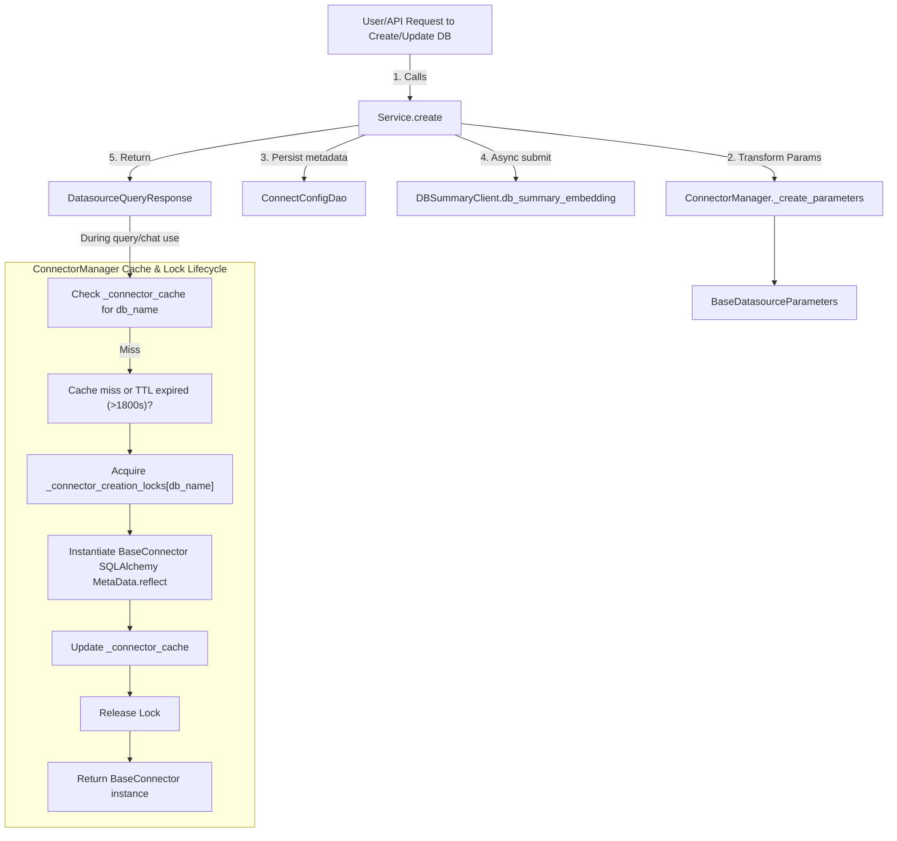
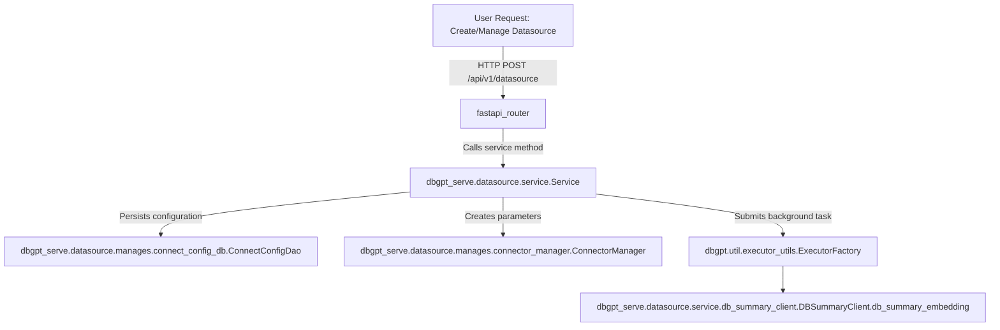
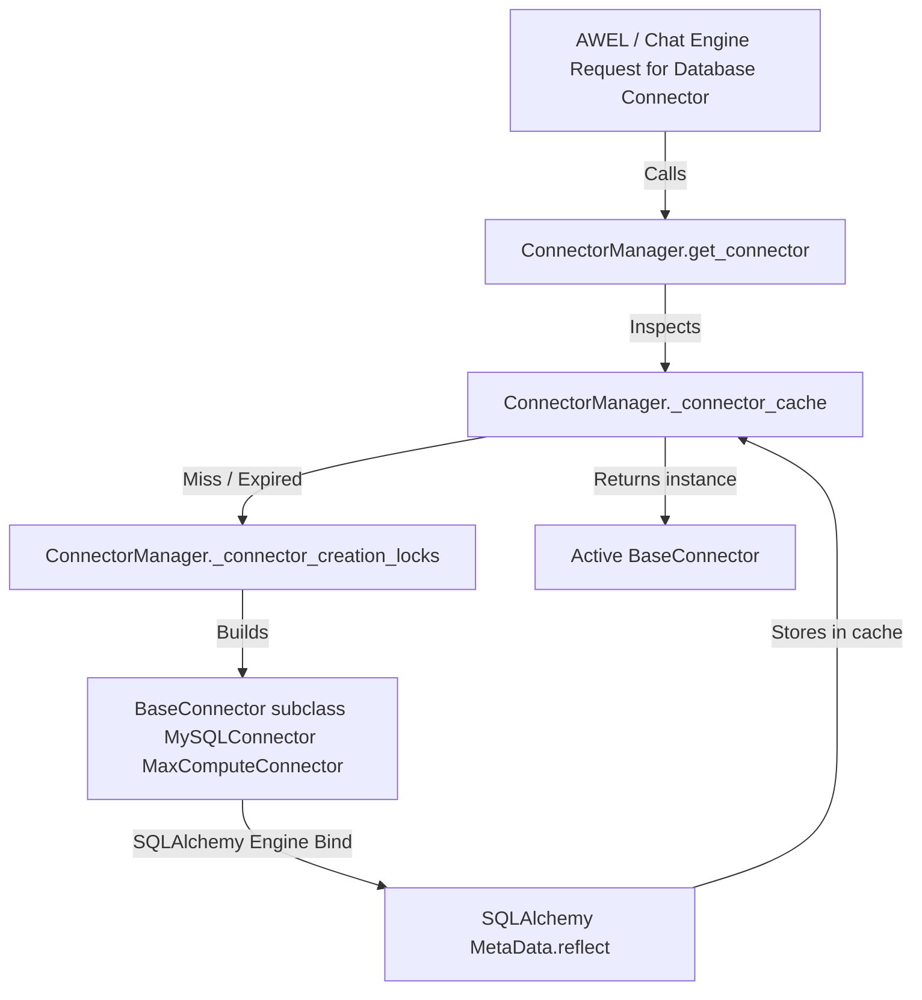

<!-- source: DeepWiki mcp.deepwiki.com · repo eosphoros-ai/DB-GPT · page 7.3 Datasource Service & Connector Lifecycle · fetched 2026-10-26 -->

# Datasource Service & Connector Lifecycle

Relevant source files

The following files were used as context for generating this wiki page:

- [packages/dbgpt-core/src/dbgpt/storage/base.py](packages/dbgpt-core/src/dbgpt/storage/base.py)
- [packages/dbgpt-core/src/dbgpt/storage/vector_store/base.py](packages/dbgpt-core/src/dbgpt/storage/vector_store/base.py)
- [packages/dbgpt-ext/src/dbgpt_ext/datasource/rdbms/conn_maxcompute.py](packages/dbgpt-ext/src/dbgpt_ext/datasource/rdbms/conn_maxcompute.py)
- [packages/dbgpt-ext/src/dbgpt_ext/datasource/schema.py](packages/dbgpt-ext/src/dbgpt_ext/datasource/schema.py)
- [packages/dbgpt-ext/src/dbgpt_ext/storage/vector_store/chroma_store.py](packages/dbgpt-ext/src/dbgpt_ext/storage/vector_store/chroma_store.py)
- [packages/dbgpt-ext/src/dbgpt_ext/storage/vector_store/elastic_store.py](packages/dbgpt-ext/src/dbgpt_ext/storage/vector_store/elastic_store.py)
- [packages/dbgpt-ext/src/dbgpt_ext/storage/vector_store/milvus_store.py](packages/dbgpt-ext/src/dbgpt_ext/storage/vector_store/milvus_store.py)
- [packages/dbgpt-ext/src/dbgpt_ext/storage/vector_store/oceanbase_store.py](packages/dbgpt-ext/src/dbgpt_ext/storage/vector_store/oceanbase_store.py)
- [packages/dbgpt-ext/src/dbgpt_ext/storage/vector_store/pgvector_store.py](packages/dbgpt-ext/src/dbgpt_ext/storage/vector_store/pgvector_store.py)
- [packages/dbgpt-ext/src/dbgpt_ext/storage/vector_store/weaviate_store.py](packages/dbgpt-ext/src/dbgpt_ext/storage/vector_store/weaviate_store.py)
- [packages/dbgpt-serve/src/dbgpt_serve/datasource/manages/connector_manager.py](packages/dbgpt-serve/src/dbgpt_serve/datasource/manages/connector_manager.py)
- [packages/dbgpt-serve/src/dbgpt_serve/datasource/service/db_summary_client.py](packages/dbgpt-serve/src/dbgpt_serve/datasource/service/db_summary_client.py)
- [packages/dbgpt-serve/src/dbgpt_serve/datasource/service/service.py](packages/dbgpt-serve/src/dbgpt_serve/datasource/service/service.py)
- [web/public/icons/maxcompute.png](web/public/icons/maxcompute.png)
- [web/types/db.ts](web/types/db.ts)
- [web/utils/constants.ts](web/utils/constants.ts)

This page documents the detailed technical implementation of the Datasource Service and the Connector lifecycle within DB-GPT. It focuses on the management of connectors, cache and locking strategies, CRUD operations on datasource entities, the `DBType` schema, connection testing, and refresh of database summary embeddings. The reader will gain an in-depth understanding of the key classes, data flows, and the integration between different components handling datasource connections.

---

## 1. Overview

The datasource handling in DB-GPT is orchestrated mainly by two components:

- **`ConnectorManager`**: Responsible for creating, caching, and managing live database connector instances across the system. It employs caching with TTL (Time-To-Live) semantics and locking to prevent redundant expensive connector creations [packages/dbgpt-serve/src/dbgpt_serve/datasource/manages/connector_manager.py:30-60]().

- **Datasource Service (`Service`)**: Provides CRUD (Create, Read, Update, Delete) operations for datasource metadata and configuration, backed by persistent storage (`ConnectConfigDao`). It delegates connector creation to `ConnectorManager` and triggers asynchronous refreshes of embeddings for knowledge summarization [packages/dbgpt-serve/src/dbgpt_serve/datasource/manages/connector_manager.py:30-125]().

The datasource lifecycle spans:
- Creation of datasource metadata entry (connection parameters, schema, description).
- Connector instantiation or reuse from cache for querying.
- Connection testing to verify validity.
- Periodic and on-demand refresh of DB schema summaries and embedding updates.

The key schema capturing supported database types is the `DBType` enum, which associates identifiers, labels, and file-based flags for each supported datasource [packages/dbgpt-ext/src/dbgpt_ext/datasource/schema.py:17-46]().

Sources:
- `packages/dbgpt-serve/src/dbgpt_serve/datasource/manages/connector_manager.py:30-60`
- `packages/dbgpt-ext/src/dbgpt_ext/datasource/schema.py:17-46`

---

## 2. ConnectorManager: Cache, TTL, and Locking

`ConnectorManager` is a singleton system component overseeing all connectors. It is registered with the component system as `ComponentType.CONNECTOR_MANAGER` and is created with the system app context [packages/dbgpt-serve/src/dbgpt_serve/datasource/manages/connector_manager.py:30-33]().

Its main responsibility is to efficiently manage connector instances keyed by datasource name while avoiding expensive re-instantiation and reflection costs.

### 2.1 Connector Caching and TTL

- **Cache Structure:**  
  `ConnectorManager` maintains an internal dictionary `_connector_cache` mapping from `db_name` (string) to a tuple `(created_at_unix_timestamp: float, connector_instance: BaseConnector)` [packages/dbgpt-serve/src/dbgpt_serve/datasource/manages/connector_manager.py:49-53](). This stores the cached connector instance along with its creation time.

- **TTL Logic:**  
  The default TTL period `_CONNECTOR_CACHE_DEFAULT_TTL` is set to 1800 seconds (30 minutes) [packages/dbgpt-serve/src/dbgpt_serve/datasource/manages/connector_manager.py:41](). When a connector is requested, if it exists in cache and its creation time is within the TTL period, it is reused. Otherwise, the connector is recreated on demand. This mechanism prevents the overhead of repeated expensive metadata reflection calls during connector construction.

- **Cache Synchronization:**  
  All access and modifications to `_connector_cache` are guarded by a mutex lock `_connector_cache_lock` to ensure thread safety and avoid race conditions [packages/dbgpt-serve/src/dbgpt_serve/datasource/manages/connector_manager.py:53]().

### 2.2 Connector Creation Locking

- Besides the cache lock, a "creation" lock per database name is used to prevent multiple concurrent threads from redundantly recreating the same connector simultaneously [packages/dbgpt-serve/src/dbgpt_serve/datasource/manages/connector_manager.py:54-57](). 

- This uses a dictionary `_connector_creation_locks` keyed by `db_name` storing `threading.Lock` instances. When a connector needs to be created or refreshed, the thread acquires this lock. Other threads requesting that same connector wait until this initialization completes. This improves efficiency especially for large RDBMS with lengthy SQLAlchemy reflection (e.g., MSSQL, Oracle with many tables).

### 2.3 Initialization and Supported Connectors

- The `on_init()` method dynamically imports all supported connector classes for relational and graph/non-relational databases, including various connectors for MySQL, PostgreSQL, SQLite, OceanBase, ClickHouse, Neo4j, TuGraph, Spark, and others [packages/dbgpt-serve/src/dbgpt_serve/datasource/manages/connector_manager.py:66-113]().

- Supported resource types (database types and their parameter schemas) are exposed via `get_supported_types()` returning `ResourceTypes` metadata suitable for UI and configuration usage [packages/dbgpt-serve/src/dbgpt_serve/datasource/manages/connector_manager.py:148-162]().

- A deprecated method `get_all_completed_types()` is retained for backward compatibility [packages/dbgpt-serve/src/dbgpt_serve/datasource/manages/connector_manager.py:136-146]().

Sources:
- `packages/dbgpt-serve/src/dbgpt_serve/datasource/manages/connector_manager.py:30-162`

---

## 3. Datasource Service: CRUD and Integration

The `Service` class handles higher-level datasource management operations, interfacing with storage and connector creation.

### 3.1 Metadata DAO and Persistence

- The service uses `ConnectConfigDao` as the data access object to persist datasource configuration metadata [packages/dbgpt-serve/src/dbgpt_serve/datasource/manages/connector_manager.py:45]().

- Datasource metadata fields include name, host, user, password, database type (`type`), port, description, and any extended configuration as JSON (`ext_config`).

- When creating or updating a datasource, user parameters are transformed into connector-specific parameter classes (`BaseDatasourceParameters` subclasses) to ensure type consistency.

### 3.2 ConnectorManager Access and Embedding Refresh

- The service class accesses the `ConnectorManager` singleton via the property `datasource_manager`.

- When a datasource is created or updated, an asynchronous background task is submitted to refresh the database summary embedding for RAG purposes through `DBSummaryClient`. This allows the knowledge index to stay current with schema changes [packages/dbgpt-serve/src/dbgpt_serve/datasource/manages/connector_manager.py:114-125]().

### 3.3 Connection Testing and Other Operations

- The service exposes typical CRUD methods for datasource entities: create, update, delete, and list.
- It also permits connection testing by attempting to instantiate connectors through `ConnectorManager`.

Sources:
- `packages/dbgpt-serve/src/dbgpt_serve/datasource/manages/connector_manager.py:45-125`

---

## 4. DBType Schema Definition

The `DBType` enum class models all recognized database types and embeds metadata about each [packages/dbgpt-ext/src/dbgpt_ext/datasource/schema.py:17-46]().

- Declared in `dbgpt_ext.datasource.schema`, `DBType` enumerates types like MySQL, OceanBase, DuckDb, SQLite, Oracle, MSSQL, Postgresql, GaussDB, openGauss, Vertica, Clickhouse, StarRocks, Spark, Doris, Hive, MaxCompute, TuGraph and Neo4j [packages/dbgpt-ext/src/dbgpt_ext/datasource/schema.py:17-37]().

- Each enum entry wraps a `DbInfo` object holding:
  - `name`: canonical string identifier (e.g., `"mysql"`, `"maxcompute"`).
  - `is_file_db`: boolean flag indicating if the database is a local file-based embedded DB (e.g., SQLite, DuckDB, Spark) [packages/dbgpt-ext/src/dbgpt_ext/datasource/schema.py:8-15]().

- Utility methods provided:
  - `value()` returns string type name [packages/dbgpt-ext/src/dbgpt_ext/datasource/schema.py:39-41]().
  - `is_file_db()` returns whether it is a file database [packages/dbgpt-ext/src/dbgpt_ext/datasource/schema.py:43-45]().
  - Static `of_db_type(db_type: str)` converts string names to enum items [packages/dbgpt-ext/src/dbgpt_ext/datasource/schema.py:47-60]().
  - Static method `parse_file_db_name_from_path(db_type, local_db_path)` extracts a suitable logical DB name from a file path for embedded DB types [packages/dbgpt-ext/src/dbgpt_ext/datasource/schema.py:62-69]().

Sources:
- `packages/dbgpt-ext/src/dbgpt_ext/datasource/schema.py:8-69`

---

## 5. Data Flow Diagram of Datasource Lifecycle

Title: Datasource Lifecycle & Caching Flow

Description:  
When a create or update API call occurs, the datasource service converts parameters into concrete classes, then persists them via the DAO. It submits an asynchronous background task to refresh DB schema embeddings through the `DBSummaryClient` for up-to-date RAG knowledge. Runtime queries or chat actions invoke `ConnectorManager` which manages connector instances with cache TTL and per-DB locks to avoid duplicated expensive creation [packages/dbgpt-serve/src/dbgpt_serve/datasource/manages/connector_manager.py:30-125]().

Sources:
- `packages/dbgpt-serve/src/dbgpt_serve/datasource/manages/connector_manager.py:30-125`

---

## 6. Natural Language to Code Entity Association Diagrams

### 6.1 Datasource Service & CRUD Integration

Title: Natural Language Space to Code Entities for Datasource Operations

Sources:
- `packages/dbgpt-serve/src/dbgpt_serve/datasource/manages/connector_manager.py:30-125`

### 6.2 ConnectorManager Caching & Reflection

Title: Runtime Connector Resolution and Caching Flow

Sources:
- `packages/dbgpt-serve/src/dbgpt_serve/datasource/manages/connector_manager.py:30-125`

---

## 7. Summary Table: Classes and Modules

| Component | Location | Role |
|---|---|---|
| `ConnectorManager` | `dbgpt_serve/datasource/manages/connector_manager.py` | Cache, create, and manage connector instances with TTL and locking [packages/dbgpt-serve/src/dbgpt_serve/datasource/manages/connector_manager.py:30-60]() |
| `Service` (Datasource) | `dbgpt_serve/datasource/service/service.py` | Datasource metadata CRUD, connector orchestration, and refresh of DB summary embeddings |
| `ConnectConfigDao` | `dbgpt_serve/datasource/manages/connect_config_db.py` | DAO persisting datasource configuration metadata |
| `DBSummaryClient` | `dbgpt_serve/datasource/service/db_summary_client.py` | Asynchronous refresh of DB schema embeddings for RAG knowledge |
| `DBType` | `dbgpt_ext/datasource/schema.py` | Enum for supported DB types and file-based DB flags [packages/dbgpt-ext/src/dbgpt_ext/datasource/schema.py:17-46]() |
| `BaseConnector` | `dbgpt/datasource/base.py` | Abstract base class for database connectors |
| `BaseDatasourceParameters` | `dbgpt/datasource/parameter.py` | Base class for typed datasource connection parameters and URI building |

Sources:
- `packages/dbgpt-serve/src/dbgpt_serve/datasource/manages/connector_manager.py:30-60`
- `packages/dbgpt-ext/src/dbgpt_ext/datasource/schema.py:17-46`
- `web/types/db.ts:1-82`

---

