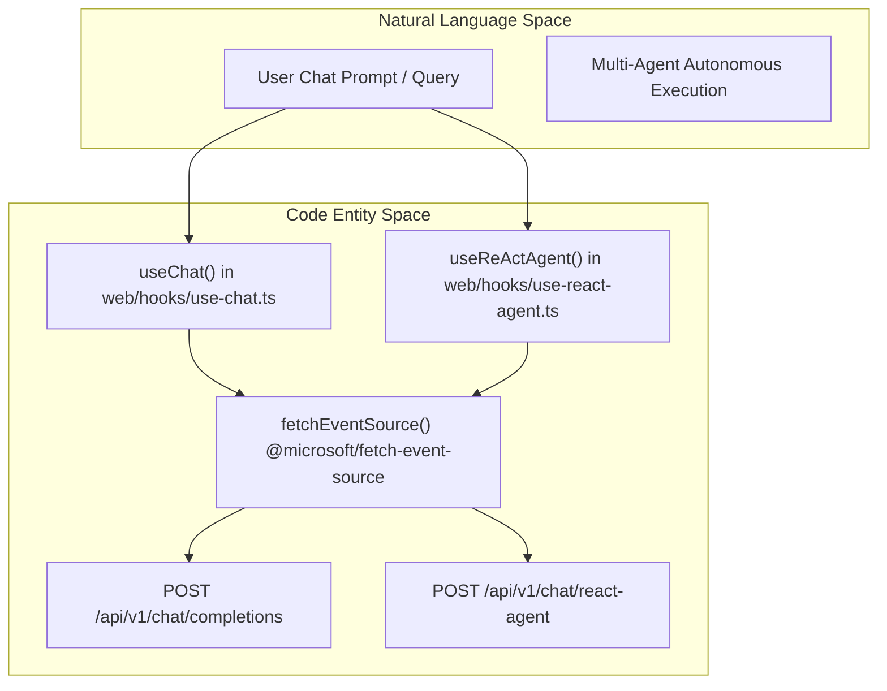
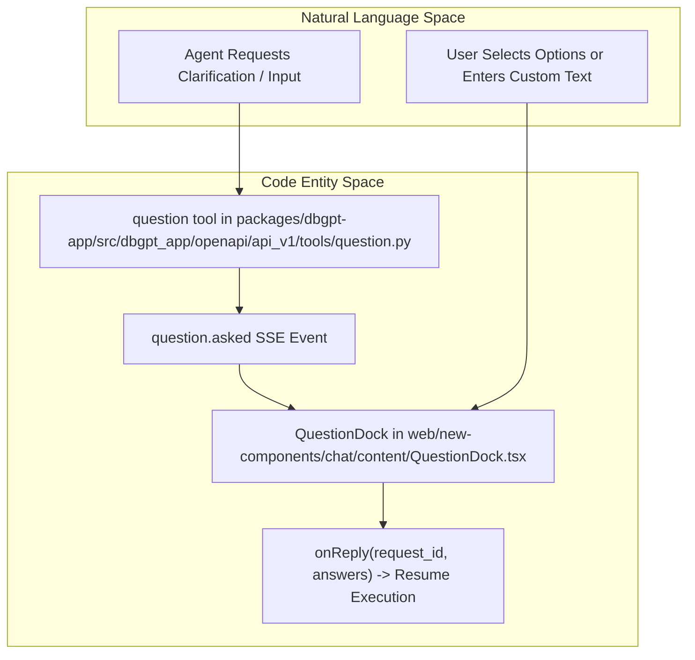

<!-- source: DeepWiki mcp.deepwiki.com · repo eosphoros-ai/DB-GPT · page 8.1 Chat & Conversation UI · fetched 2026-10-26 -->

# Chat & Conversation UI

Relevant source files

The following files were used as context for generating this wiki page:

- [packages/dbgpt-app/src/dbgpt_app/openapi/api_v1/agentic_data_api.py](packages/dbgpt-app/src/dbgpt_app/openapi/api_v1/agentic_data_api.py)
- [packages/dbgpt-app/src/dbgpt_app/openapi/api_v1/editor/_chat_history/meta_db_history.py](packages/dbgpt-app/src/dbgpt_app/openapi/api_v1/editor/_chat_history/meta_db_history.py)
- [packages/dbgpt-app/src/dbgpt_app/openapi/api_v1/editor/api_editor_v1.py](packages/dbgpt-app/src/dbgpt_app/openapi/api_v1/editor/api_editor_v1.py)
- [packages/dbgpt-app/src/dbgpt_app/openapi/api_v1/editor/service.py](packages/dbgpt-app/src/dbgpt_app/openapi/api_v1/editor/service.py)
- [packages/dbgpt-app/src/dbgpt_app/openapi/api_v1/editor/tests/__init__.py](packages/dbgpt-app/src/dbgpt_app/openapi/api_v1/editor/tests/__init__.py)
- [packages/dbgpt-app/src/dbgpt_app/openapi/api_v1/editor/tests/test_chart_run.py](packages/dbgpt-app/src/dbgpt_app/openapi/api_v1/editor/tests/test_chart_run.py)
- [packages/dbgpt-app/src/dbgpt_app/tests/test_skill_upload_api.py](packages/dbgpt-app/src/dbgpt_app/tests/test_skill_upload_api.py)
- [web/components/chat/agent-content.tsx](web/components/chat/agent-content.tsx)
- [web/components/chat/chat-content/VisResponse.tsx](web/components/chat/chat-content/VisResponse.tsx)
- [web/components/chat/chat-content/agent-messages.tsx](web/components/chat/chat-content/agent-messages.tsx)
- [web/components/chat/chat-content/agent-plans.tsx](web/components/chat/chat-content/agent-plans.tsx)
- [web/components/chat/chat-content/config.tsx](web/components/chat/chat-content/config.tsx)
- [web/components/chat/chat-content/index.tsx](web/components/chat/chat-content/index.tsx)
- [web/components/chat/chat-content/vis-code.tsx](web/components/chat/chat-content/vis-code.tsx)
- [web/components/chat/chat-content/vis-plugin.tsx](web/components/chat/chat-content/vis-plugin.tsx)
- [web/components/chat/db-editor.tsx](web/components/chat/db-editor.tsx)
- [web/components/chat/monaco-editor.tsx](web/components/chat/monaco-editor.tsx)
- [web/components/chat/ob-editor/ob-plugin.ts](web/components/chat/ob-editor/ob-plugin.ts)
- [web/components/chat/ob-editor/service.ts](web/components/chat/ob-editor/service.ts)
- [web/components/chat/ob-editor/theme.ts](web/components/chat/ob-editor/theme.ts)
- [web/components/chat/opencode-agent-chat-container.tsx](web/components/chat/opencode-agent-chat-container.tsx)
- [web/hooks/use-chat.ts](web/hooks/use-chat.ts)
- [web/hooks/use-react-agent-chat.ts](web/hooks/use-react-agent-chat.ts)
- [web/hooks/use-react-agent.ts](web/hooks/use-react-agent.ts)
- [web/locales/en/chat.ts](web/locales/en/chat.ts)
- [web/locales/zh/chat.ts](web/locales/zh/chat.ts)
- [web/new-components/chat/content/ChatContent.tsx](web/new-components/chat/content/ChatContent.tsx)
- [web/new-components/chat/content/ManusLeftPanel.tsx](web/new-components/chat/content/ManusLeftPanel.tsx)
- [web/new-components/chat/content/ManusRightPanel.tsx](web/new-components/chat/content/ManusRightPanel.tsx)
- [web/new-components/chat/content/OpenCodeChatCompletion.tsx](web/new-components/chat/content/OpenCodeChatCompletion.tsx)
- [web/new-components/chat/content/QuestionDock.tsx](web/new-components/chat/content/QuestionDock.tsx)
- [web/new-components/chat/content/SessionTurn.tsx](web/new-components/chat/content/SessionTurn.tsx)
- [web/new-components/common/MarkdownContext.tsx](web/new-components/common/MarkdownContext.tsx)
- [web/pages/chat/index.tsx](web/pages/chat/index.tsx)
- [web/pages/index.tsx](web/pages/index.tsx)

The Chat & Conversation UI in DB-GPT is a comprehensive Next.js frontend architecture [web/pages/chat/index.tsx:1-468]() designed to support multi-modal conversational workflows, including Text2SQL database querying, RAG knowledge retrieval, advanced chart visualization, and multi-agent execution tracking. This page details chat components, data flows, hook abstractions (`useChat`, `useReActAgent`), Manus execution panels, `QuestionDock`, `SessionTurn` components, the Monaco-powered DB editor, session file management, and localization.

---

## Architecture & Data Flow

The chat UI acts as a bridge between user interactions in the natural language space and backend conversational and agentic services. User inputs flow through React hooks (`useChat`, `useReActAgent`) that manage Server-Sent Events (SSE) streaming from REST API endpoints. Incoming message streams are parsed and rendered into structured UI elements such as markdown blocks, tables, charts, and agentic step executions.

### Natural Language to Code Entity Mapping: Chat Stream & ReAct Agents

**Data Flow Explanation:**

- User inputs enter the chat UI and are routed through either `useChat` for standard chat completions or `useReActAgent` for agentic multi-step workflows [web/hooks/use-chat.ts:62-98](), [web/hooks/use-react-agent.ts:163-193]().
- Both hooks use the Microsoft `fetch-event-source` library to maintain SSE connections for incremental streaming data [web/hooks/use-chat.ts:92]().
- Responses stream from the respective backend API routes: `/api/v1/chat/completions` for standard LLM chat and `/api/v1/chat/react-agent` for the ReAct multi-agent system [web/hooks/use-chat.ts:62](), [web/hooks/use-react-agent.ts:71]().

Sources: [web/hooks/use-chat.ts:62-98](), [web/hooks/use-react-agent.ts:1-223](), [web/pages/chat/index.tsx:1-468]()

---

## Core Hooks: useChat & useReActAgent

### useChat Hook

The `useChat` hook manages standard chat message streaming with robust context token budgeting and human-in-the-loop question handling [web/hooks/use-chat.ts:62-163]().

- **Endpoint:** Sends POST requests to `/api/v1/chat/completions` [web/hooks/use-chat.ts:62]().
- **Streaming:** Uses `fetchEventSource` to handle SSE, parsing message chunks and JSON payloads [web/hooks/use-chat.ts:92-121]().
- **Context Status:** Detects incoming `context_status` events from the backend's token management layer and exposes UI state (`ChatContextStatus`) such as token usage and warning/error levels [web/hooks/use-chat.ts:38-60](), [web/hooks/use-chat.ts:130-152]().
- **Question Handling:** Listens for human confirmation questions (`question.asked` SSE events) and manages a `pendingQuestion` state for components like `QuestionDock` [web/hooks/use-chat.ts:155-163]().

Sources: [web/hooks/use-chat.ts:1-245]()

### useReActAgent Hook

The `useReActAgent` hook orchestrates communication with the ReAct multi-agent backend endpoint and processes streaming agentic events [web/hooks/use-react-agent.ts:1-223]().

- **Endpoint:** POST requests to `/api/v1/chat/react-agent` with authority to abort and reset [web/hooks/use-react-agent.ts:71](), [web/hooks/use-react-agent.ts:85-112]().
- **Parsing Logic:** Uses a ReAct-specific SSE parser to accumulate events into typed message parts (`MessagePart`, `ReasoningPart`, `ToolPart`) and extracts final answers, error states, and execution metadata [web/hooks/use-react-agent.ts:8-10](), [web/hooks/use-react-agent.ts:114-161]().
- **State:** Maintains incremental parts and an `isWorking` flag indicating processing status [web/hooks/use-react-agent.ts:23-35]().
- **Human-in-the-loop:** Tracks agent requests for clarification questions and supports reply/reject callbacks [web/hooks/use-react-agent.ts:47-55](), [web/hooks/use-react-agent.ts:123-125]().

Sources: [web/hooks/use-react-agent.ts:1-223]()

---

## Core UI Components & SessionTurn

- **ChatContainer & ChatContentContainer**: These are root React containers handling chat history navigation, input panels, and the main viewport rendering the sequence of message turns [web/pages/chat/index.tsx:1-23](), [web/pages/chat/index.tsx:95-170](). These containers integrate model selection, reply loading states, and contextual environment info.
- **SessionTurn & OpenCodeSessionTurn**: The `SessionTurn` component renders individual chat turns (messages) including complex subcomponents for agentic workflows [web/pages/index.tsx:42-49](). `OpenCodeSessionTurn` extends this to handle specialized parts like code blocks, tool calls, and reasoning segments, presenting rich formatted output with collapsible sections and custom markdown rendering.

Sources: [web/pages/chat/index.tsx:1-468](), [web/pages/index.tsx:32-49]()

---

## Manus Panels (Execution Visualization)

Manus panels visualize the multi-step execution flows of agentic workflows in a structured, interactive manner.

### ManusLeftPanel
- Displays a detailed chronological list of individual `ExecutionStep` objects, each typed by `StepType` (`read`, `edit`, `write`, `bash`, `python`, `sql`, `question`, `kb`, `code_graph`, etc.) [web/new-components/chat/content/ManusLeftPanel.tsx:63-81](), [web/new-components/chat/content/ManusLeftPanel.tsx:46-61]().
- Shows visual statuses: `pending`, `running`, `completed`, and `error` with intuitive Ant Design icons [web/new-components/chat/content/ManusLeftPanel.tsx:44](), [web/new-components/chat/content/ManusLeftPanel.tsx:155-191]().
- Supports interaction callbacks to highlight and navigate execution steps [web/new-components/chat/content/ManusLeftPanel.tsx:103-106]().
- Supports additional features such as viewing attached files, knowledge bases, skills, and database connectors related to a step [web/new-components/chat/content/ManusLeftPanel.tsx:127-144]().
- Implements task plan cards within sections and shows "thinking" sections with expandable execution steps [web/new-components/chat/content/ManusLeftPanel.tsx:83-89]().

### ManusRightPanel
- Shows detailed execution outputs for an active step with grouping for code executions, tables, charts, HTML tabs, markdown, errors, images, and thought texts [web/new-components/chat/content/ManusRightPanel.tsx:78-87](), [web/new-components/chat/content/ManusRightPanel.tsx:96-163]().
- Integrates AntV GPTVis for rich visualizations of charts and dashboards linked to execution outputs [web/new-components/chat/content/ManusRightPanel.tsx:47]().
- Contains inline interactive controls for rerun, share, scheduling, and artifact management [web/new-components/chat/content/ManusRightPanel.tsx:176-187]().
- Handles image URL normalization for backend resource linking, supporting preview and download of artifacts [web/new-components/chat/content/ManusRightPanel.tsx:60-76]().

Sources: [web/new-components/chat/content/ManusLeftPanel.tsx:1-216](), [web/new-components/chat/content/ManusRightPanel.tsx:1-187]()

---

## Human-in-the-Loop via QuestionDock

Human-in-the-loop interactions are facilitated by the `QuestionDock` component that appears dynamically when the backend agent requires user input confirmation or additional answers [web/new-components/chat/content/QuestionDock.tsx:1-27]().

### Natural Language to Code Entity Mapping: Question Workflow

- `QuestionDock` floats above the chat input panel while the `pendingQuestion` state is non-null, presenting the user with interactive single/multi-choice questions and optional custom answer inputs [web/new-components/chat/content/QuestionDock.tsx:27-87]().
- The UI neatly groups choices into responsive grids with buttons showing state icons [web/new-components/chat/content/QuestionDock.tsx:123-164]().
- Callback handlers `onReply` and `onReject` propagate user answers back to the backend to continue or cancel the agentic workflow [web/new-components/chat/content/QuestionDock.tsx:21-25](), [web/new-components/chat/content/QuestionDock.tsx:76-87]().
- Supports custom input per question when `custom !== false`, providing user flexibility [web/new-components/chat/content/QuestionDock.tsx:165-200]().

Sources: [web/new-components/chat/content/QuestionDock.tsx:1-205](), [web/hooks/use-chat.ts:155-163]()

---

## DB Editor & SQL Interaction

DB-GPT provides a dedicated `DbEditor` component for interactive SQL exploration and editing inside chat scenarios [web/pages/chat/index.tsx:19-21]():

- **Monaco Editor Integration:** A sophisticated Monaco editor wrapper enriches the SQL editing experience with schema awareness, code completion, and syntax highlighting based on active database schemas and table metadata.
- **Side-by-Side Layout:** Supports configurable layouts for displaying SQL editor, tabular query outputs, and graphical visualizations with smooth toggle options.
- **Backend API Connectivity:** SQL execution and metadata retrieval occur through FastAPI editor routes, including `/v1/editor/sql` and `/v1/editor/db/tables` for secure, server-managed query processing and schema discovery [packages/dbgpt-app/src/dbgpt_app/openapi/api_v1/editor/api_editor_v1.py:77-126]().

Sources: [web/components/chat/db-editor.tsx:1-203](), [packages/dbgpt-app/src/dbgpt_app/openapi/api_v1/editor/api_editor_v1.py:77-126]()

---

## Document Upload & Session Files

Multi-modal conversations leverage an advanced session file management system:

- **Session File Snapshots:** Immutable `SessionFileSnapshot` objects represent files uploaded during chat, preserving metadata and content for replay and consistent state rendering [web/new-components/chat/content/ManusLeftPanel.tsx:124-127]().
- **Supported File Types:** UI handlers and helper functions identify and display file types including CSV, Excel, PDFs, images, Word and text documents for preview and interaction within chat turns [web/pages/index.tsx:135-168]().
- **UI Elements:** Attachment rails, preview drawers, upload progress, and error states are user-friendly and responsive. Upload constraints, plain filename validations, and duplicate checks are enforced client-side and server-side [web/pages/index.tsx:11-28](), [packages/dbgpt-app/src/dbgpt_app/openapi/api_v1/agentic_data_api.py:80-94]().

Sources: [web/pages/index.tsx:1-196](), [web/new-components/chat/content/ManusLeftPanel.tsx:1-137](), [packages/dbgpt-app/src/dbgpt_app/openapi/api_v1/agentic_data_api.py:80-94]()

---

## Internationalization (i18n) & Mobile Support

- **Internationalization:** The chat UI uses `react-i18next` with translation catalogs in English (`web/locales/en/chat.ts`) and Chinese (`web/locales/zh/chat.ts`). These cover all UI labels, step types, upload messages, replay tooltips, and interactive button texts, ensuring global usability [web/locales/en/chat.ts:1-137](), [web/locales/zh/chat.ts:1-183]().
- **Mobile Adaptation:** The UI employs responsive Ant Design layout containers, collapsible sidebars, and touch-optimized controls that adapt well to mobile devices, maintaining full chat functionality on smaller screens [web/pages/index.tsx:95-101]().

Sources: [web/locales/en/chat.ts:1-137](), [web/locales/zh/chat.ts:1-183](), [web/pages/chat/index.tsx:1-468]()

---

## Summary

The Chat & Conversation UI architecture combines modular Next.js components, robust streaming hooks (`useChat`, `useReActAgent`), advanced execution tracking (Manus panels), and interactive human-in-the-loop controls (`QuestionDock`) to deliver an extensible, user-friendly conversational interface for DB-GPT. It supports multi-modal input, database-aware editing, and rich agentic workflows across desktop and mobile environments.

---

## References

- [web/pages/chat/index.tsx:1-468]()
- [web/hooks/use-chat.ts:1-245]()
- [web/hooks/use-react-agent.ts:1-223]()
- [web/new-components/chat/content/ManusLeftPanel.tsx:1-216]()
- [web/new-components/chat/content/ManusRightPanel.tsx:1-187]()
- [web/new-components/chat/content/QuestionDock.tsx:1-205]()
- [web/components/chat/db-editor.tsx:1-203]()
- [packages/dbgpt-app/src/dbgpt_app/openapi/api_v1/editor/api_editor_v1.py:77-126]()
- [web/locales/en/chat.ts:1-137]()
- [web/locales/zh/chat.ts:1-183]()

---

