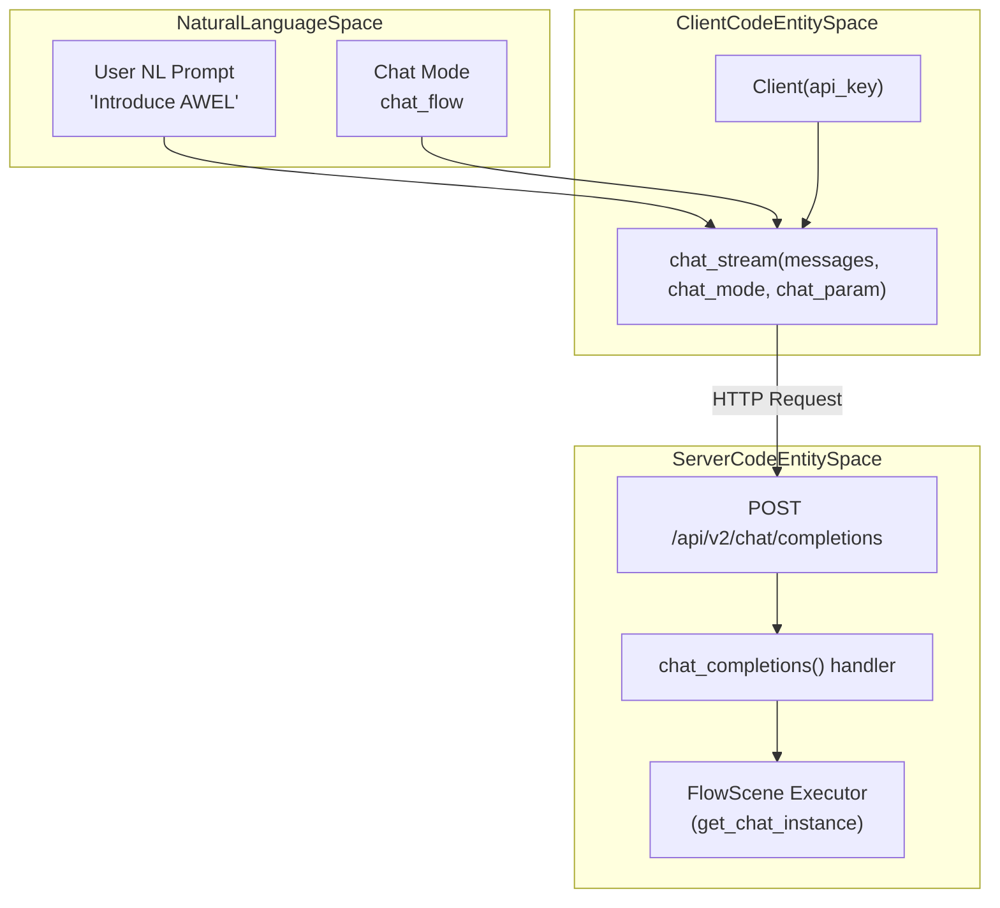
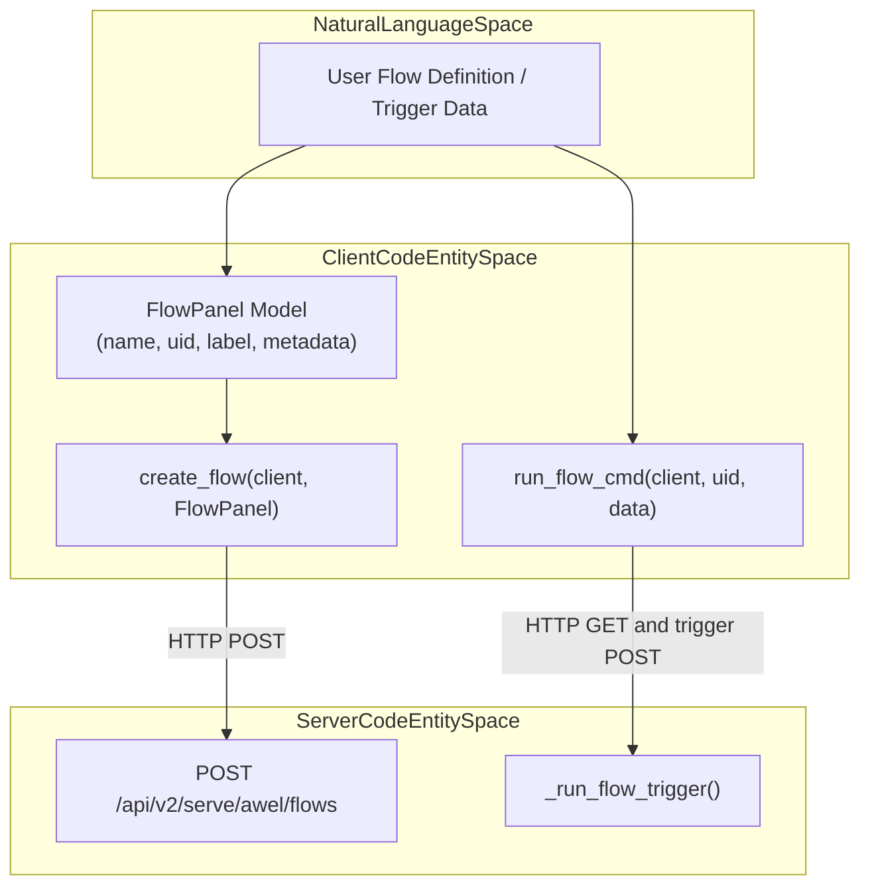
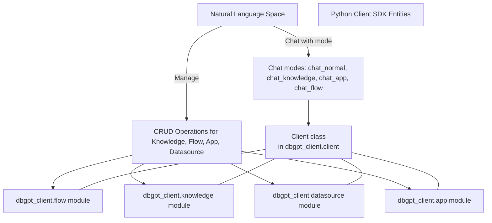
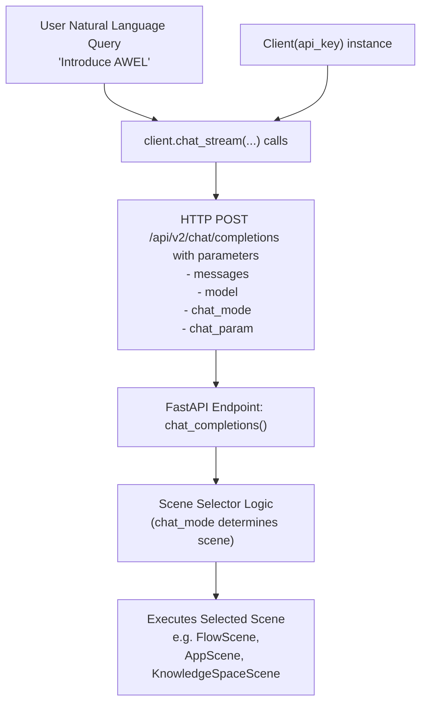

<!-- source: DeepWiki mcp.deepwiki.com · repo eosphoros-ai/DB-GPT · page 9.2 Python Client SDK (dbgpt-client) · fetched 2026-10-26 -->

# Python Client SDK (dbgpt-client)

<details>
<summary>Relevant source files</summary>

The following files were used as context for generating this wiki page:

- [docs/docs/api/app.md](docs/docs/api/app.md)
- [docs/docs/api/chat.md](docs/docs/api/chat.md)
- [docs/docs/api/flow.md](docs/docs/api/flow.md)
- [docs/docs/api/introduction.md](docs/docs/api/introduction.md)
- [docs/docs/api/knowledge.md](docs/docs/api/knowledge.md)
- [docs/i18n/zh-CN/docusaurus-plugin-content-docs/current/api/flow.md](docs/i18n/zh-CN/docusaurus-plugin-content-docs/current/api/flow.md)
- [examples/client/app_crud_example.py](examples/client/app_crud_example.py)
- [examples/client/client_chat_example.py](examples/client/client_chat_example.py)
- [examples/client/flow_crud_example.py](examples/client/flow_crud_example.py)
- [examples/client/knowledge_crud_example.py](examples/client/knowledge_crud_example.py)
- [packages/dbgpt-client/src/dbgpt_client/datasource.py](packages/dbgpt-client/src/dbgpt_client/datasource.py)
- [packages/dbgpt-client/src/dbgpt_client/flow.py](packages/dbgpt-client/src/dbgpt_client/flow.py)
- [packages/dbgpt-client/src/dbgpt_client/knowledge.py](packages/dbgpt-client/src/dbgpt_client/knowledge.py)
- [packages/dbgpt-client/src/dbgpt_client/tests/test_datasource.py](packages/dbgpt-client/src/dbgpt_client/tests/test_datasource.py)
- [packages/dbgpt-client/src/dbgpt_client/tests/test_flow.py](packages/dbgpt-client/src/dbgpt_client/tests/test_flow.py)
- [packages/dbgpt-client/src/dbgpt_client/tests/test_knowledge.py](packages/dbgpt-client/src/dbgpt_client/tests/test_knowledge.py)

</details>


The `dbgpt-client` package provides a comprehensive asynchronous Python SDK to interact with the DB-GPT server seamlessly. It encapsulates the underlying REST API operations into convenient async functions, data models, and streaming interfaces. This enables developers to perform chat interactions, manage knowledge spaces, AWEL flows, applications, and datasource connectors programmatically.

Sources: `[packages/dbgpt-client/src/dbgpt_client/client.py:1-50]()`, `[examples/client/client_chat_example.py:1-50]()`

---

## Core Client Architecture

### `Client` Class

The paramount entity in the SDK is the `Client` class which wraps `httpx.AsyncClient`. Major features include:

- Bearer token authentication for secure communication.
- Configurable base URL targeting the DB-GPT server instance.
- Support for standard HTTP methods (`get`, `post`, `put`, `delete`).
- Asynchronous chat completion streaming to handle server sent events efficiently.

Because the client manages connection pooling, explicit closure via `await client.aclose()` after usage is necessary to avoid event loop errors.

Sources: `[examples/client/client_chat_example.py:51-76]()`, `[packages/dbgpt-client/src/dbgpt_client/client.py:1-100]()`

---

## Chat and Multi-Mode Interaction

The SDK supports various chat interaction modes reflecting different backend scenarios. The primary method for chatting is via `Client.chat()` for single-shot and `Client.chat_stream()` for streamed responses.

| Chat Mode       | Description                                    | Corresponding Server Scene       |
|-----------------|------------------------------------------------|---------------------------------|
| `chat_normal`   | Regular conversational mode                      | Base ChatScene                  |
| `chat_knowledge`| Retrieval-Augmented Generation with knowledge   | KnowledgeSpaceScene             |
| `chat_app`      | Multi-agent application chat                      | AppScene                       |
| `chat_flow`     | AWEL agentic workflow execution                  | FlowScene                      |

### Chat Interaction Data Flow Diagram (Natural Language ➔ Code Entity)


Sources: `[examples/client/client_chat_example.py:1-76]()`, `[docs/docs/api/chat.md:7-196]()`

---

## Knowledge Management (RAG)

`dbgpt_client.knowledge` offers asynchronous CRUD operations for knowledge spaces and documents which form the backbone of the retrieval-augmented generation (RAG) capabilities.

### Supported Knowledge APIs (CRUD)

| Function            | Description                     |
|---------------------|---------------------------------|
| `create_space()`    | Create a knowledge space        |
| `update_space()`    | Update an existing space        |
| `delete_space()`    | Delete a space by ID            |
| `get_space()`       | Retrieve a space by ID          |
| `list_space()`      | List all spaces                 |
| `create_document()` | Add documents to spaces         |
| `get_document()`    | Get a document by ID            |
| `list_document()`   | List documents                  |
| `delete_document()` | Remove a document               |
| `sync_document()`   | Trigger document syncing/chunking|

Example usage includes creating, updating, getting, and deleting knowledge entities asynchronously.

Sources: `[examples/client/knowledge_crud_example.py:1-128]()`, `[docs/docs/api/knowledge.md:1-170]()`

---

## Application and Flow Management

The SDK exposes CRUD operations and execution utilities for both multi-agent applications (`dbgpt_client.app`) and AWEL flows (`dbgpt_client.flow`).

### Flow Management Functions

- `create_flow(client, flow: FlowPanel)` - Create new AWEL flow.
- `update_flow(client, flow: FlowPanel)` - Update existing flow (requires `uid`).
- `delete_flow(client, flow_id: str)` - Delete flow by ID.
- `get_flow(client, flow_id: str)` - Get flow details by ID.
- `list_flow(client)` - List all flows.
- `run_flow_cmd(client, name: str | None, uid: str | None, data: dict)` - Execute a flow trigger with optional callbacks.

### Flow CRUD & Execution Data Flow (Natural Language ➔ Code Entity)


Sources: `[packages/dbgpt-client/src/dbgpt_client/flow.py:13-215]()`, `[examples/client/flow_crud_example.py:1-49]()`, `[docs/docs/api/flow.md:5-311]()`

---

## Datasource Management

The `dbgpt_client.datasource` module manages datasource configurations (database connectors) which are essential for database agent scenes, Text2SQL, and schema introspection.

### Datasource Operations

| Function                 | Purpose                     |
|--------------------------|-----------------------------|
| `create_datasource()`    | Add a new DB datasource      |
| `update_datasource()`    | Update existing datasource   |
| `delete_datasource()`    | Delete datasource by ID      |
| `get_datasource()`       | Retrieve datasource by ID    |
| `list_datasource()`      | List all datasources         |

These functions wrap the underlying REST endpoints and return or accept the Pydantic `DatasourceModel` instances.

Sources: `[packages/dbgpt-client/src/dbgpt_client/datasource.py:12-121]()`

---

## Evaluation Client

The evaluation client facilitates benchmark execution and metric verification against the DB-GPT server evaluation pipelines.

Sources: `[packages/dbgpt-client/src/dbgpt_client/client.py:1-100]()`

---

## Usage Examples

### Simple Chat Streaming Example

```python
import asyncio
from dbgpt_client import Client

async def main():
    client = Client(api_key="dbgpt")
    try:
        # Streaming chat with "Qwen2.5-72B-Instruct" model example
        async for data in client.chat_stream(
            model="Qwen2.5-72B-Instruct",
            messages="hello",
            chat_mode="chat_normal"
        ):
            print(data)
    finally:
        await client.aclose()

if __name__ == "__main__":
    asyncio.run(main())
```

This example shows basic client initialization, streaming chat interaction, and graceful client closure.

Sources: `[examples/client/client_chat_example.py:51-76]()`

---

# Appendix: Key Class and Function References

| Code Entity                | Purpose/Role                                       | Defined In                             |
|----------------------------|--------------------------------------------------|--------------------------------------|
| `Client`                   | Core HTTP async client with chat streaming       | `dbgpt_client/client.py`              |
| `DBGPTClientException`     | Exception for client operation errors             | `dbgpt_client/client.py`              |
| `create_flow()`            | Create a new AWEL flow                             | `dbgpt_client/flow.py:13-29`          |
| `update_flow()`            | Update an existing flow (must have `uid`)         | `dbgpt_client/flow.py:31-55`          |
| `delete_flow()`            | Delete an AWEL flow by ID                          | `dbgpt_client/flow.py:57-78`          |
| `get_flow()`               | Get flow details by ID                             | `dbgpt_client/flow.py:80-101`         |
| `list_flow()`              | List AWEL flows                                   | `dbgpt_client/flow.py:103-127`        |
| `run_flow_cmd()`           | Run a flow trigger by name or uid                 | `dbgpt_client/flow.py:128-175`        |
| `create_datasource()`      | Create a datasource record                         | `dbgpt_client/datasource.py:12-30`    |
| `update_datasource()`      | Update a datasource record                         | `dbgpt_client/datasource.py:32-55`    |
| `delete_datasource()`      | Delete datasource by ID                            | `dbgpt_client/datasource.py:56-77`    |
| `get_datasource()`         | Get datasource details by ID                       | `dbgpt_client/datasource.py:79-100`   |
| `list_datasource()`        | List all datasource records                        | `dbgpt_client/datasource.py:102-122`  |

Sources: `[packages/dbgpt-client/src/dbgpt_client/client.py:1-100]()`, `[packages/dbgpt-client/src/dbgpt_client/flow.py:1-215]()`, `[packages/dbgpt-client/src/dbgpt_client/datasource.py:1-121]()`

---

# Diagram: Mapping System Names to Code Entities


Sources: `[examples/client/client_chat_example.py:1-76]()`, `[packages/dbgpt-client/src/dbgpt_client/flow.py:1-215]()`, `[packages/dbgpt-client/src/dbgpt_client/datasource.py:1-121]()`

---

# Diagram: Chat Flow Detailed Mapping


Sources: `[examples/client/client_chat_example.py:1-76]()`, `[docs/docs/api/chat.md:7-196]()`

---

## Sources

- `[examples/client/client_chat_example.py:1-76]()`
- `[examples/client/knowledge_crud_example.py:1-128]()`
- `[examples/client/flow_crud_example.py:1-49]()`
- `[examples/client/app_crud_example.py:1-34]()`
- `[packages/dbgpt-client/src/dbgpt_client/flow.py:1-215]()`
- `[packages/dbgpt-client/src/dbgpt_client/datasource.py:1-121]()`
- `[docs/docs/api/chat.md:1-219]()`
- `[docs/docs/api/flow.md:1-311]()`
- `[docs/docs/api/knowledge.md:1-170]()`
- `[docs/docs/api/app.md:1-264]()`

---

