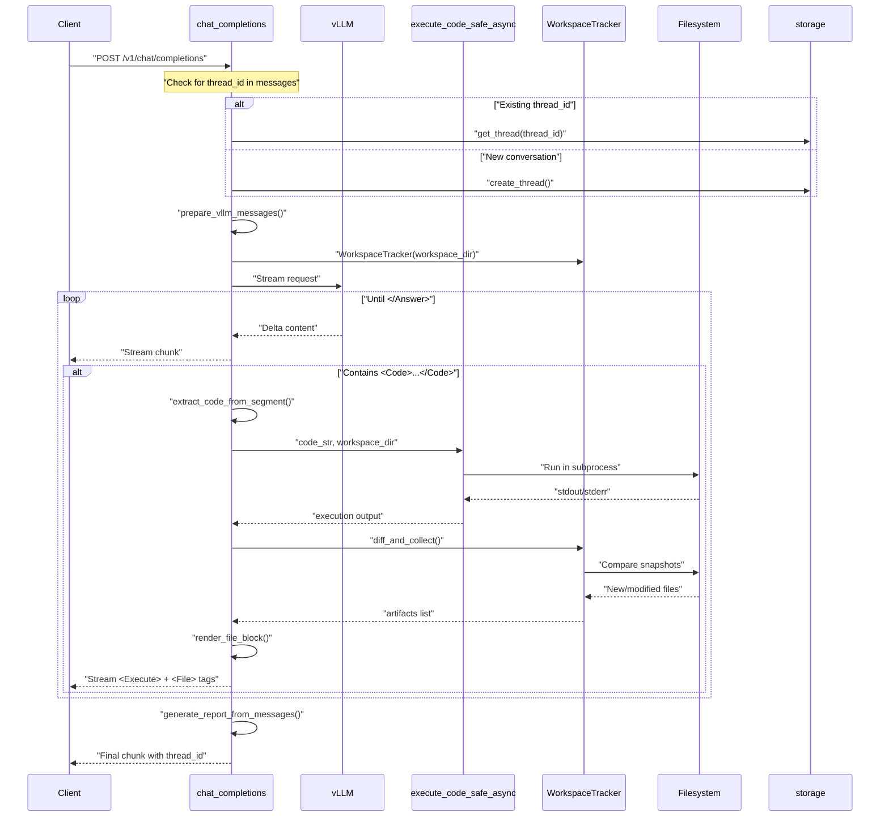
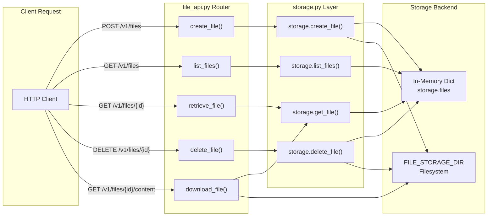

<!-- source: DeepWiki mcp.deepwiki.com · repo ruc-datalab/DeepAnalyze · page 10.1 API Endpoints Reference · fetched 2026-10-26 -->

# API Endpoints Reference

<details>
<summary>Relevant source files</summary>

The following files were used as context for generating this wiki page:

- [API/__init__.py](API/__init__.py)
- [API/admin_api.py](API/admin_api.py)
- [API/chat_api.py](API/chat_api.py)
- [API/example/Simpson.csv](API/example/Simpson.csv)
- [API/example/exampleRequest.py](API/example/exampleRequest.py)
- [API/file_api.py](API/file_api.py)
- [API/models_api.py](API/models_api.py)
- [API/start_server.py](API/start_server.py)
- [API/storage.py](API/storage.py)

</details>


This document provides a complete reference of all HTTP endpoints exposed by the DeepAnalyze API Server. The API server runs on port 8200 and provides an OpenAI-compatible interface for interacting with the DeepAnalyze-8B model.

For general usage guides and workflows, see [Using DeepAnalyze](#7). For configuration options, see [Configuration Options](#10.2). For information about the action tags used in responses, see [Action Tags Reference](#10.3).

---

## Endpoint Overview

The DeepAnalyze API Server exposes five categories of endpoints, all mounted under the `/v1/` prefix to maintain OpenAI compatibility:

| Category | Base Path | Description | Primary Router File |
|----------|-----------|-------------|---------------------|
| Chat Completions | `/v1/chat/completions` | Main conversational endpoint with code execution | [API/chat_api.py]() |
| Files | `/v1/files` | File upload, listing, retrieval, and deletion | [API/file_api.py]() |
| Models | `/v1/models` | Model listing and information | [API/models_api.py]() |
| Admin | `/v1/admin` | Thread cleanup and statistics | [API/admin_api.py]() |
| Health | `/health` | Server health check | [API/main.py]() |

**Sources:** [API/main.py](), [API/chat_api.py](), [API/file_api.py](), [API/models_api.py](), [API/admin_api.py]()

---

## Endpoint to Code Mapping

```mermaid
graph TB
    subgraph "FastAPI Application"
        MAIN["main.py<br/>create_app()"]
    end
    
    subgraph "Chat Router - /v1/chat"
        CHAT_ROUTER["chat_api.py<br/>router = APIRouter"]
        CHAT_POST["@router.post('/completions')<br/>chat_completions()"]
    end
    
    subgraph "File Router - /v1/files"
        FILE_ROUTER["file_api.py<br/>router = APIRouter"]
        FILE_POST["@router.post('')<br/>create_file()"]
        FILE_LIST["@router.get('')<br/>list_files()"]
        FILE_GET["@router.get('/{file_id}')<br/>retrieve_file()"]
        FILE_DELETE["@router.delete('/{file_id}')<br/>delete_file()"]
        FILE_CONTENT["@router.get('/{file_id}/content')<br/>download_file()"]
    end
    
    subgraph "Models Router - /v1/models"
        MODELS_ROUTER["models_api.py<br/>router = APIRouter"]
        MODELS_LIST["@router.get('')<br/>list_models()"]
        MODELS_GET["@router.get('/{model_id}')<br/>retrieve_model()"]
    end
    
    subgraph "Admin Router - /v1/admin"
        ADMIN_ROUTER["admin_api.py<br/>router = APIRouter"]
        ADMIN_CLEANUP["@router.post('/cleanup-threads')<br/>manual_cleanup_threads()"]
        ADMIN_STATS["@router.get('/threads-stats')<br/>get_threads_stats()"]
    end
    
    MAIN --> CHAT_ROUTER
    MAIN --> FILE_ROUTER
    MAIN --> MODELS_ROUTER
    MAIN --> ADMIN_ROUTER
    
    CHAT_ROUTER --> CHAT_POST
    FILE_ROUTER --> FILE_POST
    FILE_ROUTER --> FILE_LIST
    FILE_ROUTER --> FILE_GET
    FILE_ROUTER --> FILE_DELETE
    FILE_ROUTER --> FILE_CONTENT
    MODELS_ROUTER --> MODELS_LIST
    MODELS_ROUTER --> MODELS_GET
    ADMIN_ROUTER --> ADMIN_CLEANUP
    ADMIN_ROUTER --> ADMIN_STATS
```



**Sources:** [API/main.py](), [API/chat_api.py:41](), [API/file_api.py:18](), [API/models_api.py:16](), [API/admin_api.py:15]()

---

## Chat Completions API

### POST /v1/chat/completions

The primary conversational endpoint that processes user messages, executes code, tracks generated files, and returns streaming or non-streaming responses.

#### Endpoint Details

| Property | Value |
|----------|-------|
| **HTTP Method** | POST |
| **Path** | `/v1/chat/completions` |
| **Function** | `chat_completions()` in [API/chat_api.py:44-389]() |
| **Streaming Support** | Yes (Server-Sent Events) |
| **OpenAI Compatible** | Yes |

#### Request Parameters

The request body must be a JSON object with the following fields:

| Parameter | Type | Required | Default | Description |
|-----------|------|----------|---------|-------------|
| `model` | string | Yes | - | Model name (e.g., "DeepAnalyze-8B") |
| `messages` | array | Yes | - | List of message objects with `role` and `content` |
| `file_ids` | array | No | `null` | List of file IDs to attach to conversation |
| `temperature` | float | No | 0.4 | Sampling temperature (from [API/config.py]()) |
| `stream` | boolean | No | `false` | Whether to stream the response |

#### Message Format

Messages can include `file_ids` directly (OpenAI compatibility):

```json
{
  "role": "user",
  "content": "Analyze this data",
  "file_ids": ["file-abc123"]
}
```

Or include `thread_id` to continue an existing conversation:

```json
{
  "role": "user",
  "content": "Add a trend line",
  "thread_id": "thread-xyz789"
}
```

#### Request Example

```json
{
  "model": "DeepAnalyze-8B",
  "messages": [
    {
      "role": "user",
      "content": "分析这个数据集并生成可视化图表",
      "file_ids": ["file-Simpson-csv-a1b2c3d4"]
    }
  ],
  "temperature": 0.3,
  "stream": true
}
```

**Sources:** [API/chat_api.py:44-66](), [API/example/exampleRequest.py:82-93]()

#### Non-Streaming Response Format

```json
{
  "id": "chatcmpl-a1b2c3d4e5f6g7h8",
  "object": "chat.completion",
  "created": 1703001234,
  "model": "DeepAnalyze-8B",
  "choices": [
    {
      "index": 0,
      "message": {
        "role": "assistant",
        "content": "<Analyze>...</Analyze><Code>...</Code><Execute>...</Execute>",
        "thread_id": "thread-xyz789",
        "files": [
          {
            "filename": "plot.png",
            "url": "http://localhost:8100/thread-xyz789/generated/plot.png"
          }
        ]
      },
      "finish_reason": "stop"
    }
  ],
  "generated_files": [...]
}
```

**Key fields:**
- `message.content`: Full assistant response including action tags
- `message.thread_id`: Thread ID for continuing the conversation
- `message.files`: Array of generated file objects (new OpenAI compatibility)
- `generated_files`: Top-level array for backward compatibility

**Sources:** [API/chat_api.py:366-386]()

#### Streaming Response Format

Streaming responses use Server-Sent Events (SSE) with `text/event-stream` media type. Each chunk follows this format:

```
data: {"id":"chatcmpl-...","object":"chat.completion.chunk","created":1703001234,"model":"DeepAnalyze-8B","choices":[{"index":0,"delta":{"content":"text"},"finish_reason":null}]}

data: [DONE]
```

**Special streaming behavior:**
1. Content is streamed character-by-character or in chunks
2. When `<Code>` tags are detected and closed, code execution occurs
3. Execution output is streamed with `<Execute>` tags
4. Generated files are streamed with `<File>` tags
5. Final chunk includes `thread_id` and `files` array

```json
{
  "id": "chatcmpl-...",
  "object": "chat.completion.chunk",
  "created": 1703001234,
  "model": "DeepAnalyze-8B",
  "choices": [
    {
      "index": 0,
      "delta": {
        "files": [...],
        "thread_id": "thread-xyz789"
      },
      "finish_reason": "stop"
    }
  ],
  "generated_files": [...]
}
```

**Sources:** [API/chat_api.py:126-278](), [API/example/exampleRequest.py:142-159]()

#### Code Execution Workflow



**Sources:** [API/chat_api.py:126-227](), [API/utils.py]()

#### Thread Management

The endpoint automatically creates and manages threads:

1. **New conversation**: If no `thread_id` is provided in the last message, a new thread is created [API/chat_api.py:82-87]()
2. **Existing conversation**: If `thread_id` is found in the last message, the existing thread workspace is reused [API/chat_api.py:72-80]()
3. **Workspace isolation**: Each thread has its own workspace directory at `workspace/thread-{id}/` [API/storage.py:96-98]()
4. **File persistence**: Files from previous turns remain accessible in subsequent turns

**Sources:** [API/chat_api.py:67-87](), [API/storage.py:73-109]()

#### File Attachment Handling

Files can be attached in two ways:

1. **Top-level parameter** (backward compatibility):
```json
{
  "model": "DeepAnalyze-8B",
  "messages": [...],
  "file_ids": ["file-abc123"]
}
```

2. **Per-message** (OpenAI compatibility):
```json
{
  "messages": [
    {
      "role": "user",
      "content": "Analyze this",
      "file_ids": ["file-abc123"]
    }
  ]
}
```

The endpoint collects all `file_ids` from both sources and copies them to the thread workspace [API/chat_api.py:90-114]().

**Sources:** [API/chat_api.py:90-114](), [API/example/exampleRequest.py:72-111]()

---

## File Management API

The file management endpoints handle upload, listing, retrieval, and deletion of files. Files are stored in `FILE_STORAGE_DIR` and assigned unique IDs.

### POST /v1/files

Upload a file to the server.

#### Endpoint Details

| Property | Value |
|----------|-------|
| **HTTP Method** | POST |
| **Path** | `/v1/files` |
| **Function** | `create_file()` in [API/file_api.py:21-51]() |
| **Content Type** | `multipart/form-data` |

#### Request Parameters

| Parameter | Type | Required | Default | Description |
|-----------|------|----------|---------|-------------|
| `file` | file | Yes | - | File to upload (form data) |
| `purpose` | string | No | "file-extract" | Purpose of file (must be in `VALID_FILE_PURPOSES`) |

#### Response Format

```json
{
  "id": "file-Simpson-csv-a1b2c3d4",
  "object": "file",
  "bytes": 12345,
  "created_at": 1703001234,
  "filename": "Simpson.csv",
  "purpose": "file-extract"
}
```

#### Example Request (curl)

```bash
curl -X POST http://localhost:8200/v1/files \
  -F "file=@data.csv" \
  -F "purpose=file-extract"
```

**Sources:** [API/file_api.py:21-51](), [API/example/exampleRequest.py:36-40]()

---

### GET /v1/files

List all uploaded files, optionally filtered by purpose.

#### Endpoint Details

| Property | Value |
|----------|-------|
| **HTTP Method** | GET |
| **Path** | `/v1/files` |
| **Function** | `list_files()` in [API/file_api.py:53-58]() |

#### Query Parameters

| Parameter | Type | Required | Default | Description |
|-----------|------|----------|---------|-------------|
| `purpose` | string | No | `null` | Filter files by purpose |

#### Response Format

```json
{
  "object": "list",
  "data": [
    {
      "id": "file-abc123",
      "object": "file",
      "bytes": 12345,
      "created_at": 1703001234,
      "filename": "data.csv",
      "purpose": "file-extract"
    }
  ]
}
```

**Sources:** [API/file_api.py:53-58]()

---

### GET /v1/files/{file_id}

Retrieve metadata for a specific file.

#### Endpoint Details

| Property | Value |
|----------|-------|
| **HTTP Method** | GET |
| **Path** | `/v1/files/{file_id}` |
| **Function** | `retrieve_file()` in [API/file_api.py:60-67]() |

#### Path Parameters

| Parameter | Type | Required | Description |
|-----------|------|----------|-------------|
| `file_id` | string | Yes | File identifier |

#### Response Format

Same as file object in POST response.

**Sources:** [API/file_api.py:60-67]()

---

### DELETE /v1/files/{file_id}

Delete a file from the server.

#### Endpoint Details

| Property | Value |
|----------|-------|
| **HTTP Method** | DELETE |
| **Path** | `/v1/files/{file_id}` |
| **Function** | `delete_file()` in [API/file_api.py:69-76]() |

#### Response Format

```json
{
  "id": "file-abc123",
  "object": "file",
  "deleted": true
}
```

**Sources:** [API/file_api.py:69-76](), [API/example/exampleRequest.py:67]()

---

### GET /v1/files/{file_id}/content

Download the actual file content.

#### Endpoint Details

| Property | Value |
|----------|-------|
| **HTTP Method** | GET |
| **Path** | `/v1/files/{file_id}/content` |
| **Function** | `download_file()` in [API/file_api.py:78-92]() |
| **Content Type** | `application/octet-stream` |

#### Response

Raw file bytes with `application/octet-stream` content type.

**Sources:** [API/file_api.py:78-92]()

---

## File API Storage Flow



**Sources:** [API/file_api.py](), [API/storage.py:20-71]()

---

## Models API

The models API provides information about available models.

### GET /v1/models

List all available models.

#### Endpoint Details

| Property | Value |
|----------|-------|
| **HTTP Method** | GET |
| **Path** | `/v1/models` |
| **Function** | `list_models()` in [API/models_api.py:19-46]() |

#### Response Format

```json
{
  "object": "list",
  "data": [
    {
      "id": "DeepAnalyze-8B",
      "object": "model",
      "created": 1703001234,
      "owned_by": "deepanalyze"
    }
  ]
}
```

**Sources:** [API/models_api.py:19-46]()

---

### GET /v1/models/{model_id}

Retrieve information about a specific model.

#### Endpoint Details

| Property | Value |
|----------|-------|
| **HTTP Method** | GET |
| **Path** | `/v1/models/{model_id}` |
| **Function** | `retrieve_model()` in [API/models_api.py:48-68]() |

#### Path Parameters

| Parameter | Type | Required | Description |
|-----------|------|----------|-------------|
| `model_id` | string | Yes | Model identifier |

#### Response Format

```json
{
  "id": "DeepAnalyze-8B",
  "object": "model",
  "created": 1703001234,
  "owned_by": "deepanalyze"
}
```

**Sources:** [API/models_api.py:48-68]()

---

## Admin API

Administrative endpoints for thread cleanup and system statistics.

### POST /v1/admin/cleanup-threads

Manually trigger cleanup of expired threads.

#### Endpoint Details

| Property | Value |
|----------|-------|
| **HTTP Method** | POST |
| **Path** | `/v1/admin/cleanup-threads` |
| **Function** | `manual_cleanup_threads()` in [API/admin_api.py:18-41]() |

#### Query Parameters

| Parameter | Type | Required | Default | Description |
|-----------|------|----------|---------|-------------|
| `timeout_hours` | integer | No | 12 | Threads inactive for more than this are deleted |

#### Response Format

```json
{
  "status": "success",
  "cleaned_threads": 5,
  "timeout_hours": 12,
  "timestamp": 1703001234
}
```

#### Cleanup Logic

The cleanup process:
1. Iterates through all threads in `storage.threads`
2. Compares `last_accessed_at` timestamp with current time
3. Deletes threads exceeding `timeout_hours` threshold
4. Removes thread workspace directories from filesystem

**Sources:** [API/admin_api.py:18-41](), [API/storage.py:171-193]()

---

### GET /v1/admin/threads-stats

Get statistics about active threads.

#### Endpoint Details

| Property | Value |
|----------|-------|
| **HTTP Method** | GET |
| **Path** | `/v1/admin/threads-stats` |
| **Function** | `get_threads_stats()` in [API/admin_api.py:43-75]() |

#### Response Format

```json
{
  "total_threads": 25,
  "recent_threads": 10,
  "old_threads": 12,
  "expired_threads": 3,
  "timeout_hours": 12,
  "timestamp": 1703001234
}
```

**Field definitions:**
- `recent_threads`: Threads accessed within the last hour
- `old_threads`: Threads accessed 1-12 hours ago
- `expired_threads`: Threads older than 12 hours (ready for cleanup)

**Sources:** [API/admin_api.py:43-75]()

---

## Health Check Endpoint

### GET /health

Simple health check endpoint.

#### Endpoint Details

| Property | Value |
|----------|-------|
| **HTTP Method** | GET |
| **Path** | `/health` |
| **Function** | Defined in [API/main.py]() |

#### Response Format

```json
{
  "status": "ok"
}
```

**Sources:** [API/main.py](), [API/example/exampleRequest.py:165-170]()

---

## Data Models and Types

All API endpoints use Pydantic models for request/response validation. Key models:

| Model | File | Description |
|-------|------|-------------|
| `ChatCompletionRequest` | [API/models.py]() | Chat completion request body |
| `ChatCompletionResponse` | [API/models.py]() | Chat completion response |
| `FileObject` | [API/models.py]() | File metadata object |
| `FileDeleteResponse` | [API/models.py]() | File deletion confirmation |
| `ModelObject` | [API/models.py]() | Model information object |
| `ThreadObject` | [API/models.py]() | Thread metadata |
| `MessageObject` | [API/models.py]() | Message object |
| `ThreadCleanupResponse` | [API/models.py]() | Cleanup operation result |
| `ThreadStatsResponse` | [API/models.py]() | Thread statistics |

**Sources:** [API/models.py]()

---

## Complete API Reference Table

| Endpoint | Method | Function | Purpose |
|----------|--------|----------|---------|
| `/v1/chat/completions` | POST | `chat_completions()` | Chat with code execution |
| `/v1/files` | POST | `create_file()` | Upload file |
| `/v1/files` | GET | `list_files()` | List uploaded files |
| `/v1/files/{file_id}` | GET | `retrieve_file()` | Get file metadata |
| `/v1/files/{file_id}` | DELETE | `delete_file()` | Delete file |
| `/v1/files/{file_id}/content` | GET | `download_file()` | Download file content |
| `/v1/models` | GET | `list_models()` | List available models |
| `/v1/models/{model_id}` | GET | `retrieve_model()` | Get model info |
| `/v1/admin/cleanup-threads` | POST | `manual_cleanup_threads()` | Clean expired threads |
| `/v1/admin/threads-stats` | GET | `get_threads_stats()` | Get thread statistics |
| `/health` | GET | health check | Server health status |

**Sources:** [API/main.py](), [API/chat_api.py](), [API/file_api.py](), [API/models_api.py](), [API/admin_api.py]()

---

## Configuration Constants

Key configuration values used by the API (defined in [API/config.py]()):

| Constant | Default | Description |
|----------|---------|-------------|
| `API_BASE` | `http://localhost:8000/v1` | vLLM server base URL |
| `DEFAULT_MODEL` | `"DeepAnalyze-8B"` | Default model name |
| `DEFAULT_TEMPERATURE` | `0.4` | Default sampling temperature |
| `MAX_NEW_TOKENS` | `16384` | Maximum tokens per generation |
| `STOP_TOKEN_IDS` | `[100001, 100002, ...]` | Stop token IDs for generation |
| `FILE_STORAGE_DIR` | `./file_storage` | Directory for uploaded files |
| `WORKSPACE_DIR` | `./workspace` | Directory for thread workspaces |
| `CLEANUP_TIMEOUT_HOURS` | `12` | Thread cleanup timeout |
| `VALID_FILE_PURPOSES` | `["file-extract", "assistants"]` | Valid file purposes |

**Sources:** [API/config.py]()

---

## Error Responses

All endpoints return HTTP error responses in the following format:

```json
{
  "detail": "Error message describing what went wrong"
}
```

Common HTTP status codes:

| Code | Meaning | Common Causes |
|------|---------|---------------|
| 400 | Bad Request | Invalid parameters, missing required fields |
| 404 | Not Found | File ID or thread ID not found |
| 500 | Internal Server Error | File system errors, vLLM connection issues |

**Sources:** [API/chat_api.py:76](), [API/file_api.py:29-32](), [API/file_api.py:64-65]()

---

## Usage Examples

### Example 1: Simple Chat (Non-Streaming)

```python
import requests

response = requests.post("http://localhost:8200/v1/chat/completions", json={
    "model": "DeepAnalyze-8B",
    "messages": [
        {"role": "user", "content": "What is Python?"}
    ],
    "temperature": 0.3
})

result = response.json()
print(result['choices'][0]['message']['content'])
```

**Sources:** [API/example/exampleRequest.py:15-31]()

### Example 2: Chat with File Attachment

```python
# Upload file
with open("data.csv", 'rb') as f:
    files = {'file': ('data.csv', f, 'text/csv')}
    data = {'purpose': 'file-extract'}
    upload_response = requests.post(
        "http://localhost:8200/v1/files",
        files=files,
        data=data
    )

file_id = upload_response.json()['id']

# Analyze file
chat_response = requests.post("http://localhost:8200/v1/chat/completions", json={
    "model": "DeepAnalyze-8B",
    "messages": [
        {"role": "user", "content": "Analyze this data"}
    ],
    "file_ids": [file_id],
    "temperature": 0.3
})
```

**Sources:** [API/example/exampleRequest.py:33-68]()

### Example 3: Streaming Chat

```python
response = requests.post(
    "http://localhost:8200/v1/chat/completions",
    json={
        "model": "DeepAnalyze-8B",
        "messages": [{"role": "user", "content": "Generate a report"}],
        "stream": True
    },
    stream=True
)

for line in response.iter_lines():
    if line:
        line_str = line.decode('utf-8')
        if line_str.startswith('data: '):
            data = line_str[6:]
            if data != '[DONE]':
                chunk = json.loads(data)
                if 'choices' in chunk:
                    delta = chunk['choices'][0].get('delta', {})
                    if 'content' in delta:
                        print(delta['content'], end='', flush=True)
```

**Sources:** [API/example/exampleRequest.py:113-160]()

### Example 4: Multi-Turn Conversation

```python
# First turn - get thread_id
response1 = requests.post("http://localhost:8200/v1/chat/completions", json={
    "model": "DeepAnalyze-8B",
    "messages": [
        {"role": "user", "content": "Analyze the data structure"}
    ],
    "file_ids": [file_id]
})

thread_id = response1.json()['choices'][0]['message']['thread_id']

# Second turn - reuse thread_id
response2 = requests.post("http://localhost:8200/v1/chat/completions", json={
    "model": "DeepAnalyze-8B",
    "messages": [
        {"role": "user", "content": "Generate a detailed report", "thread_id": thread_id}
    ],
    "file_ids": [file_id]
})
```

**Sources:** [API/example/exampleRequest.py:173-316]()

---

