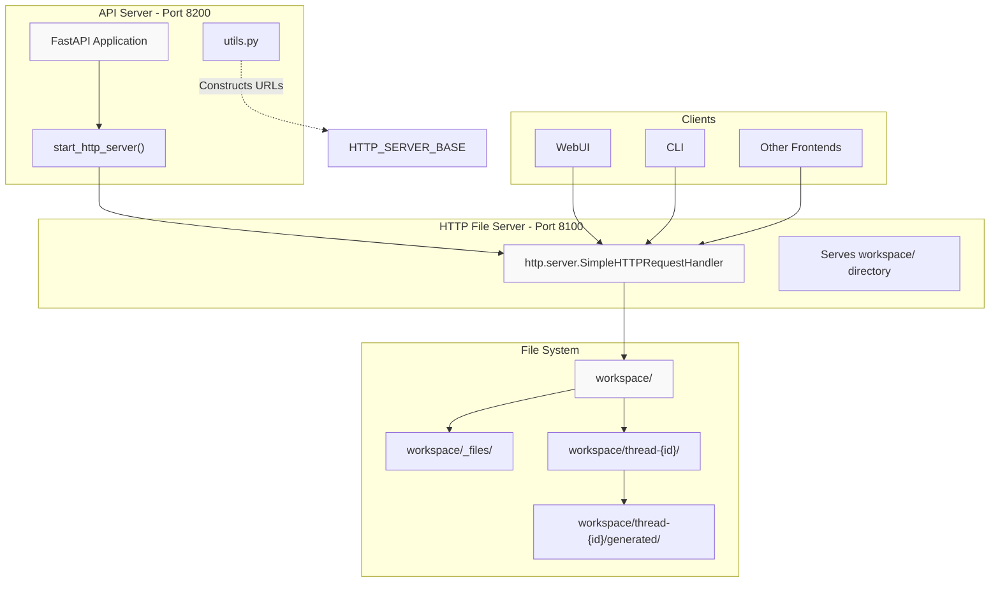
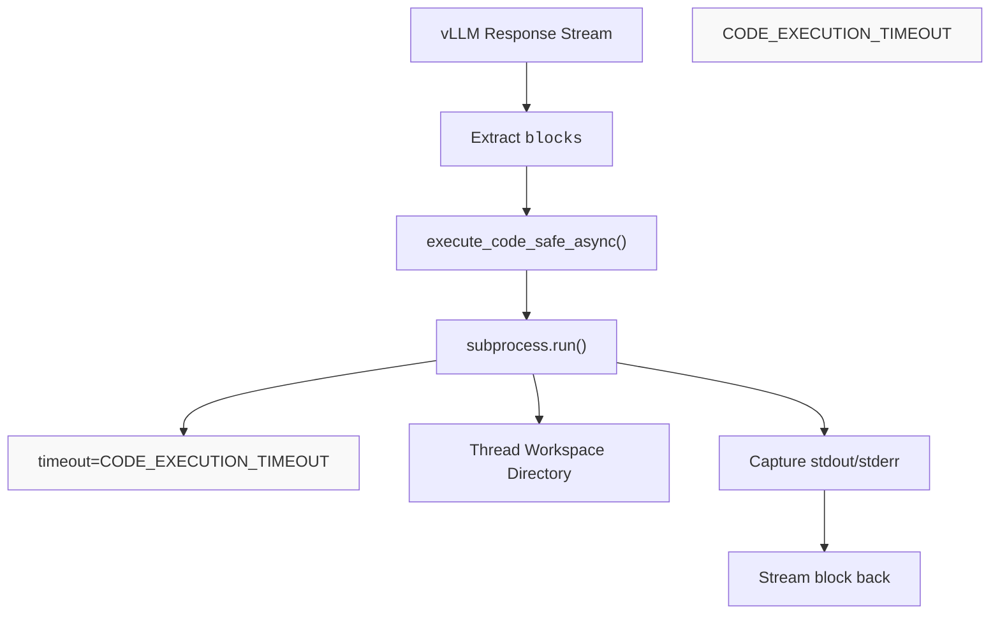
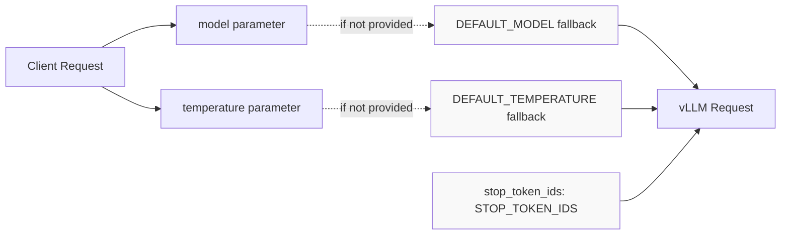
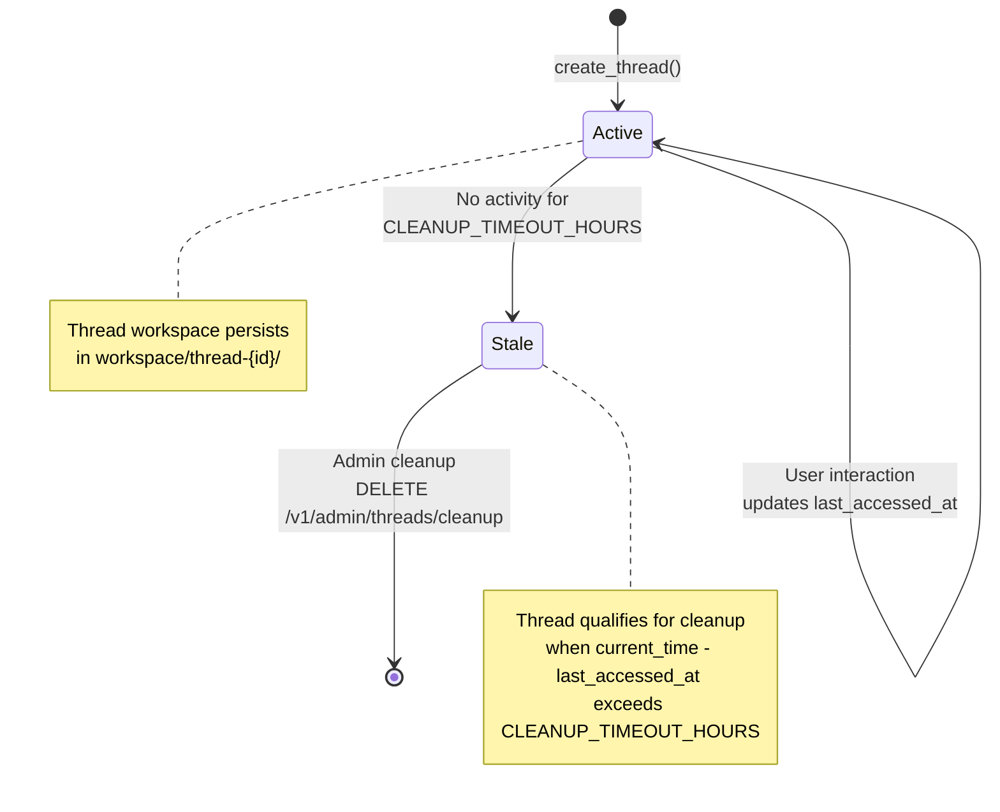
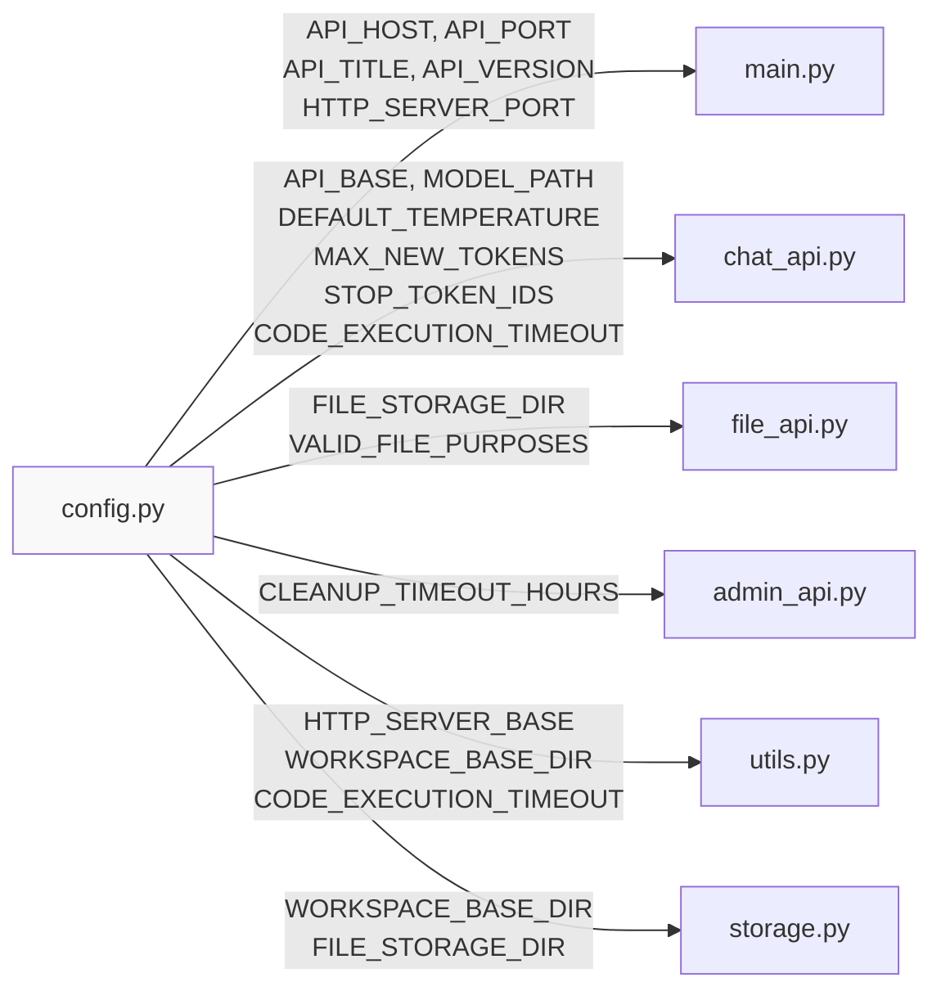

<!-- source: DeepWiki mcp.deepwiki.com · repo ruc-datalab/DeepAnalyze · page 10.2 Configuration Options · fetched 2026-10-26 -->

# Configuration Options

<details>
<summary>Relevant source files</summary>

The following files were used as context for generating this wiki page:

- [API/config.py](API/config.py)
- [API/main.py](API/main.py)
- [API/models.py](API/models.py)

</details>


This page provides a complete reference for all configuration constants and environment variables used in the DeepAnalyze API server. These settings control server behavior, resource limits, file handling, code execution, and integration with the vLLM inference engine.

For information about deploying the server with these configurations, see [Deployment](#4). For details on API endpoints themselves, see [API Endpoints Reference](#10.1).

---

## Configuration System Overview

The DeepAnalyze API server uses a centralized configuration system defined in [API/config.py](). All configuration constants are imported by other modules as needed, providing a single source of truth for system-wide settings.

The configuration system is **static** at runtime—values are set when the application starts and cannot be modified through API calls. To change configuration, you must modify [API/config.py]() and restart the server.

**Sources:** [API/config.py:1-44]()

---

## Server Configuration

These settings control the API server's network binding and identification.

| Constant | Default Value | Type | Description |
|----------|---------------|------|-------------|
| `API_HOST` | `"0.0.0.0"` | `str` | Network interface to bind the API server. `"0.0.0.0"` allows external connections; use `"127.0.0.1"` for localhost-only |
| `API_PORT` | `8200` | `int` | TCP port for the FastAPI server |
| `API_TITLE` | `"DeepAnalyze OpenAI-Compatible API"` | `str` | API title displayed in OpenAPI documentation |
| `API_VERSION` | `"1.0.0"` | `str` | API version string for documentation and clients |

These values are used during application initialization in [API/main.py:26-28]() when creating the FastAPI instance and in [API/main.py:82]() when starting the Uvicorn server.

**Sources:** [API/config.py:18-22](), [API/main.py:26-28](), [API/main.py:82]()

---

## vLLM Integration Configuration

These settings define how the API server communicates with the vLLM inference engine.

| Constant | Default Value | Type | Description |
|----------|---------------|------|-------------|
| `API_BASE` | `"http://localhost:8000/v1"` | `str` | Base URL for the vLLM server's OpenAI-compatible API endpoint |
| `MODEL_PATH` | `"DeepAnalyze-8B"` | `str` | Model identifier passed to vLLM; must match the model name used when starting vLLM |

The `API_BASE` constant is used throughout the codebase when making HTTP requests to vLLM for inference. The `MODEL_PATH` serves as the model identifier in both requests to vLLM and in responses to clients.

**Important:** The vLLM server must be running and accessible at the `API_BASE` URL before starting the DeepAnalyze API server. The model name in vLLM's `--served-model-name` parameter should match `MODEL_PATH`.

**Sources:** [API/config.py:12-13]()

---

## File Management Configuration

These settings control how files are stored and served.

| Constant | Default Value | Type | Description |
|----------|---------------|------|-------------|
| `WORKSPACE_BASE_DIR` | `"workspace"` | `str` | Root directory for all workspace and file storage |
| `FILE_STORAGE_DIR` | `workspace/_files` | `str` | Directory for uploaded files before they're copied to thread workspaces |
| `HTTP_SERVER_PORT` | `8100` | `int` | TCP port for the HTTP file server that serves generated artifacts |
| `HTTP_SERVER_BASE` | `"http://localhost:8100"` | `str` | Base URL used when constructing download links for generated files |
| `VALID_FILE_PURPOSES` | `["fine-tune", "answers", "file-extract", "assistants"]` | `List[str]` | Allowed values for the `purpose` field when uploading files (OpenAI compatibility) |

### Directory Structure

```
workspace/
├── _files/                    # FILE_STORAGE_DIR - uploaded files
│   ├── file-abc123/
│   │   └── data.csv
│   └── file-xyz789/
│       └── report.pdf
└── thread-{id}/               # Thread workspaces
    ├── data.csv               # Copied from _files
    └── generated/             # Generated artifacts
        ├── plot.png
        └── analysis.csv
```

The `FILE_STORAGE_DIR` is computed as [API/config.py:33]():
```python
FILE_STORAGE_DIR = os.path.join(WORKSPACE_BASE_DIR, "_files")
```

**Sources:** [API/config.py:14-34]()

---

## HTTP File Server Configuration

### File Server Architecture



The HTTP file server is started in a daemon thread [API/main.py:75-76]() and serves the entire `WORKSPACE_BASE_DIR` directory. URLs are constructed using `HTTP_SERVER_BASE` when generating file blocks in responses.

**Sources:** [API/config.py:15-16](), [API/main.py:75-76]()

---

## Code Execution Configuration

These settings control the sandboxed Python code execution environment.

| Constant | Default Value | Type | Description |
|----------|---------------|------|-------------|
| `CODE_EXECUTION_TIMEOUT` | `120` | `int` | Maximum execution time in seconds for Python code before it's terminated |
| `MAX_NEW_TOKENS` | `32768` | `int` | Maximum number of tokens the model can generate in a single completion |

### Code Execution Flow



The `CODE_EXECUTION_TIMEOUT` is used in the `subprocess.run()` call with the `timeout` parameter. If execution exceeds this duration, the process is killed and an error is returned to the client.

The `MAX_NEW_TOKENS` parameter is passed to vLLM in chat completion requests to limit response length, preventing excessive token generation and associated costs/latency.

**Sources:** [API/config.py:28-30]()

---

## Model Configuration

These settings define model-specific parameters for inference and response generation.

| Constant | Default Value | Type | Description |
|----------|---------------|------|-------------|
| `DEFAULT_MODEL` | `"DeepAnalyze-8B"` | `str` | Default model identifier returned in API responses |
| `DEFAULT_TEMPERATURE` | `0.4` | `float` | Default sampling temperature for completions (lower = more deterministic) |
| `STOP_TOKEN_IDS` | `[151676, 151645]` | `List[int]` | Token IDs that signal the end of generation for the DeepAnalyze model |
| `SUPPORTED_TOOLS` | `["code_interpreter"]` | `List[str]` | List of tool types supported by the API (OpenAI compatibility) |

### Model Configuration in Request Flow



The `STOP_TOKEN_IDS` are critical for proper model behavior—they correspond to special tokens in the DeepAnalyze vocabulary that indicate the end of structured sections. Without these, the model may continue generating beyond intended boundaries.

The `DEFAULT_TEMPERATURE` of 0.4 is tuned for data science tasks where some creativity is helpful but excessive randomness is undesirable. This is defined both in [API/config.py:37]() and as a default in the Pydantic model [API/models.py:59]().

**Sources:** [API/config.py:36-42](), [API/models.py:54-61]()

---

## Thread Management Configuration

These settings control the lifecycle of conversation threads and their associated workspaces.

| Constant | Default Value | Type | Description |
|----------|---------------|------|-------------|
| `CLEANUP_TIMEOUT_HOURS` | `12` | `int` | Hours of inactivity after which a thread is eligible for cleanup |
| `CLEANUP_INTERVAL_MINUTES` | `30` | `int` | (Currently unused) Intended interval for automatic cleanup background tasks |

### Thread Lifecycle



The `CLEANUP_TIMEOUT_HOURS` constant is used by the admin API [API/admin_api.py]() to determine which threads should be deleted. The cleanup is **manual** via the `/v1/admin/threads/cleanup` endpoint—there is no automatic background cleanup process, despite `CLEANUP_INTERVAL_MINUTES` being defined.

When a thread is cleaned up:
1. The thread metadata is removed from in-memory storage
2. The thread's workspace directory (`workspace/thread-{id}/`) is deleted from the filesystem
3. All files within that workspace are permanently removed

**Sources:** [API/config.py:24-26]()

---

## Environment Variables

These are operating system environment variables set by the configuration module.

| Variable | Value | Purpose |
|----------|-------|---------|
| `MPLBACKEND` | `"Agg"` | Sets matplotlib to use the non-interactive Agg backend, preventing GUI window creation in server environments |

This environment variable is set in [API/config.py:9]():
```python
os.environ.setdefault("MPLBACKEND", "Agg")
```

The `setdefault()` method only sets the value if it's not already defined, allowing users to override it if needed. The Agg backend is essential for server deployment because:
- It doesn't require X11 or display server
- It prevents memory leaks from interactive backends
- It allows headless plot generation
- It's thread-safe for concurrent requests

**Sources:** [API/config.py:8-9]()

---

## Configuration Dependencies and Relationships

### Complete Configuration Map

```mermaid
graph TB
    subgraph "Server Infrastructure"
        API_HOST["API_HOST<br/>0.0.0.0"]
        API_PORT["API_PORT<br/>8200"]
        HTTP_PORT["HTTP_SERVER_PORT<br/>8100"]
    end
    
    subgraph "vLLM Integration"
        API_BASE["API_BASE<br/>http://localhost:8000/v1"]
        MODEL_PATH["MODEL_PATH<br/>DeepAnalyze-8B"]
    end
    
    subgraph "File Management"
        WORKSPACE_BASE["WORKSPACE_BASE_DIR<br/>workspace"]
        FILE_STORAGE["FILE_STORAGE_DIR<br/>workspace/_files"]
        HTTP_BASE["HTTP_SERVER_BASE<br/>http://localhost:8100"]
    end
    
    subgraph "Execution Limits"
        TIMEOUT["CODE_EXECUTION_TIMEOUT<br/>120s"]
        MAX_TOKENS["MAX_NEW_TOKENS<br/>32768"]
    end
    
    subgraph "Model Behavior"
        DEFAULT_MODEL["DEFAULT_MODEL<br/>DeepAnalyze-8B"]
        TEMPERATURE["DEFAULT_TEMPERATURE<br/>0.4"]
        STOP_TOKENS["STOP_TOKEN_IDS<br/>[151676, 151645]"]
    end
    
    subgraph "Thread Lifecycle"
        CLEANUP_TIMEOUT["CLEANUP_TIMEOUT_HOURS<br/>12"]
        CLEANUP_INTERVAL["CLEANUP_INTERVAL_MINUTES<br/>30 (unused)"]
    end
    
    API_PORT -.->|Uvicorn binds| MAIN["main.py<br/>FastAPI app"]
    HTTP_PORT -.->|File server| HTTP_THREAD["HTTP Server Thread"]
    
    WORKSPACE_BASE -->|Derived| FILE_STORAGE
    HTTP_PORT -->|Constructs| HTTP_BASE
    
    API_BASE -.->|Chat requests| VLLM_SERVER["vLLM Server"]
    MODEL_PATH -.->|Model identifier| VLLM_SERVER
    
    TIMEOUT -.->|Subprocess limit| CODE_EXEC["Code Execution"]
    MAX_TOKENS -.->|vLLM parameter| VLLM_SERVER
    
    TEMPERATURE -.->|Sampling| VLLM_SERVER
    STOP_TOKENS -.->|Generation end| VLLM_SERVER
    
    CLEANUP_TIMEOUT -.->|Admin API| CLEANUP_LOGIC["Thread Cleanup"]
    
    style WORKSPACE_BASE fill:#f9f9f9
    style API_BASE fill:#f9f9f9
    style TIMEOUT fill:#f9f9f9
```



### Key Configuration Relationships

1. **Port Trio**: The system uses three ports that must not conflict:
   - `API_PORT` (8200): Main FastAPI server
   - `HTTP_SERVER_PORT` (8100): File serving
   - vLLM port (8000, hardcoded in `API_BASE`): Inference engine

2. **File Path Derivation**: `FILE_STORAGE_DIR` is computed from `WORKSPACE_BASE_DIR`, creating a dependency where changing the base directory affects file storage location.

3. **URL Construction**: `HTTP_SERVER_BASE` is derived from `HTTP_SERVER_PORT` and must match for download URLs to work correctly.

4. **Model Coordination**: `MODEL_PATH` must match both:
   - The vLLM server's `--served-model-name` parameter
   - The `DEFAULT_MODEL` constant (though they can technically differ, this would be confusing)

5. **Token Limits**: `STOP_TOKEN_IDS` and `MAX_NEW_TOKENS` work together to control generation—stop tokens provide semantic boundaries while max tokens provide a hard safety limit.

**Sources:** [API/config.py:1-44](), [API/main.py:15]()

---

## Configuration Usage in Code

### Import Pattern

All modules that need configuration import specific constants:

```python
# From API/main.py:15
from config import API_HOST, API_PORT, API_TITLE, API_VERSION, HTTP_SERVER_PORT, CLEANUP_INTERVAL_MINUTES
```

This selective import pattern makes dependencies explicit and makes it easy to track which configurations each module uses.

### Configuration Access Map



This diagram shows the **direct dependencies** from each module on specific configuration constants. Understanding these dependencies is important when:
- Modifying configuration values (need to consider all affected modules)
- Troubleshooting issues (knowing which configurations a module uses)
- Extending the system (following existing patterns for new configurations)

**Sources:** [API/main.py:15](), [API/config.py:1-44]()

---

## Summary Table: All Configuration Constants

| Category | Constant | Default | Location |
|----------|----------|---------|----------|
| **Server** | `API_HOST` | `"0.0.0.0"` | [API/config.py:19]() |
| **Server** | `API_PORT` | `8200` | [API/config.py:20]() |
| **Server** | `API_TITLE` | `"DeepAnalyze OpenAI-Compatible API"` | [API/config.py:21]() |
| **Server** | `API_VERSION` | `"1.0.0"` | [API/config.py:22]() |
| **vLLM** | `API_BASE` | `"http://localhost:8000/v1"` | [API/config.py:12]() |
| **vLLM** | `MODEL_PATH` | `"DeepAnalyze-8B"` | [API/config.py:13]() |
| **Files** | `WORKSPACE_BASE_DIR` | `"workspace"` | [API/config.py:14]() |
| **Files** | `FILE_STORAGE_DIR` | `"workspace/_files"` | [API/config.py:33]() |
| **Files** | `HTTP_SERVER_PORT` | `8100` | [API/config.py:15]() |
| **Files** | `HTTP_SERVER_BASE` | `"http://localhost:8100"` | [API/config.py:16]() |
| **Files** | `VALID_FILE_PURPOSES` | `["fine-tune", "answers", "file-extract", "assistants"]` | [API/config.py:34]() |
| **Execution** | `CODE_EXECUTION_TIMEOUT` | `120` | [API/config.py:29]() |
| **Execution** | `MAX_NEW_TOKENS` | `32768` | [API/config.py:30]() |
| **Model** | `DEFAULT_MODEL` | `"DeepAnalyze-8B"` | [API/config.py:38]() |
| **Model** | `DEFAULT_TEMPERATURE` | `0.4` | [API/config.py:37]() |
| **Model** | `STOP_TOKEN_IDS` | `[151676, 151645]` | [API/config.py:41]() |
| **Model** | `SUPPORTED_TOOLS` | `["code_interpreter"]` | [API/config.py:44]() |
| **Threads** | `CLEANUP_TIMEOUT_HOURS` | `12` | [API/config.py:25]() |
| **Threads** | `CLEANUP_INTERVAL_MINUTES` | `30` | [API/config.py:26]() |
| **Environment** | `MPLBACKEND` | `"Agg"` | [API/config.py:9]() |

**Sources:** [API/config.py:1-44]()

---

