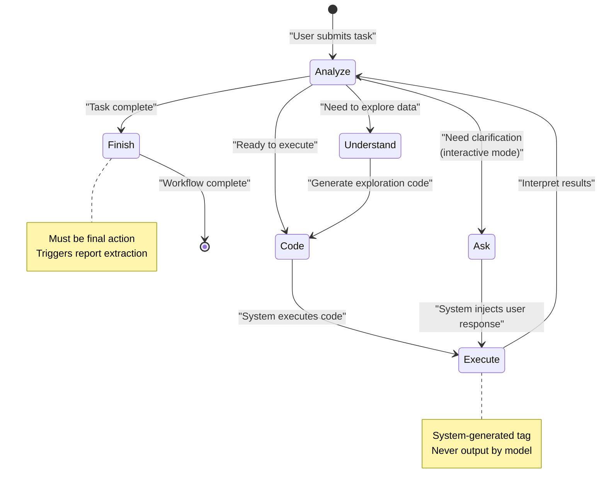
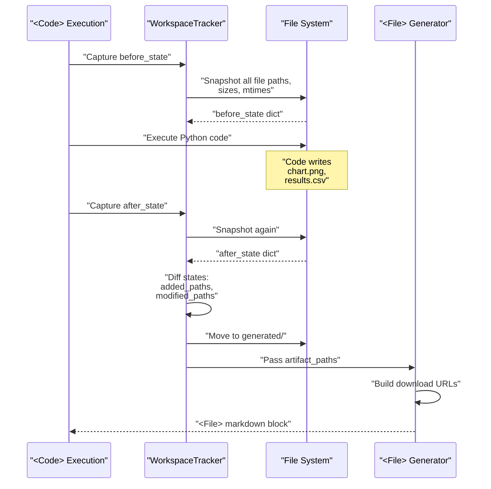
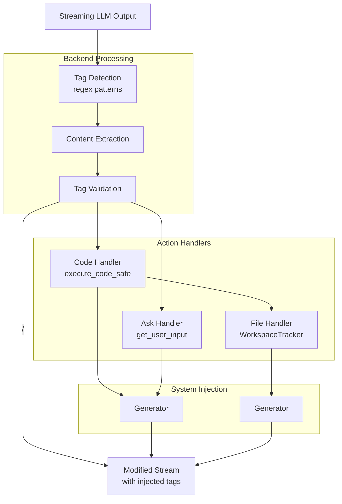
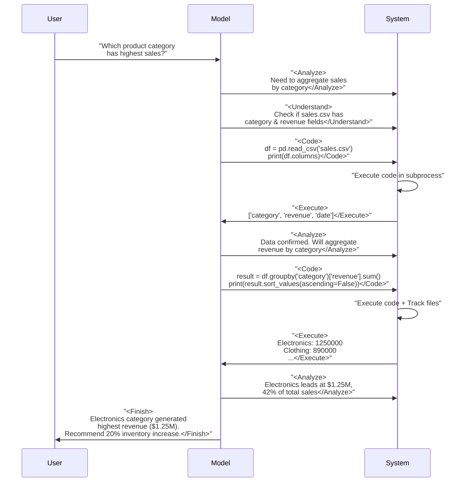

<!-- source: DeepWiki mcp.deepwiki.com · repo ruc-datalab/DeepAnalyze · page 10.3 Action Tags Reference · fetched 2026-10-26 -->

# Action Tags Reference

<details>
<summary>Relevant source files</summary>

The following files were used as context for generating this wiki page:

- [demo/chat/backend.py](demo/chat/backend.py)
- [demo/deepanalyze_general/README.md](demo/deepanalyze_general/README.md)
- [demo/deepanalyze_general/README_ZH.md](demo/deepanalyze_general/README_ZH.md)
- [demo/deepanalyze_general/__init__.py](demo/deepanalyze_general/__init__.py)
- [demo/deepanalyze_general/deepanalyze_general.py](demo/deepanalyze_general/deepanalyze_general.py)
- [docs/FAQ.md](docs/FAQ.md)
- [docs/FAQ_ZH.md](docs/FAQ_ZH.md)

</details>


This document provides a comprehensive reference for the special XML-like action tags used by DeepAnalyze to structure its agentic workflow. These tags enable the model to decompose data analysis tasks into discrete, observable steps following a "think-act-observe" pattern inspired by human data scientists.

For information about how these tags are processed during code execution and workspace tracking, see [Code Execution and Agentic Loop](#6.6.1). For multi-turn conversation patterns that use these tags, see [Multi-turn Conversations](#7.4).

## Overview of Action Tags

Action tags are XML-style markers that DeepAnalyze uses to structure its responses. Each tag represents a specific type of action in the data science workflow, making the model's reasoning process transparent and debuggable. The model outputs one action tag per turn, and the system automatically handles code execution and result injection.

**Key Characteristics:**
- Tags are case-sensitive and must be properly closed (e.g., `<Code>...</Code>`)
- Each response contains exactly one action tag
- Some tags trigger automatic system responses (e.g., `<Code>` triggers execution)
- Tags enable structured extraction of analysis sections for reporting

**Sources:** [demo/chat/backend.py:616-636](), [demo/deepanalyze_general/deepanalyze_general.py:13-102]()

## Standard Action Tags

The following table summarizes all standard action tags supported by DeepAnalyze:

| Tag | Purpose | Generated By | Triggers System Action | Content Format |
|-----|---------|--------------|------------------------|----------------|
| `<Analyze>` | Task planning, reasoning, hypothesis, result interpretation | Model | No | Natural language explanation |
| `<Understand>` | Express intent to explore data structure/semantics | Model | No | Natural language intent statement |
| `<Code>` | Generate executable Python code | Model | Yes - code execution | Python code (optionally in ```python blocks) |
| `<Execute>` | Contains execution results or user responses | System | No | stdout/stderr output or user text |
| `<Answer>` / `<Finish>` | Output final conclusions and recommendations | Model | No - signals completion | Natural language report/conclusion |
| `<Ask>` | Ask user for clarification (interactive mode only) | Model | Yes - waits for user input | Natural language question |
| `<File>` | Display generated artifacts with download links | System | No | Markdown list of files with URLs |

**Sources:** [demo/deepanalyze_general/deepanalyze_general.py:23-29](), [demo/chat/backend.py:759-787]()

## Tag Lifecycle and State Transitions

The following diagram illustrates how action tags transition between states in a typical analysis workflow:



**Sources:** [demo/deepanalyze_general/deepanalyze_general.py:131-133](), [demo/chat/backend.py:686-697]()

## Detailed Tag Specifications

### `<Analyze>` Tag

**Purpose:** Expresses reasoning, planning, hypothesis formation, or result interpretation.

**Generated By:** Model

**When to Use:**
- At the start of a task to plan the approach
- After receiving `<Execute>` results to interpret findings
- When diagnosing errors or obstacles
- When synthesizing insights from multiple execution rounds

**Rules:**
- Must NOT contain unverified business assumptions
- Must be based on known facts or returned data
- Must NOT make up definitions for ambiguous terms
- Should transition to `<Code>` or `<Ask>` when action is needed

**Example:**
```xml
<Analyze>
The data contains 'category' and 'revenue' columns. To identify the highest-selling 
category, I need to group by 'category', sum the 'revenue', and sort descending.
</Analyze>
```

**Detection Pattern:** [demo/chat/backend.py:616]()
```python
pattern = re.compile(r"<(Analyze|Understand|Code|Execute|Answer)>(.*?)(?:</\1>|(?=$))", re.DOTALL)
```

**Sources:** [demo/deepanalyze_general/deepanalyze_general.py:25](), [demo/deepanalyze_general/deepanalyze_general.py:116]()

### `<Understand>` Tag

**Purpose:** Declares the intent to explore data structure, semantics, or schema before writing analysis code.

**Generated By:** Model

**When to Use:**
- Before examining a new dataset for the first time
- When field names or data types are unknown
- To check for missing values or data quality issues
- Before complex transformations requiring schema knowledge

**Important:** This is NOT a question to the user. It's a declaration that the next step will be exploration code.

**Example:**
```xml
<Understand>
Goal: Examine sales.csv to confirm it contains 'category' and 'revenue' fields, 
and check for any null values or data type issues.
</Understand>
```

**Typical Follow-up:** The next turn should contain `<Code>` that performs the exploration (e.g., `df.info()`, `df.head()`).

**Sources:** [demo/deepanalyze_general/deepanalyze_general.py:26](), [demo/deepanalyze_general/deepanalyze_general.py:117]()

### `<Code>` Tag

**Purpose:** Contains executable Python code for data manipulation, analysis, or visualization.

**Generated By:** Model

**When to Use:**
- To load and inspect data
- To perform calculations, aggregations, or transformations
- To generate visualizations
- To export results

**System Behavior:**
1. System extracts code from tag (strips markdown code blocks if present)
2. Prepends matplotlib configuration for Chinese fonts [demo/chat/backend.py:39-43]()
3. Executes code in isolated subprocess [demo/chat/backend.py:83-123]()
4. Captures stdout/stderr output
5. Automatically appends `<Execute>` tag with results

**Content Format:**
```xml
<Code>
import pandas as pd
df = pd.read_csv('data.csv')
print(df.groupby('category')['revenue'].sum().sort_values(ascending=False))
</Code>
```

Or with markdown code blocks (automatically stripped):
```xml
<Code>
```python
import pandas as pd
df = pd.read_csv('data.csv')
print(df['category'].value_counts())
```
</Code>
```

**Code Extraction Logic:** [demo/chat/backend.py:697-702]()
```python
code_match = re.search(r"<Code>(.*?)</Code>", cur_res, re.DOTALL)
if code_match:
    code_content = code_match.group(1).strip()
    md_match = re.search(r"```(?:python)?(.*?)```", code_content, re.DOTALL)
    code_str = md_match.group(1).strip() if md_match else code_content
```

**Execution Environment:**
- Working directory: Thread workspace (`workspace/thread-{id}/`)
- Timeout: 120 seconds [demo/chat/backend.py:84]()
- Environment variables: `MPLBACKEND=Agg`, `QT_QPA_PLATFORM=offscreen` [demo/chat/backend.py:98-101]()
- Subprocess isolation: Runs in separate Python process [demo/chat/backend.py:103-111]()

**Rules:**
- `<Code>` must be the only tag in the response
- Cannot output `<Execute>` manually - system handles it
- Next turn after `<Execute>` must start with `<Analyze>`

**Sources:** [demo/chat/backend.py:697-713](), [demo/deepanalyze_general/deepanalyze_general.py:27](), [demo/deepanalyze_general/deepanalyze_general.py:361-367]()

### `<Execute>` Tag

**Purpose:** Contains the results of code execution or user responses to questions.

**Generated By:** System only (never by model)

**Content Sources:**
1. **After `<Code>`:** stdout and stderr from Python subprocess
2. **After `<Ask>`:** User's text response (interactive mode)

**Format:**
```xml
<Execute>
   user_id signup_date last_active segment
0      101  2023-05-01  2024-01-10    A
1      102  2023-06-12  2023-11-05    B
</Execute>
```

**System Injection Logic:** [demo/chat/backend.py:759-790]()
```python
exe_str = f"\n<Execute>\n```\n{exe_output}\n```\n</Execute>\n"
assistant_reply += full_execution_block
yield full_execution_block
messages.append({"role": "execute", "content": f"{exe_output}"})
```

**Rules:**
- Model must NEVER generate this tag
- Always appears after `<Code>` or `<Ask>`
- Next action must be `<Analyze>` to interpret results
- Added to conversation history with role `"execute"`

**Sources:** [demo/chat/backend.py:759-790](), [demo/deepanalyze_general/deepanalyze_general.py:28](), [demo/deepanalyze_general/deepanalyze_general.py:366-372]()

### `<Answer>` / `<Finish>` Tag

**Purpose:** Outputs the final conclusions, recommendations, or report for the analysis task.

**Generated By:** Model

**When to Use:**
- When the task is complete and all questions are answered
- After sufficient exploration and validation
- When ready to provide actionable insights

**System Behavior:**
- Signals workflow completion [demo/chat/backend.py:686-688]()
- Triggers report generation extraction [demo/chat/backend.py:850-886]()
- No further rounds executed after this tag

**Example:**
```xml
<Finish>
Analysis complete. The "Electronics" category generated the highest revenue at $1.25M, 
representing 42% of total sales. Recommend increasing inventory allocation for this 
category by 20% in Q2.
</Finish>
```

**Finish Detection:** [demo/chat/backend.py:686-688]()
```python
if "</Answer>" in cur_res:
    finished = True
    break
```

**Rules:**
- Must be the final action in the workflow
- All statements must be based on verified data
- Cannot be followed by any other tags

**Alternative Names:** Both `<Answer>` and `<Finish>` are accepted, with `<Finish>` being more common in the interactive mode prompts.

**Sources:** [demo/chat/backend.py:686-688](), [demo/deepanalyze_general/deepanalyze_general.py:29](), [demo/chat/backend.py:859]()

## Interactive Mode Tags

### `<Ask>` Tag

**Purpose:** Allows the model to ask the user clarifying questions when critical information is missing.

**Generated By:** Model (only when `is_interactive=True`)

**When to Use (Strict Criteria):**
- Data lacks fields needed to define a key concept (e.g., "high-value customer" with no value indicator)
- Field names/values are ambiguous and business meaning cannot be inferred from data
- User's goal depends on external context not provided (e.g., time ranges, success criteria)

**When NOT to Use:**
- Do not ask questions that can be answered by examining the data
- Do not ask if ambiguity can be resolved through code exploration
- Do not use for general confirmation - only for genuinely missing information

**Format:**
```xml
<Ask>
Two questions need confirmation:
1. Does the 'segment' field with values A, B, C represent customer value tiers? 
   If so, which value corresponds to "high-value customers"?
2. What is the retention definition? Should it be users active within the last 90 days?
</Ask>
```

**System Behavior:**
1. System pauses execution and prompts user for input
2. User provides text response
3. System wraps response in `<Execute>` tag
4. Model must interpret the response in next `<Analyze>` action

**Enabling Interactive Mode:** [demo/deepanalyze_general/deepanalyze_general.py:249-259]()
```python
deepanalyze = DeepAnalyzeVLLM(
    model_name="qwen3-coder-30b-a3b-instruct",
    is_interactive=True  # Enables <Ask> tag
)
```

**Detection and Handling:** [demo/deepanalyze_general/deepanalyze_general.py:368-372]()
```python
elif self.is_interactive and (ask_match := re.search(r"<Ask>(.*?)</Ask>", ans, re.DOTALL)):
    ask_str = ask_match.group(1).strip()
    exe_output = self.get_user_input(ask_str)
    exe_output_str = f"<Execute>\n{exe_output}\n</Execute>"
    ans += f"\n{exe_output_str}"
```

**Rules:**
- Only available when interactive mode is enabled
- Must be specific, single, answerable questions
- Cannot make assumptions about the answer
- Must NOT be used for questions answerable by data exploration

**Sources:** [demo/deepanalyze_general/deepanalyze_general.py:119-123](), [demo/deepanalyze_general/README.md:10-17]()

## System-Generated Output Tags

### `<File>` Tag

**Purpose:** Displays information about generated artifacts (plots, CSVs, reports) with download URLs.

**Generated By:** System only (after code execution)

**When Generated:**
- After `<Code>` execution completes
- When new or modified files are detected in workspace via `WorkspaceTracker`
- Files are moved to `generated/` subdirectory

**Format:**
```xml
<File>
- [sales_by_category.png](http://localhost:8100/session-123/generated/sales_by_category.png)

- [summary_report.csv](http://localhost:8100/session-123/generated/summary_report.csv)
</File>
```

**Generation Logic:** [demo/chat/backend.py:760-787]()
```python
file_block = ""
if artifact_paths:
    lines = ["<File>"]
    for p in artifact_paths:
        rel = Path(p).relative_to(Path(WORKSPACE_DIR).resolve()).as_posix()
        url = build_download_url(f"{session_id}/{rel}")
        name = Path(p).name
        lines.append(f"- [{name}]({url})")
        if Path(p).suffix.lower() in [".png", ".jpg", ".jpeg", ".gif", ".webp", ".svg"]:
            lines.append(f"")
    lines.append("</File>")
    file_block = "\n" + "\n".join(lines) + "\n"
```

**File Detection:** Uses `WorkspaceTracker` to compare filesystem state before/after code execution:



**Detection Logic:** [demo/chat/backend.py:704-756]()
```python
# Snapshot before execution
before_state = {
    p.resolve(): (p.stat().st_size, p.stat().st_mtime_ns)
    for p in Path(WORKSPACE_DIR).rglob("*")
    if p.is_file()
}

# Execute code...

# Snapshot after execution
after_state = { /* same structure */ }

# Compute diff
added_paths = [p for p in after_state.keys() if p not in before_state]
modified_paths = [
    p for p in after_state.keys()
    if p in before_state and after_state[p] != before_state[p]
]
```

**Image Embedding:** Image files (`.png`, `.jpg`, `.jpeg`, `.gif`, `.webp`, `.svg`) are automatically embedded with markdown image syntax for inline preview in frontend interfaces.

**Rules:**
- Model cannot generate this tag
- Automatically follows `<Execute>` when files are created/modified
- URLs point to HTTP file server on port 8100
- Files are namespaced by `session_id` or `thread_id`

**Sources:** [demo/chat/backend.py:760-787](), [demo/chat/backend.py:704-756]()

## Tag Detection and Parsing

The following diagram shows how tags are detected and processed across different components:



### Tag Detection Patterns

**Backend Pattern (chat_api.py):** [demo/chat/backend.py:616]()
```python
pattern = re.compile(
    r"<(Analyze|Understand|Code|Execute|Answer)>(.*?)(?:</\1>|(?=$))", 
    re.DOTALL
)
```

**SDK Pattern (deepanalyze_general.py):** [demo/deepanalyze_general/deepanalyze_general.py:361-368]()
```python
# Code extraction
if code_match := re.search(r"<Code>(.*?)</Code>", ans, re.DOTALL):
    code_content = code_match.group(1).strip()
    md_match = re.search(r"```(?:python)?(.*?)```", code_content, re.DOTALL)
    code_str = md_match.group(1).strip() if md_match else code_content

# Ask extraction (interactive mode)
elif self.is_interactive and (ask_match := re.search(r"<Ask>(.*?)</Ask>", ans, re.DOTALL)):
    ask_str = ask_match.group(1).strip()
```

**Report Extraction Pattern:** [demo/chat/backend.py:859]()
```python
tag_pattern = r"<(Analyze|Understand|Code|Execute|File|Answer)>([\s\S]*?)</\1>"
for match in re.finditer(tag_pattern, content, re.DOTALL):
    tag, seg = match.groups()
```

### Tag Auto-Completion

If the model's response is truncated mid-tag due to token limits or stop conditions, the system attempts to auto-complete the tag:

[demo/chat/backend.py:689-694]()
```python
if chunk.choices[0].finish_reason == "stop" and not finished:
    if not cur_res.endswith("</Code>"):
        missing_tag = "</Code>"
        cur_res += missing_tag
        assistant_reply += missing_tag
        yield missing_tag
```

**Sources:** [demo/chat/backend.py:616-636](), [demo/chat/backend.py:689-694](), [demo/deepanalyze_general/deepanalyze_general.py:361-372]()

## Multi-Turn Workflow Example

The following sequence demonstrates a complete multi-turn workflow with action tag transitions:



**Sources:** [demo/deepanalyze_general/deepanalyze_general.py:142-231](), [demo/chat/backend.py:639-803]()

## Core Rules and Best Practices

### Mandatory Rules

1. **One Tag Per Turn:** Each response must contain exactly one action tag
2. **Tag Sequencing:**
   - `<Understand>` → must be followed by `<Code>` to explore
   - `<Code>` → system automatically adds `<Execute>` → next must be `<Analyze>`
   - `<Ask>` → system adds `<Execute>` with user response → next must be `<Analyze>`
3. **System Tags:** Never manually output `<Execute>` or `<File>` tags
4. **Termination:** `<Finish>` must be the final action, no tags after it
5. **Evidence-Based:** All claims in `<Analyze>` or `<Finish>` must be based on actual execution results

### Code Generation Guidelines

**Environment Setup:** [demo/chat/backend.py:39-43]()
```python
Chinese_matplot_str = """
import matplotlib.pyplot as plt
plt.rcParams['font.sans-serif'] = ['SimHei'] 
plt.rcParams['axes.unicode_minus'] = False    
"""
```
This is automatically prepended to all code executions.

**Best Practices:**
- Use `plt.savefig()` instead of `plt.show()` for visualizations
- Print intermediate results for debugging
- Handle exceptions explicitly when possible
- Use relative paths (code runs in thread workspace)
- Avoid long-running operations (120s timeout)

**File Output:**
- Save files directly to current directory
- System will automatically detect and move to `generated/`
- Supported formats: images (png, jpg, svg), data (csv, xlsx), reports (txt, md)

### Interactive Mode Guidelines

**When to Enable:** Set `is_interactive=True` when:
- Tasks involve ambiguous business terms
- External context may be needed
- User expertise required for domain-specific decisions

**Question Quality:**
- Be specific and focused (one question at a time preferred)
- Avoid yes/no questions when options are needed
- Provide context for why the information is needed
- Never make assumptions about the answer

**Sources:** [demo/deepanalyze_general/deepanalyze_general.py:131-139](), [demo/chat/backend.py:39-43]()

## Frontend Rendering

Different frontends render action tags differently for optimal user experience:

| Frontend | Tag Rendering Approach |
|----------|------------------------|
| **WebUI** | Collapsible sections per tag in Assistant Panel, `<Code>` shown in Monaco editor [demo/chat/frontend]() |
| **CLI** | Color-coded tag headers with Rich library formatting [demo/cli/api_cli.py]() |
| **JupyterUI** | `<Code>` → executable code cells, others → markdown cells [demo/jupyter]() |
| **Gradio** | Simple markdown rendering with file download buttons [demo/gradio]() |

**Section Extraction for Reports:** [demo/chat/backend.py:850-886]()

The report generation endpoint extracts content from specific tags:
- `<Answer>` sections become main report body
- All other tags (`<Analyze>`, `<Code>`, `<Execute>`) go into appendix
- Preserves order of appearance for workflow reconstruction

**Sources:** [demo/chat/backend.py:850-886](), [demo/chat/frontend]()

## Configuration and Customization

### Stop Token Configuration

Action tags are enforced through stop tokens in vLLM generation:

[demo/chat/backend.py:674-676]()
```python
extra_body={
    "add_generation_prompt": False,
    "stop_token_ids": [151676, 151645],
    "max_new_tokens": 32768,
}
```

These token IDs correspond to common tag boundaries in the model's vocabulary.

### Custom Tag Extensions

While not officially supported, the pattern-matching system can be extended. New tags would require:
1. Adding pattern to detection regex
2. Implementing handler in execution loop
3. Updating system prompt to define behavior
4. Training/fine-tuning model to use new tag

**Note:** The existing tag set is designed to cover all common data science workflows. Extensions should be considered carefully to avoid workflow fragmentation.

**Sources:** [demo/chat/backend.py:674-676](), [demo/chat/backend.py:616]()

---

## Summary Table: Tag Properties

| Property | `<Analyze>` | `<Understand>` | `<Code>` | `<Execute>` | `<Finish>` | `<Ask>` | `<File>` |
|----------|------------|---------------|---------|------------|-----------|--------|---------|
| **Generated By** | Model | Model | Model | System | Model | Model | System |
| **Triggers Execution** | No | No | Yes | N/A | No | Yes | N/A |
| **Can Be Final** | No | No | No | No | Yes | No | No |
| **Requires Response** | No | No | Yes | N/A | No | Yes | N/A |
| **Multi-Turn** | Yes | Yes | Yes | Yes | No | Yes | Yes |
| **Interactive Only** | No | No | No | No | No | Yes | No |

**Sources:** [demo/chat/backend.py:616-803](), [demo/deepanalyze_general/deepanalyze_general.py:13-235]()

---

