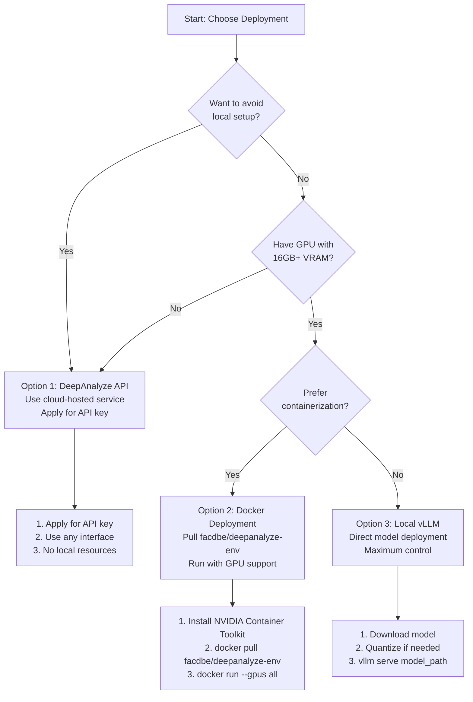
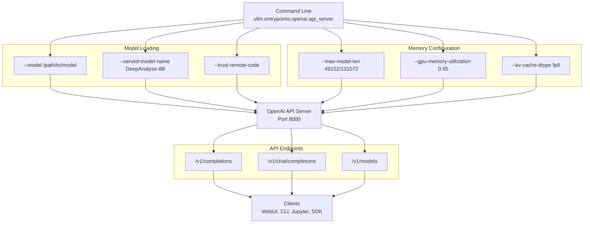
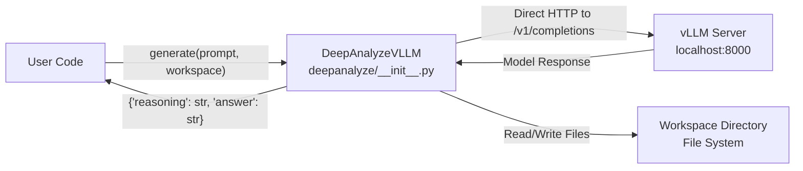
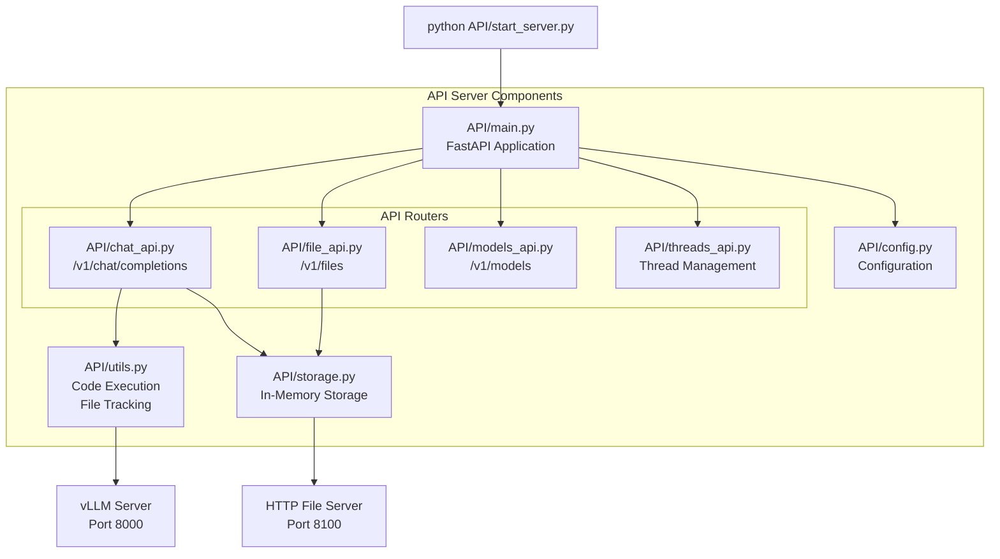
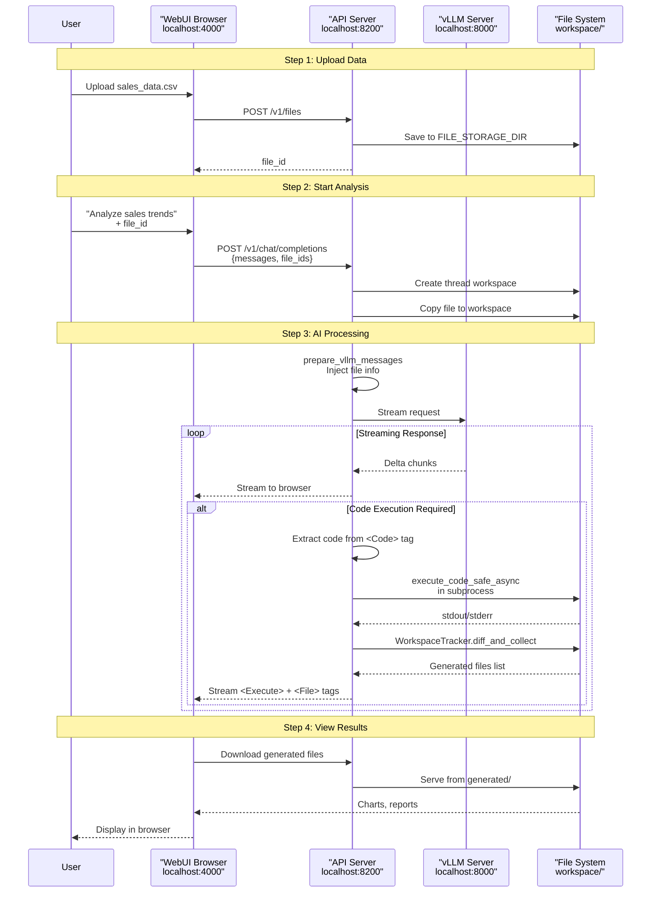

<!-- source: DeepWiki mcp.deepwiki.com · repo ruc-datalab/DeepAnalyze · page 2 Getting Started · fetched 2026-10-26 -->

# Getting Started

<details>
<summary>Relevant source files</summary>

The following files were used as context for generating this wiki page:

- [README.md](README.md)
- [assets/wechat.jpg](assets/wechat.jpg)
- [docker/.dockerignore](docker/.dockerignore)
- [docker/Dockerfile](docker/Dockerfile)
- [docker/README.md](docker/README.md)
- [docker/docker-compose.yml](docker/docker-compose.yml)
- [docs/DeepAnalyze_API_Key_Usage_Guide.md](docs/DeepAnalyze_API_Key_Usage_Guide.md)
- [docs/DeepAnalyze_API_Key_Usage_Guide_ZH.md](docs/DeepAnalyze_API_Key_Usage_Guide_ZH.md)
- [example/README.md](example/README.md)
- [quantize.py](quantize.py)
- [requirements.txt](requirements.txt)

</details>


This guide covers the initial setup and deployment of DeepAnalyze, including prerequisites, installation, model configuration, and running your first data analysis. For detailed information about specific interfaces, see [Frontend Interfaces](#5). For training your own model, see [Training Pipeline](#3.2). For API endpoint documentation, see [API Endpoints Reference](#10.1).

## Prerequisites

### System Requirements

DeepAnalyze requires the following base software:

| Component | Requirement | Notes |
|-----------|------------|-------|
| Operating System | Linux, macOS, Windows | Docker available for all platforms |
| Python | 3.8 or higher (3.12 recommended) | Required for local deployment |
| CUDA | 12.1 or compatible | Required for GPU acceleration |
| Docker | Latest version | Optional, for containerized deployment |
| NVIDIA Container Toolkit | Latest version | Required for GPU support in Docker |

**Sources:** [README.md:212-227](), [docker/README.md:7-11]()

### GPU Memory Requirements

DeepAnalyze-8B requires GPU acceleration. The memory configuration determines which model version and context length you can use:

| GPU Memory | Model Type | Recommended max-model-len | Use FP8 KV Cache |
|------------|------------|---------------------------|------------------|
| 16GB | 4-bit Quantized | 49152 | ✓ |
| 16GB | 8-bit Quantized | 8192 | ✓ |
| 24GB | Original Model | 16384 | ✓ |
| 24GB | 4-bit Quantized | 131072 | ✓ |
| 40GB+ | Original Model | 131072 | ✓ |
| 80GB | Original Model | 131072 |  |

**Quick Selection Guide:**
- **Limited Memory (<24GB)**: Use 4-bit quantized version with FP8 KV cache
- **Balanced Configuration (24-40GB)**: Choose model type based on context length requirements
- **Sufficient Memory (≥40GB)**: Use original model for best precision

**Sources:** [README.md:136-148]()

### Python Dependencies

The minimal dependencies for inference are specified in [requirements.txt:1-16](). Key packages include:

- `vllm>=0.8.5` - High-throughput inference engine
- `torch` - Deep learning framework
- `transformers` - Model loading and tokenization
- `fastapi` - API server framework
- `uvicorn` - ASGI server
- `numpy`, `pandas`, `scikit-learn`, `matplotlib`, `seaborn` - Data science libraries

**Sources:** [requirements.txt:1-16]()

## Installation

### Basic Installation

Create and activate a conda environment with Python 3.12:

```bash
conda create -n deepanalyze python=3.12 -y
conda activate deepanalyze
```

Install minimal dependencies for inference:

```bash
pip install -r requirements.txt
```

This installs the packages specified in [requirements.txt:1-16](), which includes `vllm>=0.8.5`, `torch`, `transformers`, and the necessary API server and data science libraries.

**Note:** Training dependencies (`ms-swift`, `SkyRL`) should be installed in a separate environment to avoid conflicts. See [Training Pipeline](#3.2) for training setup.

**Sources:** [README.md:214-226](), [requirements.txt:1-16]()

### Repository Structure

```
DeepAnalyze/
├── API/                    # API server implementation
│   ├── start_server.py    # Server entry point
│   ├── config.py          # Configuration constants
│   └── ...
├── demo/                   # Frontend interfaces
│   ├── chat/              # WebUI implementation
│   ├── cli/               # Command-line interface
│   ├── jupyter/           # Jupyter notebook integration
│   └── deepanalyze_general/ # Gradio apps
├── deepanalyze/           # Training and model utilities
│   ├── ms-swift/          # SFT training framework
│   ├── SkyRL/             # RL training framework
│   └── add_vocab.py       # Add special tokens to base model
├── docker/                # Docker deployment
├── quantize.py            # Model quantization script
├── requirements.txt       # Minimal inference dependencies
└── README.md
```

**Sources:** Repository structure analysis

## Deployment Options

DeepAnalyze offers three deployment approaches: cloud API, local vLLM deployment, and Docker containers. The following diagram shows the deployment decision flow:

### Deployment Decision Flow



**Sources:** [README.md:116-128](), [docker/README.md:1-89]()

### Option 1: DeepAnalyze API (Recommended for First-Time Users)

The easiest way to start using DeepAnalyze is through the hosted API service, which requires no local GPU resources.

**Apply for API Key:**
- [Primary Form (Google)](https://forms.gle/YxVkCzczqq8jeciw9)
- [Alternative Form (Feishu)](https://heywhale.feishu.cn/share/base/shrcnnBRgO0x2qhx40yq4m1HxUg)

**API Endpoint:**
```
https://www.heywhale.com/api/model/services/691d42c36c6dda33df0bf645/app/v1/chat/completions
```

**Usage Documentation:**
- [English Guide](./docs/DeepAnalyze_API_Key_Usage_Guide.md)
- [Chinese Guide (Feishu Wiki)](https://heywhale.feishu.cn/wiki/TcVmw314liwCiKkxnttc2CnInfg)

**Basic Usage Example:**

```bash
curl -X POST https://www.heywhale.com/api/model/services/.../v1/chat/completions \
  -H "Content-Type: application/json" \
  -H "Authorization: Bearer your_api_key" \
  -d '{"messages": [{"role": "user", "content": "Analyze this data"}]}'
```

The API is OpenAI-compatible, so you can use it with the OpenAI Python SDK or any compatible client. See [Using OpenAI SDK](#7.6) for detailed examples.

**Sources:** [README.md:116-128](), [docs/DeepAnalyze_API_Key_Usage_Guide.md:1-191]()

### Option 2: Local vLLM Deployment

For maximum control and no network dependency, deploy DeepAnalyze-8B locally using vLLM.

#### Step 1: Model Download

Download the model from Hugging Face or ModelScope:

- **Hugging Face:** [RUC-DataLab/DeepAnalyze-8B](https://huggingface.co/RUC-DataLab/DeepAnalyze-8B)
- **ModelScope:** [RUC-DataLab/DeepAnalyze-8B](https://www.modelscope.cn/models/RUC-DataLab/DeepAnalyze-8B/summary)

```bash
# Using Hugging Face CLI
huggingface-cli download RUC-DataLab/DeepAnalyze-8B --local-dir ./DeepAnalyze-8B
```

**Sources:** [README.md:131-133]()

#### Step 2: Model Quantization (Optional)

If your GPU has limited memory, quantize the model using [quantize.py:1-145]():

```bash
python quantize.py \
  --model_path /path/to/DeepAnalyze-8B \
  --output_dir /path/to/output \
  --quant_type both  # Creates both 4-bit and 8-bit versions
```

**Quantization Options:**

The `quantize_model_4bit` function in [quantize.py:12-53]() uses:
- `bnb_4bit_quant_type="nf4"` - NF4 quantization (optimized for neural networks)
- `bnb_4bit_compute_dtype=torch.bfloat16` - BFloat16 computation
- `bnb_4bit_use_double_quant=True` - Double quantization for further compression

The `quantize_model_8bit` function in [quantize.py:56-94]() uses:
- `load_in_8bit=True` - 8-bit quantization
- `llm_int8_threshold=6.0` - Outlier detection threshold

**Sources:** [README.md:148](), [quantize.py:1-145]()

#### Step 3: Launch vLLM Server

The vLLM server provides an OpenAI-compatible API on port 8000. Use the command template based on your GPU memory:

**General Template:**
```bash
python -m vllm.entrypoints.openai.api_server \
  --model <model_path> \
  --served-model-name DeepAnalyze-8B \
  --max-model-len <context_length> \
  --gpu-memory-utilization 0.95 \
  --port 8000 \
  --trust-remote-code
```

**16GB GPU (4-bit quantized):**
```bash
python -m vllm.entrypoints.openai.api_server \
  --model /path/to/deepanalyze/4bit \
  --served-model-name DeepAnalyze-8B \
  --max-model-len 49152 \
  --gpu-memory-utilization 0.95 \
  --port 8000 \
  --kv-cache-dtype fp8 \
  --trust-remote-code
```

**24GB GPU (maximum context):**
```bash
python -m vllm.entrypoints.openai.api_server \
  --model /path/to/deepanalyze/4bit \
  --served-model-name DeepAnalyze-8B \
  --max-model-len 131072 \
  --gpu-memory-utilization 0.95 \
  --port 8000 \
  --kv-cache-dtype fp8 \
  --trust-remote-code
```

**80GB GPU (best performance):**
```bash
python -m vllm.entrypoints.openai.api_server \
  --model /path/to/original/model \
  --served-model-name DeepAnalyze-8B \
  --max-model-len 131072 \
  --gpu-memory-utilization 0.95 \
  --port 8000 \
  --trust-remote-code
```

The server will be accessible at `http://localhost:8000/v1/completions`.

**Sources:** [README.md:150-210]()

#### vLLM Server Architecture



**Sources:** [README.md:150-210]()

### Option 3: Docker Deployment

Docker provides a pre-configured environment with all dependencies installed.

#### Pull Pre-built Image

```bash
# Pull from Docker Hub
docker pull facdbe/deepanalyze-env:latest

# Run with GPU support
docker run --gpus all -it --rm \
  -p 8000:8000 \
  -v /path/to/models:/models \
  facdbe/deepanalyze-env:latest
```

**Sources:** [docker/README.md:17-28]()

#### Build from Dockerfile

For customization, build the image from [docker/Dockerfile:1-113]():

```bash
cd docker
docker build -t deepanalyze-env:latest .

docker run --gpus all -it --rm \
  -p 8000:8000 \
  deepanalyze-env:latest
```

**Docker Image Contents:**

The [docker/Dockerfile:1-113]() includes:
- **Base:** `nvidia/cuda:12.1.0-devel-ubuntu22.04` [docker/Dockerfile:7]()
- **Core ML:** `vllm`, `torch`, `transformers`, `accelerate` [docker/Dockerfile:28-38]()
- **Data Science:** `pandasql`, `feature-engine`, `missingno` [docker/Dockerfile:42-46]()
- **Visualization:** `plotly`, `bokeh`, `matplotlib-venn`, `folium` [docker/Dockerfile:48-56]()
- **Advanced Analytics:** `optuna`, `shap`, `prophet`, `pymc` [docker/Dockerfile:58-78]()
- **Causal Inference:** `dowhy`, `econml`, `causalml` [docker/Dockerfile:80-86]()
- **Geospatial:** `geopandas`, `shapely`, `pysal` [docker/Dockerfile:88-106]()

**Image Size:** ~17GB total (CUDA: ~5GB, vLLM/PyTorch: ~10GB, Data Science: ~2GB)

**Sources:** [docker/Dockerfile:1-113](), [docker/README.md:75-79]()

#### Docker Compose Deployment

Use [docker/docker-compose.yml:1-49]() for production deployments:

```bash
cd docker
docker-compose up -d
```

The compose file configures:
- GPU resource allocation [docker/docker-compose.yml:15-22]()
- Port mapping `8000:8000` [docker/docker-compose.yml:24-26]()
- Volume mounts for workspace and models [docker/docker-compose.yml:28-31]()
- Environment variables for CUDA configuration [docker/docker-compose.yml:33-36]()

**Sources:** [docker/docker-compose.yml:1-49]()

## Running Your First Analysis

### Quick Start with Python SDK

The `DeepAnalyzeVLLM` class provides the simplest programmatic interface, bypassing the API server and communicating directly with vLLM.

#### Basic Usage Pattern



Create a Python script using the SDK:

```python
from deepanalyze import DeepAnalyzeVLLM

# Initialize the SDK (points to vLLM server)
deepanalyze = DeepAnalyzeVLLM("/path/to/model")

# Define your analysis prompt
prompt = """# Instruction
Analyze the uploaded data and generate visualizations.

# Data
File 1: {"name": "sales_data.csv", "size": "150KB"}
"""

# Specify workspace directory (where files are located)
workspace = "/path/to/workspace/"

# Generate analysis
answer = deepanalyze.generate(prompt, workspace=workspace)

# Access results
print(answer["reasoning"])  # Full reasoning trace
print(answer["answer"])     # Final answer
```

The `DeepAnalyzeVLLM` class in `deepanalyze/__init__.py` handles:
- Direct communication with vLLM on port 8000
- Workspace file management
- Response parsing and structured output

**Sources:** [README.md:237-262]()

### Launching the API Server and Frontend Interfaces

For a complete interactive experience with file upload, streaming responses, and artifact viewing, use the API server with one of the frontend interfaces.

#### API Server Deployment Flow



#### Start the API Server

Ensure vLLM is running, then start the API server:

```bash
# Terminal 1: vLLM (if not already running)
vllm serve DeepAnalyze-8B

# Terminal 2: API Server
cd API
python start_server.py
```

This launches:
- **API Server:** Port 8200 (configured in [API/config.py]())
- **File Server:** Port 8100 (configured in [API/config.py]())

The `start_server.py` script initializes the FastAPI application defined in [API/main.py]() and includes routers for chat, files, models, threads, and admin endpoints.

**Sources:** [README.md:91-100](), [README.md:283-287]()

### Interface Options

Once the API server is running, choose your preferred interface:

#### WebUI (Browser-based)

```bash
cd demo/chat/frontend
npm install
cd ..
bash start.sh  # Launches backend and frontend

# Access at http://localhost:4000
```

The WebUI provides a three-panel interface with file management, chat, and code execution. See [WebUI](#5.1) for details.

**Sources:** [README.md:55-69]()

#### CLI (Terminal)

```bash
cd demo/cli
python api_cli.py       # English interface
# or
python api_cli_ZH.py    # Chinese interface
```

The CLI uses the Rich library for formatted output and supports file upload commands. See [Command Line Interface](#5.2) for details.

**Sources:** [README.md:89-105]()

#### JupyterUI (Notebook)

```bash
cd demo/jupyter
# Follow setup instructions in demo/jupyter/README.md
```

JupyterUI integrates DeepAnalyze into Jupyter Lab using the Model Context Protocol (MCP). See [JupyterUI](#5.3) for details.

**Sources:** [README.md:71-80]()

#### Gradio Apps (Simplified Web Interface)

```bash
cd demo/deepanalyze_general
python app.py       # English interface
# or
python app_ZH.py    # Chinese interface

# Access at http://localhost:8080
```

Gradio provides a simplified web interface with file upload and chat. See [Gradio Apps](#5.4) for details.

**Sources:** [docs/DeepAnalyze_API_Key_Usage_Guide.md:163-179]()

### Example: First Analysis with WebUI

This example demonstrates a complete analysis workflow using the WebUI:



**Workflow Steps:**

1. **Upload Data:** Click the upload button or drag-and-drop CSV/Excel files into the Files Panel
2. **Enter Prompt:** In the Assistant Panel, enter: "Analyze the sales data and identify trends"
3. **Attach Files:** Select uploaded files to attach to your message
4. **Send:** Click send and watch the streaming response with structured sections
5. **View Results:** Generated charts and reports appear in the Files Panel with download links
6. **Iterate:** Ask follow-up questions in the same thread to build upon previous analysis

The WebUI maintains conversation state through `thread_id`, allowing multi-turn analysis where each iteration can access files and results from previous turns. See [Multi-turn Conversations](#7.4) for details.

**Sources:** [README.md:46-69](), Diagram 3 from system architecture overview

## Configuration Reference

### API Server Configuration

Key configuration constants in [API/config.py]():

| Constant | Default | Description |
|----------|---------|-------------|
| `VLLM_API_BASE` | `"http://localhost:8000/v1"` | vLLM server endpoint |
| `API_PORT` | `8200` | API server port |
| `FILE_SERVER_PORT` | `8100` | File server port |
| `FILE_STORAGE_DIR` | `"./uploaded_files"` | Upload directory |
| `WORKSPACE_DIR` | `"./workspace"` | Thread workspaces |
| `MAX_FILE_SIZE` | `100 * 1024 * 1024` | 100MB upload limit |

To customize, edit [API/config.py]() before starting the server.

**Sources:** [API/config.py]() (implied from system architecture)

### Model Configuration

When launching vLLM, the key parameters are:

| Parameter | Purpose | Values |
|-----------|---------|--------|
| `--model` | Model path | Local directory or HF model ID |
| `--served-model-name` | API model name | `"DeepAnalyze-8B"` |
| `--max-model-len` | Context window | 8192-131072 (based on GPU) |
| `--gpu-memory-utilization` | VRAM usage | 0.95 (aggressive) |
| `--kv-cache-dtype` | KV cache precision | `fp8` (for memory savings) |
| `--trust-remote-code` | Custom code | Required for DeepAnalyze |

**Sources:** [README.md:150-210]()

## Verification and Testing

### Verify vLLM Server

Test the vLLM server is responding:

```bash
curl http://localhost:8000/v1/models
```

Expected response:
```json
{
  "object": "list",
  "data": [
    {
      "id": "DeepAnalyze-8B",
      "object": "model",
      "created": 1234567890,
      "owned_by": "organization"
    }
  ]
}
```

**Sources:** [README.md:210]()

### Verify API Server

Test the API server health endpoint:

```bash
curl http://localhost:8200/health
```

Test file upload:

```bash
curl -X POST "http://localhost:8200/v1/files" \
  -F "file=@test_data.csv" \
  -F "purpose=file-extract"
```

**Sources:** [README.md:292-311]()

### Test Analysis with cURL

Complete example with file upload and analysis:

```bash
# Upload file
FILE_RESPONSE=$(curl -s -X POST "http://localhost:8200/v1/files" \
    -F "file=@data.csv" \
    -F "purpose=file-extract")

# Extract file ID
FILE_ID=$(echo $FILE_RESPONSE | jq -r '.id')

# Request analysis
curl -X POST http://localhost:8200/v1/chat/completions \
     -H "Content-Type: application/json" \
     -d "{
        \"model\": \"DeepAnalyze-8B\",
        \"messages\": [
          {
            \"role\": \"user\",
            \"content\": \"Generate a data science report.\",
            \"file_ids\": [\"$FILE_ID\"]
          }
        ]
      }"
```

**Sources:** [README.md:292-311]()

## Troubleshooting

### Common Issues

**Issue: vLLM OOM (Out of Memory)**

- Reduce `--max-model-len` to a smaller context window
- Use a more aggressive quantization (4-bit instead of 8-bit)
- Enable FP8 KV cache with `--kv-cache-dtype fp8`
- Increase `--gpu-memory-utilization` to 0.95 or higher

**Issue: API Server Cannot Connect to vLLM**

- Verify vLLM is running: `curl http://localhost:8000/v1/models`
- Check `VLLM_API_BASE` in [API/config.py]() matches your vLLM port
- Ensure no firewall is blocking port 8000

**Issue: File Upload Fails**

- Check `MAX_FILE_SIZE` in [API/config.py]() (default 100MB)
- Verify `FILE_STORAGE_DIR` has write permissions
- Ensure disk space is available

**Issue: Code Execution Timeout**

- Long-running analyses may timeout
- Check subprocess timeout settings in [API/utils.py]()
- Consider increasing timeout for complex analyses

**Sources:** Based on configuration in [API/config.py]() and execution logic in [API/utils.py]()

## Next Steps

After completing this setup:

1. **Explore Interfaces:** Try different interfaces (WebUI, CLI, Jupyter) to find your preferred workflow - see [Frontend Interfaces](#5)
2. **Learn Multi-turn:** Understand thread-based conversations for iterative analysis - see [Multi-turn Conversations](#7.4)
3. **Try Examples:** Work through real-world use cases - see [Example Use Cases](#8)
4. **Advanced Usage:** Explore workspace management and report generation - see [Working with Workspaces](#7.5)
5. **API Integration:** Integrate DeepAnalyze into your applications - see [Using OpenAI SDK](#7.6)

**Sources:** Based on documentation structure

---

