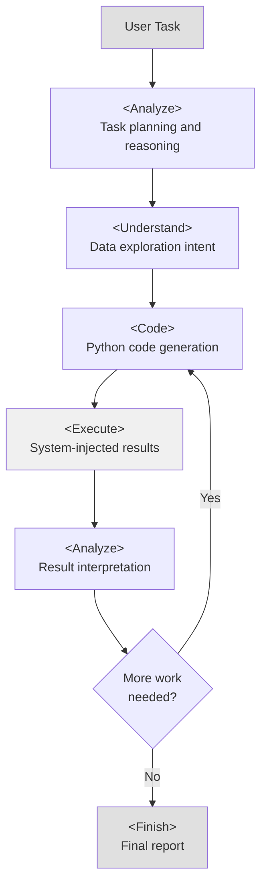
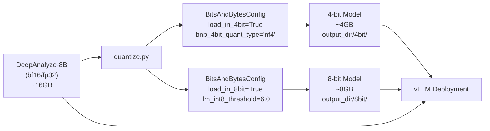
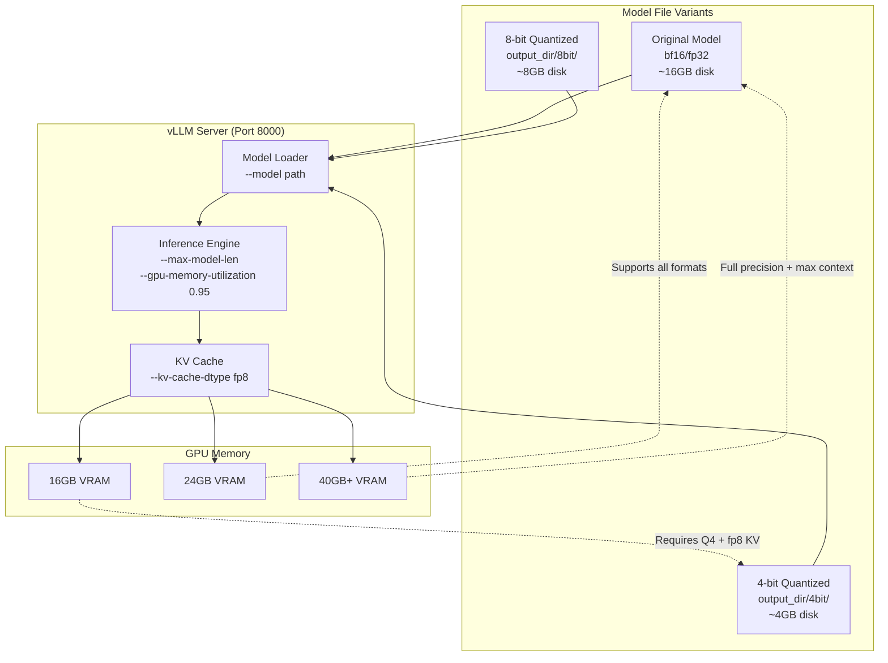

<!-- source: DeepWiki mcp.deepwiki.com · repo ruc-datalab/DeepAnalyze · page 3.1 DeepAnalyze-8B Model · fetched 2026-10-26 -->

# DeepAnalyze-8B Model

<details>
<summary>Relevant source files</summary>

The following files were used as context for generating this wiki page:

- [README.md](README.md)
- [assets/wechat.jpg](assets/wechat.jpg)
- [demo/deepanalyze_general/README.md](demo/deepanalyze_general/README.md)
- [demo/deepanalyze_general/README_ZH.md](demo/deepanalyze_general/README_ZH.md)
- [demo/deepanalyze_general/__init__.py](demo/deepanalyze_general/__init__.py)
- [demo/deepanalyze_general/deepanalyze_general.py](demo/deepanalyze_general/deepanalyze_general.py)
- [docs/DeepAnalyze_API_Key_Usage_Guide.md](docs/DeepAnalyze_API_Key_Usage_Guide.md)
- [docs/DeepAnalyze_API_Key_Usage_Guide_ZH.md](docs/DeepAnalyze_API_Key_Usage_Guide_ZH.md)
- [example/README.md](example/README.md)
- [quantize.py](quantize.py)
- [requirements.txt](requirements.txt)

</details>


## Purpose and Scope

This page documents the DeepAnalyze-8B model, including its architecture, special token system, quantization options, and deployment configurations. For information about the training methodology used to create this model, see [Training Pipeline](#3.2). For dataset details, see [DataScience-Instruct-500K Dataset](#3.3). For deployment instructions and hardware requirements, see [Deployment](#4).

---

## Base Model Foundation

DeepAnalyze-8B is built upon **DeepSeek-R1-0528-Qwen3-8B**, a reasoning-focused language model with 8 billion parameters. The base model provides strong mathematical and logical reasoning capabilities that are enhanced through curriculum-based fine-tuning for autonomous data science tasks.

### Model Specifications

| Attribute | Value |
|-----------|-------|
| **Base Model** | DeepSeek-R1-0528-Qwen3-8B |
| **Parameters** | 8 billion |
| **Context Length** | Up to 131,072 tokens (deployment-dependent) |
| **Precision** | bf16/fp32 (original), 8-bit, 4-bit (quantized) |
| **License** | Open source |
| **Model Hub** | [RUC-DataLab/DeepAnalyze-8B](https://huggingface.co/RUC-DataLab/DeepAnalyze-8B) |

### Token Extension Process

The base model vocabulary is extended with specialized action tags using [deepanalyze/add_vocab.py](). This script adds tokens for the agentic workflow system before training begins.

**Command:**
```bash
python deepanalyze/add_vocab.py \
  --model_path "$MODEL_PATH" \
  --save_path "$SAVE_PATH" \
  --add_tags
```

**Sources:** [README.md:318-330](), System architecture diagrams

---

## Action Tag System

DeepAnalyze operates through a structured "think-act-observe" workflow controlled by XML-like action tags. These tags enable the model to break down data science tasks into explicit reasoning steps, code generation, and result interpretation.

### Core Action Tags



**Tag Definitions:**

- **`<Analyze>`**: Task planning, logical reasoning, hypothesis formation, result interpretation, and reflection
- **`<Understand>`**: Declaration of intent to explore data source structure and semantics through code
- **`<Code>`**: Generation of executable Python code using pandas, numpy, matplotlib, seaborn, etc.
- **`<Execute>`**: System-injected tag containing code execution results (stdout, stderr, errors)
- **`<Finish>`**: Final conclusions, reports, or recommendations
- **`<Ask>`**: (Optional) Interactive mode tag for requesting clarification from users

### System Prompt Architecture

The model's behavior is governed by comprehensive system prompts that define action tag semantics and workflow rules. Two variants exist:

**Basic Mode** (`deepanalyze_system_prompt`):
- Supports `<Analyze>`, `<Understand>`, `<Code>`, `<Execute>`, `<Finish>`
- Enforces one-action-per-turn constraint
- Automatic code execution cycle

**Interactive Mode** (`deepanalyze_system_prompt_with_ask`):
- Adds `<Ask>` tag for user interaction
- Enables clarification of ambiguous requirements
- Prevents unverified business assumptions

**Sources:** [demo/deepanalyze_general/deepanalyze_general.py:13-235]()

---

## Model Workflow Execution

### Single-Turn Reasoning Cycle

```mermaid
sequenceDiagram
    participant User
    participant Model as DeepAnalyze-8B
    participant Executor as Code Executor
    
    User->>Model: User instruction
    Model->>Model: Generate &lt;Analyze&gt;
    Note over Model: Plan approach
    
    Model->>Model: Generate &lt;Understand&gt;
    Note over Model: Declare exploration intent
    
    Model->>Model: Generate &lt;Code&gt;
    Note over Model: Python code
    
    Model->>Executor: Code block
    Executor->>Executor: Execute in sandbox
    Executor->>Model: &lt;Execute&gt; stdout/stderr
    
    Model->>Model: Generate &lt;Analyze&gt;
    Note over Model: Interpret results
    
    alt More iterations needed
        Model->>Model: Generate &lt;Code&gt;
        Model->>Executor: Next code block
    else Task complete
        Model->>User: &lt;Finish&gt; report
    end
```

### Code Execution Environment

The execution environment is initialized with pre-imported libraries and shared namespace for variable persistence across multiple code blocks:

**Initialization** ([demo/deepanalyze_general/deepanalyze_general.py:262-275]()):
```python
namespace = {}
import pandas as pd
import matplotlib.pyplot as plt
import seaborn as sns
namespace['pd'] = pd
namespace['plt'] = plt
namespace['sns'] = sns
namespace['__builtins__'] = __builtins__
```

**Key features:**
- Variables defined in one `<Code>` block persist to subsequent blocks
- Automatic warning suppression to conserve context window
- Safe cleanup after task completion

**Sources:** [demo/deepanalyze_general/deepanalyze_general.py:238-386](), [demo/deepanalyze_general/README.md:20-25]()

---

## Model Quantization and Variants

DeepAnalyze-8B is available in three precision formats to accommodate different GPU memory configurations. Quantization is performed using the `bitsandbytes` library via [quantize.py]().

### Quantization Options

| Format | Memory Footprint | Quantization Type | Use Case |
|--------|------------------|-------------------|----------|
| **bf16/fp32** | ~16 GB | Original precision | Maximum quality, 40GB+ VRAM |
| **8-bit** | ~8 GB | `load_in_8bit=True`<br/>`llm_int8_threshold=6.0` | Balanced quality/efficiency, 24GB+ VRAM |
| **4-bit** | ~4 GB | `bnb_4bit_quant_type="nf4"`<br/>`bnb_4bit_use_double_quant=True` | Maximum compression, 16GB VRAM |

### Quantization Process

**4-bit Quantization** ([quantize.py:12-53]()):
```bash
python quantize.py \
  --model_path /path/to/original/model \
  --output_dir /path/to/output \
  --quant_type 4bit
```

**Configuration:**
- Uses NF4 (Normal Float 4) quantization type
- bf16 compute dtype for numerical stability
- Optional double quantization for additional compression

**8-bit Quantization** ([quantize.py:56-94]()):
```bash
python quantize.py \
  --model_path /path/to/original/model \
  --output_dir /path/to/output \
  --quant_type 8bit
```

**Configuration:**
- Outlier detection with `llm_int8_threshold=6.0`
- Preserves critical weights in higher precision

### Quantization Implementation Diagram



**Sources:** [quantize.py:1-145](), [README.md:136-148]()

---

## Deployment Configurations

### GPU Memory Requirements Matrix

The following table maps GPU memory capacity to recommended deployment configurations:

| GPU Memory | Model Type | max-model-len | kv-cache-dtype | Context Length Range | Example GPUs |
|------------|------------|---------------|----------------|---------------------|--------------|
| **16GB** | 4-bit Quantized | 49152 | fp8 | 49K tokens | RTX 3090, RTX 4080 |
| **16GB** | 8-bit Quantized | 8192 | fp8 | 8K tokens | RTX 3090, RTX 4080 |
| **24GB** | Original Model | 16384 | fp8 | 16K tokens | RTX 4090, A5000 |
| **24GB** | 8-bit Quantized | 98304 | fp8 | 98K tokens | RTX 4090, A5000 |
| **24GB** | 4-bit Quantized | 131072 | fp8 | 131K tokens | RTX 4090, A5000 |
| **40GB** | Original Model | 131072 | fp8 | 131K tokens | A100 40GB |
| **40GB** | 8-bit Quantized | 131072 | (none) | 131K tokens | A100 40GB |
| **80GB** | Original Model | 131072 | (none) | 131K tokens | A100 80GB, H100 |

### vLLM Launch Commands

**General Template** ([README.md:153-162]()):
```bash
python -m vllm.entrypoints.openai.api_server \
  --model <model_path> \
  --served-model-name DeepAnalyze-8B \
  --max-model-len <context_length> \
  --gpu-memory-utilization 0.95 \
  --port 8000 \
  --kv-cache-dtype fp8 \  # if specified in table
  --trust-remote-code
```

**16GB GPU Example** (4-bit, maximum context):
```bash
python -m vllm.entrypoints.openai.api_server \
  --model /path/to/deepanalyze/4bit \
  --served-model-name DeepAnalyze-8B \
  --max-model-len 49152 \
  --gpu-memory-utilization 0.95 \
  --port 8000 \
  --kv-cache-dtype fp8 \
  --trust-remote-code
```

**80GB GPU Example** (original precision, full context):
```bash
python -m vllm.entrypoints.openai.api_server \
  --model /path/to/original/model \
  --served-model-name DeepAnalyze-8B \
  --max-model-len 131072 \
  --gpu-memory-utilization 0.95 \
  --port 8000 \
  --trust-remote-code
```

### Deployment Architecture



**Key Configuration Parameters:**
- `--gpu-memory-utilization 0.95`: Aggressive memory allocation for maximum context
- `--kv-cache-dtype fp8`: Reduces KV cache memory by ~50%
- `--max-model-len`: Controls maximum sequence length
- `--trust-remote-code`: Required for custom model code

**Sources:** [README.md:136-210](), Training to Deployment Pipeline diagram

---

## Model Capabilities

### Autonomous Data Science Workflow

DeepAnalyze-8B is specifically trained to perform end-to-end data science tasks without human intervention:

1. **Data Understanding**: Automatic exploration of structured (CSV, Excel, databases), semi-structured (JSON, XML), and unstructured data (text, markdown)
2. **Exploratory Analysis**: Statistical summaries, distribution analysis, correlation detection
3. **Data Preparation**: Cleaning, transformation, feature engineering
4. **Modeling**: Statistical analysis, machine learning model training
5. **Visualization**: Matplotlib, Seaborn chart generation with automatic file persistence
6. **Report Generation**: Analyst-grade markdown reports with structured sections

### Multi-Turn Reasoning

The model maintains context across multiple reasoning cycles, enabling:
- Iterative hypothesis refinement
- Error detection and self-correction
- Incremental analysis building on prior results
- Debugging failed code executions

### Interactive Clarification (Optional)

When deployed with `is_interactive=True` ([demo/deepanalyze_general/deepanalyze_general.py:250]()), the model can:
- Detect ambiguous requirements (e.g., "high-value customer" without definition)
- Generate `<Ask>` tags to request clarification
- Incorporate user responses into subsequent reasoning
- Prevent errors from unverified assumptions

**Example interaction** ([demo/deepanalyze_general/README.md:143-230]()):
```xml
<Ask>
有两个问题需要确认:
1. 'segment' 字段的取值 A、B、C 是否代表客户价值等级?
2. "留存"是指用户在最近多少天内有活动?
</Ask>
```

### Language Support

- **Primary**: English
- **Secondary**: Chinese (中文) - Supported in CLI, Gradio, and system prompts
- Bilingual interfaces available for CLI and Gradio applications

**Sources:** [README.md:21-24](), [demo/deepanalyze_general/deepanalyze_general.py:104-235](), [demo/deepanalyze_general/README.md:8-16]()

---

## Model Access and Distribution

### Official Repositories

- **Hugging Face**: [RUC-DataLab/DeepAnalyze-8B](https://huggingface.co/RUC-DataLab/DeepAnalyze-8B)
- **ModelScope**: [RUC-DataLab/DeepAnalyze-8B](https://www.modelscope.cn/models/RUC-DataLab/DeepAnalyze-8B/summary)
- **GitHub**: [ruc-datalab/DeepAnalyze](https://github.com/ruc-datalab/DeepAnalyze)

### Installation Requirements

**Minimal dependencies** ([requirements.txt:1-16]()):
```txt
vllm>=0.8.5
torch
transformers
numpy
pandas
scikit-learn
seaborn
matplotlib
```

**Environment setup**:
```bash
conda create -n deepanalyze python=3.12 -y
conda activate deepanalyze
pip install -r requirements.txt
```

**Note**: Training frameworks (`ms-swift`, `SkyRL`) are not required for inference and should be installed in separate environments to avoid dependency conflicts.

### API Key Access

For users who prefer not to deploy locally, API keys are available through:
- **Google Form**: https://forms.gle/YxVkCzczqq8jeciw9
- **Feishu Form**: https://heywhale.feishu.cn/share/base/shrcnnBRgO0x2qhx40yq4m1HxUg

API endpoint: `https://www.heywhale.com/api/model/services/691d42c36c6dda33df0bf645/app/v1/chat/completions`

**Sources:** [README.md:116-128](), [docs/DeepAnalyze_API_Key_Usage_Guide.md:1-20](), [requirements.txt:1-16]()

---

## Related Pages

- [Training Pipeline](#3.2) - Curriculum-based training methodology, single-ability to multi-ability RL
- [DataScience-Instruct-500K Dataset](#3.3) - Training data structure and composition
- [vLLM Server Setup](#4.1) - Detailed deployment instructions
- [Model Quantization](#4.2) - Advanced quantization techniques and troubleshooting
- [GPU Requirements and Configuration](#4.4) - Hardware planning and optimization

---

