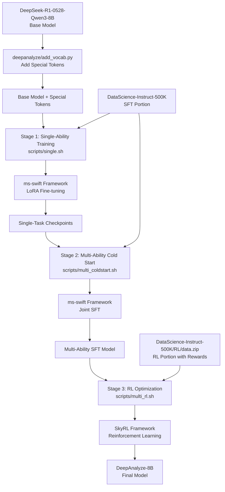
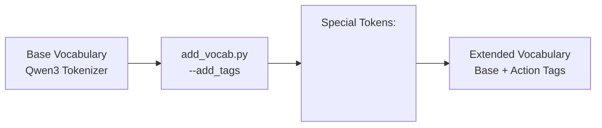
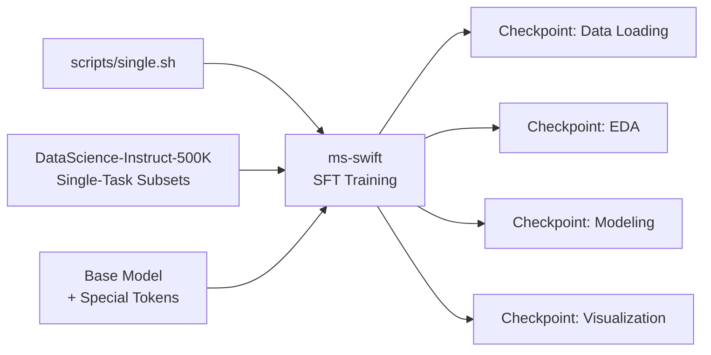
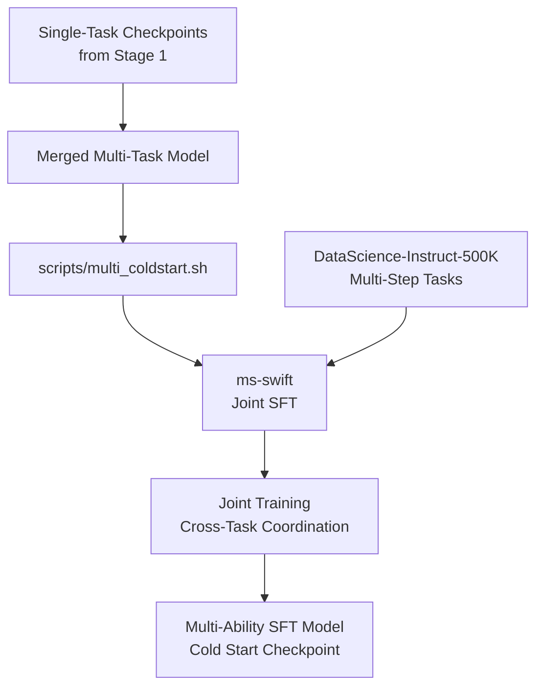
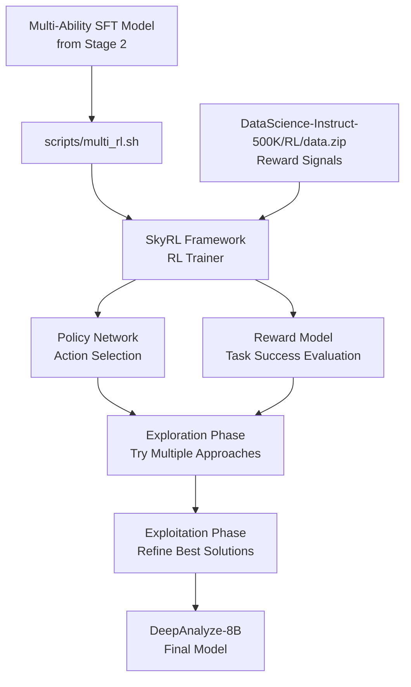
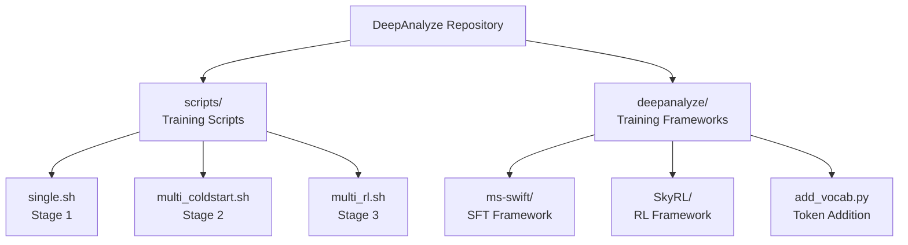

<!-- source: DeepWiki mcp.deepwiki.com · repo ruc-datalab/DeepAnalyze · page 3.2 Training Pipeline · fetched 2026-10-26 -->

# Training Pipeline

<details>
<summary>Relevant source files</summary>

The following files were used as context for generating this wiki page:

- [README.md](README.md)
- [assets/wechat.jpg](assets/wechat.jpg)
- [docs/DeepAnalyze_API_Key_Usage_Guide.md](docs/DeepAnalyze_API_Key_Usage_Guide.md)
- [docs/DeepAnalyze_API_Key_Usage_Guide_ZH.md](docs/DeepAnalyze_API_Key_Usage_Guide_ZH.md)
- [example/README.md](example/README.md)
- [quantize.py](quantize.py)
- [requirements.txt](requirements.txt)

</details>


## Purpose and Scope

This document describes the curriculum-based training methodology used to produce the DeepAnalyze-8B model. It covers the three-stage training process (single-ability fine-tuning, multi-ability cold start, and reinforcement learning), the base model preparation steps, training data structure, and the frameworks used at each stage.

For information about the final trained model's architecture and capabilities, see [DeepAnalyze-8B Model](#3.1). For details about the training dataset structure and content, see [DataScience-Instruct-500K Dataset](#3.3). For post-training quantization procedures, see [Model Quantization](#4.2).

---

## Training Pipeline Overview

DeepAnalyze employs a **curriculum-based agentic training approach** that progressively builds autonomous data science capabilities through three distinct stages. This methodology prevents the model from being overwhelmed by complex multi-step reasoning tasks early in training, instead building competencies incrementally.

### Training Pipeline Architecture



**Sources:** [README.md:315-341]()

---

## Base Model Preparation

### Base Model Selection

DeepAnalyze builds upon **DeepSeek-R1-0528-Qwen3-8B**, a reasoning-optimized language model. This base model provides strong foundational capabilities in logical reasoning and code generation, which are essential for autonomous data science tasks.

**Alternative Starting Point:** Users can also start from the already-trained [DeepAnalyze-8B](https://huggingface.co/RUC-DataLab/DeepAnalyze-8B) model if they wish to perform additional fine-tuning or domain adaptation.

### Special Token Addition

Before training, the base model vocabulary must be extended with **special action tags** that enable structured agentic behavior. The `add_vocab.py` script adds tokens like `<Analyze>`, `<Code>`, `<Execute>`, and `<File>` that allow the model to segment its output into distinct reasoning and action phases.

**Command:**
```bash
MODEL_PATH=path_to_DeepSeek-R1-0528-Qwen3-8B
SAVE_PATH=path_to_save_DeepSeek-R1-0528-Qwen3-8B-addvocab

python deepanalyze/add_vocab.py \
  --model_path "$MODEL_PATH" \
  --save_path "$SAVE_PATH" \
  --add_tags
```

**Script Location:** [README.md:320-330]()

### Special Token Structure



These tokens enable the model to produce structured outputs that the API server can parse and execute. For example, code wrapped in `<Code>` tags is extracted and run in sandboxed environments (see [Code Execution and Agentic Loop](#6.6.1) for runtime behavior).

**Sources:** [README.md:320-330]()

---

## Training Data Structure

The **DataScience-Instruct-500K** dataset is organized into two portions for the different training stages:

| Data Portion | Format | Purpose | Used In Stage |
|--------------|--------|---------|---------------|
| **SFT Portion** | Standard instruction-response pairs | Supervised fine-tuning for individual skills | Stage 1, Stage 2 |
| **RL Portion** | Instruction-response pairs + reward signals | Reinforcement learning for autonomous optimization | Stage 3 |

The RL portion requires unpacking:
```bash
unzip DataScience-Instruct-500K/RL/data.zip
```

The SFT data covers tasks such as:
- Data cleaning and preprocessing
- Exploratory data analysis (EDA)
- Statistical modeling
- Visualization generation
- Report writing

The RL data includes reward signals based on:
- Task completion accuracy
- Code execution success
- Output file quality
- Multi-step reasoning coherence

For detailed information about dataset structure and content, see [DataScience-Instruct-500K Dataset](#3.3).

**Sources:** [README.md:332-335]()

---

## Stage 1: Single-Ability Fine-Tuning

### Objective

The first stage trains the model on **isolated data science subtasks**, ensuring it masters individual capabilities before attempting complex multi-step workflows. Each checkpoint specializes in one skill: data loading, statistical analysis, visualization, etc.

### Training Script



**Script Path:** [README.md:338]()

### Training Configuration

The `scripts/single.sh` script uses **ms-swift** with LoRA (Low-Rank Adaptation) to enable efficient fine-tuning:

- **LoRA rank**: Typically 8-16 for parameter efficiency
- **Training epochs**: Task-dependent, typically 3-5 epochs per subtask
- **Batch size**: Optimized for GPU memory constraints
- **Learning rate**: Conservative to preserve base model reasoning

Each subtask training run produces a specialized checkpoint that demonstrates proficiency in one aspect of data science work.

**Sources:** [README.md:338]()

---

## Stage 2: Multi-Ability Cold Start

### Objective

Stage 2 **integrates multiple capabilities** learned in Stage 1, training the model to coordinate different skills within a single conversation. This stage uses supervised fine-tuning (SFT) but presents multi-step tasks that require combining data loading, analysis, visualization, and reporting.

### Training Script



**Script Path:** [README.md:339]()

### Training Characteristics

- **Input**: Merged weights from Stage 1 checkpoints OR continue from base model
- **Data**: Multi-step workflows from DataScience-Instruct-500K
- **Framework**: ms-swift with LoRA or full fine-tuning
- **Objective**: Learn to sequence `<Analyze>`, `<Code>`, `<Execute>` actions coherently

At this stage, the model learns **task decomposition** and **sequential reasoning**, but still relies on supervised examples rather than autonomous exploration.

**Sources:** [README.md:339]()

---

## Stage 3: Reinforcement Learning Optimization

### Objective

The final stage applies **reinforcement learning** to optimize the model's autonomous decision-making. Using reward signals based on task success, code correctness, and output quality, the model learns to explore solution spaces, debug failures, and iteratively refine outputs without explicit supervision.

### Training Script and Framework



**Script Path:** [README.md:340]()

### Reinforcement Learning Components

**Framework:** SkyRL (see [deepanalyze/SkyRL/](https://github.com/ruc-datalab/DeepAnalyze/tree/main/deepanalyze/SkyRL))

**Training Loop:**
1. Model generates analysis workflow for a data task
2. Code is executed in a sandboxed environment
3. Reward model evaluates outputs (correctness, completeness, quality)
4. Policy network is updated based on reward signals
5. Process repeats with different tasks and exploration strategies

**Reward Criteria:**
- **Task Completion**: Did the model answer the user's question?
- **Code Execution**: Does the generated code run without errors?
- **Output Quality**: Are visualizations informative? Are reports well-structured?
- **Efficiency**: Does the solution avoid unnecessary steps?

This stage produces the **autonomous agentic behavior** that distinguishes DeepAnalyze from traditional instruction-following models.

**Sources:** [README.md:340]()

---

## Training Frameworks

### ms-swift

**Repository:** [deepanalyze/ms-swift/](https://github.com/ruc-datalab/DeepAnalyze/tree/main/deepanalyze/ms-swift)

**Purpose:** Supervised fine-tuning framework used in Stages 1 and 2

**Installation:**
```bash
cd ./deepanalyze/ms-swift/
pip install -e .
```

**Key Features:**
- LoRA and full fine-tuning support
- Efficient multi-GPU training
- Checkpoint management and merging
- Integration with Hugging Face transformers

**Requirements:** [deepanalyze/ms-swift/requirements.txt]()

**Sources:** [README.md:221-222](), [README.md:365]()

### SkyRL

**Repository:** [deepanalyze/SkyRL/](https://github.com/ruc-datalab/DeepAnalyze/tree/main/deepanalyze/SkyRL)

**Purpose:** Reinforcement learning framework used in Stage 3

**Installation:**
```bash
cd ./deepanalyze/SkyRL/
pip install -e .
```

**Key Features:**
- Policy gradient algorithms for LLMs
- Reward model training and inference
- PPO (Proximal Policy Optimization) support
- Experience replay and sampling strategies

**Requirements:** [deepanalyze/SkyRL/pyproject.toml]()

**Sources:** [README.md:221-222](), [README.md:365]()

---

## Training Environment Setup

### Dependency Separation

The documentation recommends **separating inference and training environments** to avoid dependency conflicts between vLLM (used for deployment) and training frameworks.

**Inference Environment:**
```bash
conda create -n deepanalyze-inference python=3.12 -y
conda activate deepanalyze-inference
pip install -r requirements.txt
```

**Training Environment:**
```bash
conda create -n deepanalyze-training python=3.12 -y
conda activate deepanalyze-training

# Install training frameworks
cd ./deepanalyze/ms-swift/ && pip install -e .
cd ../SkyRL/ && pip install -e .
```

**Minimal Inference Requirements:** [requirements.txt:1-16]()

**Sources:** [README.md:212-227]()

---

## Training Execution Summary

### Complete Training Pipeline

| Stage | Script | Framework | Input | Output | Duration |
|-------|--------|-----------|-------|--------|----------|
| **Token Addition** | `deepanalyze/add_vocab.py` | transformers | Base model | Model + special tokens | ~10 min |
| **Stage 1** | `scripts/single.sh` | ms-swift | SFT data (single tasks) | Single-ability checkpoints | Hours-Days |
| **Stage 2** | `scripts/multi_coldstart.sh` | ms-swift | SFT data (multi-step) | Multi-ability SFT model | Days |
| **Stage 3** | `scripts/multi_rl.sh` | SkyRL | RL data (with rewards) | DeepAnalyze-8B | Days-Weeks |

### Directory Structure for Training



**Sources:** [README.md:315-341]()

---

## Output Model and Post-Training

### DeepAnalyze-8B Model

The final output of Stage 3 is **DeepAnalyze-8B**, an 8-billion parameter language model with agentic data science capabilities. The model is published on Hugging Face:

- **Model Hub:** [RUC-DataLab/DeepAnalyze-8B](https://huggingface.co/RUC-DataLab/DeepAnalyze-8B)
- **Model Format:** Standard Hugging Face transformers format (bf16/fp32)
- **Model Size:** ~16GB (full precision)

### Post-Training Quantization

After training completes, the model can be quantized for deployment on different GPU memory configurations using the `quantize.py` script:

```bash
python quantize.py \
  --model_path /path/to/DeepAnalyze-8B \
  --output_dir /path/to/output \
  --quant_type both  # Produces both 4-bit and 8-bit versions
```

**Quantization Script:** [quantize.py:1-145]()

**Quantization Options:**

| Quantization Type | Memory Footprint | Quality | Command Flag |
|-------------------|------------------|---------|--------------|
| **Original (bf16)** | ~16GB | Best | N/A (no quantization) |
| **8-bit** | ~8GB | High | `--quant_type 8bit` |
| **4-bit (NF4)** | ~4GB | Good | `--quant_type 4bit` |

For detailed deployment configurations with quantized models, see [Model Quantization](#4.2) and [GPU Requirements and Configuration](#4.4).

**Sources:** [quantize.py:1-145](), [README.md:131-148]()

---

## Training from Existing DeepAnalyze-8B

Users who want to perform **domain-specific fine-tuning** or **continue training** can start directly from the published DeepAnalyze-8B model rather than training from scratch:

```bash
# Download DeepAnalyze-8B
# No need to run add_vocab.py (special tokens already included)

# Run custom fine-tuning with ms-swift
# Example: Fine-tune on domain-specific financial data
```

This approach is useful for:
- **Domain adaptation** (e.g., medical data science, financial analytics)
- **Language adaptation** (e.g., training on non-English data science tasks)
- **Behavioral refinement** (e.g., adjusting output verbosity or formatting)

**Sources:** [README.md:318]()

---

## Summary

The DeepAnalyze training pipeline implements a **three-stage curriculum** that progressively builds autonomous capabilities:

1. **Stage 1** trains individual skills in isolation using supervised fine-tuning with ms-swift
2. **Stage 2** integrates multiple skills into coherent workflows through joint supervised training
3. **Stage 3** optimizes autonomous decision-making through reinforcement learning with SkyRL

This methodology ensures the model learns both **task-specific competencies** and **cross-task coordination**, culminating in a model capable of autonomous data science without human intervention.

**Sources:** [README.md:315-341]()

---

