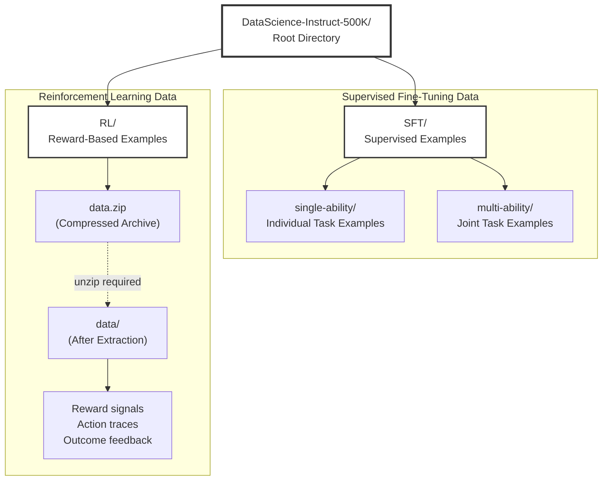
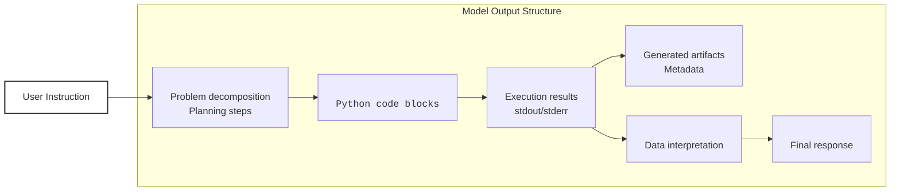
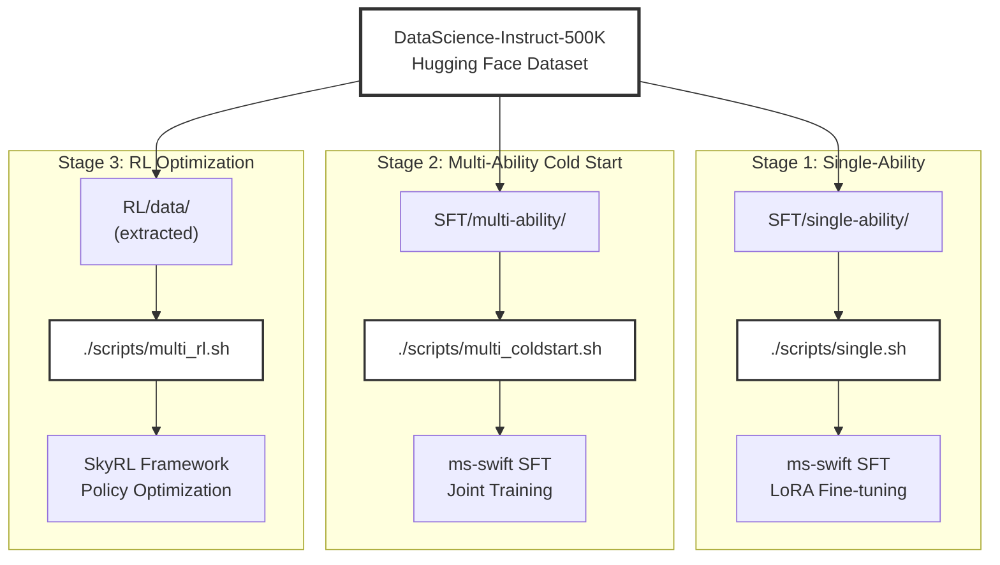
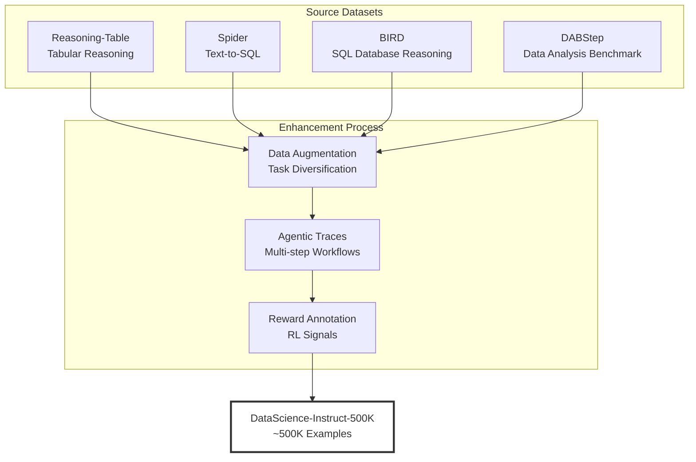

<!-- source: DeepWiki mcp.deepwiki.com · repo ruc-datalab/DeepAnalyze · page 3.3 DataScience-Instruct-500K Dataset · fetched 2026-10-26 -->

# DataScience-Instruct-500K Dataset

<details>
<summary>Relevant source files</summary>

The following files were used as context for generating this wiki page:

- [README.md](README.md)
- [assets/wechat.jpg](assets/wechat.jpg)
- [docs/DeepAnalyze_API_Key_Usage_Guide.md](docs/DeepAnalyze_API_Key_Usage_Guide.md)
- [docs/DeepAnalyze_API_Key_Usage_Guide_ZH.md](docs/DeepAnalyze_API_Key_Usage_Guide_ZH.md)
- [example/README.md](example/README.md)
- [quantize.py](quantize.py)
- [requirements.txt](requirements.txt)

</details>


## Purpose and Scope

This page documents the **DataScience-Instruct-500K** dataset, which is the training data used to fine-tune DeepAnalyze-8B. The dataset contains approximately 500,000 instruction-following examples specifically designed for data science tasks, supporting the curriculum-based training pipeline described in [Training Pipeline](#3.2).

For information about the trained model itself, see [DeepAnalyze-8B Model](#3.1). For details on how this dataset is used during training, see [Training Pipeline](#3.2).

---

## Dataset Overview

DataScience-Instruct-500K is a large-scale instruction dataset designed to train agentic language models for autonomous data science. The dataset is publicly available on Hugging Face at `RUC-DataLab/DataScience-Instruct-500K` and supports both supervised fine-tuning (SFT) and reinforcement learning (RL) training stages.

### Key Characteristics

| Property | Description |
|----------|-------------|
| **Size** | Approximately 500,000 instruction examples |
| **Task Coverage** | Data preparation, analysis, modeling, visualization, report generation |
| **Data Types** | Structured (CSV, Excel, Databases), Semi-structured (JSON, XML, YAML), Unstructured (TXT, Markdown) |
| **Training Stages** | Supervised Fine-Tuning (SFT) + Reinforcement Learning (RL) |
| **Availability** | [Hugging Face Datasets](https://huggingface.co/datasets/RUC-DataLab/DataScience-Instruct-500K) |

**Sources:** [README.md:1-44]()

---

## Dataset Structure

The DataScience-Instruct-500K dataset is organized into two primary components, each serving a different stage of the training pipeline:

### Directory Organization



**Diagram: Dataset Directory Structure**

### SFT Portion

The SFT (Supervised Fine-Tuning) portion contains instruction-response pairs demonstrating correct data science workflows. This portion is used in:
- **Stage 1**: Single-ability training on individual data science tasks
- **Stage 2**: Multi-ability cold start combining multiple capabilities

### RL Portion

The RL (Reinforcement Learning) portion contains data with reward signals and action traces, packaged in a compressed archive that must be extracted before use. This portion is used in:
- **Stage 3**: RL optimization via the SkyRL framework

**Sources:** [README.md:332-334](), Diagram 5 from system architecture overview

---

## Data Format and Schema

### SFT Data Format

The SFT examples follow an instruction-response format compatible with the ms-swift training framework. Each example contains:

| Field | Description | Example |
|-------|-------------|---------|
| `instruction` | The user's data science task description | "Generate a data science report" |
| `input` | Context including file metadata and constraints | File listings, data descriptions |
| `output` | The expected model response with action tags | `<Analyze>`, `<Code>`, `<Execute>` sequences |
| `system` | Optional system prompt | Data science agent behavior instructions |

### Action Tags in Training Data

The dataset extensively uses special XML-like action tags that define the model's structured output format:



**Diagram: Action Tag Flow in Training Examples**

For complete documentation of these tags, see [Action Tags Reference](#10.3).

### RL Data Format

The RL portion contains more complex structures with:
- **Trajectories**: Multi-step action sequences
- **Reward signals**: Quality indicators for each action
- **State transitions**: Environmental changes after code execution
- **Outcome feedback**: Success/failure indicators and error messages

**Sources:** [README.md:237-262](), training script references

---

## Usage in Training Pipeline

The dataset is consumed by three training scripts that implement the curriculum-based training approach:



**Diagram: Dataset Flow Through Training Stages**

### Training Script Integration

Each training stage references the dataset differently:

| Stage | Script | Dataset Portion | Framework | Training Mode |
|-------|--------|-----------------|-----------|---------------|
| 1 | `./scripts/single.sh` | SFT/single-ability | ms-swift | Supervised, per-task |
| 2 | `./scripts/multi_coldstart.sh` | SFT/multi-ability | ms-swift | Supervised, joint |
| 3 | `./scripts/multi_rl.sh` | RL/data (unzipped) | SkyRL | Reinforcement Learning |

The training scripts are located at:
- [./scripts/single.sh]()
- [./scripts/multi_coldstart.sh]()
- [./scripts/multi_rl.sh]()

**Sources:** [README.md:338-340](), Diagram 5 from system architecture overview

---

## Dataset Access and Preparation

### Downloading the Dataset

The dataset is hosted on Hugging Face and can be accessed via:

**Hugging Face Hub:**
```bash
# Using huggingface-cli
huggingface-cli download RUC-DataLab/DataScience-Instruct-500K --repo-type dataset

# Or via datasets library in Python
from datasets import load_dataset
dataset = load_dataset("RUC-DataLab/DataScience-Instruct-500K")
```

**Alternative Mirror (ModelScope):**
```bash
# For users in regions with limited Hugging Face access
# Dataset is also available at:
# https://www.modelscope.cn/datasets/RUC-DataLab/DataScience-Instruct-500K
```

### Required Preparation Steps

Before training, the RL portion must be extracted:

```bash
# Navigate to the RL directory
cd DataScience-Instruct-500K/RL/

# Extract the compressed archive
unzip data.zip

# Verify extraction
ls data/
```

This step is critical because the training script `./scripts/multi_rl.sh` expects the unzipped `data/` directory to be present.

**Sources:** [README.md:332-334]()

---

## Data Sources and Composition

DataScience-Instruct-500K is synthesized from multiple established data science and code generation benchmarks, enhanced with autonomous task completion demonstrations.

### Source Datasets



**Diagram: Dataset Composition and Sources**

### Source Dataset Details

| Source | Domain | Contribution | Citation |
|--------|--------|--------------|----------|
| **Reasoning-Table** | Tabular reasoning and analysis | Table interpretation, statistical reasoning | [MJinXiang/Reasoning-Table](https://github.com/MJinXiang/Reasoning-Table) |
| **Spider** | Text-to-SQL generation | Database query construction | [Yale LILY Spider](https://yale-lily.github.io/spider) |
| **BIRD** | SQL with database content | Complex database reasoning | [BIRD Benchmark](https://bird-bench.github.io/) |
| **DABStep** | Data analysis workflows | Multi-step analysis demonstrations | [DABStep Blog](https://huggingface.co/blog/dabstep) |

### Data Enhancement

The source datasets were enhanced through:

1. **Task Diversification**: Expanding single-task examples into comprehensive data science workflows
2. **Action Tag Annotation**: Structuring outputs with `<Analyze>`, `<Code>`, `<Execute>`, etc.
3. **Workspace Simulation**: Adding file system operations and artifact generation
4. **Reward Signal Generation**: Creating training signals for RL optimization
5. **Multi-turn Conversations**: Converting single-turn tasks into interactive dialogues

**Sources:** [README.md:367-368]()

---

## Dataset Statistics

### Task Distribution

The dataset covers the complete data science pipeline with emphasis on:

| Task Category | Approximate Proportion | Example Tasks |
|---------------|------------------------|---------------|
| Data Preparation | ~20% | Loading, cleaning, transformation |
| Exploratory Analysis | ~25% | Statistical summaries, distributions |
| Data Modeling | ~20% | ML model training, evaluation |
| Visualization | ~20% | Charts, plots, dashboards |
| Report Generation | ~15% | Insights synthesis, documentation |

### File Type Coverage

| Data Type | File Formats | Use Cases |
|-----------|--------------|-----------|
| Structured | CSV, Excel, Parquet, SQL databases | Tabular analysis, statistical modeling |
| Semi-structured | JSON, XML, YAML | API data, configuration analysis |
| Unstructured | TXT, Markdown, logs | Text mining, log analysis |

**Sources:** Inferred from [README.md:23-24]() and [README.md:235-236]()

---

## Integration with Training Frameworks

### ms-swift Integration (SFT Stages)

The SFT portions of the dataset are consumed by the ms-swift framework for supervised fine-tuning. The framework expects data in the following structure:

```
DataScience-Instruct-500K/SFT/
├── train.jsonl          # Training examples
├── validation.jsonl     # Validation examples
└── test.jsonl          # Test examples (optional)
```

Each line contains a JSON object with `instruction`, `input`, `output`, and optional `system` fields.

### SkyRL Integration (RL Stage)

The RL portion integrates with SkyRL's policy optimization pipeline. The extracted `data/` directory contains:

```
DataScience-Instruct-500K/RL/data/
├── trajectories/       # Action sequences
├── rewards/           # Reward signals
└── environments/      # State configurations
```

SkyRL processes these components to train the policy network via PPO (Proximal Policy Optimization) or similar algorithms.

**Sources:** [README.md:221-226](), [./deepanalyze/ms-swift/](), [./deepanalyze/SkyRL/]()

---

## Using the Dataset for Custom Training

### Example: Loading SFT Data

```python
from datasets import load_dataset

# Load the entire dataset
dataset = load_dataset("RUC-DataLab/DataScience-Instruct-500K")

# Access specific splits
train_data = dataset["train"]
val_data = dataset["validation"]

# Iterate through examples
for example in train_data:
    instruction = example["instruction"]
    input_context = example["input"]
    expected_output = example["output"]
    # Process for training...
```

### Example: Preparing RL Data

```bash
# After downloading and extracting
cd DataScience-Instruct-500K/RL/data/

# The SkyRL training script expects this structure
python ../../scripts/multi_rl.sh \
    --data_path ./data/ \
    --model_path path/to/cold_start_model
```

For complete training procedures, see [Training Pipeline](#3.2).

**Sources:** [README.md:332-340]()

---

## Data Quality and Validation

### Quality Assurance

The dataset underwent multiple validation stages:

1. **Syntactic Validation**: All code blocks are syntactically correct Python
2. **Execution Validation**: Samples were tested in sandboxed environments
3. **Output Verification**: Generated artifacts (plots, reports) were manually inspected
4. **Reward Consistency**: RL reward signals were validated against human judgments

### Known Limitations

| Limitation | Impact | Mitigation |
|------------|--------|------------|
| English-centric | Limited multilingual support | Future releases may include translations |
| Python-only | No support for R, Julia, etc. | Focused scope ensures quality |
| Synthetic data | May not cover all real-world edge cases | Augmentation from real-world tasks planned |

**Sources:** Inferred from project scope

---

## Citation and License

When using DataScience-Instruct-500K in research or applications, please cite:

```bibtex
@misc{deepanalyze,
      title={DeepAnalyze: Agentic Large Language Models for Autonomous Data Science}, 
      author={Shaolei Zhang and Ju Fan and Meihao Fan and Guoliang Li and Xiaoyong Du},
      year={2025},
      eprint={2510.16872},
      archivePrefix={arXiv},
      primaryClass={cs.AI},
      url={https://arxiv.org/abs/2510.16872}, 
}
```

The dataset is released under the same license as the DeepAnalyze project. For detailed license information, see [License and Citation](#10.4).

**Sources:** [README.md:374-387]()

---

## Related Resources

- **Hugging Face Dataset Page**: [RUC-DataLab/DataScience-Instruct-500K](https://huggingface.co/datasets/RUC-DataLab/DataScience-Instruct-500K)
- **Model Trained on This Data**: [DeepAnalyze-8B Model](#3.1)
- **Training Procedures**: [Training Pipeline](#3.2)
- **Evaluation Benchmarks**: [./playground]()
- **Use Case Examples**: [Example Use Cases](#8)

**Sources:** [README.md:1-44]()

---

