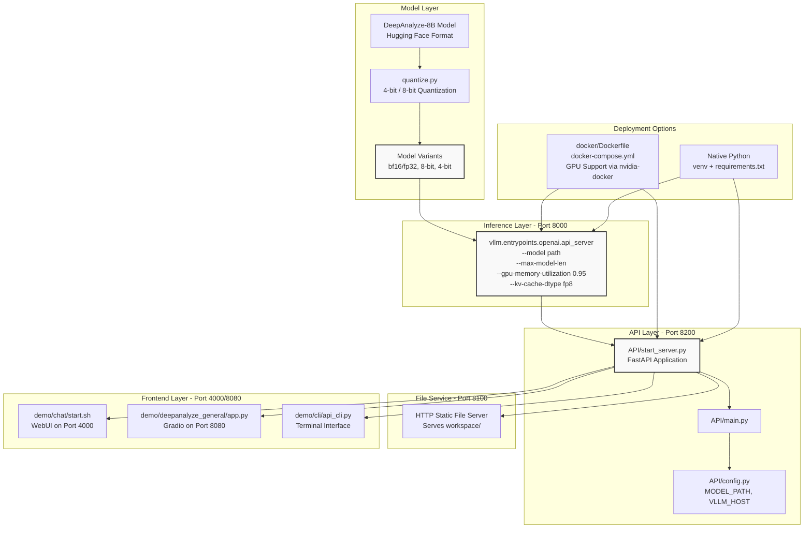
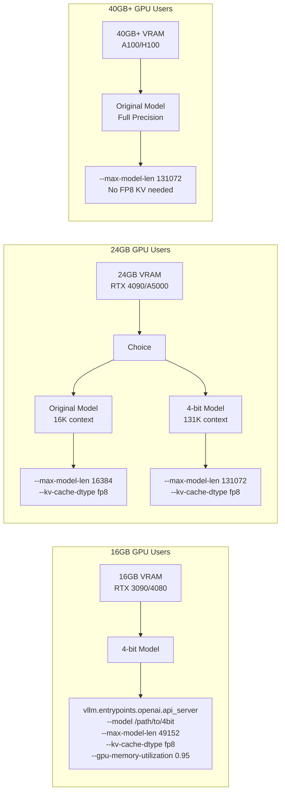
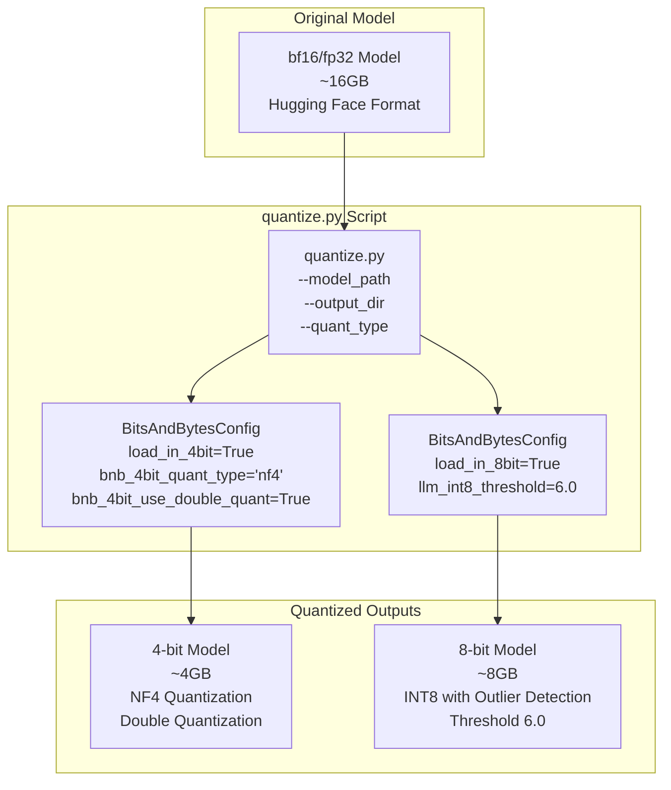
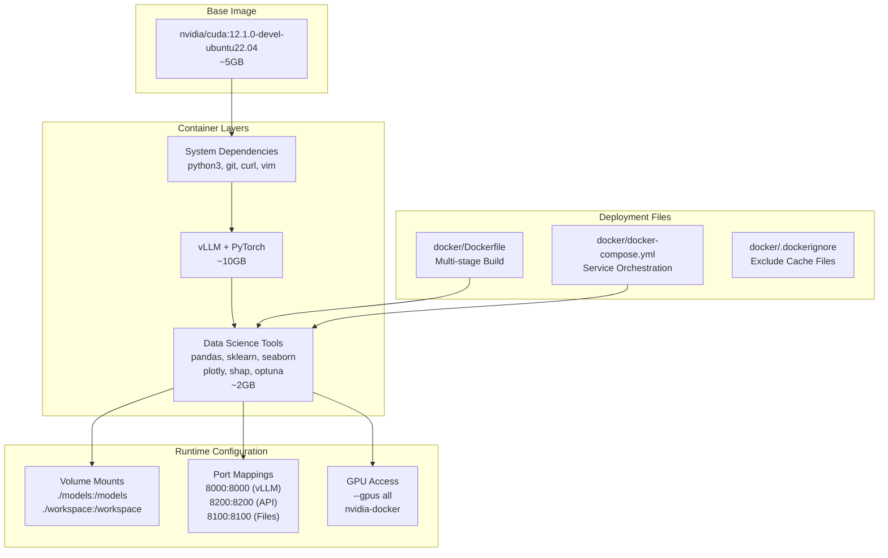
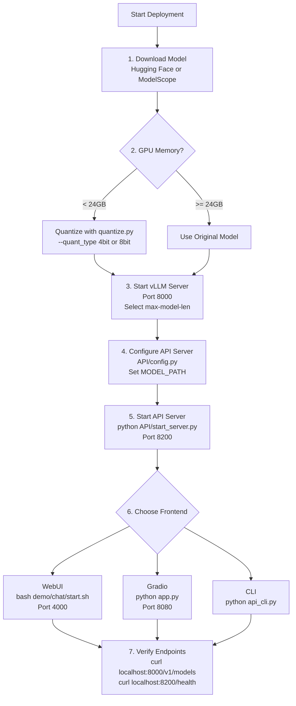
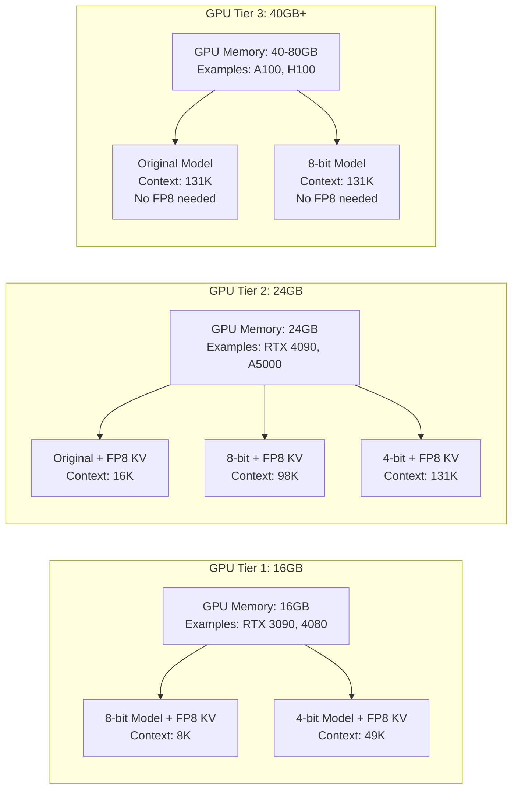

<!-- source: DeepWiki mcp.deepwiki.com · repo ruc-datalab/DeepAnalyze · page 4 Deployment · fetched 2026-10-26 -->

# Deployment

<details>
<summary>Relevant source files</summary>

The following files were used as context for generating this wiki page:

- [README.md](README.md)
- [assets/wechat.jpg](assets/wechat.jpg)
- [docker/.dockerignore](docker/.dockerignore)
- [docker/Dockerfile](docker/Dockerfile)
- [docker/README.md](docker/README.md)
- [docker/docker-compose.yml](docker/docker-compose.yml)
- [docs/DeepAnalyze_API_Key_Usage_Guide.md](docs/DeepAnalyze_API_Key_Usage_Guide.md)
- [docs/DeepAnalyze_API_Key_Usage_Guide_ZH.md](docs/DeepAnalyze_API_Key_Usage_Guide_ZH.md)
- [example/README.md](example/README.md)
- [quantize.py](quantize.py)
- [requirements.txt](requirements.txt)

</details>


This page covers the deployment of DeepAnalyze in production and development environments. It includes instructions for setting up the vLLM inference server, quantizing models for different GPU memory configurations, containerized deployment with Docker, and hardware requirement matrices.

For information about using the deployed system through various interfaces, see [Frontend Interfaces](#5). For API server configuration details, see [Configuration System](#6.2).

---

## Deployment Architecture Overview

DeepAnalyze follows a multi-service architecture where different components run on separate ports and can be deployed independently or together.



**Sources:** [README.md:56-210](), [docker/README.md:1-89](), [API/config.py]()

---

## Prerequisites and Dependencies

### System Requirements

| Component | Minimum | Recommended |
|-----------|---------|-------------|
| **Python** | 3.8 | 3.12 |
| **CUDA** | 11.8 | 12.1+ |
| **GPU Memory** | 16GB | 24GB+ |
| **System Memory** | 32GB | 64GB+ |
| **Storage** | 50GB | 100GB+ |

### Python Dependencies

The minimal dependencies for inference are specified in [requirements.txt:1-16]():

```
vllm>=0.8.5
torch
transformers
numpy
pandas
scikit-learn
seaborn
matplotlib
fastapi
uvicorn
openai
requests
websockets
python-multipart
```

Additional dependencies for training are found in:
- [deepanalyze/ms-swift/requirements.txt]()
- [deepanalyze/SkyRL/pyproject.toml]()

### Environment Setup

Create an isolated environment to avoid dependency conflicts:

```bash
conda create -n deepanalyze python=3.12 -y
conda activate deepanalyze
pip install -r requirements.txt
```

For training environments, install additional frameworks:

```bash
# Install ms-swift for supervised fine-tuning
cd ./deepanalyze/ms-swift/
pip install -e .

# Install SkyRL for reinforcement learning
cd ../SkyRL/
pip install -e .
```

The project recommends **separating inference and training environments** to prevent dependency conflicts between `vllm` and training frameworks.

**Sources:** [README.md:212-226]()

---

## Model Download and Preparation

### Obtaining the Model

Download the DeepAnalyze-8B model from either:
- **Hugging Face**: [RUC-DataLab/DeepAnalyze-8B](https://huggingface.co/RUC-DataLab/DeepAnalyze-8B)
- **ModelScope**: [RUC-DataLab/DeepAnalyze-8B](https://www.modelscope.cn/models/RUC-DataLab/DeepAnalyze-8B/summary)

```bash
# Using Hugging Face CLI
huggingface-cli download RUC-DataLab/DeepAnalyze-8B --local-dir /path/to/models/DeepAnalyze-8B

# Or clone the repository
git lfs install
git clone https://huggingface.co/RUC-DataLab/DeepAnalyze-8B
```

### Model Variants

DeepAnalyze-8B is available in multiple formats to accommodate different hardware configurations:

| Variant | Size | GPU Memory | Context Length | Precision |
|---------|------|------------|----------------|-----------|
| **Original** | ~16GB | 24-80GB | Up to 131K | bf16/fp32 |
| **8-bit** | ~8GB | 16-40GB | Up to 98K | int8 with outlier detection |
| **4-bit** | ~4GB | 16-24GB | Up to 131K | nf4 quantization |

### Building from Base Model

If starting from the base model [DeepSeek-R1-0528-Qwen3-8B](https://huggingface.co/deepseek-ai/DeepSeek-R1-0528-Qwen3-8B), special tokens must be added using [deepanalyze/add_vocab.py]():

```bash
MODEL_PATH=/path/to/DeepSeek-R1-0528-Qwen3-8B
SAVE_PATH=/path/to/DeepSeek-R1-0528-Qwen3-8B-addvocab

python deepanalyze/add_vocab.py \
  --model_path "$MODEL_PATH" \
  --save_path "$SAVE_PATH" \
  --add_tags
```

This adds the special action tags used by DeepAnalyze: `<Analyze>`, `<Code>`, `<Execute>`, `<File>`, `<Report>`, etc.

**Sources:** [README.md:131-148](), [README.md:318-330]()

---

## vLLM Server Deployment

### Overview

DeepAnalyze uses [vLLM](https://github.com/vllm-project/vllm) as its inference engine, providing:
- High-throughput serving with continuous batching
- OpenAI-compatible API endpoints
- PagedAttention for efficient memory management
- FP8 KV cache support for extended context lengths

The vLLM server runs on **port 8000** by default and exposes endpoints at `/v1/completions` and `/v1/chat/completions`.

### Basic Deployment Command

The general template for starting the vLLM server is specified in [README.md:152-162]():

```bash
python -m vllm.entrypoints.openai.api_server \
  --model <model_path> \
  --served-model-name DeepAnalyze-8B \
  --max-model-len <context_length> \
  --gpu-memory-utilization 0.95 \
  --port 8000 \
  --trust-remote-code
```

Or using the `vllm serve` shorthand:

```bash
vllm serve /path/to/DeepAnalyze-8B \
  --max-model-len 131072 \
  --gpu-memory-utilization 0.95 \
  --port 8000
```

### GPU Memory Configuration Matrix

The following table from [README.md:136-146]() maps GPU memory to recommended configurations:

| GPU Memory | Model Type | max-model-len | FP8 KV Cache | Notes |
|------------|------------|---------------|--------------|-------|
| **16GB** | 8-bit Quantized | 8,192 | ✓ Required | RTX 3090, 4080 |
| **16GB** | 4-bit Quantized | 49,152 | ✓ Required | Best for consumer GPUs |
| **24GB** | Original Model | 16,384 | ✓ Recommended | RTX 4090, A5000 |
| **24GB** | 8-bit Quantized | 98,304 | ✓ Recommended | Extended context |
| **24GB** | 4-bit Quantized | 131,072 | ✓ Recommended | Maximum context |
| **40GB** | Original Model | 131,072 | ✓ Optional | A100-40GB, Optimal performance |
| **40GB** | 8-bit Quantized | 131,072 | ✗ Not needed | |
| **80GB** | Original Model | 131,072 | ✗ Not needed | A100-80GB, H100 |

The `--gpu-memory-utilization 0.95` flag allocates 95% of GPU memory to vLLM, leaving 5% for CUDA overhead.

### Deployment Scenarios with Commands



**Scenario 1: 16GB GPU - 4-bit Quantized (Recommended)**

From [README.md:166-177]():

```bash
python -m vllm.entrypoints.openai.api_server \
  --model /path/to/deepanalyze/4bit \
  --served-model-name DeepAnalyze-8B \
  --max-model-len 49152 \
  --gpu-memory-utilization 0.95 \
  --port 8000 \
  --kv-cache-dtype fp8 \
  --trust-remote-code
```

**Scenario 2: 24GB GPU - Maximum Context Length**

From [README.md:179-190]():

```bash
python -m vllm.entrypoints.openai.api_server \
  --model /path/to/deepanalyze/4bit \
  --served-model-name DeepAnalyze-8B \
  --max-model-len 131072 \
  --gpu-memory-utilization 0.95 \
  --port 8000 \
  --kv-cache-dtype fp8 \
  --trust-remote-code
```

**Scenario 3: 80GB GPU - Best Performance**

From [README.md:192-202]():

```bash
python -m vllm.entrypoints.openai.api_server \
  --model /path/to/original/model \
  --served-model-name DeepAnalyze-8B \
  --max-model-len 131072 \
  --gpu-memory-utilization 0.95 \
  --port 8000 \
  --trust-remote-code
```

### Verifying Deployment

Once started, the vLLM server provides several endpoints accessible at `http://localhost:8000`:

```bash
# Check available models
curl http://localhost:8000/v1/models

# Test completions endpoint
curl http://localhost:8000/v1/completions \
  -H "Content-Type: application/json" \
  -d '{
    "model": "DeepAnalyze-8B",
    "prompt": "Explain data analysis",
    "max_tokens": 100
  }'
```

**Sources:** [README.md:150-210](), [docker/README.md:49-72]()

---

## Model Quantization

### Overview

The [quantize.py:1-145]() script uses `bitsandbytes` to create quantized versions of DeepAnalyze-8B. Quantization reduces model size and memory requirements while maintaining acceptable quality for most data science tasks.

### Quantization Methods



### 4-bit Quantization

The `quantize_model_4bit` function in [quantize.py:12-53]() uses **NF4 (NormalFloat4)** quantization:

```python
bnb_config = BitsAndBytesConfig(
    load_in_4bit=True,
    bnb_4bit_quant_type="nf4",  # NormalFloat4 quantization
    bnb_4bit_compute_dtype=torch.bfloat16,  # bf16 for computation
    bnb_4bit_use_double_quant=True,  # Additional compression
)
```

**Characteristics:**
- **Compression**: ~16GB → ~4GB (4x reduction)
- **Quality**: Minimal degradation for most tasks
- **Use Case**: Maximum context length on 16-24GB GPUs
- **Technique**: NormalFloat4 with double quantization for quantization constants

### 8-bit Quantization

The `quantize_model_8bit` function in [quantize.py:56-94]() uses **INT8** with outlier detection:

```python
bnb_config = BitsAndBytesConfig(
    load_in_8bit=True,
    llm_int8_threshold=6.0,  # Outlier threshold for mixed precision
)
```

**Characteristics:**
- **Compression**: ~16GB → ~8GB (2x reduction)
- **Quality**: Better than 4-bit, handles outliers specially
- **Use Case**: Balanced performance and memory
- **Technique**: Mixed INT8/FP16 quantization (outliers stay in FP16)

### Running Quantization

Basic usage:

```bash
python quantize.py \
  --model_path /path/to/DeepAnalyze-8B \
  --output_dir /path/to/quantized/models \
  --quant_type both
```

Available options from [quantize.py:97-142]():

| Argument | Choices | Default | Description |
|----------|---------|---------|-------------|
| `--model_path` | path | (required) | Path to original bf16/fp32 model |
| `--output_dir` | path | (required) | Output directory for quantized models |
| `--quant_type` | `4bit`, `8bit`, `both` | `both` | Quantization type to perform |
| `--no_double_quant` | flag | False | Disable double quantization for 4-bit |

The script creates subdirectories:
- `<output_dir>/4bit/` - 4-bit quantized model
- `<output_dir>/8bit/` - 8-bit quantized model

### Quantization Output Structure

After quantization, each output directory contains:

```
output_dir/
├── 4bit/
│   ├── config.json
│   ├── tokenizer_config.json
│   ├── model.safetensors (quantized weights)
│   └── ...
└── 8bit/
    ├── config.json
    ├── tokenizer_config.json
    ├── model.safetensors (quantized weights)
    └── ...
```

These directories can be loaded directly by vLLM using the `--model` parameter.

**Sources:** [quantize.py:1-145](), [README.md:148]()

---

## Docker Deployment

### Overview

DeepAnalyze provides Docker containerization with full CUDA 12.1 support for GPU acceleration. The Docker image includes vLLM, PyTorch, and all necessary data science libraries.

### Docker Architecture



### Docker Image Components

The [docker/Dockerfile:1-113]() builds a comprehensive image with:

**Base Layer** (lines 7-16):
- `nvidia/cuda:12.1.0-devel-ubuntu22.04`
- Python 3, pip, git, wget, curl, vim

**Core ML Layer** (lines 28-38):
- `vllm` for high-performance inference
- `torch`, `transformers`, `accelerate`
- `fastapi`, `uvicorn` for API serving

**Data Science Layer** (lines 42-107):
- Analysis: `pandasql`, `pyjanitor`, `feature-engine`, `missingno`
- Visualization: `plotly`, `bokeh`, `wordcloud`, `folium`
- ML: `mlxtend`, `imbalanced-learn`, `optuna`, `shap`, `lime`
- Time Series: `prophet`, `pmdarima`, `tslearn`, `lifelines`
- Bayesian: `pymc`, `pystan`, `pyro-ppl`
- Causal: `dowhy`, `econml`, `causalml`
- Geospatial: `geopandas`, `shapely`, `rasterio`, `pysal`

**Total Image Size**: ~17GB

### Deployment Options

**Option 1: Pull Pre-built Image** (Recommended)

From [docker/README.md:17-28]():

```bash
# Pull from Docker Hub
docker pull facdbe/deepanalyze-env:latest

# Run with GPU support
docker run --gpus all -it --rm \
  -p 8000:8000 \
  -v /path/to/models:/models \
  facdbe/deepanalyze-env:latest
```

**Option 2: Build from Source**

From [docker/README.md:30-46]():

```bash
# Clone repository
git clone https://github.com/ruc-datalab/DeepAnalyze.git
cd DeepAnalyze/docker

# Build image
docker build -t deepanalyze-env:latest .

# Run container
docker run --gpus all -it --rm \
  -p 8000:8000 \
  -v /path/to/models:/models \
  deepanalyze-env:latest
```

**Option 3: Docker Compose** (Multi-service)

The [docker/docker-compose.yml:1-49]() provides orchestrated deployment:

```yaml
version: '3.8'

services:
  vllm:
    image: deepanalyze-env:latest
    container_name: deepanalyze-vllm
    
    deploy:
      resources:
        reservations:
          devices:
            - driver: nvidia
              count: all
              capabilities: [gpu]
    
    ports:
      - "8000:8000"
      - "8200:8200"
      - "8100:8100"
    
    volumes:
      - ./workspace:/workspace
      - ./models:/models
    
    environment:
      - CUDA_VISIBLE_DEVICES=0
    
    restart: unless-stopped
```

Start with:

```bash
cd docker
docker-compose up -d
```

### Running vLLM in Docker

From [docker/README.md:48-62]():

```bash
docker run --gpus all -d \
  -p 8000:8000 \
  -v /path/to/models:/models \
  --name deepanalyze-vllm \
  deepanalyze-env:latest \
  python3 -m vllm.entrypoints.openai.api_server \
    --model /models/DeepAnalyze-8B \
    --host 0.0.0.0 \
    --port 8000 \
    --max-model-len 131072 \
    --gpu-memory-utilization 0.95
```

### Docker Networking

The containerized deployment exposes three endpoints:

| Port | Service | Endpoint | Purpose |
|------|---------|----------|---------|
| **8000** | vLLM | `/v1/completions`, `/v1/chat/completions`, `/v1/models` | Model inference |
| **8200** | API Server | `/v1/files`, `/v1/chat/completions`, `/health` | OpenAI-compatible API |
| **8100** | File Server | `/thread-{id}/generated/*` | Serve generated artifacts |

### Volume Mounts

The `.dockerignore` file in [docker/.dockerignore:1-42]() excludes unnecessary files from the image:

```
__pycache__/
*.py[cod]
venv/
.git/
*.safetensors
*.bin
models/
checkpoints/
```

Recommended volume mounts:

```bash
-v /host/models:/models            # Model weights
-v /host/workspace:/workspace      # Persistent workspaces
-v /host/data:/data                # Input data files
```

**Sources:** [docker/Dockerfile:1-113](), [docker/docker-compose.yml:1-49](), [docker/README.md:1-89](), [docker/.dockerignore:1-42]()

---

## API Server and Frontend Deployment

### Starting the API Server

The API server runs on **port 8200** and provides OpenAI-compatible endpoints. Start with [API/start_server.py]():

```bash
cd API
python start_server.py
```

This launches:
- FastAPI application from [API/main.py]()
- Static file server on port 8100
- Health check endpoint at `/health`

The server requires vLLM to be running on port 8000. Configure the vLLM endpoint in [API/config.py]():

```python
VLLM_HOST = "http://localhost:8000"
MODEL_PATH = "DeepAnalyze-8B"
```

### Frontend Deployment

**WebUI** (Port 4000)

From [README.md:55-69]():

```bash
cd demo/chat/frontend
npm install
cd ..
bash start.sh

# Stop services
bash stop.sh
```

For remote deployment, update:
- [demo/chat/backend.py]() - Replace `localhost` with server IP
- [demo/chat/frontend/lib/config.ts]() - Update API endpoints

**Gradio Apps** (Port 8080)

From [docs/DeepAnalyze_API_Key_Usage_Guide.md:166-170]():

```bash
# English interface
python demo/deepanalyze_general/app.py

# Chinese interface
python demo/deepanalyze_general/app_ZH.py
```

**CLI Interface**

From [README.md:89-100]():

```bash
# Terminal 1: Start API server
cd API
python start_server.py

# Terminal 2: Launch CLI
cd demo/cli
python api_cli.py       # English
python api_cli_ZH.py    # Chinese
```

### Complete Deployment Checklist



**Sources:** [README.md:55-100](), [API/start_server.py](), [API/config.py](), [docs/DeepAnalyze_API_Key_Usage_Guide.md:131-193]()

---

## Configuration Reference

### Key Configuration Files

| File | Purpose | Key Settings |
|------|---------|--------------|
| [API/config.py]() | API server configuration | `VLLM_HOST`, `MODEL_PATH`, `API_PORT` (8200), `FILE_SERVER_PORT` (8100) |
| [requirements.txt:1-16]() | Python dependencies | `vllm>=0.8.5`, `torch`, `transformers`, `fastapi` |
| [docker/docker-compose.yml]() | Container orchestration | Port mappings, GPU allocation, volumes |

### Environment Variables

Common environment variables for deployment:

```bash
# vLLM Configuration
export CUDA_VISIBLE_DEVICES=0              # GPU selection
export VLLM_USE_MODELSCOPE=False           # Disable ModelScope
export VLLM_WORKER_MULTIPROC_METHOD=spawn  # Multiprocessing method

# API Server Configuration
export API_HOST=0.0.0.0                    # Bind address
export API_PORT=8200                       # API server port
export FILE_SERVER_PORT=8100               # File server port

# Model Configuration
export MODEL_PATH=/path/to/DeepAnalyze-8B  # Model location
export MAX_MODEL_LEN=131072                # Context length
```

### Port Summary

| Port | Service | Configured In | Default |
|------|---------|---------------|---------|
| **8000** | vLLM inference | vLLM CLI args | Required |
| **8200** | API server | [API/config.py]() | Required |
| **8100** | File server | [API/config.py]() | Required |
| **4000** | WebUI | [demo/chat/start.sh]() | Optional |
| **8080** | Gradio | [demo/deepanalyze_general/app.py]() | Optional |

### Hardware Configuration Matrix

From [README.md:136-146](), the complete configuration matrix:



**Quick Selection Guide** from [README.md:204-208]():
- **Limited Memory (<24GB)**: Use 4-bit quantized + FP8 KV cache
- **Balanced Configuration (24-40GB)**: Choose model type based on requirements
- **Sufficient Memory (≥40GB)**: Use original model for best precision

**Sources:** [README.md:136-210](), [API/config.py](), [docker/docker-compose.yml:1-49]()

---

## Troubleshooting Deployment Issues

### Common Issues

**1. vLLM OOM (Out of Memory)**

Symptoms: `RuntimeError: CUDA out of memory`

Solutions:
- Reduce `--max-model-len`
- Enable `--kv-cache-dtype fp8`
- Lower `--gpu-memory-utilization` to 0.9
- Use a more quantized model variant

**2. Port Already in Use**

Symptoms: `[Errno 98] Address already in use`

Solutions:
```bash
# Find process using port
lsof -i :8000
kill -9 <PID>

# Or use different ports
vllm serve model --port 8001
python start_server.py --port 8201
```

**3. Model Not Found**

Symptoms: `FileNotFoundError` or `Model not found`

Solutions:
- Verify model path: `ls /path/to/model`
- Check [API/config.py]() `MODEL_PATH` matches vLLM `--served-model-name`
- Ensure model has `config.json` and `tokenizer_config.json`

**4. Docker GPU Access**

Symptoms: `RuntimeError: No CUDA GPUs are available`

Solutions:
```bash
# Install NVIDIA Container Toolkit
distribution=$(. /etc/os-release;echo $ID$VERSION_ID)
curl -s -L https://nvidia.github.io/nvidia-docker/gpgkey | sudo apt-key add -
curl -s -L https://nvidia.github.io/nvidia-docker/$distribution/nvidia-docker.list | \
  sudo tee /etc/apt/sources.list.d/nvidia-docker.list

sudo apt-get update && sudo apt-get install -y nvidia-docker2
sudo systemctl restart docker

# Verify
docker run --rm --gpus all nvidia/cuda:12.1.0-base-ubuntu22.04 nvidia-smi
```

**5. Slow Inference**

Symptoms: High latency, low throughput

Solutions:
- Increase `--max-num-batched-tokens`
- Use tensor parallelism: `--tensor-parallel-size 2`
- Check GPU utilization: `nvidia-smi`
- Reduce context length if not needed

### Verification Commands

```bash
# Check vLLM health
curl http://localhost:8000/v1/models

# Check API server health
curl http://localhost:8200/health

# Check GPU usage
watch -n 1 nvidia-smi

# Test end-to-end
curl -X POST http://localhost:8200/v1/chat/completions \
  -H "Content-Type: application/json" \
  -d '{"model": "DeepAnalyze-8B", "messages": [{"role": "user", "content": "Hello"}]}'
```

**Sources:** [README.md:55-210](), [docker/README.md:1-89]()

---

## Production Deployment Considerations

### Scaling Strategies

**Horizontal Scaling**: Deploy multiple vLLM instances behind a load balancer
```bash
# Instance 1
CUDA_VISIBLE_DEVICES=0 vllm serve model --port 8000

# Instance 2
CUDA_VISIBLE_DEVICES=1 vllm serve model --port 8001

# Load balancer (nginx, haproxy)
upstream vllm_backend {
    server localhost:8000;
    server localhost:8001;
}
```

**Vertical Scaling**: Use tensor parallelism across multiple GPUs
```bash
vllm serve model \
  --tensor-parallel-size 2 \
  --gpu-memory-utilization 0.95
```

### Monitoring and Logging

- **vLLM metrics**: Enable Prometheus metrics with `--enable-metrics`
- **API logs**: Check logs in [API/start_server.py]()
- **GPU monitoring**: Use `nvidia-smi dmon` or `dcgm-exporter`

### Security Considerations

- **API authentication**: Implement API key validation in [API/main.py]()
- **Network isolation**: Use Docker networks or VPNs
- **File upload limits**: Configure in [API/config.py]()
- **Rate limiting**: Add middleware in FastAPI application

### Backup and Recovery

- **Model backups**: Store model weights in redundant storage
- **Workspace backups**: Regularly backup `workspace/` directory
- **Configuration backups**: Version control [API/config.py]() and Docker configs

**Sources:** [README.md:1-403](), [docker/README.md:1-89](), [API/config.py]()

---

