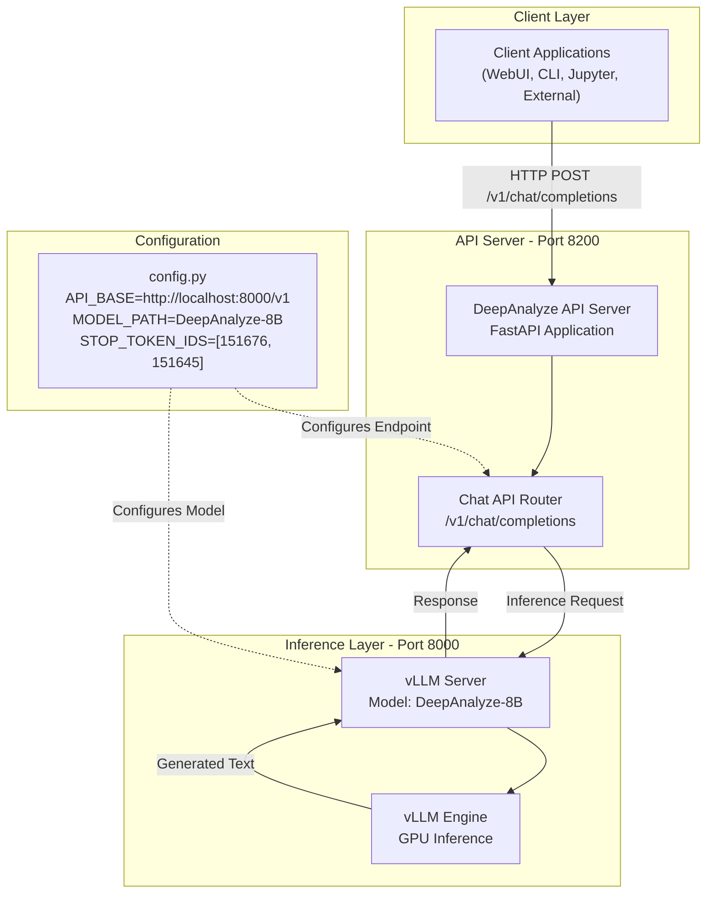
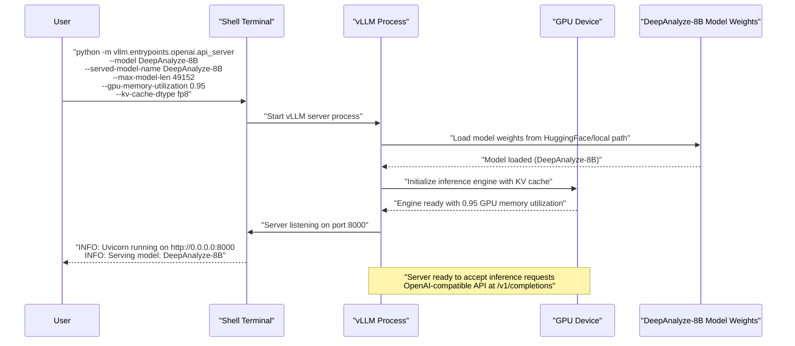
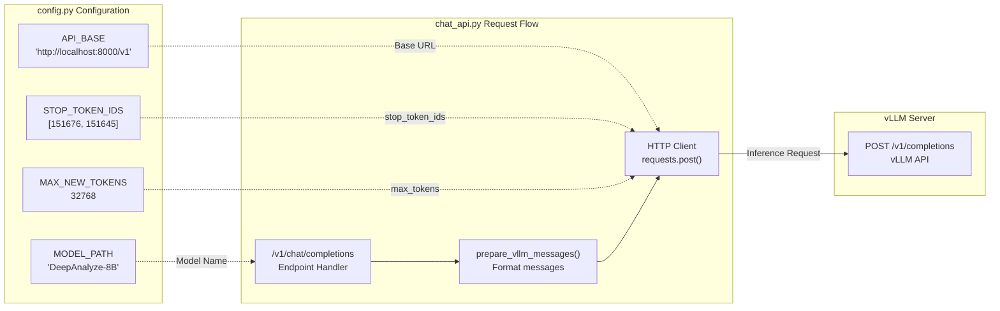
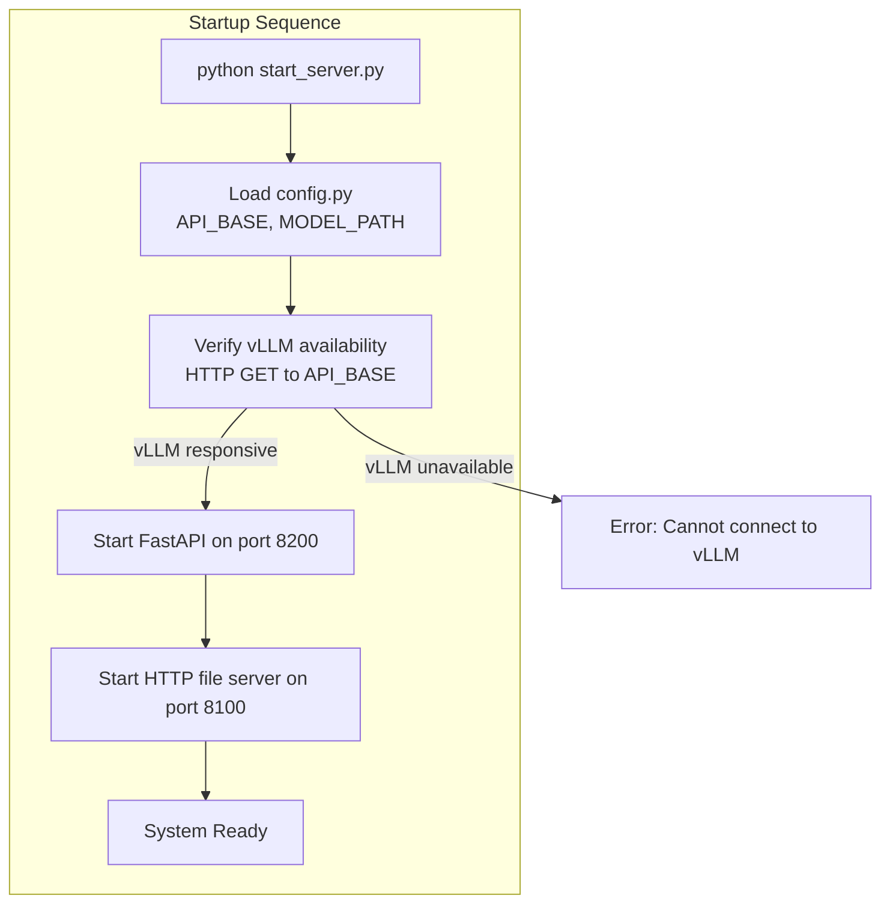
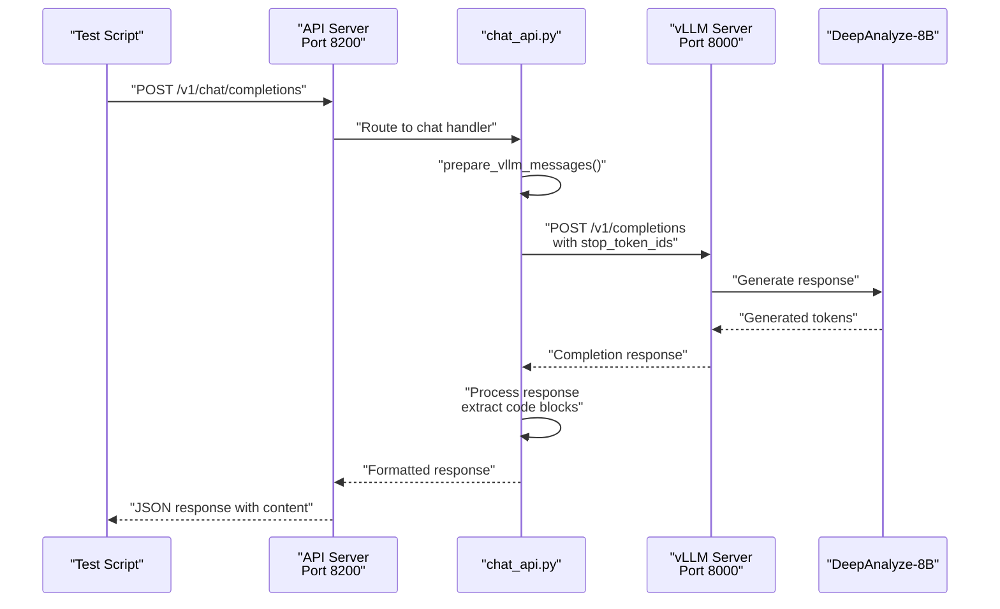
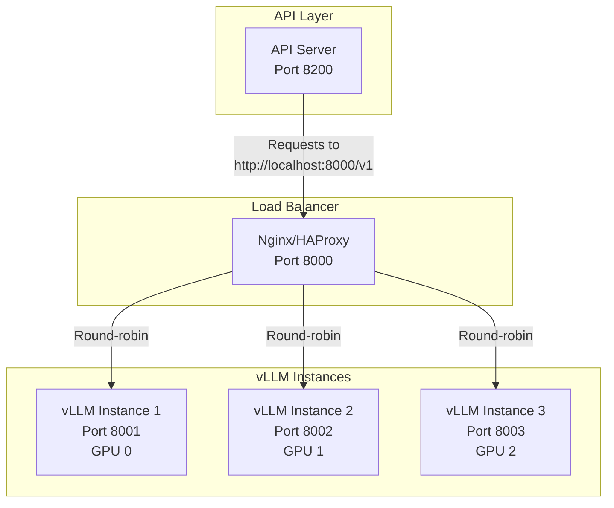
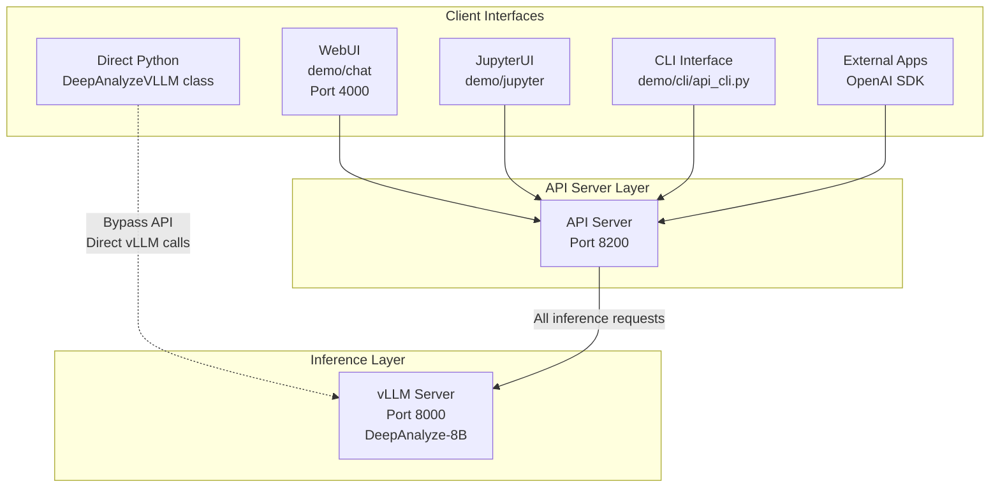

<!-- source: DeepWiki mcp.deepwiki.com · repo ruc-datalab/DeepAnalyze · page 4.1 vLLM Server Setup · fetched 2026-10-26 -->

# vLLM Server Setup

<details>
<summary>Relevant source files</summary>

The following files were used as context for generating this wiki page:

- [README.md](README.md)
- [assets/wechat.jpg](assets/wechat.jpg)
- [docs/DeepAnalyze_API_Key_Usage_Guide.md](docs/DeepAnalyze_API_Key_Usage_Guide.md)
- [docs/DeepAnalyze_API_Key_Usage_Guide_ZH.md](docs/DeepAnalyze_API_Key_Usage_Guide_ZH.md)
- [example/README.md](example/README.md)
- [quantize.py](quantize.py)
- [requirements.txt](requirements.txt)

</details>


## Purpose and Scope

This page documents how to deploy and configure the vLLM server for serving the DeepAnalyze-8B model. The vLLM server provides high-performance inference capabilities and runs as a separate service from the DeepAnalyze API server. 

For information about the API server itself, see [API Server Architecture](#2). For details about the DeepAnalyze-8B model, see [DeepAnalyze-8B Model](#6.1). For using the complete system, see [Getting Started](#4.1).

**Sources:** [README.md:1-291](), [API/README.md:1-389]()

---

## vLLM Role in DeepAnalyze Architecture

The vLLM server is the external model inference engine that powers DeepAnalyze. It operates independently on port 8000, while the main API server on port 8200 forwards inference requests to it. This separation enables efficient GPU utilization and allows for independent scaling of inference and API layers.



**Deployment Architecture:**

| Component | Port | Purpose | Deployment |
|-----------|------|---------|------------|
| vLLM Server | 8000 | Model inference with GPU acceleration | Deployed via `vllm serve` command |
| API Server | 8200 | Request handling, code execution, file management | Deployed via `python start_server.py` |
| File Server | 8100 | Static file serving for generated artifacts | Embedded in API server |

**Sources:** [API/README.md:356-363](), [API/config.py:11-16]()

---

## Prerequisites

### System Requirements

**Hardware:**
- GPU with sufficient VRAM for the model (recommended: 24GB+ for DeepAnalyze-8B)
- CPU with adequate cores for request handling
- Sufficient disk space for model weights (~16GB for DeepAnalyze-8B)

**Software:**
- Python 3.12 or higher
- CUDA-compatible GPU drivers
- PyTorch with CUDA support
- vLLM version 0.8.5 or higher

### Installing vLLM

```bash
# Create conda environment
conda create -n deepanalyze python=3.12 -y
conda activate deepanalyze

# Install dependencies from requirements.txt
pip install -r requirements.txt
```

The [requirements.txt:1-end]() file includes vLLM and all necessary dependencies for inference.

**Sources:** [README.md:107-122](), [API/README.md:1-18]()

---

## Basic Deployment

### Obtaining the Model

The DeepAnalyze-8B model must be downloaded before deployment. It is available on Hugging Face and ModelScope:

```bash
# Option 1: Using huggingface-cli
huggingface-cli download RUC-DataLab/DeepAnalyze-8B

# Option 2: Using git-lfs
git lfs install
git clone https://huggingface.co/RUC-DataLab/DeepAnalyze-8B

# Option 3: ModelScope (for users in China)
# See: https://www.modelscope.cn/models/RUC-DataLab/DeepAnalyze-8B/summary
```

For users with limited GPU memory, consider using quantized versions. See [Model Quantization](#4.2) for details on creating 4-bit and 8-bit quantized models using [quantize.py:1-145]().

**Sources:** [README.md:133-133]()

### GPU Memory Configuration

Choose your deployment configuration based on available GPU memory:

| GPU Memory | Model Type | Recommended max-model-len | Use FP8 KV Cache |
|------------|------------|--------------------------|-----------------------|
| **16GB** | 8-bit Quantized | 8192 | ✓ |
| **16GB** | 4-bit Quantized | 49152 | ✓ |
| **24GB** | Original Model | 16384 | ✓ |
| **24GB** | 8-bit Quantized | 98304 | ✓ |
| **24GB** | 4-bit Quantized | 131072 | ✓ |
| **40GB** | Original Model | 131072 | ✓ |
| **40GB** | 8-bit Quantized | 131072 |  |
| **80GB** | Original Model | 131072 |  |

**Quick Selection Guide:**
- **Limited Memory (<24GB)**: Use 4-bit quantized version + FP8 KV Cache
- **Balanced Configuration (24-40GB)**: Choose model type based on requirements
- **Sufficient Memory (≥40GB)**: Use original model for best precision

**Sources:** [README.md:136-147](), [README.md:205-209]()

### Starting the vLLM Server

**Simplified Command (Recommended):**

```bash
vllm serve DeepAnalyze-8B
```

This uses default settings: port 8000, automatic host binding, and optimal GPU memory utilization.

**Full Command Template:**

```bash
python -m vllm.entrypoints.openai.api_server \
  --model <model_path> \
  --served-model-name DeepAnalyze-8B \
  --max-model-len <select_from_table_above> \
  --gpu-memory-utilization 0.95 \
  --port 8000 \
  <add_fp8_if_required> \
  --trust-remote-code
```

**Important Parameters:**
- `--model`: Path to model weights (e.g., `/path/to/DeepAnalyze-8B` or `DeepAnalyze-8B` for Hugging Face)
- `--served-model-name`: Name exposed in API (must match `MODEL_PATH` in [API/config.py:12]())
- `--max-model-len`: Maximum context length (see table above)
- `--gpu-memory-utilization`: Fraction of GPU memory to use (0.95 recommended for aggressive utilization)
- `--kv-cache-dtype`: Set to `fp8` when using FP8 KV cache
- `--trust-remote-code`: Required for DeepAnalyze-8B model

**Sources:** [README.md:55-55](), [README.md:152-162]()

### Deployment Examples by GPU Memory

**Scenario 1: 16GB GPU Memory (Recommended: 4-bit Quantized)**

```bash
python -m vllm.entrypoints.openai.api_server \
  --model /path/to/deepanalyze/4bit \
  --served-model-name DeepAnalyze-8B \
  --max-model-len 49152 \
  --gpu-memory-utilization 0.95 \
  --port 8000 \
  --kv-cache-dtype fp8 \
  --trust-remote-code
```

This configuration:
- Uses 4-bit quantized model (created via [quantize.py:12-53]())
- Enables FP8 KV cache compression for additional memory savings
- Supports context length up to 49K tokens
- Suitable for RTX 3090, RTX 4080, or similar consumer GPUs

**Scenario 2: 24GB GPU Memory (Maximum Context Length)**

```bash
python -m vllm.entrypoints.openai.api_server \
  --model /path/to/deepanalyze/4bit \
  --served-model-name DeepAnalyze-8B \
  --max-model-len 131072 \
  --gpu-memory-utilization 0.95 \
  --port 8000 \
  --kv-cache-dtype fp8 \
  --trust-remote-code
```

This configuration:
- Uses 4-bit quantized model with FP8 KV cache
- Maximizes context length to 131K tokens (model's full capacity)
- Suitable for RTX 4090, A5000, or similar GPUs

**Scenario 3: 80GB GPU Memory (Best Performance)**

```bash
python -m vllm.entrypoints.openai.api_server \
  --model /path/to/original/model \
  --served-model-name DeepAnalyze-8B \
  --max-model-len 131072 \
  --gpu-memory-utilization 0.95 \
  --port 8000 \
  --trust-remote-code
```

This configuration:
- Uses original bf16/fp32 model weights
- No KV cache compression needed
- Provides best precision and performance
- Suitable for A100, H100, or similar enterprise GPUs

**Sources:** [README.md:166-203]()

### Deployment Workflow



**Sources:** [README.md:152-203]()

---

## Configuration Options

### Model-Specific Configuration

The DeepAnalyze-8B model requires specific configuration in the API server to work correctly with vLLM.

**Critical Configuration in [API/config.py:11-13]():**

```python
API_BASE = "http://localhost:8000/v1"  # vLLM endpoint
MODEL_PATH = "DeepAnalyze-8B"          # Must match --served-model-name
STOP_TOKEN_IDS = [151676, 151645]      # DeepAnalyze stop tokens
```

**Configuration Alignment:**

The `MODEL_PATH` in [API/config.py:12]() must match the `--served-model-name` parameter when starting vLLM. This ensures the API server sends requests to the correct model endpoint.

| vLLM Parameter | API config.py | Purpose |
|----------------|---------------|---------|
| `--served-model-name DeepAnalyze-8B` | `MODEL_PATH = "DeepAnalyze-8B"` | Model identifier in API requests |
| `--port 8000` | `API_BASE = "http://localhost:8000/v1"` | Endpoint URL |

**Stop Token IDs:**

The stop tokens `[151676, 151645]` defined in [API/config.py:13]() are special tokens added to the DeepAnalyze-8B model's vocabulary. These tokens:
- Signal the model to halt generation at appropriate boundaries
- Prevent runaway generation in code blocks
- Control transitions between reasoning and code execution phases
- Are automatically included in inference requests by [API/utils.py]()

If you fine-tuned from the base model, ensure these tokens were added via [deepanalyze/add_vocab.py:1-end]() during training.

**Sources:** [API/config.py:11-13](), [API/config.py:40-41](), [README.md:320-330]()

### Advanced vLLM Server Options

**Full Parameter Reference:**

| Parameter | Purpose | Recommended Value | Notes |
|-----------|---------|-------------------|-------|
| `--model` | Path to model weights | `/path/to/DeepAnalyze-8B` | Can be local path or HuggingFace model ID |
| `--served-model-name` | Model name in API | `DeepAnalyze-8B` | Must match `MODEL_PATH` in config.py |
| `--max-model-len` | Maximum context length | See GPU memory table | Up to 131072 for DeepAnalyze-8B |
| `--gpu-memory-utilization` | Fraction of GPU memory | `0.95` | Aggressive utilization recommended |
| `--port` | Server port | `8000` | Must match `API_BASE` in config.py |
| `--host` | Bind address | `0.0.0.0` | Use localhost for security |
| `--kv-cache-dtype` | KV cache compression | `fp8` | Use with limited GPU memory |
| `--trust-remote-code` | Allow custom model code | Required | Needed for DeepAnalyze-8B |
| `--dtype` | Model weights dtype | `auto` | auto, float16, bfloat16 |
| `--tensor-parallel-size` | GPUs for tensor parallelism | `1` | Use 2+ for very large models |

**Multi-GPU Deployment (Tensor Parallelism):**

```bash
# Split model across 2 GPUs
python -m vllm.entrypoints.openai.api_server \
  --model /path/to/DeepAnalyze-8B \
  --served-model-name DeepAnalyze-8B \
  --max-model-len 131072 \
  --gpu-memory-utilization 0.95 \
  --port 8000 \
  --tensor-parallel-size 2 \
  --trust-remote-code
```

This enables:
- Model weights distributed across multiple GPUs
- Lower memory requirements per GPU
- Slightly increased latency due to inter-GPU communication

**Production Tuning:**

```bash
# Optimized for throughput
python -m vllm.entrypoints.openai.api_server \
  --model /path/to/DeepAnalyze-8B \
  --served-model-name DeepAnalyze-8B \
  --max-model-len 49152 \
  --gpu-memory-utilization 0.95 \
  --max-num-seqs 256 \
  --max-num-batched-tokens 16384 \
  --port 8000 \
  --kv-cache-dtype fp8 \
  --trust-remote-code
```

This configuration:
- Maximizes concurrent request handling via `--max-num-seqs`
- Optimizes batch processing with `--max-num-batched-tokens`
- Reduces memory footprint with FP8 KV cache

**Sources:** [README.md:152-162]()

---

## Connecting to the API Server

The DeepAnalyze API server connects to vLLM through the configuration specified in `config.py`. The connection flow is managed by the chat API router.



### Configuration Verification

After starting the vLLM server, verify the configuration:

**Check vLLM Server:**

```bash
# Test vLLM health endpoint
curl http://localhost:8000/health

# Expected response:
# {"status": "ok"}
```

**Verify Model Loading:**

Check vLLM server logs for:
```
INFO: Started server process
INFO: Waiting for application startup.
INFO: Application startup complete.
INFO: Uvicorn running on http://0.0.0.0:8000
```

**Sources:** [API/config.py:11-42](), [API/README.md:20-23]()

---

## API Server Integration

Once the vLLM server is running, start the API server to enable full system functionality:

```bash
cd API
python start_server.py
```

The API server will:
1. Read configuration from `config.py`
2. Validate connectivity to vLLM at `http://localhost:8000/v1`
3. Start the FastAPI application on port 8200
4. Start the file server on port 8100



**Health Check:**

```bash
# Check API server
curl http://localhost:8200/health

# Expected response:
# {"status": "healthy", "timestamp": 1704067200}
```

**Sources:** [API/README.md:13-23](), [API/README.md:338-354]()

---

## Testing the Inference Pipeline

### Direct vLLM Test

Test vLLM directly without the API server:

```bash
curl http://localhost:8000/v1/completions \
  -H "Content-Type: application/json" \
  -d '{
    "model": "DeepAnalyze-8B",
    "prompt": "Explain Python in one sentence.",
    "max_tokens": 100,
    "temperature": 0.4
  }'
```

### End-to-End Test

Test through the DeepAnalyze API server:

```bash
curl -X POST http://localhost:8200/v1/chat/completions \
  -H "Content-Type: application/json" \
  -d '{
    "model": "DeepAnalyze-8B",
    "messages": [
      {
        "role": "user",
        "content": "Introduce Python programming language in one sentence"
      }
    ],
    "temperature": 0.4
  }'
```

**Expected Flow:**



**Sources:** [API/README.md:65-95]()

---

## Model Path and Naming Configuration

### Understanding --model vs --served-model-name

vLLM distinguishes between the model's location and its API name:

- `--model`: Physical location of model weights (file path or HuggingFace ID)
- `--served-model-name`: Name exposed in the OpenAI-compatible API

**Example:**

```bash
python -m vllm.entrypoints.openai.api_server \
  --model /data/models/deepanalyze-8b-quantized-4bit \
  --served-model-name DeepAnalyze-8B \
  --port 8000
```

In this case:
- Model weights are loaded from `/data/models/deepanalyze-8b-quantized-4bit`
- API clients use model name `DeepAnalyze-8B` in requests
- [API/config.py:12]() should set `MODEL_PATH = "DeepAnalyze-8B"`

### Configuration Scenarios

**Scenario 1: HuggingFace Model Hub**

```bash
# vLLM automatically downloads from HuggingFace
vllm serve RUC-DataLab/DeepAnalyze-8B
```

```python
# API/config.py
MODEL_PATH = "RUC-DataLab/DeepAnalyze-8B"  # Or "DeepAnalyze-8B" if --served-model-name is set
```

**Scenario 2: Local Model with Default Name**

```bash
python -m vllm.entrypoints.openai.api_server \
  --model /data/models/DeepAnalyze-8B \
  --served-model-name DeepAnalyze-8B \
  --port 8000
```

```python
# API/config.py
MODEL_PATH = "DeepAnalyze-8B"  # Matches --served-model-name
```

**Scenario 3: Quantized Model with Consistent Name**

```bash
python -m vllm.entrypoints.openai.api_server \
  --model /data/models/deepanalyze-8b-4bit \
  --served-model-name DeepAnalyze-8B \
  --port 8000
```

```python
# API/config.py
MODEL_PATH = "DeepAnalyze-8B"  # Use consistent name across all deployments
```

### Configuration Alignment Table

| vLLM --model | vLLM --served-model-name | config.py MODEL_PATH | Status |
|--------------|--------------------------|---------------------|--------|
| `DeepAnalyze-8B` | (auto: DeepAnalyze-8B) | `"DeepAnalyze-8B"` | ✅ Recommended |
| `/path/to/model` | `DeepAnalyze-8B` | `"DeepAnalyze-8B"` | ✅ Best for quantized |
| `RUC-DataLab/DeepAnalyze-8B` | (auto: RUC-DataLab/DeepAnalyze-8B) | `"RUC-DataLab/DeepAnalyze-8B"` | ✅ Works |
| `/path/to/model` | (auto: model) | `"DeepAnalyze-8B"` | ❌ Mismatch |

**Important:** Always use `--served-model-name DeepAnalyze-8B` explicitly to ensure consistency with [API/config.py:12]().

**Sources:** [README.md:152-162](), [API/config.py:12-13]()

---

## Multi-Instance Deployment

For production environments or load balancing, multiple vLLM instances can be deployed:

### Load Balancing Architecture



### Deployment Commands

```bash
# Instance 1 - GPU 0
CUDA_VISIBLE_DEVICES=0 vllm serve DeepAnalyze-8B --host 0.0.0.0 --port 8001

# Instance 2 - GPU 1
CUDA_VISIBLE_DEVICES=1 vllm serve DeepAnalyze-8B --host 0.0.0.0 --port 8002

# Instance 3 - GPU 2
CUDA_VISIBLE_DEVICES=2 vllm serve DeepAnalyze-8B --host 0.0.0.0 --port 8003
```

### Load Balancer Configuration (Nginx)

```nginx
upstream vllm_backend {
    server localhost:8001;
    server localhost:8002;
    server localhost:8003;
}

server {
    listen 8000;
    
    location /v1/ {
        proxy_pass http://vllm_backend;
    }
}
```

**Sources:** [API/config.py:11-12]()

---

## Troubleshooting

### Common Issues

**Issue: vLLM Server Fails to Start**

| Symptom | Cause | Solution |
|---------|-------|----------|
| "CUDA out of memory" | Insufficient GPU VRAM | Reduce `--gpu-memory-utilization` or use smaller batch size |
| "Model not found" | Incorrect model path | Verify model path and ensure weights are downloaded |
| "Port already in use" | Port 8000 occupied | Use different port or kill existing process |
| "Invalid stop token IDs" | Token mismatch | Verify `STOP_TOKEN_IDS` match model vocabulary |

**Issue: API Server Cannot Connect to vLLM**

```bash
# Verify vLLM is running
curl http://localhost:8000/health

# Check vLLM server logs
# Look for "Uvicorn running on http://0.0.0.0:8000"

# Verify config.py matches vLLM deployment
grep API_BASE API/config.py
# Should output: API_BASE = "http://localhost:8000/v1"
```

**Issue: Slow Inference Performance**

```bash
# Increase GPU memory utilization
vllm serve DeepAnalyze-8B --host 0.0.0.0 --port 8000 --gpu-memory-utilization 0.95

# Enable continuous batching (default in vLLM)
vllm serve DeepAnalyze-8B --host 0.0.0.0 --port 8000 --max-num-seqs 256

# Use tensor parallelism for large models
vllm serve DeepAnalyze-8B --host 0.0.0.0 --port 8000 --tensor-parallel-size 2
```

**Sources:** [API/config.py:11-41](), [README.md:107-122]()

---

## Monitoring and Logging

### vLLM Server Logs

The vLLM server outputs detailed logs including:
- Model loading progress
- Memory allocation
- Request latency
- Token generation statistics

**Sample Log Output:**

```
INFO:     Started server process [12345]
INFO:     Waiting for application startup.
INFO:     Application startup complete.
INFO:     Uvicorn running on http://0.0.0.0:8000 (Press CTRL+C to quit)
INFO:     Processing completion request with 512 tokens
INFO:     Generated 128 tokens in 2.3s (55.6 tokens/s)
```

### Performance Metrics

Key metrics to monitor:

| Metric | Description | Target |
|--------|-------------|--------|
| Tokens/second | Generation throughput | 50+ for 8B model |
| Request latency | Time to first token | <500ms |
| GPU utilization | GPU memory usage | 80-95% |
| Batch size | Concurrent requests | Depends on GPU |

**Sources:** Based on vLLM operational characteristics

---

## Integration with Different Client Interfaces

The vLLM server supports all DeepAnalyze client interfaces through the API server:



**Direct Python Usage:**

The `DeepAnalyzeVLLM` class can bypass the API server and communicate directly with vLLM for lower latency:

```python
from deepanalyze import DeepAnalyzeVLLM

# Direct vLLM access
deepanalyze = DeepAnalyzeVLLM("/path/to/DeepAnalyze-8B")
answer = deepanalyze.generate(prompt, workspace=workspace)
```

**Sources:** [README.md:48-59](), [README.md:79-96](), [README.md:123-157]()

---

## Summary

The vLLM server setup involves:

1. **Installation**: Install vLLM 0.8.5+ and dependencies
2. **Model Download**: Obtain DeepAnalyze-8B from Hugging Face
3. **Deployment**: Start vLLM with `vllm serve DeepAnalyze-8B --host 0.0.0.0 --port 8000`
4. **Configuration**: Ensure `API_BASE` in `config.py` points to vLLM endpoint
5. **Verification**: Test connectivity and inference through both direct and API routes

The vLLM server operates independently from the API server, enabling flexible deployment topologies and efficient GPU utilization. For production deployments, consider load balancing multiple vLLM instances across available GPUs.

**Sources:** [README.md:105-209](), [API/README.md:1-389](), [API/config.py:1-44]()

---

