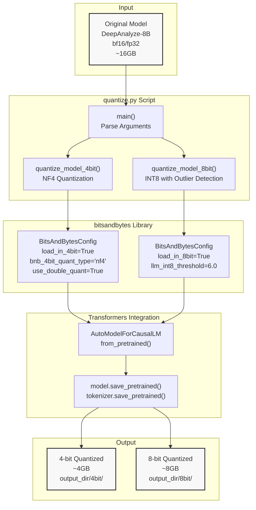
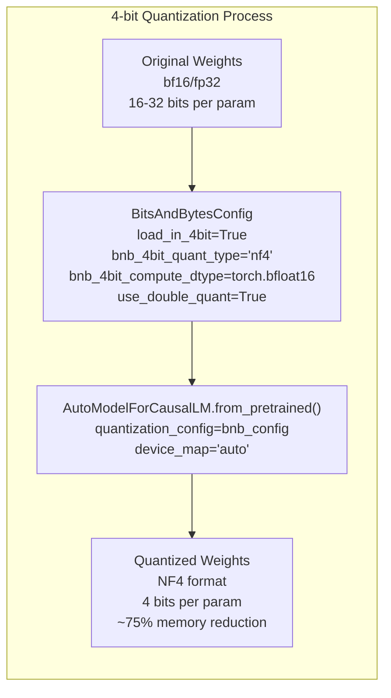
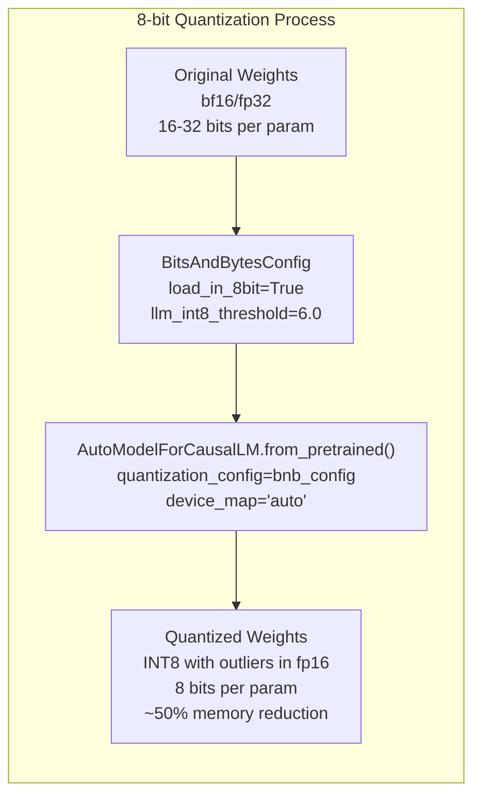
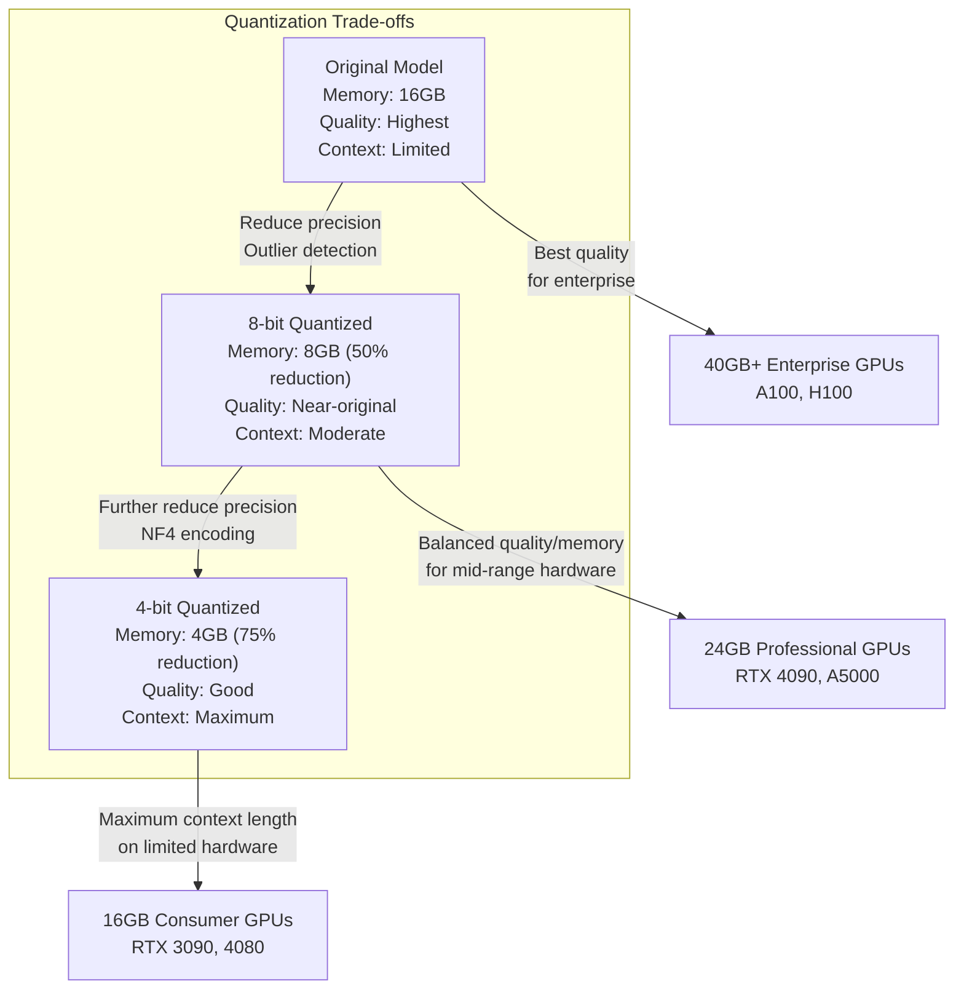
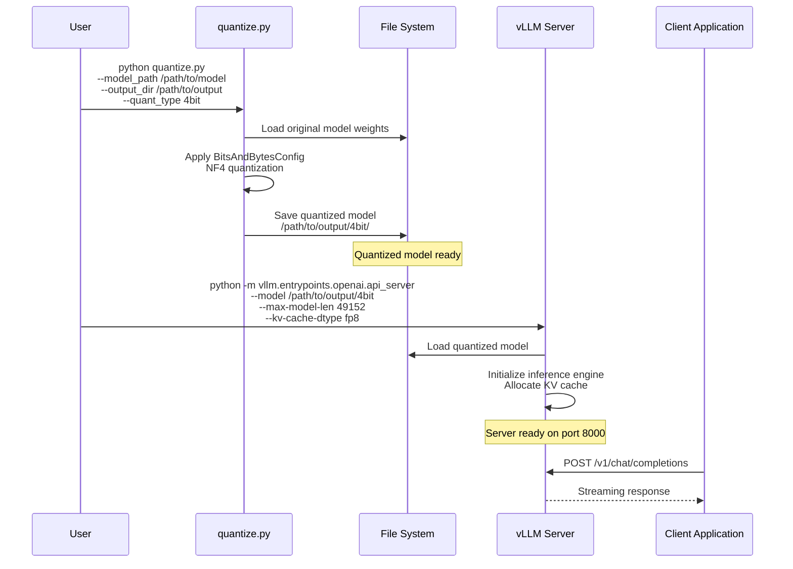
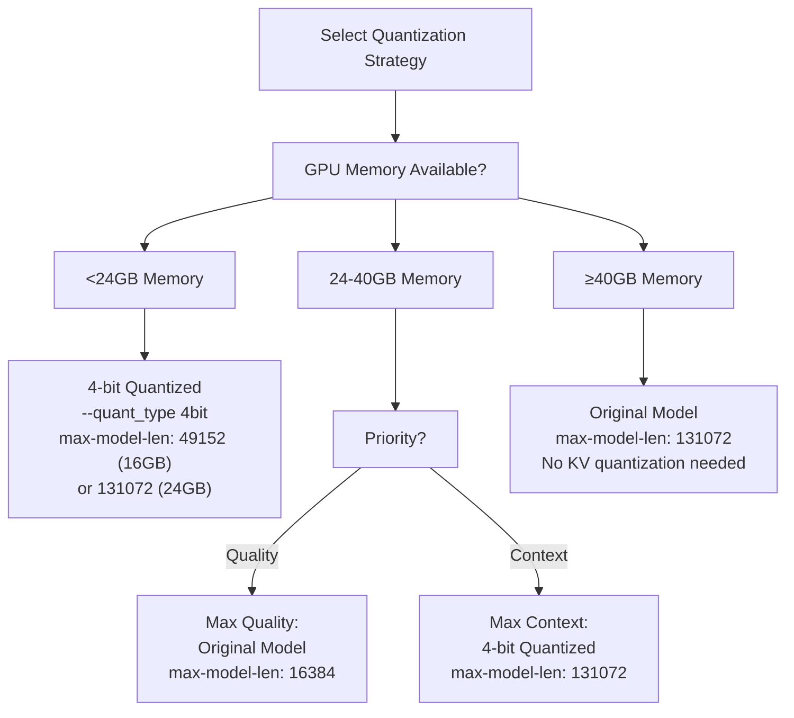

<!-- source: DeepWiki mcp.deepwiki.com · repo ruc-datalab/DeepAnalyze · page 4.2 Model Quantization · fetched 2026-10-26 -->

# Model Quantization

<details>
<summary>Relevant source files</summary>

The following files were used as context for generating this wiki page:

- [README.md](README.md)
- [assets/wechat.jpg](assets/wechat.jpg)
- [docs/DeepAnalyze_API_Key_Usage_Guide.md](docs/DeepAnalyze_API_Key_Usage_Guide.md)
- [docs/DeepAnalyze_API_Key_Usage_Guide_ZH.md](docs/DeepAnalyze_API_Key_Usage_Guide_ZH.md)
- [example/README.md](example/README.md)
- [quantize.py](quantize.py)
- [requirements.txt](requirements.txt)

</details>


This page documents the model quantization system for DeepAnalyze-8B, which enables deployment on GPUs with varying memory capacities. It covers the `quantize.py` utility, supported quantization formats, memory trade-offs, and integration with vLLM deployment.

For information about deploying the quantized models with vLLM, see [vLLM Server Setup](#4.1). For GPU memory requirements and deployment configurations, see [GPU Requirements and Configuration](#4.4).

## Purpose and Scope

DeepAnalyze-8B can be quantized to reduce GPU memory requirements while maintaining acceptable performance. The quantization system produces two variants:

- **4-bit quantized models**: ~4GB memory footprint, enabling deployment on 16GB consumer GPUs
- **8-bit quantized models**: ~8GB memory footprint, balancing quality and efficiency

This page documents the quantization process, the underlying `bitsandbytes` library integration, and how quantized models integrate with vLLM for inference.

**Sources:** [README.md:136-209](), [quantize.py:1-145]()

## Quantization Architecture

The following diagram illustrates how the quantization pipeline transforms the original model into deployment-ready variants:



**Sources:** [quantize.py:1-145]()

## The quantize.py Utility

The [quantize.py]() script provides command-line quantization functionality using the `bitsandbytes` library integrated with Hugging Face Transformers.

### Command-Line Interface

The script accepts the following arguments:

| Argument | Type | Default | Description |
|----------|------|---------|-------------|
| `--model_path` | str | `/path/to/origin/model` | Path to the original bf16 or fp32 model |
| `--output_dir` | str | `/path/to/output/dir` | Output directory for quantized models |
| `--quant_type` | str | `both` | Quantization type: `4bit`, `8bit`, or `both` |
| `--no_double_quant` | flag | False | Disable double quantization (4-bit only) |

**Sources:** [quantize.py:97-124]()

### Basic Usage

To quantize a model to both 4-bit and 8-bit formats:

```bash
python quantize.py \
  --model_path /path/to/DeepAnalyze-8B \
  --output_dir /path/to/quantized \
  --quant_type both
```

This creates two subdirectories:
- `output_dir/4bit/` - Contains the 4-bit quantized model
- `output_dir/8bit/` - Contains the 8-bit quantized model

**Sources:** [quantize.py:97-142]()

## 4-bit Quantization (NF4)

The `quantize_model_4bit()` function implements 4-bit quantization using the NF4 (Normal Float 4-bit) format.



### Configuration Parameters

The function configures quantization via `BitsAndBytesConfig`:

- **`load_in_4bit=True`**: Enables 4-bit quantization mode
- **`bnb_4bit_quant_type="nf4"`**: Uses NormalFloat4 quantization, optimized for normally distributed weights
- **`bnb_4bit_compute_dtype=torch.bfloat16`**: Computes in bf16 during inference for numerical stability
- **`bnb_4bit_use_double_quant=True`**: Applies double quantization to quantization constants themselves, further reducing memory

**Sources:** [quantize.py:12-53](), specifically [quantize.py:24-29]()

### Function Implementation

```python
# From quantize.py:12-53
def quantize_model_4bit(model_path: str, output_path: str, use_double_quant: bool = True)
```

The function performs these steps:

1. Creates `BitsAndBytesConfig` with 4-bit parameters
2. Loads model using `AutoModelForCausalLM.from_pretrained()` with `quantization_config`
3. Loads tokenizer using `AutoTokenizer.from_pretrained()`
4. Saves both model and tokenizer to `output_path`

The `device_map="auto"` parameter enables automatic GPU memory management during loading.

**Sources:** [quantize.py:12-53]()

## 8-bit Quantization (INT8)

The `quantize_model_8bit()` function implements 8-bit integer quantization with outlier detection.



### Configuration Parameters

The function configures quantization via `BitsAndBytesConfig`:

- **`load_in_8bit=True`**: Enables 8-bit quantization mode
- **`llm_int8_threshold=6.0`**: Outlier detection threshold; values with magnitude > 6.0 remain in fp16

The outlier detection mechanism preserves numerical precision for extreme weights that would lose significant accuracy under uniform quantization.

**Sources:** [quantize.py:56-94](), specifically [quantize.py:67-70]()

### Function Implementation

```python
# From quantize.py:56-94
def quantize_model_8bit(model_path: str, output_path: str)
```

The function follows the same pattern as 4-bit quantization but with 8-bit specific configuration. Note: Line 91 contains a typo (`save_pretained` should be `save_pretrained`).

**Sources:** [quantize.py:56-94]()

## Memory and Performance Trade-offs

The following table summarizes the memory footprint, context length capabilities, and GPU requirements for each quantization level:

### Deployment Configuration Matrix

| GPU Memory | Model Type | Memory Footprint | Recommended max-model-len | Use FP8 KV Cache |
|------------|------------|------------------|---------------------------|------------------|
| **16GB** | 8-bit Quantized | ~8GB | 8,192 | ✓ |
| **16GB** | 4-bit Quantized | ~4GB | 49,152 | ✓ |
| **24GB** | Original Model | ~16GB | 16,384 | ✓ |
| **24GB** | 8-bit Quantized | ~8GB | 98,304 | ✓ |
| **24GB** | 4-bit Quantized | ~4GB | 131,072 | ✓ |
| **40GB** | Original Model | ~16GB | 131,072 | ✓ |
| **40GB** | 8-bit Quantized | ~8GB | 131,072 | - |
| **80GB** | Original Model | ~16GB | 131,072 | - |

**Sources:** [README.md:136-147]()

### Trade-off Analysis



**Key observations:**

- **4-bit quantization** maximizes context length on limited hardware by freeing memory for KV cache
- **8-bit quantization** provides better quality with moderate memory savings
- **FP8 KV cache** is required on <40GB GPUs to maximize context length
- **Double quantization** (`use_double_quant=True`) provides additional memory savings for 4-bit models

**Sources:** [README.md:136-209](), [quantize.py:12-53]()

## Integration with vLLM Deployment

Quantized models integrate seamlessly with vLLM's OpenAI-compatible API server. The deployment workflow proceeds as follows:



### Example Deployment Commands

**Scenario 1: 16GB GPU with 4-bit quantization**

```bash
# Step 1: Quantize the model
python quantize.py \
  --model_path /path/to/DeepAnalyze-8B \
  --output_dir /path/to/quantized \
  --quant_type 4bit

# Step 2: Deploy with vLLM
python -m vllm.entrypoints.openai.api_server \
  --model /path/to/quantized/4bit \
  --served-model-name DeepAnalyze-8B \
  --max-model-len 49152 \
  --gpu-memory-utilization 0.95 \
  --port 8000 \
  --kv-cache-dtype fp8 \
  --trust-remote-code
```

**Scenario 2: 24GB GPU with 8-bit quantization**

```bash
# Step 1: Quantize the model
python quantize.py \
  --model_path /path/to/DeepAnalyze-8B \
  --output_dir /path/to/quantized \
  --quant_type 8bit

# Step 2: Deploy with vLLM
python -m vllm.entrypoints.openai.api_server \
  --model /path/to/quantized/8bit \
  --served-model-name DeepAnalyze-8B \
  --max-model-len 98304 \
  --gpu-memory-utilization 0.95 \
  --port 8000 \
  --kv-cache-dtype fp8 \
  --trust-remote-code
```

**Sources:** [README.md:150-203]()

## Quick Selection Guide

The following decision tree helps select the appropriate quantization strategy:



**Recommendations by use case:**

- **Limited memory (<24GB)**: Use 4-bit quantization with FP8 KV cache
- **Balanced configuration (24-40GB)**: Choose based on quality vs. context requirements
- **Sufficient memory (≥40GB)**: Use original model for best precision
- **Maximum context length**: Always use 4-bit with FP8 KV cache regardless of GPU size

**Sources:** [README.md:204-209]()

## Technical Implementation Details

### BitsAndBytesConfig Entity Mapping

The quantization system uses specific classes and methods from the Hugging Face ecosystem:

| Entity | Source | Purpose |
|--------|--------|---------|
| `BitsAndBytesConfig` | `transformers` | Configuration object for quantization parameters |
| `AutoModelForCausalLM` | `transformers` | Model loading with quantization support |
| `AutoTokenizer` | `transformers` | Tokenizer loading |
| `quantize_model_4bit()` | [quantize.py:12-53]() | 4-bit quantization function |
| `quantize_model_8bit()` | [quantize.py:56-94]() | 8-bit quantization function |
| `main()` | [quantize.py:97-142]() | CLI entry point with argument parsing |

**Sources:** [quantize.py:1-145]()

### Dependencies

The quantization script requires the following packages:

```python
# From quantize.py:6-9
import os
import argparse
import torch
from transformers import AutoModelForCausalLM, AutoTokenizer, BitsAndBytesConfig
```

Additional implicit dependency:
- `bitsandbytes` library (installed as dependency of `transformers` with quantization support)

**Sources:** [quantize.py:6-9](), [requirements.txt:1-16]()

### Output Directory Structure

After running quantization, the output directory contains:

```
output_dir/
├── 4bit/
│   ├── config.json
│   ├── model.safetensors (quantized weights)
│   ├── tokenizer_config.json
│   ├── tokenizer.json
│   └── special_tokens_map.json
└── 8bit/
    ├── config.json
    ├── model.safetensors (quantized weights)
    ├── tokenizer_config.json
    ├── tokenizer.json
    └── special_tokens_map.json
```

Both subdirectories are complete, self-contained model directories that can be loaded directly by vLLM or Transformers.

**Sources:** [quantize.py:46-50](), [quantize.py:87-91]()

## Common Issues and Considerations

### Double Quantization

Double quantization (`bnb_4bit_use_double_quant=True`) quantizes the quantization constants themselves, providing additional memory savings. This can be disabled for slightly faster inference at the cost of higher memory usage:

```bash
python quantize.py \
  --model_path /path/to/model \
  --output_dir /path/to/output \
  --quant_type 4bit \
  --no_double_quant
```

**Sources:** [quantize.py:18-19](), [quantize.py:119-122]()

### GPU Memory During Quantization

The quantization process itself requires sufficient GPU memory to load the original model. For DeepAnalyze-8B (~16GB), you need:

- At least 16GB GPU memory for quantization
- The quantized output can then be deployed on smaller GPUs

If GPU memory is insufficient, consider using CPU offloading or performing quantization on a larger GPU then deploying the result elsewhere.

**Sources:** [quantize.py:32-38](), [quantize.py:74-79]()

### vLLM Compatibility

The `bitsandbytes` quantization format produced by this script is compatible with vLLM's model loading mechanisms. vLLM automatically detects and uses the quantized weights when loading from the specified model path.

**Sources:** [README.md:150-203]()

---

