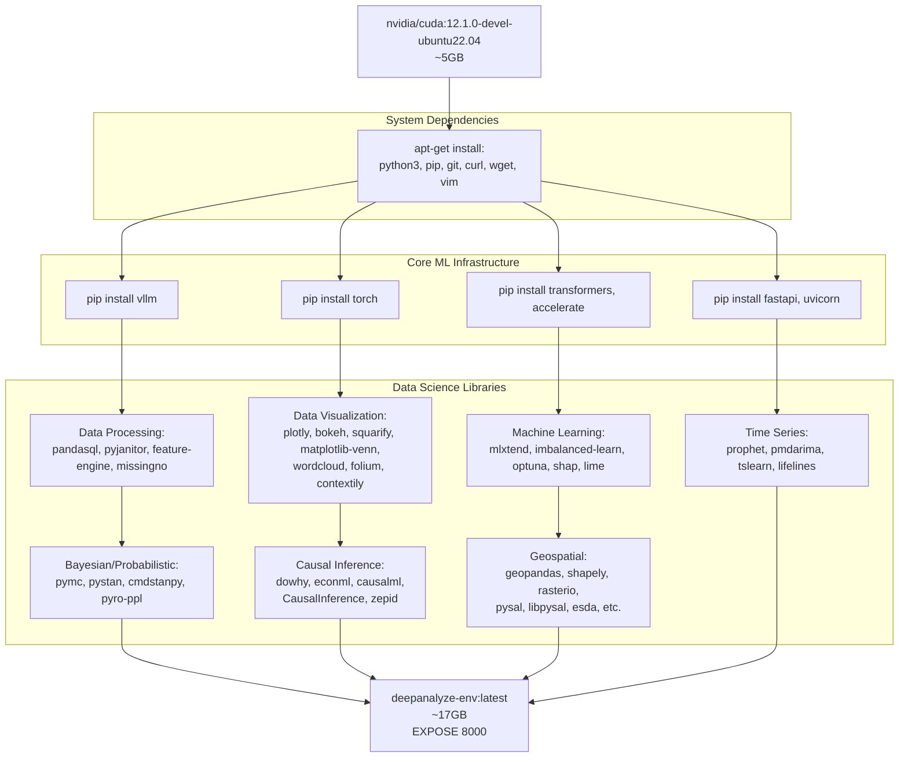
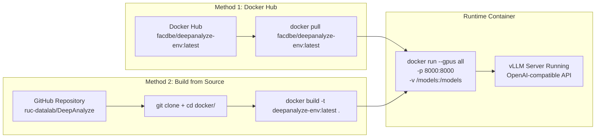
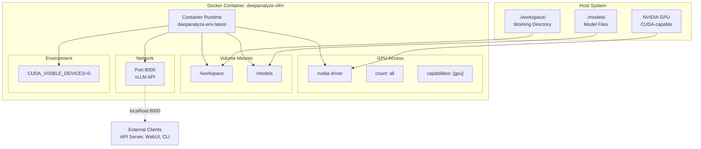
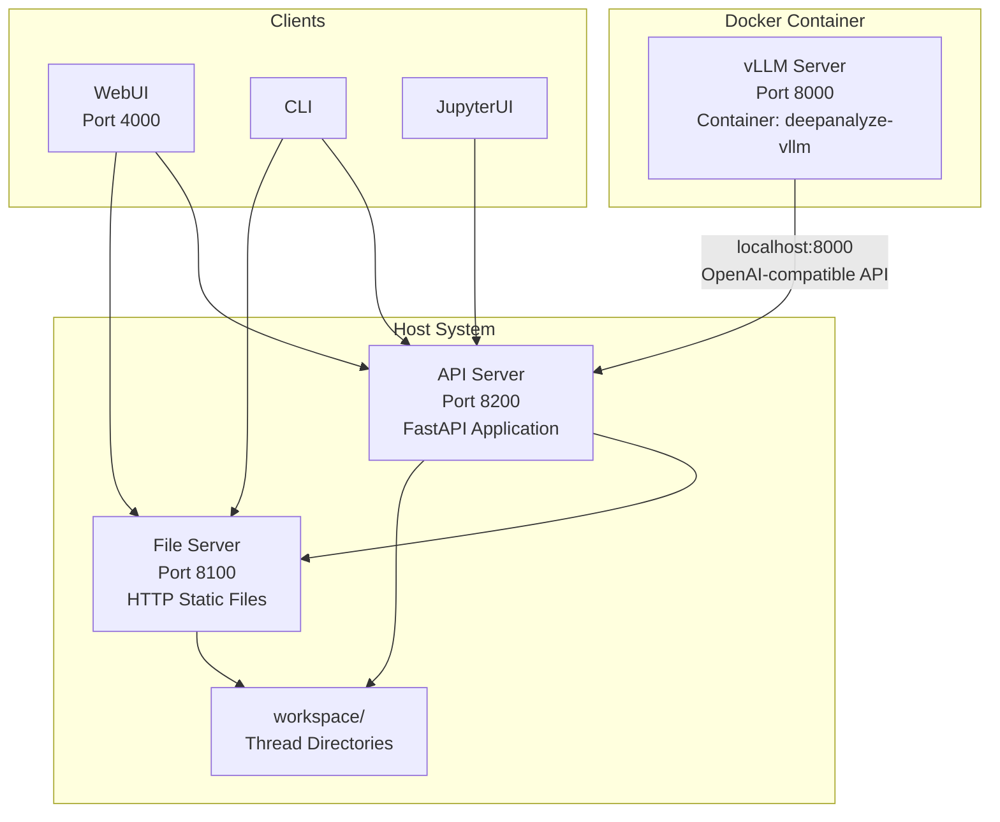

<!-- source: DeepWiki mcp.deepwiki.com · repo ruc-datalab/DeepAnalyze · page 4.3 Docker Deployment · fetched 2026-10-26 -->

# Docker Deployment

<details>
<summary>Relevant source files</summary>

The following files were used as context for generating this wiki page:

- [docker/.dockerignore](docker/.dockerignore)
- [docker/Dockerfile](docker/Dockerfile)
- [docker/README.md](docker/README.md)
- [docker/docker-compose.yml](docker/docker-compose.yml)

</details>


## Purpose and Scope

This page covers containerized deployment of DeepAnalyze using Docker and Docker Compose. The Docker environment provides a pre-configured image with CUDA 12.1, vLLM, and comprehensive data science libraries for running the DeepAnalyze-8B model inference engine.

For detailed vLLM server configuration options, see [vLLM Server Setup](#4.1). For GPU memory requirements and context length configurations, see [GPU Requirements and Configuration](#4.4). For model quantization before deployment, see [Model Quantization](#4.2).

**Note:** The Docker setup in this repository focuses on the vLLM inference layer (port 8000). The API server (port 8200), file server (port 8100), and frontend interfaces are typically deployed separately or alongside this container.

---

## Docker Environment Overview

The DeepAnalyze Docker environment is based on `nvidia/cuda:12.1.0-devel-ubuntu22.04` and provides a complete stack for LLM inference and data science tasks.

### Dockerfile Structure

The image build process follows a layered approach to optimize caching and maintainability:



**Sources:** [docker/Dockerfile:1-113]()

### Installed Components

The image includes comprehensive libraries aligned with DeepAnalyze's autonomous data science capabilities:

| Category | Libraries | Purpose |
|----------|-----------|---------|
| **Core Inference** | `vllm`, `torch`, `transformers`, `accelerate` | High-throughput LLM serving with CUDA support |
| **API Framework** | `fastapi`, `uvicorn` | OpenAI-compatible API server |
| **Data Processing** | `pandasql`, `pyjanitor`, `feature-engine`, `missingno` | Data cleaning, transformation, feature engineering |
| **Visualization** | `plotly`, `bokeh`, `squarify`, `matplotlib-venn`, `wordcloud`, `folium` | Interactive and static plotting |
| **ML/DL** | `mlxtend`, `imbalanced-learn`, `optuna`, `shap`, `lime` | Model training, hyperparameter tuning, explainability |
| **Time Series** | `prophet`, `pmdarima`, `tslearn`, `lifelines` | Forecasting and survival analysis |
| **Bayesian** | `pymc`, `pystan`, `cmdstanpy`, `pyro-ppl` | Probabilistic modeling |
| **Causal Inference** | `dowhy`, `econml`, `causalml`, `CausalInference`, `zepid` | Causal analysis and treatment effects |
| **Geospatial** | `geopandas`, `shapely`, `rasterio`, `pysal`, `libpysal` | Spatial data analysis |

These libraries enable the model to execute generated code for complex data science tasks without external dependencies.

**Sources:** [docker/Dockerfile:32-106]()

### Image Size Breakdown

| Component | Size | Description |
|-----------|------|-------------|
| **Base CUDA Image** | ~5GB | `nvidia/cuda:12.1.0-devel-ubuntu22.04` with development tools |
| **vLLM + PyTorch** | ~10GB | Core inference dependencies |
| **Data Science Tools** | ~2GB | All specialized libraries listed above |
| **Total** | ~17GB | Complete runtime environment |

**Sources:** [docker/README.md:74-80]()

---

## Deployment Methods

DeepAnalyze provides two deployment methods: pulling a pre-built image from Docker Hub or building from source.

### Deployment Workflow



**Sources:** [docker/README.md:16-46]()

### Method 1: Pull Pre-built Image

The fastest deployment method uses the official Docker Hub image:

```bash
# Pull the image
docker pull facdbe/deepanalyze-env:latest

# Run with GPU support
docker run --gpus all -it --rm \
  -p 8000:8000 \
  facdbe/deepanalyze-env:latest
```

This provides an interactive bash shell inside the container with all dependencies pre-installed.

**Sources:** [docker/README.md:16-28]()

### Method 2: Build from Source

For customization or to verify the build:

```bash
# Clone the repository
git clone https://github.com/ruc-datalab/DeepAnalyze.git
cd DeepAnalyze/docker

# Build the image
docker build -t deepanalyze-env:latest .

# Run the container
docker run --gpus all -it --rm \
  -p 8000:8000 \
  deepanalyze-env:latest
```

The [docker/.dockerignore:1-42]() file ensures that build artifacts, Python cache files, virtual environments, and large model files are excluded from the image build context.

**Sources:** [docker/README.md:30-46](), [docker/.dockerignore:1-42]()

---

## Docker Compose Configuration

For production deployments, Docker Compose provides declarative service management with GPU support, volume mounts, and automatic restarts.

### Service Architecture



**Sources:** [docker/docker-compose.yml:1-49]()

### Configuration File

The [docker/docker-compose.yml:1-49]() defines a single `vllm` service with the following key configurations:

#### Service Definition

```yaml
services:
  vllm:
    image: deepanalyze-env:latest
    container_name: deepanalyze-vllm
```

Uses the built image and assigns a recognizable container name.

#### GPU Support

```yaml
deploy:
  resources:
    reservations:
      devices:
        - driver: nvidia
          count: all
          capabilities: [gpu]
```

**Critical:** This configuration uses the Docker Compose v3.8 GPU reservation syntax. It requires:
- NVIDIA Docker runtime installed
- `nvidia-container-toolkit` configured
- Compatible NVIDIA GPU driver

The `count: all` specification allocates all available GPUs to the container.

#### Port Mapping

```yaml
ports:
  - "8000:8000"
```

Exposes the vLLM server on port 8000, making it accessible to:
- The API server (typically running on the host at port 8200)
- Direct HTTP clients
- Frontend interfaces

#### Volume Mounts

```yaml
volumes:
  - ./workspace:/workspace
  - ./models:/models
```

| Mount Point | Purpose | Contents |
|-------------|---------|----------|
| `./workspace:/workspace` | Working directory | Temporary files, logs, execution artifacts |
| `./models:/models` | Model storage | DeepAnalyze-8B model files (quantized or full precision) |

**Important:** Model files should be placed in `./models/` on the host before starting the container. See [Model Quantization](#4.2) for preparing model files.

#### Environment Variables

```yaml
environment:
  - CUDA_VISIBLE_DEVICES=0
```

Controls GPU visibility. Set to `0` for single-GPU systems, or `0,1` for multi-GPU configurations.

#### Startup Command

```yaml
# Default: interactive bash shell
command: /bin/bash
stdin_open: true
tty: true
```

The default configuration starts an interactive shell. To automatically start the vLLM server, uncomment and modify:

```yaml
command: python3 -m vllm.entrypoints.openai.api_server \
  --model /models/your-model-name \
  --host 0.0.0.0 \
  --port 8000
```

#### Restart Policy

```yaml
restart: unless-stopped
```

Ensures the container restarts automatically after system reboots or crashes, unless explicitly stopped.

**Sources:** [docker/docker-compose.yml:1-49]()

---

## Running vLLM Server in Docker

### Manual Startup

Start the container with Docker Compose:

```bash
cd DeepAnalyze/docker
docker-compose up -d
```

This launches the container in detached mode. Access the shell:

```bash
docker exec -it deepanalyze-vllm /bin/bash
```

Inside the container, start the vLLM server:

```bash
python3 -m vllm.entrypoints.openai.api_server \
  --model /models/DeepAnalyze-8B \
  --host 0.0.0.0 \
  --port 8000 \
  --gpu-memory-utilization 0.95 \
  --max-model-len 32768
```

### Direct Docker Run

Alternatively, start the vLLM server directly without Docker Compose:

```bash
docker run --gpus all -d \
  -p 8000:8000 \
  -v /path/to/models:/models \
  --name deepanalyze-vllm \
  deepanalyze-env:latest \
  python3 -m vllm.entrypoints.openai.api_server \
    --model /models/DeepAnalyze-8B \
    --host 0.0.0.0 \
    --port 8000 \
    --gpu-memory-utilization 0.95 \
    --max-model-len 32768
```

**Key vLLM Arguments:**

| Argument | Purpose | Typical Value |
|----------|---------|---------------|
| `--model` | Path to model directory | `/models/DeepAnalyze-8B` |
| `--host` | Bind address | `0.0.0.0` (accept external connections) |
| `--port` | Server port | `8000` |
| `--gpu-memory-utilization` | GPU memory fraction | `0.95` (aggressive utilization) |
| `--max-model-len` | Context window size | `8192` to `131072` depending on GPU RAM |
| `--quantization` | Quantization method | `awq` or omit for full precision |
| `--kv-cache-dtype` | KV cache precision | `fp8` for memory efficiency |

For detailed configuration options, see [vLLM Server Setup](#4.1) and [GPU Requirements and Configuration](#4.4).

**Sources:** [docker/README.md:48-72]()

### Verifying Deployment

Once the server is running, verify the OpenAI-compatible API:

```bash
# List models
curl http://localhost:8000/v1/models

# Test chat completion
curl http://localhost:8000/v1/chat/completions \
  -H "Content-Type: application/json" \
  -d '{
    "model": "DeepAnalyze-8B",
    "messages": [{"role": "user", "content": "Hello"}],
    "max_tokens": 100
  }'
```

**Available Endpoints:**

- **Base URL**: `http://localhost:8000`
- **Models**: `http://localhost:8000/v1/models`
- **Completions**: `http://localhost:8000/v1/completions`
- **Chat Completions**: `http://localhost:8000/v1/chat/completions`

**Sources:** [docker/README.md:64-72]()

---

## Integration with DeepAnalyze API Server

The vLLM Docker container serves as the inference backend for the DeepAnalyze API server. The typical deployment architecture:



### API Server Configuration

The API server connects to the vLLM Docker container via the `VLLM_URL` configuration in [API/config.py]():

```python
VLLM_URL = "http://localhost:8000/v1/chat/completions"
```

Since the container exposes port 8000 to the host, the API server running on the host can access it via `localhost:8000`.

### Running API Server on Host

After starting the vLLM Docker container:

```bash
# Start vLLM container
cd docker
docker-compose up -d

# Start API server on host
cd ../API
python main.py

# Start file server on host
cd ../file_server
python -m http.server 8100 --directory workspace
```

### Alternative: All Services in Docker

For a fully containerized deployment, you can extend the `docker-compose.yml` to include the API server and file server. However, this requires careful volume sharing to ensure the API server can access workspace directories.

**Sources:** Based on system architecture from Diagram 1 in overview

---

## Production Considerations

### Security

1. **Network Isolation**: In production, bind vLLM to `127.0.0.1` instead of `0.0.0.0` if the API server runs on the same host:
   ```bash
   --host 127.0.0.1
   ```

2. **Volume Permissions**: Ensure proper permissions for mounted volumes:
   ```bash
   chmod 755 ./workspace ./models
   ```

3. **Secrets Management**: If using authentication, pass API keys via environment variables rather than command-line arguments.

### Resource Management

1. **GPU Memory**: Monitor GPU utilization with `nvidia-smi`:
   ```bash
   docker exec deepanalyze-vllm nvidia-smi
   ```

2. **CPU and RAM**: Set resource limits in `docker-compose.yml`:
   ```yaml
   deploy:
     resources:
       limits:
         cpus: '8'
         memory: 32G
   ```

3. **Disk Space**: The workspace directory can grow large. Implement periodic cleanup or mount an external volume.

### Logging

1. **Container Logs**: Access vLLM logs:
   ```bash
   docker logs -f deepanalyze-vllm
   ```

2. **Log Rotation**: Configure Docker logging driver in `docker-compose.yml`:
   ```yaml
   logging:
     driver: "json-file"
     options:
       max-size: "10m"
       max-file: "3"
   ```

### High Availability

1. **Health Checks**: Add health check to `docker-compose.yml`:
   ```yaml
   healthcheck:
     test: ["CMD", "curl", "-f", "http://localhost:8000/v1/models"]
     interval: 30s
     timeout: 10s
     retries: 3
   ```

2. **Automatic Restart**: The `restart: unless-stopped` policy ensures recovery from crashes.

3. **Load Balancing**: For multiple GPUs or servers, deploy multiple containers with different model shards or replicas, fronted by a reverse proxy.

### Monitoring

Monitor key metrics:
- **GPU utilization**: `nvidia-smi` or Prometheus exporters
- **Request latency**: vLLM provides metrics at `/metrics` endpoint
- **Token throughput**: Logged by vLLM server
- **Container health**: Docker health checks

**Sources:** General best practices for Docker and vLLM deployment

---

## Summary

The Docker deployment provides a reproducible, GPU-accelerated environment for running DeepAnalyze-8B inference. Key components:

- **Base image**: `nvidia/cuda:12.1.0-devel-ubuntu22.04` with CUDA 12.1 support
- **Total size**: ~17GB with comprehensive data science libraries
- **Primary use**: vLLM inference engine (port 8000)
- **Deployment**: Pull from Docker Hub or build from [docker/Dockerfile:1-113]()
- **Orchestration**: Docker Compose with GPU support via [docker/docker-compose.yml:1-49]()
- **Integration**: Serves as backend for API server (port 8200) and frontends

For next steps:
- Configure vLLM server options: [vLLM Server Setup](#4.1)
- Prepare quantized models: [Model Quantization](#4.2)
- Understand GPU requirements: [GPU Requirements and Configuration](#4.4)

**Sources:** [docker/README.md:1-89](), [docker/Dockerfile:1-113](), [docker/docker-compose.yml:1-49](), [docker/.dockerignore:1-42]()

---

