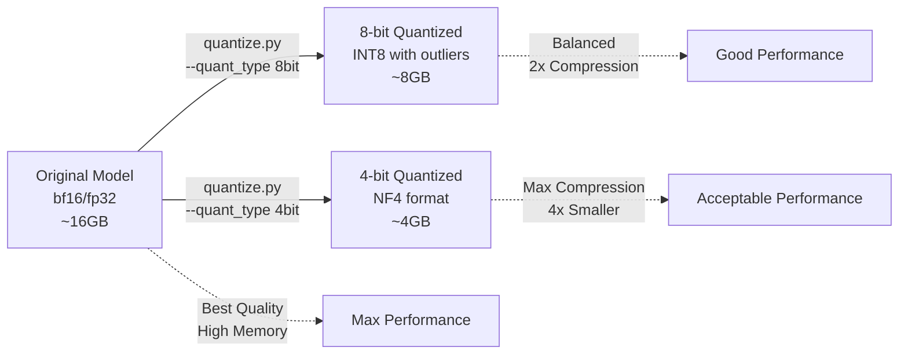
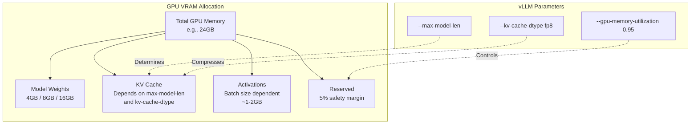
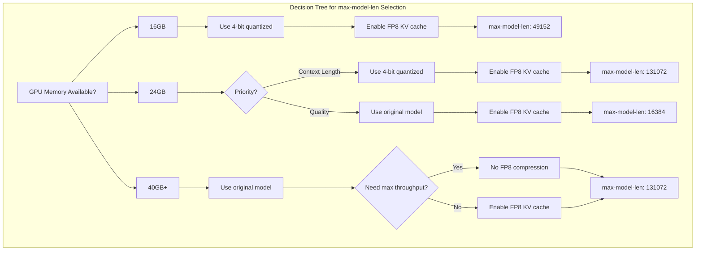
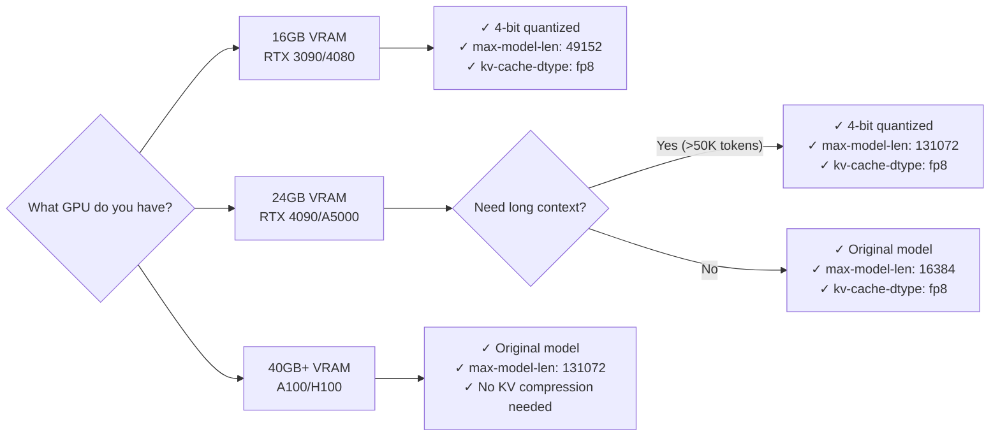

<!-- source: DeepWiki mcp.deepwiki.com · repo ruc-datalab/DeepAnalyze · page 4.4 GPU Requirements and Configuration · fetched 2026-10-26 -->

# GPU Requirements and Configuration

<details>
<summary>Relevant source files</summary>

The following files were used as context for generating this wiki page:

- [README.md](README.md)
- [assets/wechat.jpg](assets/wechat.jpg)
- [docker/.dockerignore](docker/.dockerignore)
- [docker/Dockerfile](docker/Dockerfile)
- [docker/README.md](docker/README.md)
- [docker/docker-compose.yml](docker/docker-compose.yml)
- [docs/DeepAnalyze_API_Key_Usage_Guide.md](docs/DeepAnalyze_API_Key_Usage_Guide.md)
- [docs/DeepAnalyze_API_Key_Usage_Guide_ZH.md](docs/DeepAnalyze_API_Key_Usage_Guide_ZH.md)
- [example/README.md](example/README.md)
- [quantize.py](quantize.py)
- [requirements.txt](requirements.txt)

</details>


This document provides technical specifications for GPU requirements and configuration options when deploying DeepAnalyze-8B. It covers hardware requirements, model quantization strategies, vLLM server parameters, and the trade-offs between GPU memory, context length, and inference performance.

For information about the quantization process itself, see [Model Quantization](#4.2). For details on vLLM server deployment, see [vLLM Server Setup](#4.1). For Docker-based deployment with GPU support, see [Docker Deployment](#4.3).

## GPU Requirements Overview

DeepAnalyze-8B requires NVIDIA GPUs with CUDA support. The minimum viable configuration is a 16GB GPU using 4-bit quantization, while high-end deployments can utilize 80GB GPUs for maximum context length and inference speed.

### Base Requirements

**Minimum Hardware:**
- NVIDIA GPU with 16GB VRAM (e.g., RTX 3090, RTX 4080)
- CUDA 12.1 or later
- PCIe 4.0 x16 interface (recommended for bandwidth)

**Software Dependencies:**
- `vllm>=0.8.5`
- `torch`
- `transformers`
- NVIDIA Container Toolkit (for Docker deployments)

**Sources:** [README.md:212-227](), [requirements.txt:1-16](), [docker/Dockerfile:1-113]()

## Model Variants and Memory Footprint

DeepAnalyze-8B is available in three precision formats, each with different memory requirements and performance characteristics:



### Original Model (bf16/fp32)

- **Model Size:** ~16GB on disk
- **Runtime Memory:** 16GB + KV cache + activations
- **Precision:** Full bfloat16 or float32 precision
- **Use Case:** Maximum quality for production deployments with sufficient GPU memory

### 8-bit Quantized Model

- **Model Size:** ~8GB on disk
- **Quantization Method:** INT8 with outlier detection via `BitsAndBytesConfig`
- **Runtime Memory:** 8GB + KV cache + activations
- **Quality Loss:** Minimal (<1% degradation on most tasks)
- **Generation:** `quantize.py --quant_type 8bit`

The 8-bit quantization uses a threshold of 6.0 for outlier detection [quantize.py:69](), preserving critical weight values in higher precision while compressing the majority of weights.

### 4-bit Quantized Model

- **Model Size:** ~4GB on disk
- **Quantization Method:** NF4 (Normal Float 4) via `BitsAndBytesConfig`
- **Runtime Memory:** 4GB + KV cache + activations
- **Quality Loss:** Small (2-5% degradation on complex reasoning tasks)
- **Generation:** `quantize.py --quant_type 4bit`
- **Double Quantization:** Enabled by default for further compression [quantize.py:28]()

The 4-bit variant uses NF4 quantization type [quantize.py:26](), which is optimized for normally distributed weights common in transformer models.

**Sources:** [README.md:135-149](), [quantize.py:1-145]()

## Configuration Matrix

The following table provides recommended configurations for different GPU memory tiers, optimizing the balance between context length and memory utilization:

| GPU Memory | Model Type | Recommended max-model-len | Use FP8 KV Cache | Effective Context | Notes |
|------------|------------|--------------------------|------------------|-------------------|-------|
| **16GB** | 8-bit Quantized | 8,192 | ✓ | ~8K tokens | Minimal viable configuration |
| **16GB** | 4-bit Quantized | 49,152 | ✓ | ~49K tokens | Recommended for 16GB GPUs |
| **24GB** | Original Model | 16,384 | ✓ | ~16K tokens | Entry-level full precision |
| **24GB** | 8-bit Quantized | 98,304 | ✓ | ~98K tokens | Balanced configuration |
| **24GB** | 4-bit Quantized | 131,072 | ✓ | ~131K tokens | Maximum context on 24GB |
| **40GB** | Original Model | 131,072 | ✓ | ~131K tokens | High-performance deployment |
| **40GB** | 8-bit Quantized | 131,072 | ✗ | ~131K tokens | Full precision KV cache |
| **80GB** | Original Model | 131,072 | ✗ | ~131K tokens | Maximum quality |

### Configuration Parameters Explained

**`max-model-len`**: Maximum number of tokens (input + output) the model can process in a single request. This is the primary factor determining GPU memory consumption beyond the model weights.

**`gpu-memory-utilization`**: Fraction of GPU memory to use (recommended: 0.95). Set in vLLM command [README.md:158]().

**`kv-cache-dtype`**: Data type for key-value cache storage:
- **`fp8`**: 8-bit floating point, reduces KV cache memory by 2x compared to bf16
- **Default (bf16)**: Full precision, higher quality but more memory

**Sources:** [README.md:135-146]()

## vLLM Configuration Parameters

### Memory Allocation Breakdown



### Core vLLM Server Arguments

The following parameters control GPU resource allocation when launching vLLM:

**`--model <model_path>`**: Path to the model directory (original or quantized).

**`--served-model-name DeepAnalyze-8B`**: Name exposed via OpenAI-compatible API [README.md:156]().

**`--max-model-len <tokens>`**: Maximum sequence length (input + output). Critical for memory management [README.md:157]().

**`--gpu-memory-utilization 0.95`**: Use 95% of available GPU memory, leaving 5% for safety margin [README.md:158]().

**`--kv-cache-dtype fp8`**: Enable FP8 key-value cache compression (2x memory reduction) [README.md:175-176]().

**`--port 8000`**: API server port [README.md:159]().

**`--trust-remote-code`**: Required for loading DeepAnalyze-8B custom code [README.md:161]().

**Sources:** [README.md:150-202]()

## Deployment Scenarios

### Scenario 1: Consumer GPUs (16GB VRAM)

**Hardware Examples:** RTX 3090, RTX 4080, RTX 4060 Ti 16GB

**Recommended Configuration:**

```bash
python -m vllm.entrypoints.openai.api_server \
  --model /path/to/deepanalyze/4bit \
  --served-model-name DeepAnalyze-8B \
  --max-model-len 49152 \
  --gpu-memory-utilization 0.95 \
  --port 8000 \
  --kv-cache-dtype fp8 \
  --trust-remote-code
```

**Characteristics:**
- **Model Type:** 4-bit quantized (NF4)
- **Context Length:** 49,152 tokens (~36,000 words)
- **KV Cache:** FP8 compressed
- **Memory Breakdown:**
  - Model weights: ~4GB
  - FP8 KV cache: ~10GB
  - Activations: ~1.5GB
  - Reserved: ~0.5GB

This configuration provides the best context length for consumer hardware while maintaining acceptable inference quality.

**Sources:** [README.md:166-177]()

### Scenario 2: Professional GPUs (24GB VRAM)

**Hardware Examples:** RTX 4090, RTX A5000, A10

**Configuration A: Maximum Context Length**

```bash
python -m vllm.entrypoints.openai.api_server \
  --model /path/to/deepanalyze/4bit \
  --served-model-name DeepAnalyze-8B \
  --max-model-len 131072 \
  --gpu-memory-utilization 0.95 \
  --port 8000 \
  --kv-cache-dtype fp8 \
  --trust-remote-code
```

- **Context Length:** 131,072 tokens (maximum supported)
- **Model Type:** 4-bit quantized
- **Use Case:** Long document analysis, complex multi-step reasoning

**Configuration B: Balanced Performance**

```bash
python -m vllm.entrypoints.openai.api_server \
  --model /path/to/original/model \
  --served-model-name DeepAnalyze-8B \
  --max-model-len 16384 \
  --gpu-memory-utilization 0.95 \
  --port 8000 \
  --kv-cache-dtype fp8 \
  --trust-remote-code
```

- **Context Length:** 16,384 tokens
- **Model Type:** Original bf16
- **Use Case:** Standard data analysis tasks requiring full precision

**Sources:** [README.md:179-189]()

### Scenario 3: Enterprise GPUs (40GB+ VRAM)

**Hardware Examples:** A100 40GB/80GB, H100

**Configuration: Best Performance**

```bash
python -m vllm.entrypoints.openai.api_server \
  --model /path/to/original/model \
  --served-model-name DeepAnalyze-8B \
  --max-model-len 131072 \
  --gpu-memory-utilization 0.95 \
  --port 8000 \
  --trust-remote-code
```

**Characteristics:**
- **Model Type:** Original bf16 (no quantization)
- **Context Length:** 131,072 tokens
- **KV Cache:** bf16 (no compression)
- **Memory Breakdown (80GB GPU):**
  - Model weights: ~16GB
  - bf16 KV cache: ~40GB
  - Activations: ~2GB
  - Reserved: ~4GB
  - Free for batching: ~18GB

This configuration provides maximum quality and throughput, suitable for production deployments serving multiple concurrent requests.

**Sources:** [README.md:192-202]()

## Context Length vs. Memory Trade-offs

The relationship between context length, model precision, and GPU memory is critical for deployment planning:



### Memory Consumption Formula

Approximate GPU memory usage can be estimated using:

```
Total Memory ≈ Model Size + KV Cache + Activations

KV Cache = 2 × num_layers × hidden_size × max_model_len × precision_bytes
         = 2 × 28 × 2048 × max_model_len × precision_bytes

For DeepAnalyze-8B:
- bf16 KV cache: ~114,688 × max_model_len bytes
- fp8 KV cache:  ~57,344 × max_model_len bytes
```

**Examples:**

| Configuration | Model | KV Cache Precision | max-model-len | Approx Total Memory |
|---------------|-------|-------------------|---------------|---------------------|
| Minimal | 4-bit | fp8 | 8,192 | ~4 + 0.5 + 1.5 = 6GB |
| Balanced | 4-bit | fp8 | 49,152 | ~4 + 2.8 + 1.5 = 8.3GB |
| Extended | 8-bit | fp8 | 98,304 | ~8 + 5.6 + 1.5 = 15.1GB |
| Maximum | Original | bf16 | 131,072 | ~16 + 15 + 2 = 33GB |

**Sources:** [README.md:135-209]()

## Performance Considerations

### Inference Speed

Inference throughput (tokens/second) is affected by:

1. **Model Precision**: bf16 > 8-bit > 4-bit (quantized models have ~10-15% overhead)
2. **Batch Size**: Larger batches improve throughput but increase memory
3. **Context Length**: Longer contexts reduce throughput due to attention computation
4. **KV Cache Type**: FP8 cache has negligible impact on speed (~2-3% overhead)

### Quality Trade-offs

**4-bit Quantization Impact:**
- Data exploration tasks: <1% degradation
- Complex reasoning: 2-5% degradation
- Numerical precision: 3-7% degradation (occasional rounding errors)

**FP8 KV Cache Impact:**
- Negligible quality impact (<0.5%) for most data science tasks
- Slight degradation in long-context reasoning (>64K tokens)

### Concurrency and Batching

The `gpu-memory-utilization` parameter leaves headroom for request batching:

- **0.95 utilization**: Minimal batching (~1-2 concurrent requests)
- **0.90 utilization**: Moderate batching (~3-5 concurrent requests)
- **0.85 utilization**: High batching (~6-10 concurrent requests)

For production deployments with multiple users, consider using 0.85-0.90 to allow vLLM's dynamic batching to improve throughput.

**Sources:** [README.md:152-161]()

## Docker Deployment with GPU

For containerized deployments with GPU support:

```bash
# Using docker-compose
docker-compose up -d

# Manual deployment with GPU access
docker run --gpus all -d \
  -p 8000:8000 \
  -v /path/to/models:/models \
  --name deepanalyze-vllm \
  deepanalyze-env:latest \
  python3 -m vllm.entrypoints.openai.api_server \
    --model /models/DeepAnalyze-8B \
    --max-model-len 49152 \
    --gpu-memory-utilization 0.95 \
    --kv-cache-dtype fp8 \
    --host 0.0.0.0 \
    --port 8000 \
    --trust-remote-code
```

**Docker Image Specifications:**
- Base: `nvidia/cuda:12.1.0-devel-ubuntu22.04`
- Size: ~17GB
- Includes: vLLM, PyTorch, transformers, data science libraries

The `docker-compose.yml` configuration automatically allocates all available GPUs [docker/docker-compose.yml:16-22]() and exposes port 8000 [docker/docker-compose.yml:25-26]().

**Sources:** [docker/Dockerfile:1-113](), [docker/docker-compose.yml:1-49](), [docker/README.md:1-89]()

## Quick Selection Guide



**Decision Criteria:**

- **Limited Memory (<24GB)**: Use 4-bit quantized model + FP8 KV cache
- **Balanced Configuration (24-40GB)**: Choose between context length and quality based on use case
- **Sufficient Memory (≥40GB)**: Use original model for maximum precision and throughput

**Sources:** [README.md:204-209]()

---

