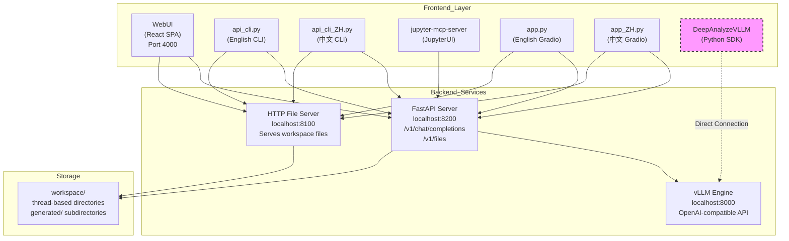
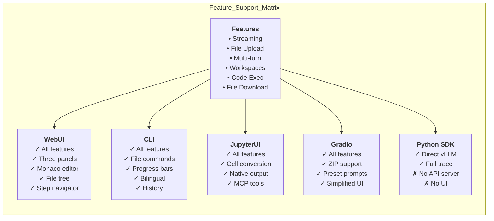
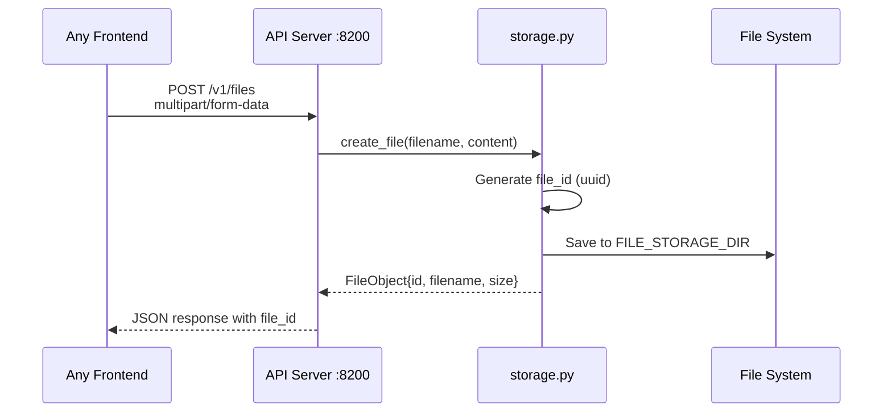
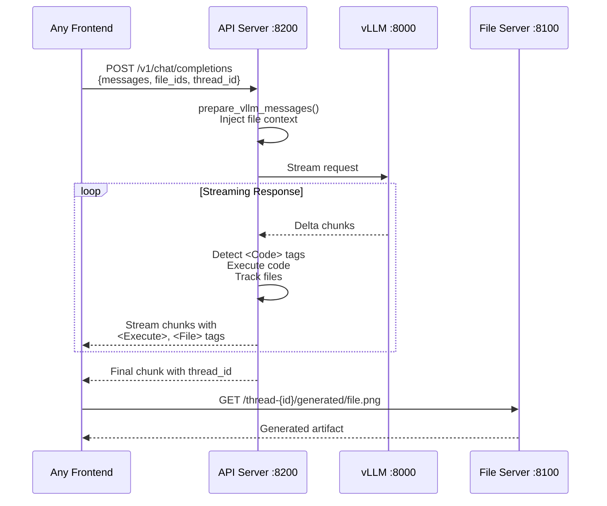
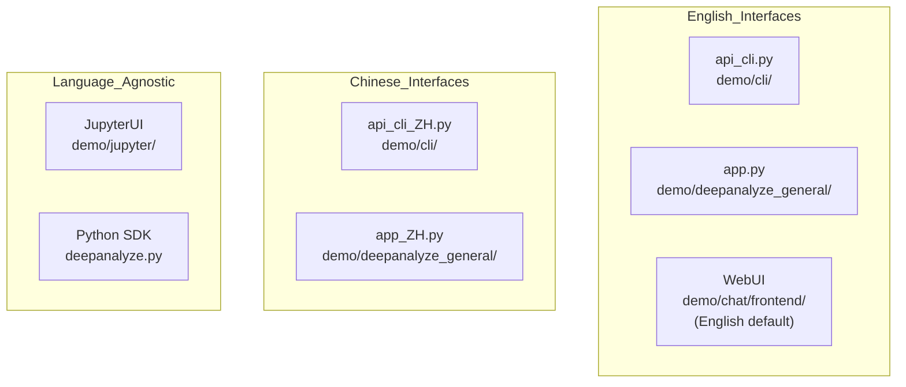
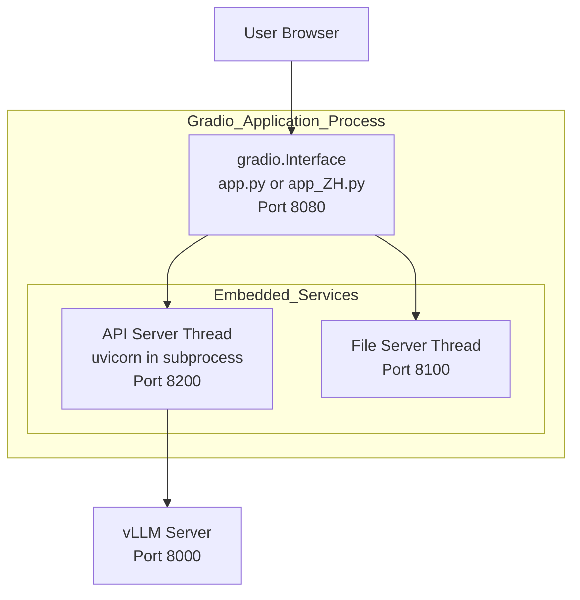

<!-- source: DeepWiki mcp.deepwiki.com · repo ruc-datalab/DeepAnalyze · page 5 Frontend Interfaces · fetched 2026-10-26 -->

# Frontend Interfaces

<details>
<summary>Relevant source files</summary>

The following files were used as context for generating this wiki page:

- [README.md](README.md)
- [assets/wechat.jpg](assets/wechat.jpg)
- [docs/DeepAnalyze_API_Key_Usage_Guide.md](docs/DeepAnalyze_API_Key_Usage_Guide.md)
- [docs/DeepAnalyze_API_Key_Usage_Guide_ZH.md](docs/DeepAnalyze_API_Key_Usage_Guide_ZH.md)
- [example/README.md](example/README.md)
- [quantize.py](quantize.py)
- [requirements.txt](requirements.txt)

</details>


## Purpose and Scope

This document covers the five distinct frontend interfaces provided by DeepAnalyze for user interaction. Each interface targets different use cases and user preferences while maintaining consistent functionality through shared backend services. This page provides technical details about the architecture, key components, and deployment of each frontend.

For backend API architecture details, see [API Server Architecture](#6). For usage guides and examples, see [Using DeepAnalyze](#7).

## Overview of Available Interfaces

DeepAnalyze provides a "multiple frontends, unified backend" architecture. All interfaces support streaming responses, file uploads, workspace management, and multi-turn conversations, but differ in deployment complexity and feature richness.

| Interface | Technology Stack | Target Users | Key Features | Requires Browser |
|-----------|-----------------|--------------|--------------|------------------|
| **WebUI** | React + TypeScript | Data scientists, analysts | Three-panel layout, Monaco editor, file tree, structured output | Yes |
| **CLI** | Python + Rich library | Terminal users, automation | Bilingual support, file commands, progress bars | No |
| **JupyterUI** | MCP + fastmcp | Jupyter users | Native notebook cells, markdown/code conversion | Yes (Jupyter) |
| **Gradio** | Gradio framework | Non-technical users | Simplified interface, ZIP support, easy deployment | Yes |
| **Python SDK** | Pure Python | Developers, embedding | Direct vLLM access, programmatic control, no API server | No |

**Sources:** [README.md:21-113](), [docs/DeepAnalyze_API_Key_Usage_Guide.md:1-192]()

## Frontend-Backend Architecture



**Key Architectural Points:**

- **Standard Path**: WebUI, CLI, Jupyter, and Gradio interfaces communicate with the FastAPI server (port 8200) for chat completions and the HTTP file server (port 8100) for downloading generated artifacts
- **Direct Path**: The Python SDK (`DeepAnalyzeVLLM`) bypasses the API server entirely and communicates directly with vLLM (port 8000), providing lower latency and full control over generation parameters
- **Shared Backend**: All standard-path frontends benefit from the same workspace isolation, file tracking, and code execution capabilities provided by the API server
- **Port Configuration**: Ports 4000 (WebUI), 8080 (Gradio), 8100 (file server), 8200 (API server), and 8000 (vLLM) are the default values and can be reconfigured

**Sources:** [README.md:56-111](), [docs/DeepAnalyze_API_Key_Usage_Guide.md:173-177]()

## Interface Comparison Matrix



**Deployment Complexity:**
- **Simplest**: Gradio (single command: `python app.py`)
- **Simple**: CLI (requires API server running: `python start_server.py` + `python api_cli.py`)
- **Moderate**: WebUI (requires npm install, API server, and React dev server)
- **Moderate**: JupyterUI (requires Jupyter Lab + MCP server configuration)
- **Advanced**: Python SDK (requires understanding of workspace management and direct vLLM interaction)

**Sources:** [README.md:56-111]()

## Common Communication Patterns

All standard-path frontends follow similar interaction patterns with the backend:

### File Upload Flow



**Sources:** [README.md:292-310]()

### Chat Completion Flow



**Sources:** [README.md:292-310]()

## Detailed Interface Specifications

### Connection Endpoints

All standard-path frontends use these endpoints:

| Endpoint | Port | Purpose | Used By |
|----------|------|---------|---------|
| `/v1/files` | 8200 | File upload, list, delete | All except SDK |
| `/v1/chat/completions` | 8200 | Main chat interface | All except SDK |
| `/v1/models` | 8200 | List available models | All except SDK |
| `/thread-{id}/generated/{file}` | 8100 | Download generated files | All except SDK |
| `/v1/completions` | 8000 | Direct vLLM inference | SDK only |
| `/health` | 8200 | API health check | All |

**Sources:** [README.md:292-310](), [docs/DeepAnalyze_API_Key_Usage_Guide.md:173-177]()

### Session Management

All interfaces except the Python SDK use thread-based session management:

| Concept | Description | Storage Location |
|---------|-------------|------------------|
| `thread_id` | Unique session identifier (UUID) | In-memory storage + filesystem |
| `session_id` | Legacy alternative to thread_id | Gradio interfaces |
| Workspace | Per-thread directory | `workspace/thread-{id}/` |
| Generated Files | Artifacts from code execution | `workspace/thread-{id}/generated/` |

**Sources:** [README.md:56-111]()

## Language Support

Three interfaces provide bilingual support (English and Chinese):



**Implementation Notes:**
- Language selection is at the file level (separate scripts for EN/ZH)
- WebUI supports both languages but defaults to English in the UI
- JupyterUI and SDK are language-agnostic, relying on the model's multilingual capabilities
- All interfaces can process prompts in any language the model supports

**Sources:** [README.md:96-104]()

## Startup and Deployment

### Startup Sequences by Interface

| Interface | Required Services | Startup Command(s) | Access URL |
|-----------|------------------|-------------------|------------|
| WebUI | vLLM + API + React | `vllm serve DeepAnalyze-8B`<br/>`cd demo/chat && bash start.sh` | http://localhost:4000 |
| CLI | vLLM + API | `python API/start_server.py`<br/>`python demo/cli/api_cli.py` | Terminal |
| JupyterUI | vLLM + API + Jupyter | See [demo/jupyter]() | Jupyter Lab |
| Gradio | vLLM + API (embedded) | `python demo/deepanalyze_general/app.py` | http://localhost:8080 |
| Python SDK | vLLM only | `vllm serve DeepAnalyze-8B` | Programmatic |

**Sources:** [README.md:56-111](), [docs/DeepAnalyze_API_Key_Usage_Guide.md:164-178]()

### Gradio Embedded API Pattern

Gradio applications use a unique deployment pattern where they start their own API server:



**Key Points:**
- Gradio scripts launch API and file servers as background threads/subprocesses
- This provides "one-command deployment" without manual service management
- The embedded servers use the same code from `API/` directory
- Health checks ensure all services are ready before exposing Gradio UI

**Sources:** [docs/DeepAnalyze_API_Key_Usage_Guide.md:171-178]()

## File Format Support

All interfaces support the same file formats through the unified API backend:

| Category | Formats | Extensions |
|----------|---------|------------|
| Structured Data | CSV, Excel, Parquet | `.csv`, `.xlsx`, `.xls`, `.parquet` |
| Semi-structured | JSON, XML, YAML | `.json`, `.xml`, `.yaml`, `.yml` |
| Unstructured | Text, Markdown, Logs | `.txt`, `.md`, `.log` |
| Code | Python, SQL, R | `.py`, `.sql`, `.r` |
| Documents | PDF | `.pdf` |
| Archives | ZIP | `.zip` (auto-extracted) |
| Images | PNG, JPG, SVG | `.png`, `.jpg`, `.jpeg`, `.svg` |

**ZIP Archive Handling:**
- All interfaces automatically extract ZIP files
- Only supported formats within the archive are processed
- Nested directories are flattened
- Original ZIP structure is not preserved in workspace

**Sources:** [docs/DeepAnalyze_API_Key_Usage_Guide.md:185-186](), [docs/DeepAnalyze_API_Key_Usage_Guide_ZH.md:110-112]()

## Feature Comparison: Standard Frontends vs Python SDK

The Python SDK has a fundamentally different architecture:

| Feature | Standard Frontends | Python SDK |
|---------|-------------------|------------|
| **Connection** | API Server (port 8200) | Direct vLLM (port 8000) |
| **Streaming** | Server-sent events | Full response at once |
| **Code Execution** | Automatic (API handles) | Manual (user manages) |
| **File Tracking** | Automatic (WorkspaceTracker) | Manual (user manages) |
| **Workspace** | Managed by API server | User-specified directory |
| **Thread Management** | Automatic (thread_id) | Not supported |
| **Output** | Parsed sections (<Analyze>, <Code>) | Raw reasoning trace |
| **Use Case** | Interactive analysis | Batch processing, embedding |

**Sources:** [README.md:236-262]()

### Python SDK Return Format

The SDK returns a dictionary with the complete reasoning trace:

```python
{
    "reasoning": str,  # Full model output including <Analyze>, <Code>, <Execute> tags
    "answer": str,     # Extracted final answer
}
```

This raw format requires the caller to parse action tags and manage code execution manually, providing maximum control but requiring more implementation effort.

**Sources:** [README.md:260-261]()

## Next Steps

For detailed documentation on each specific interface:
- WebUI technical details: see [WebUI](#5.1)
- CLI usage and commands: see [Command Line Interface](#5.2)
- Jupyter integration: see [JupyterUI](#5.3)
- Gradio deployment: see [Gradio Apps](#5.4)
- SDK programming guide: see [Python SDK](#5.5)

For backend services that all frontends depend on:
- API endpoint specifications: see [Chat Completions API](#6.6)
- File management: see [File Management API](#6.7)
- Workspace persistence: see [Workspace and File Tracking](#6.6.2)

For practical usage examples:
- First-time setup: see [Quick Start Guide](#7.1)
- File operations: see [File Upload and Management](#7.3)
- Multi-turn workflows: see [Multi-turn Conversations](#7.4)

**Sources:** [README.md:1-403]()

---

