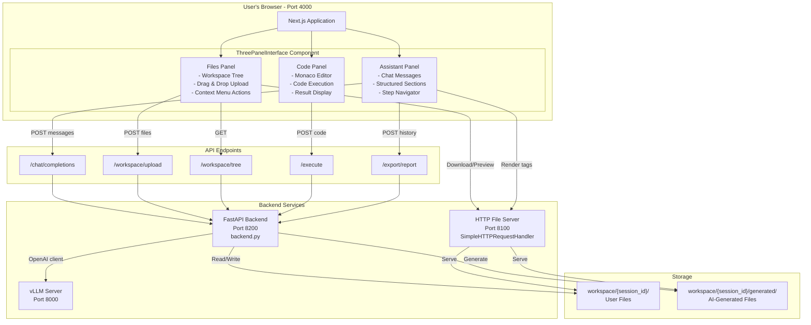
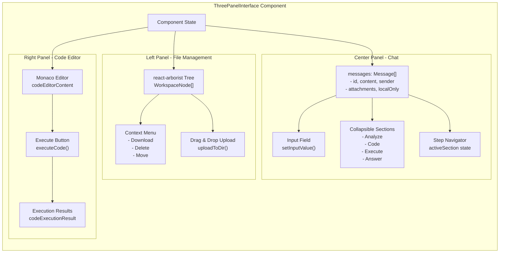
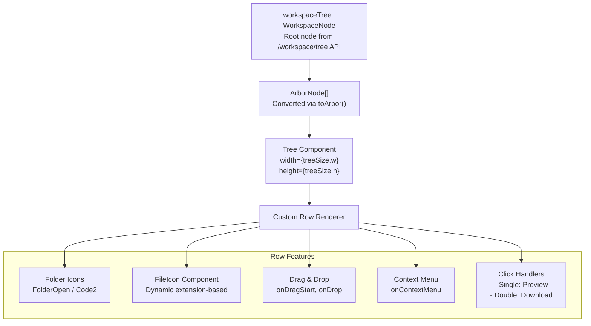
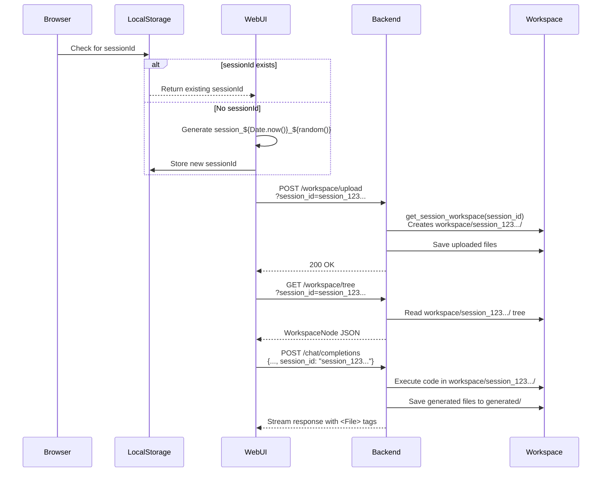
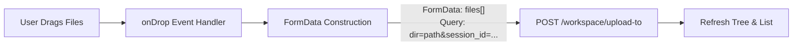
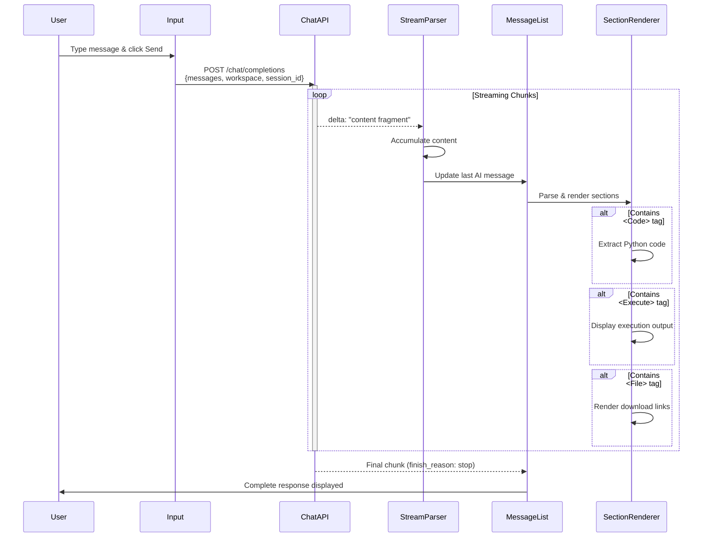
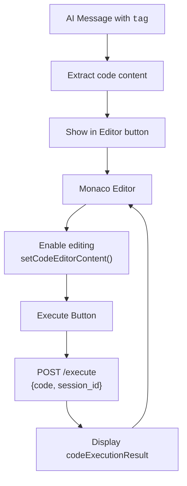
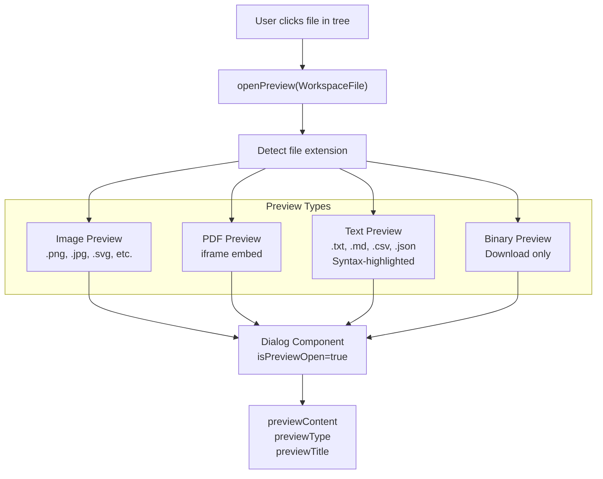
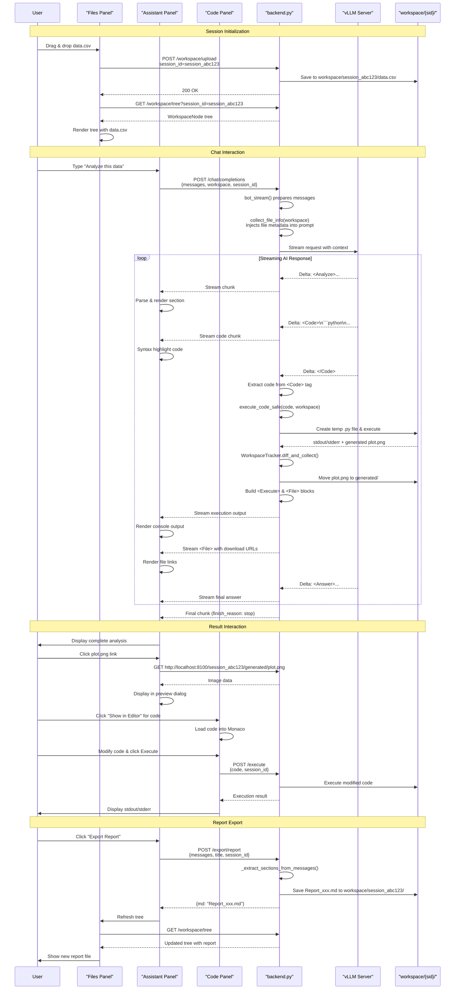
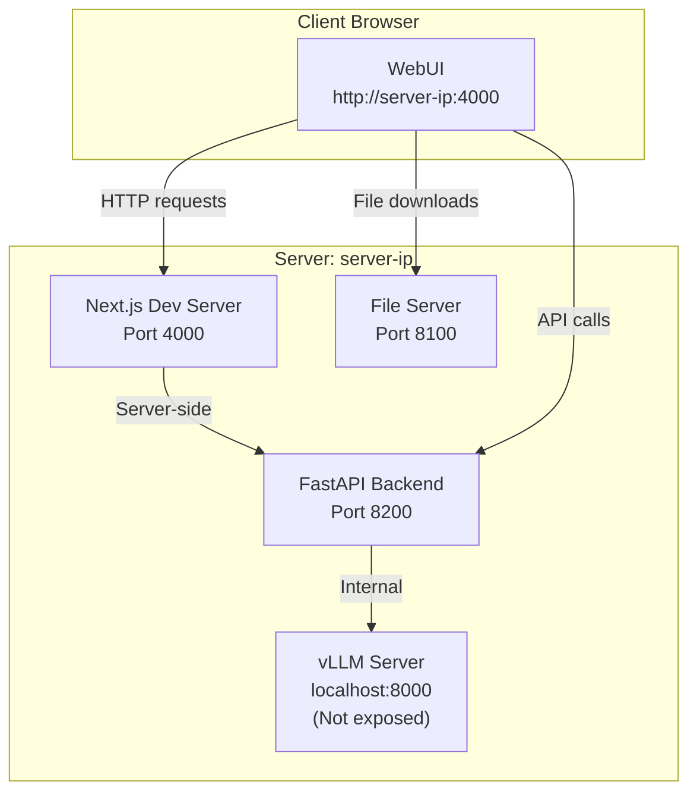

<!-- source: DeepWiki mcp.deepwiki.com · repo ruc-datalab/DeepAnalyze · page 5.1 WebUI · fetched 2026-10-26 -->

# WebUI

<details>
<summary>Relevant source files</summary>

The following files were used as context for generating this wiki page:

- [README.md](README.md)
- [assets/wechat.jpg](assets/wechat.jpg)
- [demo/chat/backend.py](demo/chat/backend.py)
- [demo/chat/frontend/components/three-panel-interface.tsx](demo/chat/frontend/components/three-panel-interface.tsx)
- [demo/chat/frontend/package-lock.json](demo/chat/frontend/package-lock.json)
- [docs/DeepAnalyze_API_Key_Usage_Guide.md](docs/DeepAnalyze_API_Key_Usage_Guide.md)
- [docs/DeepAnalyze_API_Key_Usage_Guide_ZH.md](docs/DeepAnalyze_API_Key_Usage_Guide_ZH.md)
- [docs/FAQ.md](docs/FAQ.md)
- [docs/FAQ_ZH.md](docs/FAQ_ZH.md)
- [example/README.md](example/README.md)
- [quantize.py](quantize.py)
- [requirements.txt](requirements.txt)

</details>


The WebUI is a React + TypeScript single-page application that provides a full-featured browser interface for interacting with DeepAnalyze. It runs on port 4000 and offers a sophisticated three-panel layout optimized for interactive data analysis workflows, with integrated file management, chat interface, and code editing capabilities.

For information about other frontend interfaces, see [Command Line Interface (CLI)](#5.2), [JupyterUI](#5.3), [Gradio Apps](#5.4), and [Python SDK](#5.5). For backend API details, see [API Server Architecture](#6).

**Sources:** [README.md:48-70](), [demo/chat/frontend/components/three-panel-interface.tsx:1-20]()

---

## Architecture Overview

The WebUI operates as a client-side React application communicating with two backend services: the API server and the HTTP file server.



**Key Communication Flow:**

1. **Chat Messages**: `ThreePanelInterface` sends user messages to `/chat/completions` with streaming enabled
2. **File Uploads**: Files dragged into the Files Panel are POSTed to `/workspace/upload` with `session_id`
3. **Workspace Tree**: Files Panel fetches `/workspace/tree` to display hierarchical file structure
4. **Code Execution**: Code Panel sends Python code to `/execute` endpoint
5. **File Download**: Generated files are served via HTTP file server at port 8100

**Sources:** [demo/chat/backend.py:1-50](), [demo/chat/frontend/components/three-panel-interface.tsx:117-350](), [demo/chat/frontend/lib/config.ts]()

---

## Frontend Structure

### Three-Panel Layout

The UI is implemented as a single React component `ThreePanelInterface` using `ResizablePanelGroup` for adjustable panel sizes.



**Component Organization:**

- **State Management**: Uses React hooks (`useState`, `useEffect`, `useRef`) for local state
- **Session Isolation**: `sessionId` stored in `localStorage`, unique per browser
- **Theme Support**: Dark/light mode via `isDarkMode` state and theme class toggling
- **Message Persistence**: Chat history cached in `localStorage` under `CHAT_STORAGE_KEY`

**Sources:** [demo/chat/frontend/components/three-panel-interface.tsx:117-510]()

---

### Key React Components and Libraries

| Component/Library | Purpose | Usage in WebUI |
|---|---|---|
| `@monaco-editor/react` | Code editor | Syntax-highlighted Python editor in Code Panel |
| `react-arborist` | Tree view | Hierarchical workspace file browser |
| `react-markdown` | Markdown rendering | Renders AI responses with GitHub-flavored markdown |
| `react-syntax-highlighter` | Code block syntax | Highlights code in `<Code>` sections |
| `react-file-icon` | File type icons | Shows appropriate icons for different file extensions |
| `@radix-ui/*` | UI primitives | Dialog, Dropdown, Switch, Toast components |
| `lucide-react` | Icon library | UI icons (Send, Upload, Download, etc.) |
| `next-themes` | Theme management | Dark/light mode switching |

**File Tree Component Implementation:**

The workspace tree uses `react-arborist` with custom `Row` component rendering:



**Data Structure Mapping:**

```typescript
// Backend API response
WorkspaceNode {
  name: string
  path: string         // relative path
  is_dir: boolean
  size?: number
  extension?: string
  icon?: string
  download_url?: string
  children?: WorkspaceNode[]
  is_generated?: boolean  // files in generated/ folder
}

// Converted for react-arborist
ArborNode {
  id: string           // path
  name: string
  isDir: boolean
  icon?: string
  download_url?: string
  extension?: string
  size?: number
  children?: ArborNode[]
  isGenerated?: boolean
}
```

**Sources:** [demo/chat/frontend/components/three-panel-interface.tsx:89-108](), [demo/chat/frontend/components/three-panel-interface.tsx:706-912](), [demo/chat/frontend/package-lock.json:59]()

---

## Backend Integration

### API Communication

The WebUI communicates with the backend through several key API endpoints defined in `lib/config.ts`:

| Endpoint | Method | Purpose | Request Body/Params |
|---|---|---|---|
| `/chat/completions` | POST | Stream AI responses | `{messages, workspace, session_id}` |
| `/workspace/upload` | POST | Upload files | FormData + `session_id` query param |
| `/workspace/tree` | GET | Get file hierarchy | `?session_id=...` |
| `/workspace/files` | GET | List files (flat) | `?session_id=...` |
| `/workspace/file` | DELETE | Delete single file | `?path=...&session_id=...` |
| `/workspace/dir` | DELETE | Delete directory | `?path=...&recursive=true&session_id=...` |
| `/workspace/move` | POST | Move file/directory | `?src=...&dst_dir=...&session_id=...` |
| `/workspace/upload-to` | POST | Upload to subdirectory | FormData + `?dir=...&session_id=...` |
| `/execute` | POST | Execute Python code | `{code, session_id}` |
| `/export/report` | POST | Generate report | `{messages, title, session_id}` |
| `/proxy` | GET | CORS proxy for previews | `?url=...` |

**Sources:** [demo/chat/frontend/lib/config.ts](), [demo/chat/backend.py:269-1000]()

---

### Session Management

The WebUI implements client-side session management to isolate workspaces across different browser users:



**Session Lifecycle:**

1. **Initialization**: On component mount, `useEffect` checks `localStorage.getItem("sessionId")` [demo/chat/frontend/components/three-panel-interface.tsx:137-161]()
2. **Generation**: If not found, generates `session_${Date.now()}_${Math.random().toString(36).substr(2, 9)}`
3. **Persistence**: Stored in `localStorage` for subsequent visits
4. **Backend Mapping**: Backend's `get_session_workspace(session_id)` creates `workspace/{session_id}/` directory [demo/chat/backend.py:141-147]()

**State Persistence:**

The WebUI also persists chat messages and UI state per session:

- `localStorage.setItem(CHAT_STORAGE_KEY, JSON.stringify(messages))` - Chat history
- `localStorage.setItem(`collapsedSections:${sessionId}`, JSON.stringify(collapsedSections))` - Section collapse state
- `localStorage.setItem(`manualLocks:${sessionId}`, JSON.stringify(manualLocks))` - Manual collapse locks

**Sources:** [demo/chat/frontend/components/three-panel-interface.tsx:128-187](), [demo/chat/frontend/components/three-panel-interface.tsx:444-508](), [demo/chat/backend.py:141-147]()

---

## Key Features

### File Management

The Files Panel provides comprehensive file operations through both UI interactions and context menu actions.

**Drag and Drop Upload:**



**Implementation:** [demo/chat/frontend/components/three-panel-interface.tsx:657-677]()

```typescript
const uploadToDir = async (dirPath: string, files: FileList | File[]) => {
  setIsUploading(true);
  const form = new FormData();
  Array.from(files).forEach((f) => form.append("files", f));
  const url = `${API_URLS.WORKSPACE_UPLOAD_TO}?dir=${encodeURIComponent(
    dirPath || ""
  )}&session_id=${encodeURIComponent(sessionId)}`;
  await fetch(url, { method: "POST", body: form });
  await loadWorkspaceTree();
  await loadWorkspaceFiles();
  setIsUploading(false);
}
```

**Context Menu Actions:**

When user right-clicks on a file/folder in the tree, a context menu appears with:

- **Download**: Triggers browser download via `downloadFileByUrl()`
- **Preview**: Opens `Dialog` with file content preview
- **Delete**: Shows confirmation dialog before deletion
- **Move**: Drag-and-drop to move within workspace

**Generated Files Distinction:**

Files created by AI code execution are moved to `workspace/{session_id}/generated/` and visually distinguished:

- Purple background (`bg-purple-50 dark:bg-purple-950/20`)
- Purple text color for filename
- `Sparkles` icon indicator
- Grouped under "代码生成文件" (Code Generated Files) section header

**Sources:** [demo/chat/frontend/components/three-panel-interface.tsx:657-912](), [demo/chat/backend.py:732-757]()

---

### Chat Interface

The center panel implements a streaming chat interface with structured response parsing.

**Message Structure:**

```typescript
interface Message {
  id: string
  content: string
  sender: "user" | "ai"
  timestamp: Date
  attachments?: FileAttachment[]
  localOnly?: boolean  // not sent to backend (e.g., welcome message)
}
```

**Streaming Response Handling:**



**Section Parsing:**

The AI's response is parsed for special XML-like tags that structure the content:

| Tag | Purpose | Rendering |
|---|---|---|
| `<Analyze>...</Analyze>` | Analysis explanation | Collapsible section with chart icon |
| `<Understand>...</Understand>` | Data understanding | Collapsible section with lightbulb icon |
| `<Code>...</Code>` | Python code | Syntax-highlighted code block |
| `<Execute>...</Execute>` | Execution output | Preformatted console output |
| `<File>...</File>` | Generated files | List of download links with previews |
| `<Answer>...</Answer>` | Final answer | Collapsible section with checkmark icon |

**Collapsible Sections:**

Sections can be collapsed/expanded with state persistence:

- **Auto-collapse**: When `autoCollapseEnabled` is true, new sections auto-collapse when newer ones arrive
- **Manual locks**: User can click to lock a section open, preventing auto-collapse
- **State persistence**: Collapse state and locks saved per session in `localStorage`

**Step Navigator:**

A horizontal scrollable navigation bar displays all sections in the current conversation:

- Each step is clickable to jump to that section
- Active step is highlighted and auto-scrolled into view
- Uses `stepNavigatorRef` and `activeStepRefs` for scroll management

**Sources:** [demo/chat/frontend/components/three-panel-interface.tsx:72-116](), [demo/chat/frontend/components/three-panel-interface.tsx:322-441]()

---

### Code Editor

The right panel provides an integrated Monaco editor for viewing and executing Python code.

**Monaco Editor Configuration:**

The editor is configured in `lib/monaco-config.ts` with:

- Python language support
- Syntax highlighting
- Auto-completion
- Dark/light theme switching
- Read-only mode (default) with option to enable editing

**Code Extraction from Chat:**

When AI generates code in `<Code>` tags, users can click to view it in the editor:



**Code Execution Flow:**

1. User clicks "Execute" button in Code Panel
2. Frontend calls `executeCode()` function which POSTs to `/execute` endpoint [demo/chat/frontend/components/three-panel-interface.tsx]()
3. Backend's `execute_code_api()` receives code and `session_id` [demo/chat/backend.py:551-577]()
4. Backend calls `execute_code_safe()` which:
   - Creates temporary `.py` file in session workspace
   - Runs it in subprocess with timeout (120s default)
   - Captures stdout/stderr
   - Returns execution output [demo/chat/backend.py:83-123]()
5. Frontend displays result in Code Panel below editor

**Workspace Context:**

Code executes with the session workspace as the current working directory, allowing it to:

- Read uploaded user files
- Write new files (automatically moved to `generated/` folder)
- Import libraries available in the backend environment

**Sources:** [demo/chat/frontend/lib/monaco-config.ts](), [demo/chat/backend.py:551-577](), [demo/chat/backend.py:83-123]()

---

### File Preview System

The WebUI provides in-browser preview for various file types through a modal dialog.

**Preview Dialog Component:**



**File Type Detection:**

```typescript
const openPreview = async (file: WorkspaceFile) => {
  const ext = file.extension.toLowerCase();
  
  if ([".png", ".jpg", ".jpeg", ".gif", ".webp", ".svg"].includes(ext)) {
    setPreviewType("image");
  } else if (ext === ".pdf") {
    setPreviewType("pdf");
  } else if ([".txt", ".md", ".csv", ".json", ".py", ".js"].includes(ext)) {
    setPreviewType("text");
    // Fetch content via proxy or direct download
    const response = await fetch(file.download_url);
    const content = await response.text();
    setPreviewContent(content);
  } else {
    setPreviewType("binary");
  }
  
  setPreviewTitle(file.name);
  setPreviewDownloadUrl(file.download_url);
  setIsPreviewOpen(true);
}
```

**CORS Proxy:**

For external files or to work around CORS issues, the WebUI can route requests through the backend's `/proxy` endpoint:

```
GET /proxy?url=${encodeURIComponent(externalUrl)}
```

The backend fetches the resource and returns it with `Access-Control-Allow-Origin: *` header [demo/chat/backend.py:462-477]().

**Sources:** [demo/chat/frontend/components/three-panel-interface.tsx:679-693](), [demo/chat/backend.py:462-477]()

---

## Data Flow: Complete Analysis Session

The following diagram illustrates a complete user workflow from file upload through AI analysis to result download.



**Sources:** [demo/chat/frontend/components/three-panel-interface.tsx](), [demo/chat/backend.py:639-1000]()

---

## Deployment

### Prerequisites

1. **Backend Services Running:**
   - vLLM server at port 8000 serving DeepAnalyze-8B model
   - No separate API server needed (backend.py serves both API and starts file server)

2. **Node.js Environment:**
   - Node.js 16.8+ (required for Next.js 14)
   - npm or yarn package manager

**Sources:** [README.md:55-70](), [requirements.txt:10-16]()

---

### Installation Steps

**1. Install Node.js Dependencies:**

```bash
cd demo/chat/frontend
npm install
```

This installs all dependencies defined in [demo/chat/frontend/package-lock.json:1-100](), including:
- Next.js 14.2.33
- React 18
- Monaco Editor
- Radix UI components
- React Markdown with plugins

**2. Configure API Endpoints:**

Edit `demo/chat/frontend/lib/config.ts` to set backend URLs:

```typescript
export const API_CONFIG = {
  BACKEND_BASE_URL: "http://localhost:8200",  // Change to your backend IP
  FILE_SERVER_BASE_URL: "http://localhost:8100",  // Change to your file server IP
};
```

Also update `demo/chat/backend.py` to match:

```python
API_BASE = "http://localhost:8000/v1"  # vLLM API (keep localhost)
HTTP_SERVER_BASE = "http://your-ip:8100"  # File server (change to your IP)
```

**3. Start Backend:**

```bash
cd demo/chat
python backend.py
```

This starts:
- FastAPI backend on port 8200
- HTTP file server on port 8100 (in separate thread)

**4. Start Frontend Development Server:**

```bash
cd demo/chat/frontend
npm run dev
```

Or for production build:

```bash
npm run build
npm start
```

**5. Access WebUI:**

Open browser to `http://localhost:4000` (or `http://your-ip:4000` if deploying remotely)

**Sources:** [README.md:57-70](), [demo/chat/frontend/package-lock.json]()

---

### Using start.sh Script

The repository provides a convenience script for launching both backend and frontend:

```bash
cd demo/chat
bash start.sh
```

This script:
1. Starts `backend.py` in background
2. Navigates to `frontend/` directory
3. Runs `npm run dev`
4. Logs to `backend.log` and `frontend.log`

To stop services:

```bash
bash stop.sh
```

This script:
1. Kills Python process running `backend.py`
2. Kills Node.js process running Next.js dev server
3. Optionally kills vLLM process if needed

**Sources:** [README.md:62-66]()

---

### Remote Deployment Considerations

When deploying the WebUI to be accessed from remote browsers:

1. **Update Backend IP in frontend config:**
   - Edit `demo/chat/frontend/lib/config.ts`
   - Replace `localhost` with server IP (e.g., `192.168.1.100` or domain name)

2. **Update File Server URL in backend:**
   - Edit `demo/chat/backend.py` line 137
   - Change `HTTP_SERVER_BASE` from `http://localhost:8100` to `http://your-ip:8100`

3. **Firewall Configuration:**
   - Open ports 4000 (WebUI), 8100 (file server), 8200 (API backend)
   - Port 8000 (vLLM) should remain localhost-only for security

4. **CORS Configuration:**
   - Backend already has CORS enabled for all origins [demo/chat/backend.py:162-168]()
   - For production, restrict `allow_origins` to specific domains

**Network Diagram for Remote Deployment:**



**Sources:** [README.md:69](), [demo/chat/backend.py:126-138](), [demo/chat/backend.py:162-168]()

---

## Component Reference Table

| Component/File | Purpose | Key Functions/Exports |
|---|---|---|
| `three-panel-interface.tsx` | Main UI component | `ThreePanelInterface()` |
| `lib/config.ts` | API endpoint configuration | `API_URLS`, `API_CONFIG` |
| `lib/monaco-config.ts` | Monaco editor setup | `configureMonaco()` |
| `ui/button.tsx` | Styled button component | `Button` |
| `ui/dialog.tsx` | Modal dialog component | `Dialog`, `DialogContent` |
| `ui/switch.tsx` | Toggle switch component | `Switch` |
| `ui/toast.tsx` | Notification toast | `useToast()` |
| `backend.py` | FastAPI backend server | `app`, all API routes |
| `start.sh` | Launch script | Starts backend + frontend |
| `stop.sh` | Cleanup script | Kills processes |

**Sources:** [demo/chat/frontend/components/](), [demo/chat/frontend/lib/](), [demo/chat/backend.py]()

---

