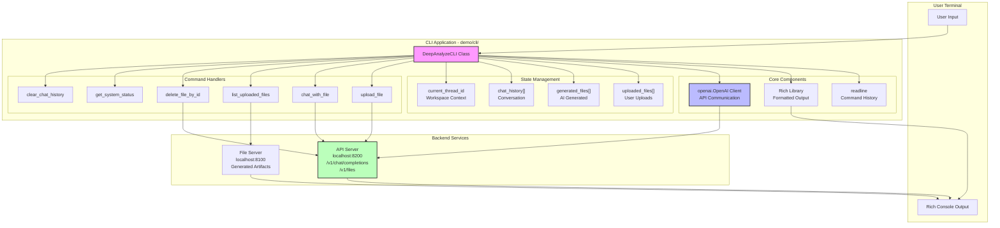
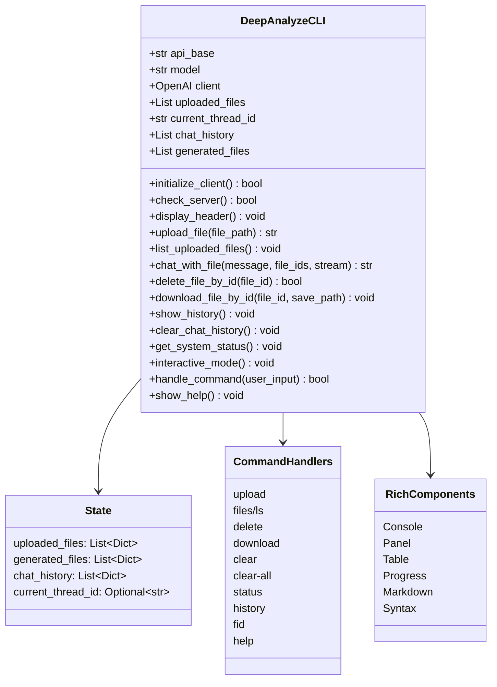
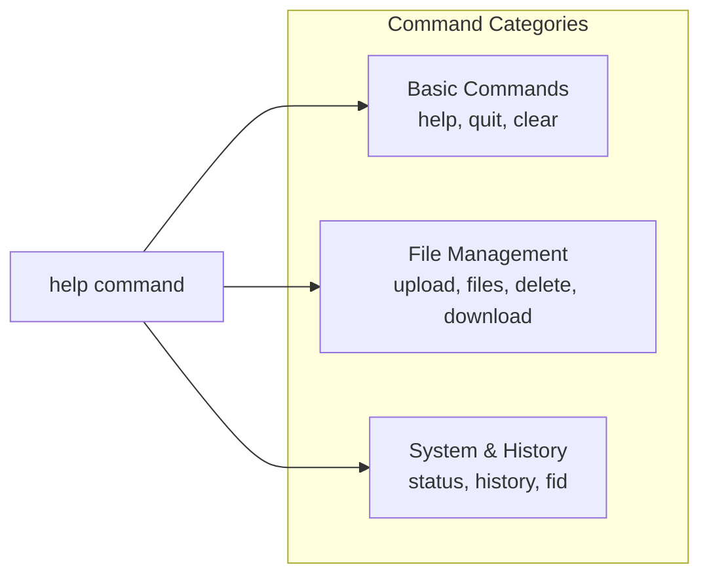
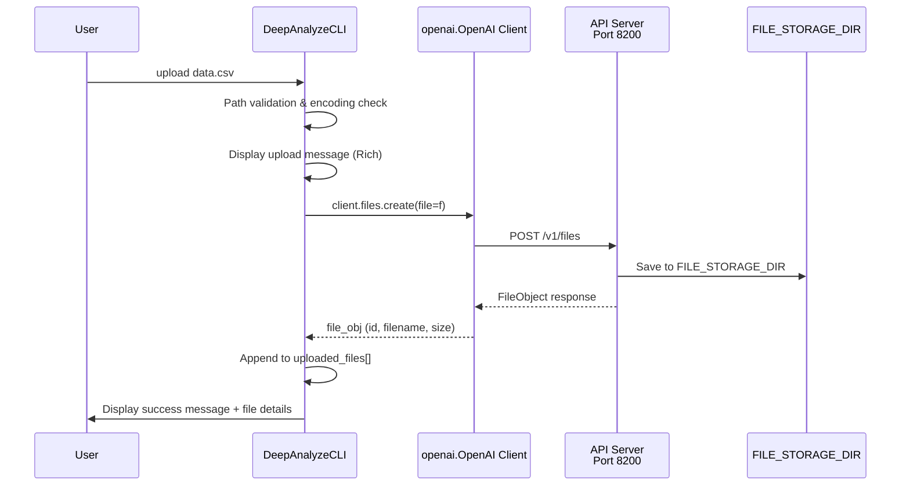
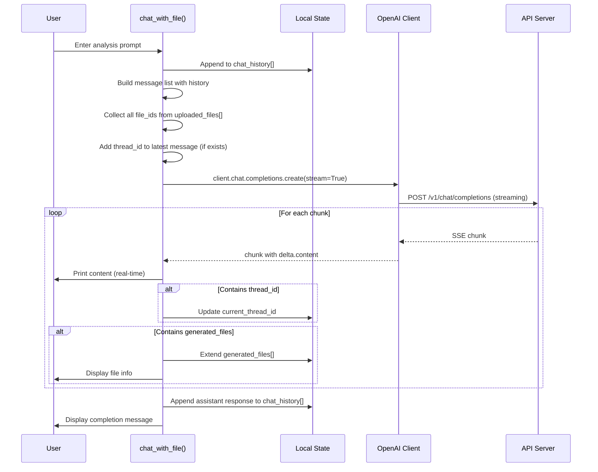
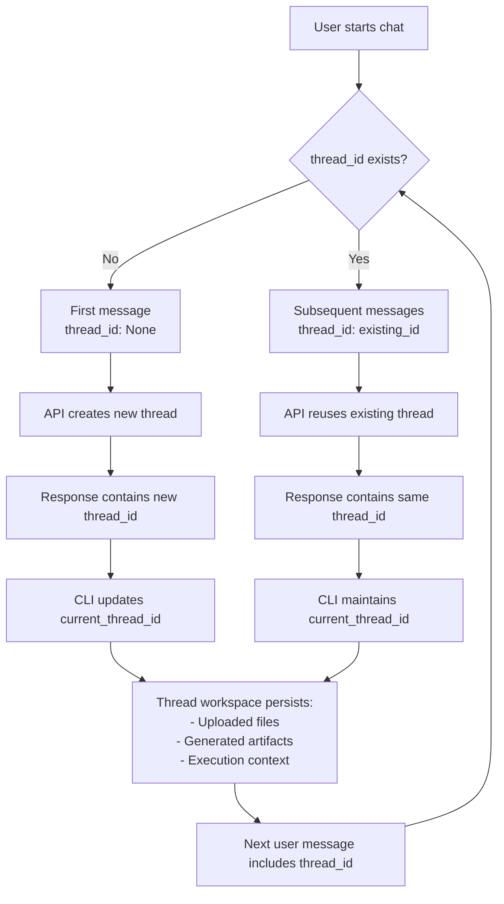
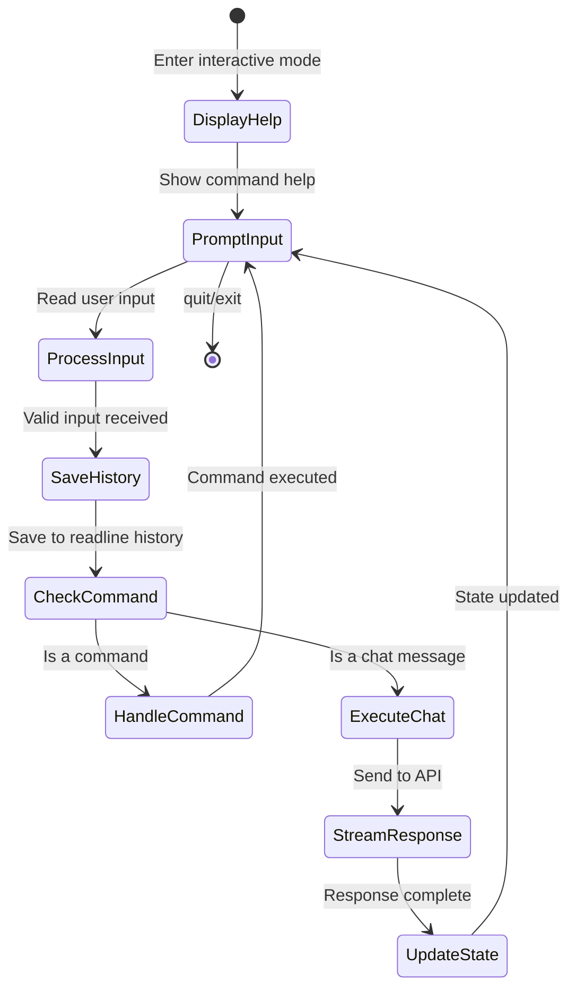

<!-- source: DeepWiki mcp.deepwiki.com · repo ruc-datalab/DeepAnalyze · page 5.2 Command Line Interface (CLI) · fetched 2026-10-26 -->

# Command Line Interface (CLI)

<details>
<summary>Relevant source files</summary>

The following files were used as context for generating this wiki page:

- [API/README_ZH.md](API/README_ZH.md)
- [README.md](README.md)
- [assets/wechat.jpg](assets/wechat.jpg)
- [demo/cli/api_cli.py](demo/cli/api_cli.py)
- [demo/cli/api_cli_ZH.py](demo/cli/api_cli_ZH.py)
- [docs/DeepAnalyze_API_Key_Usage_Guide.md](docs/DeepAnalyze_API_Key_Usage_Guide.md)
- [docs/DeepAnalyze_API_Key_Usage_Guide_ZH.md](docs/DeepAnalyze_API_Key_Usage_Guide_ZH.md)
- [example/README.md](example/README.md)
- [quantize.py](quantize.py)
- [requirements.txt](requirements.txt)

</details>


## Purpose and Scope

The Command Line Interface (CLI) provides a Rich-based terminal user interface for interacting with DeepAnalyze. It enables users to perform data analysis tasks, manage files, and maintain multi-turn conversations directly from the command line. The CLI supports both English and Chinese languages and offers features like command history, streaming responses, and workspace persistence.

For information about the web-based interface, see [WebUI](#5.1). For Jupyter notebook integration, see [JupyterUI](#5.3). For programmatic access, see [Python SDK](#5.5).

**Sources:** [README.md:82-112](), [demo/cli/api_cli.py:1-10]()

---

## Overview

The CLI is implemented as a standalone Python application that communicates with the DeepAnalyze API Server using the OpenAI Python client library. It provides:

- **Rich Terminal UI**: Formatted output using the Rich library with panels, tables, progress bars, and syntax highlighting
- **File Management**: Upload, list, delete, and download files with drag-and-drop support
- **Interactive Chat**: Real-time streaming responses with code execution and file generation
- **Command History**: Persistent command history with readline support and tab completion
- **Bilingual Support**: Separate interfaces for English (`api_cli.py`) and Chinese (`api_cli_ZH.py`)
- **Session Persistence**: Thread-based workspace management for multi-turn conversations
- **Offline Artifacts**: View and download generated reports, charts, and data files

**Sources:** [demo/cli/api_cli.py:1-30](), [README.md:82-112]()

---

## System Architecture

### CLI Integration with Backend Services



**Diagram 1: CLI Component Architecture**

The CLI application is structured around the `DeepAnalyzeCLI` class, which manages state and coordinates between the Rich display library, OpenAI client, and backend services. Command handlers process user input and update local state while communicating with the API server.

**Sources:** [demo/cli/api_cli.py:32-43](), [demo/cli/api_cli.py:71-81]()

---

## Prerequisites and Startup

### Starting the CLI

Before launching the CLI, ensure the following services are running:

1. **vLLM Model Server** (port 8000):
   ```bash
   vllm serve DeepAnalyze-8B
   ```

2. **API Server** (port 8200):
   ```bash
   cd API
   python start_server.py
   ```

3. **Launch CLI**:
   ```bash
   cd demo/cli
   python api_cli.py       # English interface
   # or
   python api_cli_ZH.py    # Chinese interface (中文界面)
   ```

The CLI automatically checks server connectivity on startup using the `/health` endpoint at [demo/cli/api_cli.py:83-97]().

**Sources:** [README.md:89-100](), [demo/cli/api_cli.py:697-719]()

---

## Interface Components

### DeepAnalyzeCLI Class Structure



**Diagram 2: CLI Class Structure**

The `DeepAnalyzeCLI` class encapsulates all CLI functionality with clear separation between state management, command handling, and display formatting.

**Sources:** [demo/cli/api_cli.py:32-43](), [demo/cli/api_cli.py:44-70]()

---

## Command Reference

### Available Commands

The CLI provides the following commands, accessible via the `handle_command` method:

| Command | Syntax | Description |
|---------|--------|-------------|
| **help** / **h** | `help` | Display command help information |
| **files** / **ls** | `files` | List all uploaded and generated files |
| **upload** | `upload <file_path>` | Upload a new file to the API server |
| **delete** | `delete <file_id>` | Delete a specific uploaded file |
| **download** | `download <file_id> [save_path]` | Download an uploaded file |
| **clear** | `clear` | Clear conversation history and reset thread |
| **clear-all** | `clear-all` | Clear all content including uploaded files |
| **status** | `status` | Display system status and statistics |
| **history** | `history` | Show conversation history summary |
| **fid** | `fid` | Display file names with complete file IDs |
| **quit** / **exit** | `quit` | Exit the CLI application |

**Sources:** [demo/cli/api_cli.py:556-644](), [demo/cli/api_cli_ZH.py:556-674]()

### Help Command Output



**Diagram 3: Command Categories**

The help system organizes commands into logical categories for easy reference. Implementation at [demo/cli/api_cli.py:556-580]().

**Sources:** [demo/cli/api_cli.py:556-580]()

---

## File Management

### File Upload Workflow



**Diagram 4: File Upload Process**

The CLI uses the OpenAI client library to upload files, which are stored on the server and tracked locally in the `uploaded_files` list.

**Sources:** [demo/cli/api_cli.py:106-163]()

### File Upload Implementation

The `upload_file` method handles file uploads with the following features:

- **Path Resolution**: Expands user paths and converts to absolute paths
- **Encoding Safety**: Handles non-UTF-8 filenames by generating safe alternatives
- **Progress Display**: Shows upload status using Rich console output
- **Metadata Tracking**: Stores file ID, name, path, size, and purpose locally

Key implementation at [demo/cli/api_cli.py:106-163]():

```python
# Path validation
full_path = Path(file_path).expanduser().resolve()
if not full_path.exists():
    console.print(f"[red]❌ File does not exist: {file_path}[/red]")
    return None

# Safe filename handling
safe_filename = full_path.name
try:
    safe_filename.encode('utf-8')
except UnicodeEncodeError:
    safe_filename = f"file_{int(time.time())}{full_path.suffix}"

# Upload via OpenAI client
with open(full_path, 'rb') as f:
    file_obj = self.client.files.create(file=f, purpose="assistants")

# Track locally
self.uploaded_files.append({
    'id': file_obj.id,
    'name': safe_response_filename,
    'path': str(full_path),
    'size': file_size,
    'purpose': file_obj.purpose
})
```

**Sources:** [demo/cli/api_cli.py:106-163]()

### File Listing

The `list_uploaded_files` method displays two categories of files:

#### 1. User Uploaded Files Table

Displays files uploaded by the user with:
- Filename
- Truncated File ID (first 8 characters)
- File Size (formatted using Rich's `decimal` function)
- Purpose
- Status indicator (✅ Uploaded)

#### 2. AI Generated Files Table

Displays workspace artifacts with:
- Filename
- Clickable URL (styled as hyperlink)
- File Type (Report, Image, or Generated File based on extension)
- Size (fetched dynamically via HTTP HEAD request if not available)
- Status indicator (📋 Generated)

Implementation at [demo/cli/api_cli.py:165-245]():

```python
# User uploaded files
table = Table(title="User Uploaded Files", ...)
for file_info in self.uploaded_files:
    table.add_row(
        file_info['name'],
        file_info['id'][:8] + "...",
        decimal(file_info['size']),
        file_info.get('purpose', 'assistants'),
        "✅ Uploaded"
    )

# AI generated files
workspace_table = Table(title="AI Generated Files in Workspace", ...)
for file_info in workspace_files:
    # Determine file type by extension
    if file_name.lower().endswith(('.md', '.markdown')):
        file_type = "Report"
    elif file_name.lower().endswith(('.png', '.jpg', ...)):
        file_type = "Image"
    # Create clickable URL
    url_text = Text(display_url, style="blue")
    url_text.stylize(f"link {file_url}")
```

**Sources:** [demo/cli/api_cli.py:165-245]()

### File Deletion and Download

**Delete**: Removes file from server and local `uploaded_files` list [demo/cli/api_cli.py:367-384]()
**Download**: Retrieves file content and saves to specified path [demo/cli/api_cli.py:386-418]()

---

## Chat and Analysis

### Streaming Chat Flow



**Diagram 5: Streaming Chat Process**

The CLI implements streaming chat to provide real-time feedback during potentially long-running data analysis tasks.

**Sources:** [demo/cli/api_cli.py:247-364]()

### Chat Implementation Details

The `chat_with_file` method at [demo/cli/api_cli.py:247-364]() implements the following workflow:

#### 1. Message Preparation

```python
# Add user message to history
self.chat_history.append({"role": "user", "content": message})

# Build messages including history (excluding file_ids from history)
messages = []
for msg in self.chat_history[:-1]:  # Exclude newly added message
    if msg["role"] == "user":
        messages.append({"role": "user", "content": msg["content"]})
    elif msg["role"] == "assistant":
        messages.append({"role": "assistant", "content": msg["content"]})

# Collect all uploaded file IDs
all_file_ids = [f['id'] for f in self.uploaded_files]

# Add current message with file_ids and thread_id
current_message = {"role": "user", "content": message}
if all_file_ids:
    current_message["file_ids"] = all_file_ids
if self.current_thread_id:
    current_message["thread_id"] = self.current_thread_id
messages.append(current_message)
```

**Key Design Decision**: Only the latest user message contains `file_ids` and `thread_id`, while the full conversation history is maintained without these fields to avoid confusion and reduce payload size.

**Sources:** [demo/cli/api_cli.py:254-278]()

#### 2. Streaming Response Handling

```python
stream_response = self.client.chat.completions.create(
    model=self.model,
    messages=messages,
    temperature=0.3,
    stream=True
)

response_text = ""
collected_files = []
response_thread_id = None

for chunk in stream_response:
    if chunk.choices:
        delta = chunk.choices[0].delta
        # Stream content in real-time
        if hasattr(delta, 'content') and delta.content:
            content = delta.content
            response_text += content
            console.print(content, end='')
        
        # Extract thread_id
        if hasattr(chunk.choices[0].delta, 'thread_id'):
            response_thread_id = chunk.choices[0].delta.thread_id
    
    # Collect generated files
    if hasattr(chunk, 'generated_files'):
        collected_files.extend(chunk.generated_files)
```

**Sources:** [demo/cli/api_cli.py:294-315]()

#### 3. Post-Stream Processing

After streaming completes, the CLI:
- Updates `current_thread_id` if a new thread was created or returned
- Appends the assistant's complete response to `chat_history`
- Processes generated files by fetching sizes via HTTP HEAD requests
- Displays file information in a formatted list

**Sources:** [demo/cli/api_cli.py:316-364]()

---

## Thread and Workspace Management

### Thread Persistence

The CLI maintains thread context across multiple conversation turns using the `current_thread_id` field:



**Diagram 6: Thread Lifecycle**

Thread IDs enable workspace persistence, allowing subsequent messages to access files and artifacts from previous turns in the conversation.

**Sources:** [demo/cli/api_cli.py:273-277](), [demo/cli/api_cli.py:318-321]()

### Workspace File Tracking

The CLI tracks two separate file collections:

1. **`uploaded_files`**: User-uploaded files stored via `/v1/files` endpoint
   - Contains: `id`, `name`, `path`, `size`, `purpose`
   - Managed by: `upload_file()`, `delete_file_by_id()`
   - Source: [demo/cli/api_cli.py:38]()

2. **`generated_files`**: AI-generated artifacts in thread workspace
   - Contains: `name`, `url`, `size` (fetched dynamically)
   - Populated during streaming chat responses
   - Source: [demo/cli/api_cli.py:41](), [demo/cli/api_cli.py:353-358]()

Both collections are displayed together by `list_uploaded_files()` but serve different purposes in the workflow.

**Sources:** [demo/cli/api_cli.py:38-41](), [demo/cli/api_cli.py:165-245]()

---

## Session Management

### Command History

The CLI implements persistent command history using the `readline` module:

```python
def setup_command_history(self):
    """Setup command history functionality"""
    history_file = os.path.expanduser("~/.deeppanalyze_history_en")
    
    try:
        if os.path.exists(history_file):
            readline.read_history_file(history_file)
        readline.set_history_length(1000)
        readline.set_auto_history(True)
    except Exception as e:
        pass  # Silently handle failures
    
    self.history_file = history_file

def save_history(self):
    """Save history to file"""
    try:
        if hasattr(self, 'history_file'):
            readline.write_history_file(self.history_file)
    except Exception as e:
        pass
```

Features:
- Stores up to 1000 commands
- Persists across CLI sessions
- Supports arrow key navigation
- Separate history files for English and Chinese versions
- Automatically saved after valid commands

**Sources:** [demo/cli/api_cli.py:44-69]()

### Conversation History Management

The `show_history()` command displays statistics and recent messages:

```python
def show_history(self):
    """Display conversation history"""
    # Statistics panel
    console.print(Panel(
        f"[bold]Conversation rounds:[/bold] {len(self.chat_history) // 2}\n"
        f"[bold]User messages:[/bold] {len([m for m in self.chat_history if m['role'] == 'user'])}\n"
        f"[bold]AI responses:[/bold] {len([m for m in self.chat_history if m['role'] == 'assistant'])}\n"
        f"[bold]Generated files:[/bold] {generated_files_count}\n"
        f"[bold]Thread ID:[/bold] {self.current_thread_id or 'None'}",
        title="Conversation History Statistics",
        border_style="blue"
    ))
    
    # Display recent messages (last 6)
    recent_messages = self.chat_history[-6:]
    for msg in recent_messages:
        role_emoji = "👤" if msg['role'] == 'user' else "🤖"
        role_color = "blue" if msg['role'] == 'user' else "green"
        content = msg['content'][:100] + "..." if len(msg['content']) > 100 else msg['content']
        console.print(f"[{role_color}]{role_emoji} {msg['role'].title()}:[/{role_color}] {content}")
```

**Sources:** [demo/cli/api_cli.py:420-451]()

### Clear Operations

Two clearing commands provide different levels of cleanup:

#### `clear` Command
Clears conversation-specific state while preserving uploaded files:
- Empties `chat_history[]`
- Empties `generated_files[]`
- Resets `current_thread_id` to `None`
- **Preserves** `uploaded_files[]`

Implementation at [demo/cli/api_cli.py:452-461]()

#### `clear-all` Command
Performs complete cleanup including server-side file deletion:
- Deletes all uploaded files via API
- Clears all local state collections
- Resets thread context

Implementation at [demo/cli/api_cli.py:463-486]()

**Sources:** [demo/cli/api_cli.py:452-486]()

---

## System Status

### Status Command Output

The `get_system_status()` method provides a comprehensive system overview:

```python
def get_system_status(self):
    """Get system status"""
    # Check server connectivity
    server_status = "✅ Online" if self.check_server() else "❌ Offline"
    
    status_panel = Panel(
        f"[bold]API Server:[/bold] {server_status}\n"
        f"[bold]API Endpoint:[/bold] {self.api_base}\n"
        f"[bold]Current Model:[/bold] {self.model}\n"
        f"[bold]Thread ID:[/bold] {self.current_thread_id or 'None'}\n"
        f"[bold]Uploaded Files:[/bold] {len(self.uploaded_files)}\n"
        f"[bold]Generated Files:[/bold] {generated_files_count}\n"
        f"[bold]Conversation Rounds:[/bold] {len([m for m in self.chat_history if m['role'] == 'user'])}",
        title="System Status",
        border_style="cyan"
    )
    console.print(status_panel)
```

Status information includes:
- Server connectivity (health check)
- API endpoint URL
- Model name
- Current thread ID
- File counts (uploaded and generated)
- Conversation statistics

**Sources:** [demo/cli/api_cli.py:488-512]()

---

## Interactive Mode

### Main Event Loop

The `interactive_mode()` method implements the primary user interaction loop:



**Diagram 7: Interactive Mode State Machine**

Implementation at [demo/cli/api_cli.py:514-555]():

```python
def interactive_mode(self):
    """Interactive conversation mode"""
    console.print("\n[bold green]💬 Entering interactive conversation mode[/bold green]")
    self.show_help()
    
    while True:
        try:
            user_input = input("You: ").strip()
            
            # Save history
            if user_input:
                self.save_history()
            
            # Exit commands
            if user_input.lower() in ['quit', 'exit']:
                console.print("[green]👋 Goodbye![/green]")
                break
            
            # Handle commands
            if self.handle_command(user_input):
                continue
            
            # Skip empty input
            if not user_input:
                continue
            
            # Execute chat
            file_ids = [f['id'] for f in self.uploaded_files]
            self.chat_with_file(user_input, file_ids if file_ids else None, stream=True)
        
        except KeyboardInterrupt:
            console.print("\n[green]👋 Goodbye![/green]")
            break
```

**Sources:** [demo/cli/api_cli.py:514-555]()

---

## Bilingual Support

### Language Variants

DeepAnalyze provides two complete CLI implementations:

| File | Language | History File | Display Language |
|------|----------|--------------|------------------|
| `api_cli.py` | English | `~/.deeppanalyze_history_en` | English messages and prompts |
| `api_cli_ZH.py` | Chinese | `~/.deeppanalyze_history_zh` | 中文消息和提示 |

Both implementations share identical functionality and differ only in:
- UI text and prompts
- Error messages
- Help text
- Command descriptions
- Table titles and headers

**Example Differences**:

| Component | English (`api_cli.py`) | Chinese (`api_cli_ZH.py`) |
|-----------|------------------------|---------------------------|
| Header | "DeepAnalyze API Client" | "DeepAnalyze API 客户端" |
| Upload message | "📤 Uploading {filename}..." | "📤 正在上传 {filename}..." |
| Success message | "✅ File uploaded successfully!" | "✅ 文件上传成功!" |
| Table title | "User Uploaded Files" | "用户上传文件" |

**Sources:** [demo/cli/api_cli.py:100-104](), [demo/cli/api_cli_ZH.py:100-104]()

---

## Implementation Summary

### Key Design Patterns

1. **State Encapsulation**: All CLI state is contained within the `DeepAnalyzeCLI` class instance
2. **Client Abstraction**: Uses OpenAI client library for API communication, avoiding raw HTTP requests
3. **Streaming First**: Default to streaming responses for better user experience
4. **Rich Display**: Leverages Rich library for tables, panels, progress bars, and formatted output
5. **Command Pattern**: Separate handler methods for each command type
6. **Error Resilience**: Silent failure handling for non-critical operations (history, encoding)

### Dependencies

```python
# Core dependencies from requirements.txt
import openai           # OpenAI client for API communication
from rich.console import Console
from rich.panel import Panel
from rich.table import Table
from rich.progress import Progress
from rich.markdown import Markdown
from rich.syntax import Syntax
import readline         # Command history
```

**Sources:** [demo/cli/api_cli.py:1-28](), [requirements.txt:11-16]()

### Entry Point

```python
def main():
    """Main function"""
    cli = DeepAnalyzeCLI()
    cli.run()

if __name__ == "__main__":
    main()
```

The `run()` method:
1. Checks server connectivity
2. Displays header
3. Enters interactive mode
4. Handles cleanup on exit (Ctrl+C)

**Sources:** [demo/cli/api_cli.py:722-729](), [demo/cli/api_cli.py:697-719]()

---

