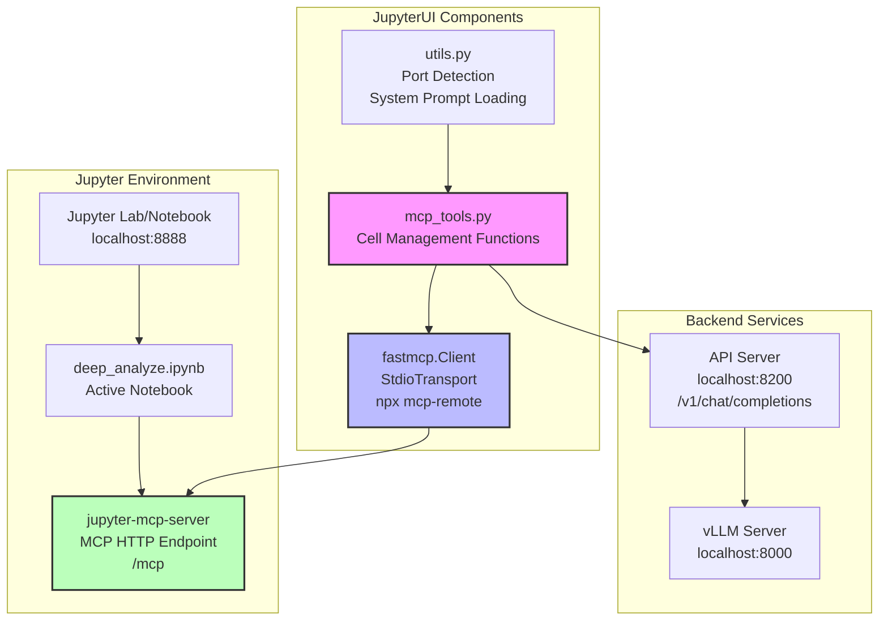
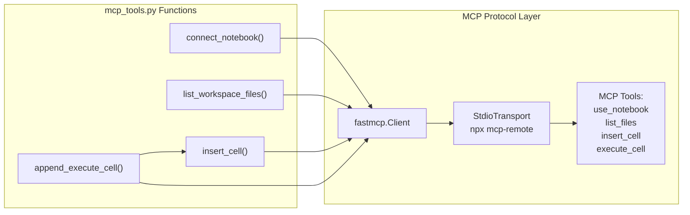
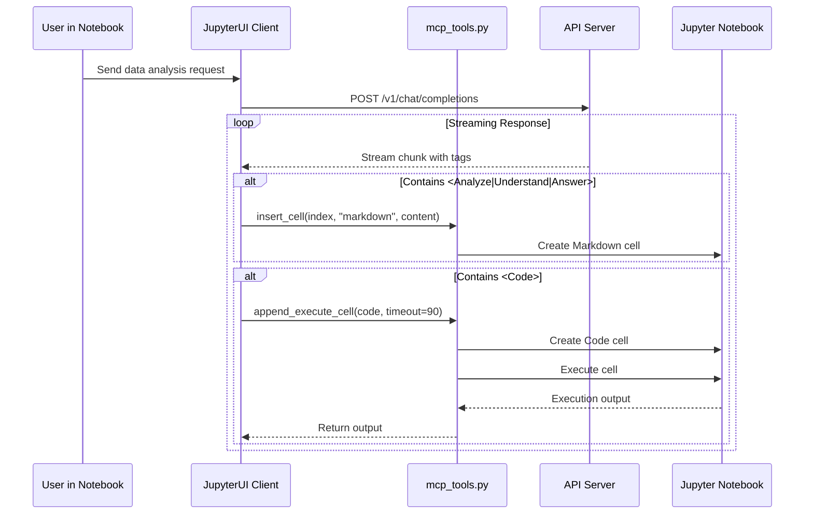
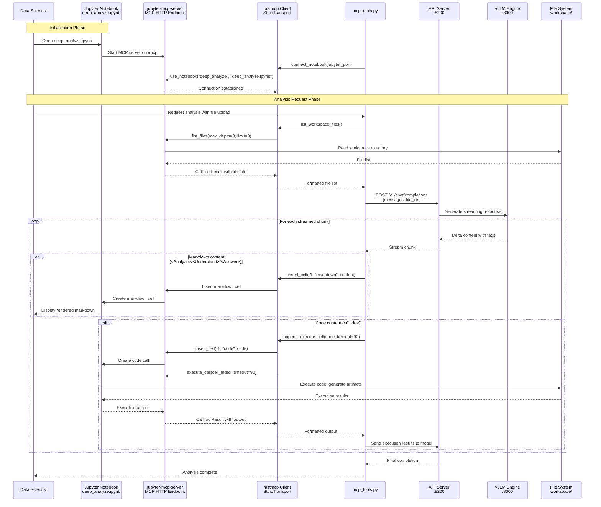

<!-- source: DeepWiki mcp.deepwiki.com · repo ruc-datalab/DeepAnalyze · page 5.3 JupyterUI · fetched 2026-10-26 -->

# JupyterUI

<details>
<summary>Relevant source files</summary>

The following files were used as context for generating this wiki page:

- [README.md](README.md)
- [assets/wechat.jpg](assets/wechat.jpg)
- [demo/jupyter/.env.example](demo/jupyter/.env.example)
- [demo/jupyter/.gitignore](demo/jupyter/.gitignore)
- [demo/jupyter/.python-version](demo/jupyter/.python-version)
- [demo/jupyter/mcp_tools.py](demo/jupyter/mcp_tools.py)
- [demo/jupyter/pyproject.toml](demo/jupyter/pyproject.toml)
- [demo/jupyter/test/mock_server.py](demo/jupyter/test/mock_server.py)
- [demo/jupyter/utils.py](demo/jupyter/utils.py)
- [demo/jupyter/uv.lock](demo/jupyter/uv.lock)
- [docs/DeepAnalyze_API_Key_Usage_Guide.md](docs/DeepAnalyze_API_Key_Usage_Guide.md)
- [docs/DeepAnalyze_API_Key_Usage_Guide_ZH.md](docs/DeepAnalyze_API_Key_Usage_Guide_ZH.md)
- [example/README.md](example/README.md)
- [quantize.py](quantize.py)
- [requirements.txt](requirements.txt)

</details>


The **JupyterUI** provides native Jupyter Lab and Jupyter Notebook integration for DeepAnalyze, enabling data scientists to interact with the AI-powered data analysis system directly within their familiar notebook environment. This interface leverages the Model Context Protocol (MCP) to convert DeepAnalyze's structured XML-like output tags into native notebook cells, allowing for seamless interaction and execution.

For information about other frontend interfaces, see [Frontend Interfaces](#5). For the API Server that JupyterUI communicates with, see [API Server Architecture](#6).

---

## Overview and Integration Architecture

The JupyterUI frontend integrates DeepAnalyze into the Jupyter ecosystem using the **jupyter-mcp-server** package, which provides a bridge between the OpenAI-compatible API and Jupyter's cell-based interface. Unlike other frontends that display results in a web interface or terminal, JupyterUI converts AI responses into **native notebook cells** that can be edited, re-executed, and persisted as part of the notebook document.



**Sources:** [README.md:71-80](), [demo/jupyter/pyproject.toml:1-32](), [demo/jupyter/mcp_tools.py:1-84]()

---

## Core Components

### 1. MCP Tools Module (`mcp_tools.py`)

The `mcp_tools.py` module provides the primary interface for interacting with the Jupyter notebook via the MCP protocol. It defines functions that abstract away the complexity of MCP communication.

| Function | Parameters | Purpose |
|----------|-----------|---------|
| `connect_notebook` | `jupyter_port: int` | Establishes connection to `deep_analyze.ipynb` notebook via MCP |
| `list_workspace_files` | `client: Client` | Lists all files in workspace directory (max_depth=3) |
| `insert_cell` | `client: Client, cell_index: int, cell_type: str, cell_source: str` | Inserts a cell at specified index, returns actual index |
| `append_execute_cell` | `client: Client, cell_source: str, timeout: int = 90` | Appends and executes a code cell, returns execution output |

**Key Implementation Details:**

- **Transport Layer**: Uses `StdioTransport` with command `npx mcp-remote http://127.0.0.1:{jupyter_port}/mcp` [demo/jupyter/mcp_tools.py:28-31]()
- **Notebook Target**: Hardcoded to connect to notebook named `deep_analyze` with path `deep_analyze.ipynb` [demo/jupyter/mcp_tools.py:36-40]()
- **Content Conversion**: `convert_to_backend_format()` transforms MCP `CallToolResult` objects to plain text, handling `TextContent` and `ImageContent` types [demo/jupyter/mcp_tools.py:7-21]()



**Sources:** [demo/jupyter/mcp_tools.py:1-84]()

---

### 2. Utility Functions (`utils.py`)

The `utils.py` module provides supporting functionality for environment detection and configuration management.

**Port Detection Functions:**

- `is_port_in_use(port: int) -> bool`: Checks if a TCP port is in use using socket connection testing [demo/jupyter/utils.py:7-9]()
- `jupyter_lab_alive(port: int) -> bool`: Async function that verifies Jupyter Lab server is responding at `/lab` endpoint with 3-second timeout [demo/jupyter/utils.py:12-19]()

**System Prompt Management:**

The `load_system_prompt(config: dict) -> str | None` function implements a flexible prompt template system:

1. Reads prompt index from `prompt/index.json` [demo/jupyter/utils.py:23-29]()
2. Extracts template name from config: `config.get("PROMPT", {}).get("PROMPT_TEMPLATE", "general")` [demo/jupyter/utils.py:31]()
3. Locates corresponding prompt file from index and loads content [demo/jupyter/utils.py:32-46]()
4. Returns `None` with warning if prompt not found

**Sources:** [demo/jupyter/utils.py:1-46]()

---

### 3. Dependency Management

The project uses `uv` package manager (Python 3.12+) with core dependencies defined in `pyproject.toml`:

**MCP and Jupyter Integration:**
- `jupyter-mcp-server>=0.19.0` - MCP server for Jupyter
- `fastmcp>=2.13.0.2` - Python client for MCP protocol
- `datalayer-pycrdt==0.12.17` - CRDT support for collaborative editing
- `jupyter-collaboration>=4.1.1` - Real-time collaboration
- `jupyterlab>=4`, `notebook>=7` - Jupyter environments

**Data Science Stack:**
- `pandas>=2.3.3`, `statsmodels>=0.14.5`, `scikit-learn>=1.7.2`
- `matplotlib>=3.10.7`, `seaborn>=0.13.2`

**API Communication:**
- `openai>=2.7.1` - OpenAI-compatible API client
- `python-dotenv>=1.2.1` - Environment variable management

**Sources:** [demo/jupyter/pyproject.toml:1-32]()

---

## Cell Conversion Mechanism

JupyterUI's primary innovation is converting DeepAnalyze's structured XML-like tags into native Jupyter cells. This conversion happens in the client code (not shown in provided files, but inferred from README):

| DeepAnalyze Tag | Jupyter Cell Type | Behavior |
|----------------|------------------|----------|
| `<Analyze>` | Markdown | Analysis narrative and insights |
| `<Understand>` | Markdown | Data understanding and context |
| `<Answer>` | Markdown | Final answers and conclusions |
| `<Code>` | Code (Python) | Executable code for data manipulation/visualization |
| `<Execute>` | Execution result | Output from code execution (handled automatically) |

The conversion workflow follows this pattern:



**Important Implementation Note:**

The `convert_to_backend_format()` function includes a critical comment about multimodal content handling: `# * IMPORTANT: DeepAnalyze-8B can't process Multimodal content, convert it to text.` When encountering `ImageContent`, it converts to `[IMG OUTPUT]` placeholder text [demo/jupyter/mcp_tools.py:16-17]().

**Sources:** [README.md:78](), [demo/jupyter/mcp_tools.py:7-21]()

---

## Configuration and Environment

### Environment Variables

The JupyterUI frontend expects three primary environment variables (typically stored in `.env` file):

```bash
OPENAI_API_KEY="dummy"                      # Not validated for local deployment
OPENAI_BASE_URL="http://localhost:8200/v1" # API Server endpoint
OPENAI_MODEL="DeepAnalyze-8B"               # Model identifier
```

**Sources:** [demo/jupyter/.env.example:1-3]()

### Python Version

The project targets Python 3.12 as specified in `.python-version` [demo/jupyter/.python-version:1]().

### Workspace and Cache Management

The `.gitignore` configuration excludes:

- `.env` - API credentials
- `.ipynb_checkpoints/` - Jupyter checkpoint files
- `.virtual_documents/` - Temporary document cache
- `.jupyter_ystore.db` - Jupyter collaborative editing database
- `workspace/` - Generated files and artifacts

**Sources:** [demo/jupyter/.gitignore:1-11]()

---

## Testing Infrastructure

### Mock Server for Development

The `demo/jupyter/test/mock_server.py` provides a FastAPI-based mock OpenAI API server for testing without a real model:

**Key Features:**

1. **Predefined Responses**: Cycles through 4 test responses containing various DeepAnalyze tags [demo/jupyter/test/mock_server.py:10-15]()
2. **Response Tracking**: Maintains `current_response_index` and `request_count` for sequential response generation [demo/jupyter/test/mock_server.py:17-18]()
3. **OpenAI-Compatible Endpoints**:
   - `GET /v1/models` - Returns mock model list [demo/jupyter/test/mock_server.py:45-58]()
   - `POST /v1/chat/completions` - Returns sequential test responses [demo/jupyter/test/mock_server.py:60-98]()

**Test Response Pattern:**

```python
TEST_RESPONSES = [
    "<Analyze>\nA1\n</Analyze>\n<Code>\n%pwd\n</Code>",
    "<Understand>\nU1\n</Understand>\n<Analyze>\nA2\n</Analyze>\n<Code>\nimport pandas as pd\ndf = pd.read_csv(\"data/Simpson.csv\")\ndf.head()\n</Code>",
    "<Analyze>\nA3\n</Analyze>\n<Code>\nprint(\"Goodbye!\")\n</Code>",
    "<Answer>\nAA\n</Answer>"
]
```

The server runs on `http://localhost:8000` via `uvicorn` [demo/jupyter/test/mock_server.py:105-108]().

**Sources:** [demo/jupyter/test/mock_server.py:1-108]()

---

## Complete Interaction Flow

The following diagram illustrates the complete data flow from user input to notebook cell creation:



**Sources:** [demo/jupyter/mcp_tools.py:23-84](), [README.md:71-80]()

---

## Key Differences from Other Frontends

Unlike the WebUI, CLI, and Gradio interfaces, JupyterUI provides unique capabilities:

| Feature | JupyterUI | WebUI/CLI/Gradio |
|---------|-----------|------------------|
| **Output Format** | Native notebook cells (persistent) | Temporary UI elements |
| **Code Editability** | Full in-place editing before/after execution | Read-only code display |
| **Execution Model** | Cells execute in notebook kernel | Sandboxed subprocess execution |
| **Workflow Integration** | Embedded in data science workflow | Standalone applications |
| **Collaboration** | Jupyter collaboration features | Single-user sessions |
| **Cell Reordering** | Drag-and-drop cell reordering | Fixed conversation order |
| **Artifact Persistence** | Saved in `.ipynb` format | Temporary workspace files |

**Critical Note:** JupyterUI's code execution happens in the **notebook kernel**, not in the sandboxed subprocess environment used by other frontends. This means generated code has direct access to the notebook's variable namespace and filesystem without the isolation guarantees provided by the API server's `execute_code_safe_async` function.

**Sources:** [README.md:71-80](), [demo/jupyter/mcp_tools.py:72-83]()

---

## Integration Requirements

To deploy JupyterUI, the following services must be running:

1. **vLLM Server** on port 8000 (serving DeepAnalyze-8B model)
2. **API Server** on port 8200 (OpenAI-compatible chat completions endpoint)
3. **Jupyter Lab** on configurable port (default 8888) with jupyter-mcp-server enabled
4. **MCP Remote Proxy** (`npx mcp-remote`) for protocol translation

The system assumes the presence of a `deep_analyze.ipynb` notebook in the Jupyter Lab workspace that serves as the target for cell insertion operations.

**Sources:** [demo/jupyter/mcp_tools.py:28-40](), [demo/jupyter/.env.example:1-3]()

---

