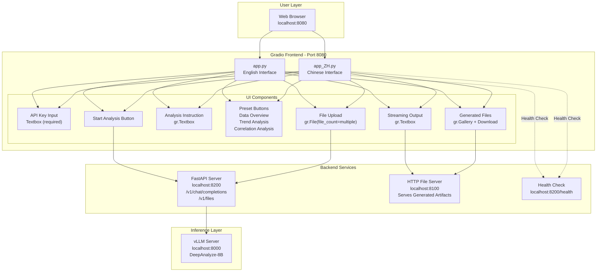
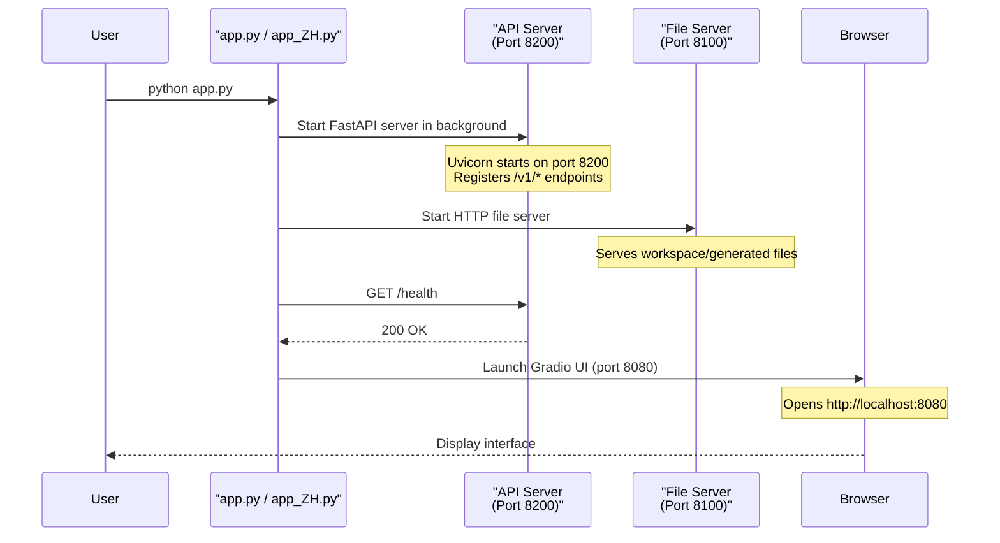
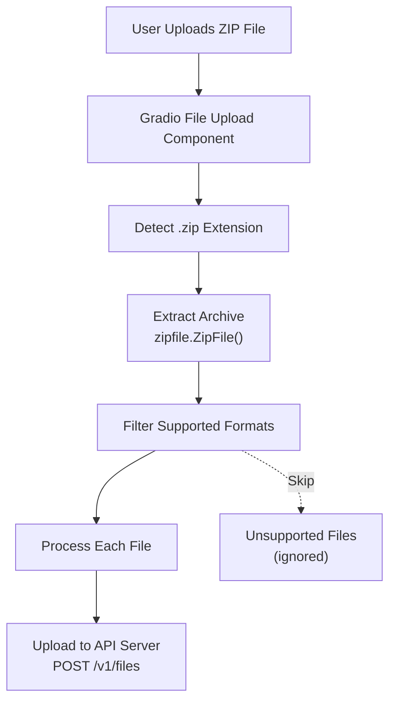
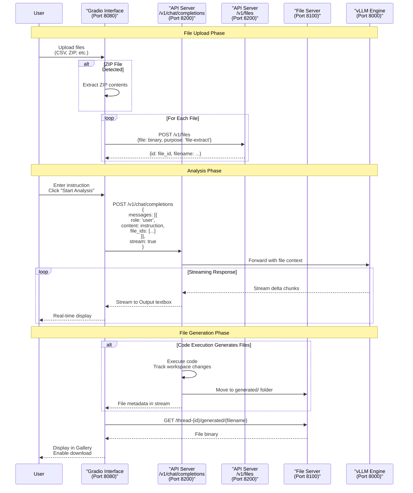

<!-- source: DeepWiki mcp.deepwiki.com · repo ruc-datalab/DeepAnalyze · page 5.4 Gradio Apps · fetched 2026-10-26 -->

# Gradio Apps

<details>
<summary>Relevant source files</summary>

The following files were used as context for generating this wiki page:

- [README.md](README.md)
- [assets/wechat.jpg](assets/wechat.jpg)
- [docs/DeepAnalyze_API_Key_Usage_Guide.md](docs/DeepAnalyze_API_Key_Usage_Guide.md)
- [docs/DeepAnalyze_API_Key_Usage_Guide_ZH.md](docs/DeepAnalyze_API_Key_Usage_Guide_ZH.md)
- [example/README.md](example/README.md)
- [quantize.py](quantize.py)
- [requirements.txt](requirements.txt)

</details>


## Purpose and Scope

This document describes the **Gradio Apps** frontend interfaces provided by DeepAnalyze. These are simplified web-based applications designed for local deployment with minimal setup overhead. The Gradio Apps offer a streamlined alternative to the full-featured WebUI ([5.1](#5.1)), providing essential data analysis functionality through an accessible browser interface.

Two versions are available:
- **English interface**: [`app.py`]()
- **Chinese interface**: [`app_ZH.py`]()

Both versions provide identical functionality with bilingual support, making DeepAnalyze accessible to diverse user communities. For other frontend options, see Command Line Interface ([5.2](#5.2)), JupyterUI ([5.3](#5.3)), Python SDK ([5.5](#5.5)), or the full WebUI ([5.1](#5.1)).

**Sources**: [README.md:46-69](), [docs/DeepAnalyze_API_Key_Usage_Guide.md:127-191](), [docs/DeepAnalyze_API_Key_Usage_Guide_ZH.md:128-192]()

---

## Architecture Overview

The Gradio Apps implement a three-tier architecture consisting of the Gradio frontend, API backend services, and the underlying vLLM inference engine.

### System Architecture Diagram



**Key Components**:

| Component | File | Port | Purpose |
|-----------|------|------|---------|
| English Interface | `app.py` | 8080 | Gradio UI with English labels and prompts |
| Chinese Interface | `app_ZH.py` | 8080 | Gradio UI with Chinese labels (中文界面) |
| API Server | Started automatically | 8200 | OpenAI-compatible chat completions and file management |
| File Server | Started automatically | 8100 | Serves generated plots, CSVs, and reports |
| Health Endpoint | `/health` | 8200 | Backend service availability check |

**Sources**: [docs/DeepAnalyze_API_Key_Usage_Guide.md:163-178](), [docs/DeepAnalyze_API_Key_Usage_Guide_ZH.md:164-179]()

---

## Deployment and Setup

### Environment Requirements

The Gradio Apps require minimal dependencies beyond the core DeepAnalyze inference stack:

```
# Core dependencies (from requirements.txt)
gradio
openai
fastapi
uvicorn
pandas
requests
python-multipart
```

**Installation Steps**:

1. **Navigate to project directory**:
   ```bash
   cd /path/to/DeepAnalyze
   ```

2. **Install dependencies**:
   ```bash
   pip install gradio openai fastapi uvicorn pandas requests python-multipart
   # Or use requirements.txt
   pip install -r requirements.txt
   ```

3. **Launch Gradio interface** (choose one):
   ```bash
   # English interface
   python app.py
   
   # Chinese interface (中文界面)
   python app_ZH.py
   ```

**Sources**: [docs/DeepAnalyze_API_Key_Usage_Guide.md:131-161](), [docs/DeepAnalyze_API_Key_Usage_Guide_ZH.md:132-163](), [requirements.txt:1-16]()

### Automatic Service Startup

Both `app.py` and `app_ZH.py` automatically handle backend service initialization:



The startup sequence ensures that:
1. API server is fully initialized before UI becomes accessible
2. File server is ready to serve generated artifacts
3. Health check confirms backend availability
4. Default browser opens automatically to `http://localhost:8080`

**Port Configuration**: If ports `8080`, `8200`, or `8100` are already in use, you can modify them in the `config.py` file or directly in `app.py`/`app_ZH.py`. Look for port definitions at the beginning of these files.

**Sources**: [docs/DeepAnalyze_API_Key_Usage_Guide.md:163-178](), [docs/DeepAnalyze_API_Key_Usage_Guide_ZH.md:170-179]()

---

## User Interface Components

The Gradio Apps provide a simplified single-screen interface organized into input, control, and output sections.

### Component Layout

| Section | Component | Type | Description |
|---------|-----------|------|-------------|
| **Authentication** | API Key Input | `gr.Textbox` | Required field for API authentication |
| **Data Input** | File Upload | `gr.File(file_count='multiple')` | Accepts single/multiple files or ZIP archives |
| **Task Definition** | Analysis Instruction | `gr.Textbox` | Free-form text describing the analysis task |
| **Quick Actions** | Preset Buttons | `gr.Button` | Pre-configured prompts:<br/>• Data Overview<br/>• Trend Analysis<br/>• Correlation Analysis |
| **Execution** | Start Analysis | `gr.Button` | Triggers the analysis workflow |
| **Results** | Streaming Output | `gr.Textbox` | Real-time display of AI reasoning and results |
| **Artifacts** | Generated Files | `gr.Gallery` + Download | Preview and download plots, CSVs, reports |

### Preset Instruction Examples

The Gradio Apps include convenient preset buttons that inject common analysis patterns:

| Preset | Injected Instruction |
|--------|---------------------|
| Data Overview | "Provide a comprehensive overview of the uploaded data, including summary statistics, data types, and missing value analysis." |
| Trend Analysis | "Analyze temporal trends in the data and identify significant patterns or anomalies." |
| Correlation Analysis | "Perform correlation analysis between variables and visualize the relationships using appropriate charts." |

Users can either click a preset button or enter custom instructions in the Analysis Instruction textbox.

**Sources**: [docs/DeepAnalyze_API_Key_Usage_Guide.md:180-186](), [docs/DeepAnalyze_API_Key_Usage_Guide_ZH.md:181-188]()

---

## File Handling and ZIP Support

The Gradio Apps implement sophisticated file handling with automatic ZIP extraction and format detection.

### Supported File Formats

The Gradio Apps accept a wide range of data formats:

| Category | Formats | Extensions |
|----------|---------|------------|
| **Structured Data** | CSV, Excel, Parquet | `.csv`, `.xlsx`, `.xls`, `.parquet` |
| **Semi-Structured** | JSON, XML, YAML | `.json`, `.xml`, `.yaml`, `.yml` |
| **Documents** | PDF, Text, Markdown | `.pdf`, `.txt`, `.md` |
| **Code** | Python, R, SQL | `.py`, `.r`, `.sql` |
| **Logs** | System logs, Application logs | `.log`, `.txt` |
| **Images** | Common image formats | `.png`, `.jpg`, `.jpeg`, `.gif` |
| **Archives** | ZIP (auto-extracted) | `.zip` |

### ZIP Archive Processing

When a ZIP file is uploaded:



**Processing Steps**:

1. **Detection**: File extension check identifies `.zip` files
2. **Extraction**: Archive contents are extracted to temporary directory
3. **Filtering**: Only supported file formats are retained
4. **Upload**: Each extracted file is uploaded individually via `POST /v1/files`
5. **Cleanup**: Temporary files are removed after upload

**Example Usage**:
```
# Upload example.zip containing:
# - data1.csv
# - data2.xlsx
# - analysis.py
# - README.md

All four files are automatically extracted and uploaded.
The API receives 4 separate file_ids.
```

**Sources**: [docs/DeepAnalyze_API_Key_Usage_Guide.md:89-110](), [docs/DeepAnalyze_API_Key_Usage_Guide_ZH.md:90-111]()

---

## Integration with Backend Services

The Gradio Apps orchestrate interactions between the user interface and backend API/file services.

### Request Flow Diagram



### API Integration Details

**File Upload Endpoint**:
- **Route**: `POST /v1/files`
- **Format**: `multipart/form-data`
- **Fields**: 
  - `file`: Binary file data
  - `purpose`: Set to `'file-extract'`
- **Response**: `{"id": "file-abc123", "filename": "data.csv", "size": 1024, ...}`

**Chat Completions Endpoint**:
- **Route**: `POST /v1/chat/completions`
- **Format**: `application/json`
- **Body**:
  ```json
  {
    "model": "DeepAnalyze-8B",
    "messages": [
      {
        "role": "user",
        "content": "Analyze this data",
        "file_ids": ["file-abc123", "file-def456"]
      }
    ],
    "stream": true
  }
  ```
- **Response**: Server-Sent Events (SSE) stream with delta chunks

For detailed API specifications, see API Server Architecture ([6](#6)) and API Endpoints Reference ([10.1](#10.1)).

**Sources**: [docs/DeepAnalyze_API_Key_Usage_Guide.md:13-20](), [docs/DeepAnalyze_API_Key_Usage_Guide_ZH.md:13-20](), [README.md:282-313]()

---

## Usage Workflow

### Complete Analysis Walkthrough

#### Step 1: Launch Application

```bash
# English version
python app.py

# Chinese version
python app_ZH.py
```

Browser automatically opens to `http://localhost:8080`.

#### Step 2: Enter API Key

In the API Key input field, enter your DeepAnalyze API key. For local deployment without API key requirements, this field may accept a dummy value (check your specific deployment configuration).

To obtain an API key:
- **Google Form**: https://forms.gle/YxVkCzczqq8jeciw9
- **Feishu Form**: https://heywhale.feishu.cn/share/base/shrcnnBRgO0x2qhx40yq4m1HxUg

See API Key Configuration ([7.2](#7.2)) for detailed setup instructions.

#### Step 3: Upload Data Files

Click the file upload area and select:
- **Single file**: e.g., `Simpson.csv`
- **Multiple files**: Hold Ctrl/Cmd and select multiple files
- **ZIP archive**: e.g., `example.zip` (automatically extracted)

**Example files** (for testing):
- [Simpson.csv](https://open-cdn.kesci.com/admin/t7r80krss/Simpson.csv) - Sample dataset for statistical analysis
- [example.zip](https://open-cdn.kesci.com/admin/t62le3tdx/example.zip) - Multi-file archive

#### Step 4: Define Analysis Task

**Option A - Use Preset Button**:
Click one of the preset buttons:
- **Data Overview**: Summary statistics and data profiling
- **Trend Analysis**: Temporal pattern identification
- **Correlation Analysis**: Variable relationship exploration

**Option B - Custom Instruction**:
Enter a custom instruction in the text field:
```
"Analyze the relationship between variables and identify Simpson's Paradox.
Create visualizations showing overall trends vs. group-specific trends."
```

#### Step 5: Start Analysis

Click the **"Start Analysis"** button. The system:
1. Uploads files to API server
2. Sends chat completion request with file context
3. Streams AI reasoning and results in real-time
4. Displays generated files in the preview gallery

#### Step 6: Review Results

**Streaming Output**: Watch the AI's reasoning process as it:
- Analyzes data structure
- Writes exploratory code
- Executes analysis steps
- Generates visualizations
- Produces insights

**Generated Files**: The gallery displays:
- **Plots**: PNG/SVG visualizations
- **Reports**: Markdown/PDF documents
- **Data**: CSV/Excel intermediate results
- **Code**: Python scripts used for analysis

Click any file to download it to your local machine.

**Sources**: [docs/DeepAnalyze_API_Key_Usage_Guide.md:180-191](), [docs/DeepAnalyze_API_Key_Usage_Guide_ZH.md:181-192]()

---

## Configuration Options

### Port Configuration

Modify ports if the default values are already in use:

```python
# In app.py or app_ZH.py (example structure)
API_PORT = 8200        # FastAPI server
FILE_SERVER_PORT = 8100  # HTTP file server
GRADIO_PORT = 8080       # Gradio UI
```

Look for these variables near the top of `app.py` or `app_ZH.py`, or in a separate `config.py` file if the Gradio apps use centralized configuration.

### API Endpoint Configuration

If using a remote DeepAnalyze API instead of local deployment:

```python
# Configure API endpoint
API_BASE_URL = "https://www.heywhale.com/api/model/services/{service_id}/app"
# Or for local deployment
API_BASE_URL = "http://localhost:8200"
```

Ensure the API endpoint includes the OpenAI-compatible routes:
- `/v1/chat/completions`
- `/v1/files`

### Authentication

For deployments with API key authentication:

```python
# API requests include Authorization header
headers = {
    "Authorization": f"Bearer {api_key}",
    "Content-Type": "application/json"
}
```

The API key entered in the UI is automatically included in all backend requests.

**Sources**: [docs/DeepAnalyze_API_Key_Usage_Guide.md:163-179](), [docs/DeepAnalyze_API_Key_Usage_Guide_ZH.md:164-179]()

---

## Comparison with Other Frontends

| Feature | Gradio Apps | WebUI ([5.1](#5.1)) | CLI ([5.2](#5.2)) | JupyterUI ([5.3](#5.3)) |
|---------|-------------|---------|-----|------------|
| **Deployment Complexity** | ⭐ Simple (1 command) | ⭐⭐ Moderate (npm + bash) | ⭐ Simple (1 command) | ⭐⭐⭐ Complex (Jupyter setup) |
| **User Interface** | Web browser | Web browser | Terminal | Jupyter Notebook |
| **File Management** | Basic upload/download | Advanced (tree view, workspace) | Command-based | Notebook attachments |
| **Code Visibility** | Output stream only | Monaco editor panel | Terminal display | Executable code cells |
| **Multi-turn Conversations** | ✓ Basic | ✓ Advanced (thread-based) | ✓ Advanced | ✓ Cell-based |
| **Streaming Output** | ✓ | ✓ | ✓ | ✓ |
| **Structured Sections** | Basic | ✓ Collapsible | Basic | Native cells |
| **ZIP Support** | ✓ Auto-extract | ✓ Manual | ✓ Manual | Manual |
| **Preset Instructions** | ✓ | - | - | - |
| **Best Use Case** | Quick local demos | Full-featured analysis | Automation/SSH | Data science workflows |
| **Target Audience** | Non-technical users | Data analysts | Developers | Data scientists |

**Sources**: [README.md:46-112]()

---

## Troubleshooting

### Common Issues

**Issue 1: Port Already in Use**
```
Error: Address already in use: Port 8080
```
**Solution**: 
- Identify and stop the conflicting process, or
- Modify `GRADIO_PORT` in the application file

**Issue 2: Backend Services Not Starting**
```
Error: API server health check failed
```
**Solution**:
- Verify vLLM server is running on port 8000
- Check API server logs for startup errors
- Ensure all dependencies are installed

**Issue 3: File Upload Fails**
```
Error: Failed to upload file to API server
```
**Solution**:
- Check file size limits
- Verify API server `/v1/files` endpoint is accessible
- Ensure multipart/form-data support is enabled

**Issue 4: ZIP Extraction Issues**
```
Error: Failed to extract ZIP archive
```
**Solution**:
- Verify ZIP file is not corrupted
- Check that ZIP contains supported file formats
- Ensure sufficient disk space for extraction

For additional support, see the main README ([README.md]()) or submit an issue on GitHub.

**Sources**: [docs/DeepAnalyze_API_Key_Usage_Guide.md:147-179]()

---

