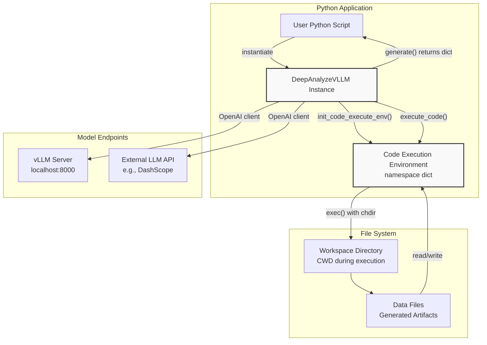
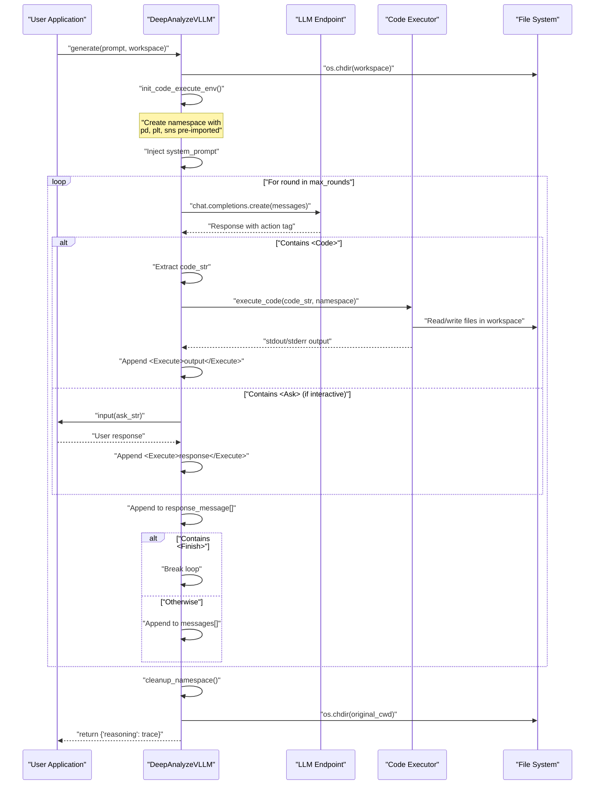
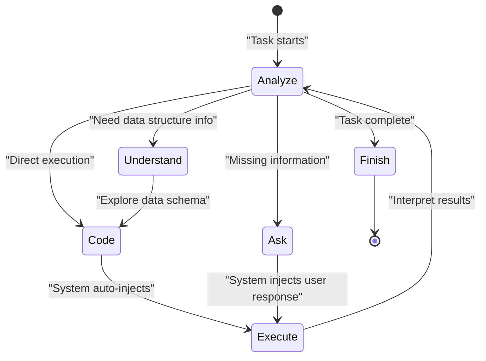
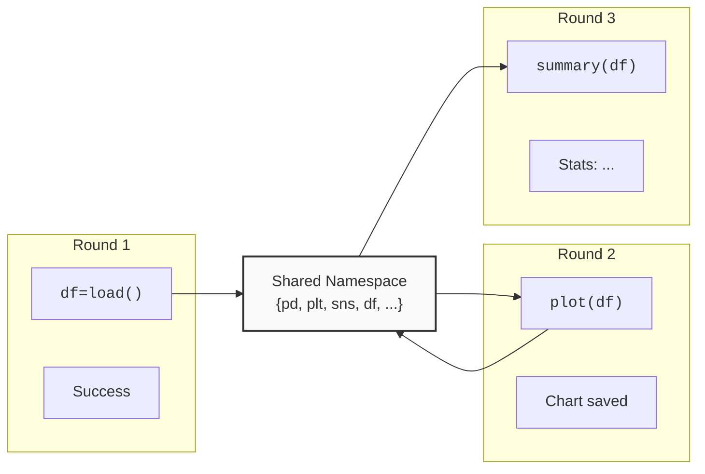

<!-- source: DeepWiki mcp.deepwiki.com · repo ruc-datalab/DeepAnalyze · page 5.5 Python SDK · fetched 2026-10-26 -->

# Python SDK

<details>
<summary>Relevant source files</summary>

The following files were used as context for generating this wiki page:

- [README.md](README.md)
- [assets/wechat.jpg](assets/wechat.jpg)
- [demo/deepanalyze_general/README.md](demo/deepanalyze_general/README.md)
- [demo/deepanalyze_general/README_ZH.md](demo/deepanalyze_general/README_ZH.md)
- [demo/deepanalyze_general/__init__.py](demo/deepanalyze_general/__init__.py)
- [demo/deepanalyze_general/deepanalyze_general.py](demo/deepanalyze_general/deepanalyze_general.py)
- [docs/DeepAnalyze_API_Key_Usage_Guide.md](docs/DeepAnalyze_API_Key_Usage_Guide.md)
- [docs/DeepAnalyze_API_Key_Usage_Guide_ZH.md](docs/DeepAnalyze_API_Key_Usage_Guide_ZH.md)
- [example/README.md](example/README.md)
- [quantize.py](quantize.py)
- [requirements.txt](requirements.txt)

</details>


The Python SDK provides programmatic access to DeepAnalyze's autonomous data science capabilities through the `DeepAnalyzeVLLM` class. This interface is designed for embedding DeepAnalyze functionality directly into Python applications, scripts, and notebooks without requiring the API server infrastructure.

**Scope**: This page documents the Python SDK implementation located in [demo/deepanalyze_general/deepanalyze_general.py](). For information about the API-based interfaces (WebUI, CLI, JupyterUI, Gradio), see [Frontend Interfaces](#5). For direct API endpoint usage, see [API Server Architecture](#6).

**Key Distinction**: Unlike other frontend interfaces that communicate with the API server (port 8200), the Python SDK bypasses the API layer entirely and communicates directly with the underlying model via OpenAI-compatible endpoints. This provides lower-level control and eliminates the overhead of HTTP-based communication for applications that require tight integration.

---

## Architecture Overview

The Python SDK operates independently from the DeepAnalyze API server stack, establishing direct communication with language model endpoints.



**Direct Model Access Pattern**

Sources: [demo/deepanalyze_general/deepanalyze_general.py:238-260](), [README.md:237-262]()

---

## DeepAnalyzeVLLM Class

The `DeepAnalyzeVLLM` class is the primary interface for SDK usage. It encapsulates model communication, code execution, and multi-round reasoning logic.

### Initialization

```python
class DeepAnalyzeVLLM:
    def __init__(
        self,
        model_name: str,
        api_url: str = "",
        max_rounds: int = 20,
        is_interactive: bool = False,
    ):
```

| Parameter | Type | Default | Description |
|-----------|------|---------|-------------|
| `model_name` | `str` | *required* | Model identifier (e.g., `"DeepAnalyze-8B"`, `"qwen3-coder-30b-a3b-instruct"`) |
| `api_url` | `str` | `""` | Base URL for model API (falls back to environment-based configuration) |
| `max_rounds` | `int` | `20` | Maximum reasoning rounds before termination |
| `is_interactive` | `bool` | `False` | Enable `<Ask>` tag for user interaction during execution |

**Initialization Flow**:
1. Creates `OpenAI` client using `DASHSCOPE_API_KEY` environment variable
2. Sets base URL to `"https://dashscope.aliyuncs.com/compatible-mode/v1"`
3. Initializes `self.env = None` (execution namespace, lazy-initialized)

Sources: [demo/deepanalyze_general/deepanalyze_general.py:244-260]()

---

### Core Methods

#### generate()

The main entry point for executing data science tasks. Returns a dictionary containing the complete reasoning trace.

```python
def generate(
    self,
    prompt: str,
    workspace: str,
    temperature: float = 0.5,
    max_tokens: int = 8192,
    top_p: float = None,
    enable_thinking: bool = False,
) -> dict:
```

**Parameters**:

| Parameter | Type | Default | Description |
|-----------|------|---------|-------------|
| `prompt` | `str` | *required* | Task description or data analysis instruction |
| `workspace` | `str` | *required* | Absolute or relative path to working directory |
| `temperature` | `float` | `0.5` | Sampling temperature (0.0-1.0); lower = more deterministic |
| `top_p` | `float` | `None` | Nucleus sampling parameter |
| `max_tokens` | `int` | `8192` | Maximum tokens per model response |
| `enable_thinking` | `bool` | `False` | Enable extended reasoning mode (model-specific) |

**Returns**: `dict` with key `"reasoning"` containing the full multi-round execution trace as a single string.

**Execution Flow**:



**Multi-Round Reasoning**

Sources: [demo/deepanalyze_general/deepanalyze_general.py:327-385]()

---

#### execute_code()

Executes Python code within the shared namespace and captures output.

```python
def execute_code(self, code_str: str) -> str:
```

**Behavior**:
- Executes code using `exec(code_str, self.env)` where `self.env` is a persistent namespace
- Captures `stdout` and `stderr` using `contextlib.redirect_stdout/stderr`
- Returns concatenated output or formatted error message prefixed with `[Error]:`
- **Shared state**: Variables defined in one `<Code>` block persist to subsequent blocks (e.g., `df` created in round 1 is accessible in round 3)

**Example**:
```python
# Round 1: Define df
code_1 = "import pandas as pd\ndf = pd.read_csv('data.csv')"
output_1 = sdk.execute_code(code_1)  # df now in namespace

# Round 2: Use df (no re-import needed)
code_2 = "print(df.shape)"
output_2 = sdk.execute_code(code_2)  # Accesses existing df
```

Sources: [demo/deepanalyze_general/deepanalyze_general.py:298-320]()

---

#### init_code_execute_env()

Initializes the execution namespace with pre-imported libraries.

```python
@classmethod
def init_code_execute_env(cls):
    namespace = {}
    import pandas as pd
    import matplotlib.pyplot as plt
    import seaborn as sns
    namespace['pd'] = pd
    namespace['plt'] = plt
    namespace['sns'] = sns
    plt.rcParams['font.sans-serif'] = ['SimHei']  # Chinese font support
    plt.rcParams['axes.unicode_minus'] = False
    namespace['__builtins__'] = __builtins__
    return namespace
```

**Pre-loaded Libraries**:
- `pandas` as `pd`
- `matplotlib.pyplot` as `plt`
- `seaborn` as `sns`
- Configured for Chinese character rendering

**Design Rationale**: Reduces token overhead by eliminating repetitive imports across `<Code>` blocks.

Sources: [demo/deepanalyze_general/deepanalyze_general.py:262-275]()

---

#### cleanup_namespace()

Safely clears the execution environment after task completion.

```python
def cleanup_namespace(self):
    if self.env is not None:
        keys_to_delete = [key for key in self.env.keys() 
                          if not key.startswith('__') and key not in ['pd', 'plt', 'sns']]
        for key in keys_to_delete:
            del self.env[key]
        self.env = None
```

**Purpose**: Prevents memory leaks and sensitive data retention between `generate()` calls.

Sources: [demo/deepanalyze_general/deepanalyze_general.py:277-286]()

---

## Action Tag System

The SDK implements a structured action tag protocol for autonomous reasoning. Each model response must contain exactly one action tag.

### Tag Definitions



**Action Tag State Machine**

| Tag | Role | Generated By | Must Follow With |
|-----|------|--------------|------------------|
| `<Analyze>` | Task planning, reasoning, hypothesis formation, result interpretation | Model | Any tag |
| `<Understand>` | Declare intent to explore data structure (not a question to user) | Model | `<Code>` |
| `<Code>` | Generate executable Python code | Model | *(System auto-appends `<Execute>`)* |
| `<Ask>` | Request clarification from user (only if `is_interactive=True`) | Model | *(System auto-appends `<Execute>` with user input)* |
| `<Execute>` | Contains code execution output or user response | **System** | `<Analyze>` |
| `<Finish>` | Final conclusions and recommendations | Model | *(Terminates task)* |

**Enforcement Rules**:
1. Only one action tag per model response
2. `<Execute>` is **never** generated by the model; always injected by `generate()`
3. After `<Execute>`, next response must start with `<Analyze>`
4. `<Finish>` must be the final action; terminates the reasoning loop

Sources: [demo/deepanalyze_general/deepanalyze_general.py:13-102]() (basic mode), [demo/deepanalyze_general/deepanalyze_general.py:104-234]() (interactive mode)

---

### System Prompts

The SDK uses two system prompt variants:

**Basic Mode** (`is_interactive=False`):
- Defined in `deepanalyze_system_prompt` [demo/deepanalyze_general/deepanalyze_general.py:13-102]()
- Supports: `<Analyze>`, `<Understand>`, `<Code>`, `<Execute>`, `<Finish>`
- Use case: Fully autonomous tasks where all necessary context is in the prompt

**Interactive Mode** (`is_interactive=True`):
- Defined in `deepanalyze_system_prompt_with_ask` [demo/deepanalyze_general/deepanalyze_general.py:104-234]()
- Adds: `<Ask>` tag for clarifying ambiguous requirements
- Enhanced `<Analyze>` rules: Prohibits unverified business assumptions
- Use case: Tasks requiring domain knowledge not inferable from data

**Example Scenario (Interactive Mode)**:
```
User: "Analyze high-value customer retention."
Model: <Analyze>Term "high-value customer" undefined...</Analyze>
Model: <Ask>What criteria define a high-value customer?</Ask>
System: <Execute>segment='A' indicates high-value</Execute>
Model: <Analyze>Confirmed. Proceeding with segment='A' filter...</Analyze>
```

Sources: [demo/deepanalyze_general/deepanalyze_general.py:13-234]()

---

## Code Execution Environment

### Workspace Isolation

The SDK changes the current working directory (`os.chdir()`) to the specified workspace for the duration of `generate()`, ensuring:
- File operations use relative paths within the workspace
- Generated artifacts (plots, CSVs) are written to the workspace
- No interference with the caller's working directory

```python
original_cwd = os.getcwd()
os.chdir(workspace)
try:
    # ... execution logic ...
finally:
    os.chdir(original_cwd)
```

Sources: [demo/deepanalyze_general/deepanalyze_general.py:340-385]()

---

### Namespace Persistence

Unlike subprocess-based execution (used by the API server), the SDK uses a single persistent namespace (`self.env`) shared across all `<Code>` blocks within a single `generate()` call.

**Advantages**:
- Variables persist between rounds (e.g., `df` defined in round 1 accessible in round 5)
- No need to serialize/deserialize dataframes
- Lower overhead compared to spawning subprocesses

**Trade-offs**:
- Namespace must be cleaned up via `cleanup_namespace()` to prevent memory leaks
- Security: Caller's process space is used (not sandboxed)



**Shared Namespace Across Rounds**

Sources: [demo/deepanalyze_general/deepanalyze_general.py:262-275](), [demo/deepanalyze_general/deepanalyze_general.py:298-320]()

---

### Warning Suppression

Python warnings are globally suppressed during SDK usage to prevent cluttering the context window:

```python
import warnings
warnings.filterwarnings('ignore')
```

This is particularly important for libraries like `pandas` and `matplotlib` that generate numerous deprecation warnings.

Sources: [demo/deepanalyze_general/deepanalyze_general.py:8-11]()

---

## Usage Patterns

### Basic Usage

Minimal example for autonomous data analysis:

```python
from deepanalyze import DeepAnalyzeVLLM

# Initialize with model
deepanalyze = DeepAnalyzeVLLM(
    model_name="DeepAnalyze-8B"
)

# Define task
prompt = """# Instruction
Generate a data science report.

# Data
File 1: {"name": "sales.csv", "size": "120KB"}
"""

# Execute
result = deepanalyze.generate(
    prompt=prompt,
    workspace="/path/to/data/directory",
    temperature=0.3
)

# Access reasoning trace
print(result["reasoning"])
```

**Key Points**:
- `workspace` should contain the referenced data files
- `result["reasoning"]` contains the full multi-round trace with all action tags
- Generated artifacts (plots, CSVs) are written to `workspace`

Sources: [README.md:237-262]()

---

### Interactive Mode

Enable `<Ask>` tag for tasks requiring domain knowledge clarification:

```python
deepanalyze = DeepAnalyzeVLLM(
    model_name="qwen3-coder-30b-a3b-instruct",
    is_interactive=True  # Enable <Ask>
)

prompt = """You are a bank data analyst. Analyze high-value customer characteristics:
- Age distribution
- Income levels
- Loan amounts

File: bank_data.xlsx
"""

result = deepanalyze.generate(
    prompt=prompt,
    workspace="./banking_analysis",
    temperature=0.3
)

# During execution, if model outputs <Ask>, user will be prompted via input()
```

**Interaction Flow**:
1. Model outputs `<Ask>What defines a high-value customer?</Ask>`
2. SDK calls `input()`, blocks for user input
3. SDK injects `<Execute>User response here</Execute>`
4. Model continues with clarified context

Sources: [demo/deepanalyze_general/deepanalyze_general.py:388-413](), [demo/deepanalyze_general/README.md:32-63]()

---

### Working with Workspaces

The workspace parameter determines where the SDK looks for input files and writes output artifacts.

**Example Workspace Structure**:

```
workspace/
├── data.csv                  # Input file
├── config.json              # Input file
├── analysis_output.png      # Generated by <Code>
├── summary.csv              # Generated by <Code>
└── report.md                # Generated by <Code>
```

**Best Practices**:
1. Use absolute paths for `workspace` to avoid ambiguity
2. Ensure write permissions for the workspace directory
3. Check workspace contents after `generate()` to retrieve artifacts
4. Clean up workspace between tasks if needed

**Accessing Generated Files**:
```python
import os

result = deepanalyze.generate(prompt, workspace="/path/to/workspace")

# List generated artifacts
generated = [f for f in os.listdir("/path/to/workspace") 
             if f.endswith(('.png', '.csv', '.pdf'))]
print(f"Generated files: {generated}")
```

Sources: [README.md:254-255](), [demo/deepanalyze_general/deepanalyze_general.py:340-342]()

---

## Configuration Options

### Model Selection

The SDK supports both local vLLM deployments and cloud API endpoints:

| Model Type | `model_name` Example | API Configuration |
|------------|---------------------|-------------------|
| Local vLLM | `"DeepAnalyze-8B"` | Set `api_url=""`, configure vLLM endpoint in OpenAI client |
| DashScope API | `"qwen3-coder-30b-a3b-instruct"` | Set `DASHSCOPE_API_KEY` environment variable |
| Custom OpenAI-compatible | `"custom-model"` | Set `api_url` to custom base URL |

**Environment Variables**:
- `DASHSCOPE_API_KEY`: Required for Alibaba Cloud DashScope models

Sources: [demo/deepanalyze_general/deepanalyze_general.py:255-258]()

---

### Sampling Parameters

Control response generation characteristics:

| Parameter | Range | Effect | Recommended |
|-----------|-------|--------|-------------|
| `temperature` | 0.0 - 1.0 | Higher = more creative/random | 0.3 for data analysis (deterministic) |
| `top_p` | 0.0 - 1.0 | Nucleus sampling threshold | 1.0 (default) or 0.9 for balance |
| `max_tokens` | 1 - model_max | Maximum response length | 8192 for complex reasoning |

**Example Configuration**:
```python
result = deepanalyze.generate(
    prompt=prompt,
    workspace=workspace,
    temperature=0.3,    # Deterministic
    top_p=1.0,          # Full distribution
    max_tokens=8192     # Long reasoning traces
)
```

Sources: [demo/deepanalyze_general/deepanalyze_general.py:327-356]()

---

### Round Limits

The `max_rounds` parameter prevents infinite loops in reasoning:

```python
deepanalyze = DeepAnalyzeVLLM(
    model_name="DeepAnalyze-8B",
    max_rounds=20  # Stop after 20 reasoning rounds
)
```

**Termination Conditions**:
1. Model outputs `<Finish>` tag (normal completion)
2. `max_rounds` exceeded (safety limit)

Typical analysis tasks complete in 5-15 rounds.

Sources: [demo/deepanalyze_general/deepanalyze_general.py:248](), [demo/deepanalyze_general/deepanalyze_general.py:347]()

---

## Comparison with API-Based Interfaces

### Architectural Differences

| Aspect | Python SDK | API Server + Frontends |
|--------|------------|------------------------|
| **Communication** | Direct OpenAI client to model | HTTP requests to API server (port 8200) |
| **Code Execution** | In-process `exec()` with namespace | Subprocess isolation via `execute_code_safe_async` |
| **Workspace Management** | `os.chdir()` during execution | Thread-specific directories under `workspace/thread-{id}/` |
| **File Tracking** | Manual inspection of workspace | Automatic via `WorkspaceTracker.diff_and_collect()` |
| **Streaming** | Full response returned at end | Token-level streaming via SSE |
| **Session Persistence** | Stateless (per `generate()` call) | Thread-based multi-turn conversations |

Sources: [demo/deepanalyze_general/deepanalyze_general.py:298-385](), [API/utils.py]() (implied)

---

### Use Case Selection

**Choose Python SDK when**:
- Embedding DeepAnalyze in Python applications/scripts
- Requiring low-latency, direct model access
- Building custom workflows or automation
- Working in environments where HTTP server infrastructure is unavailable
- Need for tight control over execution environment

**Choose API-based interfaces when**:
- Building web applications or multi-user systems
- Requiring isolation between different analysis sessions
- Need for automatic file tracking and artifact serving
- Want streaming responses for better UX
- Deploying to users unfamiliar with Python

Sources: Overview diagrams from initial context

---

### Security Considerations

| Aspect | Python SDK | API Server |
|--------|------------|------------|
| **Code Sandbox** | None (runs in caller's process) | Subprocess isolation |
| **Filesystem Access** | Full access to workspace + Python environment | Restricted to workspace directory |
| **Resource Limits** | None (inherits from parent process) | Can be configured via subprocess timeouts |
| **Multi-tenancy** | Not designed for it | Supported via thread isolation |

**SDK Security Best Practices**:
1. Only use SDK with trusted prompts and data sources
2. Run in isolated virtual environments
3. Set resource limits at OS level if needed (e.g., `ulimit`)
4. Use `cleanup_namespace()` rigorously to prevent data leakage

Sources: [demo/deepanalyze_general/deepanalyze_general.py:277-286](), [demo/deepanalyze_general/deepanalyze_general.py:298-320]()

---

## Advanced Features

### Custom System Prompts

The SDK's system prompts are defined as module-level constants, allowing customization:

```python
import demo.deepanalyze_general.deepanalyze_general as dag

# Customize system prompt
custom_prompt = """<Your custom agentic workflow instructions>"""
dag.deepanalyze_system_prompt = custom_prompt

# Use SDK as normal
deepanalyze = dag.DeepAnalyzeVLLM(model_name="DeepAnalyze-8B")
```

Useful for:
- Adapting action tags to domain-specific workflows
- Adding custom validation rules
- Integrating with specialized tools

Sources: [demo/deepanalyze_general/deepanalyze_general.py:13-102](), [demo/deepanalyze_general/deepanalyze_general.py:104-234]()

---

### Extended Reasoning Mode

Some models support enhanced reasoning via the `enable_thinking` parameter:

```python
result = deepanalyze.generate(
    prompt=prompt,
    workspace=workspace,
    enable_thinking=True  # Model-specific feature
)
```

**Note**: Only certain models (e.g., Qwen series) support this feature. Behavior varies by model.

Sources: [demo/deepanalyze_general/deepanalyze_general.py:354-356]()

---

### Tag Extraction Utilities

The SDK provides helper methods for parsing responses:

**extract_xml_content()**: Extracts content from markdown code blocks
```python
markdown_response = "```xml\n<Analyze>Content</Analyze>\n```"
xml_content = DeepAnalyzeVLLM.extract_xml_content(markdown_response)
# Returns: "<Analyze>Content</Analyze>"
```

**Pattern Matching**: Uses regex to identify action tags
```python
if code_match := re.search(r"<Code>(.*?)</Code>", response, re.DOTALL):
    code_content = code_match.group(1).strip()
```

Sources: [demo/deepanalyze_general/deepanalyze_general.py:288-296](), [demo/deepanalyze_general/deepanalyze_general.py:361-366]()

---

## Example: Complete Analysis Workflow

```python
from deepanalyze import DeepAnalyzeVLLM
import os

# Initialize SDK
deepanalyze = DeepAnalyzeVLLM(
    model_name="DeepAnalyze-8B",
    max_rounds=20,
    is_interactive=False
)

# Define multi-file analysis task
prompt = """# Instruction
Perform exploratory data analysis on student enrollment data.

# Data Sources
File 1: {"name": "enrolled.csv", "size": "20.4KB"}
File 2: {"name": "person.csv", "size": "10.6KB"}
File 3: {"name": "male.xlsx", "size": "8.8KB"}

# Requirements
1. Analyze enrollment patterns across institutions
2. Identify demographic correlations
3. Generate visualization of key findings
4. Produce summary statistics
"""

workspace = "/home/user/analysis/student_enrollment/"

# Execute analysis
result = deepanalyze.generate(
    prompt=prompt,
    workspace=workspace,
    temperature=0.3,
    max_tokens=8192
)

# Display full reasoning trace
print("=== Full Reasoning Trace ===")
print(result["reasoning"])

# Check generated artifacts
artifacts = [f for f in os.listdir(workspace) 
             if f.endswith(('.png', '.pdf', '.csv'))]
print(f"\n=== Generated Artifacts ===")
for artifact in artifacts:
    print(f"- {artifact}")
```

Sources: [README.md:237-262](), [demo/deepanalyze_general/README.md:62-95]()

---

