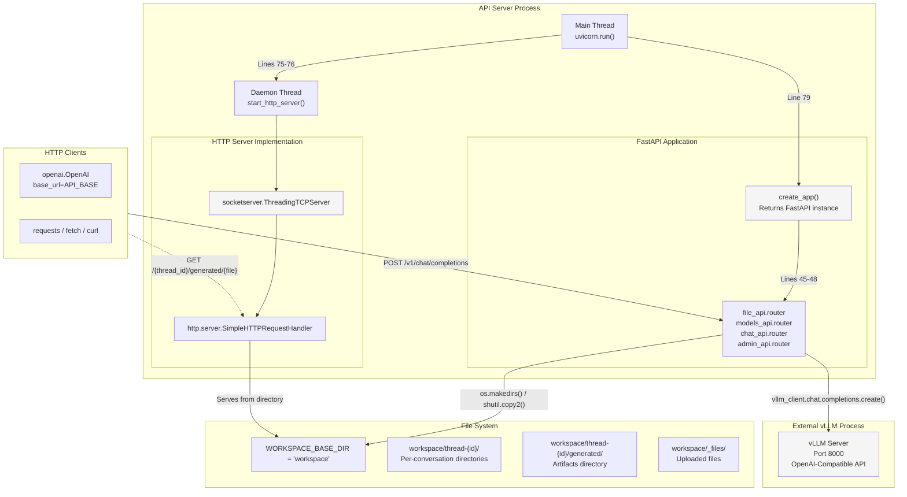
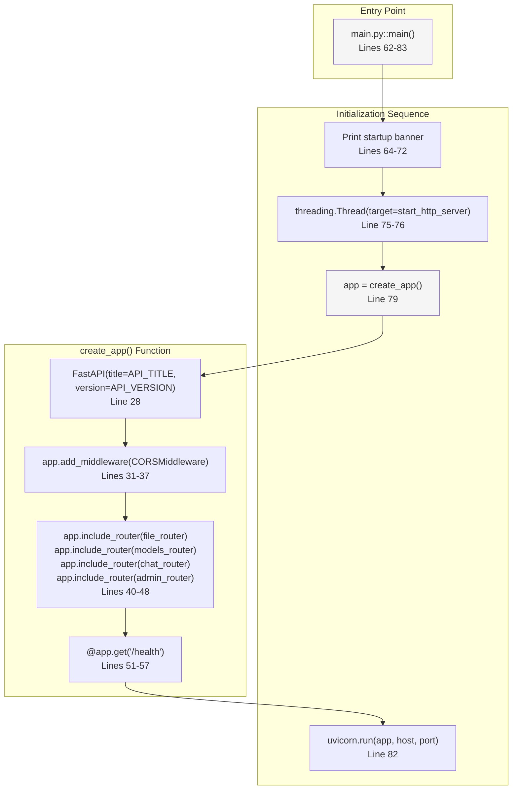
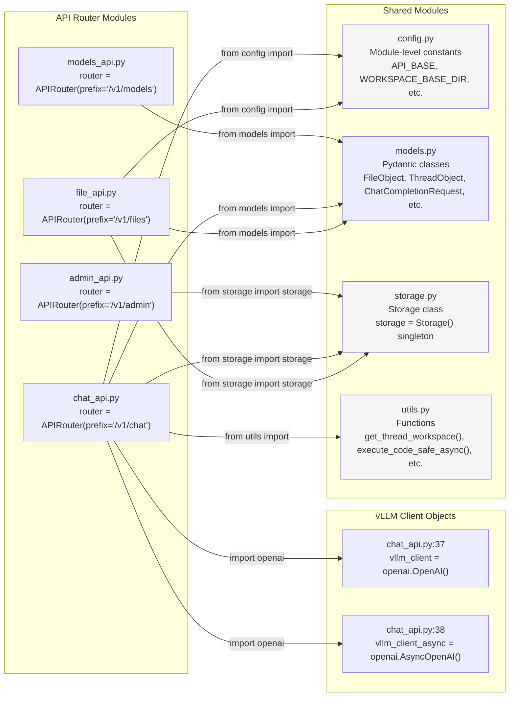
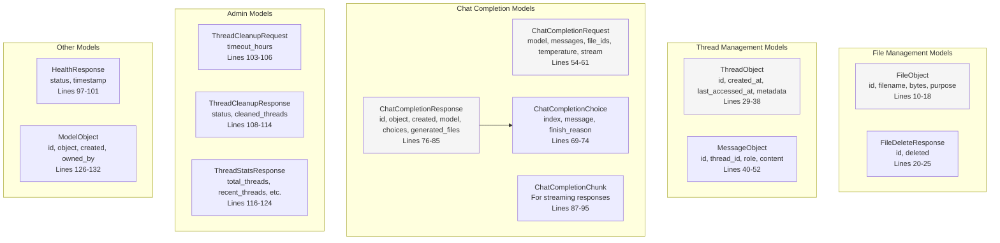
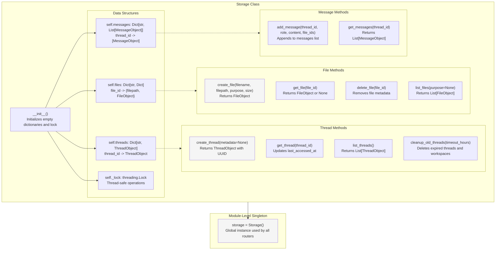
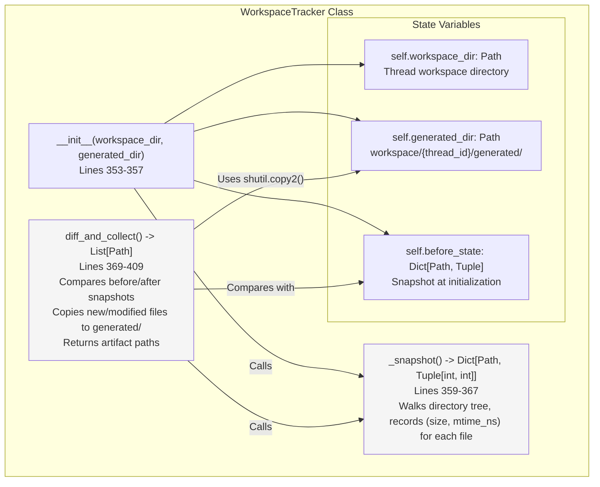
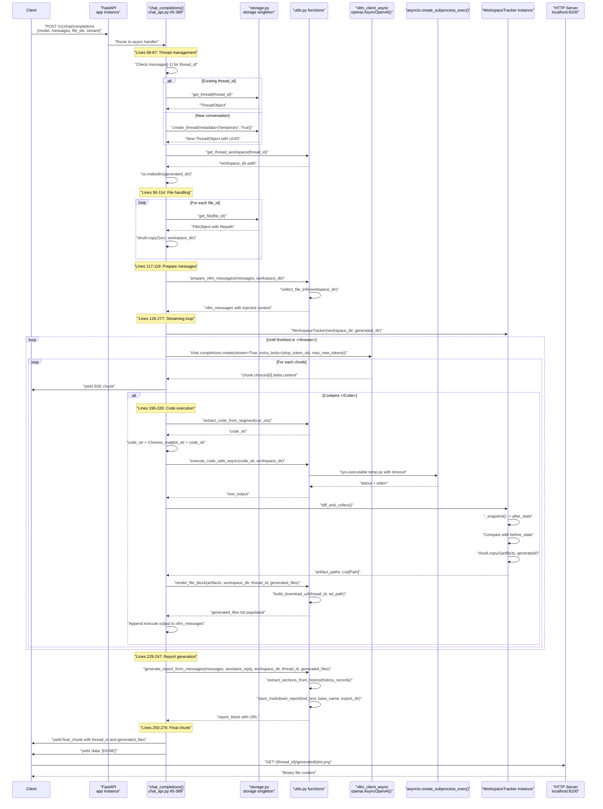
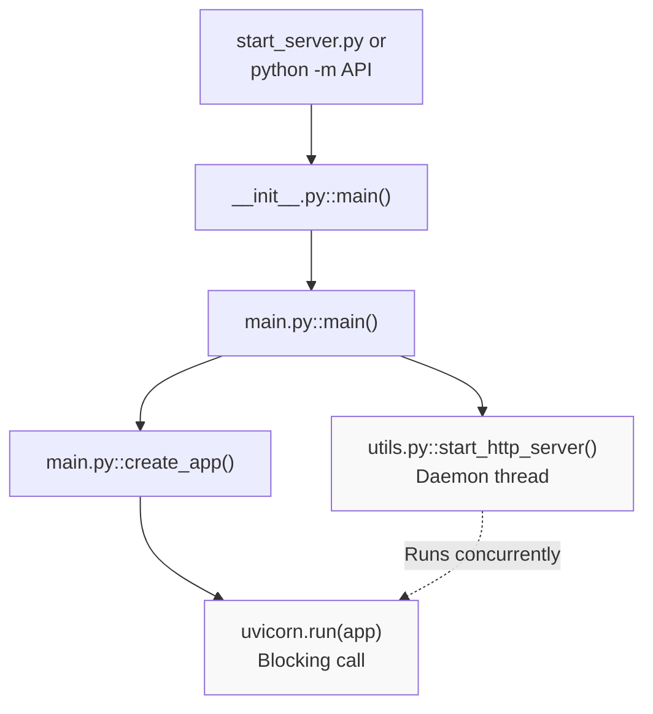
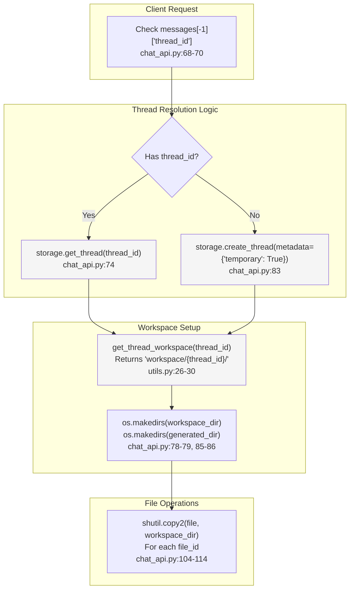

<!-- source: DeepWiki mcp.deepwiki.com · repo ruc-datalab/DeepAnalyze · page 6 API Server Architecture · fetched 2026-10-26 -->

# API Server Architecture

<details>
<summary>Relevant source files</summary>

The following files were used as context for generating this wiki page:

- [API/chat_api.py](API/chat_api.py)
- [API/config.py](API/config.py)
- [API/example/exampleOpenAI.py](API/example/exampleOpenAI.py)
- [API/example/exampleRequest.py](API/example/exampleRequest.py)
- [API/main.py](API/main.py)
- [API/models.py](API/models.py)
- [API/utils.py](API/utils.py)

</details>


## Purpose and Scope

This page provides a high-level architectural overview of the DeepAnalyze API Server, including its multi-port design, core components, and how they interact to deliver OpenAI-compatible data analysis capabilities. 

For detailed information about specific components:
- Application initialization and startup process: see [Application Setup and Entry Points](#2.1)
- Configuration parameters and settings: see [Configuration System](#2.2)
- API request/response models: see [Data Models](#2.3)
- In-memory storage implementation: see [Storage Layer](#2.4)
- Code execution and workspace management: see [Utilities and Core Functions](#2.5)

For information about individual API endpoints and their usage: see [API Endpoints](#3)

---

## Multi-Port Architecture

The API server uses a three-port architecture with clear separation of responsibilities:

**Port Configuration:**

| Port | Service | Implementation | Configuration Constant |
|------|---------|----------------|------------------------|
| **8000** | vLLM Inference Server | External process, OpenAI-compatible API | `config.API_BASE = "http://localhost:8000/v1"` |
| **8200** | FastAPI Application | `uvicorn.run(app, host=API_HOST, port=API_PORT)` | `config.API_PORT = 8200` |
| **8100** | HTTP File Server | `socketserver.ThreadingTCPServer` in daemon thread | `config.HTTP_SERVER_PORT = 8100` |

**Service Initialization and Communication:**



**Client Initialization for vLLM Communication:**

The API server communicates with vLLM using OpenAI client instances initialized in [API/chat_api.py:36-38]():

```python
vllm_client = openai.OpenAI(base_url=API_BASE, api_key="dummy")
vllm_client_async = openai.AsyncOpenAI(base_url=API_BASE, api_key="dummy")
```

Sources: [API/main.py:62-83](), [API/config.py:1-44](), [API/chat_api.py:36-38](), [API/utils.py:494-510]()

---

## Application Structure

The FastAPI application is initialized in [API/main.py:26-59]() through the `create_app()` function, which configures middleware and registers routers.

**Application Initialization Flow:**



**Router and Module Dependencies:**



Sources: [API/main.py:26-83](), [API/chat_api.py:1-42](), [API/config.py:1-44](), [API/storage.py](), [API/utils.py:1-24]()

---

## Core Components

### Configuration System (config.py)

Module-level constants defined in [API/config.py:1-44]():

**Configuration Constants:**

| Constant | Value | Line | Purpose |
|----------|-------|------|---------|
| `API_BASE` | `"http://localhost:8000/v1"` | 12 | vLLM server endpoint |
| `MODEL_PATH` | `"DeepAnalyze-8B"` | 13 | Model identifier |
| `WORKSPACE_BASE_DIR` | `"workspace"` | 14 | Root directory for all workspaces |
| `HTTP_SERVER_PORT` | `8100` | 15 | File server port |
| `API_HOST` | `"0.0.0.0"` | 19 | FastAPI bind address |
| `API_PORT` | `8200` | 20 | FastAPI listen port |
| `DEFAULT_TEMPERATURE` | `0.4` | 37 | LLM sampling temperature |
| `MAX_NEW_TOKENS` | `32768` | 30 | Maximum tokens per generation |
| `STOP_TOKEN_IDS` | `[151676, 151645]` | 41 | Stop token IDs for DeepAnalyze-8B |
| `CODE_EXECUTION_TIMEOUT` | `120` | 29 | Code execution timeout (seconds) |
| `FILE_STORAGE_DIR` | `workspace/_files` | 33 | Uploaded files directory |
| `CLEANUP_TIMEOUT_HOURS` | `12` | 25 | Thread expiration time |

The `os.environ.setdefault("MPLBACKEND", "Agg")` at line 9 configures matplotlib for headless environments.

Sources: [API/config.py:1-44]()

### Data Models (models.py)

Pydantic models in [API/models.py:1-137]() provide OpenAI API compatibility:

**Key Pydantic Classes:**



All models inherit from `pydantic.BaseModel` and use type annotations for automatic validation.

Sources: [API/models.py:1-137]()

### Storage Layer (storage.py)

The `Storage` class provides in-memory state management. Key data structures:

**Storage Class Interface:**



The singleton instance is created at module import and shared across all API endpoints. Thread cleanup deletes both in-memory state and corresponding filesystem directories via `shutil.rmtree()`.

Sources: [API/storage.py]() (referenced in architecture)

### Utilities Layer (utils.py)

The [API/utils.py:1-510]() module provides core functionality for workspace management, code execution, and artifact tracking.

**Key Utility Functions:**

| Function | Lines | Parameters | Returns | Purpose |
|----------|-------|------------|---------|---------|
| `get_thread_workspace()` | 26-30 | `thread_id: str` | `str` | Creates and returns `workspace/{thread_id}/` path |
| `build_download_url()` | 33-39 | `thread_id: str, rel_path: str` | `str` | Constructs URL for file server: `http://localhost:8100/{thread_id}/{rel_path}` |
| `collect_file_info()` | 71-86 | `directory: str` | `str` | Scans directory and returns JSON-formatted file list with sizes |
| `prepare_vllm_messages()` | 91-127 | `messages: List[Dict], workspace_dir: str` | `List[Dict]` | Injects file context into last user message with `# Instruction` and `# Data` headers |
| `execute_code_safe()` | 130-167 | `code_str: str, workspace_dir: str, timeout_sec: int` | `str` | Executes Python code in subprocess with timeout, returns stdout/stderr |
| `execute_code_safe_async()` | 170-219 | Same as above | `str` | Async version using `asyncio.create_subprocess_exec()` |
| `extract_code_from_segment()` | 222-229 | `segment: str` | `Optional[str]` | Extracts Python code from `<Code>...</Code>` tags, handles ```python``` fences |
| `extract_sections_from_history()` | 254-336 | `messages: List[Dict]` | `str` | Builds markdown report from tagged sections (`<Analyze>`, `<Code>`, etc.) |
| `generate_report_from_messages()` | 412-470 | `original_messages, assistant_reply, workspace_dir, thread_id, generated_files_sink` | `str` | Generates timestamped markdown report in `generated/` folder |
| `render_file_block()` | 471-492 | `artifact_paths: List[Path], workspace_dir, thread_id, generated_files_sink` | `str` | Builds file metadata list with download URLs |
| `start_http_server()` | 494-510 | None | None | Starts `socketserver.ThreadingTCPServer` on `HTTP_SERVER_PORT` |

**WorkspaceTracker Class:**

Defined at [API/utils.py:350-409](), this class monitors filesystem changes to detect generated artifacts:



The tracker uses file metadata (size, mtime) to detect changes, then copies artifacts to the `generated/` subdirectory for HTTP serving.

Sources: [API/utils.py:1-510](), [API/utils.py:350-409]()

---

## Request Processing Flow

### Chat Completion Endpoint Handler

The main endpoint is defined at [API/chat_api.py:44-389]() as an async function decorated with `@router.post("/completions")`.

**Request Processing Steps:**



**Key Code References:**

- Thread resolution: [API/chat_api.py:68-87]()
- File collection and copying: [API/chat_api.py:90-114]()
- Message preparation with file context: [API/chat_api.py:117-119]()
- Streaming loop with code execution: [API/chat_api.py:126-277]()
- Code extraction: [API/utils.py:222-229]()
- Async code execution: [API/utils.py:170-219]()
- Workspace tracking: [API/utils.py:369-409]()
- Report generation: [API/utils.py:412-470]()

Sources: [API/chat_api.py:44-389](), [API/utils.py:170-219](), [API/utils.py:222-229](), [API/utils.py:369-409](), [API/utils.py:412-470]()

### Code Execution Safety Mechanisms

Code execution in [API/utils.py:170-219]() implements multiple safety layers:

**Execution Isolation:**

1. **Temporary File Creation**: `tempfile.mkstemp(suffix=".py", dir=exec_cwd)` at line 178
2. **Subprocess Isolation**: `asyncio.create_subprocess_exec(sys.executable, tmp_path)` at lines 189-195
3. **Environment Configuration**: 
   - `MPLBACKEND=Agg` for headless matplotlib (line 184)
   - `QT_QPA_PLATFORM=offscreen` for Qt applications (line 185)
   - `DISPLAY` removed to prevent X11 usage (line 186)
4. **Working Directory**: `cwd=exec_cwd` restricts file access to thread workspace (line 191)
5. **Timeout Control**: `asyncio.wait_for(process.communicate(), timeout=timeout_sec)` at lines 198-201
6. **Cleanup**: Temporary file deleted in `finally` block (lines 215-219)

Sources: [API/utils.py:170-219]()

---

## Application Lifecycle

**Startup Sequence:**



**Key Startup Steps (main.py):**

1. **Line 64-72**: Print startup banner with service URLs and endpoints
2. **Line 75-76**: Start HTTP file server in daemon thread via `start_http_server()`
3. **Line 79**: Create FastAPI app via `create_app()`
4. **Line 82**: Start uvicorn server with configured host and port

The daemon thread for the HTTP server ensures it terminates when the main process exits.

Sources: [API/main.py:62-83]()

---

## OpenAI Client Integration

The API server uses the official OpenAI Python library to communicate with the vLLM server, treating it as an OpenAI-compatible endpoint.

**Client Initialization:**

At [API/chat_api.py:36-38]():

```python
vllm_client = openai.OpenAI(base_url=API_BASE, api_key="dummy")
vllm_client_async = openai.AsyncOpenAI(base_url=API_BASE, api_key="dummy")
```

- `API_BASE = "http://localhost:8000/v1"` from [API/config.py:12]()
- Both synchronous and asynchronous clients initialized
- API key is "dummy" since vLLM doesn't require authentication in local deployment

**Streaming Chat Completion Call:**

At [API/chat_api.py:133-143]():

```python
response = await vllm_client_async.chat.completions.create(
    model=model,
    messages=vllm_messages,
    temperature=temperature,
    stream=True,
    extra_body={
        "add_generation_prompt": False,
        "stop_token_ids": STOP_TOKEN_IDS,  # [151676, 151645]
        "max_new_tokens": MAX_NEW_TOKENS,   # 32768
    },
)
```

The `extra_body` parameter passes vLLM-specific settings that aren't part of the standard OpenAI API.

Sources: [API/chat_api.py:36-38](), [API/chat_api.py:133-143](), [API/config.py:12]()

## CORS Configuration

Configured at [API/main.py:31-37]() to allow cross-origin requests:

```python
app.add_middleware(
    CORSMiddleware,
    allow_origins=["*"],      # Accept all origins
    allow_credentials=True,   # Allow cookies/auth headers
    allow_methods=["*"],      # All HTTP methods (GET, POST, DELETE, etc.)
    allow_headers=["*"],      # All request headers
)
```

This enables the API to be accessed from the WebUI (port 4000), Gradio apps (port 8080), or any other web-based client.

Sources: [API/main.py:31-37]()

---

## Health Check Endpoint

Defined at [API/main.py:51-57]() as a simple liveness probe:

```python
@app.get("/health", response_model=HealthResponse)
async def health_check():
    return HealthResponse(
        status="healthy",
        timestamp=int(time.time())
    )
```

**Response Model** ([API/models.py:97-101]()):
- `status: str` - Always "healthy" if server is running
- `timestamp: int` - Unix timestamp of response

This endpoint does not verify vLLM connectivity or file system health; it only confirms the FastAPI process is responsive.

Sources: [API/main.py:51-57](), [API/models.py:97-101]()

---

## Thread and Workspace Management

### Thread Lifecycle

Threads are created dynamically by the chat completion endpoint and tracked in `storage.threads: Dict[str, ThreadObject]`.

**Thread Creation Flow:**



**Thread Directory Structure:**

```
workspace/
├── _files/                          # FILE_STORAGE_DIR (config.py:33)
│   └── {file_id}                    # Uploaded files by ID
└── {thread_id}/                     # Thread workspace (created by get_thread_workspace)
    ├── data.csv                     # Copied input files
    ├── analysis_script.py           # Temporary execution scripts
    └── generated/                   # Generated artifacts
        ├── plot.png                 # Matplotlib outputs
        ├── results.csv              # Data files
        └── Conversation_Report_YYYYMMDD_HHMMSS.md
```

### Thread Cleanup

The `storage.cleanup_old_threads(timeout_hours)` method removes expired threads and their workspaces:

1. Identifies threads with `last_accessed_at` older than timeout
2. Deletes thread from `storage.threads` dictionary
3. Deletes workspace directory with `shutil.rmtree(workspace_path)`
4. Returns count of cleaned threads

This is invoked by the admin API endpoint `POST /v1/admin/cleanup`.

Sources: [API/chat_api.py:68-87](), [API/utils.py:26-30](), [API/config.py:33](), [API/storage.py]() (referenced in architecture)

## Deployment Considerations

### State Management

The `Storage` class in [API/storage.py]() uses in-memory dictionaries protected by `threading.Lock`. This design has implications:

**Single-Instance Deployment:**
- ✅ Simple, no external dependencies
- ✅ Fast access, no network latency
- ⚠️ State lost on restart
- ⚠️ Memory usage grows with active threads

**Multi-Instance Deployment:**
- ❌ Each instance has separate state
- ❌ Thread IDs not shared across instances
- ❌ File uploads visible only to uploading instance
- **Solution**: Requires shared state backend (Redis, PostgreSQL) or sticky sessions

### Workspace Storage

The `WORKSPACE_BASE_DIR = "workspace"` directory must be:
- Writable by the API server process
- Shared across API instances if horizontally scaled (NFS, EFS, S3 with FUSE)
- Accessible by the HTTP file server thread

For production deployments, consider:
- Using absolute paths or environment variables for `WORKSPACE_BASE_DIR`
- Implementing workspace quota limits
- Setting up automated cleanup jobs for expired threads
- Mounting shared storage with proper permissions

Sources: [API/config.py:14](), [API/storage.py]() (referenced in architecture)

---

## Summary

The DeepAnalyze API Server architecture provides:

1. **Separation of Concerns**: Three-port design isolates API logic, file serving, and model inference
2. **OpenAI Compatibility**: Drop-in replacement for OpenAI API with file attachment extensions
3. **Modular Design**: Layered architecture with clear component boundaries
4. **Agentic Capabilities**: Code execution loop integrated into chat completions
5. **Thread Isolation**: Per-conversation workspaces prevent cross-contamination
6. **Type Safety**: Pydantic models for request/response validation

The architecture supports both simple chat interactions and complex autonomous data analysis workflows through its integration of the storage, utilities, and routing layers.

Sources: [API/main.py:1-85](), [API/__init__.py:1-11](), [API/README.md:1-389]()

---

