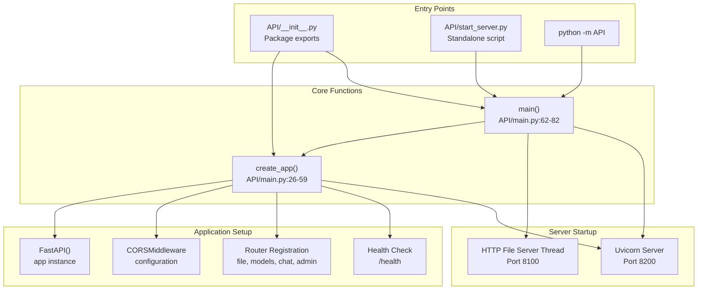
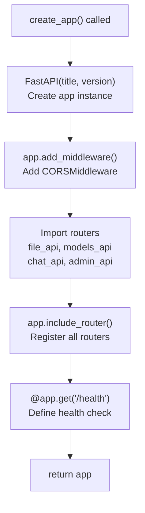
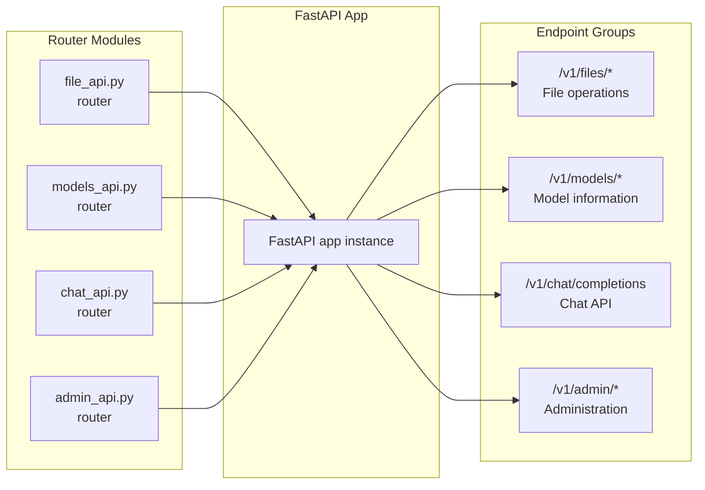
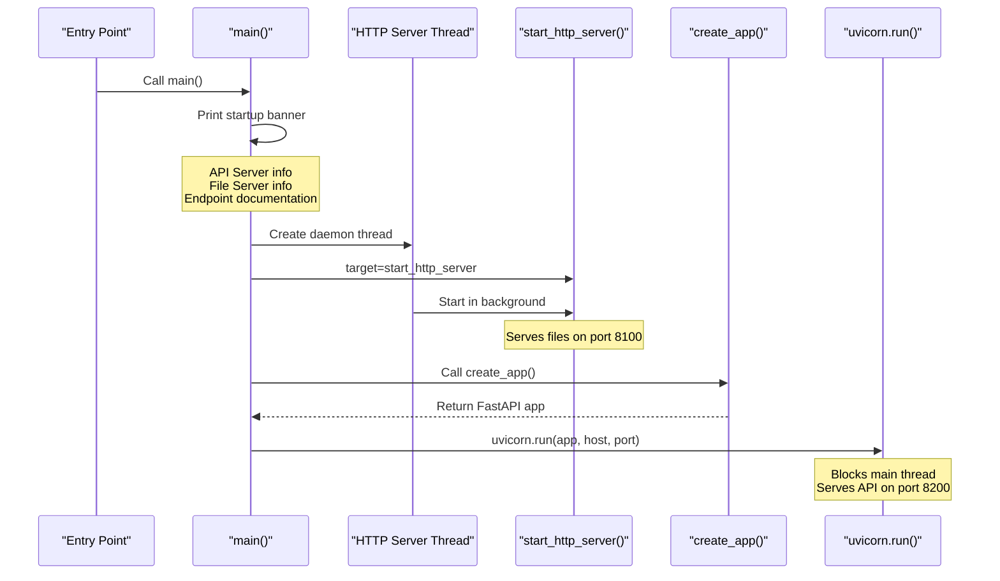
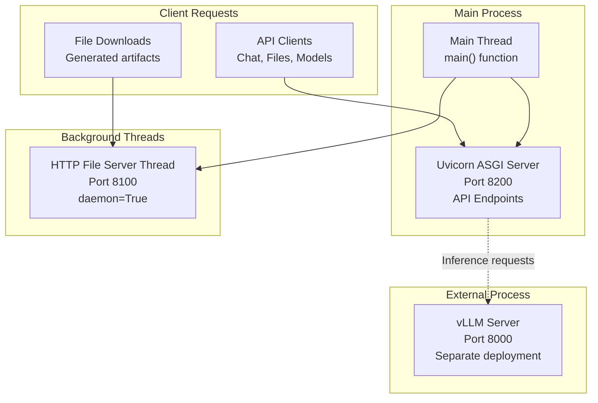

<!-- source: DeepWiki mcp.deepwiki.com · repo ruc-datalab/DeepAnalyze · page 6.1 Application Setup and Entry Points · fetched 2026-10-26 -->

# Application Setup and Entry Points

<details>
<summary>Relevant source files</summary>

The following files were used as context for generating this wiki page:

- [API/__init__.py](API/__init__.py)
- [API/admin_api.py](API/admin_api.py)
- [API/config.py](API/config.py)
- [API/example/Simpson.csv](API/example/Simpson.csv)
- [API/file_api.py](API/file_api.py)
- [API/main.py](API/main.py)
- [API/models.py](API/models.py)
- [API/start_server.py](API/start_server.py)

</details>


This document describes how the DeepAnalyze API server application is initialized, configured, and started. It covers the entry point functions, FastAPI application setup, router registration, middleware configuration, and the server startup process.

For detailed information about the configuration parameters used during setup, see page 6.2 (Configuration System). For information about the individual API routers that are registered, see pages 6.6 (Chat Completions API), 6.7 (File Management API), 6.8 (Models API), and 6.9 (Admin API).

## Purpose and Scope

The application setup layer is responsible for:
- Creating and configuring the FastAPI application instance
- Registering API routers for different endpoint groups
- Configuring Cross-Origin Resource Sharing (CORS) middleware
- Starting both the main API server (port 8200) and the HTTP file server (port 8100)
- Providing multiple entry points for different deployment scenarios

This document focuses on the initialization and startup mechanics. The actual endpoint implementations are covered in pages 6.6-6.9.

## Entry Point Architecture

The DeepAnalyze API provides three primary entry points for starting the server, each serving different use cases:

**Entry Point Diagram**


Sources: [API/__init__.py:1-11](), [API/main.py:1-86](), [API/start_server.py:1-8]()

### Package-Level Entry Point

The `API/__init__.py` module defines the package interface and exports the core entry functions:

```python
from .main import create_app, main

__all__ = ["create_app", "main"]
```

This allows external code to start the server by importing from the package:
```python
from API import main
main()
```

Sources: [API/__init__.py:9-11]()

### Standalone Script Entry Point

The `start_server.py` script provides a simple command-line entry point:

```python
#!/usr/bin/env python3
if __name__ == "__main__":
    from main import main
    main()
```

This can be executed directly: `python API/start_server.py`

Sources: [API/start_server.py:1-8]()

### Module Entry Point

The `main.py` module can also be executed directly as a module:

```python
if __name__ == "__main__":
    main()
```

This allows starting the server with: `python -m API.main`

Sources: [API/main.py:85-86]()

## Application Factory: create_app()

The `create_app()` function implements the application factory pattern, creating and configuring a FastAPI application instance. This function is defined at [API/main.py:26-59]().

**Application Factory Flow**


Sources: [API/main.py:26-59]()

### FastAPI Instance Creation

The application is created with configuration values imported from the `config` module:

```python
app = FastAPI(title=API_TITLE, version=API_VERSION)
```

The `API_TITLE` and `API_VERSION` constants are defined in the configuration system (see page 6.2).

Sources: [API/main.py:28](), [API/main.py:15]()

### CORS Middleware Configuration

Cross-Origin Resource Sharing (CORS) middleware is added to allow browser-based clients to access the API:

| Configuration Parameter | Value | Purpose |
|------------------------|-------|---------|
| `allow_origins` | `["*"]` | Accept requests from any origin |
| `allow_credentials` | `True` | Allow cookies and authentication headers |
| `allow_methods` | `["*"]` | Allow all HTTP methods (GET, POST, etc.) |
| `allow_headers` | `["*"]` | Allow all custom headers |

The middleware is configured at [API/main.py:31-37]():

```python
app.add_middleware(
    CORSMiddleware,
    allow_origins=["*"],
    allow_credentials=True,
    allow_methods=["*"],
    allow_headers=["*"],
)
```

This permissive configuration allows the DeepAnalyze API to be accessed from web browsers, the WebUI demo, and external applications without CORS restrictions.

Sources: [API/main.py:30-37]()

## Router Registration

The application registers four specialized routers that handle different API endpoint groups. Router imports occur at [API/main.py:40-43](), and registration happens at [API/main.py:45-48]().

**Router Registration Mapping**


Sources: [API/main.py:40-48]()

### Router Import and Registration

The routers are imported dynamically within the `create_app()` function to ensure proper module initialization order:

```python
from file_api import router as file_router
from models_api import router as models_router
from chat_api import router as chat_router
from admin_api import router as admin_router

app.include_router(file_router)
app.include_router(models_router)
app.include_router(chat_router)
app.include_router(admin_router)
```

Each router is registered using `app.include_router()`, which adds all endpoints defined in that router to the application. For detailed documentation of each router's endpoints, see:
- Page 6.7 (File Management API) - File upload, download, list, delete operations
- Page 6.8 (Models API) - Model information and listing
- Page 6.6 (Chat Completions API) - Main chat completion endpoint with code execution
- Page 6.9 (Admin API) - Administrative endpoints for system management

Sources: [API/main.py:40-48]()

## Health Check Endpoint

A health check endpoint is defined directly in the application factory at [API/main.py:51-57]():

```python
@app.get("/health", response_model=HealthResponse)
async def health_check():
    """Health check endpoint"""
    return HealthResponse(
        status="healthy",
        timestamp=int(time.time())
    )
```

This endpoint returns a `HealthResponse` model (defined in `models.py`) indicating the server is running and providing the current timestamp. It is used for monitoring and ensuring the server is responsive.

**Health Check Response Structure**
| Field | Type | Description |
|-------|------|-------------|
| `status` | `str` | Always returns `"healthy"` |
| `timestamp` | `int` | Current Unix timestamp |

Sources: [API/main.py:51-57](), [API/main.py:16]()

## Server Startup: main()

The `main()` function orchestrates the complete server startup process, including starting both the API server and the HTTP file server. It is defined at [API/main.py:62-82]().

**Server Startup Sequence**


Sources: [API/main.py:62-82]()

### Startup Information Display

The function begins by printing comprehensive startup information to the console:

```python
print("🚀 Starting DeepAnalyze OpenAI-Compatible API Server...")
print(f"   - API Server: http://{API_HOST}:{API_PORT}")
print(f"   - File Server: http://localhost:{HTTP_SERVER_PORT}")
print(f"   - Workspace: workspace")
print("\n📖 API Endpoints:")
print("   - Models API: /v1/models")
print("   - Files API: /v1/files")
print("   - Chat API: /v1/chat/completions")
print("   - Admin API: /v1/admin")
```

This provides operators with immediate visibility into:
- The API server URL and port (default: `http://0.0.0.0:8200`)
- The file server URL and port (default: `http://localhost:8100`)
- The workspace directory location
- Available API endpoint groups

Sources: [API/main.py:64-72](), [API/main.py:15]()

### HTTP File Server Initialization

The HTTP file server is started in a separate daemon thread before the main API server:

```python
http_thread = threading.Thread(target=start_http_server, daemon=True)
http_thread.start()
```

The `daemon=True` flag ensures the file server thread terminates when the main thread exits. The `start_http_server()` function is imported from the `utils` module and serves files from the workspace directory on port 8100 (see page 6.5 for details on core utilities).

Sources: [API/main.py:75-76](), [API/main.py:17]()

### Uvicorn Server Launch

The FastAPI application is started using Uvicorn, a lightning-fast ASGI server:

```python
app = create_app()
print("Starting API server...")
uvicorn.run(app, host=API_HOST, port=API_PORT)
```

The `uvicorn.run()` call blocks the main thread and keeps the server running until interrupted (Ctrl+C) or terminated. The `host` and `port` parameters are pulled from the configuration system.

**Server Configuration Parameters**
| Parameter | Configuration Variable | Default Value |
|-----------|----------------------|---------------|
| `host` | `API_HOST` | `"0.0.0.0"` |
| `port` | `API_PORT` | `8200` |

Sources: [API/main.py:79-82](), [API/main.py:15]()

## Multi-Process Architecture

The startup process creates a multi-component server architecture with distinct responsibilities:

**Process and Port Architecture**


Sources: [API/main.py:75-82]()

### Thread Safety Considerations

The file server runs in a daemon thread, which means:
1. It does not block the main process from exiting
2. It terminates automatically when the main thread terminates
3. It shares the same memory space as the main API server

The storage layer uses thread-safe locks to coordinate access between the API server and file server threads (see page 6.4 for details on the storage layer).

Sources: [API/main.py:75-76]()

## Configuration Dependencies

The application setup process depends on several configuration variables imported at [API/main.py:15]():

**Configuration Import Mapping**
| Configuration Variable | Used In | Purpose |
|----------------------|---------|---------|
| `API_HOST` | `main()` | Bind address for API server |
| `API_PORT` | `main()` | Port for API server |
| `API_TITLE` | `create_app()` | FastAPI application title |
| `API_VERSION` | `create_app()` | API version string |
| `HTTP_SERVER_PORT` | `main()` | Port for file server |
| `CLEANUP_INTERVAL_MINUTES` | Commented out | Thread cleanup interval (not currently used) |

The commented-out cleanup interval constants ([API/main.py:21-23]()) suggest that automatic cleanup functionality was considered but is not currently implemented in the startup process. Cleanup is instead handled through the Admin API (see page 6.9).

Sources: [API/main.py:15](), [API/main.py:21-23]()

## Summary

The DeepAnalyze API application setup follows a clean initialization pattern:

1. **Entry Points**: Multiple entry points (`__init__.py`, `start_server.py`, `main.py`) provide flexibility for different deployment scenarios
2. **Application Factory**: `create_app()` creates and configures a FastAPI instance with CORS, routers, and health check
3. **Router Registration**: Four specialized routers handle different API concerns
4. **Multi-Server Startup**: `main()` starts both the HTTP file server (daemon thread) and the main API server (Uvicorn)
5. **Configuration-Driven**: All settings are externalized to the configuration system

This architecture provides a robust, maintainable foundation for the DeepAnalyze API server with clear separation of concerns and multiple access points for different use cases.

Sources: [API/__init__.py:1-11](), [API/main.py:1-86](), [API/start_server.py:1-8]()

---

