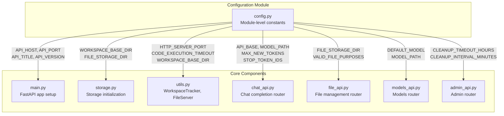
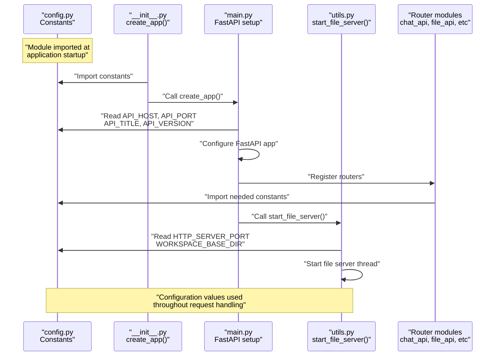

<!-- source: DeepWiki mcp.deepwiki.com · repo ruc-datalab/DeepAnalyze · page 6.2 Configuration System · fetched 2026-10-26 -->

# Configuration System

<details>
<summary>Relevant source files</summary>

The following files were used as context for generating this wiki page:

- [API/config.py](API/config.py)
- [API/main.py](API/main.py)
- [API/models.py](API/models.py)

</details>


## Purpose and Scope

This document describes the configuration system for the DeepAnalyze API Server. All configuration parameters are centralized in a single module that defines constants for API endpoints, port numbers, model settings, execution timeouts, and other system-wide settings. The configuration system provides a single source of truth for all operational parameters used throughout the API server.

For information about how these configuration values are used during application startup, see [Application Setup and Entry Points](#2.1). For details on model-specific settings and deployment, see [Model and Deployment](#6).

## Configuration Architecture

The DeepAnalyze configuration system is implemented as a simple Python module (`API/config.py`) that exports module-level constants. All other components import these constants directly, ensuring consistent behavior across the entire system.



**Configuration Import Flow**

The diagram above illustrates how configuration constants from `config.py` are imported and used by different API components. Each module imports only the constants it requires, though all constants are available to all modules.

**Sources:** [API/config.py:1-44]()

## Configuration Categories

The configuration system organizes settings into several logical categories:

### External Service Configuration

These parameters define connections to external services, primarily the vLLM model server.

| Parameter | Value | Description |
|-----------|-------|-------------|
| `API_BASE` | `"http://localhost:8000/v1"` | Base URL for the vLLM server API endpoint |
| `MODEL_PATH` | `"DeepAnalyze-8B"` | Model identifier passed to vLLM |

The `API_BASE` parameter [API/config.py:12]() specifies where the chat completion router should send inference requests. This URL points to the vLLM server's OpenAI-compatible API endpoint. The `MODEL_PATH` [API/config.py:13]() identifies which model the vLLM server should use for inference.

**Sources:** [API/config.py:11-13]()

### API Server Configuration

These parameters control the FastAPI application server itself.

| Parameter | Value | Description |
|-----------|-------|-------------|
| `API_HOST` | `"0.0.0.0"` | Host address to bind the API server |
| `API_PORT` | `8200` | Port number for the API server |
| `API_TITLE` | `"DeepAnalyze OpenAI-Compatible API"` | API title displayed in OpenAPI docs |
| `API_VERSION` | `"1.0.0"` | API version string |

The `API_HOST` [API/config.py:19]() value of `"0.0.0.0"` allows the server to accept connections from any network interface. The `API_PORT` [API/config.py:20]() of 8200 is the standard port for the DeepAnalyze API server, distinct from the vLLM server (port 8000) and file server (port 8100).

**Sources:** [API/config.py:18-22]()

### Workspace and File Storage

These parameters define the file system organization for workspace directories and file storage.

| Parameter | Value | Description |
|-----------|-------|-------------|
| `WORKSPACE_BASE_DIR` | `"workspace"` | Root directory for all workspace operations |
| `FILE_STORAGE_DIR` | `"workspace/_files"` | Directory for storing uploaded files |
| `HTTP_SERVER_PORT` | `8100` | Port for the HTTP file server |
| `HTTP_SERVER_BASE` | `"http://localhost:8100"` | Base URL for file download links |

The `WORKSPACE_BASE_DIR` [API/config.py:14]() serves as the root for both uploaded files and thread-specific workspaces. The `FILE_STORAGE_DIR` [API/config.py:33]() is constructed by joining the workspace base directory with `"_files"`, creating a dedicated location for user-uploaded files that is separate from thread workspaces.

Thread workspaces are created as subdirectories within `WORKSPACE_BASE_DIR`, following the pattern `workspace/thread-{thread_id}/`. Generated artifacts are stored in `workspace/thread-{thread_id}/generated/`.

The `HTTP_SERVER_PORT` [API/config.py:15]() defines the port for the standalone file server that serves generated artifacts and uploaded files. The `HTTP_SERVER_BASE` [API/config.py:16]() is used to construct download URLs returned in API responses.

**Sources:** [API/config.py:14-16, 33]()

### File Handling

| Parameter | Value | Description |
|-----------|-------|-------------|
| `VALID_FILE_PURPOSES` | `["fine-tune", "answers", "file-extract", "assistants"]` | Allowed values for file purpose field |

The `VALID_FILE_PURPOSES` [API/config.py:34]() list defines acceptable values for the `purpose` field when uploading files. While DeepAnalyze primarily uses files for data analysis (similar to the "assistants" purpose), the list includes standard OpenAI file purposes for compatibility.

**Sources:** [API/config.py:34]()

### Thread Management

These parameters control the automatic cleanup of inactive threads.

| Parameter | Value | Description |
|-----------|-------|-------------|
| `CLEANUP_TIMEOUT_HOURS` | `12` | Hours of inactivity before thread is eligible for cleanup |
| `CLEANUP_INTERVAL_MINUTES` | `30` | Interval between cleanup checks |

The `CLEANUP_TIMEOUT_HOURS` [API/config.py:25]() determines when a thread is considered stale. Threads inactive for more than 12 hours are eligible for deletion. The `CLEANUP_INTERVAL_MINUTES` [API/config.py:26]() controls how frequently the cleanup background task runs.

**Sources:** [API/config.py:24-26]()

### Code Execution

These parameters control the sandbox environment for executing model-generated code.

| Parameter | Value | Description |
|-----------|-------|-------------|
| `CODE_EXECUTION_TIMEOUT` | `120` | Maximum seconds allowed for code execution |
| `MAX_NEW_TOKENS` | `32768` | Maximum tokens the model can generate in a single response |

The `CODE_EXECUTION_TIMEOUT` [API/config.py:29]() prevents infinite loops or long-running computations from blocking the API. If code execution exceeds 120 seconds, it is terminated. The `MAX_NEW_TOKENS` [API/config.py:30]() parameter is passed to the vLLM server to limit response length.

**Sources:** [API/config.py:28-30]()

### Model Configuration

These parameters define model-specific settings and behavior.

| Parameter | Value | Description |
|-----------|-------|-------------|
| `DEFAULT_TEMPERATURE` | `0.4` | Default sampling temperature for model inference |
| `DEFAULT_MODEL` | `"DeepAnalyze-8B"` | Default model name in API responses |
| `STOP_TOKEN_IDS` | `[151676, 151645]` | Token IDs that signal the model to stop generating |
| `SUPPORTED_TOOLS` | `["code_interpreter"]` | List of supported tool types |

The `DEFAULT_TEMPERATURE` [API/config.py:37]() of 0.4 provides a balance between deterministic and creative outputs, suitable for data analysis tasks. The `STOP_TOKEN_IDS` [API/config.py:41]() are special tokens used by the DeepAnalyze-8B model to indicate completion of code blocks or responses. These token IDs are passed to vLLM to ensure proper response termination.

The `SUPPORTED_TOOLS` [API/config.py:43]() list indicates that DeepAnalyze supports code execution capabilities, corresponding to OpenAI's "code_interpreter" tool.

**Sources:** [API/config.py:36-43]()

## Configuration Flow

The following diagram shows how configuration values flow from the config module through the application lifecycle:



**Configuration Initialization Sequence**

This diagram illustrates the sequence of configuration access during application startup. The config module is imported early, and various components read their required parameters as they initialize.

**Sources:** [API/config.py:1-44]()

## Environment Variables

The configuration system sets default environment variables at module load time:

```python
os.environ.setdefault("MPLBACKEND", "Agg")
```

The `MPLBACKEND` environment variable [API/config.py:9]() is set to `"Agg"` to configure matplotlib to use a non-interactive backend. This is essential for server environments where no display is available, allowing plots to be saved to files without requiring a graphical interface.

**Sources:** [API/config.py:8-9]()

## Configuration Reference Table

The following table provides a complete reference of all configuration constants:

| Category | Constant | Type | Default Value | Usage |
|----------|----------|------|---------------|-------|
| **External Services** |
| | `API_BASE` | str | `"http://localhost:8000/v1"` | vLLM API endpoint |
| | `MODEL_PATH` | str | `"DeepAnalyze-8B"` | Model identifier |
| **API Server** |
| | `API_HOST` | str | `"0.0.0.0"` | Server bind address |
| | `API_PORT` | int | `8200` | Server port |
| | `API_TITLE` | str | `"DeepAnalyze OpenAI-Compatible API"` | API documentation title |
| | `API_VERSION` | str | `"1.0.0"` | API version |
| **Workspace** |
| | `WORKSPACE_BASE_DIR` | str | `"workspace"` | Root workspace directory |
| | `FILE_STORAGE_DIR` | str | `"workspace/_files"` | Uploaded files directory |
| | `HTTP_SERVER_PORT` | int | `8100` | File server port |
| | `HTTP_SERVER_BASE` | str | `"http://localhost:8100"` | File server base URL |
| **File Handling** |
| | `VALID_FILE_PURPOSES` | list | `["fine-tune", "answers", "file-extract", "assistants"]` | Valid file purposes |
| **Thread Management** |
| | `CLEANUP_TIMEOUT_HOURS` | int | `12` | Inactivity timeout |
| | `CLEANUP_INTERVAL_MINUTES` | int | `30` | Cleanup check interval |
| **Code Execution** |
| | `CODE_EXECUTION_TIMEOUT` | int | `120` | Max execution seconds |
| | `MAX_NEW_TOKENS` | int | `32768` | Max model output tokens |
| **Model** |
| | `DEFAULT_TEMPERATURE` | float | `0.4` | Sampling temperature |
| | `DEFAULT_MODEL` | str | `"DeepAnalyze-8B"` | Default model name |
| | `STOP_TOKEN_IDS` | list | `[151676, 151645]` | Model stop tokens |
| | `SUPPORTED_TOOLS` | list | `["code_interpreter"]` | Available tools |

**Sources:** [API/config.py:1-44]()

## Usage Pattern

Components import configuration constants directly from the config module:

```python
from config import API_BASE, MODEL_PATH, MAX_NEW_TOKENS
```

This simple import pattern is used throughout the codebase. For example:
- `chat_api.py` imports `API_BASE`, `MODEL_PATH`, `MAX_NEW_TOKENS`, and `STOP_TOKEN_IDS` for model inference
- `file_api.py` imports `FILE_STORAGE_DIR` and `VALID_FILE_PURPOSES` for file management
- `utils.py` imports `WORKSPACE_BASE_DIR`, `HTTP_SERVER_PORT`, and `CODE_EXECUTION_TIMEOUT` for workspace operations

The configuration system does not support runtime modification of values. All configuration is static and loaded at application startup.

**Sources:** [API/config.py:1-44]()

---

