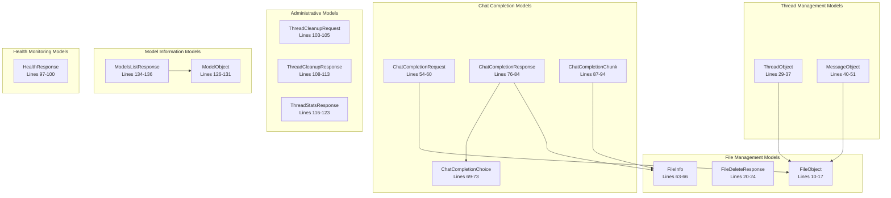
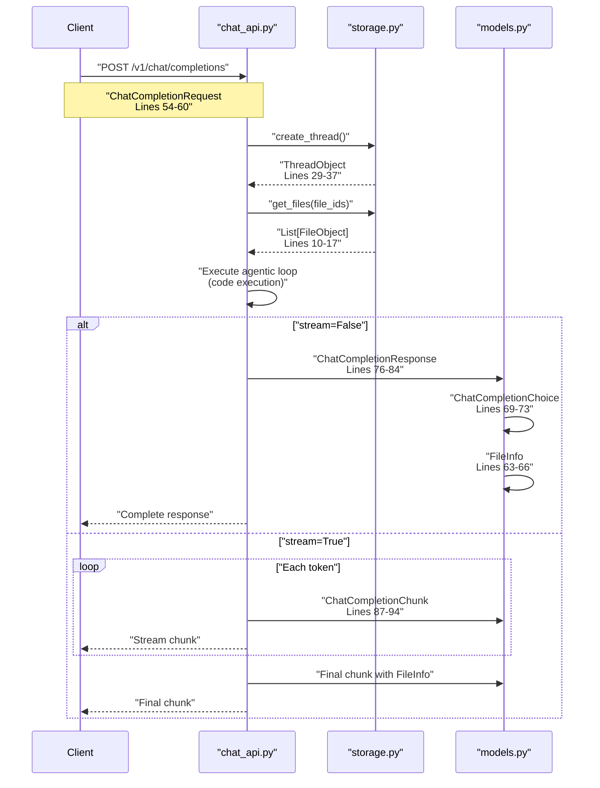
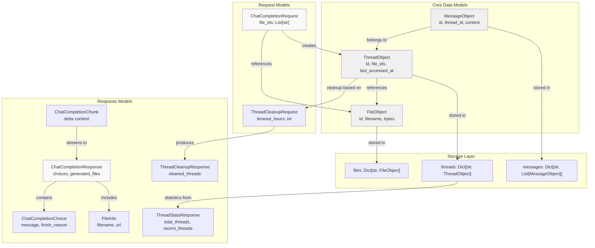

<!-- source: DeepWiki mcp.deepwiki.com · repo ruc-datalab/DeepAnalyze · page 6.3 Data Models · fetched 2026-10-26 -->

# Data Models

<details>
<summary>Relevant source files</summary>

The following files were used as context for generating this wiki page:

- [API/config.py](API/config.py)
- [API/main.py](API/main.py)
- [API/models.py](API/models.py)

</details>


This document provides comprehensive documentation of all Pydantic data models defined in the DeepAnalyze API Server. These models establish type-safe contracts for API requests and responses while maintaining OpenAI API compatibility.

For information about how these models are used in API endpoints, see [API Endpoints](#3). For details on how data is stored and managed, see [Storage Layer](#2.4).

## Overview

The DeepAnalyze API Server uses Pydantic models defined in [API/models.py:1-137]() to provide:

- **Type safety**: Automatic validation of request/response data
- **OpenAI compatibility**: Consistent data structures matching OpenAI API conventions
- **Documentation**: Self-documenting field definitions with type hints
- **Serialization**: Automatic JSON encoding/decoding

All models are organized into six functional categories:

| Category | Models | Purpose |
|----------|--------|---------|
| File Management | `FileObject`, `FileDeleteResponse`, `FileInfo` | File upload, storage, and metadata |
| Thread Management | `ThreadObject`, `MessageObject` | Conversation thread and message tracking |
| Chat Completions | `ChatCompletionRequest`, `ChatCompletionResponse`, `ChatCompletionChoice`, `ChatCompletionChunk` | Main analysis request/response flow |
| Administrative | `ThreadCleanupRequest`, `ThreadCleanupResponse`, `ThreadStatsResponse` | System maintenance and monitoring |
| Model Information | `ModelObject`, `ModelsListResponse` | Available model enumeration |
| Health Monitoring | `HealthResponse` | Server health checks |

**Sources:** [API/models.py:1-137]()

## Model Category Diagram



**Sources:** [API/models.py:1-137]()

## File Management Models

### FileObject

The `FileObject` model represents an uploaded file and follows the OpenAI file object specification.

**Location:** [API/models.py:10-17]()

| Field | Type | Description |
|-------|------|-------------|
| `id` | `str` | Unique file identifier (format: `file-{uuid}`) |
| `object` | `Literal["file"]` | Always `"file"` for OpenAI compatibility |
| `bytes` | `int` | File size in bytes |
| `created_at` | `int` | Unix timestamp of creation |
| `filename` | `str` | Original filename |
| `purpose` | `str` | File purpose (e.g., `"assistants"`, `"vision"`) |

**Usage:** Returned by file upload endpoints and referenced in thread/message objects.

### FileDeleteResponse

Response model confirming file deletion.

**Location:** [API/models.py:20-24]()

| Field | Type | Description |
|-------|------|-------------|
| `id` | `str` | ID of deleted file |
| `object` | `Literal["file"]` | Always `"file"` |
| `deleted` | `bool` | Deletion success status |

### FileInfo

Simplified file information model used in chat completion responses to provide download URLs for generated artifacts.

**Location:** [API/models.py:63-66]()

| Field | Type | Description |
|-------|------|-------------|
| `filename` | `str` | Name of generated file |
| `url` | `str` | HTTP URL to download the file |

**Usage:** Included in `ChatCompletionResponse.generated_files` to provide access to analysis artifacts.

**Sources:** [API/models.py:10-24](), [API/models.py:63-66]()

## Thread Management Models

### ThreadObject

The `ThreadObject` model represents a conversation thread with associated files and metadata. Each thread maintains its own workspace directory for file isolation.

**Location:** [API/models.py:29-37]()

| Field | Type | Description |
|-------|------|-------------|
| `id` | `str` | Unique thread identifier (format: `thread-{timestamp}-{uuid}`) |
| `object` | `Literal["thread"]` | Always `"thread"` |
| `created_at` | `int` | Unix timestamp of creation |
| `last_accessed_at` | `int` | Unix timestamp of last access (used for cleanup) |
| `metadata` | `Dict[str, Any]` | Custom metadata dictionary |
| `file_ids` | `List[str]` | List of file IDs attached to thread |
| `tool_resources` | `Optional[Dict[str, Any]]` | Optional tool resources configuration |

**Key characteristics:**
- Threads are automatically created during chat completion requests
- Each thread has a dedicated workspace directory: `workspace/{thread_id}/`
- `last_accessed_at` is updated on each request to enable timeout-based cleanup

### MessageObject

The `MessageObject` model represents a single message within a thread conversation.

**Location:** [API/models.py:40-51]()

| Field | Type | Description |
|-------|------|-------------|
| `id` | `str` | Unique message identifier |
| `object` | `Literal["thread.message"]` | Always `"thread.message"` |
| `created_at` | `int` | Unix timestamp of creation |
| `thread_id` | `str` | Parent thread ID |
| `role` | `Literal["user", "assistant"]` | Message sender role |
| `content` | `List[Dict[str, Any]]` | Message content blocks |
| `file_ids` | `List[str]` | Attached file IDs |
| `assistant_id` | `Optional[str]` | Assistant identifier (if applicable) |
| `run_id` | `Optional[str]` | Run identifier (if applicable) |
| `metadata` | `Dict[str, Any]` | Custom metadata |

**Content structure:** The `content` field contains dictionaries with `type` and `text` keys for text blocks.

**Sources:** [API/models.py:29-51]()

## Chat Completion Models

### ChatCompletionRequest

Request model for the primary analysis endpoint `/v1/chat/completions`.

**Location:** [API/models.py:54-60]()

| Field | Type | Default | Description |
|-------|------|---------|-------------|
| `model` | `str` | (required) | Model identifier to use |
| `messages` | `List[Dict[str, Any]]` | (required) | Conversation messages |
| `file_ids` | `Optional[List[str]]` | `None` | File IDs to attach |
| `temperature` | `Optional[float]` | `0.4` | Sampling temperature |
| `stream` | `Optional[bool]` | `False` | Enable streaming response |

**Message format:** Each message dictionary contains `role` (e.g., `"user"`, `"assistant"`) and `content` (text string).

**File attachment:** Files specified in `file_ids` are copied into the thread workspace before processing.

### ChatCompletionResponse

Complete response model for non-streaming chat completions.

**Location:** [API/models.py:76-84]()

| Field | Type | Description |
|-------|------|-------------|
| `id` | `str` | Unique completion ID (format: `chatcmpl-{uuid}`) |
| `object` | `Literal["chat.completion"]` | Always `"chat.completion"` |
| `created` | `int` | Unix timestamp |
| `model` | `str` | Model used for completion |
| `choices` | `List[ChatCompletionChoice]` | Response choices (typically one) |
| `generated_files` | `Optional[List[Dict[str, str]]]` | Generated artifact metadata |
| `attached_files` | `Optional[List[str]]` | Original attached file IDs |

**Extended fields:** The `generated_files` and `attached_files` fields extend the OpenAI API specification to support DeepAnalyze's file generation capabilities.

### ChatCompletionChoice

Individual completion choice within a response.

**Location:** [API/models.py:69-73]()

| Field | Type | Description |
|-------|------|-------------|
| `index` | `int` | Choice index (0-based) |
| `message` | `Dict[str, Any]` | Assistant message with `role` and `content` |
| `finish_reason` | `Optional[str]` | Completion stop reason (e.g., `"stop"`, `"length"`) |

### ChatCompletionChunk

Streaming chunk model for Server-Sent Events (SSE) responses.

**Location:** [API/models.py:87-94]()

| Field | Type | Description |
|-------|------|-------------|
| `id` | `str` | Unique completion ID |
| `object` | `Literal["chat.completion.chunk"]` | Always `"chat.completion.chunk"` |
| `created` | `int` | Unix timestamp |
| `model` | `str` | Model identifier |
| `choices` | `List[Dict[str, Any]]` | Streaming delta choices |
| `generated_files` | `Optional[List[Dict[str, str]]]` | Generated files (sent in final chunk) |

**Streaming behavior:** Content is sent incrementally in `delta` objects within choices. The final chunk includes `generated_files` metadata.

**Sources:** [API/models.py:54-94]()

## Chat Completion Flow Diagram



**Sources:** [API/models.py:54-94]()

## Administrative Models

### ThreadCleanupRequest

Request model for triggering thread cleanup operations.

**Location:** [API/models.py:103-105]()

| Field | Type | Default | Description |
|-------|------|---------|-------------|
| `timeout_hours` | `int` | `12` | Threads inactive longer than this are deleted |

### ThreadCleanupResponse

Response model confirming cleanup completion.

**Location:** [API/models.py:108-113]()

| Field | Type | Description |
|-------|------|-------------|
| `status` | `str` | Cleanup status message |
| `cleaned_threads` | `int` | Number of threads deleted |
| `timeout_hours` | `int` | Timeout threshold used |
| `timestamp` | `int` | Unix timestamp of cleanup |

### ThreadStatsResponse

Response model providing thread statistics.

**Location:** [API/models.py:116-123]()

| Field | Type | Description |
|-------|------|-------------|
| `total_threads` | `int` | Total active threads |
| `recent_threads` | `int` | Threads accessed within 1 hour |
| `old_threads` | `int` | Threads accessed 1-12 hours ago |
| `expired_threads` | `int` | Threads not accessed in >12 hours |
| `timeout_hours` | `int` | Current timeout threshold |
| `timestamp` | `int` | Unix timestamp |

**Usage:** Used by monitoring systems and admin endpoints to track thread lifecycle.

**Sources:** [API/models.py:103-123]()

## Model Information Models

### ModelObject

Represents an available model following OpenAI's model object specification.

**Location:** [API/models.py:126-131]()

| Field | Type | Description |
|-------|------|-------------|
| `id` | `str` | Model identifier (e.g., `"DeepAnalyze-8B"`) |
| `object` | `Literal["model"]` | Always `"model"` |
| `created` | `Optional[int]` | Model creation timestamp |
| `owned_by` | `Optional[str]` | Model owner/organization |

### ModelsListResponse

Response model for listing available models.

**Location:** [API/models.py:134-136]()

| Field | Type | Description |
|-------|------|-------------|
| `object` | `Literal["list"]` | Always `"list"` |
| `data` | `List[ModelObject]` | Array of available models |

**Usage:** Returned by `GET /v1/models` endpoint for OpenAI SDK compatibility.

**Sources:** [API/models.py:126-137]()

## Health Monitoring Models

### HealthResponse

Simple health check response model.

**Location:** [API/models.py:97-100]()

| Field | Type | Description |
|-------|------|-------------|
| `status` | `str` | Health status (typically `"healthy"`) |
| `timestamp` | `int` | Unix timestamp of check |

**Usage:** Returned by health check endpoints for monitoring and load balancer probes.

**Sources:** [API/models.py:97-100]()

## Model Relationships and Data Flow



**Sources:** [API/models.py:1-137]()

## OpenAI Compatibility Fields

All models include specific fields to maintain compatibility with the OpenAI API specification:

| Model | Compatibility Field | Value | Purpose |
|-------|-------------------|-------|---------|
| `FileObject` | `object` | `"file"` | Identifies as file resource |
| `FileDeleteResponse` | `object` | `"file"` | Identifies as file resource |
| `ThreadObject` | `object` | `"thread"` | Identifies as thread resource |
| `MessageObject` | `object` | `"thread.message"` | Identifies as message resource |
| `ChatCompletionResponse` | `object` | `"chat.completion"` | Identifies as completion |
| `ChatCompletionChunk` | `object` | `"chat.completion.chunk"` | Identifies as streaming chunk |
| `ModelObject` | `object` | `"model"` | Identifies as model resource |
| `ModelsListResponse` | `object` | `"list"` | Identifies as list container |

These `object` fields enable OpenAI SDK clients to properly parse and handle responses without modification.

**Sources:** [API/models.py:10-137]()

## DeepAnalyze-Specific Extensions

While maintaining OpenAI compatibility, several models include extensions for DeepAnalyze's unique capabilities:

### Generated Files Support

**Models:** `ChatCompletionResponse` [API/models.py:83](), `ChatCompletionChunk` [API/models.py:94]()

The `generated_files` field provides metadata and download URLs for artifacts created during code execution:

```python
generated_files: Optional[List[Dict[str, str]]] = Field(default=None)
```

Each entry contains:
- `filename`: Name of generated artifact
- `url`: HTTP download URL (served by file server on port 8100)

### Attached Files Tracking

**Model:** `ChatCompletionResponse` [API/models.py:84]()

The `attached_files` field tracks original file IDs attached to the request:

```python
attached_files: Optional[List[str]] = Field(default=None)
```

This enables clients to correlate generated outputs with input files.

### Thread Access Tracking

**Model:** `ThreadObject` [API/models.py:34]()

The `last_accessed_at` field enables automatic thread cleanup:

```python
last_accessed_at: int
```

Updated on every request to support timeout-based workspace deletion (see [Admin API](#3.4)).

**Sources:** [API/models.py:34](), [API/models.py:83-84](), [API/models.py:94]()

## Type Safety and Validation

All models leverage Pydantic's validation capabilities:

- **Automatic type checking**: Invalid field types raise `ValidationError`
- **Required fields**: Missing required fields are rejected
- **Default values**: Optional fields use `Field(default=...)` or `Field(default_factory=...)`
- **Literal types**: Enumerated string values enforce valid options
- **Nested validation**: Complex structures are recursively validated

Example validation behavior:

```python
# Valid request
request = ChatCompletionRequest(
    model="DeepAnalyze-8B",
    messages=[{"role": "user", "content": "Analyze this data"}],
    temperature=0.7
)

# Invalid - raises ValidationError
request = ChatCompletionRequest(
    model="DeepAnalyze-8B",
    messages=[{"role": "user", "content": "Analyze this data"}],
    temperature="invalid"  # Must be float
)
```

**Sources:** [API/models.py:1-137]()

## Model Imports and Usage

The models module is imported throughout the API server:

| Module | Imported Models | Purpose |
|--------|----------------|---------|
| `file_api.py` | `FileObject`, `FileDeleteResponse` | File management endpoints |
| `chat_api.py` | `ChatCompletionRequest`, `ChatCompletionResponse`, `ChatCompletionChoice`, `ChatCompletionChunk`, `FileInfo` | Chat completion processing |
| `models_api.py` | `ModelObject`, `ModelsListResponse` | Model enumeration |
| `admin_api.py` | `ThreadCleanupRequest`, `ThreadCleanupResponse`, `ThreadStatsResponse` | Administrative operations |
| `storage.py` | `FileObject`, `ThreadObject`, `MessageObject` | Data persistence |

**Usage pattern:**
```python
from models import ChatCompletionRequest, ChatCompletionResponse

@router.post("/v1/chat/completions")
async def chat_completion(request: ChatCompletionRequest) -> ChatCompletionResponse:
    # Request automatically validated
    # Response automatically serialized
    pass
```

**Sources:** [API/models.py:1-6]()

---

