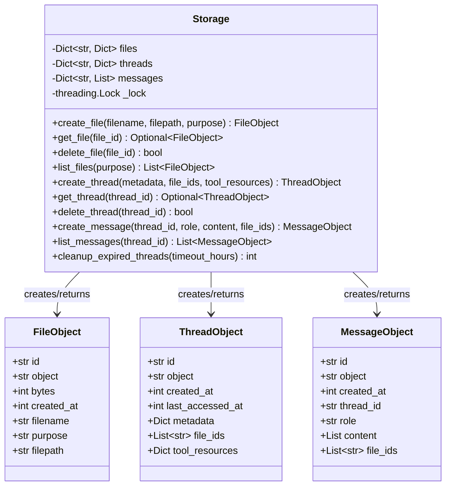
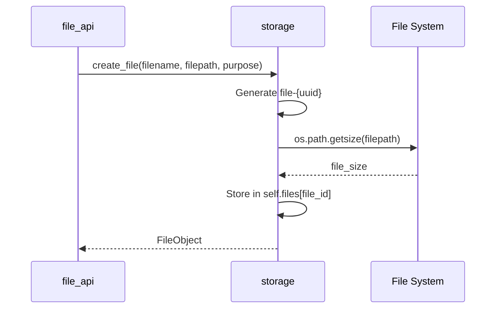
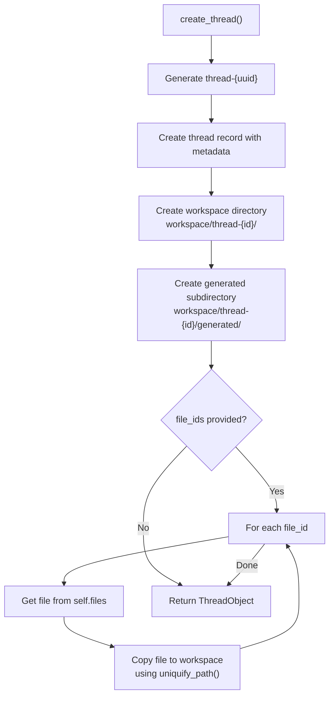
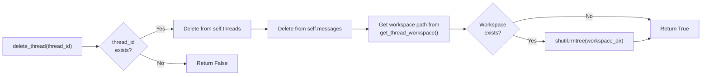
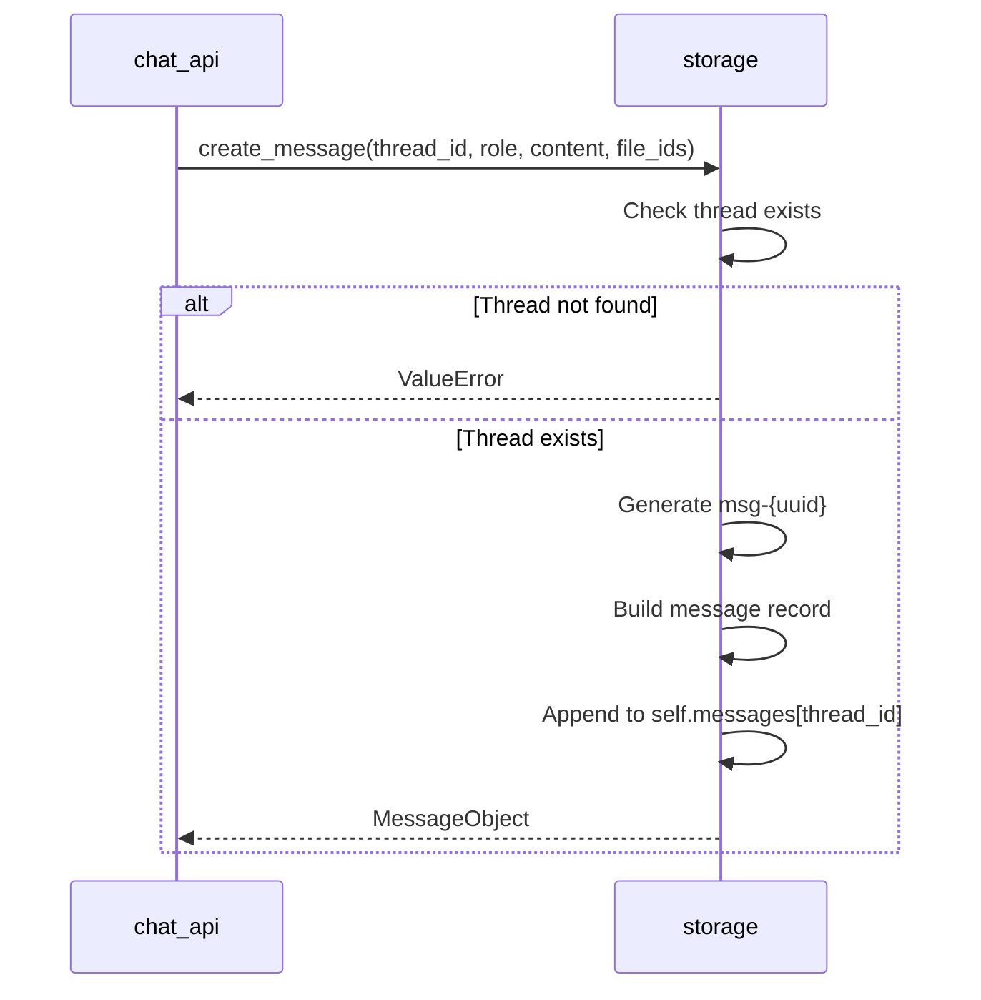
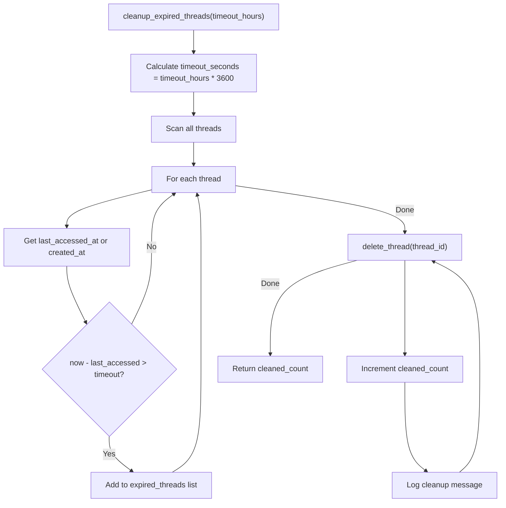
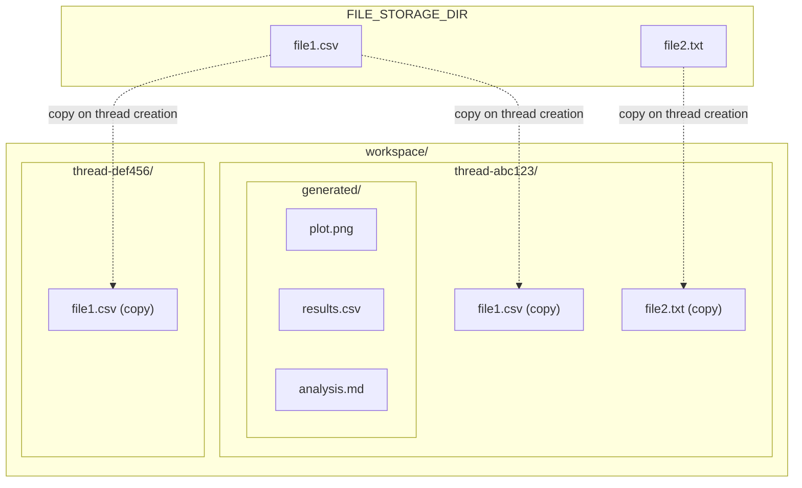

<!-- source: DeepWiki mcp.deepwiki.com · repo ruc-datalab/DeepAnalyze · page 6.4 Storage Layer · fetched 2026-10-26 -->

# Storage Layer

<details>
<summary>Relevant source files</summary>

The following files were used as context for generating this wiki page:

- [API/models_api.py](API/models_api.py)
- [API/storage.py](API/storage.py)

</details>


## Purpose and Scope

The Storage Layer provides in-memory data persistence for the DeepAnalyze API Server, managing files, threads, messages, and their associated filesystem workspaces. This layer implements OpenAI-compatible storage semantics while adding thread-based workspace isolation for code execution and file generation.

This document covers the `Storage` class implementation, its data structures, thread-safe operations, and workspace management. For information about the API endpoints that use this storage layer, see [File Management API](#6.7) and [Chat Completions API](#6.6). For details on how workspaces are used during code execution, see [Workspace and File Tracking](#6.6.2).

**Sources:** [API/storage.py:1-197]()

---

## Storage Architecture Overview

The storage layer is a singleton in-memory database that maintains three primary collections: files, threads, and messages. Each collection maps unique IDs to data records, with thread-safe access controlled by a single lock.

### Storage Class Structure



**Sources:** [API/storage.py:20-27](), [API/storage.py:196-197]()

---

## In-Memory Data Structures

The `Storage` class maintains three dictionaries for different entity types:

| Collection | Type | Key | Value | Purpose |
|------------|------|-----|-------|---------|
| `files` | `Dict[str, Dict[str, Any]]` | `file-{uuid}` | File metadata record | Stores uploaded file information and filesystem paths |
| `threads` | `Dict[str, Dict[str, Any]]` | `thread-{uuid}` | Thread metadata record | Stores conversation threads and associated file lists |
| `messages` | `Dict[str, List[Dict[str, Any]]]` | `thread-{uuid}` | List of message records | Stores conversation history per thread |

All operations are protected by a single `threading.Lock` instance to ensure thread-safe concurrent access.

**Sources:** [API/storage.py:23-27]()

---

## File Storage Operations

### Creating File Records

The `create_file()` method generates unique file IDs, records file metadata, and returns a `FileObject`:



**File ID Format:** `file-{24-character-hex}` (e.g., `file-a1b2c3d4e5f6789012345678`)

**File Record Structure:**
- `id`: Unique file identifier
- `object`: Always `"file"`
- `bytes`: File size in bytes
- `created_at`: Unix timestamp
- `filename`: Original filename
- `purpose`: File purpose (e.g., `"assistants"`)
- `filepath`: Absolute path to file in `FILE_STORAGE_DIR`

**Sources:** [API/storage.py:29-44]()

### Retrieving and Managing Files

| Method | Parameters | Returns | Description |
|--------|-----------|---------|-------------|
| `get_file()` | `file_id: str` | `Optional[FileObject]` | Retrieves file metadata by ID |
| `delete_file()` | `file_id: str` | `bool` | Deletes file record and filesystem file |
| `list_files()` | `purpose: Optional[str]` | `List[FileObject]` | Lists all files, optionally filtered by purpose |

The `delete_file()` method performs both in-memory and filesystem cleanup:

1. Removes the file from the `self.files` dictionary
2. Deletes the physical file from `FILE_STORAGE_DIR` using `os.remove()`
3. Returns `True` if successful, `False` if file not found

**Sources:** [API/storage.py:46-70]()

---

## Thread Storage Operations

Threads are the core workspace isolation mechanism in DeepAnalyze. Each thread has its own workspace directory where code executes and files are generated.

### Thread Creation and Workspace Initialization



**Thread Workspace Structure:**
```
workspace/
└── thread-{uuid}/
    ├── {uploaded_files}.csv
    ├── {uploaded_files}.txt
    └── generated/
        ├── plot.png
        ├── results.csv
        └── report.md
```

**Thread Record Structure:**
- `id`: Unique thread identifier (`thread-{uuid}`)
- `object`: Always `"thread"`
- `created_at`: Unix timestamp of creation
- `last_accessed_at`: Unix timestamp of last access (updated on `get_thread()`)
- `metadata`: User-provided metadata dictionary
- `file_ids`: List of file IDs associated with this thread
- `tool_resources`: Optional tool configuration

**Sources:** [API/storage.py:73-109]()

### File Copying to Thread Workspace

When a thread is created with `file_ids`, the storage layer automatically copies files from `FILE_STORAGE_DIR` to the thread's workspace:

1. Retrieves each file's metadata from `self.files[file_id]`
2. Gets the source filepath from the file record
3. Uses `uniquify_path()` to avoid filename conflicts
4. Copies file to `workspace/thread-{id}/{filename}` using `shutil.copy2()`

This ensures that code executed in the thread context has direct access to the uploaded files without needing to reference the original storage location.

**Sources:** [API/storage.py:100-107]()

### Thread Retrieval and Access Tracking

The `get_thread()` method implements automatic access time tracking:

```python
def get_thread(self, thread_id: str) -> Optional[ThreadObject]:
    with self._lock:
        if thread_id in self.threads:
            # Update last accessed time
            self.threads[thread_id]["last_accessed_at"] = int(time.time())
            return ThreadObject(**self.threads[thread_id])
        return None
```

This timestamp is used for automatic cleanup of inactive threads (see [Thread Lifecycle Management](#thread-lifecycle-management) below).

**Sources:** [API/storage.py:111-118]()

### Thread Deletion and Workspace Cleanup

The `delete_thread()` method performs comprehensive cleanup:



This ensures no orphaned data remains in memory or on disk.

**Sources:** [API/storage.py:120-132]()

---

## Message Storage Operations

Messages are stored per-thread in the `self.messages` dictionary, which maps `thread_id` to a list of message records.

### Message Creation

The `create_message()` method validates thread existence before creating messages:



**Message Record Structure:**
- `id`: Unique message identifier (`msg-{uuid}`)
- `object`: Always `"thread.message"`
- `created_at`: Unix timestamp
- `thread_id`: Parent thread identifier
- `role`: Either `"user"` or `"assistant"`
- `content`: List of content blocks (e.g., `[{"type": "text", "text": {"value": "..."}}]`)
- `file_ids`: List of file IDs attached to this message
- `assistant_id`: Always `None` (reserved for future use)
- `run_id`: Always `None` (reserved for future use)
- `metadata`: User-provided metadata dictionary

**Sources:** [API/storage.py:134-161]()

### Message Retrieval

The `list_messages()` method returns all messages for a given thread in chronological order:

| Parameter | Type | Description |
|-----------|------|-------------|
| `thread_id` | `str` | Thread identifier to list messages from |
| **Returns** | `List[MessageObject]` | List of messages in creation order |

If the thread doesn't exist in `self.messages`, an empty list is returned.

**Sources:** [API/storage.py:163-168]()

---

## Thread Lifecycle Management

### Automatic Cleanup of Expired Threads

The `cleanup_expired_threads()` method implements a time-based garbage collection mechanism:



**Default Timeout:** 12 hours (configurable via parameter)

**Cleanup Process:**
1. Iterates through all threads while holding the lock
2. Identifies threads not accessed within `timeout_hours`
3. Releases the lock before deletion to avoid long lock holds
4. Calls `delete_thread()` for each expired thread
5. Logs cleanup operations to stdout
6. Returns the count of successfully cleaned threads

This method is typically called by the admin API's cleanup endpoint.

**Sources:** [API/storage.py:171-193]()

---

## Thread Safety and Concurrency

All `Storage` methods acquire `self._lock` before accessing shared data structures:

```python
with self._lock:
    # Critical section: read/write shared data
    # Lock is automatically released on exit
```

### Lock Acquisition Patterns

| Operation Type | Lock Duration | Rationale |
|---------------|---------------|-----------|
| Read operations | Short (dictionary lookup) | Minimal contention |
| Write operations | Short (dictionary update) | Atomic in-memory operations |
| Thread creation | Medium (includes filesystem I/O) | Must be atomic to prevent race conditions |
| Thread cleanup | Released during deletion loop | Prevents blocking other operations during bulk cleanup |

The single-lock design is appropriate for the expected concurrency level (multiple API clients) and the in-memory nature of operations. For higher concurrency scenarios, more granular locking or lock-free data structures could be considered.

**Sources:** [API/storage.py:27](), [API/storage.py:31](), [API/storage.py:48](), [API/storage.py:80]()

---

## Integration with File System

The storage layer bridges in-memory records with persistent filesystem storage:

### Workspace Directory Management



### Utility Functions Used

The storage layer depends on utility functions from `utils.py`:

| Function | Purpose | Usage |
|----------|---------|-------|
| `get_thread_workspace(thread_id)` | Returns path to thread workspace directory | Used in `create_thread()` and `delete_thread()` |
| `uniquify_path(path)` | Ensures unique filenames by adding suffixes if needed | Used when copying files to avoid conflicts |

**Sources:** [API/storage.py:17](), [API/storage.py:96](), [API/storage.py:106](), [API/storage.py:128]()

---

## Global Storage Instance

The storage layer is instantiated as a module-level singleton:

```python
# Global storage instance
storage = Storage()
```

This singleton is imported and used across all API routers:
- `file_api.py`: File upload, retrieval, and deletion
- `chat_api.py`: Thread and message management during conversations
- `threads_api.py`: Thread lifecycle operations
- `admin_api.py`: Cleanup operations

**Benefits of Singleton Pattern:**
- Single source of truth for all storage operations
- Shared state across all API endpoints
- Simplified dependency injection

**Limitations:**
- In-memory storage is lost on server restart
- No persistence across deployments
- Limited to single-process deployments (not suitable for multi-process or distributed setups)

For production deployments requiring persistence or horizontal scaling, the `Storage` class could be replaced with a database-backed implementation implementing the same interface.

**Sources:** [API/storage.py:196-197]()

---

## Summary

The Storage Layer provides a simple, thread-safe in-memory persistence mechanism for the DeepAnalyze API Server. Key characteristics:

- **In-memory dictionaries** for fast access to files, threads, and messages
- **Thread-safe operations** using a single lock for all mutations
- **Workspace isolation** via thread-specific directories on the filesystem
- **Automatic file copying** from upload storage to thread workspaces
- **Access time tracking** for automatic cleanup of expired threads
- **OpenAI compatibility** through consistent data models and ID formats

This design prioritizes simplicity and performance for single-instance deployments while maintaining clean separation between API logic and data persistence.

**Sources:** [API/storage.py:1-197]()

---

