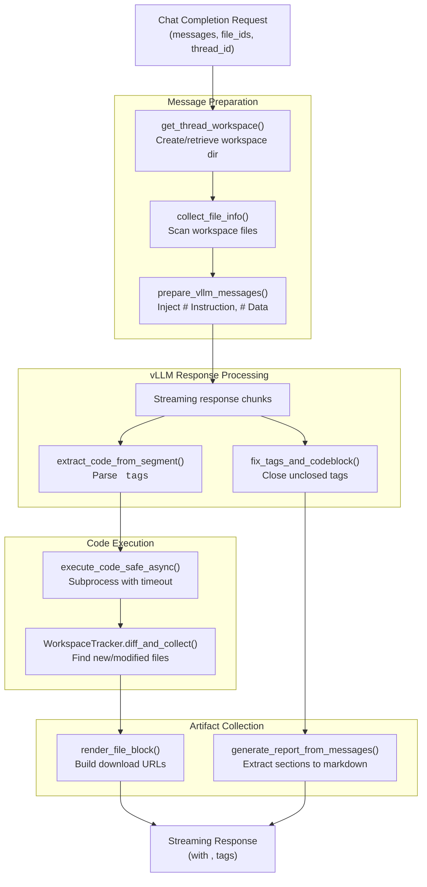
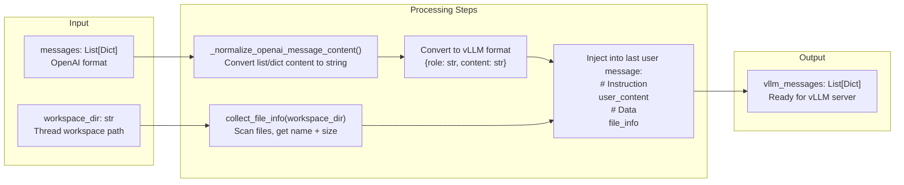
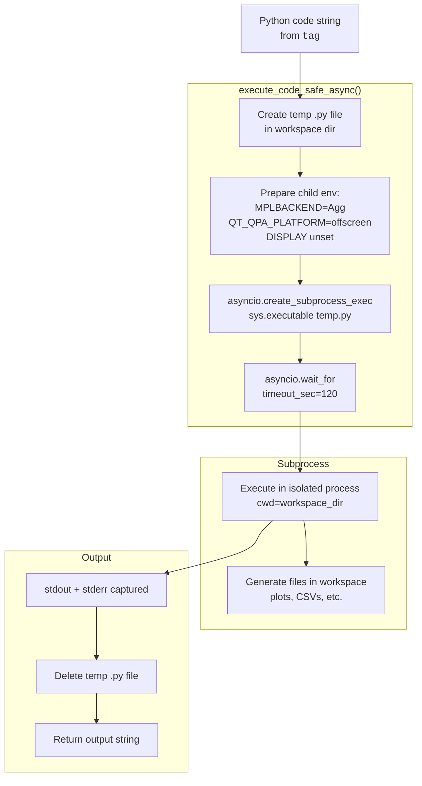
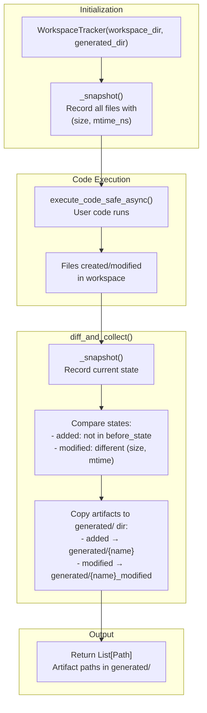
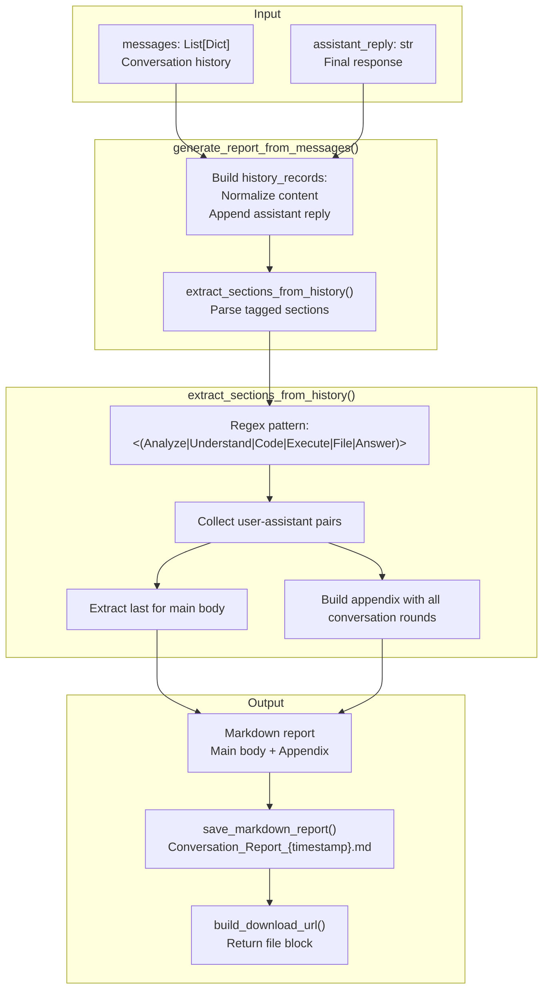
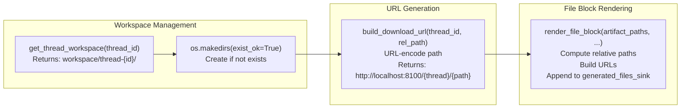
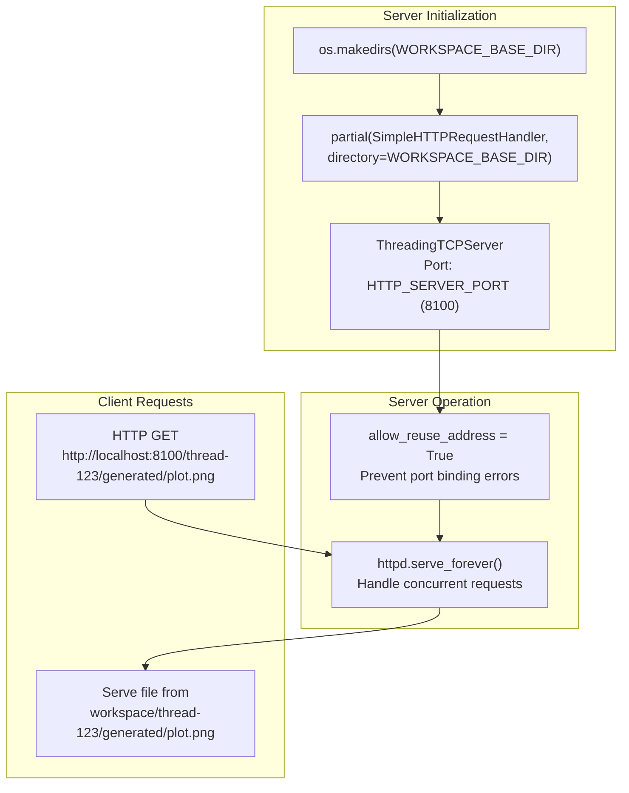

<!-- source: DeepWiki mcp.deepwiki.com · repo ruc-datalab/DeepAnalyze · page 6.5 Core Utilities · fetched 2026-10-26 -->

# Core Utilities

<details>
<summary>Relevant source files</summary>

The following files were used as context for generating this wiki page:

- [API/example/exampleOpenAI.py](API/example/exampleOpenAI.py)
- [API/utils.py](API/utils.py)

</details>


This document describes the core utility functions and classes in `API/utils.py` that support the API server's operations. These utilities handle critical tasks including message preparation, sandboxed code execution, workspace tracking, and report generation.

For information about how these utilities are called within API endpoints, see [Chat Completions API](#6.6). For the storage layer that manages threads and files, see [Storage Layer](#6.4). For configuration constants used by utilities, see [Configuration System](#6.2).

**Sources:** [API/utils.py:1-510]()

---

## Overview

The utilities module provides five main functional areas:

| Function Area | Key Components | Purpose |
|--------------|----------------|---------|
| **Message Preparation** | `prepare_vllm_messages()`, `collect_file_info()` | Transform OpenAI-format messages into vLLM format with file context injection |
| **Code Execution** | `execute_code_safe_async()`, `extract_code_from_segment()` | Execute Python code in isolated subprocesses with timeout protection |
| **Workspace Tracking** | `WorkspaceTracker` class | Monitor filesystem changes and collect generated artifacts |
| **Report Generation** | `extract_sections_from_history()`, `generate_report_from_messages()` | Extract structured content from conversations into Markdown reports |
| **File Management** | `build_download_url()`, `get_thread_workspace()`, `render_file_block()` | Manage workspace directories and construct file URLs |

**Sources:** [API/utils.py:1-510]()

---

## Utility Function Pipeline

The following diagram shows how core utilities integrate into the chat completion request flow:



**Sources:** [API/utils.py:26-127](), [API/utils.py:170-220](), [API/utils.py:350-410](), [API/utils.py:412-470]()

---

## Message Preparation

### Overview

The message preparation pipeline converts OpenAI-compatible messages into vLLM format while injecting workspace context. This enables the model to "see" uploaded files without explicit file content in prompts.

**Sources:** [API/utils.py:91-127]()

### prepare_vllm_messages Function



The function locates the last user message and wraps it with structured headings [API/utils.py:108-126]():

```
# Instruction
{original user content}

# Data
File 1:
{
    "name": "data.csv",
    "size": "42.3KB"
}

File 2:
{
    "name": "config.json",
    "size": "1.2KB"
}
```

**Key implementation details:**

- **Content Normalization** [API/utils.py:47-59](): The `_normalize_openai_message_content()` function handles OpenAI's complex content format where `content` can be a string, list of content items, or nested dictionaries. It extracts text from `type: "text"` items.

- **File Info Collection** [API/utils.py:71-86](): `collect_file_info()` scans the workspace directory, sorting files and formatting each with name and size in KB. This provides the model with file awareness without loading file contents into memory.

- **Template Injection** [API/utils.py:115-125](): The function always wraps user messages with `# Instruction` heading, and conditionally appends `# Data` section if workspace files exist.

**Sources:** [API/utils.py:91-127](), [API/utils.py:47-59](), [API/utils.py:71-86]()

---

## Code Execution System

### Sandboxed Execution Architecture



**Sources:** [API/utils.py:170-219]()

### Implementation Details

#### Async Execution with Timeout

The `execute_code_safe_async()` function provides non-blocking code execution [API/utils.py:170-219]():

1. **Temporary File Creation** [API/utils.py:177-181](): Creates a `.py` file in the workspace directory using `tempfile.mkstemp()`, ensuring the code executes in the correct context.

2. **Environment Configuration** [API/utils.py:183-186]():
   - `MPLBACKEND=Agg`: Ensures matplotlib uses non-interactive backend
   - `QT_QPA_PLATFORM=offscreen`: Prevents Qt from requiring display
   - `DISPLAY` removed: Prevents X11/GUI initialization

3. **Subprocess Execution** [API/utils.py:189-195](): Uses `asyncio.create_subprocess_exec()` to run Python interpreter with:
   - Current working directory set to workspace (enables relative file paths)
   - Stdout and stderr piped for capture
   - Modified environment for headless execution

4. **Timeout Protection** [API/utils.py:198-211](): Wraps `process.communicate()` with `asyncio.wait_for()`. On timeout, kills the process and returns timeout message.

5. **Cleanup** [API/utils.py:214-219](): Always attempts to delete the temporary `.py` file, even on error.

**Sources:** [API/utils.py:170-219]()

#### Code Extraction from Tags

The `extract_code_from_segment()` function parses code from model responses [API/utils.py:222-229]():

```python
# Matches: <Code>print("hello")</Code>
# Matches: <Code>```python\nprint("hello")\n```</Code>
# Returns: print("hello")
```

It handles two formats:
1. Direct code: `<Code>code_here</Code>`
2. Markdown-fenced: `<Code>```python\ncode_here\n```</Code>`

**Sources:** [API/utils.py:222-229]()

#### Tag Completion

The `fix_tags_and_codeblock()` function handles incomplete streaming responses [API/utils.py:232-251]():

- Detects unclosed `<Analyze>`, `<Understand>`, `<Code>`, `<Execute>`, or `<Answer>` tags
- For `<Code>` tags, also closes unclosed markdown code fences (````)
- Appends closing tags to enable proper parsing

This is critical for streaming scenarios where the model response may be cut off mid-generation.

**Sources:** [API/utils.py:232-251]()

---

## Workspace Tracking

### WorkspaceTracker Class

The `WorkspaceTracker` class monitors filesystem changes during code execution to automatically capture generated artifacts [API/utils.py:350-409]():



**Sources:** [API/utils.py:350-409]()

### Implementation Details

#### State Snapshots

The `_snapshot()` method [API/utils.py:359-367]() creates a dictionary mapping file paths to their state:

```python
{
    Path("/workspace/thread-123/data.csv").resolve(): (1024, 1234567890),
    Path("/workspace/thread-123/plot.png").resolve(): (8192, 1234567891),
    ...
}
```

Each entry stores `(file_size, modification_time_nanoseconds)` to detect both new files and modifications.

**Sources:** [API/utils.py:359-367]()

#### Diff and Collection

The `diff_and_collect()` method [API/utils.py:369-409]() performs file tracking:

1. **Snapshot After Execution** [API/utils.py:372-378](): Captures current workspace state using `rglob("*")` to recursively find all files.

2. **Identify Changes** [API/utils.py:380-384]():
   - **Added files**: Present in after_state but not before_state
   - **Modified files**: Present in both but with different (size, mtime) tuple

3. **Copy to Generated Folder** [API/utils.py:386-406]():
   - Added files: Copied as-is to `generated/{filename}`
   - Modified files: Copied with `_modified` suffix to preserve original
   - Skips files already in `generated/` directory to avoid recursion

4. **Update State** [API/utils.py:408](): Saves after_state as new before_state for next execution.

5. **Return Artifacts** [API/utils.py:409](): Returns resolved paths for all collected artifacts.

**Sources:** [API/utils.py:369-409]()

### Usage Pattern

Typical usage in chat API [API/chat_api.py]():

```python
# Before code execution
tracker = WorkspaceTracker(workspace_dir, f"{workspace_dir}/generated")

# Execute code (creates files in workspace)
await execute_code_safe_async(code, workspace_dir)

# Collect generated artifacts
artifact_paths = tracker.diff_and_collect()

# Build download URLs
file_block = render_file_block(artifact_paths, workspace_dir, thread_id)
```

**Sources:** [API/utils.py:350-409]()

---

## Report Generation

### Architecture

The report generation system extracts structured content from conversation history and formats it into Markdown documents with appendices.



**Sources:** [API/utils.py:412-470](), [API/utils.py:254-336]()

### extract_sections_from_history Function

This function parses conversation history into structured Markdown [API/utils.py:254-336]():

#### Processing Steps

1. **Collect Message Pairs** [API/utils.py:264-281](): Iterates through messages, pairing each user message with its subsequent assistant response. This preserves conversation flow for the appendix.

2. **Extract Last Answer** [API/utils.py:284-304](): Uses regex to find all `<Answer>...</Answer>` tags in assistant messages. The content from the last `<Answer>` tag becomes the main report body.

3. **Build Appendix** [API/utils.py:306-327](): For each user-assistant pair:
   - Adds `## 对话轮次 {round_number}` heading
   - Includes user instruction under `### 用户指令`
   - Parses assistant response tags into `#### 步骤 {step}: {tag_name}` sections
   - Captures all tag types: `Analyze`, `Understand`, `Code`, `Execute`, `File`, `Answer`

4. **Format Output** [API/utils.py:329-336](): Combines main body with appendix, separated by `\newpage` (for PDF conversion).

**Example output structure:**
```markdown
{Last <Answer> content}

\newpage

# 附录：完整对话过程

## 对话轮次 1

### 用户指令
{User message 1}

### 助手响应

#### 步骤 1: Analyze
{Analyze section content}

#### 步骤 2: Code
{Code section content}

...
```

**Sources:** [API/utils.py:254-336]()

### generate_report_from_messages Function

Main entry point for report generation [API/utils.py:412-470]():

1. **Normalize Message History** [API/utils.py:433-440](): Converts raw API messages into consistent format using `_normalize_openai_message_content()`, then appends the final assistant reply.

2. **Extract Structured Content** [API/utils.py:442-448](): Calls `extract_sections_from_history()` to parse tags. Falls back to placeholder text if no tags found.

3. **Save Report File** [API/utils.py:450-454](): Creates `generated/` directory and saves with timestamp: `Conversation_Report_YYYYMMDD_HHMMSS.md`

4. **Build Download URL** [API/utils.py:456-462](): Constructs relative path from workspace and generates download URL using `build_download_url()`.

5. **Track Generated File** [API/utils.py:464-465](): If `generated_files_sink` list provided, appends file metadata `{"name": ..., "url": ...}`.

6. **Error Handling** [API/utils.py:468-470](): Catches and logs any report generation errors, returning empty string on failure.

**Sources:** [API/utils.py:412-470]()

---

## File Management Utilities

### Workspace and URL Functions



**Sources:** [API/utils.py:26-40](), [API/utils.py:471-492]()

### get_thread_workspace

Creates and returns the workspace directory for a thread [API/utils.py:26-30]():

```python
def get_thread_workspace(thread_id: str) -> str:
    workspace_dir = os.path.join(WORKSPACE_BASE_DIR, thread_id)
    os.makedirs(workspace_dir, exist_ok=True)
    return workspace_dir
```

- Constructs path: `{WORKSPACE_BASE_DIR}/{thread_id}/`
- Creates directory structure if missing
- Returns absolute path string

**Sources:** [API/utils.py:26-30]()

### build_download_url

Generates HTTP download URL for files [API/utils.py:33-39]():

```python
def build_download_url(thread_id: str, rel_path: str) -> str:
    try:
        encoded = quote(f"{thread_id}/{rel_path}", safe="/")
    except Exception:
        encoded = f"{thread_id}/{rel_path}"
    return f"http://localhost:{HTTP_SERVER_PORT}/{encoded}"
```

- Uses `urllib.parse.quote()` for URL encoding with `/` preserved
- Falls back to unencoded path on error
- Constructs full URL: `http://localhost:8100/{thread_id}/{rel_path}`

**Sources:** [API/utils.py:33-39]()

### render_file_block

Converts artifact paths to download URLs and tracks metadata [API/utils.py:471-492]():

1. **Compute Relative Paths** [API/utils.py:482-486](): For each artifact, calculates path relative to workspace directory. Falls back to filename if relative path calculation fails.

2. **Generate URLs** [API/utils.py:487](): Calls `build_download_url()` with thread_id and relative path.

3. **Track Metadata** [API/utils.py:489-491](): If `generated_files_sink` list provided, appends `{"name": filename, "url": download_url}` for each unique file.

4. **Return Value** [API/utils.py:492](): Currently returns empty string (previously returned formatted `<File>` block for streaming).

**Sources:** [API/utils.py:471-492]()

---

## HTTP File Server

### start_http_server Function

Launches a threaded HTTP server to serve workspace files [API/utils.py:494-510]():



**Sources:** [API/utils.py:494-510]()

### Implementation Details

1. **Directory Serving** [API/utils.py:495-501](): Uses `functools.partial()` to create a `SimpleHTTPRequestHandler` bound to `WORKSPACE_BASE_DIR`. All HTTP paths are resolved relative to this directory.

2. **Threading Support** [API/utils.py:503](): `ThreadingTCPServer` handles concurrent file downloads, essential for streaming multiple files or serving multiple users.

3. **Port Reuse** [API/utils.py:504](): `allow_reuse_address = True` prevents "Address already in use" errors when restarting the server.

4. **Graceful Shutdown** [API/utils.py:506-510](): Catches `KeyboardInterrupt` and calls `httpd.shutdown()` for clean termination.

**Typical deployment:** The HTTP server runs as a background thread or separate process alongside the FastAPI application [API/main.py](), serving files on port 8100 while the API runs on port 8200.

**Sources:** [API/utils.py:494-510]()

---

## Utility Integration Examples

### Example: Complete Message Processing Flow

From the OpenAI SDK example [API/example/exampleOpenAI.py:90-193](), here's how utilities integrate:

```
1. Upload file → File API stores in FILE_STORAGE_DIR
2. Send chat request with file_ids
3. API calls get_thread_workspace(thread_id) → create workspace/thread-{id}/
4. API copies files from FILE_STORAGE_DIR to thread workspace
5. API calls prepare_vllm_messages(messages, workspace_dir)
   ↓
   collect_file_info(workspace_dir) → scan files
   ↓
   Inject file info into last user message
6. Stream response from vLLM
7. On <Code> tag: extract_code_from_segment()
8. Create WorkspaceTracker, execute_code_safe_async()
9. tracker.diff_and_collect() → find generated plots/CSVs
10. render_file_block() → build download URLs
11. At conversation end: generate_report_from_messages()
12. Frontend downloads artifacts via HTTP server (port 8100)
```

**Sources:** [API/example/exampleOpenAI.py:90-193](), [API/utils.py:26-510]()

### Example: Multi-Turn Workflow

Multi-turn conversations leverage workspace persistence [API/example/exampleOpenAI.py:90-193]():

**Turn 1:**
- `get_thread_workspace(new_thread_id)` creates workspace
- Files uploaded and copied to workspace
- Code execution generates artifacts in workspace/generated/
- `thread_id` returned to client

**Turn 2:**
- Client sends `thread_id` in request
- `get_thread_workspace(thread_id)` retrieves existing workspace
- `collect_file_info()` sees original files + previously generated artifacts
- New code execution can reference old files
- Additional artifacts added to same workspace/generated/ folder
- Same `thread_id` returned, maintaining conversation context

This enables iterative analysis where each turn builds on previous results.

**Sources:** [API/example/exampleOpenAI.py:90-193](), [API/utils.py:26-30](), [API/utils.py:71-86]()

---

## Summary

The core utilities module provides the foundational infrastructure for DeepAnalyze's autonomous data analysis capabilities:

| Utility | Key Functions | Purpose |
|---------|---------------|---------|
| **Message Prep** | `prepare_vllm_messages()`, `collect_file_info()` | Context injection for file-aware generation |
| **Code Execution** | `execute_code_safe_async()`, `extract_code_from_segment()` | Secure, isolated Python execution with timeout |
| **Workspace Tracking** | `WorkspaceTracker.diff_and_collect()` | Automatic artifact capture from code execution |
| **Report Generation** | `extract_sections_from_history()`, `generate_report_from_messages()` | Structured documentation from conversations |
| **File Management** | `get_thread_workspace()`, `build_download_url()`, `render_file_block()` | Thread isolation and artifact serving |
| **HTTP Server** | `start_http_server()` | Static file serving for frontend downloads |

These utilities are invoked by the chat API to create a seamless agentic loop where the model generates code, the system executes it, tracks results, and feeds outputs back into the conversation. The workspace persistence mechanism enables stateful multi-turn workflows essential for complex data analysis tasks.

**Sources:** [API/utils.py:1-510]()

---

