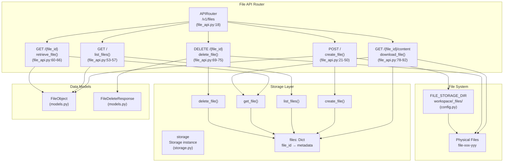
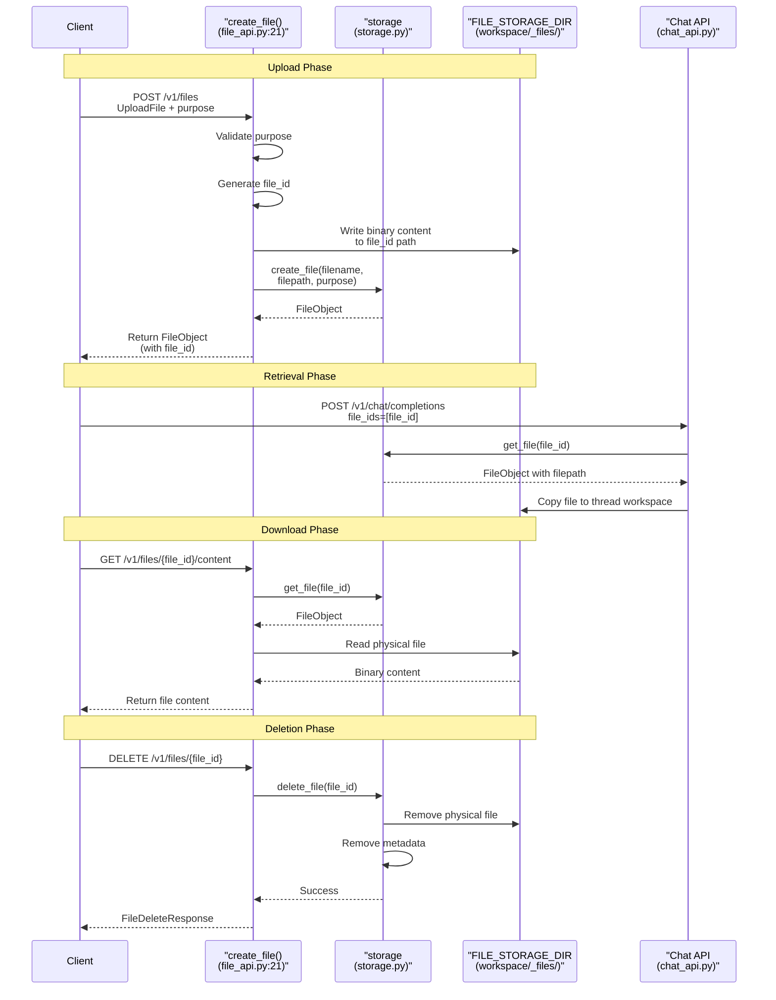
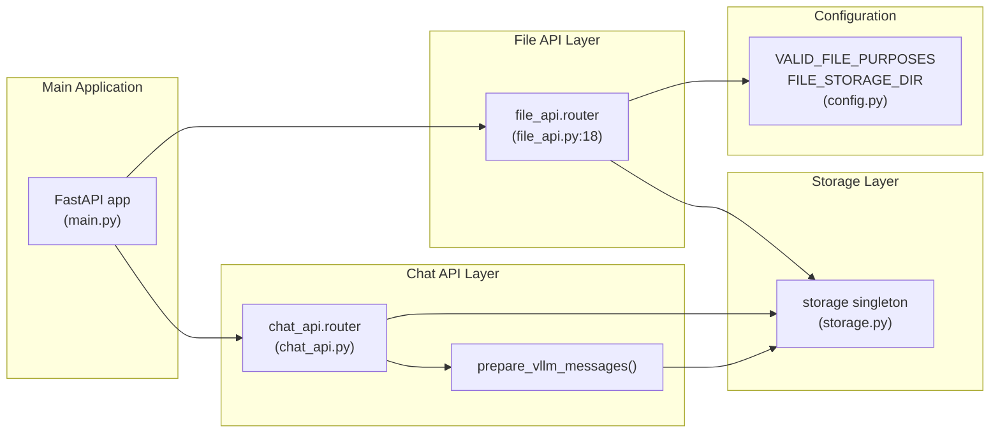

<!-- source: DeepWiki mcp.deepwiki.com · repo ruc-datalab/DeepAnalyze · page 6.7 File Management API · fetched 2026-10-26 -->

# File Management API

<details>
<summary>Relevant source files</summary>

The following files were used as context for generating this wiki page:

- [API/__init__.py](API/__init__.py)
- [API/admin_api.py](API/admin_api.py)
- [API/example/Simpson.csv](API/example/Simpson.csv)
- [API/file_api.py](API/file_api.py)
- [API/start_server.py](API/start_server.py)

</details>


## Purpose and Scope

This document provides technical documentation for the File Management API endpoints exposed at `/v1/files`. These endpoints handle file upload, storage, retrieval, listing, and deletion operations that are foundational to DeepAnalyze's data analysis capabilities. Files uploaded through this API can be attached to chat completion requests for analysis.

For information about using these endpoints in client applications, see [File Upload and Management](#4.3). For information about attaching files to chat requests, see [Chat Completions API](#3.3).

**Sources:** [API/file_api.py:1-4]()

## Overview

The File Management API is implemented as a FastAPI router that exposes five primary endpoints for file operations. The API follows OpenAI's file management specification for compatibility with existing OpenAI SDK clients. All endpoints are prefixed with `/v1/files` and operate on files stored in the workspace file system.

The API maintains two layers of file information:
- **Metadata**: Stored in-memory via the `Storage` class, containing file IDs, filenames, sizes, timestamps, and purposes
- **Physical Files**: Stored on disk in `FILE_STORAGE_DIR` (typically `workspace/_files/`) for persistent access

**Sources:** [API/file_api.py:1-18]()

## System Architecture



**Figure 1: File API Architecture and Component Relationships**

This diagram illustrates how the five endpoint handlers in `file_api.py` interact with the storage layer and file system. The router delegates business logic to the `Storage` class while managing physical file I/O directly.

**Sources:** [API/file_api.py:1-92]()

## Endpoint Specifications

### POST /v1/files - File Upload

**Handler Function:** `create_file()` [API/file_api.py:21-50]()

Uploads a file to the DeepAnalyze server and stores it for later use in chat completions.

#### Request Parameters

| Parameter | Type | Location | Required | Description |
|-----------|------|----------|----------|-------------|
| `file` | `UploadFile` | multipart/form-data | Yes | Binary file content |
| `purpose` | `str` | form field | No | File purpose, default: "file-extract" |

The `purpose` parameter must be one of the values specified in `VALID_FILE_PURPOSES` [API/file_api.py:28-32](). Invalid purposes result in a 400 error.

#### Processing Flow

1. **Validation**: Purpose is validated against `VALID_FILE_PURPOSES` [API/file_api.py:28-32]()
2. **ID Generation**: A unique file ID is generated using the pattern `file-{sanitized_filename}-{random_hex}` [API/file_api.py:36]()
3. **Physical Storage**: File content is written to `FILE_STORAGE_DIR/file_id` [API/file_api.py:35-42]()
4. **Metadata Storage**: File metadata is stored via `storage.create_file()` [API/file_api.py:44]()
5. **Cleanup on Failure**: If any step fails, the physical file is removed [API/file_api.py:48-49]()

#### Response Model

Returns a `FileObject` containing:
- `id`: Unique file identifier
- `object`: Always "file"
- `bytes`: File size in bytes
- `created_at`: Unix timestamp
- `filename`: Original filename
- `purpose`: File purpose

**Sources:** [API/file_api.py:21-50](), [API/README.md:201-221]()

### GET /v1/files - List Files

**Handler Function:** `list_files()` [API/file_api.py:53-57]()

Lists all uploaded files, optionally filtered by purpose.

#### Request Parameters

| Parameter | Type | Location | Required | Description |
|-----------|------|----------|----------|-------------|
| `purpose` | `str` | query | No | Filter files by purpose |

#### Response Format

Returns a dictionary with:
- `object`: Always "list"
- `data`: Array of `FileObject` instances

The filtering is delegated to `storage.list_files(purpose=purpose)` [API/file_api.py:56]().

**Sources:** [API/file_api.py:53-57](), [API/README.md:223-245]()

### GET /v1/files/{file_id} - Retrieve File Metadata

**Handler Function:** `retrieve_file()` [API/file_api.py:60-66]()

Retrieves metadata for a specific file without downloading its content.

#### Request Parameters

| Parameter | Type | Location | Required | Description |
|-----------|------|----------|----------|-------------|
| `file_id` | `str` | path | Yes | Unique file identifier |

#### Response

Returns a `FileObject` if found, or raises `HTTPException(404)` if the file doesn't exist [API/file_api.py:64-65]().

**Sources:** [API/file_api.py:60-66]()

### DELETE /v1/files/{file_id} - Delete File

**Handler Function:** `delete_file()` [API/file_api.py:69-75]()

Deletes a file and its metadata from the system.

#### Request Parameters

| Parameter | Type | Location | Required | Description |
|-----------|------|----------|----------|-------------|
| `file_id` | `str` | path | Yes | Unique file identifier |

#### Response Model

Returns a `FileDeleteResponse` containing:
- `id`: The deleted file's ID
- `object`: Always "file"
- `deleted`: Always `true`

The deletion is handled by `storage.delete_file()` [API/file_api.py:72](), which removes both metadata and the physical file.

**Sources:** [API/file_api.py:69-75](), [API/README.md:258-272]()

### GET /v1/files/{file_id}/content - Download File Content

**Handler Function:** `download_file()` [API/file_api.py:78-92]()

Downloads the actual binary content of a previously uploaded file.

#### Request Parameters

| Parameter | Type | Location | Required | Description |
|-----------|------|----------|----------|-------------|
| `file_id` | `str` | path | Yes | Unique file identifier |

#### Processing Flow

1. **Metadata Retrieval**: Fetches file metadata via `storage.get_file()` [API/file_api.py:81-83]()
2. **Filepath Lookup**: Retrieves physical file path from `storage.files[file_id]` [API/file_api.py:85]()
3. **Existence Check**: Verifies the physical file exists [API/file_api.py:86-87]()
4. **Content Delivery**: Reads and returns file content as `application/octet-stream` [API/file_api.py:89-92]()

#### Response

Returns raw binary content with media type `application/octet-stream`. Raises `HTTPException(404)` if either the metadata or physical file is missing.

**Sources:** [API/file_api.py:78-92](), [API/README.md:247-256]()

## File Lifecycle and Data Flow



**Figure 2: File Lifecycle Through API Endpoints**

This sequence diagram shows the complete lifecycle of a file from upload through usage in chat completions to eventual deletion. Note that the Chat API retrieves files from storage and copies them to thread-specific workspaces for isolated execution.

**Sources:** [API/file_api.py:21-92]()

## File ID Generation and Storage Structure

### File ID Format

File IDs are generated using a deterministic pattern [API/file_api.py:36]():

```
file-{sanitized_filename}-{random_hex}
```

Where:
- `sanitized_filename`: First 8 characters of filename with `.` and `_` replaced by `-`
- `random_hex`: 4 random bytes encoded as hex (8 characters)

Example: `data.csv` → `file-data-csv-a3f8b2c1`

### Storage Locations

| Data Type | Location | Access Pattern |
|-----------|----------|----------------|
| Physical Files | `workspace/_files/{file_id}` | Direct filesystem I/O |
| Metadata | In-memory `storage.files` dict | Via `Storage` class methods |
| Thread Copies | `workspace/thread-{id}/{filename}` | Copied during chat initialization |

**Sources:** [API/file_api.py:35-37]()

## Error Handling

The File API implements standardized error responses:

| Status Code | Condition | Endpoint(s) |
|-------------|-----------|-------------|
| 400 | Invalid `purpose` parameter | POST /v1/files |
| 404 | File ID not found in metadata | GET, DELETE, GET /content |
| 404 | Physical file missing | GET /content |
| 500 | File write/read failure | POST /v1/files |

All errors are raised as `HTTPException` instances [API/file_api.py:29-30, 47, 50, 65, 74, 83, 87]().

### Error Recovery

The `create_file` handler implements cleanup on failure [API/file_api.py:47-50]():
```python
except Exception as e:
    # Clean up file if creation failed
    if os.path.exists(file_path):
        os.remove(file_path)
    raise HTTPException(status_code=500, detail=str(e))
```

This ensures no orphaned files remain on disk if metadata creation fails.

**Sources:** [API/file_api.py:47-50]()

## Integration with Other Components



**Figure 3: File API Integration Points**

The File API router is registered with the main FastAPI application and shares the `storage` singleton with other API components. The Chat API retrieves uploaded files to inject their content into messages.

**Sources:** [API/file_api.py:14, 18]()

## OpenAI Compatibility

The File Management API is designed for compatibility with OpenAI's file management specification:

| Feature | OpenAI Spec | DeepAnalyze Implementation |
|---------|-------------|---------------------------|
| File Upload | POST /v1/files | ✓ Fully compatible |
| List Files | GET /v1/files | ✓ Fully compatible |
| Retrieve File | GET /v1/files/{id} | ✓ Fully compatible |
| Delete File | DELETE /v1/files/{id} | ✓ Fully compatible |
| Download Content | GET /v1/files/{id}/content | ✓ Fully compatible |
| Purpose Parameter | Required field | ✓ Supported with validation |
| File Object Schema | Standard fields | ✓ Uses same schema |

This compatibility allows clients to use the official OpenAI Python SDK without modification.

**Sources:** [API/file_api.py:1-4](), [API/README.md:34-63]()

## Thread Safety and Concurrency

File operations are thread-safe due to the `Storage` class's use of `threading.Lock` for all operations. However, physical file I/O operations in the endpoint handlers [API/file_api.py:35-42, 89-92]() occur outside the storage lock, relying on the operating system's file locking mechanisms.

**Concurrent Upload Safety**: Multiple uploads can occur simultaneously. Each receives a unique file ID due to the random hex component [API/file_api.py:36]().

**Concurrent Read Safety**: Multiple clients can read the same file simultaneously. The file content is read in its entirety [API/file_api.py:89-90]() rather than streamed, preventing partial read issues.

**Sources:** [API/file_api.py:36, 40-42, 89-92]()

---

