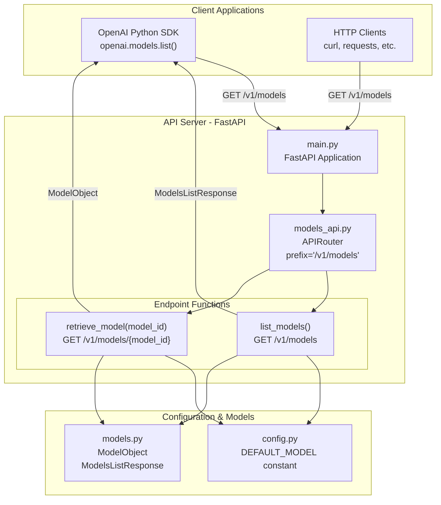
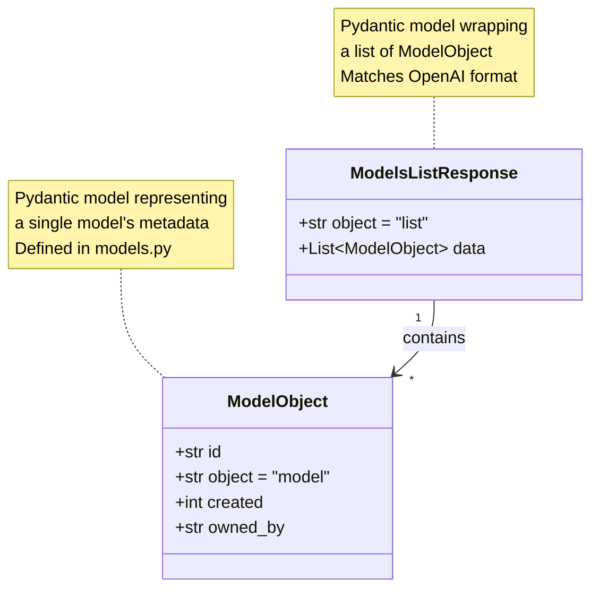
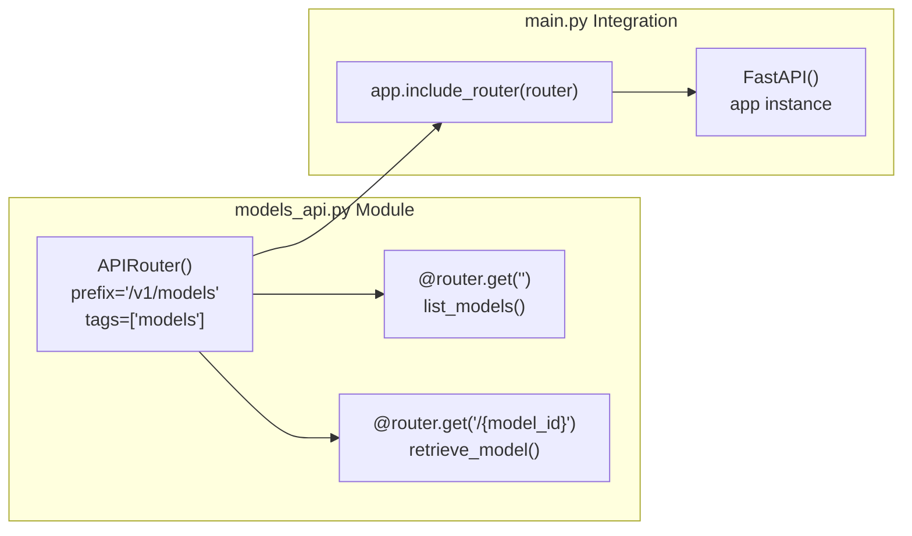
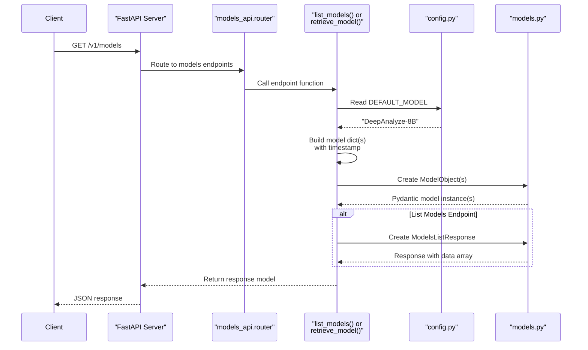

<!-- source: DeepWiki mcp.deepwiki.com · repo ruc-datalab/DeepAnalyze · page 6.8 Models API · fetched 2026-10-26 -->

# Models API

<details>
<summary>Relevant source files</summary>

The following files were used as context for generating this wiki page:

- [API/models_api.py](API/models_api.py)
- [API/storage.py](API/storage.py)

</details>


## Purpose and Scope

The Models API provides OpenAI-compatible endpoints for listing available models and retrieving model information. This documentation covers the `/v1/models` endpoints that return metadata about models served by the DeepAnalyze API Server.

For information about the underlying model deployment and vLLM configuration, see [vLLM Server Setup](#4.1). For details about making chat completion requests using these models, see [Chat Completions API](#6.6). For the Pydantic data structures used by this API, see [Data Models](#6.3).

**Sources:** [API/models_api.py:1-68]()

---

## Overview

The Models API is a lightweight router module that exposes two OpenAI-compatible endpoints. Unlike other API components that interact with storage or external services, the Models API returns static model metadata based on the `DEFAULT_MODEL` constant from the configuration system.

The API is designed for compatibility with OpenAI client libraries, which query the `/v1/models` endpoint to discover available models before making chat completion requests. DeepAnalyze currently serves a single model (DeepAnalyze-8B), though the implementation supports expansion to multiple models in the future.

**Key Characteristics:**
- **Stateless**: Does not depend on the storage layer or filesystem
- **Simple**: Returns hardcoded model metadata with timestamps
- **OpenAI-Compatible**: Matches the response format of OpenAI's Models API
- **Extensible**: Designed to support multiple models via list expansion

**Sources:** [API/models_api.py:1-68]()

---

## API Architecture



**Diagram: Models API Request Flow**

This diagram shows the complete request path from client to response. The `models_api.py` module defines an `APIRouter` with prefix `/v1/models` that is included in the main FastAPI application via `main.py`. Both endpoint functions reference `DEFAULT_MODEL` from `config.py` and return Pydantic models defined in `models.py`.

**Sources:** [API/models_api.py:1-68](), [API/main.py]()

---

## Endpoint Reference

### List Models

**Endpoint:** `GET /v1/models`

**Function:** `list_models()`

**Purpose:** Returns a list of all available models that can be used with the chat completions API.

**Request:** No parameters required.

**Response Model:** `ModelsListResponse`

**Response Format:**
```json
{
  "object": "list",
  "data": [
    {
      "id": "DeepAnalyze-8B",
      "object": "model",
      "created": 1704067200,
      "owned_by": "deepanalyze"
    }
  ]
}
```

**Implementation Details:**

The function constructs a hardcoded list of available models at [API/models_api.py:26-38](). Currently, only `DEFAULT_MODEL` is returned, but the structure supports adding additional models by extending the `available_models` list:

```python
available_models = [
    {
        "id": DEFAULT_MODEL,
        "created": int(time.time()),
        "owned_by": "deepanalyze"
    },
    # Future models can be added here
]
```

Each model dictionary is converted to a `ModelObject` Pydantic model at [API/models_api.py:40](), then wrapped in a `ModelsListResponse` at [API/models_api.py:42-45]().

**Sources:** [API/models_api.py:19-45]()

---

### Retrieve Model

**Endpoint:** `GET /v1/models/{model_id}`

**Function:** `retrieve_model(model_id: str)`

**Purpose:** Returns metadata about a specific model identified by its model ID.

**Request Parameters:**

| Parameter | Type | Location | Description |
|-----------|------|----------|-------------|
| `model_id` | string | path | The model identifier (e.g., "DeepAnalyze-8B") |

**Response Model:** `ModelObject`

**Response Format:**
```json
{
  "id": "DeepAnalyze-8B",
  "object": "model",
  "created": 1704067200,
  "owned_by": "deepanalyze"
}
```

**Implementation Details:**

The function checks if the requested `model_id` matches `DEFAULT_MODEL` at [API/models_api.py:55-60](). If it matches, it returns a `ModelObject` with the requested ID. 

For compatibility with OpenAI clients that may query arbitrary model names, the function returns a valid `ModelObject` for any requested model ID at [API/models_api.py:64-68](), even if it doesn't exist in the system. This permissive behavior prevents client errors while maintaining API compatibility.

**Sources:** [API/models_api.py:48-68]()

---

## Data Models



**Diagram: Models API Data Structures**

### ModelObject

The `ModelObject` Pydantic model represents a single model's metadata. It includes:

- **`id`**: The model identifier string (e.g., "DeepAnalyze-8B")
- **`object`**: Always set to "model" for type identification
- **`created`**: Unix timestamp of when the model was created/added
- **`owned_by`**: Owner organization string (e.g., "deepanalyze")

This structure matches the OpenAI API specification for model objects, ensuring compatibility with OpenAI client libraries.

### ModelsListResponse

The `ModelsListResponse` Pydantic model wraps a list of `ModelObject` instances. It includes:

- **`object`**: Always set to "list" to indicate this is a collection
- **`data`**: Array of `ModelObject` instances

This structure matches the OpenAI API specification for list responses, enabling seamless integration with existing OpenAI SDKs.

**Sources:** [API/models_api.py:12](), [API/models.py]()

---

## Router Configuration



**Diagram: Router Registration and URL Structure**

The router is created at [API/models_api.py:16]() with the prefix `/v1/models` and the tag `models` for API documentation grouping. This prefix is combined with the route decorators:

- `@router.get("")` at [API/models_api.py:19]() → Full path: `GET /v1/models`
- `@router.get("/{model_id}")` at [API/models_api.py:48]() → Full path: `GET /v1/models/{model_id}`

The router is included in the main FastAPI application in `main.py`, making these endpoints available at the server's base URL (typically `http://localhost:8200`).

**Sources:** [API/models_api.py:16]()

---

## OpenAI Compatibility

The Models API is designed for drop-in compatibility with OpenAI's client libraries. This enables users to use the official `openai` Python package or other OpenAI-compatible tools without modification.

### Using with OpenAI Python SDK

```python
from openai import OpenAI

# Point client to DeepAnalyze API Server
client = OpenAI(
    base_url="http://localhost:8200/v1",
    api_key="dummy-key"  # DeepAnalyze uses dummy keys for local deployment
)

# List all available models
models = client.models.list()
for model in models.data:
    print(f"Model ID: {model.id}")
    print(f"Created: {model.created}")
    print(f"Owned by: {model.owned_by}")

# Retrieve specific model
model = client.models.retrieve("DeepAnalyze-8B")
print(f"Retrieved: {model.id}")
```

### Using with HTTP Requests

**List Models:**
```bash
curl http://localhost:8200/v1/models \
  -H "Authorization: Bearer dummy-key"
```

**Retrieve Model:**
```bash
curl http://localhost:8200/v1/models/DeepAnalyze-8B \
  -H "Authorization: Bearer dummy-key"
```

The API accepts any value for the `Authorization` header since DeepAnalyze operates without authentication in local deployments. For production deployments, authentication should be added via middleware or a reverse proxy.

**Sources:** [API/models_api.py:1-68]()

---

## Implementation Flow



**Diagram: Request Processing Sequence**

This sequence diagram illustrates the complete flow from client request to JSON response:

1. **Client Request:** A client sends a GET request to `/v1/models` or `/v1/models/{model_id}`
2. **Routing:** FastAPI matches the route to the `models_api.router` based on the URL prefix
3. **Endpoint Invocation:** The appropriate function (`list_models` or `retrieve_model`) is called
4. **Configuration Access:** The function reads `DEFAULT_MODEL` from [config.py]()
5. **Model Construction:** A dictionary with model metadata is created, including a current timestamp via `time.time()`
6. **Pydantic Validation:** The dictionary is validated and converted to a `ModelObject` Pydantic model
7. **Response Wrapping:** For list endpoints, multiple `ModelObject` instances are wrapped in a `ModelsListResponse`
8. **JSON Serialization:** FastAPI automatically serializes the Pydantic model to JSON
9. **Client Response:** The JSON is returned with appropriate HTTP headers

**Sources:** [API/models_api.py:19-68]()

---

## Extension Points

While the current implementation serves a single model, the code structure supports future expansion:

### Adding New Models

To add additional models, extend the `available_models` list in `list_models()`:

```python
available_models = [
    {
        "id": DEFAULT_MODEL,
        "created": int(time.time()),
        "owned_by": "deepanalyze"
    },
    {
        "id": "DeepAnalyze-8B-FineTuned",
        "created": int(time.time()),
        "owned_by": "deepanalyze"
    },
    {
        "id": "DeepAnalyze-70B",
        "created": int(time.time()),
        "owned_by": "deepanalyze"
    },
]
```

The commented example at [API/models_api.py:33-37]() demonstrates this pattern.

### Model Validation

The `retrieve_model()` function currently accepts any model ID at [API/models_api.py:64-68](). For production deployments, you may want to add validation:

```python
@router.get("/{model_id}", response_model=ModelObject)
async def retrieve_model(model_id: str):
    # Validate against a list of allowed models
    allowed_models = [DEFAULT_MODEL, "DeepAnalyze-8B-FineTuned", ...]
    if model_id not in allowed_models:
        raise HTTPException(status_code=404, detail=f"Model {model_id} not found")
    
    return ModelObject(
        id=model_id,
        created=int(time.time()),
        owned_by="deepanalyze"
    )
```

### Dynamic Model Discovery

For systems with multiple vLLM servers or dynamic model loading, the Models API could be enhanced to query actual model availability:

```python
async def list_models():
    # Query vLLM server for available models
    async with httpx.AsyncClient() as client:
        response = await client.get(f"{VLLM_URL}/v1/models")
        vllm_models = response.json()["data"]
    
    # Transform vLLM model format to DeepAnalyze format
    available_models = [
        {
            "id": model["id"],
            "created": model["created"],
            "owned_by": "deepanalyze"
        }
        for model in vllm_models
    ]
    
    return ModelsListResponse(object="list", data=[ModelObject(**m) for m in available_models])
```

**Sources:** [API/models_api.py:26-68]()

---

## Configuration Dependencies

The Models API has minimal configuration dependencies:

| Constant | File | Purpose | Default Value |
|----------|------|---------|---------------|
| `DEFAULT_MODEL` | config.py | The primary model identifier returned by the API | "DeepAnalyze-8B" |

The `DEFAULT_MODEL` constant is imported at [API/models_api.py:11]() and used in both endpoint functions to identify the model served by the system. This provides a single source of truth for the model name across the API server.

**Sources:** [API/models_api.py:11](), [API/config.py]()

---

## Relationship to Other Components

The Models API is the simplest component in the API server architecture, but it plays an important role in the overall system:

**Relationship to Chat Completions API:**
- The Chat Completions API accepts a `model` parameter that should match a model ID returned by the Models API
- Most OpenAI clients query `/v1/models` first to validate model availability before making completion requests
- See [Chat Completions API](#6.6) for details on model usage in requests

**Relationship to Configuration System:**
- Shares the `DEFAULT_MODEL` constant with other API components
- See [Configuration System](#6.2) for complete configuration reference

**Relationship to Data Models:**
- Uses `ModelObject` and `ModelsListResponse` Pydantic models for type safety and validation
- See [Data Models](#6.3) for complete schema definitions

**Independence from Storage Layer:**
- Unlike File Management, Chat, and Thread APIs, the Models API does not interact with the storage layer
- This makes it stateless and suitable for read-only operations

**Sources:** [API/models_api.py:1-68]()

---

