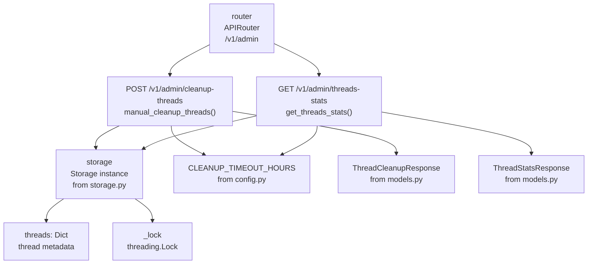
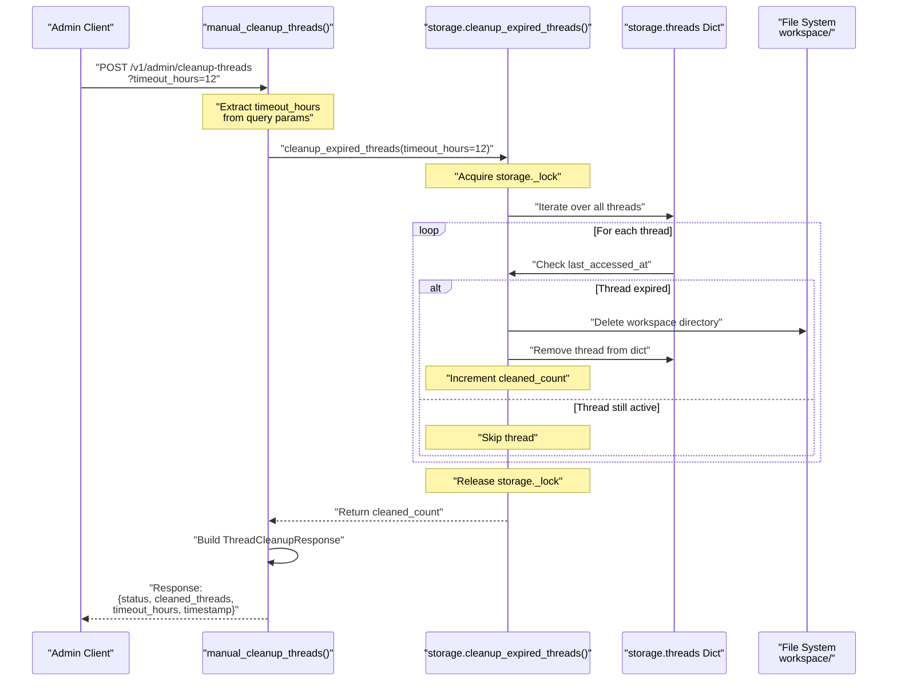
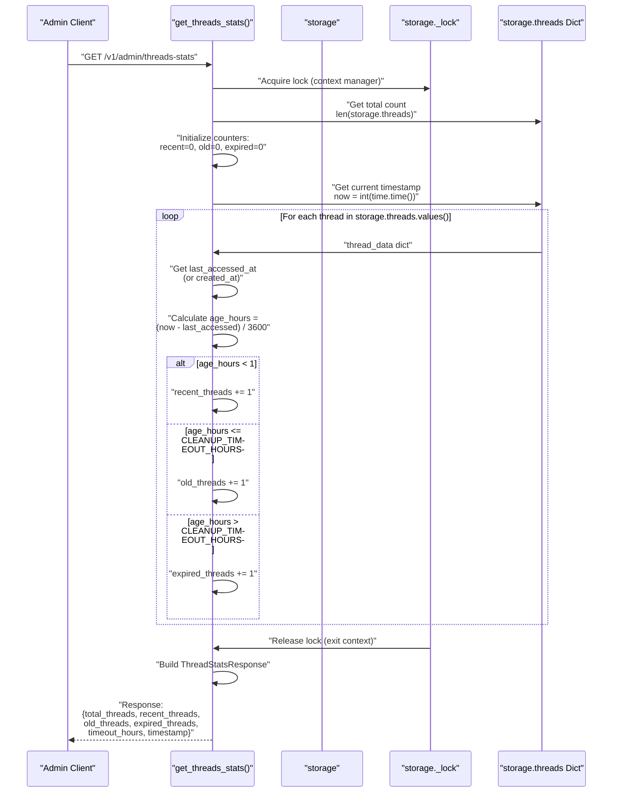
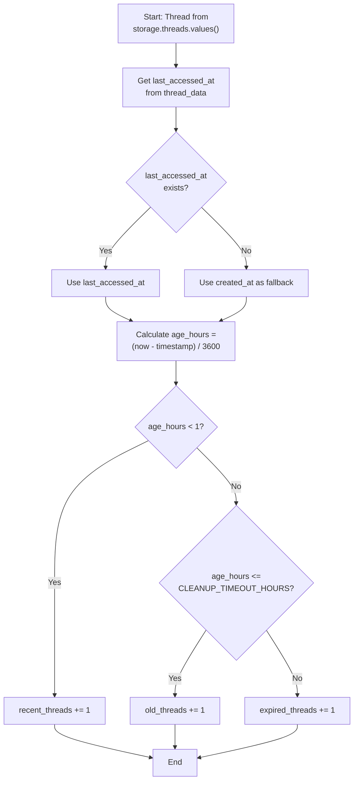

<!-- source: DeepWiki mcp.deepwiki.com · repo ruc-datalab/DeepAnalyze · page 6.9 Admin API · fetched 2026-10-26 -->

# Admin API

<details>
<summary>Relevant source files</summary>

The following files were used as context for generating this wiki page:

- [API/__init__.py](API/__init__.py)
- [API/admin_api.py](API/admin_api.py)
- [API/example/Simpson.csv](API/example/Simpson.csv)
- [API/file_api.py](API/file_api.py)
- [API/start_server.py](API/start_server.py)

</details>


The Admin API provides administrative endpoints for managing and monitoring the DeepAnalyze API server. This includes thread lifecycle management, cleanup operations, and system statistics.

For information about thread management in the storage layer, see [Storage Layer](#2.4). For general API architecture, see [API Endpoints](#3).

**Sources:** [API/admin_api.py:1-75]()

## Overview

The Admin API is implemented in a dedicated FastAPI router that exposes endpoints under the `/v1/admin` prefix. It provides two primary capabilities:

1. **Thread Cleanup** - Manual triggering of expired thread cleanup operations
2. **Thread Statistics** - Retrieval of system-wide thread statistics and age distribution

The admin router operates directly on the in-memory `storage` instance, providing system operators with control over resource management and visibility into server state.

**Sources:** [API/admin_api.py:14-15]()

## Router Configuration

The admin router is initialized with the following configuration:

| Property | Value | Description |
|----------|-------|-------------|
| Prefix | `/v1/admin` | All admin endpoints are mounted under this path |
| Tags | `["admin"]` | OpenAPI tag for grouping admin endpoints |

```python
router = APIRouter(prefix="/v1/admin", tags=["admin"])
```

**Sources:** [API/admin_api.py:15]()

## Admin API Router Architecture



**Sources:** [API/admin_api.py:1-75]()

## Thread Cleanup Endpoint

### Endpoint Specification

- **Method:** `POST`
- **Path:** `/v1/admin/cleanup-threads`
- **Function:** `manual_cleanup_threads()`
- **Response Model:** `ThreadCleanupResponse`

### Purpose

Manually triggers cleanup of threads that have not been accessed for more than a specified timeout period. This endpoint provides system operators with the ability to reclaim resources from inactive threads on demand.

**Sources:** [API/admin_api.py:18-40]()

### Request Parameters

| Parameter | Type | Default | Description |
|-----------|------|---------|-------------|
| `timeout_hours` | `int` | `CLEANUP_TIMEOUT_HOURS` | Number of hours of inactivity before a thread is considered expired |

The `timeout_hours` parameter is provided as a query parameter and defaults to the system-configured `CLEANUP_TIMEOUT_HOURS` value from [config.py](). This allows operators to override the default timeout for specific cleanup operations.

**Sources:** [API/admin_api.py:19-21]()

### Response Format

The endpoint returns a `ThreadCleanupResponse` object with the following fields:

| Field | Type | Description |
|-------|------|-------------|
| `status` | `string` | Either `"success"` or `"error"` |
| `cleaned_threads` | `int` | Number of threads successfully cleaned up |
| `timeout_hours` | `int` | The timeout value used for this cleanup operation |
| `timestamp` | `int` | Unix timestamp when the operation completed |

**Sources:** [API/admin_api.py:28-40]()

### Thread Cleanup Flow



**Sources:** [API/admin_api.py:18-40]()

### Error Handling

The cleanup operation includes exception handling to ensure the endpoint always returns a valid response:

- On success: Returns status `"success"` with the actual count of cleaned threads
- On error: Returns status `"error"` with `cleaned_threads` set to 0

This design ensures that cleanup failures do not crash the API server and provides visibility into operation outcomes.

**Sources:** [API/admin_api.py:34-40]()

## Thread Statistics Endpoint

### Endpoint Specification

- **Method:** `GET`
- **Path:** `/v1/admin/threads-stats`
- **Function:** `get_threads_stats()`
- **Response Model:** `ThreadStatsResponse`

### Purpose

Provides real-time statistics about thread distribution and age categories. This endpoint enables monitoring of server resource utilization and identification of expired threads that may need cleanup.

**Sources:** [API/admin_api.py:43-75]()

### Response Format

The endpoint returns a `ThreadStatsResponse` object with the following fields:

| Field | Type | Description |
|-------|------|-------------|
| `total_threads` | `int` | Total number of threads in the system |
| `recent_threads` | `int` | Threads accessed within the last hour |
| `old_threads` | `int` | Threads last accessed between 1 and `timeout_hours` ago |
| `expired_threads` | `int` | Threads not accessed for more than `timeout_hours` |
| `timeout_hours` | `int` | The configured cleanup timeout threshold |
| `timestamp` | `int` | Unix timestamp when statistics were collected |

**Sources:** [API/admin_api.py:68-75]()

### Thread Age Categories

Threads are categorized into three age groups based on time since last access:

| Category | Age Range | Field Name |
|----------|-----------|------------|
| Recent | < 1 hour | `recent_threads` |
| Old | 1 hour to `CLEANUP_TIMEOUT_HOURS` | `old_threads` |
| Expired | > `CLEANUP_TIMEOUT_HOURS` | `expired_threads` |

The categorization logic determines thread age by comparing the current timestamp with the thread's `last_accessed_at` field, falling back to `created_at` if the former is unavailable.

**Sources:** [API/admin_api.py:52-66]()

### Thread Statistics Collection Flow



**Sources:** [API/admin_api.py:43-75]()

### Thread-Safe Statistics

The statistics collection operation is protected by the storage layer's thread lock to ensure consistency:

```python
with storage._lock:
    total_threads = len(storage.threads)
    # ... iterate and categorize threads
```

This ensures that the statistics represent a consistent snapshot of the system state, even in the presence of concurrent thread creation or cleanup operations.

**Sources:** [API/admin_api.py:48]()

## Thread Age Calculation Logic



**Sources:** [API/admin_api.py:57-66]()

## Integration with Storage Layer

The Admin API operates directly on the shared `storage` instance, invoking storage methods for cleanup operations:

| Admin API Function | Storage Method Called | Purpose |
|-------------------|----------------------|---------|
| `manual_cleanup_threads()` | `storage.cleanup_expired_threads()` | Removes expired threads from memory and filesystem |
| `get_threads_stats()` | Direct access to `storage.threads` | Reads thread metadata for statistics |

The Admin API does not implement cleanup or statistics logic itself; instead, it serves as an HTTP interface to existing storage layer capabilities.

**Sources:** [API/admin_api.py:27,48]()

## Usage Patterns

### Periodic Cleanup

System operators can schedule periodic cleanup operations using the cleanup endpoint:

```bash
# Clean up threads older than 12 hours (default)
curl -X POST http://localhost:8200/v1/admin/cleanup-threads

# Clean up threads older than 24 hours
curl -X POST "http://localhost:8200/v1/admin/cleanup-threads?timeout_hours=24"
```

### Monitoring

The statistics endpoint enables monitoring dashboards and alerts:

```bash
# Check current thread distribution
curl http://localhost:8200/v1/admin/threads-stats
```

Response example:
```json
{
  "total_threads": 45,
  "recent_threads": 12,
  "old_threads": 28,
  "expired_threads": 5,
  "timeout_hours": 12,
  "timestamp": 1704067200
}
```

The `expired_threads` count indicates threads eligible for cleanup.

**Sources:** [API/admin_api.py:18-75]()

## Configuration Dependencies

The Admin API relies on the following configuration parameters:

| Parameter | Source | Used By | Purpose |
|-----------|--------|---------|---------|
| `CLEANUP_TIMEOUT_HOURS` | [config.py]() | Both endpoints | Default timeout threshold for thread expiration |

This configuration value determines the boundary between "old" and "expired" threads in statistics, and provides the default timeout for cleanup operations.

**Sources:** [API/admin_api.py:9,20,63]()

## Model Dependencies

The Admin API uses the following Pydantic models from [models.py]():

| Model | Usage | Fields |
|-------|-------|--------|
| `ThreadCleanupRequest` | Imported but not actively used | - |
| `ThreadCleanupResponse` | Response model for cleanup endpoint | `status`, `cleaned_threads`, `timeout_hours`, `timestamp` |
| `ThreadStatsResponse` | Response model for statistics endpoint | `total_threads`, `recent_threads`, `old_threads`, `expired_threads`, `timeout_hours`, `timestamp` |

The `ThreadCleanupRequest` model is imported but cleanup parameters are currently passed as query parameters instead.

**Sources:** [API/admin_api.py:10]()

## Security Considerations

The Admin API endpoints are currently unprotected and accessible to any client that can reach the API server. In production deployments, these endpoints should be protected through:

- Network-level access control (firewall rules, VPN)
- API authentication and authorization
- Rate limiting to prevent abuse

These endpoints provide privileged operations that can impact system resources and should not be exposed to untrusted clients.

**Sources:** [API/admin_api.py:1-75]()

---

