<!-- source: DeepWiki mcp.deepwiki.com · repo ruc-datalab/DeepAnalyze · page 7 Using DeepAnalyze · fetched 2026-10-26 -->

# Using DeepAnalyze

<details>
<summary>Relevant source files</summary>

The following files were used as context for generating this wiki page:

- [README.md](README.md)
- [assets/wechat.jpg](assets/wechat.jpg)
- [docs/DeepAnalyze_API_Key_Usage_Guide.md](docs/DeepAnalyze_API_Key_Usage_Guide.md)
- [docs/DeepAnalyze_API_Key_Usage_Guide_ZH.md](docs/DeepAnalyze_API_Key_Usage_Guide_ZH.md)
- [example/README.md](example/README.md)
- [quantize.py](quantize.py)
- [requirements.txt](requirements.txt)

</details>


DeepAnalyze provides multiple interfaces for autonomous data science, ranging from browser-based UIs to programmatic APIs. This guide introduces the available usage options, common workflows, and practical patterns for effective data analysis.

For detailed interface-specific documentation, see the sub-pages: [Quick Start Guide (7.1)](#7.1), [API Key Configuration (7.2)](#7.2), [File Upload and Management (7.3)](#7.3), [Multi-turn Conversations (7.4)](#7.4), [Working with Workspaces (7.5)](#7.5), [Using OpenAI SDK (7.6)](#7.6), [Direct HTTP Requests (7.7)](#7.7).

## Overview of Usage Options

DeepAnalyze can be accessed through five distinct interfaces, each optimized for different use cases and deployment scenarios:

**Interface Comparison**

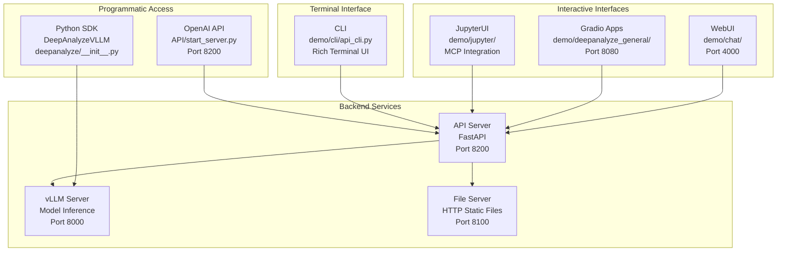

**Interface Selection Guide**

| Interface | Best For | Requirements | Key Features |
|-----------|----------|--------------|--------------|
| **WebUI** | Interactive exploration, rich visualization | Browser, npm | Three-panel layout, file tree, Monaco editor |
| **CLI** | Terminal workflows, automation scripts | Python, terminal | Command history, Rich formatting, bilingual |
| **JupyterUI** | Data science notebooks | Jupyter Lab/Notebook | Native cell integration, MCP protocol |
| **Gradio** | Quick demos, non-technical users | Python, browser | Simplified UI, ZIP support, easy deployment |
| **Python SDK** | Embedding in applications | Python only | Direct vLLM access, bypasses API server |
| **OpenAI API** | Language-agnostic integration | Any HTTP client | OpenAI-compatible, streaming support |

Sources: [README.md:46-113](), [README.md:228-262]()

## Deployment Modes

DeepAnalyze supports two primary deployment configurations:

**Local Deployment Architecture**

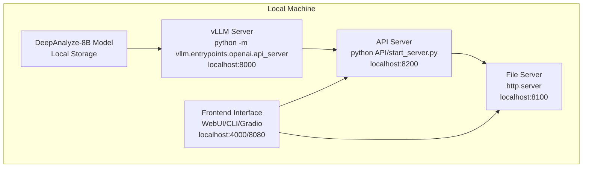

**Hosted API Deployment**

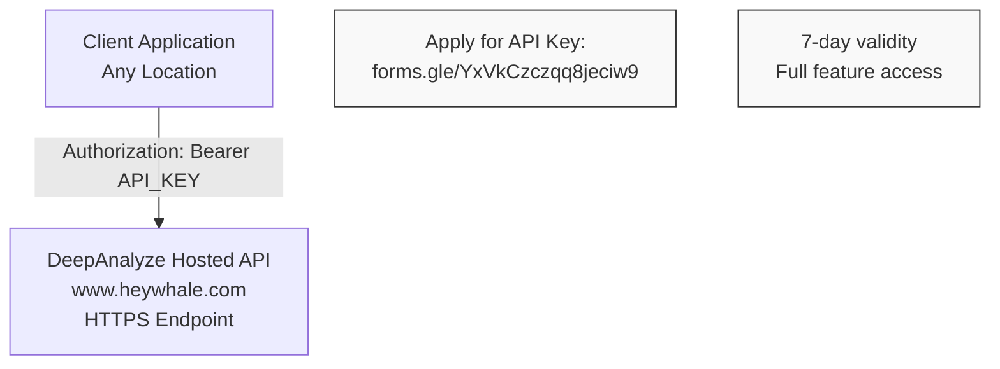

**Deployment Comparison**

| Aspect | Local Deployment | Hosted API |
|--------|------------------|------------|
| **Setup Complexity** | High (GPU, dependencies, model download) | Low (API key only) |
| **GPU Requirements** | 16-80GB VRAM depending on configuration | None |
| **Data Privacy** | Complete (all processing local) | Data sent to remote server |
| **Customization** | Full (modify code, fine-tune model) | Limited to API parameters |
| **Cost** | Hardware investment + electricity | Free during trial period |
| **Latency** | Low (local inference) | Network-dependent |

Sources: [README.md:114-211](), [docs/DeepAnalyze_API_Key_Usage_Guide.md:1-7]()

## System Architecture Overview

Understanding the multi-port architecture is essential for troubleshooting and integration:

**Port Assignment and Service Responsibilities**

| Port | Service | Process | Primary Function |
|------|---------|---------|------------------|
| 8000 | vLLM Model Server | `vllm serve DeepAnalyze-8B` | Model inference, text generation |
| 8200 | API Server | `python API/start_server.py` | Request handling, code execution |
| 8100 | File Server | Auto-started by API server | Serve generated artifacts (plots, CSVs) |
| 4000 | WebUI Frontend | `cd demo/chat && bash start.sh` | React application serving |
| 8080 | Gradio App | `python demo/deepanalyze_general/app.py` | Gradio interface serving |

**Request Flow Diagram**

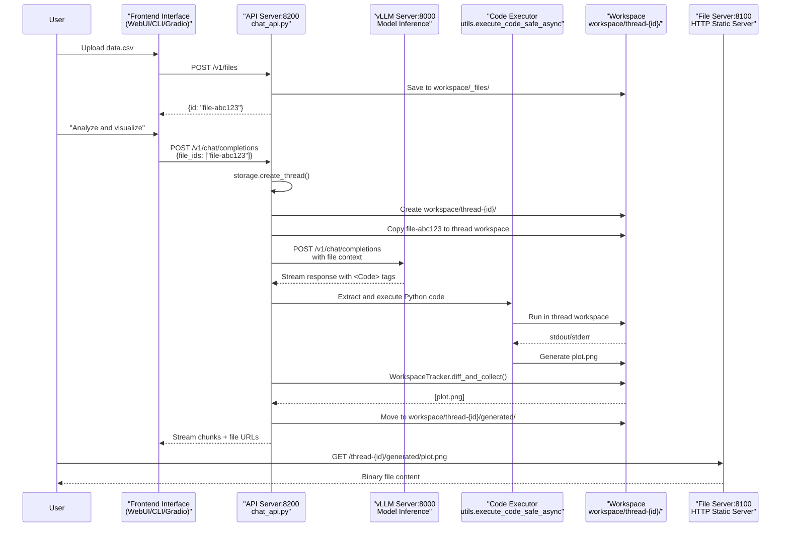

Sources: [README.md:56-69](), [README.md:283-313]()

## Common Workflows

DeepAnalyze supports several fundamental workflows that apply across all interfaces. Understanding these patterns helps users leverage the system effectively regardless of the chosen interface.

### Workflow 1: Single-Turn Analysis

The simplest workflow performs a complete analysis in one request:

**Pattern Overview**

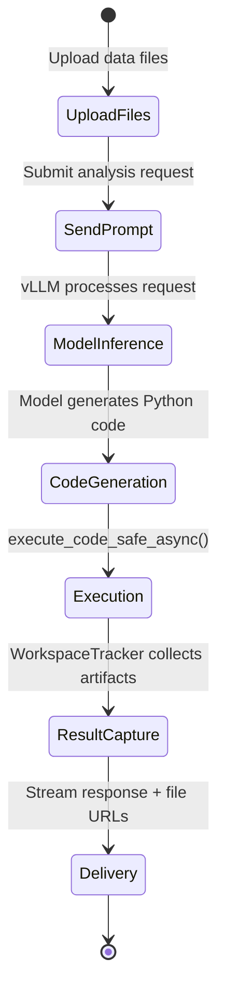

**Example: Quick Data Overview**

| Step | Action | Interface Method |
|------|--------|------------------|
| 1 | Upload `sales_data.csv` | `POST /v1/files` or UI upload button |
| 2 | Send prompt: "Analyze sales trends" | `POST /v1/chat/completions` or text input |
| 3 | Receive analysis + visualizations | Streaming response with file URLs |
| 4 | Download generated charts | `GET http://localhost:8100/thread-{id}/generated/` |

**Code Example (Python SDK)**

```python
from deepanalyze import DeepAnalyzeVLLM

deepanalyze = DeepAnalyzeVLLM("/path/to/DeepAnalyze-8B")
result = deepanalyze.generate(
    prompt="Analyze sales_data.csv and generate visualizations",
    workspace="/path/to/workspace/"
)
print(result["reasoning"])  # Analysis text
print(result["workspace"])  # Location of generated files
```

Sources: [README.md:228-280](), [deepanalyze/__init__.py]()

### Workflow 2: Multi-Turn Iterative Analysis

For complex analyses requiring refinement, DeepAnalyze maintains conversation context through `thread_id`:

**Thread-Based Conversation Flow**

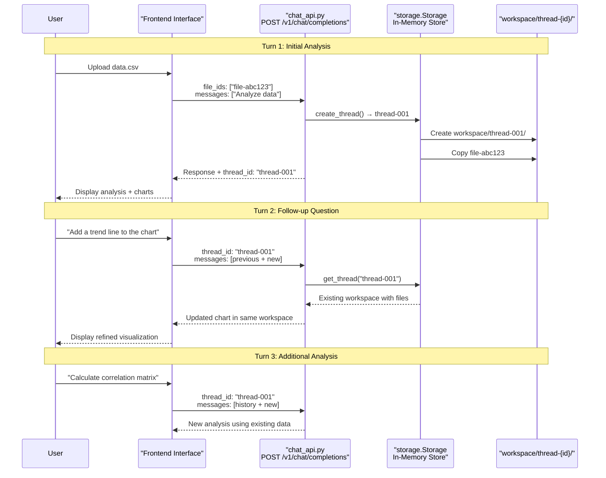

**Key Benefits of Thread-Based Workflow**

| Aspect | Benefit | Implementation |
|--------|---------|----------------|
| **Context Persistence** | Model remembers previous analyses | Full message history sent to vLLM |
| **File Reuse** | No need to re-upload data | Files persist in `workspace/thread-{id}/` |
| **Incremental Refinement** | Build upon previous results | Generated artifacts accessible to subsequent code |
| **Workspace Isolation** | Multiple conversations don't interfere | Separate `thread-{id}` directories |

Sources: [API/chat_api.py:71-108](), [API/storage.py:40-68]()

### Workflow 3: Batch File Analysis

Analyzing multiple related files in a single session:

**Multi-File Processing Pattern**

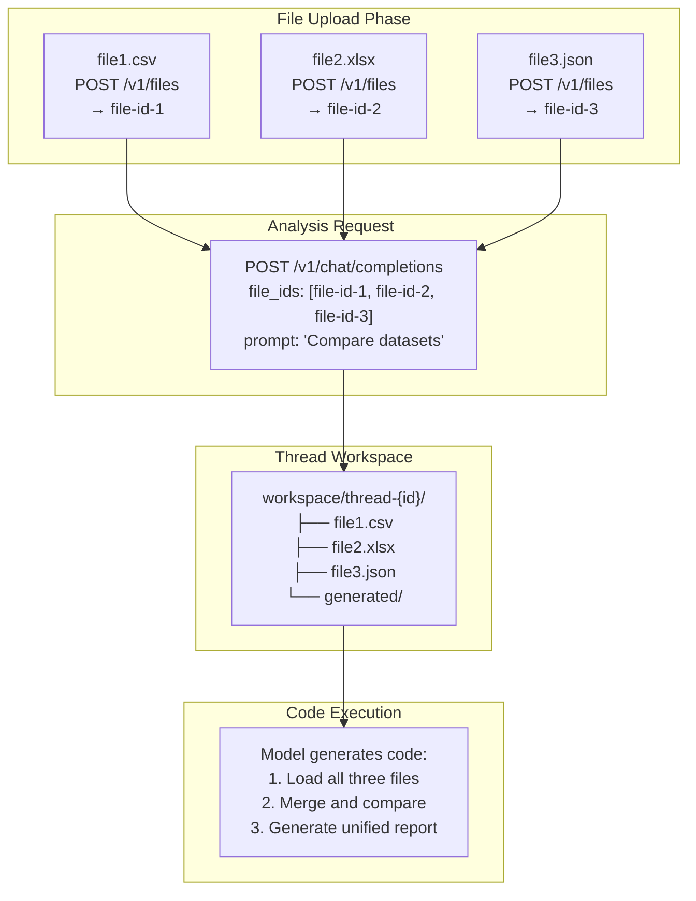

**Example: Cross-Dataset Analysis**

```python
import openai

client = openai.OpenAI(base_url="http://localhost:8200/v1", api_key="dummy")

# Upload multiple files
file_ids = []
for filepath in ["sales_q1.csv", "sales_q2.csv", "sales_q3.csv"]:
    with open(filepath, "rb") as f:
        file_obj = client.files.create(file=f, purpose="file-extract")
        file_ids.append(file_obj.id)

# Analyze all files together
response = client.chat.completions.create(
    model="DeepAnalyze-8B",
    messages=[{
        "role": "user",
        "content": "Compare quarterly sales data and identify trends",
        "file_ids": file_ids
    }]
)
```

Sources: [API/example/exampleOpenAI.py:21-50](), [API/utils.py:134-180]()

### Workflow 4: Report Generation

Extracting structured analysis into downloadable reports:

**Report Compilation Flow**

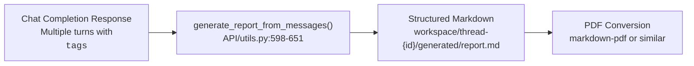

**Report Structure**

The system automatically extracts sections from conversation tags:

| Tag | Report Section | Content Example |
|-----|----------------|-----------------|
| `<Analyze>` | Analysis Overview | "The dataset contains 1,000 records..." |
| `<Code>` | Methodology | Code blocks for reproducibility |
| `<Execute>` | Execution Results | stdout/stderr from code runs |
| `<File>` | Generated Artifacts | Links to plots, CSVs |

Sources: [API/utils.py:598-651](), [API/chat_api.py:178-189]()

## Response Formats

The API returns generated files in two locations for compatibility:

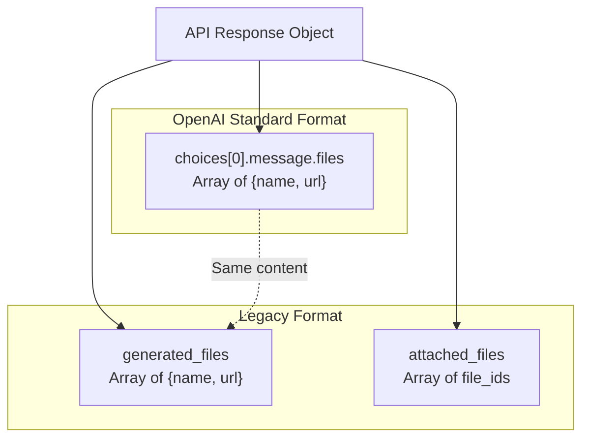

**Non-streaming response structure**:

```json
{
  "choices": [{
    "message": {
      "role": "assistant",
      "content": "Analysis complete...",
      "files": [{"name": "chart.png", "url": "http://localhost:8100/..."}]
    }
  }],
  "generated_files": [{"name": "chart.png", "url": "http://localhost:8100/..."}],
  "attached_files": ["file-abc123"]
}
```

**Streaming response chunks**:

```
data: {"choices": [{"delta": {"content": "Analysis"}}]}
data: {"choices": [{"delta": {"content": " complete"}}]}
data: {"choices": [{"delta": {"files": [{"name":"chart.png","url":"..."}]}}]}
data: [DONE]
```

Sources: [API/README.md:296-335](), [API/example/exampleOpenAI.py:68-79]()

## Client Initialization

### OpenAI SDK Method

The recommended approach uses the official OpenAI Python library:

```python
import openai

client = openai.OpenAI(
    base_url="http://localhost:8200/v1",
    api_key="dummy"  # Any value accepted
)
```

See [Client Setup with OpenAI SDK](#4.2) for detailed configuration options.

Sources: [API/example/exampleOpenAI.py:11-18]()

### Direct HTTP Method

For environments without the OpenAI SDK:

```python
import requests

API_BASE = "http://localhost:8200"
headers = {"Content-Type": "application/json"}
```

See [Direct HTTP Requests](#4.5) for complete examples.

Sources: [API/example/exampleRequest.py:11-12]()

## File Operations

### Upload Workflow

Files uploaded via `POST /v1/files` are stored in two locations:

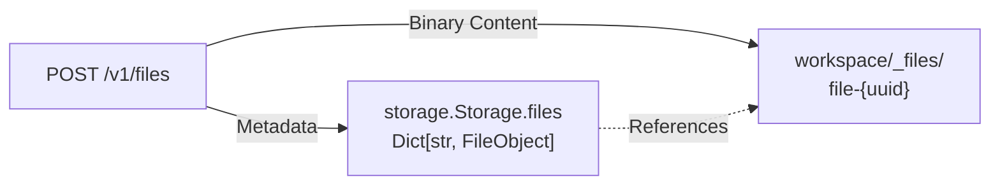

**Response format**:
```json
{
  "id": "file-abc123...",
  "object": "file",
  "bytes": 1024,
  "created_at": 1704067200,
  "filename": "data.csv",
  "purpose": "file-extract"
}
```

The `file_id` returned must be used in subsequent chat requests to attach the file.

Sources: [API/README.md:36-63](), [API/README.md:199-221]()

### File Lifecycle

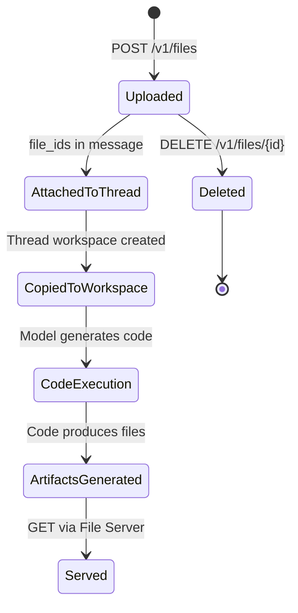

See [File Upload and Management](#4.3) for complete API reference.

Sources: [API/README.md:199-272]()

## Chat Completions

### Basic Request

Minimal chat completion without files:

```python
response = client.chat.completions.create(
    model="DeepAnalyze-8B",
    messages=[
        {"role": "user", "content": "Explain Python in one sentence"}
    ],
    temperature=0.4
)
print(response.choices[0].message.content)
```

Sources: [API/example/exampleOpenAI.py:52-79](), [API/README.md:82-94]()

### Request with Files

Attach uploaded files to enable data analysis:

```python
# Upload file first
with open("data.csv", "rb") as f:
    file_obj = client.files.create(file=f, purpose="file-extract")

# Chat with file attached
response = client.chat.completions.create(
    model="DeepAnalyze-8B",
    messages=[{
        "role": "user",
        "content": "Analyze this data and calculate averages",
        "file_ids": [file_obj.id]
    }],
    temperature=0.4
)

# Access generated files
if hasattr(response.choices[0].message, 'files'):
    for file_info in response.choices[0].message.files:
        print(f"{file_info['name']}: {file_info['url']}")
```

See [Chat Completions with Files](#4.4) for advanced usage including streaming and multi-turn conversations.

Sources: [API/example/exampleOpenAI.py:52-84](), [API/README.md:96-142]()

## Streaming Responses

### Streaming Pattern

Enable streaming for real-time response rendering:

```python
stream = client.chat.completions.create(
    model="DeepAnalyze-8B",
    messages=[{
        "role": "user",
        "content": "Analyze data and generate charts",
        "file_ids": [file_id]
    }],
    stream=True
)

for chunk in stream:
    if chunk.choices[0].delta.content:
        print(chunk.choices[0].delta.content, end='', flush=True)
```

Generated files appear in the final chunk with `finish_reason: "stop"`.

Sources: [API/example/exampleOpenAI.py:86-131](), [API/README.md:144-194]()

### File Collection in Streaming

Files are delivered in the final streaming chunk:

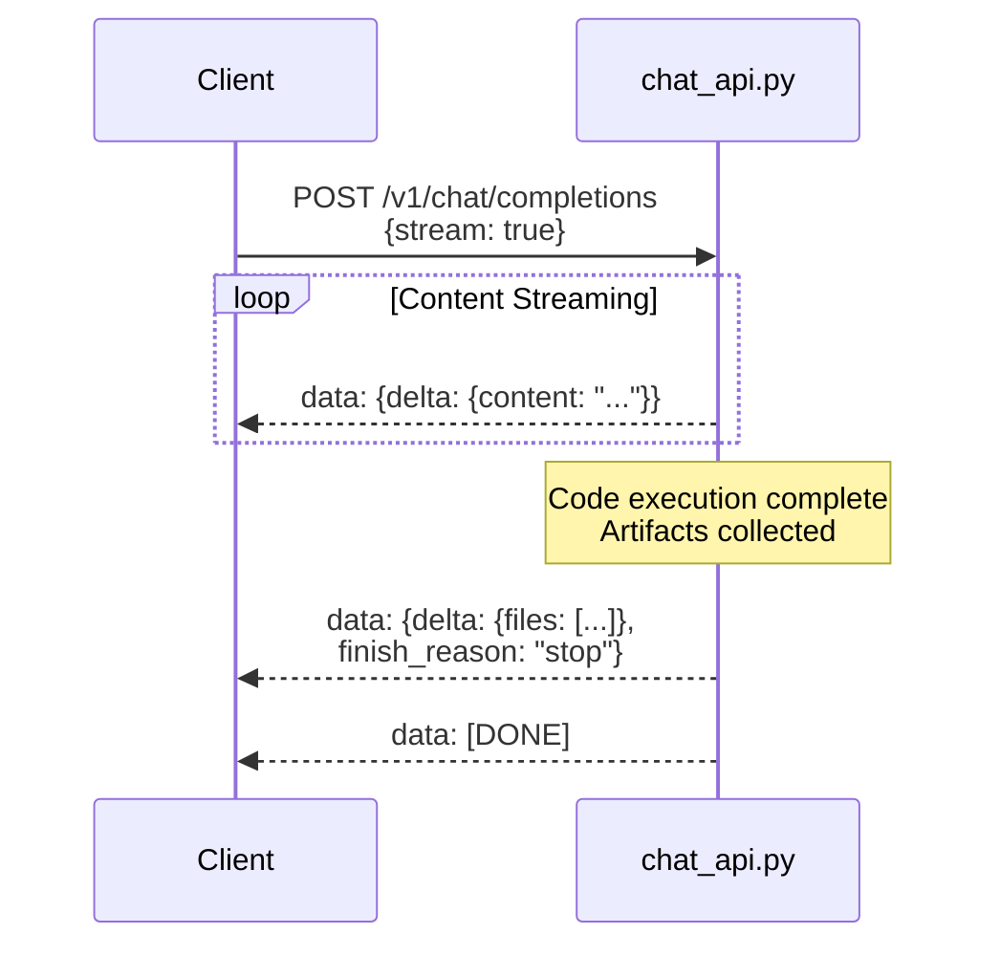

Sources: [API/README.md:329-334](), [API/example/exampleOpenAI.py:112-127]()

## Error Handling

### Common Error Patterns

| Scenario | HTTP Status | Response Format |
|----------|-------------|-----------------|
| File not found | 404 | `{"detail": "File not found"}` |
| Invalid file_id | 400 | `{"detail": "Invalid file_id"}` |
| vLLM server down | 500 | `{"detail": "Model inference error"}` |
| Invalid JSON | 422 | Pydantic validation error |

### Connection Verification

Check server health before sending requests:

```python
import requests

def check_server(base_url="http://localhost:8200"):
    try:
        response = requests.get(f"{base_url}/health", timeout=2)
        return response.status_code == 200
    except:
        return False
```

Sources: [API/example/exampleRequest.py:164-171]()

### Model Availability Check

Verify model server connection:

```python
# Using OpenAI SDK
models = client.models.list()
print(f"Available models: {[m.id for m in models.data]}")

# Using requests
response = requests.get("http://localhost:8200/v1/models")
models = response.json()['data']
```

Sources: [API/example/exampleOpenAI.py:167-168]()

## Best Practices

### Request Configuration

**Recommended settings**:

| Parameter | Value | Rationale |
|-----------|-------|-----------|
| `temperature` | 0.3-0.5 | Balances creativity with determinism for data analysis |
| `max_tokens` | Default (32768) | Allows complete code generation and reports |
| `stream` | `True` for interactive UIs | Improves perceived latency |

**File attachment**:
- Use message-level `file_ids` for OpenAI compatibility
- Verify file upload success before chat request
- Keep file references across conversation turns

Sources: [API/README.md:364-379]()

### Workspace Management

Each chat request creates an isolated workspace:

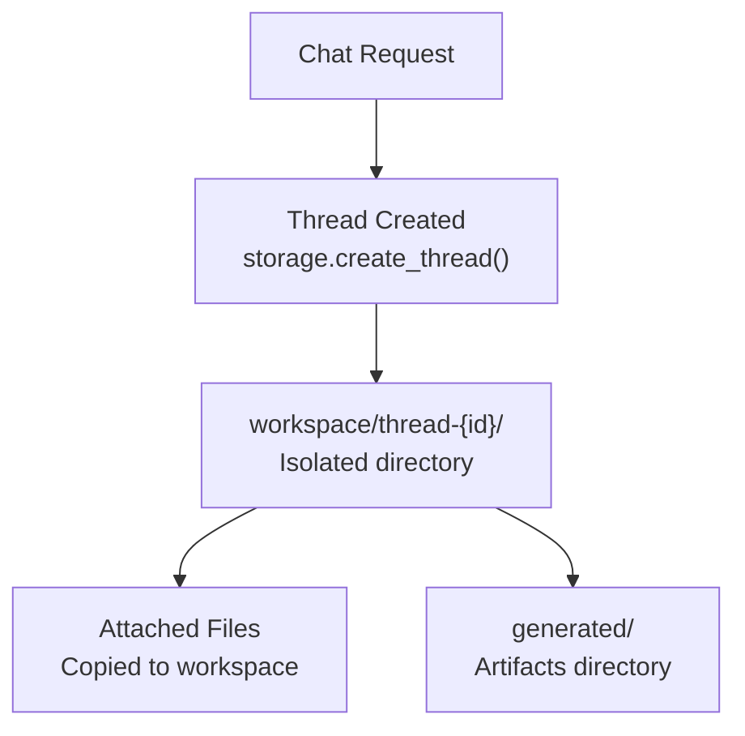

Thread workspaces persist for artifact access but should be cleaned periodically via admin API endpoints.

Sources: [API/README.md:19-24]()

## Code Entity Reference

### Core API Functions

| Function | Location | Purpose |
|----------|----------|---------|
| `create_app()` | [API/main.py]() | Initialize FastAPI application |
| `upload_file()` | [API/file_api.py]() | Handle POST /v1/files |
| `chat_completions()` | [API/chat_api.py]() | Handle POST /v1/chat/completions |
| `execute_code_safe()` | [API/utils.py]() | Sandbox code execution |
| `generate_report_from_messages()` | [API/utils.py]() | Compile markdown reports |

### Data Models

| Model | Location | Purpose |
|-------|----------|---------|
| `FileObject` | [API/models.py]() | File metadata storage |
| `ThreadObject` | [API/models.py]() | Conversation thread state |
| `ChatCompletionRequest` | [API/models.py]() | Chat request validation |
| `ChatCompletionResponse` | [API/models.py]() | Chat response structure |

### Storage Operations

| Method | Location | Operation |
|--------|----------|-----------|
| `storage.create_file()` | [API/storage.py]() | Add file to in-memory store |
| `storage.get_file()` | [API/storage.py]() | Retrieve file by ID |
| `storage.create_thread()` | [API/storage.py]() | Initialize conversation thread |
| `storage.add_message()` | [API/storage.py]() | Append message to thread |

Sources: [API/README.md:1-389](), [API/example/exampleOpenAI.py:1-190](), [API/example/exampleRequest.py:1-222]()

---

For step-by-step server setup and prerequisites, see [Getting Started](#4.1).

For detailed OpenAI SDK configuration, see [Client Setup with OpenAI SDK](#4.2).

For comprehensive file API documentation, see [File Upload and Management](#4.3).

For advanced chat features and streaming, see [Chat Completions with Files](#4.4).

For HTTP-level request construction, see [Direct HTTP Requests](#4.5).

---

