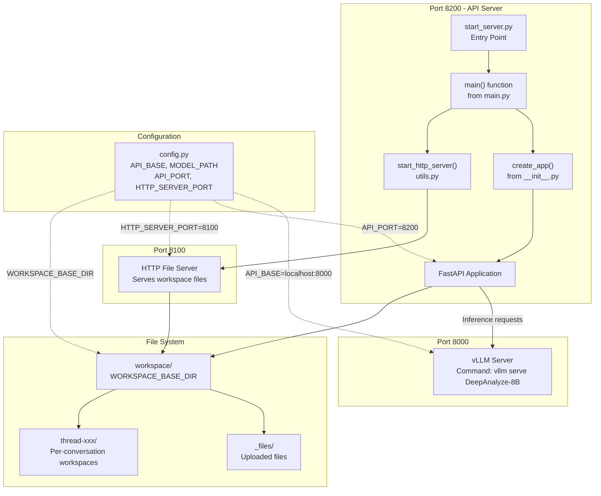
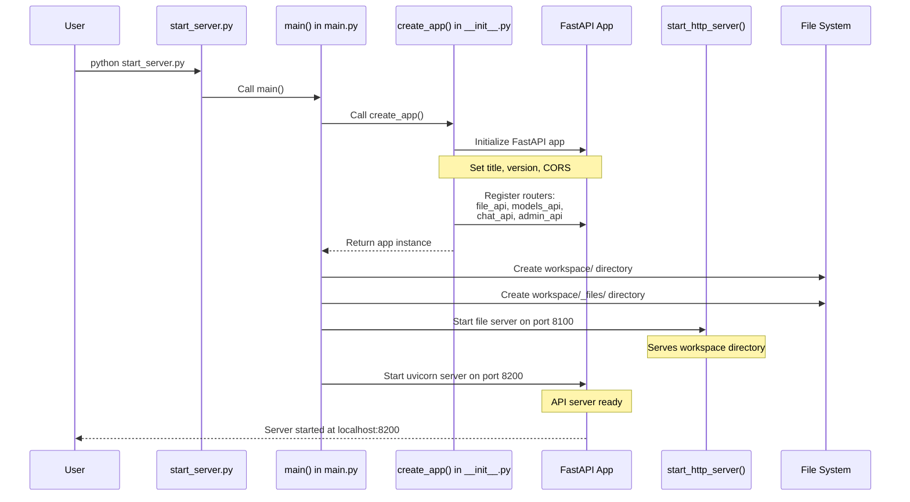
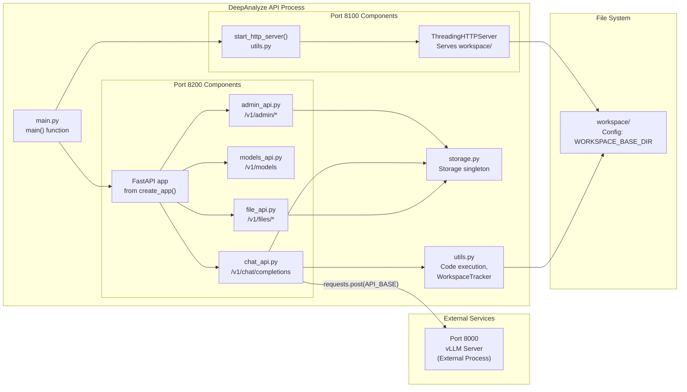

<!-- source: DeepWiki mcp.deepwiki.com · repo ruc-datalab/DeepAnalyze · page 7.1 Quick Start Guide · fetched 2026-10-26 -->

# Getting Started

<details>
<summary>Relevant source files</summary>

The following files were used as context for generating this wiki page:

- [README.md](README.md)
- [assets/wechat.jpg](assets/wechat.jpg)
- [docs/DeepAnalyze_API_Key_Usage_Guide.md](docs/DeepAnalyze_API_Key_Usage_Guide.md)
- [docs/DeepAnalyze_API_Key_Usage_Guide_ZH.md](docs/DeepAnalyze_API_Key_Usage_Guide_ZH.md)
- [example/README.md](example/README.md)
- [quantize.py](quantize.py)
- [requirements.txt](requirements.txt)

</details>


This page provides a quick start guide for deploying and running the DeepAnalyze API server. It covers prerequisites, model server setup with vLLM, API server startup, and basic configuration.

For detailed API usage examples, see [Client Setup with OpenAI SDK](#4.2). For information about the underlying architecture, see [API Server Architecture](#2).

---

## Prerequisites

DeepAnalyze requires two separate servers to operate: a vLLM model inference server and the FastAPI application server. Before starting, ensure you have the following installed:

### Python Environment

```bash
conda create -n deepanalyze python=3.12 -y
conda activate deepanalyze
```

### Core Dependencies

Install the required packages listed in `requirements.txt`:

| Package | Purpose |
|---------|---------|
| `vllm>=0.8.5` | Model inference server |
| `torch` | Deep learning framework |
| `transformers` | Model loading and tokenization |
| `fastapi` | API server framework |
| `uvicorn` | ASGI server |
| `openai` | Client compatibility |

```bash
pip install -r requirements.txt
```

**Sources:** [requirements.txt:1-20](), [README.md:108-121]()

---

## System Deployment Architecture

The following diagram illustrates the complete deployment structure, showing how the vLLM server, API server, and file server interact:



**Sources:** [API/config.py:11-20](), [API/start_server.py:1-8](), [API/main.py:1-50](), [API/README.md:356-363]()

---

## Step 1: Model Server Setup

### Download the Model

Download the DeepAnalyze-8B model from Hugging Face:

```bash
# Using huggingface-cli
huggingface-cli download RUC-DataLab/DeepAnalyze-8B --local-dir ./DeepAnalyze-8B

# Or via git
git clone https://huggingface.co/RUC-DataLab/DeepAnalyze-8B
```

### Start vLLM Server

The vLLM server handles all model inference requests. Start it on port 8000:

```bash
vllm serve DeepAnalyze-8B --host 0.0.0.0 --port 8000
```

| Parameter | Description |
|-----------|-------------|
| `DeepAnalyze-8B` | Model name or path |
| `--host 0.0.0.0` | Listen on all interfaces |
| `--port 8000` | Default inference port |

The vLLM server must be running before starting the API server, as the API server connects to it via the `API_BASE` configuration parameter.

**Configuration Reference:** The API server expects the vLLM endpoint at [API/config.py:12]():
```python
API_BASE = "http://localhost:8000/v1"
```

**Sources:** [API/README.md:7-11](), [README.md:48-49](), [API/config.py:12]()

---

## Step 2: API Server Startup

### Startup Sequence

The following diagram shows the exact startup sequence and function calls:



**Sources:** [API/start_server.py:1-8](), [API/main.py:1-100](), [API/__init__.py:1-50]()

### Start the API Server

Navigate to the API directory and run the startup script:

```bash
cd API
python start_server.py
```

The script [API/start_server.py:6-8]() imports and calls the `main()` function from `main.py`, which:

1. **Creates the FastAPI application** via `create_app()` [API/__init__.py]()
2. **Initializes workspace directories** [API/main.py]()
   - Creates `workspace/` directory (configured as `WORKSPACE_BASE_DIR`)
   - Creates `workspace/_files/` subdirectory for uploaded files
3. **Starts the HTTP file server** on port 8100 via `start_http_server()` [API/utils.py]()
4. **Launches the Uvicorn ASGI server** on port 8200

### Server Endpoints

Once started, the following endpoints become available:

| Endpoint | Port | Purpose |
|----------|------|---------|
| `http://localhost:8200` | 8200 | Main API server |
| `http://localhost:8200/health` | 8200 | Health check endpoint |
| `http://localhost:8200/docs` | 8200 | Interactive API documentation |
| `http://localhost:8100` | 8100 | Static file server for downloads |

**Sources:** [API/README.md:14-23](), [API/config.py:18-20]()

---

## Step 3: Verify Installation

### Health Check

Verify the API server is running correctly:

```bash
curl http://localhost:8200/health
```

Expected response:
```json
{
  "status": "healthy",
  "timestamp": 1704067200
}
```

### Check Available Models

Query the models endpoint to verify vLLM connectivity:

```bash
curl http://localhost:8200/v1/models
```

Expected response:
```json
{
  "object": "list",
  "data": [
    {
      "id": "DeepAnalyze-8B",
      "object": "model",
      "created": 1704067200,
      "owned_by": "system"
    }
  ]
}
```

If this request fails, verify that:
1. The vLLM server is running on port 8000
2. The `API_BASE` in [API/config.py:12]() points to the correct vLLM endpoint

**Sources:** [API/README.md:338-354](), [API/models_api.py]()

---

## Configuration Overview

The [API/config.py]() file contains all system configuration parameters. Key settings for initial deployment:

### Server Ports

```python
# API/config.py
API_BASE = "http://localhost:8000/v1"  # vLLM endpoint
API_HOST = "0.0.0.0"                   # API server host
API_PORT = 8200                        # API server port
HTTP_SERVER_PORT = 8100                # File server port
```

### Workspace Configuration

```python
# API/config.py
WORKSPACE_BASE_DIR = "workspace"                           # Base directory
FILE_STORAGE_DIR = os.path.join(WORKSPACE_BASE_DIR, "_files")  # Uploaded files
```

The API server creates the following directory structure:

```
workspace/
├── _files/              # Uploaded files storage
├── thread-<uuid>/       # Per-conversation workspace
│   ├── <uploaded_file>  # Files attached to this conversation
│   └── generated/       # Code execution artifacts
└── thread-<uuid>/
    └── generated/
```

### Model Configuration

```python
# API/config.py
MODEL_PATH = "DeepAnalyze-8B"       # Model identifier
DEFAULT_TEMPERATURE = 0.4           # Sampling temperature
MAX_NEW_TOKENS = 32768              # Max response length
STOP_TOKEN_IDS = [151676, 151645]   # Model-specific stop tokens
```

### Execution Configuration

```python
# API/config.py
CODE_EXECUTION_TIMEOUT = 120         # Code execution timeout (seconds)
CLEANUP_TIMEOUT_HOURS = 12           # Thread cleanup after inactivity
CLEANUP_INTERVAL_MINUTES = 30        # Cleanup check frequency
```

**Sources:** [API/config.py:1-44](), [API/README.md:364-379]()

---

## Deployment Architecture Summary

The following diagram maps the three-port architecture to actual code components:



**Sources:** [API/main.py](), [API/__init__.py](), [API/utils.py](), [API/storage.py](), [API/file_api.py](), [API/models_api.py](), [API/chat_api.py](), [API/admin_api.py]()

---

## Environment Variables

While the default configuration works for local deployment, you can override settings via environment variables or by editing [API/config.py]():

```bash
# Set matplotlib backend for headless operation
export MPLBACKEND=Agg

# Custom vLLM endpoint
export API_BASE=http://your-vllm-server:8000/v1

# Custom workspace location
export WORKSPACE_BASE_DIR=/path/to/workspace
```

The environment setup at [API/config.py:8-9]() ensures matplotlib works in headless environments (necessary for generating plots during code execution).

**Sources:** [API/config.py:6-16]()

---

## Next Steps

After successfully starting the servers:

1. **Test with examples**: Run the example scripts in `API/example/`
   - [API/README.md:27-32]() shows quick test commands
   - `exampleRequest.py` demonstrates direct HTTP requests
   - `exampleOpenAI.py` demonstrates OpenAI SDK compatibility

2. **Set up a client**: See [Client Setup with OpenAI SDK](#4.2) for details on connecting to the API

3. **Upload files and analyze data**: See [File Upload and Management](#4.3) and [Chat Completions with Files](#4.4)

4. **Explore the web interface**: Deploy the WebUI for a browser-based experience
   ```bash
   cd demo/chat
   npm install
   cd ..
   bash start.sh
   ```

5. **Review configuration**: See [Configuration System](#2.2) for detailed parameter explanations

**Sources:** [API/README.md:27-32](), [README.md:40-59]()

---

## Troubleshooting

| Issue | Cause | Solution |
|-------|-------|----------|
| `Connection refused to localhost:8000` | vLLM server not running | Start vLLM: `vllm serve DeepAnalyze-8B --port 8000` |
| Models endpoint returns empty list | Wrong `API_BASE` configuration | Check [API/config.py:12]() points to vLLM |
| Permission denied on workspace/ | Insufficient file permissions | Check write permissions on current directory |
| Port already in use | Port 8200 or 8100 occupied | Change `API_PORT` or `HTTP_SERVER_PORT` in config |
| Code execution timeout | Long-running analysis | Increase `CODE_EXECUTION_TIMEOUT` in [API/config.py:29]() |

**Sources:** [API/config.py:1-44](), [API/README.md:1-389]()

---

