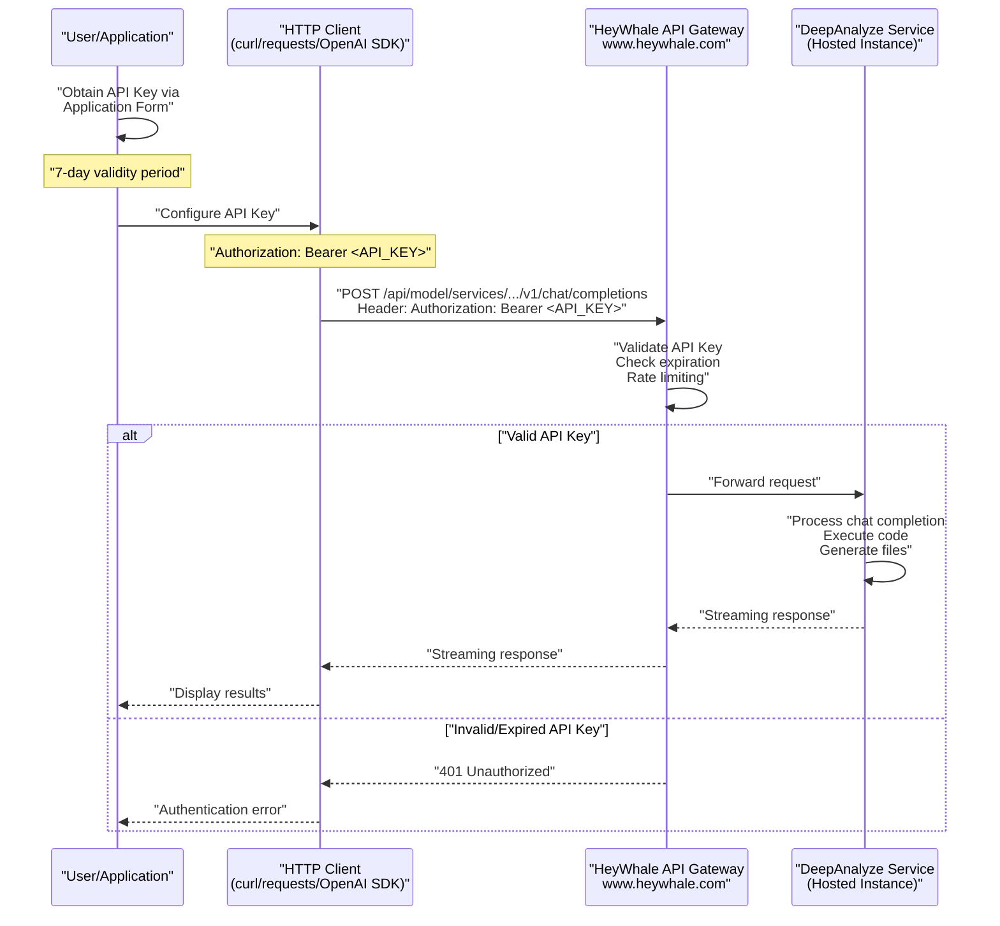
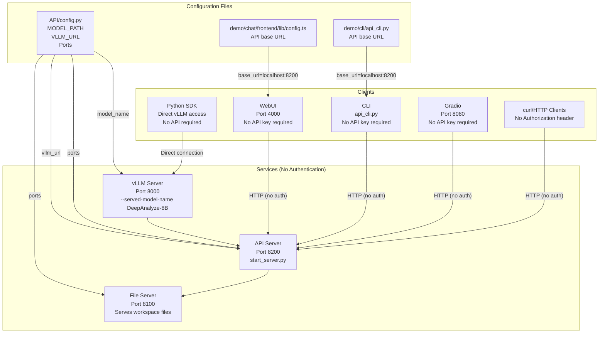
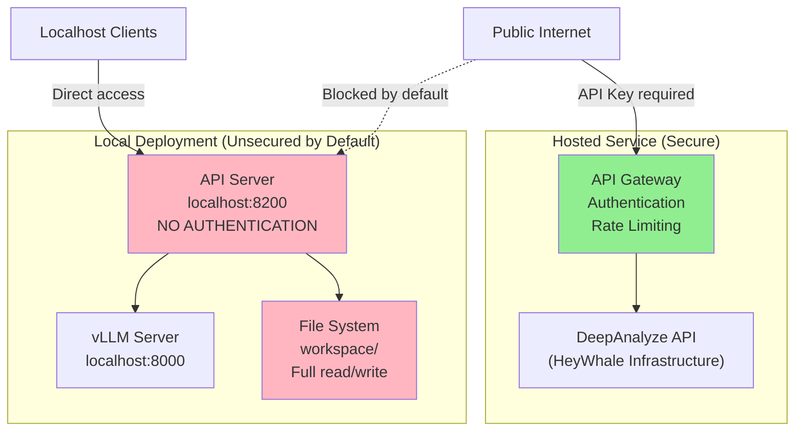

<!-- source: DeepWiki mcp.deepwiki.com · repo ruc-datalab/DeepAnalyze · page 7.2 API Key Configuration · fetched 2026-10-26 -->

# API Key Configuration

<details>
<summary>Relevant source files</summary>

The following files were used as context for generating this wiki page:

- [README.md](README.md)
- [assets/wechat.jpg](assets/wechat.jpg)
- [docs/DeepAnalyze_API_Key_Usage_Guide.md](docs/DeepAnalyze_API_Key_Usage_Guide.md)
- [docs/DeepAnalyze_API_Key_Usage_Guide_ZH.md](docs/DeepAnalyze_API_Key_Usage_Guide_ZH.md)
- [example/README.md](example/README.md)
- [quantize.py](quantize.py)
- [requirements.txt](requirements.txt)

</details>


This page explains how to configure API keys for accessing DeepAnalyze services, covering both hosted API deployments and local self-hosted deployments.

**Scope:** This document focuses on API key setup and authentication configuration. For general usage patterns with different interfaces, see [Frontend Interfaces](#5). For detailed API endpoint usage, see [API Endpoints Reference](#10.1). For initial setup and deployment, see [Getting Started](#2) and [Deployment](#4).

---

## Overview: Deployment Modes and Authentication

DeepAnalyze supports two distinct deployment modes with different authentication requirements:

| Deployment Mode | Authentication | API Keys Required | Use Case |
|----------------|----------------|-------------------|----------|
| **Hosted Service** | Bearer token authentication | Yes (apply via form) | Cloud-based access without local infrastructure |
| **Local Self-Hosted** | No authentication (dummy keys) | No | Full control, private data, no external dependencies |

The hosted service is provided by HeyWhale Community and requires obtaining an API key through an application process. Local deployments use the API server code in [API/]() but do not enforce authentication, allowing unrestricted access to `localhost`.

**Sources:** [README.md:116-128](), [docs/DeepAnalyze_API_Key_Usage_Guide.md:1-7]()

---

## Obtaining API Keys for Hosted Service

### Application Process

API keys for the hosted DeepAnalyze service (deployed on HeyWhale Community infrastructure) are available through an application form:

- **Primary Form (Google):** https://forms.gle/YxVkCzczqq8jeciw9
- **Alternative Form (Feishu):** https://heywhale.feishu.cn/share/base/shrcnnBRgO0x2qhx40yq4m1HxUg

Keys are valid for 7 days from issuance. The application process is free and requires basic information about intended usage.

### API Endpoint

Once you receive your API key, the hosted service is accessible at:

```
https://www.heywhale.com/api/model/services/691d42c36c6dda33df0bf645/app/v1/chat/completions
```

This endpoint is OpenAI-compatible and supports the same request/response format as the local API server described in [Chat Completions API](#6.6).

**Sources:** [README.md:116-128](), [docs/DeepAnalyze_API_Key_Usage_Guide.md:5-6]()

---

## API Key Authentication Flow

The following diagram illustrates how API keys are used to authenticate requests to the hosted service:

### Diagram: API Key Authentication Mechanism



**Authentication Header Format:**
```http
Authorization: Bearer <your_api_key_here>
```

**Sources:** [docs/DeepAnalyze_API_Key_Usage_Guide.md:15-20]()

---

## Configuring API Keys by Interface

### WebUI (React Frontend)

The WebUI requires API key input through the browser interface when connecting to a hosted service.

**Configuration Steps:**
1. Open the WebUI in your browser (default: http://localhost:4000 for local, or hosted URL)
2. Locate the API key input field (typically in settings or connection panel)
3. Enter your API key
4. The key is stored in browser session/local storage

**Implementation Note:** The WebUI configuration is handled in [demo/chat/frontend/](), where the base URL can be modified in [demo/chat/frontend/lib/config.ts:69]() to point to either local or hosted endpoints.

**Sources:** [README.md:55-69](), [demo/chat/frontend/lib/config.ts]() (referenced in README)

---

### CLI (Command Line Interface)

Both English and Chinese CLI versions support interactive API key input.

**Configuration Methods:**

**Method 1: Interactive Prompt**
```bash
cd demo/cli
python api_cli.py       # English version

# Or
python api_cli_ZH.py    # Chinese version

# You will be prompted:
# Enter API Key: <paste_your_key_here>
```

**Method 2: Environment Variable**
```bash
export DEEPANALYZE_API_KEY="your_api_key_here"
python api_cli.py
```

**Method 3: Configuration File**

The CLI scripts can be modified to read from a configuration file. Create a `config.ini` in [demo/cli/]():

```ini
[api]
key = your_api_key_here
base_url = https://www.heywhale.com/api/model/services/691d42c36c6dda33df0bf645/app
```

**For Local Deployment:** The CLI connects to `http://localhost:8200` by default when running against a local API server. No API key is required as local deployments do not enforce authentication.

**Sources:** [README.md:83-104](), [docs/DeepAnalyze_API_Key_Usage_Guide.md:36-39]()

---

### Gradio Apps

The Gradio applications provide a web-based input field for API key configuration.

**Configuration in Gradio Interface:**

1. **Start the Gradio App:**
   ```bash
   cd demo/gradio
   python app.py       # English interface (port 8080)
   # Or
   python app_ZH.py    # Chinese interface (port 8080)
   ```

2. **API Key Input:**
   - The Gradio interface includes a dedicated text input field for the API key
   - Enter your key in the "API Key" field (marked as required)
   - The key is used for all subsequent requests in that session

3. **Backend Configuration:**
   - Gradio apps include embedded API server code
   - For hosted service, modify the base URL in the app configuration to point to HeyWhale endpoint
   - For local deployment, the app automatically starts local API/file servers on ports 8200/8100

**Sources:** [docs/DeepAnalyze_API_Key_Usage_Guide.md:164-179](), [README.md:46-113]()

---

### Python SDK and OpenAI Client

#### Using the OpenAI Python Client

The OpenAI SDK can be configured to use DeepAnalyze's API with your API key:

```python
from openai import OpenAI

# For hosted service
client = OpenAI(
    api_key="your_api_key_here",
    base_url="https://www.heywhale.com/api/model/services/691d42c36c6dda33df0bf645/app/v1"
)

# For local deployment
client = OpenAI(
    api_key="dummy-key",  # Any value works for local
    base_url="http://localhost:8200/v1"
)

# Make requests
response = client.chat.completions.create(
    model="DeepAnalyze-8B",
    messages=[
        {"role": "user", "content": "Analyze this data"}
    ]
)
```

#### Using the Native DeepAnalyzeVLLM Class

The `DeepAnalyzeVLLM` class provides direct access to the vLLM inference engine, **bypassing the API server entirely**. No API key is required as it communicates directly with the vLLM process:

```python
from deepanalyze import DeepAnalyzeVLLM

# Direct vLLM access (no API server, no API key needed)
deepanalyze = DeepAnalyzeVLLM("/path/to/DeepAnalyze-8B")
answer = deepanalyze.generate(prompt, workspace="/path/to/workspace")
```

**Important:** The `DeepAnalyzeVLLM` class connects directly to vLLM on port 8000 and does not use the API server on port 8200. This is documented in [Frontend Integration Architecture](#diagram-4).

**Sources:** [README.md:237-262](), [docs/DeepAnalyze_API_Key_Usage_Guide.md:15-20]()

---

### Direct HTTP Requests with curl

For hosted service:

```bash
# Upload file first
FILE_RESPONSE=$(curl -s -X POST \
  "https://www.heywhale.com/api/model/services/691d42c36c6dda33df0bf645/app/v1/files" \
  -H "Authorization: Bearer your_api_key_here" \
  -F "file=@data.csv" \
  -F "purpose=file-extract")

FILE_ID=$(echo $FILE_RESPONSE | jq -r '.id')

# Make chat completion request
curl -X POST \
  "https://www.heywhale.com/api/model/services/691d42c36c6dda33df0bf645/app/v1/chat/completions" \
  -H "Content-Type: application/json" \
  -H "Authorization: Bearer your_api_key_here" \
  -d "{
    \"model\": \"DeepAnalyze-8B\",
    \"messages\": [
      {
        \"role\": \"user\",
        \"content\": \"Generate a data science report.\",
        \"file_ids\": [\"$FILE_ID\"]
      }
    ]
  }"
```

For local deployment (no authentication):

```bash
# No Authorization header needed
FILE_RESPONSE=$(curl -s -X POST "http://localhost:8200/v1/files" \
    -F "file=@data.csv" \
    -F "purpose=file-extract")

FILE_ID=$(echo $FILE_RESPONSE | jq -r '.id')

curl -X POST http://localhost:8200/v1/chat/completions \
     -H "Content-Type: application/json" \
     -d "{
        \"model\": \"DeepAnalyze-8B\",
        \"messages\": [
          {
            \"role\": \"user\",
            \"content\": \"Generate a data science report.\",
            \"file_ids\": [\"$FILE_ID\"]
          }
        ]
      }"
```

**Sources:** [README.md:290-311](), [docs/DeepAnalyze_API_Key_Usage_Guide.md:15-20]()

---

## Local Deployment Configuration

### No Authentication Required

Local deployments of DeepAnalyze using the code in [API/]() do **not enforce authentication**. The API server is designed for single-user local use and accepts any request without validating API keys.

### Starting Local Services

**Step 1: Start vLLM Server**
```bash
python -m vllm.entrypoints.openai.api_server \
  --model /path/to/DeepAnalyze-8B \
  --served-model-name DeepAnalyze-8B \
  --max-model-len 49152 \
  --gpu-memory-utilization 0.95 \
  --port 8000 \
  --trust-remote-code
```

**Step 2: Start API Server**
```bash
cd API
python start_server.py
```

This starts:
- API Server on `http://localhost:8200`
- File Server on `http://localhost:8100`

**Configuration File:** The vLLM model name and endpoints are configured in [API/config.py]():

```python
# Example configuration constants
MODEL_PATH = "DeepAnalyze-8B"  # Must match vLLM --served-model-name
VLLM_URL = "http://localhost:8000"
API_PORT = 8200
FILE_SERVER_PORT = 8100
```

**Step 3: Start Frontend (Optional)**

For WebUI:
```bash
cd demo/chat/frontend
npm install
cd ..
bash start.sh
```

For CLI:
```bash
cd demo/cli
python api_cli.py  # Connects to localhost:8200 by default
```

### Diagram: Local Deployment Configuration Points



**Key Points:**
- `MODEL_PATH` in [API/config.py]() must match the `--served-model-name` argument in vLLM startup
- Frontend configurations in [demo/chat/frontend/lib/config.ts]() and [demo/chat/backend.py:69]() should use `localhost` or your server IP
- No authentication middleware is present in [API/main.py]() for local deployments

**Sources:** [README.md:55-69, 283-287](), [API/config.py]() (referenced), [demo/chat/backend.py:69]() (referenced)

---

## API Key Format and Security

### Key Format

API keys for the hosted service follow a standard format:
- Type: Bearer token
- Length: Variable (typically 32-64 characters alphanumeric)
- Validity: 7 days from issuance
- Format example: `sk-1234567890abcdef1234567890abcdef`

### Authentication Implementation

The hosted service (HeyWhale) implements authentication at the API gateway level. The local API server in [API/]() does not include authentication middleware, as visible in [API/main.py]().

**Hosted Service Authentication Flow:**

```python
# Pseudo-code representation of hosted authentication
def authenticate_request(headers):
    auth_header = headers.get("Authorization")
    if not auth_header or not auth_header.startswith("Bearer "):
        return False, "Missing or invalid Authorization header"
    
    api_key = auth_header.replace("Bearer ", "")
    
    # Validate against key database
    if not validate_key(api_key):
        return False, "Invalid API key"
    
    # Check expiration
    if is_expired(api_key):
        return False, "API key expired"
    
    # Check rate limits
    if exceeded_rate_limit(api_key):
        return False, "Rate limit exceeded"
    
    return True, None
```

**Local Deployment (No Authentication):**

The local API server accepts all requests without validation:

```python
# From API/main.py (conceptual)
from fastapi import FastAPI

app = FastAPI()

# No authentication middleware
# All routes are publicly accessible on localhost

@app.post("/v1/chat/completions")
async def chat_completions(request: ChatCompletionRequest):
    # Process request without checking credentials
    ...
```

**Sources:** [docs/DeepAnalyze_API_Key_Usage_Guide.md:15-20](), [API/main.py]() (structure referenced)

---

## Security Considerations

### Hosted Service

1. **Key Protection:**
   - Never commit API keys to version control
   - Use environment variables or secure key management systems
   - Rotate keys regularly (current validity: 7 days)

2. **Rate Limiting:**
   - The hosted service enforces rate limits per API key
   - Implement client-side retry logic with exponential backoff

3. **Data Privacy:**
   - Files uploaded to hosted service are stored on HeyWhale infrastructure
   - Review HeyWhale's data retention and privacy policies
   - For sensitive data, use local deployment

### Local Deployment

1. **Network Exposure:**
   - Local API server on port 8200 has no authentication
   - **Do not expose to public internet without adding authentication layer**
   - Use firewall rules to restrict access to localhost only
   - Consider adding reverse proxy with authentication if remote access is needed

2. **Recommended Security Setup:**
   ```bash
   # Bind only to localhost (default in start_server.py)
   uvicorn API.main:app --host 127.0.0.1 --port 8200
   
   # If remote access is needed, use SSH tunneling:
   ssh -L 8200:localhost:8200 user@remote-server
   ```

3. **File System Access:**
   - The API server has full access to the workspace directory
   - Code execution via [API/utils.py]() runs in subprocess with workspace as working directory
   - Ensure workspace directory has appropriate permissions

### Diagram: Security Boundaries



**Critical Warning:** The local API server is designed for single-user localhost deployment and **should not be exposed to the internet** without implementing proper authentication and authorization mechanisms.

**Sources:** [README.md:55-69](), [API/start_server.py]() (referenced)

---

## Configuration Reference Table

| Interface | Hosted Service Configuration | Local Deployment Configuration | Authentication Required |
|-----------|------------------------------|-------------------------------|------------------------|
| **WebUI** | API Key input field + HeyWhale base URL | Default localhost:8200 | Hosted: Yes<br/>Local: No |
| **CLI** | Interactive prompt or env var + HeyWhale URL | Default localhost:8200 | Hosted: Yes<br/>Local: No |
| **Gradio** | API Key text input + HeyWhale URL | Embedded API server on 8200 | Hosted: Yes<br/>Local: No |
| **OpenAI SDK** | `api_key` parameter + HeyWhale base URL | `api_key="dummy"` + localhost:8200 | Hosted: Yes<br/>Local: No |
| **DeepAnalyzeVLLM** | Not applicable (direct vLLM) | Model path parameter | Never (direct vLLM) |
| **curl/HTTP** | `Authorization: Bearer <key>` header | No Authorization header | Hosted: Yes<br/>Local: No |

**Key Configuration Files:**
- [API/config.py](): API server ports, vLLM URL, model name
- [demo/chat/frontend/lib/config.ts](): WebUI API endpoint
- [demo/chat/backend.py:69](): Backend IP configuration
- [demo/cli/api_cli.py](): CLI API endpoint
- [demo/gradio/app.py](): Gradio API configuration

**Sources:** [README.md:55-311](), [docs/DeepAnalyze_API_Key_Usage_Guide.md:1-191]()

---

