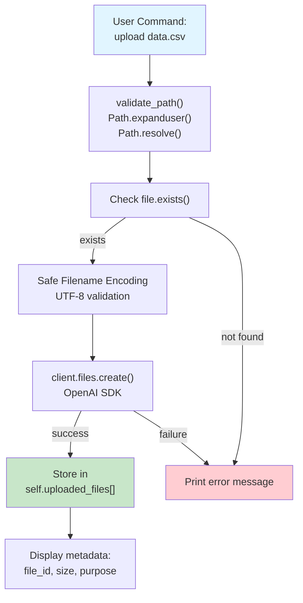
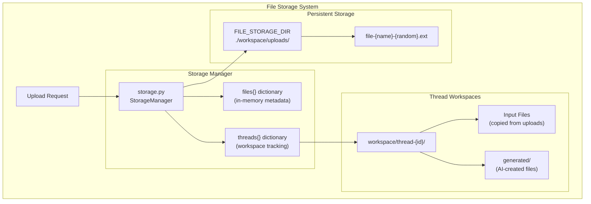
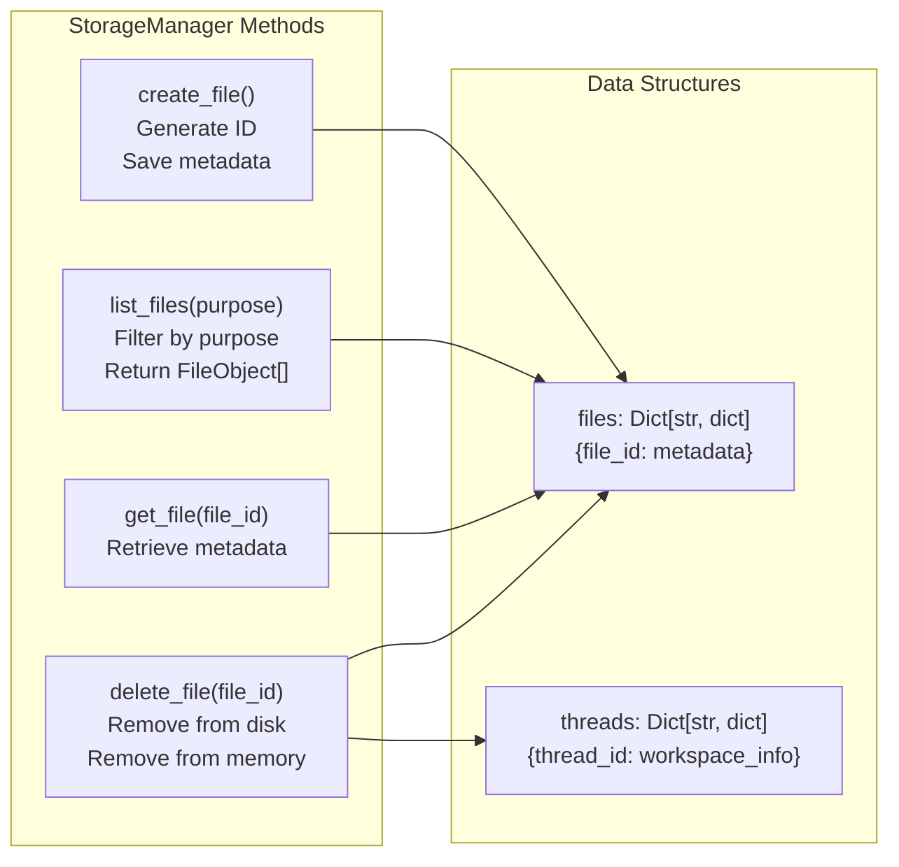
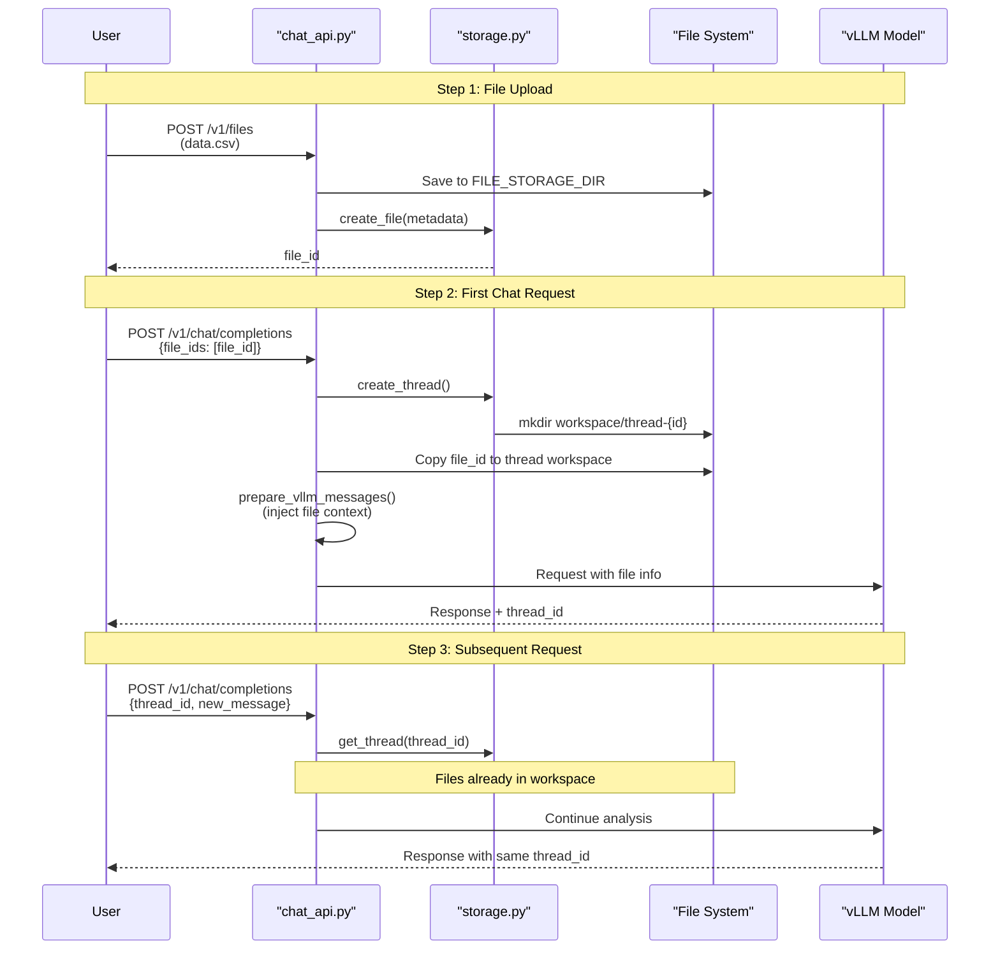
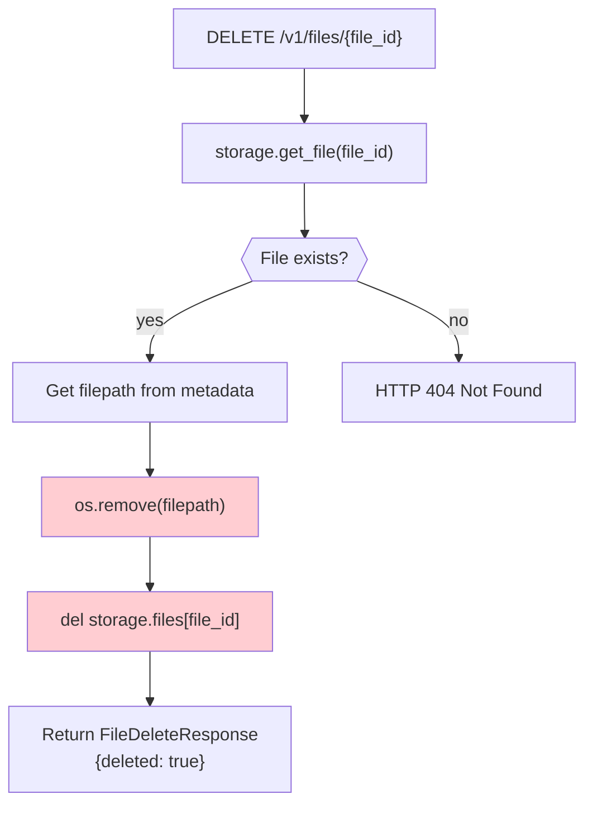
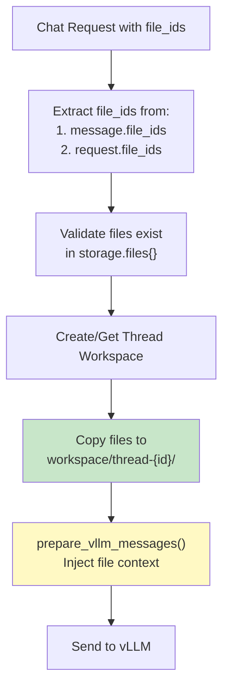

<!-- source: DeepWiki mcp.deepwiki.com · repo ruc-datalab/DeepAnalyze · page 7.3 File Upload and Management · fetched 2026-10-26 -->

# File Upload and Management

<details>
<summary>Relevant source files</summary>

The following files were used as context for generating this wiki page:

- [API/README_ZH.md](API/README_ZH.md)
- [API/__init__.py](API/__init__.py)
- [API/admin_api.py](API/admin_api.py)
- [API/example/Simpson.csv](API/example/Simpson.csv)
- [API/file_api.py](API/file_api.py)
- [API/start_server.py](API/start_server.py)
- [README.md](README.md)
- [assets/wechat.jpg](assets/wechat.jpg)
- [demo/cli/api_cli.py](demo/cli/api_cli.py)
- [demo/cli/api_cli_ZH.py](demo/cli/api_cli_ZH.py)
- [docs/DeepAnalyze_API_Key_Usage_Guide.md](docs/DeepAnalyze_API_Key_Usage_Guide.md)
- [docs/DeepAnalyze_API_Key_Usage_Guide_ZH.md](docs/DeepAnalyze_API_Key_Usage_Guide_ZH.md)
- [example/README.md](example/README.md)
- [quantize.py](quantize.py)
- [requirements.txt](requirements.txt)

</details>


## Purpose and Scope

This document describes how to upload, manage, and work with files in DeepAnalyze. It covers the file upload process, storage architecture, metadata management, and file lifecycle across multi-turn conversations. For information about how uploaded files are used within thread workspaces during analysis, see [Working with Workspaces](#7.5). For details on multi-turn conversation mechanics, see [Multi-turn Conversations](#7.4).

## File Upload Methods

DeepAnalyze supports multiple methods for uploading files, all exposing the same underlying file management API.

### Upload via HTTP API

The file upload endpoint follows OpenAI's file API specification. Files are uploaded using multipart form data to the `/v1/files` endpoint.

**Endpoint Structure:**

| Method | Endpoint | Purpose |
|--------|----------|---------|
| POST | `/v1/files` | Upload a new file |
| GET | `/v1/files` | List all uploaded files |
| GET | `/v1/files/{file_id}` | Retrieve file metadata |
| GET | `/v1/files/{file_id}/content` | Download file content |
| DELETE | `/v1/files/{file_id}` | Delete a file |

**Basic Upload Example:**

```bash
curl -X POST http://localhost:8200/v1/files \
  -F "file=@data.csv" \
  -F "purpose=file-extract"
```

The response contains a `file_id` that can be referenced in subsequent chat requests:

```json
{
  "id": "file-data-csv-a1b2c3d4",
  "object": "file",
  "bytes": 10485,
  "created_at": 1704067200,
  "filename": "data.csv",
  "purpose": "file-extract"
}
```

**Sources:** [API/file_api.py:1-92](), [README.md:292-310]()

### Upload via OpenAI SDK

The OpenAI Python library provides a convenient interface for file operations:

```python
import openai

client = openai.OpenAI(
    base_url="http://localhost:8200/v1",
    api_key="dummy"  # DeepAnalyze uses dummy keys for local deployment
)

# Upload file
with open('data.csv', 'rb') as f:
    file_obj = client.files.create(
        file=f,
        purpose="assistants"
    )

file_id = file_obj.id
print(f"File ID: {file_id}")
```

The SDK handles multipart encoding and provides typed response objects with attributes like `id`, `filename`, `bytes`, and `created_at`.

**Sources:** [docs/DeepAnalyze_API_Key_Usage_Guide.md:52-63](), [API/README_ZH.md:52-63]()

### Upload via CLI Interface

Both English and Chinese CLI interfaces support file upload with real-time progress feedback:

```bash
# In CLI interactive mode
You: upload path/to/data.csv
```

The CLI implementation provides:
- Automatic file size calculation
- Safe filename encoding to handle Unicode characters
- Progress indicators using the Rich library
- File metadata display upon successful upload

**CLI Upload Implementation Flow:**



**Sources:** [demo/cli/api_cli.py:106-163](), [demo/cli/api_cli_ZH.py:106-163]()

## File Storage Architecture

DeepAnalyze uses a two-tier storage system to manage uploaded files and generated artifacts separately.

### Storage Locations



**Storage Configuration:**

| Constant | Default Value | Purpose |
|----------|---------------|---------|
| `FILE_STORAGE_DIR` | `workspace/uploads/` | Persistent storage for uploaded files |
| `WORKSPACE_BASE_DIR` | `workspace/` | Base directory for thread workspaces |
| Thread workspace | `workspace/thread-{uuid}/` | Isolated environment per conversation |
| Generated files | `workspace/thread-{id}/generated/` | AI-created outputs |

**Sources:** [API/file_api.py:12-13](), [API/config.py]() (referenced)

### File ID Generation

File IDs are generated using a deterministic format to ensure uniqueness:

```python
# From file_api.py:36
file_id = f"file-{file.filename.replace('.', '-').replace('_', '-')[:8]}-{os.urandom(4).hex()}"
```

This creates IDs like: `file-data-csv-a1b2c3d4`

Components:
- Prefix: `file-`
- Sanitized filename (first 8 chars): `data-csv-`
- Random suffix: `a1b2c3d4`

**Sources:** [API/file_api.py:36]()

### Storage Manager Operations

The `storage` singleton (from `storage.py`) maintains in-memory metadata for all files and threads:



**Sources:** [API/storage.py]() (referenced), [API/file_api.py:44-50]()

## File Metadata and Retrieval

### File Object Structure

Each uploaded file is represented by a `FileObject` model conforming to OpenAI's specification:

```python
{
    "id": "file-data-csv-a1b2c3d4",
    "object": "file",
    "bytes": 10485,
    "created_at": 1704067200,
    "filename": "data.csv",
    "purpose": "file-extract"
}
```

**Valid Purpose Values:**

| Purpose | Description |
|---------|-------------|
| `file-extract` | General file analysis |
| `assistants` | Assistant/chat context |
| `fine-tune` | Training data (not used in inference) |

**Sources:** [API/models.py]() (referenced), [API/config.py]() (referenced), [API/file_api.py:23-32]()

### Listing Files

The list endpoint supports optional filtering by purpose:

```python
# List all files
response = client.files.list()

# Filter by purpose (if supported)
response = requests.get('http://localhost:8200/v1/files?purpose=assistants')
```

Response format:

```json
{
  "object": "list",
  "data": [
    {
      "id": "file-data-csv-a1b2c3d4",
      "object": "file",
      "bytes": 10485,
      "created_at": 1704067200,
      "filename": "data.csv",
      "purpose": "file-extract"
    }
  ]
}
```

**Sources:** [API/file_api.py:53-57](), [API/README_ZH.md:309-331]()

### Downloading File Content

Files can be downloaded by their ID through the `/content` endpoint:

```python
# Using OpenAI SDK
file_content = client.files.content("file-data-csv-a1b2c3d4")

with open("downloaded.csv", "wb") as f:
    f.write(file_content.content)
```

The implementation reads directly from the filesystem:

```python
# From file_api.py:78-91
filepath = storage.files[file_id].get("filepath")
if not filepath or not os.path.exists(filepath):
    raise HTTPException(status_code=404, detail="File content not found")

with open(filepath, "rb") as f:
    content = f.read()

return Response(content=content, media_type="application/octet-stream")
```

**Sources:** [API/file_api.py:78-91](), [demo/cli/api_cli.py:386-418]()

## File Lifecycle in Conversations

Files uploaded through the API persist independently but are copied into thread workspaces when used in conversations.

### File Integration with Threads



**Key Points:**

1. **Uploaded files remain in `FILE_STORAGE_DIR`** - Original files are never deleted when threads are cleaned up
2. **Files are copied to thread workspaces** - Each thread gets its own copy for isolation
3. **Thread workspace persists** - All files (uploaded and generated) remain accessible across conversation turns
4. **File metadata is injected into prompts** - The `prepare_vllm_messages()` function adds file information to the model's context

**Sources:** [API/chat_api.py]() (referenced), [API/storage.py]() (referenced)

### File Context Injection

When files are attached to a chat request, the system injects file metadata into the prompt:

```python
# Conceptual example of prepare_vllm_messages() behavior
prompt_with_files = f"""# Instruction
{user_message}

# Data
File 1: {{"name": "data.csv", "size": "10.2KB"}}
File 2: {{"name": "report.pdf", "size": "245KB"}}
"""
```

This allows the model to understand what files are available in the workspace before executing code to analyze them.

**Sources:** [README.md:240-253](), [API/utils.py]() (referenced)

## File Deletion and Cleanup

### Manual File Deletion

Users can delete uploaded files explicitly:

```python
# Via OpenAI SDK
client.files.delete("file-data-csv-a1b2c3d4")

# Via CLI
You: delete file-data-csv-a1b2c3d4
```

The deletion process:
1. Removes file from disk (`FILE_STORAGE_DIR`)
2. Removes metadata from `storage.files` dictionary
3. Does NOT remove copies in thread workspaces (those are cleaned up with threads)

**Deletion Flow:**



**Sources:** [API/file_api.py:69-75](), [demo/cli/api_cli.py:367-384]()

### Thread Cleanup

Thread workspaces (which contain file copies) are cleaned up separately through the admin API:

```bash
# Manual cleanup of expired threads
curl -X POST "http://localhost:8200/v1/admin/cleanup-threads?timeout_hours=12"
```

Response:

```json
{
  "status": "success",
  "cleaned_threads": 3,
  "timeout_hours": 12,
  "timestamp": 1704067200
}
```

**Thread Cleanup Criteria:**

| Age Category | Threshold | Action |
|-------------|-----------|--------|
| Recent | < 1 hour | Keep |
| Active | 1-12 hours | Keep (default) |
| Expired | > 12 hours | Delete workspace directory |

The cleanup process removes the entire `workspace/thread-{id}/` directory, including both copied input files and generated outputs.

**Sources:** [API/admin_api.py:18-40](), [API/config.py]() (referenced)

### CLI Cleanup Commands

The CLI provides two cleanup levels:

```bash
# Clear conversation history but keep uploaded files
You: clear

# Clear everything including uploaded files
You: clear-all
```

**Comparison Table:**

| Command | Chat History | Generated Files | Uploaded Files | Thread ID |
|---------|-------------|-----------------|----------------|-----------|
| `clear` | ✓ Cleared | ✓ Cleared | ✗ Kept | ✓ Reset |
| `clear-all` | ✓ Cleared | ✓ Cleared | ✓ Deleted | ✓ Reset |

The `clear-all` command explicitly calls `client.files.delete()` for each uploaded file in the `uploaded_files` list.

**Sources:** [demo/cli/api_cli.py:452-486](), [demo/cli/api_cli_ZH.py:452-486]()

## Supported File Formats

DeepAnalyze accepts a wide variety of file formats for data analysis:

### Structured Data

| Format | Extensions | Typical Use |
|--------|-----------|-------------|
| CSV | `.csv` | Tabular data, exports |
| Excel | `.xlsx`, `.xls` | Spreadsheets, reports |
| JSON | `.json` | Structured data, API responses |
| XML | `.xml` | Hierarchical data |
| YAML | `.yaml`, `.yml` | Configuration, structured data |

### Semi-Structured Data

| Format | Extensions | Typical Use |
|--------|-----------|-------------|
| Markdown | `.md`, `.markdown` | Documentation, notes |
| Text | `.txt` | Plain text data, logs |
| Log Files | `.log` | Application logs |

### Code and Scripts

| Format | Extensions | Typical Use |
|--------|-----------|-------------|
| Python | `.py` | Scripts, analysis code |
| SQL | `.sql` | Database queries |

### Documents and Media

| Format | Extensions | Typical Use |
|--------|-----------|-------------|
| PDF | `.pdf` | Reports, documents |
| Images | `.png`, `.jpg`, `.jpeg`, `.gif`, `.bmp`, `.svg` | Charts, diagrams, photos |

**File Format Handling:**

The system does not validate file types on upload. Format detection happens during analysis when the model:
1. Examines file extensions
2. Attempts to read file contents
3. Determines appropriate parsing libraries (pandas, PIL, etc.)

**Sources:** [README.md:235](), [docs/DeepAnalyze_API_Key_Usage_Guide.md:184]()

## File Viewing in CLI

The CLI provides a comprehensive view of both uploaded and generated files:

```bash
You: files
```

This displays two tables:

### User Uploaded Files Table

| File Name | File ID | File Size | Purpose | Status |
|-----------|---------|-----------|---------|--------|
| data.csv | file-abc123... | 10.2 KB | assistants | ✅ Uploaded |

### AI Generated Files in Workspace

| File Name | URL | File Type | Size | Status |
|-----------|-----|-----------|------|--------|
| analysis_report.md | http://localhost:8100/thread-{id}/generated/... | Report | 15.3 KB | 📋 Generated |
| trend_chart.png | http://localhost:8100/thread-{id}/generated/... | Image | 245 KB | 📋 Generated |

**File Type Detection:**

The CLI automatically categorizes generated files:
- `.md`, `.markdown` → "Report"
- `.png`, `.jpg`, `.jpeg`, `.gif`, `.bmp`, `.svg`, `.webp` → "Image"
- Others → "Generated File"

**Sources:** [demo/cli/api_cli.py:165-244](), [demo/cli/api_cli_ZH.py:165-244]()

## Integration with Chat API

Files are attached to chat requests via the `file_ids` parameter:

```python
response = client.chat.completions.create(
    model="DeepAnalyze-8B",
    messages=[
        {
            "role": "user",
            "content": "Analyze this data and create visualizations",
            "file_ids": ["file-data-csv-a1b2c3d4"]
        }
    ]
)
```

The chat endpoint supports file attachment in two ways:

1. **Message-level `file_ids`** - Attached to specific user messages (OpenAI compatible)
2. **Request-level `file_ids`** - Applied to all messages in the request

**File Attachment Processing:**



**Sources:** [API/chat_api.py]() (referenced), [API/README_ZH.md:96-141]()

## File URLs and Download Links

Generated files are served via the HTTP file server on port 8100:

```
http://localhost:8100/thread-{id}/generated/{filename}
```

**URL Structure:**

| Component | Example | Purpose |
|-----------|---------|---------|
| Base URL | `http://localhost:8100` | File server endpoint |
| Thread path | `/thread-abc123def456` | Thread isolation |
| Generated folder | `/generated/` | Distinguishes from input files |
| Filename | `chart.png` | Actual file |

These URLs are automatically generated and included in chat responses:

```json
{
  "choices": [{
    "message": {
      "role": "assistant",
      "content": "Analysis complete...",
      "files": [
        {
          "name": "chart.png",
          "url": "http://localhost:8100/thread-abc123/generated/chart.png"
        }
      ]
    }
  }],
  "generated_files": [...]
}
```

**Sources:** [API/utils.py]() (referenced), [API/README_ZH.md:396-413]()

---

