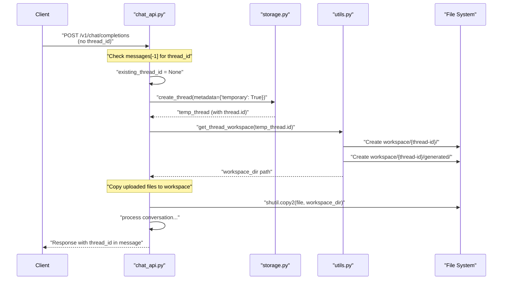
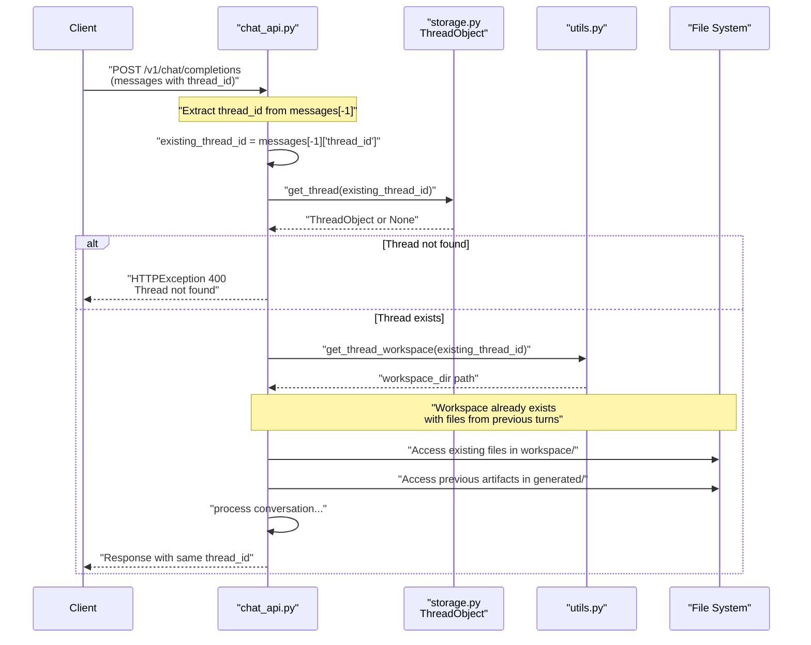
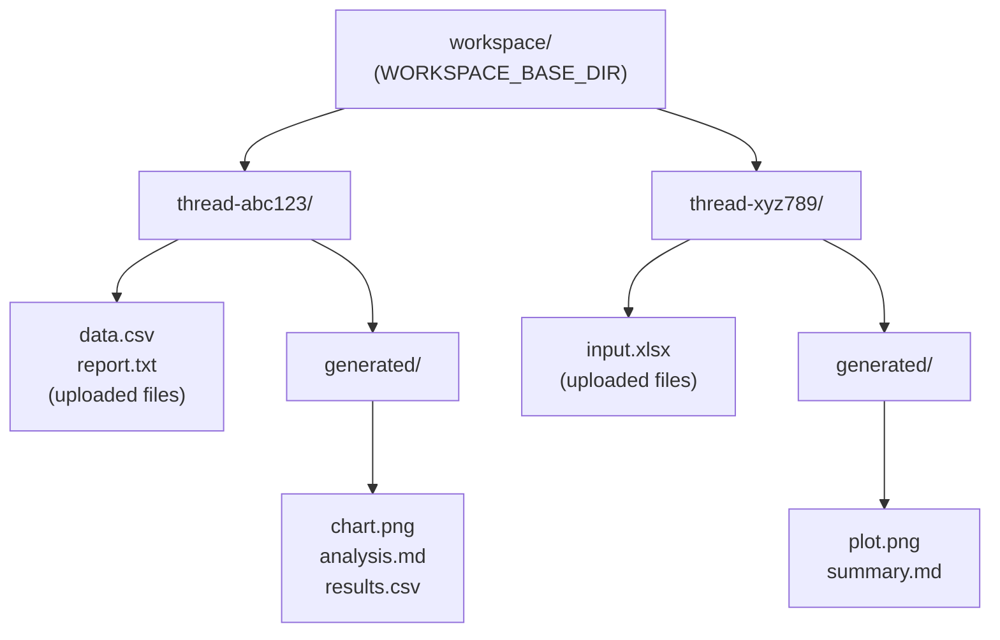
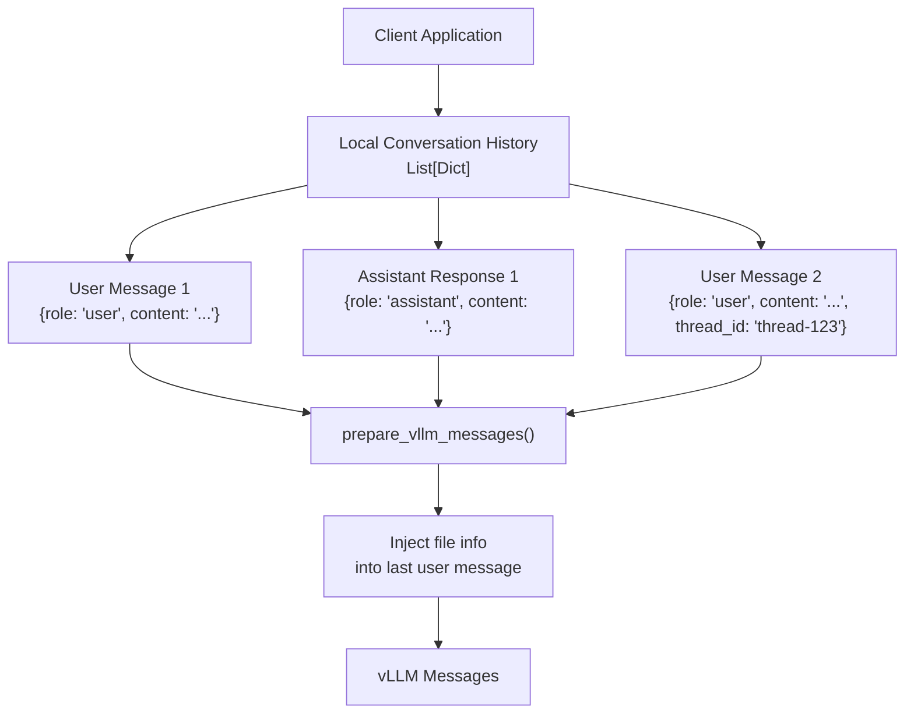
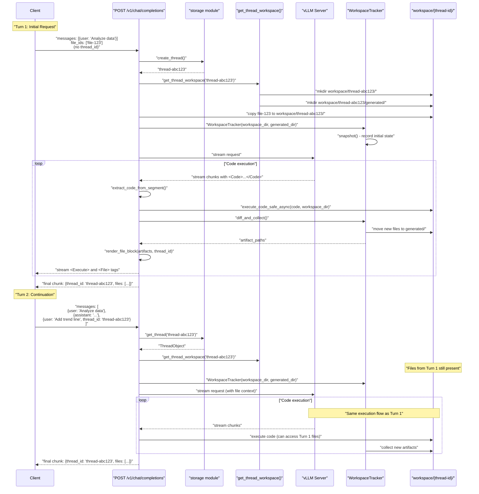

<!-- source: DeepWiki mcp.deepwiki.com · repo ruc-datalab/DeepAnalyze · page 7.4 Multi-turn Conversations · fetched 2026-10-26 -->

# Multi-turn Conversations

<details>
<summary>Relevant source files</summary>

The following files were used as context for generating this wiki page:

- [API/README_ZH.md](API/README_ZH.md)
- [API/chat_api.py](API/chat_api.py)
- [API/example/exampleOpenAI.py](API/example/exampleOpenAI.py)
- [API/example/exampleRequest.py](API/example/exampleRequest.py)
- [API/utils.py](API/utils.py)
- [demo/cli/api_cli.py](demo/cli/api_cli.py)
- [demo/cli/api_cli_ZH.py](demo/cli/api_cli_ZH.py)

</details>


This page explains how DeepAnalyze supports stateful multi-turn conversations through the `thread_id` mechanism, enabling persistent workspaces and file continuity across conversation turns. Multi-turn conversations allow data analysis tasks to build upon previous results, with generated files and intermediate artifacts automatically preserved in thread-specific workspaces.

For information about the underlying chat API endpoint, see [Chat Completions API](#6.6). For details on workspace file tracking, see [Workspace and File Tracking](#6.6.2).

---

## Overview

Multi-turn conversations in DeepAnalyze are implemented through a thread-based workspace system. Each conversation thread maintains:

- **Unique workspace directory**: `workspace/thread-{id}/`
- **Uploaded files**: Copied to thread workspace for code execution
- **Generated artifacts**: Saved to `workspace/thread-{id}/generated/`
- **Conversation context**: Must be maintained by client in message history

The `thread_id` is returned in the API response and should be included in subsequent requests to continue the same conversation thread.

**Sources:** [API/chat_api.py:67-87](), [API/utils.py:26-30]()

---

## Thread Lifecycle and Workspace Management

### Thread Creation Flow



When a request arrives without a `thread_id`, the system creates a new temporary thread using `storage.create_thread()` [API/chat_api.py:83]() and initializes its workspace directory [API/chat_api.py:84-86](). Files attached via `file_ids` are copied into the thread workspace [API/chat_api.py:105-114]().

**Sources:** [API/chat_api.py:67-87](), [API/storage.py](), [API/utils.py:26-30]()

---

### Thread Continuation Flow



When a request includes a `thread_id` in the last message [API/chat_api.py:68-70](), the system retrieves the existing thread [API/chat_api.py:74]() and reuses its workspace directory [API/chat_api.py:77](). All files from previous turns remain accessible for continued analysis.

**Sources:** [API/chat_api.py:68-80](), [API/storage.py](), [API/utils.py:26-30]()

---

## Thread Storage and Data Structures

### In-Memory Storage Schema

The storage layer maintains threads, files, and messages in memory using simple dictionaries:

| Storage Component | Data Structure | Key | Value Type |
|------------------|----------------|-----|------------|
| `storage.threads` | `Dict[str, Dict]` | `thread_id` | Thread metadata dict |
| `storage.files` | `Dict[str, Dict]` | `file_id` | File metadata with filepath |
| `storage.messages` | `Dict[str, List[Dict]]` | `thread_id` | List of message dicts |

The `ThreadObject` model [API/models.py]() contains:
- `id`: Unique thread identifier (e.g., `"thread-abc123..."`)
- `object`: Always `"thread"`
- `created_at`: Unix timestamp
- `metadata`: Optional dictionary (e.g., `{"temporary": True}`)

**Sources:** [API/storage.py](), [API/models.py]()

---

### Workspace Directory Structure



Each thread workspace has:
- **Root directory**: Contains uploaded files copied from `FILE_STORAGE_DIR`
- **`generated/` subdirectory**: Stores all artifacts created during code execution

Files are tracked by `WorkspaceTracker` [API/utils.py:350-409](), which monitors filesystem changes and moves new/modified files to `generated/` [API/utils.py:386-406]().

**Sources:** [API/utils.py:26-30](), [API/utils.py:350-409](), [API/config.py]()

---

## Message Format and thread_id Handling

### Request Message Structure

DeepAnalyze supports two approaches for including `thread_id` in requests:

**Approach 1: thread_id in the last user message (Recommended)**

```json
{
  "model": "DeepAnalyze-8B",
  "messages": [
    {"role": "user", "content": "First request"},
    {"role": "assistant", "content": "First response..."},
    {"role": "user", "content": "Second request", "thread_id": "thread-abc123..."}
  ]
}
```

**Approach 2: file_ids in messages (OpenAI compatibility)**

```json
{
  "model": "DeepAnalyze-8B",
  "messages": [
    {
      "role": "user",
      "content": "Analyze this data",
      "file_ids": ["file-xyz..."],
      "thread_id": "thread-abc123..."
    }
  ]
}
```

The system extracts `thread_id` from `messages[-1]` if present [API/chat_api.py:68-70](), otherwise creates a new thread.

**Sources:** [API/chat_api.py:67-70](), [API/README_ZH.md:143-223]()

---

### Response Message Structure

The system returns `thread_id` in both streaming and non-streaming responses:

**Non-streaming response:**

```json
{
  "id": "chatcmpl-xyz...",
  "object": "chat.completion",
  "model": "DeepAnalyze-8B",
  "choices": [{
    "index": 0,
    "message": {
      "role": "assistant",
      "content": "Analysis results...",
      "thread_id": "thread-abc123...",
      "files": [{"name": "chart.png", "url": "http://..."}]
    }
  }]
}
```

**Streaming response (final chunk):**

```json
{
  "id": "chatcmpl-xyz...",
  "object": "chat.completion.chunk",
  "choices": [{
    "delta": {
      "thread_id": "thread-abc123...",
      "files": [...]
    },
    "finish_reason": "stop"
  }]
}
```

The `thread_id` appears in the final chunk's `delta` for streaming [API/chat_api.py:254-256]() or in the message object for non-streaming [API/chat_api.py:359-360]().

**Sources:** [API/chat_api.py:249-276](), [API/chat_api.py:354-386]()

---

## Message History Management

### Conversation History Construction



**Critical requirement:** Clients must maintain the complete conversation history and send it with each request. The server does not store or reconstruct conversation history.

The `prepare_vllm_messages()` function [API/utils.py:91-127]() processes the message list and injects workspace file information into the last user message [API/utils.py:117-125]().

**Sources:** [API/utils.py:91-127](), [API/chat_api.py:117-119]()

---

### File Context Injection

The system automatically injects file information into the user's message using a structured template:

```
# Instruction
{user_content}

# Data
File 1:
{
    "name": "data.csv",
    "size": "15.3KB"
}

File 2:
{
    "name": "report.txt",
    "size": "8.7KB"
}
```

This injection is performed by `collect_file_info()` [API/utils.py:71-86]() which scans the workspace directory and `prepare_vllm_messages()` [API/utils.py:117-125]() which wraps the user message with the template.

**Sources:** [API/utils.py:71-86](), [API/utils.py:91-127]()

---

## Multi-turn Workflow Implementation

### Complete 2-Turn Example Flow



This diagram shows how `thread_id` enables workspace persistence across multiple turns, with each turn building upon the files and artifacts from previous turns.

**Sources:** [API/chat_api.py:67-87](), [API/chat_api.py:126-278](), [API/utils.py:350-409]()

---

## Usage Examples

### OpenAI SDK Example

Using the official OpenAI Python library with `thread_id` for multi-turn conversations:

```python
import openai

client = openai.OpenAI(
    base_url="http://localhost:8200/v1",
    api_key="dummy"
)

messages = []

# Turn 1: Initial analysis
messages.append({
    "role": "user",
    "content": "Examine the data structure and provide statistics"
})

response = client.chat.completions.create(
    model="DeepAnalyze-8B",
    messages=messages
)

# Extract thread_id using hasattr()
thread_id = None
if hasattr(response.choices[0].message, 'thread_id'):
    thread_id = response.choices[0].message.thread_id

messages.append({
    "role": "assistant",
    "content": response.choices[0].message.content
})

# Turn 2: Continue with same thread
messages.append({
    "role": "user",
    "content": "Generate a detailed analysis report",
    "thread_id": thread_id  # Include thread_id in last message
})

response = client.chat.completions.create(
    model="DeepAnalyze-8B",
    messages=messages
)
```

The OpenAI library requires using `hasattr()` to check for custom fields like `thread_id` [API/example/exampleOpenAI.py:74](), [API/example/exampleOpenAI.py:197-199]().

**Sources:** [API/example/exampleOpenAI.py:90-193](), [API/README_ZH.md:186-214]()

---

### Direct HTTP Requests Example

Using `requests` library with streaming to extract `thread_id`:

```python
import requests
import json

conversation_history = []

# Turn 1: Initial request (creates thread)
conversation_history.append({
    "role": "user",
    "content": "Analyze the data structure"
})

response = requests.post(
    "http://localhost:8200/v1/chat/completions",
    json={
        "model": "DeepAnalyze-8B",
        "messages": conversation_history,
        "stream": True
    },
    stream=True
)

full_response = ""
thread_id = None

for line in response.iter_lines():
    if line:
        line_str = line.decode('utf-8')
        if line_str.startswith('data: '):
            data_str = line_str[6:]
            if data_str == '[DONE]':
                break
            chunk = json.loads(data_str)
            
            # Extract content
            if 'choices' in chunk and chunk['choices']:
                delta = chunk['choices'][0].get('delta', {})
                if 'content' in delta:
                    full_response += delta['content']
            
            # Extract thread_id from delta
            if 'choices' in chunk and chunk['choices']:
                delta = chunk['choices'][0].get('delta', {})
                if 'thread_id' in delta:
                    thread_id = delta['thread_id']

conversation_history.append({"role": "assistant", "content": full_response})

# Turn 2: Continue with thread_id
conversation_history.append({
    "role": "user",
    "content": "Generate analysis report",
    "thread_id": thread_id  # Include in last message
})

response = requests.post(
    "http://localhost:8200/v1/chat/completions",
    json={
        "model": "DeepAnalyze-8B",
        "messages": conversation_history,
        "stream": True
    },
    stream=True
)
```

In streaming responses, `thread_id` appears in the `delta` object of streaming chunks [API/example/exampleRequest.py:233-235]().

**Sources:** [API/example/exampleRequest.py:173-316](), [API/chat_api.py:254-256]()

---

### CLI Multi-turn Conversation

The CLI automatically manages `thread_id` and conversation history:

```python
class DeepAnalyzeCLI:
    def __init__(self):
        self.current_thread_id = None
        self.chat_history = []
        self.generated_files = []
    
    def chat_with_file(self, message: str, file_ids: List[str] = None):
        # Add user message to history
        self.chat_history.append({"role": "user", "content": message})
        
        # Build complete message list with history
        messages = []
        for msg in self.chat_history[:-1]:
            messages.append({"role": msg["role"], "content": msg["content"]})
        
        # Add current message with thread_id
        current_message = {"role": "user", "content": message}
        if self.current_thread_id:
            current_message["thread_id"] = self.current_thread_id
        messages.append(current_message)
        
        # Make API call
        stream = self.client.chat.completions.create(
            model=self.model,
            messages=messages,
            stream=True
        )
        
        # Extract thread_id from response
        for chunk in stream:
            if hasattr(chunk.choices[0].delta, 'thread_id'):
                self.current_thread_id = chunk.choices[0].delta.thread_id
```

The CLI maintains local state for `current_thread_id` [demo/cli/api_cli.py:39]() and `chat_history` [demo/cli/api_cli.py:40](), automatically including the thread ID in subsequent requests [demo/cli/api_cli.py:276-277]().

**Sources:** [demo/cli/api_cli.py:32-365](), [demo/cli/api_cli_ZH.py:32-365]()

---

## Thread Management and Cleanup

### Thread Lifecycle Commands

| Operation | CLI Command | API Endpoint | Effect |
|-----------|-------------|--------------|--------|
| View thread ID | `status` | N/A | Display `current_thread_id` |
| Clear thread | `clear` | N/A | Reset `current_thread_id = None` |
| Clear all | `clear-all` | N/A | Delete uploaded files, reset thread |
| Admin cleanup | N/A | `POST /v1/admin/cleanup` | Delete old threads from filesystem |

The CLI `clear` command resets the thread without deleting uploaded files [demo/cli/api_cli.py:452-462](), while `clear-all` removes everything [demo/cli/api_cli.py:463-487]().

**Sources:** [demo/cli/api_cli.py:452-487](), [API/admin_api.py]()

---

### Workspace Persistence Behavior

**Important characteristics:**

1. **Thread persistence**: Thread workspaces persist indefinitely on the filesystem until manually deleted
2. **No automatic cleanup**: The API server does not automatically clean up old threads
3. **In-memory metadata**: Thread metadata is stored in memory and lost on server restart
4. **Workspace survives restarts**: Workspace directories persist across server restarts

After server restart:
- Workspace directories still exist: `workspace/thread-abc123/`
- Files remain accessible via file server: `http://localhost:8100/thread-abc123/generated/file.png`
- Thread metadata is lost from `storage.threads`
- Cannot continue conversation without valid `ThreadObject` in memory

**Sources:** [API/storage.py](), [API/config.py](), [API/utils.py:26-30]()

---

## Best Practices

### Client-Side Requirements

| Requirement | Reason | Implementation |
|-------------|--------|----------------|
| Maintain complete history | Server does not store history | Keep all user/assistant messages in list |
| Include thread_id in last message | Identifies target workspace | Add to `messages[-1]` |
| Use `hasattr()` for thread_id | OpenAI library doesn't know custom fields | Check before accessing |
| Store thread_id locally | Enable continuation | Save from first response |

**Example pattern:**

```python
messages = []
thread_id = None

# Turn 1
messages.append({"role": "user", "content": "First request"})
response = client.chat.completions.create(model=MODEL, messages=messages)

if hasattr(response.choices[0].message, 'thread_id'):
    thread_id = response.choices[0].message.thread_id
    
messages.append({"role": "assistant", "content": response.choices[0].message.content})

# Turn 2
messages.append({"role": "user", "content": "Second request", "thread_id": thread_id})
response = client.chat.completions.create(model=MODEL, messages=messages)
```

**Sources:** [API/example/exampleOpenAI.py:90-193](), [API/README_ZH.md:143-223]()

---

### Thread Management Strategies

**For interactive applications (CLI, WebUI):**
- Store `thread_id` in session/state
- Clear thread when starting new conversation
- Display thread_id in status/UI

**For batch processing:**
- Create new thread for each independent task
- Do not reuse threads across unrelated analyses
- Clean up workspaces after processing

**For long-running analysis:**
- Keep thread_id for entire analysis workflow
- All intermediate files remain accessible
- Reports and artifacts build upon previous results

**Sources:** [demo/cli/api_cli.py:32-365](), [demo/chat/frontend]()

---

## Common Issues and Solutions

### Issue: "Thread not found" Error

**Cause:** Requesting with invalid or expired `thread_id`

**Solution:** 
- Verify thread_id is correctly extracted from response
- Check if server was restarted (clears in-memory threads)
- Create new thread if continuation not possible

```python
try:
    response = client.chat.completions.create(
        model=MODEL,
        messages=[{
            "role": "user",
            "content": "Continue analysis",
            "thread_id": thread_id
        }]
    )
except openai.BadRequestError as e:
    if "Thread" in str(e) and "not found" in str(e):
        # Create new thread instead
        response = client.chat.completions.create(
            model=MODEL,
            messages=[{"role": "user", "content": "Restart analysis"}]
        )
```

**Sources:** [API/chat_api.py:74-76]()

---

### Issue: Files Not Found in Subsequent Turns

**Cause:** Files not persisting to workspace or using different thread_id

**Verification steps:**

1. Check workspace directory exists: `workspace/thread-{id}/`
2. Verify files were copied: List files in workspace
3. Confirm same thread_id used in both requests
4. Check file permissions on workspace directory

**Sources:** [API/chat_api.py:105-114](), [API/utils.py:26-30]()

---

### Issue: Conversation History Not Maintained

**Cause:** Client not sending complete message history

**Solution:** Always include all previous messages:

```python
# ✗ Wrong: Only sending current message
messages = [{"role": "user", "content": "Second request", "thread_id": thread_id}]

# ✓ Correct: Sending complete history
messages = [
    {"role": "user", "content": "First request"},
    {"role": "assistant", "content": "First response..."},
    {"role": "user", "content": "Second request", "thread_id": thread_id}
]
```

The server processes all messages through `prepare_vllm_messages()` [API/utils.py:91-127]() to maintain context.

**Sources:** [API/utils.py:91-127](), [API/README_ZH.md:147-173]()

---

