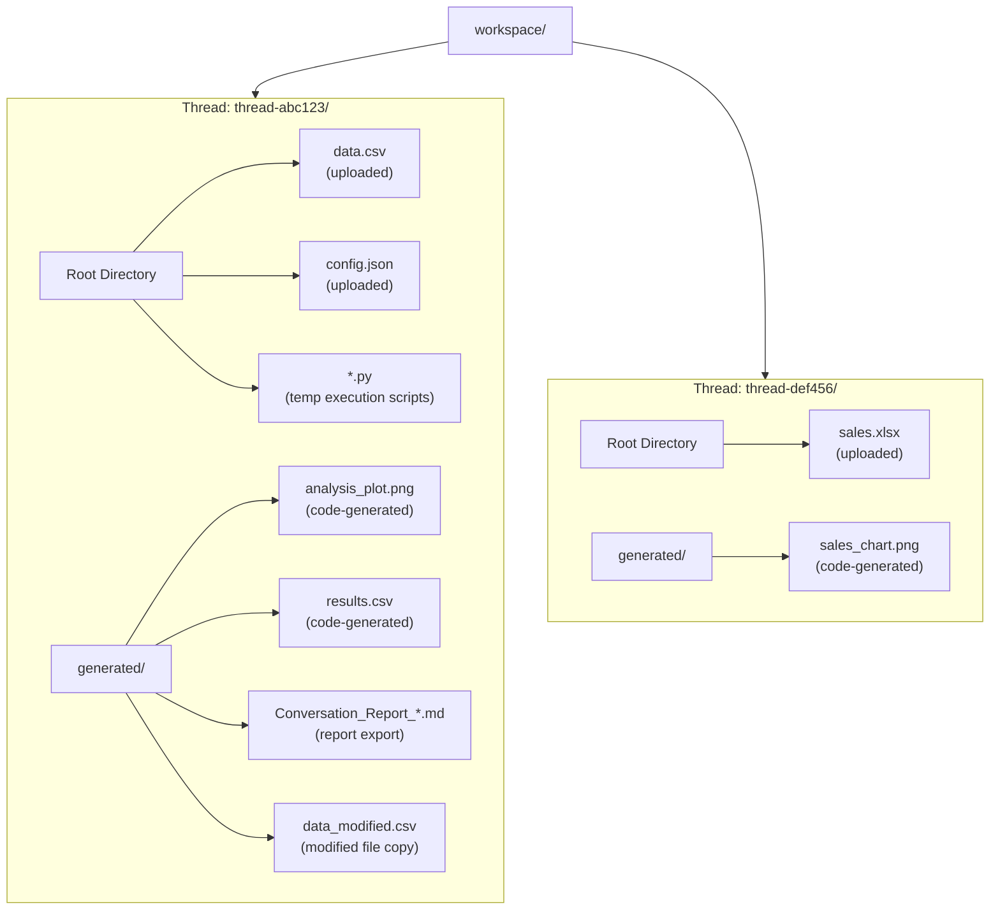
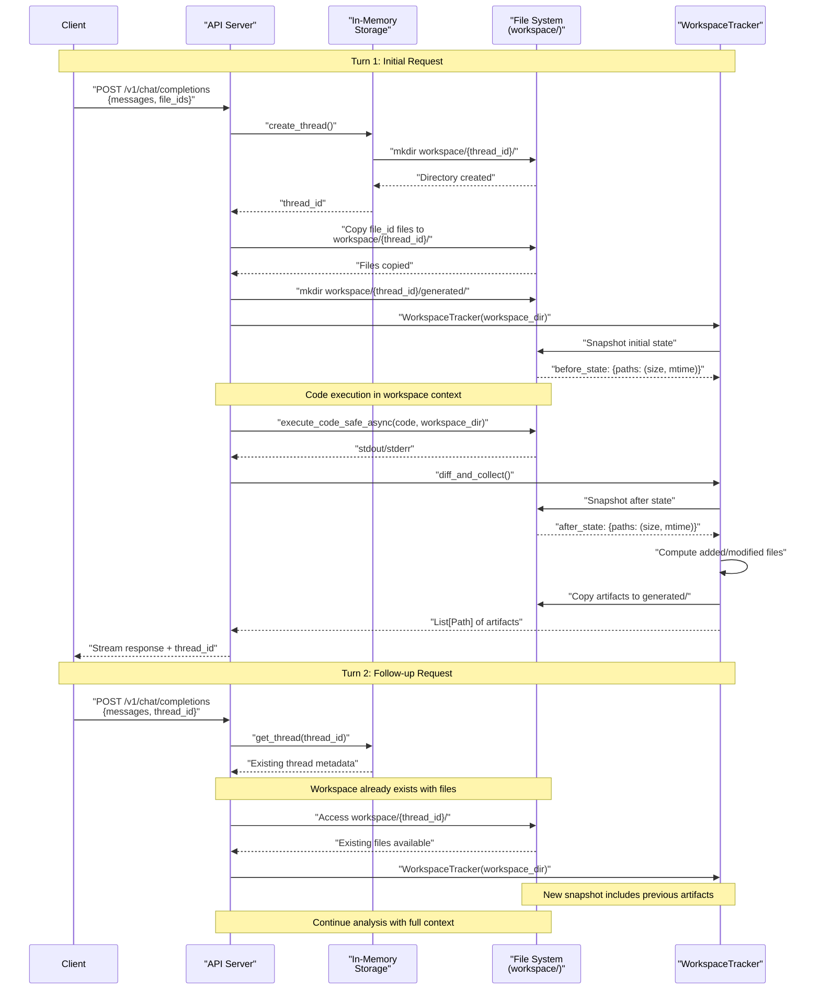
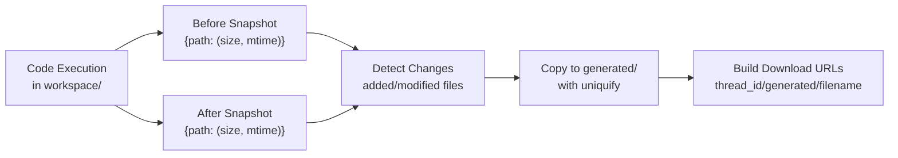
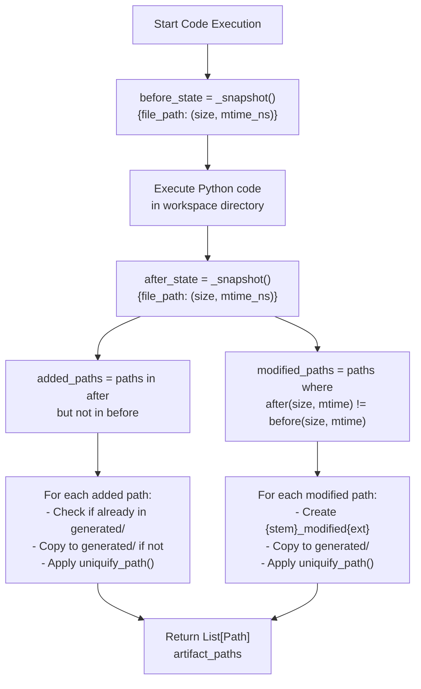
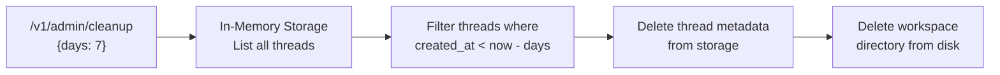

<!-- source: DeepWiki mcp.deepwiki.com · repo ruc-datalab/DeepAnalyze · page 7.5 Working with Workspaces · fetched 2026-10-26 -->

# Working with Workspaces

<details>
<summary>Relevant source files</summary>

The following files were used as context for generating this wiki page:

- [API/example/exampleOpenAI.py](API/example/exampleOpenAI.py)
- [API/utils.py](API/utils.py)
- [demo/chat/backend.py](demo/chat/backend.py)
- [docs/FAQ.md](docs/FAQ.md)
- [docs/FAQ_ZH.md](docs/FAQ_ZH.md)

</details>


## Purpose and Scope

This document explains DeepAnalyze's workspace system, which provides isolated file storage for each conversation thread. Each thread receives its own dedicated workspace directory where uploaded files, generated artifacts, and intermediate results are stored. This isolation enables stateful multi-turn conversations while preventing file conflicts between different analysis sessions.

For information about uploading files to workspaces, see [File Upload and Management](#7.3). For using workspaces in multi-turn conversations, see [Multi-turn Conversations](#7.4).

---

## Thread-Based Workspace Isolation

DeepAnalyze creates a unique workspace directory for each conversation thread. The workspace is identified by a `thread_id` (in the API server) or `session_id` (in the WebUI backend), which serves as the directory name under the base workspace path.

**Workspace Path Pattern:**
```
workspace/{thread_id}/
```

Each workspace is completely isolated from others, enabling:
- **Concurrent conversations** without file conflicts
- **Stateful analysis** where each turn builds upon previous results
- **File persistence** across multiple requests within the same thread
- **Secure isolation** between different users or analysis sessions

The workspace directory is created automatically on the first request that includes a `thread_id`. If no `thread_id` is provided, the system creates a new one.

**Sources:** [API/utils.py:26-30](), [demo/chat/backend.py:141-147](), [API/storage.py]()

---

## Workspace Directory Structure

The following diagram illustrates the complete file organization within a thread workspace:



**Directory Purposes:**

| Location | Purpose | Managed By |
|----------|---------|------------|
| `workspace/` | Base directory for all workspaces | Configuration (`WORKSPACE_BASE_DIR`) |
| `workspace/{thread_id}/` | Root workspace for a specific thread | `get_thread_workspace()` or `get_session_workspace()` |
| `workspace/{thread_id}/*.{csv,xlsx,json}` | User-uploaded data files | File upload endpoints |
| `workspace/{thread_id}/*.py` | Temporary execution scripts (auto-deleted) | `execute_code_safe_async()` |
| `workspace/{thread_id}/generated/` | Code-generated artifacts and reports | `WorkspaceTracker.diff_and_collect()` |

**Sources:** [API/utils.py:26-30](), [demo/chat/backend.py:641-645](), [API/config.py]()

---

## Workspace Lifecycle

The following sequence diagram shows how workspaces are created, populated, and used across multiple conversation turns:



**Key Lifecycle Events:**

1. **Creation:** When a new thread is created, `get_thread_workspace()` creates the directory structure
2. **Population:** Uploaded files are copied from the temporary upload storage into the thread workspace
3. **Execution Context:** Python code executes with the workspace as its current working directory
4. **Artifact Collection:** `WorkspaceTracker` detects new/modified files and moves them to `generated/`
5. **Persistence:** Workspace remains intact for subsequent turns in the same thread
6. **Cleanup:** Workspaces can be manually deleted via admin endpoints or automatic cleanup policies

**Sources:** [API/utils.py:26-30](), [API/chat_api.py](), [demo/chat/backend.py:639-803]()

---

## The `generated/` Folder

The `generated/` subdirectory serves as a quarantine zone for code-generated artifacts. This separation provides several benefits:

**Purpose:**
- **Isolation:** Separates user-uploaded files from AI-generated outputs
- **Organization:** Makes it easy to identify which files were created by code execution
- **File Server Access:** Structured location for building download URLs

**What Goes Into `generated/`:**

| File Type | Example | How It's Created |
|-----------|---------|------------------|
| Plots/Charts | `analysis_plot.png`, `correlation_matrix.svg` | Matplotlib, Seaborn, Plotly saves |
| Data Exports | `filtered_results.csv`, `summary_stats.xlsx` | Pandas DataFrame exports |
| Reports | `Conversation_Report_20250115_143022.md` | `generate_report_from_messages()` |
| Modified Files | `data_modified.csv` | Copies of files modified by code |

**Automatic File Movement:**

The `WorkspaceTracker` class handles automatic movement of generated files:



**Sources:** [API/utils.py:350-410](), [demo/chat/backend.py:732-757]()

---

## WorkspaceTracker Class

The `WorkspaceTracker` class provides filesystem change detection to capture artifacts generated by code execution. It operates by comparing filesystem snapshots before and after code execution.

**Class Definition:**

```
WorkspaceTracker(workspace_dir: str, generated_dir: str)
```

Located at [API/utils.py:350-410]()

**Key Methods:**

| Method | Purpose | Returns |
|--------|---------|---------|
| `_snapshot()` | Capture current filesystem state | `Dict[Path, Tuple[int, int]]` mapping paths to (size, mtime) |
| `diff_and_collect()` | Compare snapshots and move artifacts | `List[Path]` of artifact paths in `generated/` |

**Tracking Algorithm:**



**Example Usage in Code Execution:**

The tracker is instantiated before code execution and queried afterward:

[API/utils.py:350-410]() - WorkspaceTracker class
[demo/chat/backend.py:704-757]() - Usage in bot_stream function

The tracker ensures that:
- Files created outside `generated/` are automatically moved into it
- Modified files get a `_modified` suffix to preserve originals
- File collisions are handled via `uniquify_path()` (adding `(1)`, `(2)`, etc.)

**Sources:** [API/utils.py:350-410](), [demo/chat/backend.py:704-757]()

---

## Accessing Workspace Files

Files within workspaces are accessible via HTTP download URLs built by the `build_download_url()` function. The file server runs on port 8100 by default.

**URL Construction:**

```
http://localhost:8100/{thread_id}/{relative_path}
```

**Function Signature:**

```python
build_download_url(thread_id: str, rel_path: str) -> str
```

Located at [API/utils.py:33-39]()

**Example URLs:**

| File Location | Download URL |
|---------------|--------------|
| `workspace/thread-abc123/data.csv` | `http://localhost:8100/thread-abc123/data.csv` |
| `workspace/thread-abc123/generated/plot.png` | `http://localhost:8100/thread-abc123/generated/plot.png` |
| `workspace/thread-xyz789/generated/Report_20250115.md` | `http://localhost:8100/thread-xyz789/generated/Report_20250115.md` |

**HTTP File Server:**

The file server is a simple HTTP server serving the `WORKSPACE_BASE_DIR`:

[API/utils.py:494-510]() - `start_http_server()` function
[demo/chat/backend.py:171-179]() - WebUI backend equivalent

The server:
- Runs in a daemon thread
- Uses `http.server.SimpleHTTPRequestHandler`
- Serves files with proper MIME types
- Supports concurrent requests via `ThreadingTCPServer`

**File References in Responses:**

Generated files are returned to clients in two formats:

1. **Markdown Links (Streaming):**
   ```markdown
   <File>
   - [plot.png](http://localhost:8100/thread-abc123/generated/plot.png)
   
   </File>
   ```

2. **Structured Metadata (Response Object):**
   ```python
   generated_files = [
       {"name": "plot.png", "url": "http://localhost:8100/thread-abc123/generated/plot.png"},
       {"name": "results.csv", "url": "http://localhost:8100/thread-abc123/generated/results.csv"}
   ]
   ```

**Sources:** [API/utils.py:33-39](), [API/utils.py:471-493](), [API/utils.py:494-510]()

---

## Workspace Cleanup

Workspaces persist indefinitely by default to support multi-turn conversations. Cleanup can be performed manually or via administrative endpoints.

**Manual Cleanup:**

Delete a thread's workspace directory:

```bash
rm -rf workspace/thread-abc123/
```

**API Cleanup Endpoints:**

| Endpoint | Method | Purpose | Reference |
|----------|--------|---------|-----------|
| `/v1/admin/cleanup` | `POST` | Delete threads older than specified days | Admin API |
| `/workspace/clear` | `DELETE` | Clear all files in a session workspace | WebUI Backend |
| `/workspace/dir` | `DELETE` | Delete specific directory in workspace | WebUI Backend |

**Cleanup Workflow:**



**Cleanup Considerations:**

- **Thread Metadata:** Stored in-memory only, lost on server restart
- **Filesystem Data:** Persists until explicitly deleted
- **Active Threads:** Should not be cleaned up during ongoing conversations
- **Backup:** Consider backing up workspaces before cleanup if analysis results are valuable

**Automatic Cleanup (Not Implemented):**

The current implementation does not include automatic cleanup. Future enhancements could add:
- TTL-based expiration policies
- Disk space quota management
- Archival to long-term storage

**Sources:** [API/admin_api.py](), [demo/chat/backend.py:508-515](), [demo/chat/backend.py:434-459]()

---

## Workspace Best Practices

**For API Users:**

1. **Preserve thread_id:** Store the `thread_id` from the first response to continue multi-turn conversations
2. **Download artifacts:** Save generated files before workspace cleanup
3. **Monitor disk usage:** Workspaces accumulate data over time
4. **Session management:** Use different threads for unrelated analysis tasks

**For Frontend Developers:**

1. **Display workspace tree:** Show users the current workspace file structure (see `/workspace/tree` endpoint)
2. **Handle file conflicts:** Use `uniquify_path()` to prevent overwrites
3. **Download links:** Always use the file server URLs from the API response
4. **Session IDs:** Map UI sessions to thread IDs consistently

**For System Administrators:**

1. **Configure workspace location:** Set `WORKSPACE_BASE_DIR` to a volume with sufficient space
2. **Backup strategy:** Implement regular backups if analysis results are critical
3. **Cleanup policy:** Schedule periodic cleanup of old workspaces
4. **Monitor file server:** Ensure port 8100 is accessible to clients

**Sources:** [API/config.py](), [API/utils.py](), [demo/chat/backend.py]()

---

## Integration Examples

**Example 1: Multi-Turn Analysis with Workspace Persistence**

```python
# Turn 1: Upload data and analyze
response1 = client.chat.completions.create(
    model="DeepAnalyze-8B",
    messages=[{
        "role": "user",
        "content": "Analyze this dataset structure",
        "file_ids": [file_id]
    }]
)
thread_id = response1.choices[0].message.thread_id

# Turn 2: Generate visualization (uses files from Turn 1)
response2 = client.chat.completions.create(
    model="DeepAnalyze-8B",
    messages=[{
        "role": "user",
        "content": "Create a correlation heatmap",
        "thread_id": thread_id  # Reuses same workspace
    }]
)
```

**Example 2: Accessing Generated Files**

```python
# Extract download URLs from response
for file in response.generated_files:
    print(f"Download: {file['url']}")
    # Example: http://localhost:8100/thread-abc123/generated/heatmap.png
```

**Example 3: WebUI Workspace Tree Display**

The WebUI fetches workspace structure via `/workspace/tree` endpoint:

[demo/chat/backend.py:359-376]() - `workspace_tree()` endpoint

This returns a hierarchical tree structure that the frontend renders as an interactive file browser.

**Sources:** [API/example/exampleOpenAI.py:90-193](), [demo/chat/backend.py:270-316](), [demo/chat/backend.py:359-376]()

---

