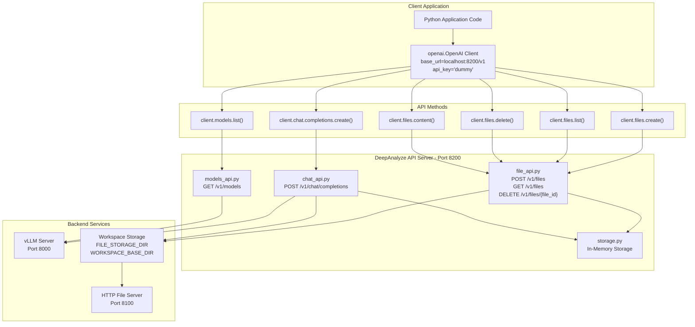
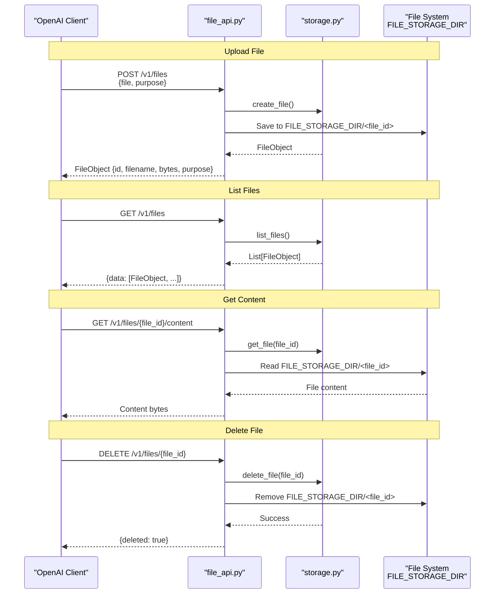
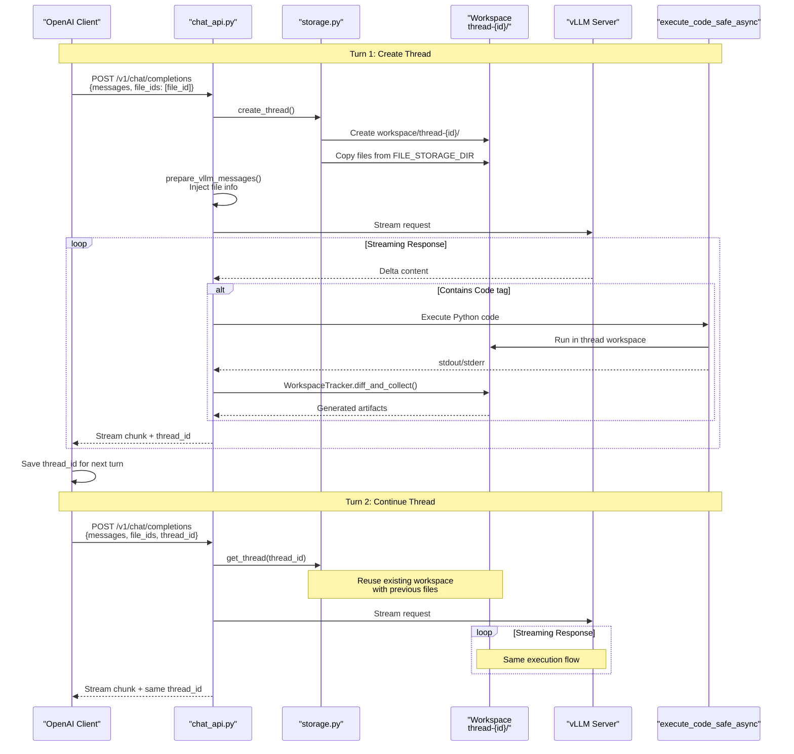
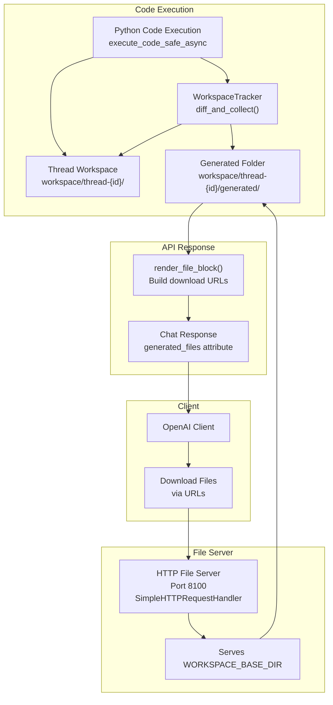

<!-- source: DeepWiki mcp.deepwiki.com · repo ruc-datalab/DeepAnalyze · page 7.6 Using OpenAI SDK · fetched 2026-10-26 -->

# Using OpenAI SDK

<details>
<summary>Relevant source files</summary>

The following files were used as context for generating this wiki page:

- [API/example/exampleOpenAI.py](API/example/exampleOpenAI.py)
- [API/utils.py](API/utils.py)

</details>


This page explains how to use the OpenAI Python client library to interact with DeepAnalyze's API server. The API server provides OpenAI-compatible endpoints, allowing you to use the familiar `openai` Python package to perform data analysis tasks.

**Scope:** This page covers using the official OpenAI Python SDK as a client for the DeepAnalyze API server (port 8200). For direct programmatic access to the vLLM engine that bypasses the API server, see [Python SDK](#5.5). For information about the API server's internal architecture, see [API Server Architecture](#6).

---

## Client Configuration

The DeepAnalyze API server exposes OpenAI-compatible endpoints at `http://localhost:8200/v1`. To use the OpenAI Python library with DeepAnalyze, configure the client to point to this base URL:

```python
import openai

client = openai.OpenAI(
    base_url="http://localhost:8200/v1",
    api_key="dummy"  # DeepAnalyze doesn't require real API keys
)
```

**Key points:**
- `base_url`: Points to the DeepAnalyze API server (default: `http://localhost:8200/v1`)
- `api_key`: Can be any string (e.g., `"dummy"`) since DeepAnalyze runs locally without authentication
- The client automatically appends `/chat/completions`, `/files`, etc. to the base URL

**Sources:** [API/example/exampleOpenAI.py:11-18]()

---

## OpenAI SDK Integration Architecture



**Diagram: OpenAI SDK Integration with DeepAnalyze API**

The OpenAI SDK provides high-level methods that map directly to DeepAnalyze API endpoints. The SDK handles HTTP requests, authentication headers (though DeepAnalyze ignores them), and response parsing. All file operations go through `file_api.py`, while chat completions are handled by `chat_api.py`. Generated artifacts are served via the HTTP file server on port 8100.

**Sources:** [API/example/exampleOpenAI.py:11-18](), [API/utils.py:23-39]()

---

## File Management

DeepAnalyze supports file uploads for data analysis tasks. Files are managed through the OpenAI-compatible `/v1/files` endpoints.

### Uploading Files

```python
# Upload a file for data analysis
with open("data.csv", "rb") as f:
    file_obj = client.files.create(
        file=f,
        purpose="file-extract"  # Purpose: assistants or file-extract
    )

print(f"File ID: {file_obj.id}")
```

**Parameters:**
- `file`: File object opened in binary mode
- `purpose`: Either `"file-extract"` (for downloadable content) or `"assistants"` (standard purpose)

**Response attributes:**
- `id`: Unique file identifier (used in `file_ids` for chat completions)
- `filename`: Original filename
- `bytes`: File size
- `purpose`: Specified purpose
- `created_at`: Unix timestamp

**Sources:** [API/example/exampleOpenAI.py:95-99]()

### Listing Files

```python
# List all uploaded files
files_list = client.files.list()
print(f"Total files: {len(files_list.data)}")

for file in files_list.data:
    print(f"- {file.filename} ({file.id})")
```

**Sources:** [API/example/exampleOpenAI.py:33-35]()

### Retrieving File Content

```python
# Get file content (only for purpose="file-extract")
if file_obj.purpose == "file-extract":
    content = client.files.content(file_obj.id)
    print(content.text)
```

**Note:** Only files with `purpose="file-extract"` can have their content retrieved directly.

**Sources:** [API/example/exampleOpenAI.py:38-40]()

### Deleting Files

```python
# Delete a file
client.files.delete(file_obj.id)
```

**Sources:** [API/example/exampleOpenAI.py:43-44]()

---

## File Operations Flow



**Diagram: File Management Operations**

Files uploaded through `client.files.create()` are stored in `FILE_STORAGE_DIR` with unique identifiers. The `storage.py` module maintains in-memory metadata while physical files reside on disk. When files are attached to chat messages via `file_ids`, they are copied into the thread's workspace directory for code execution access.

**Sources:** [API/example/exampleOpenAI.py:20-49](), [API/utils.py:71-86]()

---

## Chat Completions

### Basic Chat Completion (Non-streaming)

```python
# Simple chat completion
messages = [
    {
        "role": "user",
        "content": "Analyze the data and summarize key findings."
    }
]

response = client.chat.completions.create(
    model="DeepAnalyze-8B",
    messages=messages
)

print(response.choices[0].message.content)
```

**Sources:** [API/example/exampleOpenAI.py:68]()

### Chat Completion with File Attachments

Files can be attached to messages using the `file_ids` parameter:

```python
# Upload data file
with open("Simpson.csv", "rb") as f:
    file_obj = client.files.create(file=f, purpose="file-extract")

# Send message with file attachment
messages = [
    {
        "role": "user",
        "content": "Analyze this data and generate visualizations.",
        "file_ids": [file_obj.id]  # Attach file to message
    }
]

response = client.chat.completions.create(
    model="DeepAnalyze-8B",
    messages=messages
)

# Access thread_id for follow-up
if hasattr(response.choices[0].message, 'thread_id'):
    thread_id = response.choices[0].message.thread_id
    print(f"Thread ID: {thread_id}")

# Access generated files
if hasattr(response, 'generated_files'):
    for file in response.generated_files:
        print(f"Generated: {file['name']} - {file['url']}")
```

**Key points:**
- `file_ids`: List of file IDs to attach to the user message
- Files are copied into the thread workspace and become available for code execution
- `thread_id`: Returned in the response for multi-turn conversations
- `generated_files`: List of artifacts (plots, CSVs, reports) generated during execution

**Sources:** [API/example/exampleOpenAI.py:52-88]()

### Streaming Chat Completions

Streaming allows real-time display of the assistant's response:

```python
# Streaming with file attachments
messages = [
    {
        "role": "user",
        "content": "Analyze the data and generate charts.",
        "file_ids": [file_obj.id]
    }
]

stream = client.chat.completions.create(
    model="DeepAnalyze-8B",
    messages=messages,
    stream=True
)

full_response = ""
thread_id = None
collected_files = []

for chunk in stream:
    # Stream content
    if chunk.choices and chunk.choices[0].delta.content:
        content = chunk.choices[0].delta.content
        print(content, end='', flush=True)
        full_response += content
    
    # Capture thread_id from chunks
    if hasattr(chunk.choices[0].delta, 'thread_id') and chunk.choices[0].delta.thread_id:
        thread_id = chunk.choices[0].delta.thread_id
    
    # Collect generated files
    if hasattr(chunk, 'generated_files') and chunk.generated_files:
        collected_files.extend(chunk.generated_files)

print(f"\nThread ID: {thread_id}")
print(f"Files generated: {len(collected_files)}")
```

**Streaming response structure:**
- Content arrives in `chunk.choices[0].delta.content`
- `thread_id` appears in `chunk.choices[0].delta.thread_id`
- `generated_files` can appear in `chunk.generated_files`

**Sources:** [API/example/exampleOpenAI.py:195-244]()

---

## Multi-turn Conversations with Thread ID

DeepAnalyze maintains stateful conversations using thread workspaces. The `thread_id` allows follow-up requests to access files and results from previous turns.

### Thread-based Conversation Flow



**Diagram: Multi-turn Conversation with Thread Management**

The first turn creates a new thread and workspace. The API returns a `thread_id` that the client stores. In subsequent turns, the client includes `thread_id` in the message to continue the conversation in the same workspace. This allows code to access files and results from previous turns.

**Sources:** [API/example/exampleOpenAI.py:90-193](), [API/utils.py:91-127]()

### Complete Multi-turn Example

```python
messages = []
thread_id = None
collected_files = []

# Upload data file
with open("Simpson.csv", "rb") as f:
    file_obj = client.files.create(file=f, purpose="file-extract")

# Turn 1: Examine data structure
print("Turn 1: Examining data structure...")
messages.append({
    "role": "user",
    "content": "Please examine this data file and tell me about its structure.",
    "file_ids": [file_obj.id]
})

stream = client.chat.completions.create(
    model="DeepAnalyze-8B",
    messages=messages,
    stream=True
)

full_response = ""
for chunk in stream:
    if chunk.choices and chunk.choices[0].delta.content:
        content = chunk.choices[0].delta.content
        print(content, end='', flush=True)
        full_response += content
    
    # Capture thread_id
    if hasattr(chunk.choices[0].delta, 'thread_id') and chunk.choices[0].delta.thread_id:
        thread_id = chunk.choices[0].delta.thread_id
    
    # Collect files
    if hasattr(chunk, 'generated_files') and chunk.generated_files:
        collected_files.extend(chunk.generated_files)

messages.append({"role": "assistant", "content": full_response})

print(f"\nThread ID: {thread_id}")
print(f"Files from turn 1: {len(collected_files)}")

# Turn 2: Generate detailed analysis (with thread_id)
print("\nTurn 2: Generating detailed analysis...")
messages.append({
    "role": "user",
    "content": "Based on the previous analysis, generate a detailed report with visualizations.",
    "file_ids": [file_obj.id]
})

# Include thread_id to continue in same workspace
if thread_id:
    messages[-1]["thread_id"] = thread_id

stream = client.chat.completions.create(
    model="DeepAnalyze-8B",
    messages=messages,
    stream=True
)

full_response2 = ""
returned_thread_id = None
collected_files2 = []

for chunk in stream:
    if chunk.choices and chunk.choices[0].delta.content:
        content = chunk.choices[0].delta.content
        print(content, end='', flush=True)
        full_response2 += content
    
    if hasattr(chunk.choices[0].delta, 'thread_id') and chunk.choices[0].delta.thread_id:
        returned_thread_id = chunk.choices[0].delta.thread_id
    
    if hasattr(chunk, 'generated_files') and chunk.generated_files:
        collected_files2.extend(chunk.generated_files)

print(f"\nReturned thread_id: {returned_thread_id}")
print(f"Thread ID match: {thread_id == returned_thread_id}")
print(f"Files from turn 2: {len(collected_files2)}")

# Cleanup
client.files.delete(file_obj.id)
```

**Key observations:**
- Turn 1 creates a new thread (no `thread_id` in request)
- The API returns `thread_id` in the response
- Turn 2 includes `thread_id` in the message to continue the same thread
- Both turns can access the same workspace files
- The returned `thread_id` should match across turns

**Sources:** [API/example/exampleOpenAI.py:90-193]()

---

## Accessing Generated Files

DeepAnalyze automatically captures files generated during code execution. These files are available through the `generated_files` attribute in responses.

### Generated Files Structure

Each generated file has the following attributes:

```python
{
    "name": "plot.png",              # Filename
    "url": "http://localhost:8100/thread-abc123/generated/plot.png"  # Download URL
}
```

### Accessing Generated Files in Non-streaming Responses

```python
response = client.chat.completions.create(
    model="DeepAnalyze-8B",
    messages=messages
)

# Check for generated files
if hasattr(response, 'generated_files') and response.generated_files:
    print(f"Generated {len(response.generated_files)} files:")
    for file in response.generated_files:
        print(f"  - {file['name']}: {file['url']}")
```

### Collecting Generated Files During Streaming

```python
collected_files = []

for chunk in stream:
    # Collect files as they're generated
    if hasattr(chunk, 'generated_files') and chunk.generated_files:
        collected_files.extend(chunk.generated_files)

# After streaming completes
print(f"Total files generated: {len(collected_files)}")
for file in collected_files:
    print(f"  - {file['name']}: {file['url']}")
```

**File types commonly generated:**
- **Plots**: PNG, PDF (matplotlib/seaborn visualizations)
- **Data**: CSV, JSON (processed datasets)
- **Reports**: Markdown files (analysis summaries)

**Download URLs:**
- Served by HTTP file server on port 8100
- Format: `http://localhost:8100/{thread_id}/generated/{filename}`
- Files persist in the workspace until thread cleanup

**Sources:** [API/example/exampleOpenAI.py:78-84](), [API/example/exampleOpenAI.py:131-133](), [API/utils.py:33-39](), [API/utils.py:471-492]()

---

## Generated Files Download Architecture



**Diagram: Generated Files Flow**

When code executes in a thread workspace, `WorkspaceTracker` monitors filesystem changes. New or modified files are copied to the `generated/` subfolder. The `render_file_block()` function builds download URLs pointing to the HTTP file server (port 8100), which serves the workspace directory. These URLs are included in the API response's `generated_files` attribute.

**Sources:** [API/utils.py:350-410](), [API/utils.py:471-492](), [API/utils.py:494-510]()

---

## DeepAnalyze-Specific Extensions

While DeepAnalyze provides OpenAI-compatible endpoints, it includes several extensions:

### Extended Response Attributes

| Attribute | Location | Description |
|-----------|----------|-------------|
| `thread_id` | `response.choices[0].message.thread_id` | Thread identifier for multi-turn conversations |
| `thread_id` | `chunk.choices[0].delta.thread_id` | Thread ID in streaming chunks |
| `generated_files` | `response.generated_files` | List of generated artifacts (non-streaming) |
| `generated_files` | `chunk.generated_files` | Generated files in streaming chunks |
| `files` | `response.choices[0].message.files` | Alternative location for files (legacy) |

### Message Extensions

| Field | Location | Description |
|-------|----------|-------------|
| `file_ids` | `message['file_ids']` | List of file IDs to attach to message |
| `thread_id` | `message['thread_id']` | Thread ID to continue conversation |

### API Key Handling

DeepAnalyze runs locally and does not validate API keys. Any non-empty string is accepted:

```python
client = openai.OpenAI(
    base_url="http://localhost:8200/v1",
    api_key="dummy"  # Any value works
)
```

**Sources:** [API/example/exampleOpenAI.py:11-18](), [API/example/exampleOpenAI.py:73-84](), [API/example/exampleOpenAI.py:127-133]()

---

## Complete Example Script

The following script demonstrates a complete workflow using the OpenAI SDK with DeepAnalyze:

```python
import openai

# Configure client
client = openai.OpenAI(
    base_url="http://localhost:8200/v1",
    api_key="dummy"
)

# Upload data file
with open("data.csv", "rb") as f:
    file_obj = client.files.create(file=f, purpose="file-extract")

print(f"Uploaded: {file_obj.id}")

# Start conversation
messages = [
    {
        "role": "user",
        "content": "Analyze this dataset and create visualizations.",
        "file_ids": [file_obj.id]
    }
]

# Stream response
stream = client.chat.completions.create(
    model="DeepAnalyze-8B",
    messages=messages,
    stream=True
)

full_response = ""
thread_id = None
generated_files = []

for chunk in stream:
    if chunk.choices and chunk.choices[0].delta.content:
        content = chunk.choices[0].delta.content
        print(content, end='', flush=True)
        full_response += content
    
    if hasattr(chunk.choices[0].delta, 'thread_id'):
        thread_id = chunk.choices[0].delta.thread_id
    
    if hasattr(chunk, 'generated_files') and chunk.generated_files:
        generated_files.extend(chunk.generated_files)

print(f"\n\nThread ID: {thread_id}")
print(f"Generated {len(generated_files)} files:")
for file in generated_files:
    print(f"  - {file['name']}: {file['url']}")

# Follow-up request
messages.append({"role": "assistant", "content": full_response})
messages.append({
    "role": "user",
    "content": "Add a trend line to the visualizations.",
    "thread_id": thread_id  # Continue in same workspace
})

stream = client.chat.completions.create(
    model="DeepAnalyze-8B",
    messages=messages,
    stream=True
)

for chunk in stream:
    if chunk.choices and chunk.choices[0].delta.content:
        print(chunk.choices[0].delta.content, end='', flush=True)

# Cleanup
client.files.delete(file_obj.id)
```

This script demonstrates:
1. Client configuration
2. File upload
3. Chat completion with file attachment
4. Streaming response handling
5. Thread ID capture
6. Generated files collection
7. Multi-turn conversation continuation
8. File cleanup

**Sources:** [API/example/exampleOpenAI.py:90-193]()

---

## Reference Implementation

For complete working examples, see [API/example/exampleOpenAI.py](). This file contains:

- `file_api_examples()` - File management operations ([lines 20-49]())
- `chat_completion_with_message_file_ids()` - Basic chat with files ([lines 52-88]())
- `multi_turn_example()` - 2-turn workflow with thread management ([lines 90-193]())
- `streaming_chat_completion_with_files()` - Streaming with file handling ([lines 195-244]())

The script can be run interactively to test different API patterns.

**Sources:** [API/example/exampleOpenAI.py:1-305]()

---

