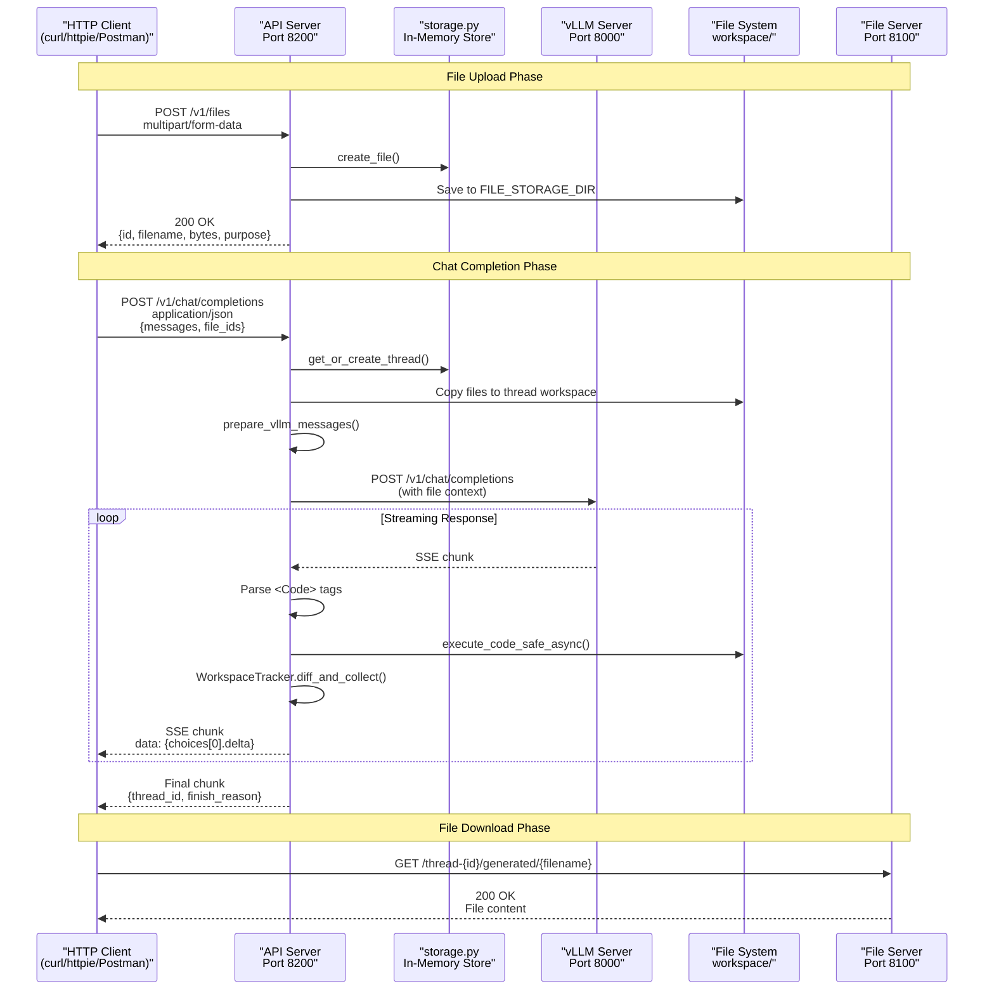

<!-- source: DeepWiki mcp.deepwiki.com · repo ruc-datalab/DeepAnalyze · page 7.7 Direct HTTP Requests · fetched 2026-10-26 -->

# Direct HTTP Requests

<details>
<summary>Relevant source files</summary>

The following files were used as context for generating this wiki page:

- [README.md](README.md)
- [assets/wechat.jpg](assets/wechat.jpg)
- [docs/DeepAnalyze_API_Key_Usage_Guide.md](docs/DeepAnalyze_API_Key_Usage_Guide.md)
- [docs/DeepAnalyze_API_Key_Usage_Guide_ZH.md](docs/DeepAnalyze_API_Key_Usage_Guide_ZH.md)
- [example/README.md](example/README.md)
- [quantize.py](quantize.py)
- [requirements.txt](requirements.txt)

</details>


## Purpose and Scope

This page demonstrates how to interact with the DeepAnalyze API using direct HTTP requests with command-line tools like `curl`, `httpie`, or GUI tools like Postman. This approach is useful for testing, debugging, scripting, or integrating DeepAnalyze into applications in languages without an OpenAI SDK.

For programmatic access using the OpenAI Python SDK, see [Using OpenAI SDK](#7.6). For general concepts about file management and multi-turn conversations, see [File Upload and Management](#7.3) and [Multi-turn Conversations](#7.4).

**Sources:** [README.md:282-313](), [docs/DeepAnalyze_API_Key_Usage_Guide.md:13-20]()

---

## Base Configuration

The DeepAnalyze API server provides three HTTP services on different ports:

| Service | Default Port | Purpose |
|---------|-------------|---------|
| API Server | 8200 | Main API endpoints (chat, files, threads, admin) |
| File Server | 8100 | Serves generated artifacts (plots, reports, CSVs) |
| vLLM Server | 8000 | Model inference (typically not accessed directly) |

**Base URLs:**
- Local deployment: `http://localhost:8200`
- Production API: `https://www.heywhale.com/api/model/services/691d42c36c6dda33df0bf645/app`

**Authentication:**
- Local deployment: Uses dummy API keys (any non-empty value works)
- Production API: Requires valid API key via `Authorization: Bearer <api_key>` header

**Sources:** [README.md:56-68, 283-287](), [docs/DeepAnalyze_API_Key_Usage_Guide.md:16-20, 173-176]()

---

## HTTP Request Structure Overview



**Diagram: Complete HTTP request flow from file upload to artifact download**

**Sources:** [README.md:292-311](), Diagram 3 from system overview

---

## File Upload Endpoint

### POST /v1/files

Uploads one or more files to the API server for use in data analysis tasks.

**Request Format:**
```bash
curl -X POST "http://localhost:8200/v1/files" \
  -F "file=@/path/to/data.csv" \
  -F "purpose=file-extract"
```

**Request Parameters:**

| Parameter | Type | Required | Description |
|-----------|------|----------|-------------|
| `file` | file | Yes | File binary data (multipart form field) |
| `purpose` | string | No | Purpose of file upload (e.g., "file-extract", "assistants") |

**Supported File Types:**
- Structured data: `.csv`, `.xlsx`, `.xls`, `.json`, `.xml`, `.yaml`
- Databases: `.db`, `.sqlite`, `.sqlite3`
- Unstructured: `.txt`, `.md`, `.log`, `.pdf`
- Archives: `.zip` (automatically extracted)
- Code: `.py`, `.js`, `.java`, `.cpp`, etc.
- Images: `.png`, `.jpg`, `.jpeg`, `.gif`

**Response Format:**
```json
{
  "id": "file-abc123xyz",
  "object": "file",
  "bytes": 10485,
  "created_at": 1699123456,
  "filename": "data.csv",
  "purpose": "file-extract"
}
```

**Key Response Fields:**

| Field | Type | Description |
|-------|------|-------------|
| `id` | string | Unique file identifier (use in `file_ids` for chat) |
| `filename` | string | Original filename |
| `bytes` | integer | File size in bytes |
| `created_at` | integer | Unix timestamp of upload |

**Multiple Files:**
```bash
# Upload multiple files in separate requests
FILE1=$(curl -s -X POST "http://localhost:8200/v1/files" \
  -F "file=@sales.csv" | jq -r '.id')

FILE2=$(curl -s -X POST "http://localhost:8200/v1/files" \
  -F "file=@customers.csv" | jq -r '.id')

echo "File IDs: $FILE1, $FILE2"
```

**ZIP Archive Handling:**
```bash
# ZIP files are automatically extracted
curl -X POST "http://localhost:8200/v1/files" \
  -F "file=@dataset.zip" \
  -F "purpose=file-extract"

# Returns file_id for the ZIP itself
# Individual files extracted and available in workspace
```

**Sources:** [README.md:292-296](), [docs/DeepAnalyze_API_Key_Usage_Guide.md:22-28, 89-111]()

---

## Chat Completions Endpoint

### POST /v1/chat/completions

The main conversational endpoint for data analysis. Supports file attachments, code execution, and streaming responses.

**Request Format:**
```bash
curl -X POST "http://localhost:8200/v1/chat/completions" \
  -H "Content-Type: application/json" \
  -d '{
    "model": "DeepAnalyze-8B",
    "messages": [
      {
        "role": "user",
        "content": "Analyze the sales trends and create visualizations.",
        "file_ids": ["file-abc123xyz"]
      }
    ],
    "stream": true
  }'
```

**Request Body Parameters:**

| Parameter | Type | Required | Description |
|-----------|------|----------|-------------|
| `model` | string | Yes | Model name (e.g., "DeepAnalyze-8B") |
| `messages` | array | Yes | Array of message objects with `role` and `content` |
| `messages[].role` | string | Yes | "user", "assistant", or "system" |
| `messages[].content` | string | Yes | Message text content |
| `messages[].file_ids` | array | No | Array of file IDs to attach to this message |
| `stream` | boolean | No | Enable streaming responses (default: false) |
| `thread_id` | string | No | Thread ID for multi-turn conversations |
| `temperature` | float | No | Sampling temperature (default: 0.0) |
| `max_tokens` | integer | No | Maximum tokens to generate |

**Non-Streaming Response:**
```json
{
  "id": "chatcmpl-abc123",
  "object": "chat.completion",
  "created": 1699123456,
  "model": "DeepAnalyze-8B",
  "choices": [
    {
      "index": 0,
      "message": {
        "role": "assistant",
        "content": "<Analyze>Data exploration reveals...\n\n<Code>\nimport pandas as pd\ndf = pd.read_csv('data.csv')\n</Code>\n\n<Execute>\nDataFrame loaded with 1000 rows\n</Execute>\n\n<File name=\"sales_plot.png\" url=\"http://localhost:8100/thread-xyz/generated/sales_plot.png\">Sales trend visualization</File>"
      },
      "finish_reason": "stop"
    }
  ],
  "usage": {
    "prompt_tokens": 150,
    "completion_tokens": 200,
    "total_tokens": 350
  },
  "thread_id": "thread-xyz789"
}
```

**Streaming Response Format (Server-Sent Events):**
```
data: {"id":"chatcmpl-abc123","object":"chat.completion.chunk","created":1699123456,"model":"DeepAnalyze-8B","choices":[{"index":0,"delta":{"role":"assistant","content":"<Analyze>"},"finish_reason":null}]}

data: {"id":"chatcmpl-abc123","object":"chat.completion.chunk","created":1699123456,"model":"DeepAnalyze-8B","choices":[{"index":0,"delta":{"content":"Data exploration"},"finish_reason":null}]}

data: {"id":"chatcmpl-abc123","object":"chat.completion.chunk","created":1699123456,"model":"DeepAnalyze-8B","choices":[{"index":0,"delta":{"content":" reveals..."},"finish_reason":null}]}

data: {"id":"chatcmpl-abc123","object":"chat.completion.chunk","created":1699123456,"model":"DeepAnalyze-8B","choices":[{"index":0,"delta":{},"finish_reason":"stop"}],"thread_id":"thread-xyz789"}

data: [DONE]
```

**Key Response Fields:**

| Field | Type | Description |
|-------|------|-------------|
| `choices[0].message.content` | string | Full assistant response with action tags |
| `choices[0].delta.content` | string | (Streaming) Incremental content chunk |
| `thread_id` | string | Thread ID for multi-turn conversations (in final chunk) |
| `finish_reason` | string | "stop" (normal), "length" (max tokens), or null (streaming) |

**Sources:** [README.md:298-311](), [docs/DeepAnalyze_API_Key_Usage_Guide.md:16-20]()

---

## Multi-Turn Conversations

To maintain context across multiple turns, include the `thread_id` from the previous response in subsequent requests:

```bash
# Turn 1: Initial analysis
RESPONSE=$(curl -s -X POST "http://localhost:8200/v1/chat/completions" \
  -H "Content-Type: application/json" \
  -d '{
    "model": "DeepAnalyze-8B",
    "messages": [{"role": "user", "content": "Analyze data.csv", "file_ids": ["file-abc123"]}]
  }')

THREAD_ID=$(echo $RESPONSE | jq -r '.thread_id')
echo "Thread ID: $THREAD_ID"

# Turn 2: Follow-up request
curl -X POST "http://localhost:8200/v1/chat/completions" \
  -H "Content-Type: application/json" \
  -d "{
    \"model\": \"DeepAnalyze-8B\",
    \"thread_id\": \"$THREAD_ID\",
    \"messages\": [
      {\"role\": \"user\", \"content\": \"Analyze data.csv\", \"file_ids\": [\"file-abc123\"]},
      {\"role\": \"assistant\", \"content\": \"...(previous response)...\"},
      {\"role\": \"user\", \"content\": \"Add a trend line to the visualization\"}
    ]
  }"
```

**Important Notes:**
- The `thread_id` is returned in the final streaming chunk or the response body
- Include the full conversation history in the `messages` array
- Files attached in previous turns remain accessible in the thread workspace
- Generated artifacts from previous turns are also available

**Sources:** [README.md:298-311](), Diagram 3 from system overview

---

## Other API Endpoints

### GET /v1/files

List all uploaded files:

```bash
curl -X GET "http://localhost:8200/v1/files"
```

**Response:**
```json
{
  "object": "list",
  "data": [
    {"id": "file-abc123", "filename": "data.csv", "bytes": 10485, "created_at": 1699123456},
    {"id": "file-def456", "filename": "sales.xlsx", "bytes": 25600, "created_at": 1699123460}
  ]
}
```

### GET /v1/files/{file_id}

Retrieve file metadata:

```bash
curl -X GET "http://localhost:8200/v1/files/file-abc123"
```

### DELETE /v1/files/{file_id}

Delete a file:

```bash
curl -X DELETE "http://localhost:8200/v1/files/file-abc123"
```

**Response:**
```json
{
  "id": "file-abc123",
  "object": "file",
  "deleted": true
}
```

### GET /v1/models

List available models:

```bash
curl -X GET "http://localhost:8200/v1/models"
```

**Response:**
```json
{
  "object": "list",
  "data": [
    {
      "id": "DeepAnalyze-8B",
      "object": "model",
      "created": 1699123456,
      "owned_by": "RUC-DataLab"
    }
  ]
}
```

### POST /v1/threads/cleanup

Admin endpoint to clean up old thread workspaces:

```bash
curl -X POST "http://localhost:8200/v1/threads/cleanup" \
  -H "Content-Type: application/json" \
  -d '{"max_age_hours": 24}'
```

### GET /v1/admin/stats

Get system statistics:

```bash
curl -X GET "http://localhost:8200/v1/admin/stats"
```

**Response:**
```json
{
  "threads": 5,
  "files": 12,
  "total_messages": 47,
  "workspace_size_mb": 156.7
}
```

**Sources:** Inferred from API structure described in Diagram 2 from system overview

---

## Downloading Generated Files

Files generated during code execution (plots, CSVs, reports) are served by the File Server on port 8100:

```bash
# Extract file URL from assistant response
FILE_URL=$(echo $RESPONSE | jq -r '.choices[0].message.content' | \
  grep -oP 'url="http://[^"]+' | sed 's/url="//')

# Download the file
curl -O "$FILE_URL"

# Or directly if you know the thread_id and filename
curl -O "http://localhost:8100/thread-xyz789/generated/sales_plot.png"
```

**File URL Structure:**
```
http://localhost:8100/thread-{thread_id}/generated/{filename}
```

**File Types Served:**
- Visualizations: `.png`, `.jpg`, `.svg`, `.pdf`
- Data exports: `.csv`, `.xlsx`, `.json`
- Reports: `.md`, `.html`, `.pdf`
- Logs: `.txt`, `.log`

**Sources:** Diagram 1 from system overview, inferred from file server architecture

---

## Streaming Response Handling

DeepAnalyze uses Server-Sent Events (SSE) for streaming. Here's how to handle streaming in different tools:

### curl with Streaming

```bash
curl -N -X POST "http://localhost:8200/v1/chat/completions" \
  -H "Content-Type: application/json" \
  -d '{
    "model": "DeepAnalyze-8B",
    "messages": [{"role": "user", "content": "Analyze data", "file_ids": ["file-abc123"]}],
    "stream": true
  }'
```

The `-N` flag disables buffering, allowing real-time output.

### Python with requests

```python
import json
import requests

url = "http://localhost:8200/v1/chat/completions"
headers = {"Content-Type": "application/json"}
data = {
    "model": "DeepAnalyze-8B",
    "messages": [{"role": "user", "content": "Analyze data", "file_ids": ["file-abc123"]}],
    "stream": True
}

response = requests.post(url, headers=headers, json=data, stream=True)

for line in response.iter_lines():
    if line:
        line = line.decode('utf-8')
        if line.startswith('data: '):
            data_str = line[6:]  # Remove 'data: ' prefix
            if data_str == '[DONE]':
                break
            try:
                chunk = json.loads(data_str)
                delta = chunk['choices'][0]['delta']
                if 'content' in delta:
                    print(delta['content'], end='', flush=True)
            except json.JSONDecodeError:
                pass
```

### httpie with Streaming

```bash
http --stream POST localhost:8200/v1/chat/completions \
  Content-Type:application/json \
  model=DeepAnalyze-8B \
  messages:='[{"role":"user","content":"Analyze data","file_ids":["file-abc123"]}]' \
  stream:=true
```

**Sources:** [docs/DeepAnalyze_API_Key_Usage_Guide.md:29-31](), standard SSE practices

---

## Complete Workflow Example

```mermaid
graph TB
    subgraph "1. File Upload"
        A[Client] -->|"POST /v1/files<br/>multipart/form-data"| B[API Server]
        B -->|"Save to FILE_STORAGE_DIR"| C[File System]
        B -->|"create_file()"| D[storage.py]
        B -->|"Response: file_id"| A
    end
    
    subgraph "2. Initial Analysis"
        A2[Client] -->|"POST /v1/chat/completions<br/>{messages, file_ids}"| B2[API Server]
        B2 -->|"get_or_create_thread()"| D2[storage.py]
        D2 -->|"Create workspace/thread-xyz/"| C2[File System]
        D2 -->|"Copy files to workspace"| C2
        B2 -->|"prepare_vllm_messages()"| E2[utils.py]
        E2 -->|"Inject file context"| F2[vLLM Server]
        F2 -->|"Stream response"| B2
        B2 -->|"execute_code_safe_async()"| C2
        C2 -->|"Generated artifacts"| G2[workspace/thread-xyz/generated/]
        B2 -->|"SSE chunks + thread_id"| A2
    end
    
    subgraph "3. Follow-up Analysis"
        A3[Client] -->|"POST /v1/chat/completions<br/>{messages, thread_id}"| B3[API Server]
        B3 -->|"get_thread(thread_id)"| D3[storage.py]
        D3 -->|"Existing workspace"| C3[workspace/thread-xyz/]
        B3 -->|"Continue analysis"| F3[vLLM Server]
        F3 -->|"Generate more code"| B3
        B3 -->|"More artifacts"| G3[workspace/thread-xyz/generated/]
        B3 -->|"SSE chunks"| A3
    end
    
    subgraph "4. Download Results"
        A4[Client] -->|"GET /thread-xyz/generated/plot.png"| H[File Server<br/>Port 8100]
        H -->|"Serve file"| A4
    end
```



**Diagram: Complete workflow showing all HTTP endpoints and data flow**

### Shell Script Example

```bash
#!/bin/bash

API_BASE="http://localhost:8200"
FILE_SERVER="http://localhost:8100"

# Step 1: Upload file
echo "Uploading data file..."
FILE_RESPONSE=$(curl -s -X POST "$API_BASE/v1/files" \
  -F "file=@sales_data.csv" \
  -F "purpose=file-extract")

FILE_ID=$(echo $FILE_RESPONSE | jq -r '.id')
echo "File uploaded with ID: $FILE_ID"

# Step 2: Request analysis with streaming
echo -e "\nRequesting analysis..."
ANALYSIS_RESPONSE=$(curl -s -X POST "$API_BASE/v1/chat/completions" \
  -H "Content-Type: application/json" \
  -d "{
    \"model\": \"DeepAnalyze-8B\",
    \"messages\": [
      {
        \"role\": \"user\",
        \"content\": \"Analyze the sales data and create visualizations showing monthly trends.\",
        \"file_ids\": [\"$FILE_ID\"]
      }
    ],
    \"stream\": false
  }")

THREAD_ID=$(echo $ANALYSIS_RESPONSE | jq -r '.thread_id')
CONTENT=$(echo $ANALYSIS_RESPONSE | jq -r '.choices[0].message.content')

echo -e "\nThread ID: $THREAD_ID"
echo -e "\nAssistant Response:\n$CONTENT"

# Step 3: Extract file URLs and download
echo -e "\nExtracting generated files..."
FILE_URLS=$(echo $CONTENT | grep -oP 'url="http://[^"]+' | sed 's/url="//')

for URL in $FILE_URLS; do
  FILENAME=$(basename "$URL")
  echo "Downloading: $FILENAME"
  curl -s -O "$URL"
done

# Step 4: Follow-up request
echo -e "\nSending follow-up request..."
FOLLOWUP_RESPONSE=$(curl -s -X POST "$API_BASE/v1/chat/completions" \
  -H "Content-Type: application/json" \
  -d "{
    \"model\": \"DeepAnalyze-8B\",
    \"thread_id\": \"$THREAD_ID\",
    \"messages\": [
      {\"role\": \"user\", \"content\": \"Analyze the sales data and create visualizations.\", \"file_ids\": [\"$FILE_ID\"]},
      {\"role\": \"assistant\", \"content\": $(echo $CONTENT | jq -R .)},
      {\"role\": \"user\", \"content\": \"Add a forecast for the next quarter.\"}
    ]
  }")

echo $FOLLOWUP_RESPONSE | jq -r '.choices[0].message.content'

echo -e "\nAnalysis complete!"
```

**Sources:** [README.md:292-311](), synthesized from API documentation

---

## Error Handling

### Common Error Responses

| Status Code | Error Type | Description |
|-------------|-----------|-------------|
| 400 | Bad Request | Invalid request format or missing required fields |
| 404 | Not Found | File or thread not found |
| 413 | Payload Too Large | File size exceeds limit |
| 422 | Unprocessable Entity | Unsupported file type or invalid parameters |
| 500 | Internal Server Error | Server-side processing error |

### Error Response Format

```json
{
  "error": {
    "message": "File not found",
    "type": "invalid_request_error",
    "param": "file_id",
    "code": "file_not_found"
  }
}
```

### Handling Specific Errors

**File Not Found:**
```bash
# Check if file exists before using
FILE_CHECK=$(curl -s -X GET "http://localhost:8200/v1/files/$FILE_ID")
if echo $FILE_CHECK | jq -e '.error' > /dev/null; then
  echo "Error: File not found"
  exit 1
fi
```

**Thread Not Found:**
```bash
# If thread_id is invalid, the API creates a new thread
# Check response for new thread_id
```

**Timeout Handling:**
```bash
# Add timeout to curl requests
curl --max-time 300 -X POST "http://localhost:8200/v1/chat/completions" \
  -H "Content-Type: application/json" \
  -d '{...}'
```

**Retry Logic:**
```bash
# Retry on server errors with exponential backoff
MAX_RETRIES=3
RETRY_DELAY=2

for i in $(seq 1 $MAX_RETRIES); do
  RESPONSE=$(curl -s -w "%{http_code}" -X POST "..." -d '{...}')
  HTTP_CODE="${RESPONSE: -3}"
  
  if [ "$HTTP_CODE" = "200" ]; then
    echo "Success"
    break
  elif [ $i -lt $MAX_RETRIES ]; then
    echo "Retry $i/$MAX_RETRIES after ${RETRY_DELAY}s..."
    sleep $RETRY_DELAY
    RETRY_DELAY=$((RETRY_DELAY * 2))
  else
    echo "Failed after $MAX_RETRIES retries"
    exit 1
  fi
done
```

**Sources:** Standard HTTP error handling practices, inferred from API structure

---

## Testing with Different HTTP Clients

### Postman Collection

Create a Postman collection with pre-configured requests:

**Environment Variables:**
```
api_base: http://localhost:8200
file_server: http://localhost:8100
model: DeepAnalyze-8B
```

**Collection Structure:**
1. **Upload File** (POST /v1/files)
   - Body: form-data, key="file", type=File
   - Save `{{file_id}}` from response

2. **Chat Completion** (POST /v1/chat/completions)
   - Body: raw JSON
   - Use `{{file_id}}` variable
   - Save `{{thread_id}}` from response

3. **Follow-up** (POST /v1/chat/completions)
   - Use `{{thread_id}}` variable

### HTTPie Examples

```bash
# Upload file
http --form POST localhost:8200/v1/files \
  file@sales_data.csv \
  purpose=file-extract

# Chat completion
http POST localhost:8200/v1/chat/completions \
  Content-Type:application/json \
  model=DeepAnalyze-8B \
  messages:='[{"role":"user","content":"Analyze data","file_ids":["file-abc123"]}]'

# Get models
http GET localhost:8200/v1/models

# Delete file
http DELETE localhost:8200/v1/files/file-abc123
```

### wget Example

```bash
# Upload file (wget doesn't support multipart easily, use curl instead)

# Download analysis results
wget http://localhost:8100/thread-xyz789/generated/sales_plot.png

# Get response to file
wget -O response.json --post-data='{"model":"DeepAnalyze-8B","messages":[{"role":"user","content":"Analyze data"}]}' \
  --header='Content-Type: application/json' \
  http://localhost:8200/v1/chat/completions
```

**Sources:** Standard HTTP client usage patterns

---

## Advanced Usage Patterns

### Parallel File Upload

```bash
# Upload multiple files in parallel using background jobs
for file in data/*.csv; do
  (
    FILE_ID=$(curl -s -X POST "http://localhost:8200/v1/files" \
      -F "file=@$file" | jq -r '.id')
    echo "$file -> $FILE_ID"
  ) &
done
wait

echo "All files uploaded"
```

### Batch Processing

```bash
# Process multiple datasets with the same analysis
for dataset in dataset1.csv dataset2.csv dataset3.csv; do
  echo "Processing $dataset..."
  
  FILE_ID=$(curl -s -X POST "http://localhost:8200/v1/files" \
    -F "file=@$dataset" | jq -r '.id')
  
  RESPONSE=$(curl -s -X POST "http://localhost:8200/v1/chat/completions" \
    -H "Content-Type: application/json" \
    -d "{
      \"model\": \"DeepAnalyze-8B\",
      \"messages\": [{\"role\":\"user\",\"content\":\"Analyze and create summary report\",\"file_ids\":[\"$FILE_ID\"]}]
    }")
  
  THREAD_ID=$(echo $RESPONSE | jq -r '.thread_id')
  echo "Analysis complete for $dataset (thread: $THREAD_ID)"
  
  # Download results
  mkdir -p "results/$THREAD_ID"
  # Extract and download files...
done
```

### Custom Headers and Authentication

```bash
# For production API with authentication
curl -X POST "https://www.heywhale.com/api/model/services/691d42c36c6dda33df0bf645/app/v1/chat/completions" \
  -H "Content-Type: application/json" \
  -H "Authorization: Bearer your_api_key_here" \
  -H "User-Agent: MyApp/1.0" \
  -d '{
    "model": "DeepAnalyze-8B",
    "messages": [{"role": "user", "content": "Analyze sales data"}]
  }'
```

### Monitoring Long-Running Analysis

```bash
# Start analysis in background and monitor
curl -N -X POST "http://localhost:8200/v1/chat/completions" \
  -H "Content-Type: application/json" \
  -d '{
    "model": "DeepAnalyze-8B",
    "messages": [{"role": "user", "content": "Analyze large dataset", "file_ids": ["file-abc123"]}],
    "stream": true
  }' 2>&1 | tee analysis.log &

CURL_PID=$!

# Monitor progress
tail -f analysis.log &
TAIL_PID=$!

# Wait for completion
wait $CURL_PID

# Stop monitoring
kill $TAIL_PID

echo "Analysis complete, results saved to analysis.log"
```

**Sources:** Advanced shell scripting patterns, synthesized from API capabilities

---

## Comparison with OpenAI SDK

| Aspect | Direct HTTP Requests | OpenAI SDK |
|--------|---------------------|------------|
| **Language Support** | Any language/tool with HTTP support | Python, Node.js, etc. |
| **Setup Complexity** | No dependencies, use curl/httpie | Requires SDK installation |
| **Type Safety** | Manual JSON construction | Typed objects and validation |
| **Streaming** | Manual SSE parsing | Built-in iterator support |
| **Error Handling** | Manual HTTP status checks | Structured exceptions |
| **File Upload** | Multipart form-data | Simple method calls |
| **Best For** | Scripting, testing, debugging, non-Python languages | Production Python apps |

**Example Equivalence:**

**HTTP Request:**
```bash
curl -X POST "http://localhost:8200/v1/chat/completions" \
  -H "Content-Type: application/json" \
  -d '{"model":"DeepAnalyze-8B","messages":[{"role":"user","content":"Analyze data"}]}'
```

**OpenAI SDK:**
```python
from openai import OpenAI
client = OpenAI(base_url="http://localhost:8200/v1", api_key="dummy")
response = client.chat.completions.create(
    model="DeepAnalyze-8B",
    messages=[{"role": "user", "content": "Analyze data"}]
)
```

For SDK usage details, see [Using OpenAI SDK](#7.6).

**Sources:** [README.md:282-313](), synthesized comparison

---

