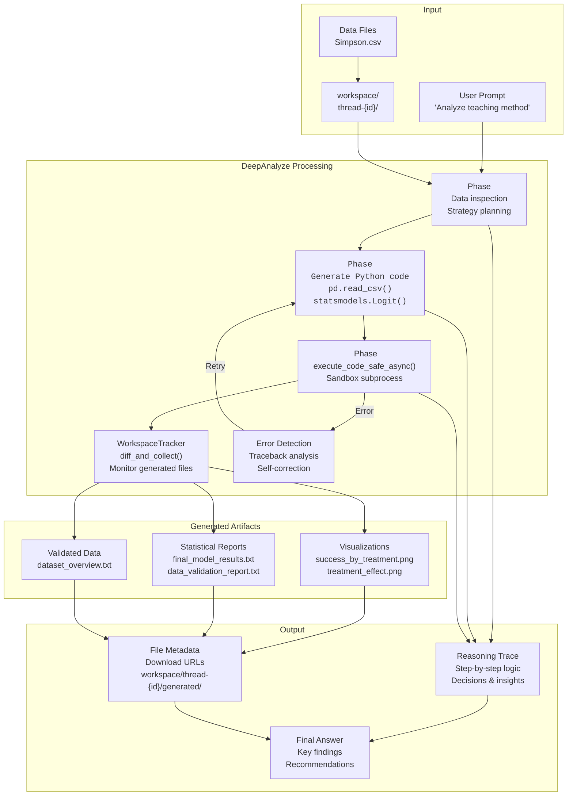
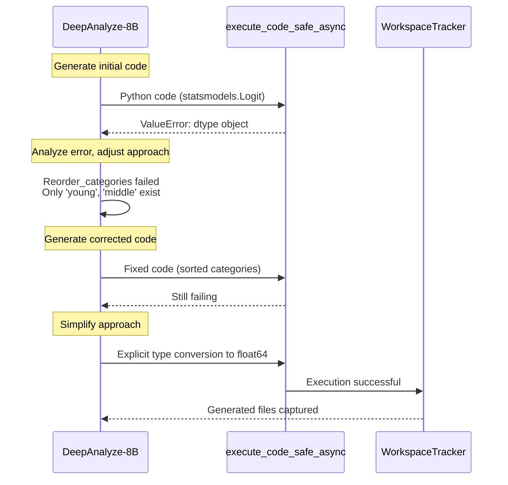

<!-- source: DeepWiki mcp.deepwiki.com · repo ruc-datalab/DeepAnalyze · page 8 Example Use Cases · fetched 2026-10-26 -->

# Example Use Cases

<details>
<summary>Relevant source files</summary>

The following files were used as context for generating this wiki page:

- [example/financial_insights_and_api_usage_analytics/bank_data.xlsx](example/financial_insights_and_api_usage_analytics/bank_data.xlsx)
- [example/financial_insights_and_api_usage_analytics/interface_calls.xlsx](example/financial_insights_and_api_usage_analytics/interface_calls.xlsx)
- [example/simpson_paradox_analysis/README.md](example/simpson_paradox_analysis/README.md)
- [example/simpson_paradox_analysis/data/Simpson.csv](example/simpson_paradox_analysis/data/Simpson.csv)
- [example/simpson_paradox_analysis/prompt.txt](example/simpson_paradox_analysis/prompt.txt)

</details>


## Purpose and Scope

This document provides an overview of real-world example use cases that demonstrate DeepAnalyze's autonomous data science capabilities. Each example showcases how DeepAnalyze analyzes data, generates code, executes it iteratively, and self-corrects errors to produce comprehensive insights.

For step-by-step guides on using DeepAnalyze interfaces, see [Using DeepAnalyze](#7). For detailed walkthroughs of specific analyses, see [Simpson's Paradox Analysis](#8.1) and [Financial Insights and API Usage Analytics](#8.2).

---

## Available Example Use Cases

DeepAnalyze includes example analyses that demonstrate different aspects of autonomous data science:

| Example | Dataset | Key Capabilities Demonstrated | Location |
|---------|---------|------------------------------|----------|
| **Simpson's Paradox** | `Simpson.csv` | Iterative debugging, statistical modeling, visualization, self-correction after errors | `example/simpson_paradox_analysis/` |
| **Financial Insights** | `bank_data.xlsx` | Multi-file analysis, business metrics, trend analysis | `example/financial_insights_and_api_usage_analytics/` |
| **API Usage Analytics** | `interface_calls.xlsx` | Time-series analysis, usage patterns, comparative statistics | `example/financial_insights_and_api_usage_analytics/` |

Each example includes:
- Input data files (CSV, XLSX formats)
- Initial prompt (`prompt.txt`)
- Complete analysis output with reasoning trace (`README.md`)
- Generated artifacts (plots, statistical reports, validation files)

---

## Running Examples

### Method 1: Python SDK (Programmatic Access)

The simplest way to run examples is using the `DeepAnalyzeVLLM` class:

```python
from deepanalyze import DeepAnalyzeVLLM

# Initialize the model
deepanalyze = DeepAnalyzeVLLM("DeepAnalyze-8B")

# Analyze with workspace context
prompt = "Analyze which teaching method (treatment) performs better."
workspace = "example/simpson_paradox_analysis/data"

# Generate analysis
answer = deepanalyze.generate(prompt, workspace=workspace)

# Access results
print(answer["reasoning"])  # Full reasoning trace
print(answer["generated_files"])  # List of created artifacts
```

**Key parameters:**
- `workspace`: Directory containing input data files (automatically accessible to generated code)
- `generate()`: Returns dictionary with `reasoning`, `generated_files`, `execution_results`

**Sources:** [example/simpson_paradox_analysis/README.md:4-16]()

---

### Method 2: API with Thread-Based Sessions

For multi-turn conversations or stateful workflows:

```python
import openai

client = openai.OpenAI(
    base_url="http://localhost:8200/v1",
    api_key="dummy"  # Local deployment uses dummy keys
)

# Upload data files
with open("Simpson.csv", "rb") as f:
    file = client.files.create(file=f, purpose="assistants")

# Create conversation with thread
response = client.chat.completions.create(
    model="DeepAnalyze-8B",
    messages=[{
        "role": "user",
        "content": "Analyze which teaching method performs better.",
        "file_ids": [file.id]
    }],
    stream=True
)

# Extract thread_id from response for follow-up queries
```

**Thread benefits:**
- Workspace persistence across conversation turns
- Incremental analysis building on previous results
- Access to all generated files from prior turns

**Sources:** Architecture diagrams (Diagram 3: Multi-Turn Conversation Flow)

---

### Method 3: Command Line Interface

For terminal-based workflows:

```bash
# English interface
cd demo/cli
python api_cli.py

# Upload files
> upload path/to/Simpson.csv

# Send analysis request
> chat Analyze which teaching method performs better.

# Download generated files
> download output_plot.png
```

**CLI commands:**
- `upload <path>`: Upload data files to workspace
- `files`: List uploaded files
- `chat <message>`: Send analysis request
- `download <filename>`: Download generated artifacts
- `delete <file_id>`: Remove uploaded files

**Sources:** [demo/cli/api_cli.py](), Architecture Diagram 4 (CLI section)

---

## Example Workflow Architecture

The following diagram illustrates how DeepAnalyze processes an example use case from prompt to final output:



**Key workflow stages:**

1. **Input preparation**: User provides prompt and data files; system creates thread workspace
2. **Analysis loop**: DeepAnalyze iterates through `<Analyze>` → `<Code>` → `<Execute>` phases
3. **Error handling**: Automatic detection and self-correction of code errors
4. **Artifact tracking**: `WorkspaceTracker.diff_and_collect()` captures all generated files
5. **Output delivery**: Reasoning trace, generated files, and final insights

**Sources:** [example/simpson_paradox_analysis/README.md:56-1040](), [API/utils.py]() (WorkspaceTracker), Architecture Diagram 3

---

## Common Patterns Across Examples

### Pattern 1: Iterative Debugging

All examples demonstrate DeepAnalyze's ability to detect and fix errors:



**Error recovery steps:**
1. Detect execution failure from stderr/traceback
2. Analyze root cause (data types, missing values, API deprecations)
3. Generate corrected code with fixes
4. Retry execution (up to multiple iterations if needed)
5. Validate success before proceeding

**Example from Simpson's Paradox:** Model fixed pandas dtype issues through 7 iterations before successful logistic regression

**Sources:** [example/simpson_paradox_analysis/README.md:302-1005]()

---

### Pattern 2: Multi-Step Analysis

Examples follow a structured progression from exploration to conclusions:

| Step | Action Tags | Typical Outputs |
|------|-------------|-----------------|
| **1. Data Inspection** | `<Analyze>`, `<Code>`, `<Execute>` | `dataset_overview.txt`, basic statistics |
| **2. Exploratory Visualization** | `<Code>`, `<Execute>`, `<File>` | Initial plots, distribution checks |
| **3. Statistical Modeling** | `<Analyze>`, `<Code>`, `<Execute>` | Model results, diagnostics |
| **4. Validation & Refinement** | `<Code>`, `<Execute>`, `<File>` | Validation reports, refined plots |
| **5. Final Synthesis** | `<Answer>` | Key findings, recommendations |

**Code entity flow:**
- `prepare_vllm_messages()`: Injects workspace file context into prompt
- `extract_and_execute_code()`: Parses `<Code>` blocks and runs them
- `WorkspaceTracker.diff_and_collect()`: Captures generated files after each execution
- `render_file_block()`: Creates `<File>` tags with download URLs

**Sources:** [API/utils.py:100-500](), [example/simpson_paradox_analysis/README.md]()

---

### Pattern 3: Workspace File Management

Thread workspaces maintain state across analysis steps:

```
workspace/
└── thread-{id}/
    ├── Simpson.csv                  # Input data (copied from uploads)
    ├── dataset_overview.txt         # Generated in Step 1
    ├── success_by_treatment.png     # Generated in Step 2
    ├── final_model_results.txt      # Generated in Step 3
    └── generated/                   # Artifacts moved here for serving
        ├── success_by_treatment.png
        ├── treatment_effect.png
        └── final_model_results.txt
```

**File lifecycle:**
1. User uploads via `/v1/files` → stored in `FILE_STORAGE_DIR`
2. Thread creation → files copied to `workspace/thread-{id}/`
3. Code execution → runs with workspace as `cwd`
4. `WorkspaceTracker` → detects new/modified files
5. Files moved to `generated/` → served via file server on port 8100

**API endpoints involved:**
- `POST /v1/files`: Upload input data
- `GET /v1/files/{file_id}`: Retrieve uploaded files
- `POST /v1/chat/completions`: Create/continue thread with file_ids
- File server: `http://localhost:8100/thread-{id}/generated/{filename}`

**Sources:** [API/storage.py](), [API/utils.py:WorkspaceTracker](), Architecture Diagram 3

---

## Example Categories

### Statistical Analysis Examples

**Simpson's Paradox** demonstrates:
- Complex statistical phenomena identification
- Iterative model refinement (logistic regression debugging)
- Visualization of paradoxical relationships
- Handling of categorical and continuous variables
- Data quality validation

**Key findings format:**
```
1. Statistical Results: Odds ratios, confidence intervals, p-values
2. Visual Evidence: Treatment effect plots by subgroups
3. Recommendations: Actionable insights based on analysis
4. Limitations: Study design constraints, confounders
```

**Sources:** [example/simpson_paradox_analysis/README.md:20-51]()

---

### Business Analytics Examples

**Financial Insights and API Usage Analytics** demonstrate:
- Multi-file analysis (XLSX format handling)
- Business metrics calculation (revenue, growth rates)
- Time-series pattern recognition
- Comparative analysis across categories
- Dashboard-style reporting

**Typical outputs:**
- Trend charts (line plots, bar charts)
- Summary statistics tables
- Period-over-period comparisons
- Actionable business recommendations

**Sources:** File listings [example/financial_insights_and_api_usage_analytics/]()

---

## Detailed Walkthroughs

For complete step-by-step analyses with full reasoning traces and code evolution:

- **[Simpson's Paradox Analysis](#8.1)**: 30-step walkthrough showing data inspection, visualization, statistical modeling, iterative debugging, and final synthesis
- **[Financial Insights and API Usage Analytics](#8.2)**: Business data analysis with multi-file handling and dashboard-style outputs

Each walkthrough includes:
- Initial prompt and data description
- Full reasoning trace with `<Analyze>`, `<Code>`, `<Execute>`, `<File>` tags
- Error recovery examples
- Generated artifacts with explanations
- Final answer with key findings and recommendations

---

## Running Custom Examples

To create your own example use case:

1. **Prepare data**: Place CSV/XLSX files in a directory
2. **Write prompt**: Clear analysis objective (see `prompt.txt` files)
3. **Run analysis**: Use Python SDK, API, or CLI
4. **Review output**: Check reasoning trace and generated files
5. **Iterate**: Provide follow-up prompts to refine analysis

**Template structure:**
```
my_example/
├── data/
│   └── my_data.csv
├── prompt.txt
└── README.md  # Generated output
```

**Sources:** [example/simpson_paradox_analysis/]() directory structure

---

## Sources

- [example/simpson_paradox_analysis/README.md]()
- [example/simpson_paradox_analysis/prompt.txt]()
- [example/financial_insights_and_api_usage_analytics/bank_data.xlsx]()
- [example/financial_insights_and_api_usage_analytics/interface_calls.xlsx]()
- [API/utils.py]() (WorkspaceTracker, execute_code_safe_async)
- [API/storage.py]() (thread workspace management)
- [API/chat_api.py]() (conversation flow)
- Architecture diagrams from system overview

---

