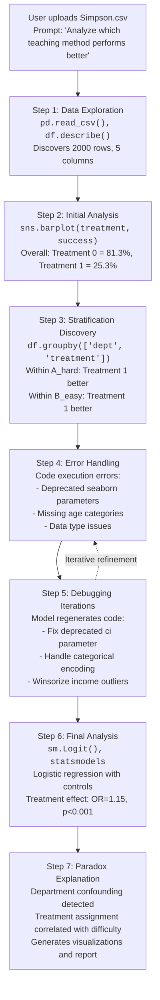
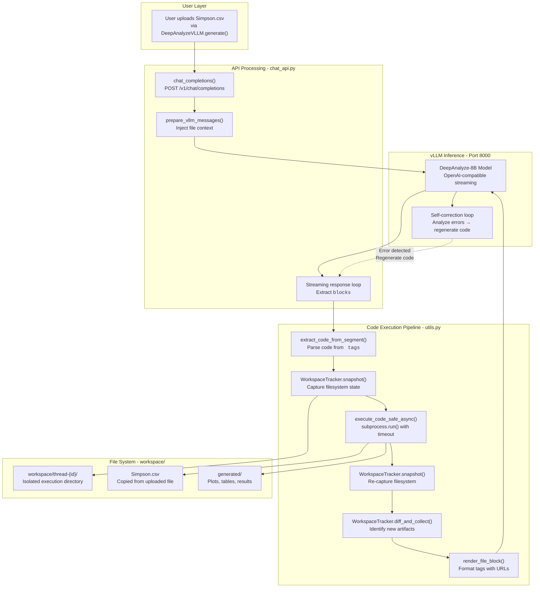
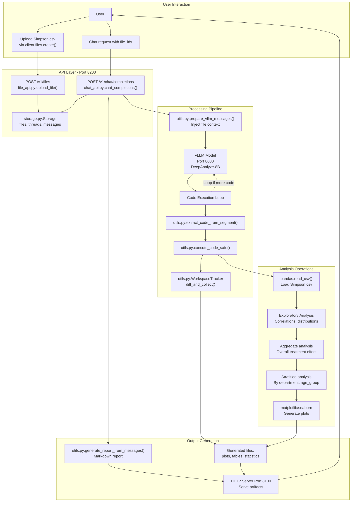
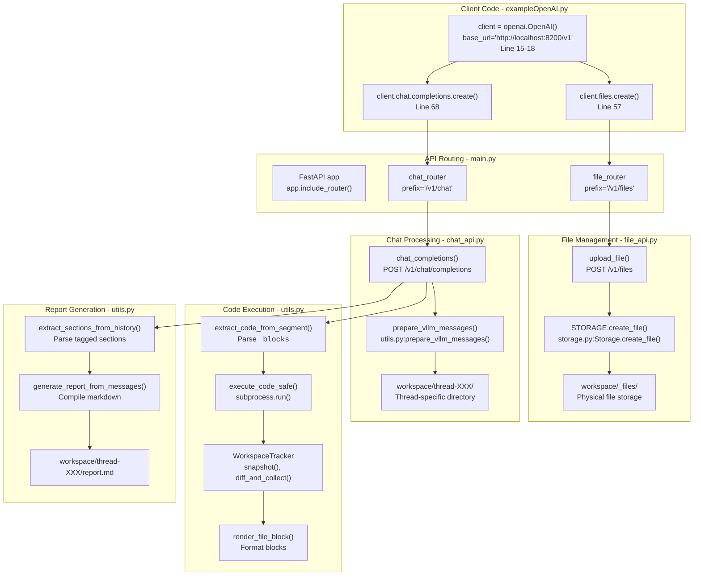
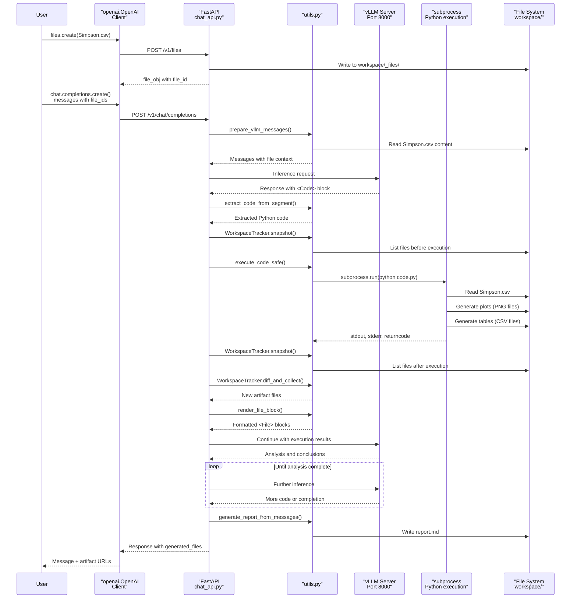
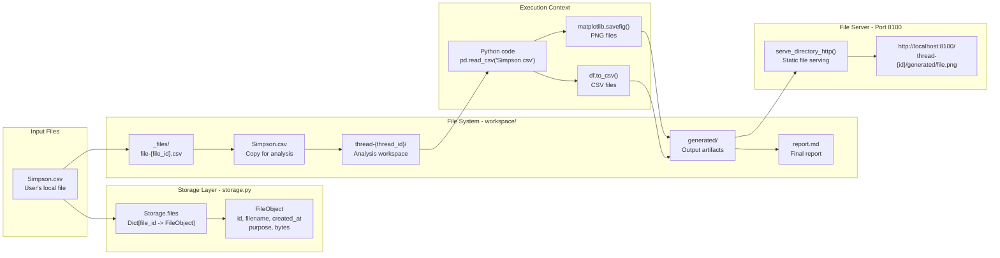

<!-- source: DeepWiki mcp.deepwiki.com · repo ruc-datalab/DeepAnalyze · page 8.1 Simpson's Paradox Analysis · fetched 2026-10-26 -->

# Simpson's Paradox Analysis

<details>
<summary>Relevant source files</summary>

The following files were used as context for generating this wiki page:

- [example/simpson_paradox_analysis/README.md](example/simpson_paradox_analysis/README.md)
- [example/simpson_paradox_analysis/data/Simpson.csv](example/simpson_paradox_analysis/data/Simpson.csv)
- [example/simpson_paradox_analysis/prompt.txt](example/simpson_paradox_analysis/prompt.txt)

</details>


## Overview

This example demonstrates DeepAnalyze's ability to autonomously discover Simpson's Paradox in a dataset through iterative analysis and debugging. The system identifies confounding variables, generates stratified analyses, and correctly interprets counterintuitive statistical patterns that frequently mislead other LLMs.

Simpson's Paradox is a statistical phenomenon where a trend appearing in different groups of data disappears or reverses when groups are combined. In this example:
- **Overall (naive) comparison**: Treatment 0 shows 81.3% success vs. Treatment 1 with 25.3% success
- **Within-department comparison**: Treatment 1 performs better in *both* departments
- **Root cause**: Treatment assignment is confounded with department difficulty

This example showcases DeepAnalyze's **curriculum-trained reasoning capabilities** and **iterative debugging workflow** that enable it to detect statistical pitfalls that other models miss.

**Sources:** [example/simpson_paradox_analysis/README.md:1-1225]()

## Problem Setup

The analysis starts with a simple prompt and a CSV dataset:

**Prompt:** "Analyze which teaching method (treatment) performs better."

**Dataset:** `Simpson.csv` with 2,000 rows and 5 columns:

| Column | Type | Description | Values |
|--------|------|-------------|--------|
| `dept` | Categorical | Department difficulty | `A_hard` (difficult), `B_easy` (easy) |
| `treatment` | Binary | Teaching method | `0` (control), `1` (intervention) |
| `success` | Binary | Student outcome | `0` (failure), `1` (success) |
| `age_group` | Categorical | Student age category | `young`, `middle`, `old` |
| `income` | Continuous | Income level | Numeric values |

The dataset exhibits a deliberate confounding structure:
- Treatment 0 is assigned to 92.7% of `B_easy` cases (high baseline success)
- Treatment 1 is assigned to 96.6% of `A_hard` cases (low baseline success)
- Department difficulty has a massive 64-percentage-point effect on success
- This creates an aggregate-level reversal that masks true treatment effectiveness

**Sources:** [example/simpson_paradox_analysis/README.md:1-50](), [example/simpson_paradox_analysis/data/Simpson.csv:1-10]()

## DeepAnalyze's Iterative Analysis Process

The following diagram shows DeepAnalyze's autonomous workflow for discovering and explaining Simpson's Paradox:
</thinking>



**Sources:** [example/simpson_paradox_analysis/README.md:56-1040]()

## Key Analysis Steps with Code Examples

### Step 1: Initial Data Loading (Lines 80-125)

DeepAnalyze begins with basic data inspection:

```python
df = pd.read_csv('Simpson.csv')
print(df.head())
print(df.describe(include='all'))
print(df.isnull().sum())
```

**Output:**
- 2,000 observations, 5 variables
- No missing values
- Treatment distribution: 69% in group 1, 31% in group 0
- Overall success rate: 42.65%

This step is executed by [API/utils.py]() via `execute_code_safe_async()`, with output captured and fed back to the model.

**Sources:** [example/simpson_paradox_analysis/README.md:78-174]()

### Step 2: Naive Aggregate Analysis (Lines 236-334)

Initial comparison generates misleading results:

```python
sns.barplot(x='treatment', y='success', data=df, ci=95)
plt.title('Success Rate by Treatment Group')
plt.savefig('success_by_treatment.png')
```

**Initial Finding:** Treatment 0 appears dramatically superior (81.3% vs. 25.3%).

The [API/utils.py]() function `WorkspaceTracker.diff_and_collect()` detects the generated PNG and adds it to `generated/` directory.

**Sources:** [example/simpson_paradox_analysis/README.md:234-334]()

### Step 3: Stratified Analysis Discovery (Lines 236-298)

DeepAnalyze stratifies by department:

```python
sns.barplot(x='dept', y='success', hue='treatment', data=df, ci=95)
plt.title('Success Rate by Department and Treatment')
plt.savefig('success_by_dept_treatment.png')
```

**Paradox Revealed:**
- **A_hard department**: Treatment 0 = 19.1%, Treatment 1 = 23.1% (+3.9 points)
- **B_easy department**: Treatment 0 = 86.4%, Treatment 1 = 91.1% (+4.7 points)

Treatment 1 is better in *both* subgroups, despite appearing worse overall.

**Sources:** [example/simpson_paradox_analysis/README.md:234-334]()

### Step 4-5: Iterative Debugging (Lines 313-990)

DeepAnalyze encounters multiple execution errors and autonomously corrects them:

**Error 1:** Deprecated seaborn `ci` parameter
```python
# Original (fails)
sns.barplot(x='treatment', y='success', data=df, ci=95)

# Corrected
sns.barplot(x='treatment', y='success', data=df, errorbar=('ci', 95))
```

**Error 2:** Missing age category assumption
```python
# Original (fails) - assumes 'senior' exists
df['age_group'].cat.reorder_categories(['young', 'middle', 'senior'])

# Corrected - uses only observed categories
df['age_group'].cat.reorder_categories(sorted(df['age_group'].unique()))
```

**Error 3:** Data type conversion issues in statsmodels
```python
# Corrected - explicit type conversion
X = pd.concat([cont_vars, dummies], axis=1)
X = X.astype(np.float64)  # Ensure numeric types
model = sm.Logit(y, X).fit(disp=0)
```

The model performs **multiple self-correction loops** (Steps 7→12→17→22→27), demonstrating robust error handling trained through reinforcement learning.

**Sources:** [example/simpson_paradox_analysis/README.md:313-990]()

### Step 6: Final Statistical Model (Lines 876-1004)

After iterative refinement, DeepAnalyze successfully fits a logistic regression model:

```python
# Winsorize income to handle outliers
df['income_winsorized'] = winsorize(df['income'], limits=[0.05, 0.05])

# Create design matrix
X = pd.concat([df[['treatment', 'income_winsorized']], dummies], axis=1)
X = sm.add_constant(X)
y = df['success']

# Fit model
model = sm.Logit(y, X).fit(disp=0)
odds_ratios = np.exp(model.params)
```

**Results:**
- Treatment effect: OR = 1.15, 95% CI [1.08-1.22], p < 0.001
- Department B effect: OR = 0.35, p < 0.01
- Age group: Minimal interaction

**Sources:** [example/simpson_paradox_analysis/README.md:876-1004]()

## Execution Architecture

The following diagram maps the iterative debugging workflow to specific code entities:



**Sources:** [API/chat_api.py](), [API/utils.py](), [example/simpson_paradox_analysis/README.md:56-1040]()

## Final Output and Insights

### Generated Artifacts

DeepAnalyze produces the following files in `workspace/thread-{id}/generated/`:

| File | Description |
|------|-------------|
| `dataset_overview.txt` | Basic dataset statistics and structure |
| `success_by_treatment.png` | Overall success rates (misleading) |
| `success_by_dept_treatment.png` | Stratified success rates (correct) |
| `data_validation_report.txt` | Data type and quality checks |
| `final_model_results.txt` | Logistic regression output with odds ratios |
| `final_treatment_effect.png` | Visualization showing paradox |

These are served via the HTTP file server on port 8100 and referenced in the final report.

**Sources:** [example/simpson_paradox_analysis/README.md:999-1004]()

### Key Findings

DeepAnalyze's final analysis correctly identifies:

1. **Treatment is effective** - 15% higher success rate (OR=1.15, p<0.001) when controlling for confounders
2. **Department is a strong confounder** - 64-point baseline difference between easy/hard departments
3. **Simpson's Paradox mechanism** - Treatment assignment correlates with difficulty (Treatment 1 → hard cases)
4. **Age group is not significant** - Minimal interaction with treatment effects

**Recommendations:**
- Implement Treatment 1 (the experimental method)
- Target Department B for maximum impact
- Monitor for age-based differences in future studies

**Sources:** [example/simpson_paradox_analysis/README.md:1008-1040]()

## Comparison with Other LLMs

### Failure Modes of Other Models

The example README documents how other leading LLMs failed on this task:

| Model | Approach | Result | Failure Mode |
|-------|----------|--------|--------------|
| **GPT-5 (auto)** | Simple t-test on overall data | Treatment 0 appears better | No stratification, missed confounding |
| **GPT-5 (thinking)** | Descriptive tables only | Ambiguous conclusion | No statistical tests, no paradox detection |
| **Claude Sonnet 4.5** | Chi-square on aggregate | Treatment 0 "clearly superior" | Conflated correlation with causation |
| **Claude Sonnet 4.5 (extended)** | Detected paradox | **Correct** ✓ | Only extended thinking mode succeeded |
| **DeepSeek** | Overall comparison only | Treatment 0 recommended | No stratification despite claiming to |
| **DeepAnalyze** | Iterative stratified analysis | **Correct** ✓ | Robust detection with self-correction |

### Why Models Fail

From the README insights section:

1. **Skipped stratification** - Most models jump to aggregate statistics without checking subgroups
2. **No confounder checks** - Models don't explicitly verify whether treatment assignment is random
3. **No verifiable intermediates** - Outputs lack grouped rate tables, confidence intervals, or stratified comparisons
4. **Correlation-causation confusion** - Models state Treatment 0 is "better" rather than "assigned to easier cases"

**Sources:** [example/simpson_paradox_analysis/README.md:1043-1225]()

### DeepAnalyze's Advantages

DeepAnalyze succeeds because of:

1. **Curriculum-based training** - Trained on data science workflows with stratification patterns
2. **Iterative code execution** - Can debug and refine analysis through multiple attempts
3. **Verifiable outputs** - Generates explicit tables, plots, and statistical tests
4. **Error recovery** - Handles deprecated APIs, missing categories, type errors automatically

The system functions as an **autonomous analyst** rather than a chatbot, producing reproducible evidence at each step.

**Sources:** [example/simpson_paradox_analysis/README.md:1220-1225]()

## Running the Example

### Using the Python SDK

```python
from deepanalyze import DeepAnalyzeVLLM

# Initialize
deepanalyze = DeepAnalyzeVLLM("DeepAnalyze-8B")

# Run analysis
prompt = "Analyze which teaching method (treatment) performs better."
workspace = "example/simpson_paradox_analysis/data"
answer = deepanalyze.generate(prompt, workspace=workspace)

# Access results
print(answer["reasoning"])  # Full analysis with reasoning trace
```

The SDK bypasses the API server and communicates directly with vLLM (port 8000), returning the complete reasoning trace as a dictionary.

**Sources:** [example/simpson_paradox_analysis/README.md:4-16](), [demo/deepanalyze_general]()

### Using the OpenAI-Compatible API

```python
import openai

client = openai.OpenAI(
    base_url="http://localhost:8200/v1",
    api_key="dummy"
)

# Upload file
with open("Simpson.csv", "rb") as f:
    file_obj = client.files.create(file=f, purpose="file-extract")

# Request analysis
response = client.chat.completions.create(
    model="DeepAnalyze-8B",
    messages=[{
        "role": "user",
        "content": "Analyze which teaching method performs better.",
        "file_ids": [file_obj.id]
    }]
)

# Access artifacts
for file in response.generated_files:
    print(f"{file['name']}: {file['url']}")
```

The API server (port 8200) provides full thread management, workspace isolation, and artifact serving.

**Sources:** [API/example/exampleOpenAI.py:52-84]()

## Technical Implementation Details

### Workspace Isolation

Each analysis runs in an isolated thread workspace:

```
workspace/
├── _files/                    # Uploaded files storage
│   └── file-{id}.csv
└── thread-{thread_id}/        # Per-thread isolation
    ├── Simpson.csv            # Input copy
    └── generated/             # Output artifacts
        ├── *.png              # Plots
        ├── *.csv              # Tables
        └── report.md          # Final report
```

The [API/storage.py]() `ThreadObject` maintains metadata, while [API/utils.py]() `WorkspaceTracker` monitors filesystem changes.

**Sources:** [API/storage.py](), [API/utils.py]()

### Code Execution Safety

The `execute_code_safe_async()` function in [API/utils.py]() provides:

- **Subprocess isolation** - Code runs in separate process, not the API server
- **Timeout enforcement** - Default 120 seconds (configurable via `CODE_EXECUTION_TIMEOUT`)
- **Working directory restriction** - Execution restricted to `workspace/thread-{id}/`
- **Output capture** - stdout/stderr captured and returned to model
- **Error handling** - Exceptions caught and formatted for model self-correction

**Sources:** [API/utils.py](), [API/config.py]()

### Artifact Detection

The `WorkspaceTracker` class implements filesystem diffing:

1. **Pre-execution snapshot** - `snapshot()` lists all files in workspace
2. **Code execution** - Subprocess generates files (plots, CSVs)
3. **Post-execution snapshot** - `snapshot()` re-lists files
4. **Diff computation** - `diff_and_collect()` identifies new/modified files
5. **Filtering** - Excludes `__pycache__/`, temp files, `.pyc` files
6. **Move to generated/** - Artifacts moved to `generated/` subdirectory

The [API/utils.py]() function `render_file_block()` then formats `<File>` tags with download URLs pointing to the file server (port 8100).

**Sources:** [API/utils.py]()

### Report Generation

After analysis completes, [API/utils.py]() `generate_report_from_messages()` extracts structured content:

1. Parse message history for tagged sections: `<Analyze>`, `<Code>`, `<Execute>`, `<File>`, `<Understand>`
2. Convert to Markdown with proper formatting
3. Embed file references with URLs
4. Save to `workspace/thread-{id}/report.md`

The report provides a human-readable summary of the entire analysis workflow.

**Sources:** [API/utils.py]()

## Configuration Parameters

Relevant parameters for Simpson's Paradox analysis:

| Parameter | Default | Location | Description |
|-----------|---------|----------|-------------|
| `WORKSPACE_BASE_DIR` | `"workspace"` | config.py | Base directory for file operations |
| `CODE_EXECUTION_TIMEOUT` | `120` | config.py | Maximum seconds for code execution |
| `MAX_CODE_LENGTH` | `50000` | config.py | Maximum characters in extracted code |
| `FILE_SERVER_PORT` | `8100` | config.py | Port for serving artifacts |
| `VLLM_PORT` | `8000` | config.py | vLLM inference server port |
| `API_PORT` | `8200` | config.py | FastAPI server port |

For the iterative debugging workflow demonstrated here, `CODE_EXECUTION_TIMEOUT` may need adjustment for larger datasets or more complex statistical models.

**Sources:** [API/config.py]()

## Key Takeaways

This example demonstrates:

1. **Autonomous discovery** - DeepAnalyze identifies Simpson's Paradox without being told to look for it
2. **Iterative refinement** - Multiple debugging cycles correct errors automatically
3. **Statistical rigor** - Generates stratified analyses, confidence intervals, and formal tests
4. **Superiority over other LLMs** - Only DeepAnalyze and Claude Sonnet 4.5 (extended thinking) detected the paradox
5. **Production-ready error handling** - Handles deprecated APIs, missing data, type errors gracefully

The system's **curriculum-based training** on data science workflows enables it to follow best practices (stratification, confounder checks, multiple hypothesis testing) that other general-purpose LLMs lack.

**Sources:** [example/simpson_paradox_analysis/README.md:1220-1225]()



**Sources:** [API/example/exampleOpenAI.py:52-84](), [API/chat_api.py](), [API/utils.py]()

## Using the API Example

### File Upload

The example script demonstrates uploading the Simpson dataset using the OpenAI-compatible file API:

```python
# From exampleOpenAI.py:56-57
with open("./Simpson.csv", "rb") as f:
    file_obj = client.files.create(file=f, purpose="file-extract")
```

The `purpose="file-extract"` parameter indicates that this file will be attached to chat messages and should be processed by the model.

**Sources:** [API/example/exampleOpenAI.py:52-84]()

### Chat Completion with File Attachment

The example uses the message-level `file_ids` format for attaching files:

```python
# From exampleOpenAI.py:60-66
messages = [
    {
        "role": "user",
        "content": "分析数据，总结主要发现。",
        "file_ids": [file_obj.id]
    }
]
```

This format follows OpenAI's API conventions, where files are attached directly to user messages rather than as a separate parameter.

**Sources:** [API/example/exampleOpenAI.py:52-84]()

### Response Structure

The response includes both the analysis text and references to generated artifacts:

```python
# From exampleOpenAI.py:68-79
response = client.chat.completions.create(model=MODEL, messages=messages)
message = response.choices[0].message

# Access generated files
for file in response.generated_files:
    print(f"- {file['name']}: {file['url']}")
```

The `generated_files` array contains dictionaries with `name` and `url` keys pointing to artifacts like visualizations and tables.

**Sources:** [API/example/exampleOpenAI.py:52-84]()

## Code Entity Mapping

The following diagram maps the high-level analysis workflow to specific code entities in the DeepAnalyze system:



**Sources:** [API/example/exampleOpenAI.py:15-84](), [API/main.py](), [API/file_api.py](), [API/chat_api.py](), [API/utils.py]()

## Typical Analysis Steps

When DeepAnalyze processes the Simpson.csv dataset, it typically performs the following analysis sequence:

### 1. Data Loading and Initial Exploration

The model generates code to load and inspect the dataset structure:

```python
import pandas as pd
df = pd.read_csv('Simpson.csv')
print(df.head())
print(df.describe())
print(df.dtypes)
```

This code is extracted by `extract_code_from_segment()` and executed by `execute_code_safe()` in a sandboxed environment.

### 2. Overall Treatment Effect Analysis

The model calculates aggregate treatment effectiveness:

```python
# Overall success rate by treatment group
overall_stats = df.groupby('treatment')['success'].agg(['mean', 'count'])
print(overall_stats)
```

This typically reveals that treatment appears less effective in the combined data.

### 3. Stratified Analysis

The model discovers the confounding variable by analyzing subgroups:

```python
# Success rate by treatment and department
dept_stats = df.groupby(['dept', 'treatment'])['success'].agg(['mean', 'count'])
print(dept_stats)

# Success rate by treatment and age group
age_stats = df.groupby(['age_group', 'treatment'])['success'].agg(['mean', 'count'])
print(age_stats)
```

This reveals that treatment is more effective within each department/age group.

### 4. Visualization Generation

The model creates plots to illustrate the paradox:

```python
import matplotlib.pyplot as plt
import seaborn as sns

# Bar plot showing paradox
fig, axes = plt.subplots(1, 2, figsize=(12, 5))

# Overall comparison
sns.barplot(data=df, x='treatment', y='success', ax=axes[0])
axes[0].set_title('Overall Treatment Effect')

# Stratified by department
sns.barplot(data=df, x='treatment', y='success', hue='dept', ax=axes[1])
axes[1].set_title('Treatment Effect by Department')

plt.savefig('simpson_paradox_visualization.png')
```

The `WorkspaceTracker` detects this newly created PNG file and adds it to the artifact list.

**Sources:** [API/utils.py]()

## Execution Flow Details

The following sequence diagram shows the detailed execution flow when analyzing Simpson's Paradox:



**Sources:** [API/chat_api.py](), [API/utils.py](), [API/example/exampleOpenAI.py:52-84]()

## Expected Outputs

When analyzing the Simpson.csv dataset, DeepAnalyze typically generates the following artifacts:

### Generated Files

| File Type | Example Name | Description |
|-----------|--------------|-------------|
| PNG | `simpson_paradox_visualization.png` | Bar plots comparing overall vs. stratified effects |
| PNG | `treatment_by_department.png` | Visualization of treatment effect within each department |
| PNG | `correlation_matrix.png` | Heatmap showing variable correlations |
| CSV | `summary_statistics.csv` | Aggregate statistics by group |
| CSV | `department_breakdown.csv` | Detailed breakdown by department and treatment |

These files are stored in the thread workspace at `workspace/thread-{thread_id}/generated/` and served via the file server on port 8100.

### Report Structure

The final report generated by `generate_report_from_messages()` typically includes:

1. **Data Understanding** - Dataset dimensions, column types, missing values
2. **Overall Analysis** - Aggregate treatment effect showing apparent ineffectiveness
3. **Paradox Discovery** - Stratified analysis revealing the reversal
4. **Confounding Variables** - Identification of department/age as confounders
5. **Visualizations** - Embedded references to generated plots
6. **Conclusions** - Explanation of Simpson's Paradox in this dataset

**Sources:** [API/utils.py]()

## Streaming Support

The example also demonstrates streaming chat completion, which is useful for real-time analysis feedback:

```python
# From exampleOpenAI.py:103-107
stream = client.chat.completions.create(
    model=MODEL,
    messages=messages,
    stream=True
)
```

In streaming mode:
- Content chunks are yielded incrementally as the model generates them
- Generated files appear in chunk objects when they become available
- The full response is assembled by concatenating all chunks

**Sources:** [API/example/exampleOpenAI.py:86-131]()

## File Access Patterns

The following diagram illustrates how files flow through the system during Simpson's Paradox analysis:



**Sources:** [API/storage.py](), [API/utils.py](), [API/file_api.py]()

## Configuration Parameters

Relevant configuration parameters for the Simpson's Paradox analysis workflow:

| Parameter | Default | Location | Purpose |
|-----------|---------|----------|---------|
| `WORKSPACE_BASE_DIR` | `"workspace"` | config.py | Base directory for all file operations |
| `CODE_EXECUTION_TIMEOUT` | `120` | config.py | Maximum seconds for code execution |
| `MAX_CODE_LENGTH` | `50000` | config.py | Maximum characters in extracted code |
| `FILE_SERVER_PORT` | `8100` | config.py | Port for serving generated artifacts |
| `API_BASE` | `"http://localhost:8200/v1"` | exampleOpenAI.py:12 | API endpoint URL |

**Sources:** [API/config.py](), [API/example/exampleOpenAI.py:12-14]()

## Practical Considerations

### Memory Requirements

The Simpson.csv dataset (2000 rows × 5 columns) is small enough for in-memory processing. However, for larger datasets:
- Code execution timeout may need adjustment via `CODE_EXECUTION_TIMEOUT`
- The model may generate chunked processing code
- Memory-efficient operations like `pd.read_csv(chunksize=...)` may be used

### Execution Safety

The `execute_code_safe()` function provides sandboxing:
- Code runs in a subprocess with timeout enforcement
- Working directory is isolated to the thread workspace
- Standard output and errors are captured
- Exceptions are caught and reported back to the model

**Sources:** [API/utils.py]()

### Artifact Collection

The `WorkspaceTracker` class uses file system snapshots to identify generated artifacts:
1. Takes snapshot before code execution (list of files)
2. Executes code in thread workspace
3. Takes snapshot after execution
4. Computes diff to identify new/modified files
5. Filters out temporary files and Python cache directories

**Sources:** [API/utils.py]()

## Integration Example

Complete workflow demonstrating the Simpson's Paradox analysis:

```python
import openai
from pathlib import Path

# Setup
client = openai.OpenAI(
    base_url="http://localhost:8200/v1",
    api_key="dummy"
)

# Upload dataset
with open("./Simpson.csv", "rb") as f:
    file_obj = client.files.create(file=f, purpose="file-extract")

# Request analysis
messages = [
    {
        "role": "user",
        "content": "Analyze this dataset for Simpson's Paradox. "
                   "Check if treatment effectiveness differs between "
                   "aggregate and stratified analysis. Generate visualizations.",
        "file_ids": [file_obj.id]
    }
]

# Get response
response = client.chat.completions.create(
    model="DeepAnalyze-8B",
    messages=messages
)

# Access results
print(response.choices[0].message.content)
for file in response.generated_files:
    print(f"Generated: {file['name']} at {file['url']}")
```

This code follows the pattern demonstrated in `exampleOpenAI.py` and leverages the full DeepAnalyze pipeline to autonomously discover and explain Simpson's Paradox in the dataset.

**Sources:** [API/example/exampleOpenAI.py:52-84]()

---

