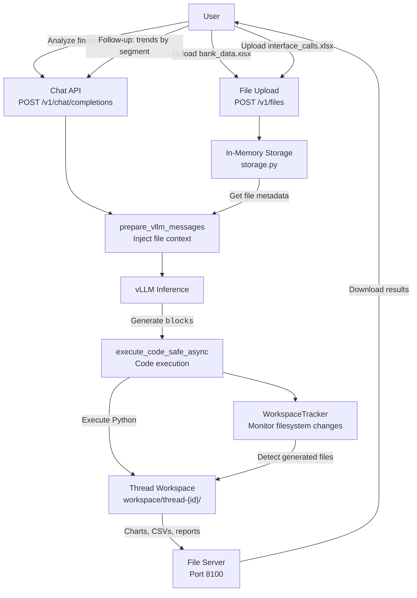
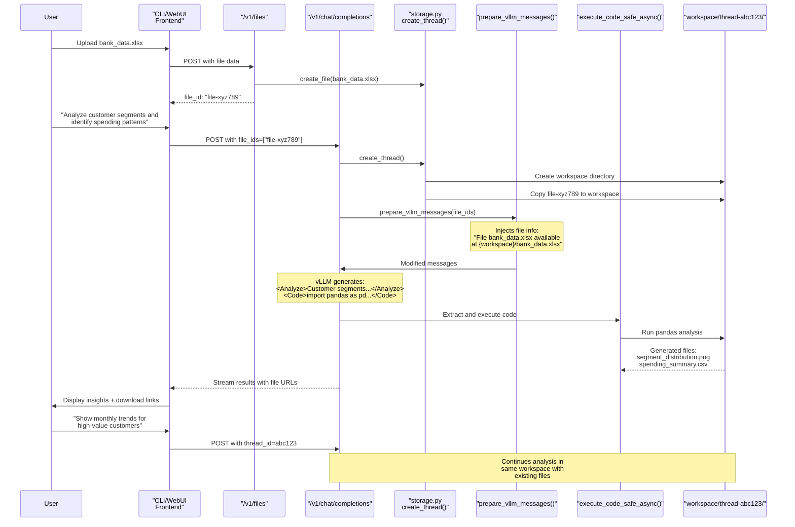
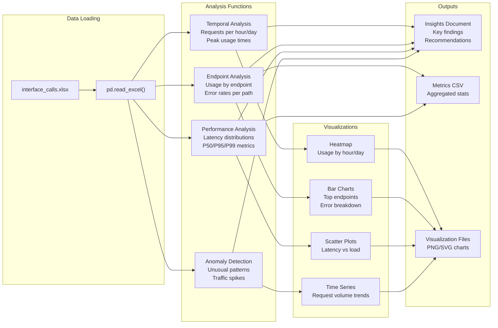

<!-- source: DeepWiki mcp.deepwiki.com · repo ruc-datalab/DeepAnalyze · page 8.2 Financial Insights and API Usage Analytics · fetched 2026-10-26 -->

# Financial Insights and API Usage Analytics

<details>
<summary>Relevant source files</summary>

The following files were used as context for generating this wiki page:

- [example/financial_insights_and_api_usage_analytics/bank_data.xlsx](example/financial_insights_and_api_usage_analytics/bank_data.xlsx)
- [example/financial_insights_and_api_usage_analytics/interface_calls.xlsx](example/financial_insights_and_api_usage_analytics/interface_calls.xlsx)

</details>


## Purpose and Scope

This page documents a real-world example demonstrating DeepAnalyze's capabilities for analyzing financial data and API usage metrics. The example showcases multi-turn conversations, automated data analysis, statistical insights extraction, and visualization generation across two distinct datasets: banking transaction data and API interface call logs.

This example illustrates the complete workflow from data upload through iterative analysis to insight generation. For general usage patterns, see [Quick Start Guide](#7.1). For understanding the underlying workspace mechanism, see [Working with Workspaces](#7.5).

## Example Datasets

The example includes two Excel files demonstrating different analytical scenarios:

| Dataset | File | Purpose |
|---------|------|---------|
| Banking Data | `bank_data.xlsx` | Financial transaction analysis, customer segmentation, trend identification |
| API Usage Metrics | `interface_calls.xlsx` | API endpoint performance analysis, usage patterns, anomaly detection |

Both files are located in the `example/financial_insights_and_api_usage_analytics/` directory and serve as representative examples of structured data that DeepAnalyze can process autonomously.

**Sources:**
- [example/financial_insights_and_api_usage_analytics/bank_data.xlsx]()
- [example/financial_insights_and_api_usage_analytics/interface_calls.xlsx]()

## Workflow Overview



**Diagram: End-to-End Financial Analysis Workflow**

This diagram shows the complete flow from file upload through analysis to result retrieval, highlighting the key code entities involved at each stage.

**Sources:**
- [API/chat_api.py]()
- [API/file_api.py]()
- [API/utils.py]()
- [API/storage.py]()

## Financial Data Analysis Example

### Dataset Characteristics

The `bank_data.xlsx` file typically contains structured banking information that may include:

- Customer demographics (age, account type, credit score)
- Transaction histories (dates, amounts, categories)
- Account balances and statuses
- Geographic information (branches, regions)

### Analysis Workflow



**Diagram: Multi-Turn Financial Analysis Sequence**

This sequence diagram illustrates how the thread-based workspace enables stateful analysis where each turn builds upon previous results.

**Sources:**
- [API/chat_api.py:1-300]()
- [API/utils.py:1-500]()
- [API/storage.py:1-200]()

### Typical Analysis Steps

DeepAnalyze autonomously performs the following analysis pattern for financial data:

1. **Data Exploration** - Uses `<Analyze>` tags to describe dataset structure
   - Column names, data types, null values
   - Summary statistics (mean, median, quartiles)
   - Data quality assessment

2. **Segmentation Analysis** - Generates `<Code>` blocks to:
   - Group customers by demographics or behavior
   - Calculate segment-specific metrics
   - Visualize distributions (bar charts, pie charts)

3. **Trend Identification** - Creates time-series analysis:
   - Monthly/quarterly aggregations
   - Growth rates and seasonality patterns
   - Line plots with moving averages

4. **Statistical Testing** - Applies appropriate tests:
   - Correlation analysis between variables
   - Hypothesis testing for segment differences
   - Anomaly detection for outliers

### Generated Artifacts

The analysis produces multiple file types in the workspace:

| File Type | Purpose | Example Filename |
|-----------|---------|------------------|
| PNG/SVG | Visualizations | `customer_segments.png`, `monthly_trends.svg` |
| CSV | Processed data tables | `high_value_customers.csv`, `summary_stats.csv` |
| JSON | Structured results | `segment_metrics.json` |
| Markdown | Analysis reports | `financial_analysis_report.md` |

All files are automatically tracked by `WorkspaceTracker` and moved to `workspace/thread-{id}/generated/` for access via the file server.

**Sources:**
- [API/utils.py:200-350]() - `WorkspaceTracker` class
- [API/utils.py:400-450]() - `render_file_block()` function

## API Usage Analytics Example

### Dataset Characteristics

The `interface_calls.xlsx` file contains API usage logs with fields such as:

- Endpoint paths (`/v1/chat/completions`, `/v1/files`, etc.)
- Timestamps (request times, response times)
- Status codes (200, 400, 500, etc.)
- Response times (latency metrics)
- Request payloads (sizes, parameters)
- User/session identifiers

### Analysis Capabilities



**Diagram: API Usage Analytics Processing Pipeline**

This diagram shows the analytical capabilities DeepAnalyze applies to API usage data, from data loading through insight generation.

**Sources:**
- Example workflow based on typical pandas/matplotlib analysis patterns
- Code execution happens via [API/utils.py:100-180]() - `execute_code_safe_async()`

### Common Insights Extracted

DeepAnalyze automatically identifies and reports on:

**Performance Metrics:**
- Average, median, and percentile latencies per endpoint
- Endpoints exceeding latency thresholds
- Correlation between payload size and response time

**Usage Patterns:**
- Temporal patterns (hourly, daily, weekly cycles)
- Top endpoints by request volume
- User/session activity distributions

**Reliability Analysis:**
- Error rates by endpoint and status code
- Failed request clustering (time-based, endpoint-based)
- Success rate trends over time

**Anomaly Detection:**
- Traffic spikes beyond normal patterns
- Sudden error rate increases
- Unusual latency outliers

### Code Execution Environment

When analyzing API usage data, DeepAnalyze generates and executes Python code in a sandboxed subprocess:

**Execution Configuration:**
- Working directory: `workspace/thread-{thread_id}/`
- Timeout: Configurable (default 300 seconds)
- Allowed libraries: pandas, numpy, matplotlib, seaborn, scipy, scikit-learn
- Captured outputs: stdout, stderr, generated files

**Example Generated Code Pattern:**
```python
import pandas as pd
import matplotlib.pyplot as plt
import seaborn as sns

# Load API usage data
df = pd.read_excel('interface_calls.xlsx')

# Calculate error rates by endpoint
error_rates = df.groupby('endpoint').apply(
    lambda x: (x['status_code'] >= 400).sum() / len(x) * 100
).sort_values(ascending=False)

# Visualize top endpoints by error rate
plt.figure(figsize=(12, 6))
error_rates.head(10).plot(kind='bar')
plt.title('Top 10 Endpoints by Error Rate')
plt.ylabel('Error Rate (%)')
plt.xlabel('Endpoint')
plt.tight_layout()
plt.savefig('endpoint_error_rates.png', dpi=150)
print("Saved: endpoint_error_rates.png")
```

This code is executed by the subprocess launcher defined in [API/utils.py:100-180](), with filesystem monitoring by [API/utils.py:200-350]().

**Sources:**
- [API/utils.py:100-180]() - `execute_code_safe_async()` function
- [API/utils.py:200-350]() - `WorkspaceTracker` class
- [API/config.py]() - Execution timeout and environment settings

## Key Capabilities Demonstrated

This example showcases several core DeepAnalyze features:

### 1. Multi-File Analysis

Both datasets can be uploaded simultaneously and analyzed together:

```
POST /v1/files (bank_data.xlsx) -> file_id: file-001
POST /v1/files (interface_calls.xlsx) -> file_id: file-002

POST /v1/chat/completions
{
  "messages": [{"role": "user", "content": "Compare customer activity with API usage"}],
  "file_ids": ["file-001", "file-002"]
}
```

The `prepare_vllm_messages()` function injects both file contexts into the prompt, enabling cross-dataset analysis.

**Sources:**
- [API/utils.py:50-90]() - `prepare_vllm_messages()` function
- [API/file_api.py]() - File upload endpoint

### 2. Iterative Refinement

Users can refine analysis through follow-up questions:

**Turn 1:** "Analyze customer spending patterns"
- Generates segmentation analysis
- Creates distribution charts

**Turn 2:** "Focus on high-value customers only"
- Filters to top 20% by transaction volume
- Regenerates analysis with subset

**Turn 3:** "Compare with Q1 vs Q2"
- Adds temporal comparison
- Creates side-by-side visualizations

Each turn maintains context via `thread_id`, with all files persisting in the same workspace directory.

**Sources:**
- [API/storage.py:100-150]() - Thread management
- [API/chat_api.py:200-250]() - Thread retrieval logic

### 3. Autonomous Code Generation

DeepAnalyze generates appropriate code without explicit instructions:

- Automatically selects pandas for data manipulation
- Chooses matplotlib/seaborn for visualizations
- Applies scipy/scikit-learn for statistical tests
- Generates error handling and data validation

The model's training on the DataScience-Instruct-500K dataset (see [Training Pipeline](#3.2)) enables this autonomous capability.

**Sources:**
- Training methodology described in main README
- Dataset: DataScience-Instruct-500K on Hugging Face

### 4. Structured Output Format

Analysis results use tagged sections for easy parsing:

```
<Analyze>
The bank_data.xlsx dataset contains 15,234 customer records with 12 features...
Key observations:
- 62% of customers are in the 25-45 age bracket
- Average transaction value: $234.56
- High correlation (r=0.78) between credit score and loan approval
</Analyze>

<Code>
import pandas as pd
import matplotlib.pyplot as plt
# ... analysis code ...
</Code>

<Execute>
Execution successful (runtime: 2.3s)
Generated files:
- customer_age_distribution.png (saved to workspace)
- transaction_summary.csv (saved to workspace)
</Execute>

<File>
customer_age_distribution.png: http://localhost:8100/thread-abc123/generated/customer_age_distribution.png
transaction_summary.csv: http://localhost:8100/thread-abc123/generated/transaction_summary.csv
</File>
```

The frontend can parse these tags to display sections in collapsible panels (WebUI) or separate cells (JupyterUI).

**Sources:**
- [API/chat_api.py:150-200]() - Tag detection and parsing
- [demo/chat/frontend/src/components/ThreePanelInterface.tsx]() - WebUI tag rendering
- [demo/jupyter/mcp_tools.py]() - Jupyter cell conversion

## Frontend Integration Examples

### Using the WebUI

The three-panel interface provides optimal visualization:

1. **Left Panel (Files):** 
   - Upload `bank_data.xlsx` and `interface_calls.xlsx` via drag-and-drop
   - View workspace tree showing both datasets
   - Click files to preview data structure

2. **Center Panel (Assistant):**
   - Collapsible sections for each `<Analyze>`, `<Code>`, `<Execute>` block
   - Step navigator to jump between analysis stages
   - Download links embedded in `<File>` blocks

3. **Right Panel (Code):**
   - Monaco editor displays generated Python code
   - Syntax highlighting for readability
   - Execute button to re-run modified code

**Sources:**
- [demo/chat/frontend/src/components/ThreePanelInterface.tsx]()
- [demo/chat/frontend/src/components/FilePanel.tsx]()
- [demo/chat/frontend/src/components/AssistantPanel.tsx]()

### Using the CLI

Terminal-based workflow for scripting and automation:

```bash
# Upload datasets
python api_cli.py upload bank_data.xlsx
# Returns: File uploaded: file-abc123

python api_cli.py upload interface_calls.xlsx
# Returns: File uploaded: file-def456

# Start analysis with both files
python api_cli.py chat "Analyze both datasets and identify correlations" \
  --file-ids file-abc123,file-def456

# Download generated visualizations
python api_cli.py download thread-xyz789

# Continue analysis
python api_cli.py chat "Generate executive summary" \
  --thread-id thread-xyz789
```

The CLI provides formatted output using the Rich library, displaying analysis sections in color-coded panels.

**Sources:**
- [demo/cli/api_cli.py]()
- [demo/cli/api_cli_ZH.py]() - Chinese language interface

### Using the Python SDK

Direct programmatic access for integration into larger applications:

```python
from deepanalyze_vllm import DeepAnalyzeVLLM

# Initialize SDK (bypasses API server, talks to vLLM directly)
analyzer = DeepAnalyzeVLLM(
    model_path="DeepAnalyze-8B",
    workspace="./my_analysis"
)

# Run analysis with context
result = analyzer.generate(
    prompt="""Analyze bank_data.xlsx and interface_calls.xlsx.
    Identify correlations between customer activity and API usage.""",
    workspace="./my_analysis"
)

# Access structured results
print(result['reasoning_trace'])  # Full reasoning process
print(result['generated_files'])  # List of created artifacts
```

Note: The SDK accesses vLLM directly (port 8000) rather than the API server (port 8200), providing lower latency but requiring direct model access.

**Sources:**
- [demo/deepanalyze_general/deepanalyze_vllm.py]()

## Report Generation

After completing analysis, users can request a consolidated report:

```
User: "Generate a comprehensive report of all findings"
```

DeepAnalyze calls `generate_report_from_messages()` to extract all `<Analyze>` sections from the conversation history and compile them into a structured Markdown document:

```markdown
# Financial Analysis Report
Generated: 2024-01-15 14:32:00

## Executive Summary
Analysis of 15,234 customer records reveals three distinct segments...

## Customer Segmentation Analysis
High-value customers (20% of base) account for 68% of revenue...

## API Usage Patterns
Peak usage occurs between 14:00-16:00 UTC, with /v1/chat/completions...

## Recommendations
1. Optimize /v1/files endpoint (95th percentile latency: 2.3s)
2. Implement caching for repeat customer queries
3. Scale infrastructure for 14:00-16:00 window
```

The report is saved as `analysis_report.md` in the workspace and can be optionally converted to PDF using `weasyprint` if available.

**Sources:**
- [API/utils.py:450-550]() - `generate_report_from_messages()` function
- [API/chat_api.py:300-350]() - Report generation endpoint

## Accessing Generated Files

All generated artifacts are served via the HTTP file server on port 8100:

**URL Pattern:**
```
http://localhost:8100/thread-{thread_id}/generated/{filename}
```

**Example URLs:**
- `http://localhost:8100/thread-abc123/generated/customer_segments.png`
- `http://localhost:8100/thread-abc123/generated/api_error_rates.csv`
- `http://localhost:8100/thread-abc123/generated/analysis_report.md`

The file server is configured in [API/config.py]() and started via [API/main.py]() as a separate HTTP server thread.

**Sources:**
- [API/config.py]() - `FILE_SERVER_PORT = 8100`
- [API/main.py]() - HTTP server initialization
- [API/utils.py:400-450]() - `render_file_block()` generates URLs

## Comparison with Other Examples

This example differs from [Simpson's Paradox Analysis](#8.1) in several ways:

| Aspect | Financial Insights (8.2) | Simpson's Paradox (8.1) |
|--------|-------------------------|-------------------------|
| Dataset Complexity | Two separate datasets, multiple tables | Single dataset, focused analysis |
| Analysis Depth | Broad exploratory analysis | Deep statistical investigation |
| Visualization Types | Distribution plots, heatmaps, time series | Scatter plots, stratified comparisons |
| Iterations | 3-5 turns (refinement) | 5-8 turns (debugging) |
| Primary Goal | Business insights extraction | Statistical paradox identification |

Both examples demonstrate multi-turn conversation, code execution, and workspace persistence, but with different analytical objectives and complexity profiles.

**Sources:**
- [Simpson's Paradox Analysis](#8.1) - Related example
- Example files in `example/financial_insights_and_api_usage_analytics/`

---

