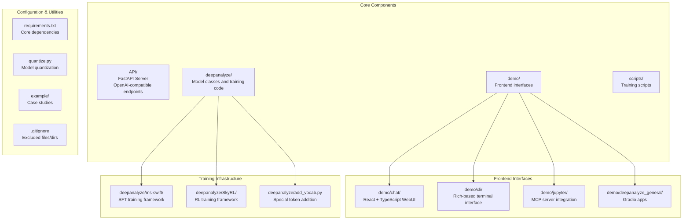
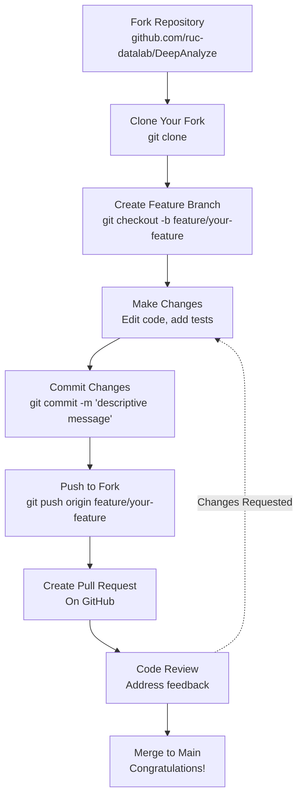
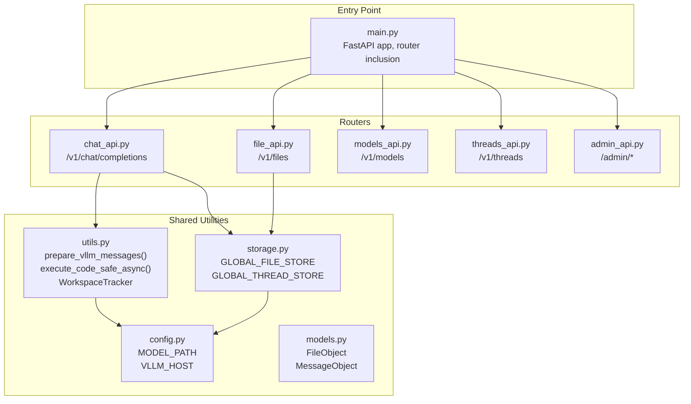

<!-- source: DeepWiki mcp.deepwiki.com · repo ruc-datalab/DeepAnalyze · page 9 Development and Contributing · fetched 2026-10-26 -->

# Development and Contributing

<details>
<summary>Relevant source files</summary>

The following files were used as context for generating this wiki page:

- [.gitignore](.gitignore)
- [README.md](README.md)
- [assets/wechat.jpg](assets/wechat.jpg)
- [docs/DeepAnalyze_API_Key_Usage_Guide.md](docs/DeepAnalyze_API_Key_Usage_Guide.md)
- [docs/DeepAnalyze_API_Key_Usage_Guide_ZH.md](docs/DeepAnalyze_API_Key_Usage_Guide_ZH.md)
- [example/README.md](example/README.md)
- [quantize.py](quantize.py)
- [requirements.txt](requirements.txt)

</details>


## Overview

DeepAnalyze is an open-source project that welcomes contributions from the community. Whether you want to fix bugs, add features, improve documentation, or share use cases, your contributions help make DeepAnalyze better for everyone.

This page provides an overview of how to contribute to the project. For detailed information, see the child pages:
- **[Project Structure](#9.1)**: Understanding the codebase organization
- **[Development Environment Setup](#9.2)**: Setting up your development environment
- **[Contributing Guidelines](#9.3)**: Detailed contribution workflow and standards

**Key Points for Contributors:**
- All merged pull requests will be listed as contributors
- The project welcomes code, model, UI, and documentation improvements
- Case study contributions are especially valuable for improving DeepAnalyze
- The project uses standard Python development tools and practices

Sources: [README.md:346-362](), [example/README.md:1-16]()

---

## Types of Contributions

DeepAnalyze accepts several types of contributions, each valuable in different ways:

### Code Contributions

Code contributions include bug fixes, new features, performance improvements, and refactoring. Common areas for code contributions:

| Component | Description | Entry Points |
|-----------|-------------|--------------|
| **API Server** | FastAPI backend with chat, file, and thread management | [API/main.py](), [API/chat_api.py](), [API/utils.py]() |
| **Frontend Interfaces** | WebUI, CLI, JupyterUI, Gradio apps | [demo/chat/](), [demo/cli/](), [demo/jupyter/](), [demo/deepanalyze_general/]() |
| **Model Integration** | vLLM integration and quantization | [deepanalyze/DeepAnalyzeVLLM.py](), [quantize.py]() |
| **Training Pipeline** | SFT and RL training scripts | [scripts/](), [deepanalyze/ms-swift/](), [deepanalyze/SkyRL/]() |

**Contribution Examples:**
- Docker packaging for easier deployment
- Model conversion and quantization improvements
- Workflow integrations with closed-source LLMs
- UI/UX enhancements for web and CLI interfaces
- Performance optimizations for code execution

### Model Contributions

Model contributions include fine-tuning, quantization, and creating domain-specific variants:
- Fine-tuning DeepAnalyze for specific domains or languages
- Creating quantized versions for different hardware configurations
- Developing evaluation benchmarks and metrics
- Sharing trained checkpoints for community use

### Case Study Contributions

Case study contributions are especially valuable for understanding real-world usage patterns and improving DeepAnalyze. These contributions help identify areas where DeepAnalyze excels or needs improvement.

**Case Study Format:**

Recommended folder structure (following [example/analysis_on_student_loan/]()):

```
example/your_case_name/
├── data/              # Uploaded data files
├── prompt.txt         # Input instructions
└── README.md          # Documentation with:
                       #   - Input description
                       #   - DeepAnalyze output
                       #   - Comparison with other LLMs (optional)
                       #   - Your evaluation/comments
```

**What Makes a Good Case Study:**
- Clear problem statement and objectives
- Representative datasets (can be anonymized)
- Documented expectations vs. actual results
- Comparison with other approaches (optional but valuable)
- Examples where DeepAnalyze performs worse are welcome - they help improve the system

Sources: [README.md:346-362](), [example/README.md:1-16]()

### Documentation Contributions

Documentation improvements include:
- Fixing typos and clarifying explanations
- Adding code examples and tutorials
- Translating documentation to other languages
- Creating video tutorials or blog posts
- Improving API reference documentation

Sources: [README.md:346-362](), [example/README.md:1-16]()

---

## Repository Structure Overview

Understanding the repository structure is essential for effective contribution. The codebase is organized into several major components:



**Repository Component Organization**

This diagram shows the major components of the DeepAnalyze repository and how they relate to each other. Each component has specific responsibilities within the system.

**Key Directories:**

| Directory | Purpose | Key Files |
|-----------|---------|-----------|
| `API/` | OpenAI-compatible API server | `main.py`, `chat_api.py`, `file_api.py`, `utils.py`, `storage.py` |
| `demo/chat/` | React WebUI frontend | `frontend/`, `backend.py` |
| `demo/cli/` | Command-line interface | `api_cli.py`, `api_cli_ZH.py` |
| `demo/jupyter/` | Jupyter integration | `mcp_tools.py`, `app.ipynb` |
| `demo/deepanalyze_general/` | Gradio interfaces | `app.py`, `app_ZH.py` |
| `deepanalyze/` | Core model and training code | `DeepAnalyzeVLLM.py`, `add_vocab.py` |
| `deepanalyze/ms-swift/` | Supervised fine-tuning | SFT training scripts and configs |
| `deepanalyze/SkyRL/` | Reinforcement learning | RL training infrastructure |
| `scripts/` | Training scripts | `single.sh`, `multi_coldstart.sh`, `multi_rl.sh` |
| `example/` | Case studies and examples | User-contributed analysis examples |

For detailed information about the project structure, see [Project Structure](#9.1).

Sources: Repository structure from high-level diagrams, [README.md:46-113]()

---

## Quick Start for Contributors

### Basic Development Setup

The minimal setup for contributing to DeepAnalyze's core components:

```bash
# 1. Clone the repository
git clone https://github.com/ruc-datalab/DeepAnalyze.git
cd DeepAnalyze

# 2. Create and activate virtual environment
conda create -n deepanalyze python=3.12 -y
conda activate deepanalyze

# 3. Install core dependencies
pip install -r requirements.txt

# 4. For training contributions, install additional frameworks
cd ./deepanalyze/ms-swift/ && pip install -e .
cd ../SkyRL/ && pip install -e .
```

**Core Dependencies** (from [requirements.txt:1-16]()):

| Category | Packages |
|----------|----------|
| **Model Inference** | `vllm>=0.8.5`, `torch`, `transformers` |
| **Data Science** | `numpy`, `pandas`, `scikit-learn`, `seaborn`, `matplotlib` |
| **Web Services** | `fastapi`, `uvicorn`, `requests`, `websockets`, `python-multipart` |
| **Client Libraries** | `openai` |

**Important Notes:**
- Separate inference and training environments to avoid dependency conflicts [README.md:226]()
- For training, see [deepanalyze/ms-swift/requirements.txt]() and [deepanalyze/SkyRL/pyproject.toml]()
- vLLM requires CUDA for GPU acceleration

For detailed environment setup, see [Development Environment Setup](#9.2).

Sources: [README.md:212-227](), [requirements.txt:1-16]()

### Testing Your Changes

After making changes, test them appropriately:

**API Server Changes:**
```bash
# Start vLLM server (if not already running)
vllm serve DeepAnalyze-8B

# Start API server
cd API
python start_server.py

# Test endpoints
curl http://localhost:8200/health
```

**Frontend Changes:**
```bash
# For WebUI
cd demo/chat/frontend
npm install
npm run dev

# For CLI
cd demo/cli
python api_cli.py

# For Gradio
cd demo/deepanalyze_general
python app.py
```

**Model/Training Changes:**
- Test with small datasets first
- Validate outputs match expected format
- Run evaluation benchmarks if available ([playground/]() directory)

Sources: [README.md:55-113]()

---

## Contribution Workflow

### Standard GitHub Flow

DeepAnalyze follows the standard GitHub contribution workflow:



**GitHub Contribution Flow**

This diagram shows the complete contribution workflow from forking the repository to having your changes merged. The process follows standard GitHub collaboration practices.

### Pull Request Guidelines

When creating a pull request:

**1. Descriptive Title and Description:**
- Clear, concise title summarizing the change
- Description explaining what, why, and how
- Reference related issues with `#issue_number`

**2. Code Quality:**
- Follow existing code style and conventions
- Add comments for complex logic
- Update documentation if needed
- Ensure code passes linting (if pre-commit hooks are configured)

**3. Testing:**
- Test your changes thoroughly
- Include test cases for new features
- Verify existing functionality still works

**4. Small, Focused Changes:**
- Keep PRs focused on a single feature or fix
- Split large changes into multiple PRs
- Makes review easier and faster

**Example PR Template:**
```markdown
## Description
Brief description of changes

## Type of Change
- [ ] Bug fix
- [ ] New feature
- [ ] Documentation update
- [ ] Performance improvement

## Testing
How the changes were tested

## Checklist
- [ ] Code follows project style
- [ ] Documentation updated
- [ ] Tests added/updated
- [ ] All tests passing
```

For detailed contributing guidelines, see [Contributing Guidelines](#9.3).

Sources: [README.md:346-362](), [example/README.md:1-16]()

---

## Component-Specific Contribution Guide

### Contributing to the API Server

The API server ([API/]()) provides the core OpenAI-compatible interface:

**Key Files to Understand:**

| File | Purpose | Common Changes |
|------|---------|----------------|
| `main.py` | FastAPI app initialization | Add new routers |
| `chat_api.py` | Chat completions endpoint | Modify streaming logic |
| `file_api.py` | File upload/management | Add file format support |
| `utils.py` | Helper functions | Add utility functions |
| `storage.py` | In-memory storage | Modify data structures |
| `config.py` | Configuration constants | Update defaults |
| `models.py` | Pydantic data models | Add new schemas |

**Testing API Changes:**
```bash
cd API
python start_server.py

# In another terminal
curl http://localhost:8200/health
```

### Contributing to Frontend Interfaces

DeepAnalyze has multiple frontend interfaces, each with different tech stacks:

**WebUI** ([demo/chat/]()):
- **Technology**: React + TypeScript
- **Setup**: `cd demo/chat/frontend && npm install`
- **Development**: `npm run dev`
- **Common Changes**: UI components, styling, API integration

**CLI** ([demo/cli/]()):
- **Technology**: Python + Rich library
- **Entry Points**: `api_cli.py` (English), `api_cli_ZH.py` (Chinese)
- **Common Changes**: Command handling, output formatting

**JupyterUI** ([demo/jupyter/]()):
- **Technology**: MCP server + fastmcp.Client
- **Entry Point**: `mcp_tools.py`
- **Common Changes**: Cell generation logic, MCP tool definitions

**Gradio** ([demo/deepanalyze_general/]()):
- **Technology**: Gradio library
- **Entry Points**: `app.py` (English), `app_ZH.py` (Chinese)
- **Common Changes**: UI layout, event handlers

### Contributing to Training Code

Training code is located in [deepanalyze/]() and includes:

**Model Preparation** ([deepanalyze/add_vocab.py]()):
- Adds special tokens to base model vocabulary
- Usage: `python deepanalyze/add_vocab.py --model_path ... --save_path ...`

**Training Scripts** ([scripts/]()):
- `single.sh`: Single-ability fine-tuning
- `multi_coldstart.sh`: Multi-ability cold start training
- `multi_rl.sh`: Reinforcement learning training

**Training Frameworks:**
- **ms-swift** ([deepanalyze/ms-swift/]()): Supervised fine-tuning
- **SkyRL** ([deepanalyze/SkyRL/]()): Reinforcement learning

### Contributing to Quantization

Model quantization ([quantize.py:1-145]()):
- Converts models to 4-bit or 8-bit formats
- Uses bitsandbytes library
- Produces vLLM-compatible quantized models

**Usage:**
```bash
python quantize.py \
  --model_path /path/to/model \
  --output_dir /path/to/output \
  --quant_type both
```

Sources: [README.md:55-113](), [API/]() directory structure, [quantize.py:1-145]()

---

## Code Organization Patterns

### API Server Architecture

The API server follows a modular router-based pattern:



**API Server Component Dependencies**

This diagram maps the API server's modular organization, showing how routers depend on shared utilities and storage. All components reference centralized configuration.

**Common Patterns:**
- Routers handle HTTP endpoints
- `utils.py` provides business logic
- `storage.py` manages in-memory state
- `config.py` centralizes configuration
- `models.py` defines Pydantic schemas

Sources: [API/]() directory structure from high-level diagrams

### Frontend Interface Patterns

Each frontend interface follows its own architectural pattern:

**WebUI Pattern** (React):
- Component-based architecture
- State management for chat history
- API client in TypeScript
- Three-panel layout system

**CLI Pattern** (Python):
- Command-line argument parsing
- Rich library for formatted output
- Streaming response handling
- File upload management

**Gradio Pattern**:
- Event-driven callbacks
- Built-in file upload components
- Automatic UI generation
- Session state management

Sources: [demo/]() directory structure from high-level diagrams

---

## Excluded Files and Directories

The repository uses `.gitignore` to exclude files from version control:

**Excluded Categories** (from [.gitignore:1-27]()):

| Category | Patterns | Reason |
|----------|----------|--------|
| **System Files** | `.DS_Store`, `Thumbs.db`, `ehthumbs.db` | OS-specific temporary files |
| **Python Cache** | `__pycache__/`, `*.py[oc]`, `*.egg-info` | Generated Python bytecode |
| **Build Artifacts** | `build/`, `dist/`, `wheels/` | Compiled packages |
| **Virtual Environments** | `.venv/` | Environment-specific dependencies |
| **IDE Configuration** | `.idea/`, `.cursor/`, `.vscode/`, `.trae/` | Editor-specific settings |
| **Workspace Data** | `**/workspace/` | User-generated analysis workspaces |
| **Logs** | `**/logs/` | Runtime log files |
| **Claude Files** | `**/.claude/`, `**/CLAUDE.md` | AI assistant working files |

**Why These Exclusions Matter:**
- **workspace/** directories contain user-specific data and generated artifacts
- **logs/** contain runtime information that varies by deployment
- IDE directories contain personal editor configurations
- Python cache files are regenerated automatically

When contributing, ensure you don't accidentally commit:
- Personal API keys or credentials
- Large generated files (models, datasets)
- Workspace-specific analysis results
- Personal IDE configurations

Sources: [.gitignore:1-27]()

---

## Tool Integration Summary

| Tool | Purpose | Configuration File | Usage Context |
|------|---------|-------------------|---------------|
| `ruff` | Fast Python linter | .pre-commit-config.yaml | Pre-commit hook |
| `black` | Code formatter | .pre-commit-config.yaml | Pre-commit hook |
| `gitleaks` | Secret detection | .pre-commit-config.yaml | Pre-commit hook |
| `uv` | Package manager | All Docker/RTD configs | Dependency resolution |
| `Sphinx` | Documentation generator | .readthedocs.yaml | Automated doc builds |
| `Hydra` | Configuration management | Experiment scripts | Training experiments |
| `Docker` | Containerization | docker/Dockerfile | Development & deployment |
| `Ray` | Distributed computing | Docker base image | Multi-node training |

This infrastructure stack supports the dual objectives of rapid local development and scalable distributed training across cloud environments.

Sources: [deepanalyze/SkyRL/.pre-commit-config.yaml:1-21](), [deepanalyze/SkyRL/.readthedocs.yaml:1-33](), [deepanalyze/SkyRL/docker/Dockerfile:1-20]()

---

