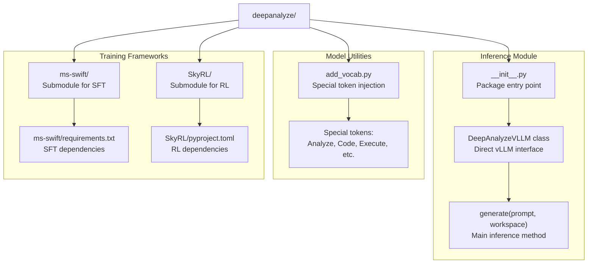
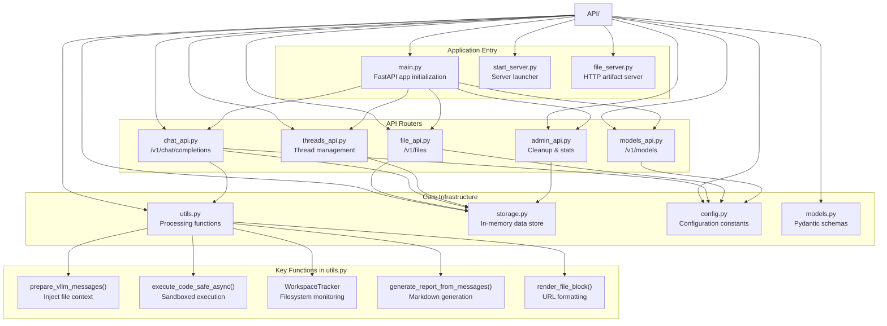
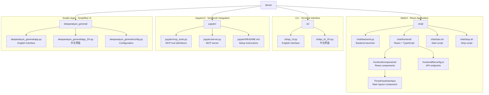
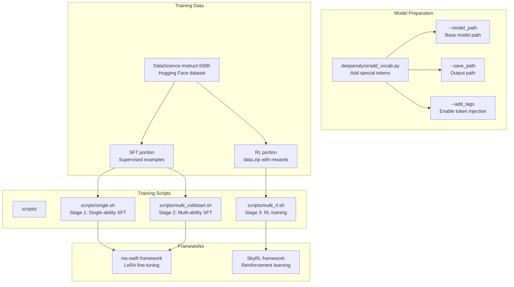
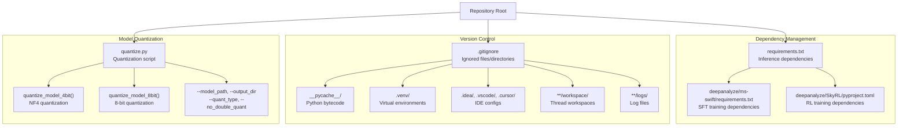
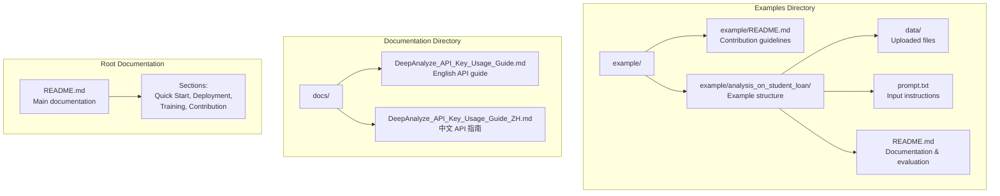
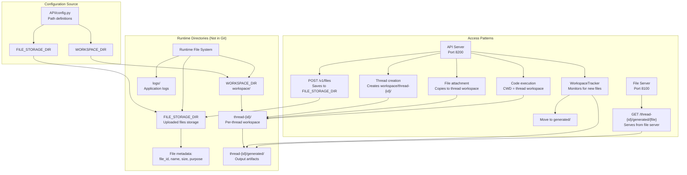

<!-- source: DeepWiki mcp.deepwiki.com · repo ruc-datalab/DeepAnalyze · page 9.1 Project Structure · fetched 2026-10-26 -->

# Project Structure

<details>
<summary>Relevant source files</summary>

The following files were used as context for generating this wiki page:

- [.gitignore](.gitignore)
- [README.md](README.md)
- [assets/wechat.jpg](assets/wechat.jpg)
- [docs/DeepAnalyze_API_Key_Usage_Guide.md](docs/DeepAnalyze_API_Key_Usage_Guide.md)
- [docs/DeepAnalyze_API_Key_Usage_Guide_ZH.md](docs/DeepAnalyze_API_Key_Usage_Guide_ZH.md)
- [example/README.md](example/README.md)
- [quantize.py](quantize.py)
- [requirements.txt](requirements.txt)

</details>


This page documents the organization of the DeepAnalyze codebase, describing the purpose and contents of each major directory and module. It is intended for developers who want to understand where different components live and how they are organized. For information about setting up a development environment, see [Development Environment Setup](#9.2). For deployment instructions, see [Deployment](#4).

The DeepAnalyze repository follows a modular architecture with clear separation between model code, API services, frontend interfaces, training infrastructure, and examples. This structure enables independent development of different components while maintaining clean interfaces between them.

---

## Repository Root Structure

The repository root contains several top-level directories and configuration files that organize the project into functional areas:

```mermaid
graph TB
    ROOT["DeepAnalyze Repository Root"]
    
    subgraph "Core Model & Inference"
        DEEPANALYZE["deepanalyze/<br/>Core Python package"]
        QUANTIZE["quantize.py<br/>Model quantization script"]
    end
    
    subgraph "API Service Layer"
        API["API/<br/>FastAPI server implementation"]
    end
    
    subgraph "Frontend Interfaces"
        DEMO["demo/<br/>User interfaces"]
        DEMO_CHAT["demo/chat/<br/>WebUI (React)"]
        DEMO_CLI["demo/cli/<br/>Terminal interface"]
        DEMO_JUPYTER["demo/jupyter/<br/>Notebook integration"]
        DEMO_GENERAL["demo/deepanalyze_general/<br/>Gradio apps"]
    end
    
    subgraph "Training Pipeline"
        SCRIPTS["scripts/<br/>Training shell scripts"]
        SWIFT["deepanalyze/ms-swift/<br/>SFT framework"]
        SKYRL["deepanalyze/SkyRL/<br/>RL framework"]
    end
    
    subgraph "Documentation & Examples"
        DOCS["docs/<br/>User guides"]
        EXAMPLE["example/<br/>Use case demonstrations"]
        README["README.md<br/>Main documentation"]
    end
    
    subgraph "Configuration"
        REQUIREMENTS["requirements.txt<br/>Dependencies"]
        GITIGNORE[".gitignore<br/>Version control config"]
    end
    
    ROOT --> DEEPANALYZE
    ROOT --> QUANTIZE
    ROOT --> API
    ROOT --> DEMO
    ROOT --> SCRIPTS
    ROOT --> DOCS
    ROOT --> EXAMPLE
    ROOT --> README
    ROOT --> REQUIREMENTS
    ROOT --> GITIGNORE
    
    DEMO --> DEMO_CHAT
    DEMO --> DEMO_CLI
    DEMO --> DEMO_JUPYTER
    DEMO --> DEMO_GENERAL
    
    DEEPANALYZE --> SWIFT
    DEEPANALYZE --> SKYRL
```



**Key Top-Level Components:**

| Directory/File | Purpose | Key Contents |
|----------------|---------|--------------|
| `deepanalyze/` | Core Python package for model inference | `DeepAnalyzeVLLM` class, training frameworks |
| `API/` | OpenAI-compatible FastAPI server | Chat completions, file management, thread isolation |
| `demo/` | Five frontend interfaces | WebUI, CLI, JupyterUI, Gradio apps, Python SDK |
| `scripts/` | Training pipeline scripts | `single.sh`, `multi_coldstart.sh`, `multi_rl.sh` |
| `example/` | Use case demonstrations | Analysis examples with data and documentation |
| `docs/` | User documentation | API key guides, usage instructions |
| `quantize.py` | Model quantization utility | 4-bit and 8-bit quantization functions |
| `requirements.txt` | Minimal dependencies | Inference-only requirements |

**Sources:** [README.md:1-403](), [.gitignore:1-27](), [requirements.txt:1-16]()

---

## Core Model Package (`deepanalyze/`)

The `deepanalyze/` directory contains the core Python package for model inference and the training frameworks. This is the primary module imported when using DeepAnalyze programmatically.



**Inference Components:**

- **`DeepAnalyzeVLLM` class**: Provides direct access to the vLLM server, bypassing the API layer. This is used for embedding DeepAnalyze in Python applications.
  - **`generate(prompt, workspace)` method**: Main inference function that accepts a prompt and workspace directory, returning a dictionary with the full reasoning trace

- **`add_vocab.py`**: Script to inject special tokens (`<Analyze>`, `<Code>`, `<Execute>`, `<File>`, etc.) into the base model's tokenizer when starting from DeepSeek-R1-0528-Qwen3-8B. Referenced at [README.md:320-330]()

**Training Frameworks:**

- **`ms-swift/`**: Git submodule containing the ms-swift framework for supervised fine-tuning (SFT). Used in stages 1 and 2 of the curriculum-based training
  - Dependencies specified in [README.md:225]()

- **`SkyRL/`**: Git submodule containing the SkyRL framework for reinforcement learning. Used in stage 3 of training
  - Dependencies specified in [README.md:225]()

**Sources:** [README.md:237-262](), [README.md:317-341](), [README.md:220-226]()

---

## API Server (`API/`)

The `API/` directory implements the OpenAI-compatible FastAPI server that provides the main interface for all frontends except the direct Python SDK. This is the most complex subsystem, handling chat completions, file management, code execution, and workspace isolation.



**Application Entry Points:**

- **`main.py`**: FastAPI application factory that includes all routers and configures CORS, middleware, and endpoints
- **`start_server.py`**: Server launcher script that starts both the API server (port 8200) and file server (port 8100)
- **`file_server.py`**: Simple HTTP server for serving generated artifacts from workspace directories

**API Routers:**

| File | Endpoints | Purpose |
|------|-----------|---------|
| `chat_api.py` | `POST /v1/chat/completions` | Main conversational endpoint with streaming, code execution, and agentic loop |
| `file_api.py` | `POST/GET/DELETE /v1/files` | File upload, listing, retrieval, and deletion |
| `models_api.py` | `GET /v1/models`, `GET /v1/models/{id}` | List and retrieve model information |
| `threads_api.py` | Thread management endpoints | Create, list, and delete conversation threads |
| `admin_api.py` | `/admin/cleanup`, `/admin/stats` | Administrative operations |

**Core Infrastructure:**

- **`config.py`**: Centralized configuration constants including:
  - `VLLM_BASE_URL = "http://localhost:8000"`: vLLM server address
  - `MODEL_PATH = "DeepAnalyze-8B"`: Model identifier
  - `FILE_STORAGE_DIR`, `WORKSPACE_DIR`: Storage paths
  - Port numbers, timeouts, and execution limits

- **`storage.py`**: In-memory data structures for threads, files, and messages. Uses dictionaries with thread IDs as keys for workspace isolation

- **`models.py`**: Pydantic schemas for OpenAI API compatibility:
  - `FileObject`, `ThreadObject`, `MessageObject`
  - `ChatCompletionRequest`, `ChatCompletionResponse`
  - Used for request validation and response serialization

- **`utils.py`**: Critical processing functions (see [Core Utilities](#6.5) for details):
  - `prepare_vllm_messages()`: Injects workspace file listings into prompts
  - `execute_code_safe_async()`: Runs Python code in isolated subprocesses
  - `WorkspaceTracker`: Monitors filesystem changes to capture generated files
  - `generate_report_from_messages()`: Extracts structured sections to Markdown
  - `render_file_block()`: Formats file metadata with download URLs

**Sources:** [README.md:283-313](), diagram references from system overview

---

## Frontend Interfaces (`demo/`)

The `demo/` directory contains five distinct user interfaces, each optimized for different workflows and user preferences. All interfaces (except the Python SDK) communicate with the API server.



**WebUI (`demo/chat/`):**

The full-featured browser-based interface with three-panel layout:

- **Backend**: `backend.py` launches the API server as a subprocess
- **Frontend**: React + TypeScript single-page application
  - Main component: `ThreePanelInterface` with files panel, assistant panel, and code panel
  - Configuration: `lib/config.ts` specifies API endpoints (`http://localhost:8200`, `http://localhost:8100`)
- **Deployment**: 
  - `start.sh`: Installs dependencies, starts backend and frontend (port 4000)
  - `stop.sh`: Kills server processes
- **Customization**: To deploy on a specific IP, modify [demo/chat/backend.py]() and [demo/chat/frontend/lib/config.ts]() as noted in [README.md:69]()

**CLI (`demo/cli/`):**

Terminal-based interface using the Rich library for formatted output:

- **`api_cli.py`**: English interface with commands:
  - `upload <file>`, `delete <file_id>`, `download <file_id>`, `files`, `help`, `quit`
  - Streaming response display with progress indicators
- **`api_cli_ZH.py`**: Chinese interface with identical functionality
- **Usage**: Start API server first, then run `python api_cli.py` or `python api_cli_ZH.py` in a separate terminal

**JupyterUI (`demo/jupyter/`):**

Integration with Jupyter Lab/Notebook via Model Context Protocol:

- **`mcp_tools.py`**: Defines MCP tools for DeepAnalyze operations
- **`server.py`**: MCP server implementation using `fastmcp.Client`
- **Functionality**: Converts AI responses to native notebook cells:
  - `<Analyze>`, `<Understand>`, `<Answer>` → Markdown cells
  - `<Code>` → Code cells (executable)
- **Setup**: Detailed instructions in [demo/jupyter/README.md]()

**Gradio Apps (`demo/deepanalyze_general/`):**

Simplified web interfaces for quick local deployment:

- **`app.py`**: English interface
- **`app_ZH.py`**: Chinese interface
- **`config.py`**: Shared configuration for API endpoints and server settings
- **Features**:
  - File upload with ZIP support (auto-extraction)
  - Chat interface with preset analysis buttons
  - File preview and download
  - Runs on port 8080

**Python SDK:**

The `DeepAnalyzeVLLM` class in the `deepanalyze/` package provides direct programmatic access, bypassing the API server entirely. See [Python SDK](#5.5) for usage details.

**Sources:** [README.md:46-113](), [docs/DeepAnalyze_API_Key_Usage_Guide.md:127-191](), [docs/DeepAnalyze_API_Key_Usage_Guide_ZH.md:128-193]()

---

## Training Infrastructure

The training infrastructure consists of shell scripts that orchestrate the curriculum-based training pipeline, along with supporting utilities for model preparation.



**Training Scripts (`scripts/`):**

Three shell scripts implement the curriculum-based training approach:

1. **`single.sh`**: Stage 1 training for single-ability fine-tuning
   - Uses ms-swift framework with LoRA
   - Trains on individual data science tasks
   - Produces specialized single-task checkpoints

2. **`multi_coldstart.sh`**: Stage 2 cold start training
   - Combines single-task checkpoints
   - Continues SFT training on multiple tasks jointly
   - Produces multi-ability model without RL

3. **`multi_rl.sh`**: Stage 3 reinforcement learning
   - Uses SkyRL framework
   - Requires RL portion of dataset (unzipped `data.zip`)
   - Produces final DeepAnalyze-8B model

**Model Preparation:**

- **`add_vocab.py`**: Adds special tokens to the base model tokenizer
  - **Usage**: `python deepanalyze/add_vocab.py --model_path <base_model> --save_path <output> --add_tags`
  - **Special tokens**: `<Analyze>`, `<Code>`, `<Execute>`, `<File>`, `<Understand>`, `<Answer>`, `<Report>`
  - Required when starting from DeepSeek-R1-0528-Qwen3-8B
  - Not needed when fine-tuning from DeepAnalyze-8B

**Dataset Requirements:**

- **DataScience-Instruct-500K**: Available on Hugging Face
- **SFT portion**: Used in stages 1 and 2
- **RL portion**: Compressed as `data.zip`, must be unzipped before stage 3
  - Command: `unzip DataScience-Instruct-500K/RL/data.zip` per [README.md:334]()

**Sources:** [README.md:315-341](), [README.md:320-330]()

---

## Configuration and Deployment Files

Configuration files at the repository root control dependencies, version control behavior, and model quantization.



**requirements.txt:**

Minimal dependencies for inference only. Key packages:
- `vllm>=0.8.5`: High-throughput inference engine
- `transformers`, `torch`: Model loading and execution
- `fastapi`, `uvicorn`: API server
- `pandas`, `numpy`, `scikit-learn`, `matplotlib`, `seaborn`: Data science libraries
- `openai`: Client library for API access

Training dependencies are separate:
- SFT training: [deepanalyze/ms-swift/requirements.txt]()
- RL training: [deepanalyze/SkyRL/pyproject.toml]()

**Recommendation from [README.md:226]()**: Separate inference and training environments to avoid dependency conflicts.

**.gitignore:**

Excludes from version control:
- **System files**: `.DS_Store`, `Thumbs.db`
- **Python artifacts**: `__pycache__/`, `*.pyc`, `*.pyo`, `build/`, `dist/`, `*.egg-info`
- **Virtual environments**: `.venv/`
- **IDE configs**: `.idea/`, `.vscode/`, `.cursor/`, `.trae/`
- **Runtime data**: `**/workspace/` (thread workspaces), `**/logs/`
- **Development files**: `**/.claude/`, `**/CLAUDE.md`

**quantize.py:**

Model quantization utility using bitsandbytes library:

- **`quantize_model_4bit()`**: 
  - NF4 quantization type
  - bf16 compute dtype
  - Optional double quantization
  - Reduces model size to ~4GB
  
- **`quantize_model_8bit()`**:
  - 8-bit quantization with outlier detection
  - Threshold: 6.0
  - Reduces model size to ~8GB

**Usage**: `python quantize.py --model_path <path> --output_dir <dir> --quant_type [4bit|8bit|both]`

**Output**: Quantized models saved in subdirectories `4bit/` and/or `8bit/`

**Sources:** [requirements.txt:1-16](), [.gitignore:1-27](), [quantize.py:1-145](), [README.md:148]()

---

## Examples and Documentation

The `example/` and `docs/` directories provide use cases and user-facing documentation.



**Examples (`example/`):**

Demonstrates use cases and serves as a template for contributions:

- **Structure** (from [example/README.md:12-15]()):
  1. `data/`: Stores uploaded files for analysis
  2. `prompt.txt`: Input instructions to DeepAnalyze
  3. `README.md`: Documentation with input, output, comparison to closed-source LLMs, and evaluation comments

- **Reference example**: `example/analysis_on_student_loan/`
  - Comprehensive analysis of student enrollment patterns
  - Multiple data files (10 files: CSV and Excel)
  - Generated report demonstrating deep research capabilities

- **Contribution guidelines**: [example/README.md]() encourages sharing use cases, including cases where DeepAnalyze underperforms closed-source LLMs (helpful for improvement)

**Documentation (`docs/`):**

User-facing guides for API key usage:

- **English guide**: `DeepAnalyze_API_Key_Usage_Guide.md`
  - API key application process
  - cURL request examples
  - Interactive Python script usage (`test_streaming.py`)
  - Gradio app deployment instructions
  - Developed by Li Haoming (HeyWhale Technology)

- **Chinese guide**: `DeepAnalyze_API_Key_Usage_Guide_ZH.md`
  - Identical content in Chinese
  - Links to Feishu wiki for mainland China users

**Main README:**

The [README.md]() serves as the primary documentation hub with sections:
- Project overview and capabilities
- Demo videos and quick start
- Model download and deployment configurations
- Training pipeline instructions
- API usage examples
- Contribution guidelines
- Citation information

**Sources:** [README.md:1-403](), [example/README.md:1-16](), [docs/DeepAnalyze_API_Key_Usage_Guide.md:1-191](), [docs/DeepAnalyze_API_Key_Usage_Guide_ZH.md:1-193]()

---

## File System Conventions

DeepAnalyze uses specific directory structures at runtime for workspace isolation and artifact storage. These directories are created dynamically and excluded from version control.



**Storage Directories:**

| Directory | Purpose | Managed By | Port |
|-----------|---------|------------|------|
| `FILE_STORAGE_DIR` | Stores uploaded files before thread association | `API/file_api.py` | 8200 |
| `WORKSPACE_DIR/thread-{id}/` | Per-thread isolated workspace for code execution | `API/storage.py`, `API/utils.py` | 8200 |
| `WORKSPACE_DIR/thread-{id}/generated/` | Output artifacts captured by `WorkspaceTracker` | `API/utils.py` | 8100 |
| `logs/` | Application logs (excluded from git) | Various components | N/A |

**Workspace Lifecycle:**

1. **File upload**: User uploads `data.csv` → saved to `FILE_STORAGE_DIR` with unique `file_id`
2. **Thread creation**: First message creates `workspace/thread-abc123/`
3. **File copying**: Files with matching `file_ids` copied to `workspace/thread-abc123/`
4. **Code execution**: Python subprocess runs with CWD = `workspace/thread-abc123/`
5. **File tracking**: `WorkspaceTracker.diff_and_collect()` detects new files (plots, CSVs, etc.)
6. **File migration**: New files moved to `workspace/thread-abc123/generated/`
7. **URL generation**: `render_file_block()` creates URLs like `http://localhost:8100/thread-abc123/generated/plot.png`
8. **Client access**: Frontend downloads files from file server (port 8100)

**Configuration:**

All paths defined in `API/config.py`:
- `FILE_STORAGE_DIR`: Default `"file_storage"`
- `WORKSPACE_DIR`: Default `"workspace"`
- Configurable via environment variables or direct modification

**Note**: These directories are listed in `.gitignore` at [.gitignore:25]() as `**/workspace/` and [.gitignore:27]() as `**/logs/`

**Sources:** [.gitignore:25-27](), diagram references from system overview showing storage patterns

---

## Module Import Paths and Key Classes

For developers working with DeepAnalyze programmatically, understanding the primary import paths and class structures is essential.

```mermaid
graph TB
    subgraph "Primary Import: deepanalyze"
        PKG["from deepanalyze import DeepAnalyzeVLLM"]
        CLASS["DeepAnalyzeVLLM class"]
        INIT_METHOD["__init__(model_path)<br/>Initialize with vLLM model"]
        GEN_METHOD["generate(prompt, workspace)<br/>Returns: dict with reasoning"]
    end
    
    subgraph "API Client: OpenAI SDK"
        OPENAI["from openai import OpenAI"]
        CLIENT["client = OpenAI(base_url, api_key)"]
        CHAT_API["client.chat.completions.create()<br/>Compatible with OpenAI API"]
    end
    
    subgraph "API Server: FastAPI App"
        MAIN["from API.main import app"]
        APP["FastAPI application instance"]
        ROUTERS["Includes: chat_api, file_api,<br/>models_api, threads_api, admin_api"]
    end
    
    subgraph "API Server: Storage"
        STORAGE["from API.storage import <class>"]
        THREAD_STORE["ThreadStore<br/>In-memory thread data"]
        FILE_STORE["FileStore<br/>In-memory file metadata"]
        MSG_STORE["MessageStore<br/>In-memory message history"]
    end
    
    subgraph "API Server: Utilities"
        UTILS["from API.utils import <function>"]
        PREP["prepare_vllm_messages(messages, workspace)"]
        EXEC["execute_code_safe_async(code, workspace)"]
        WS_TRACK["WorkspaceTracker(workspace_path)"]
        GEN_REPORT["generate_report_from_messages(messages)"]
    end
    
    PKG --> CLASS
    CLASS --> INIT_METHOD
    CLASS --> GEN_METHOD
    
    OPENAI --> CLIENT
    CLIENT --> CHAT_API
    
    MAIN --> APP
    APP --> ROUTERS
    
    STORAGE --> THREAD_STORE
    STORAGE --> FILE_STORE
    STORAGE --> MSG_STORE
    
    UTILS --> PREP
    UTILS --> EXEC
    UTILS --> WS_TRACK
    UTILS --> GEN_REPORT
```



**Primary Classes and Functions:**

**DeepAnalyze SDK:**
```python
from deepanalyze import DeepAnalyzeVLLM

# Direct vLLM access (bypasses API server)
deepanalyze = DeepAnalyzeVLLM("/path/to/model")
result = deepanalyze.generate(prompt="Analyze this data", workspace="/path/to/workspace")
# Returns: {"reasoning": "...", ...}
```

**OpenAI-Compatible Client:**
```python
from openai import OpenAI

client = OpenAI(
    base_url="http://localhost:8200/v1",
    api_key="dummy-key"  # Local deployment uses dummy keys
)
response = client.chat.completions.create(
    model="DeepAnalyze-8B",
    messages=[{"role": "user", "content": "Analyze data"}]
)
```

**API Server Components:**

- **`API.main.app`**: FastAPI application instance
  - Includes routers for all endpoints
  - Configures CORS, middleware, exception handlers

- **`API.storage`**: In-memory data stores
  - `ThreadStore`: Maps thread IDs to thread metadata and workspace paths
  - `FileStore`: Maps file IDs to file metadata
  - `MessageStore`: Maps thread IDs to message histories

- **`API.utils`**: Core processing functions
  - `prepare_vllm_messages()`: Injects file listings into message context
  - `execute_code_safe_async()`: Sandboxed Python execution with timeout
  - `WorkspaceTracker`: Context manager for filesystem diff tracking
  - `generate_report_from_messages()`: Extracts sections into Markdown report

**Sources:** [README.md:237-262]() showing SDK usage, diagram references showing API structure

---

