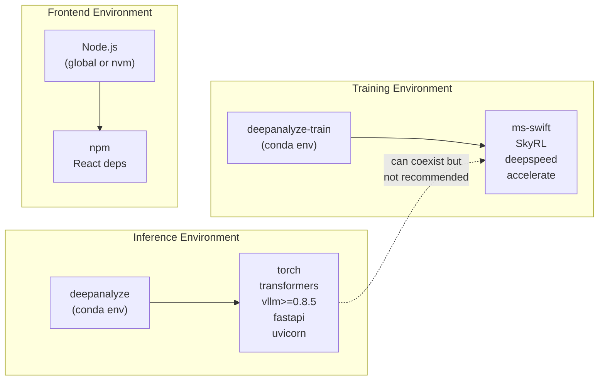
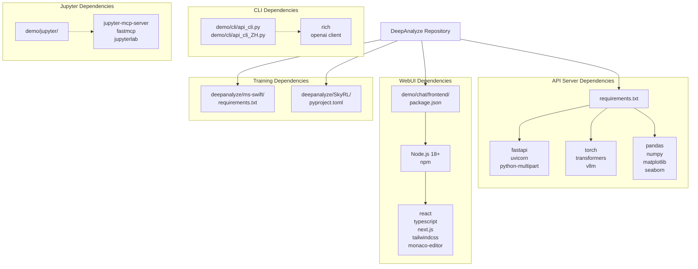
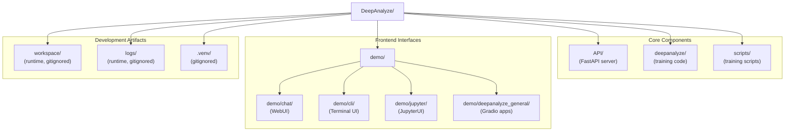
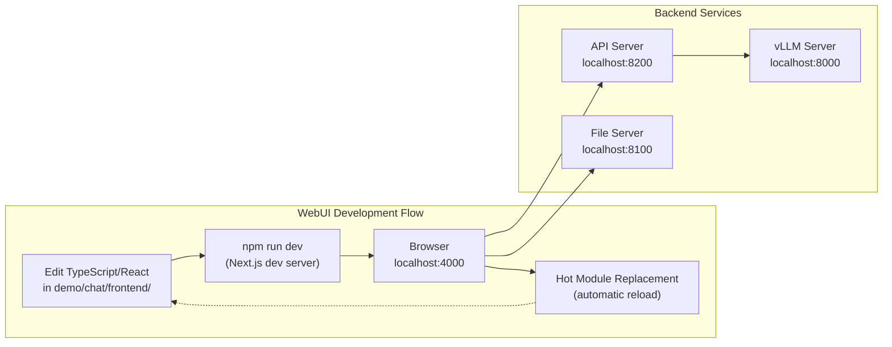
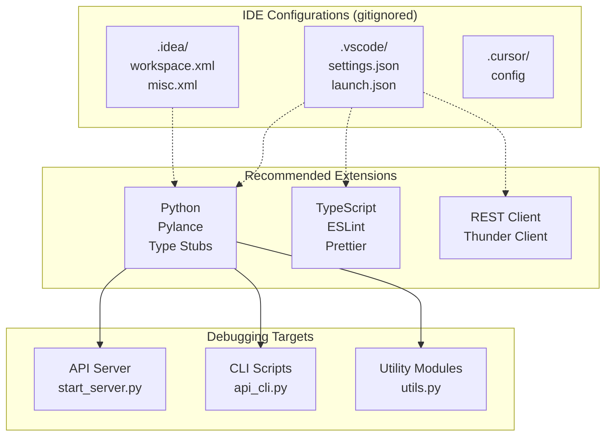
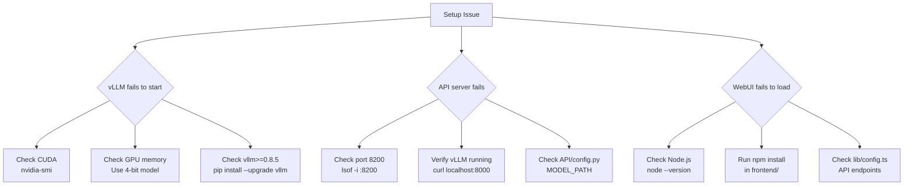

<!-- source: DeepWiki mcp.deepwiki.com · repo ruc-datalab/DeepAnalyze · page 9.2 Development Environment Setup · fetched 2026-10-26 -->

# Development Environment Setup

<details>
<summary>Relevant source files</summary>

The following files were used as context for generating this wiki page:

- [.gitignore](.gitignore)
- [README.md](README.md)
- [assets/wechat.jpg](assets/wechat.jpg)
- [docs/DeepAnalyze_API_Key_Usage_Guide.md](docs/DeepAnalyze_API_Key_Usage_Guide.md)
- [docs/DeepAnalyze_API_Key_Usage_Guide_ZH.md](docs/DeepAnalyze_API_Key_Usage_Guide_ZH.md)
- [example/README.md](example/README.md)
- [quantize.py](quantize.py)
- [requirements.txt](requirements.txt)

</details>


This document provides instructions for setting up a local development environment for contributing to the DeepAnalyze project. It covers installing dependencies, configuring tools, and running individual components for development and testing.

For production deployment instructions, see [Deployment](#4). For a quick start with pre-built containers, see [Quick Start Guide](#7.1). For understanding the codebase organization before setup, see [Project Structure](#9.1).

---

## Prerequisites

Before setting up the development environment, ensure your system meets these requirements:

| Requirement | Specification | Notes |
|-------------|--------------|-------|
| **Operating System** | Linux, macOS, or Windows (WSL2 recommended) | Windows users should use WSL2 for best compatibility |
| **Python** | 3.12 (recommended) or 3.8+ | Version 3.12 used in primary development |
| **GPU** | NVIDIA GPU with CUDA support | For model inference; CPU-only possible for frontend development |
| **CUDA** | 11.8+ or 12.1+ | Required for GPU acceleration with PyTorch |
| **RAM** | 16GB minimum, 32GB+ recommended | Varies by model quantization level |
| **Disk Space** | 50GB+ free | Model files ~16GB, dependencies ~10GB, working space ~20GB |
| **Node.js** | 18+ (for WebUI development) | Only required if developing frontend |
| **Git** | 2.x+ | For version control |

**Sources:** [README.md:212-227]()

---

## Repository Setup

### Cloning the Repository

Clone the repository and navigate to the project root:

```bash
git clone https://github.com/ruc-datalab/DeepAnalyze.git
cd DeepAnalyze
```

### Understanding Version Control Configuration

The [.gitignore:1-27]() file excludes the following from version control:

- **System files**: `.DS_Store`, `Thumbs.db`
- **Python artifacts**: `__pycache__/`, `*.pyc`, `*.egg-info`, `build/`, `dist/`
- **Virtual environments**: `.venv/`
- **IDE configurations**: `.idea/`, `.cursor/`, `.vscode/`, `.trae/`
- **Development artifacts**: `**/.claude/`, `**/workspace/`, `**/CLAUDE.md`, `**/logs/`

The `workspace/` directory is excluded because it contains per-thread runtime data generated during API server operation. Similarly, `logs/` contain runtime logs that should not be committed.

**Sources:** [.gitignore:1-27]()

---

## Python Environment Configuration

### Creating an Isolated Environment

DeepAnalyze recommends using **conda** for environment management to avoid dependency conflicts, especially between inference and training components. The project uses **separate environments** for inference and training.


**Diagram: Environment Isolation Strategy**

**Sources:** [README.md:224-226]()

### Setting Up the Inference Environment

Create and activate the primary environment for inference and API development:

```bash
# Create environment with Python 3.12
conda create -n deepanalyze python=3.12 -y

# Activate environment
conda activate deepanalyze

# Install core dependencies from requirements.txt
pip install -r requirements.txt
```

The [requirements.txt:1-16]() file specifies minimal dependencies for inference:

| Package | Purpose | Version Constraint |
|---------|---------|-------------------|
| `vllm` | High-throughput inference engine | `>=0.8.5` |
| `torch` | Deep learning framework | Latest compatible |
| `transformers` | Hugging Face model loading | Latest compatible |
| `numpy`, `pandas`, `scikit-learn` | Data processing libraries | Latest |
| `seaborn`, `matplotlib` | Visualization (used in code execution) | Latest |
| `fastapi`, `uvicorn` | API server framework | Latest |
| `openai` | OpenAI client (for SDK compatibility) | Latest |
| `requests`, `websockets`, `python-multipart` | Web utilities | Latest |

**Sources:** [requirements.txt:1-16](), [README.md:214-223]()

### Setting Up the Training Environment (Optional)

If you plan to contribute to model training, create a separate environment:

```bash
# Create separate training environment
conda create -n deepanalyze-train python=3.10 -y
conda activate deepanalyze-train

# Install training frameworks
cd deepanalyze/ms-swift/
pip install -e .

cd ../SkyRL/
pip install -e .

# Return to project root
cd ../../
```

**Why separate environments?**
- Training frameworks (ms-swift, SkyRL) have specific dependency versions that may conflict with vLLM
- Training requires different CUDA/PyTorch configurations optimized for gradient computation
- Most contributors only need the inference environment

**Sources:** [README.md:220-226]()

---

## Dependency Installation by Component


**Diagram: Dependency Structure by Component**

### Frontend Dependencies (WebUI Development)

If you plan to modify the React-based WebUI, install Node.js dependencies:

```bash
cd demo/chat/frontend
npm install

# Return to project root
cd ../../..
```

This installs dependencies defined in `demo/chat/frontend/package.json`, including React, TypeScript, Next.js, Monaco Editor, and Tailwind CSS.

**Sources:** [README.md:59-63]()

### CLI and Jupyter Dependencies

The CLI and Jupyter interfaces use the same backend as the API server but have additional client-side dependencies:

```bash
# For CLI development (included in requirements.txt)
pip install rich openai

# For Jupyter development
pip install jupyter-mcp-server fastmcp jupyterlab
```

**Sources:** [README.md:83-105]()

---

## Component Setup and Testing

### Directory Structure for Development


**Diagram: Development Directory Organization**

**Sources:** [.gitignore:1-27](), [README.md:55-105]()

### Setting Up vLLM Server for Development

The vLLM server is required for all components except the Python SDK. For development, use a quantized model to reduce memory requirements:

```bash
# Download the model first (or use local path)
# For development, 4-bit quantized version recommended

# Launch vLLM server
python -m vllm.entrypoints.openai.api_server \
  --model /path/to/DeepAnalyze-8B-4bit \
  --served-model-name DeepAnalyze-8B \
  --max-model-len 8192 \
  --gpu-memory-utilization 0.95 \
  --port 8000 \
  --kv-cache-dtype fp8 \
  --trust-remote-code

# Verify server is running
curl http://localhost:8000/v1/models
```

**Development Tips:**
- Use `--max-model-len 8192` for faster startup during development
- The server runs on port `8000` by default (configurable in `API/config.py`)
- Keep this terminal open while developing; restart only when testing model changes

**Sources:** [README.md:153-202]()

### Setting Up API Server for Development

The API server provides OpenAI-compatible endpoints and handles code execution. It connects to the vLLM server:

```bash
# Ensure vLLM server is running first (see above)

# Start API server
cd API
python start_server.py

# In another terminal, verify API is running
curl http://localhost:8200/health
```

**Key Configuration Files:**
- [API/config.py]() - Port numbers, model names, timeout settings
- [API/main.py]() - FastAPI application initialization
- [API/storage.py]() - In-memory storage initialization

The server will:
1. Start FastAPI on port `8200`
2. Start file server on port `8100`
3. Create `workspace/` directory for thread-based workspaces
4. Create `file_storage/` directory for uploaded files

**Sources:** [README.md:283-313]()

### Setting Up WebUI for Development


**Diagram: WebUI Development Workflow**

```bash
# Terminal 1: vLLM server
python -m vllm.entrypoints.openai.api_server --model /path/to/model ...

# Terminal 2: API server
cd API
python start_server.py

# Terminal 3: WebUI frontend
cd demo/chat/frontend
npm run dev

# Open browser to http://localhost:4000
```

**Configuration Files to Check:**
- [demo/chat/frontend/lib/config.ts]() - API endpoints (change `localhost` to your IP if testing remotely)
- [demo/chat/backend.py]() - Backend configuration (if using the integrated backend script instead)

The WebUI uses:
- **Next.js** development server with hot module replacement
- **Monaco Editor** for code display/editing
- **Three-panel layout**: Files (left), Assistant (center), Code (right)
- **Streaming** via fetch API with `text/event-stream`

**Sources:** [README.md:55-69]()

### Setting Up CLI for Development

The CLI interfaces are standalone Python scripts that connect to the API server:

```bash
# Terminal 1: Ensure API server is running
cd API
python start_server.py

# Terminal 2: Run CLI
cd demo/cli
python api_cli.py       # English interface
# or
python api_cli_ZH.py    # Chinese interface
```

The CLI provides:
- File upload/download commands
- Streaming response display with Rich formatting
- Command history and tab completion
- Session management with `session_id`

**Sources:** [README.md:89-105]()

### Setting Up JupyterUI for Development

The Jupyter integration uses the Model Context Protocol (MCP):

```bash
# Install Jupyter dependencies
pip install jupyter-mcp-server fastmcp jupyterlab

# Navigate to Jupyter demo
cd demo/jupyter

# Follow instructions in demo/jupyter/README.md
# Typically involves:
# 1. Configure MCP server settings
# 2. Launch JupyterLab
# 3. Load notebook and test integration
```

The Jupyter integration converts DeepAnalyze responses into notebook cells:
- `<Analyze>`, `<Understand>`, `<Answer>` → Markdown cells
- `<Code>` → Code cells (executable)
- `<Execute>` → Execution results

**Sources:** [README.md:71-80]()

---

## Development Tools and IDE Configuration

### Recommended IDE Setup


**Diagram: IDE and Debugging Configuration**

### VS Code Configuration Example

Create `.vscode/launch.json` for debugging the API server:

```json
{
  "version": "0.2.0",
  "configurations": [
    {
      "name": "Python: API Server",
      "type": "python",
      "request": "launch",
      "program": "${workspaceFolder}/API/start_server.py",
      "console": "integratedTerminal",
      "cwd": "${workspaceFolder}/API",
      "env": {
        "PYTHONPATH": "${workspaceFolder}"
      }
    },
    {
      "name": "Python: CLI",
      "type": "python",
      "request": "launch",
      "program": "${workspaceFolder}/demo/cli/api_cli.py",
      "console": "integratedTerminal",
      "cwd": "${workspaceFolder}/demo/cli"
    }
  ]
}
```

**Note:** The `.vscode/` directory is gitignored per [.gitignore:20](), so these configurations remain local to your development environment.

**Sources:** [.gitignore:18-21]()

### Testing API Endpoints

Use curl or HTTP clients to test API endpoints directly:

```bash
# Health check
curl http://localhost:8200/health

# List models
curl http://localhost:8200/v1/models

# Upload file
curl -X POST http://localhost:8200/v1/files \
  -F "file=@test.csv" \
  -F "purpose=file-extract"

# Chat completion (streaming)
curl -X POST http://localhost:8200/v1/chat/completions \
  -H "Content-Type: application/json" \
  -d '{
    "model": "DeepAnalyze-8B",
    "messages": [{"role": "user", "content": "Hello"}],
    "stream": true
  }'
```

**Sources:** [README.md:290-311]()

---

## Environment Validation

### Verification Checklist

After setup, verify each component:

| Component | Verification Command | Expected Result |
|-----------|---------------------|-----------------|
| **Python Environment** | `conda list | grep vllm` | Shows `vllm>=0.8.5` |
| **vLLM Server** | `curl http://localhost:8000/v1/models` | Returns model list JSON |
| **API Server** | `curl http://localhost:8200/health` | Returns `{"status": "healthy"}` |
| **File Server** | `curl http://localhost:8100/` | Returns directory listing or 404 |
| **WebUI (dev)** | Open `http://localhost:4000` | Shows DeepAnalyze interface |
| **Node.js** | `cd demo/chat/frontend && npm run build` | Build succeeds |

### Common Setup Issues


**Diagram: Troubleshooting Decision Tree**

### Quick Start Verification Script

Create a simple verification script `verify_setup.sh`:

```bash
#!/bin/bash
echo "=== DeepAnalyze Development Environment Verification ==="

echo -n "1. Checking conda environment... "
if conda env list | grep -q "deepanalyze"; then
    echo "✓"
else
    echo "✗ Environment 'deepanalyze' not found"
fi

echo -n "2. Checking vLLM installation... "
if python -c "import vllm" 2>/dev/null; then
    echo "✓"
else
    echo "✗ vLLM not installed"
fi

echo -n "3. Checking vLLM server... "
if curl -s http://localhost:8000/v1/models >/dev/null; then
    echo "✓"
else
    echo "✗ vLLM server not responding"
fi

echo -n "4. Checking API server... "
if curl -s http://localhost:8200/health >/dev/null; then
    echo "✓"
else
    echo "✗ API server not responding"
fi

echo -n "5. Checking Node.js (for WebUI)... "
if command -v node &> /dev/null; then
    echo "✓ ($(node --version))"
else
    echo "⚠ Node.js not installed (required for WebUI development)"
fi

echo "=== Verification Complete ==="
```

**Sources:** [README.md:212-313]()

---

## Model Quantization for Development

If you need to quantize models during development (e.g., for testing or creating deployment artifacts), use the [quantize.py:1-145]() script:

```bash
# Activate environment
conda activate deepanalyze

# Quantize to 4-bit (recommended for development)
python quantize.py \
  --model_path /path/to/DeepAnalyze-8B \
  --output_dir /path/to/output \
  --quant_type 4bit

# Quantize to both 4-bit and 8-bit
python quantize.py \
  --model_path /path/to/DeepAnalyze-8B \
  --output_dir /path/to/output \
  --quant_type both
```

The quantization script uses `bitsandbytes` with:
- **4-bit**: NF4 quantization type with optional double quantization [quantize.py:24-29]()
- **8-bit**: Int8 with outlier threshold of 6.0 [quantize.py:67-70]()

Both quantization formats are compatible with vLLM for deployment. For detailed quantization configuration, see [Model Quantization](#4.2).

**Sources:** [quantize.py:1-145](), [README.md:148]()

---

## Next Steps

After completing environment setup:

1. **Understand the codebase**: Read [Project Structure](#9.1) to familiarize yourself with module organization
2. **Make your first contribution**: Follow [Contributing Guidelines](#9.3) for coding standards and PR workflow
3. **Test your changes**: Run components locally and verify API responses
4. **Explore advanced features**: Review [API Server Architecture](#6) for deep dives into specific subsystems

**Sources:** [README.md:1-403]()

---

