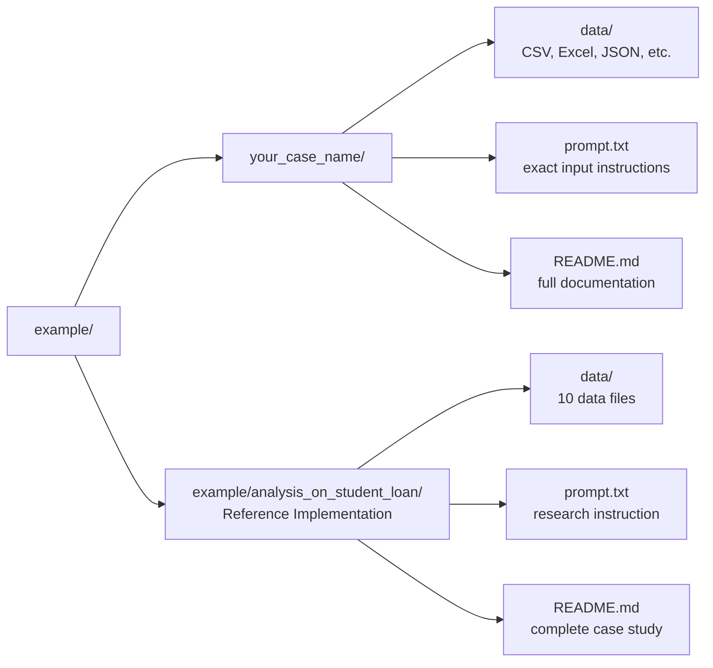
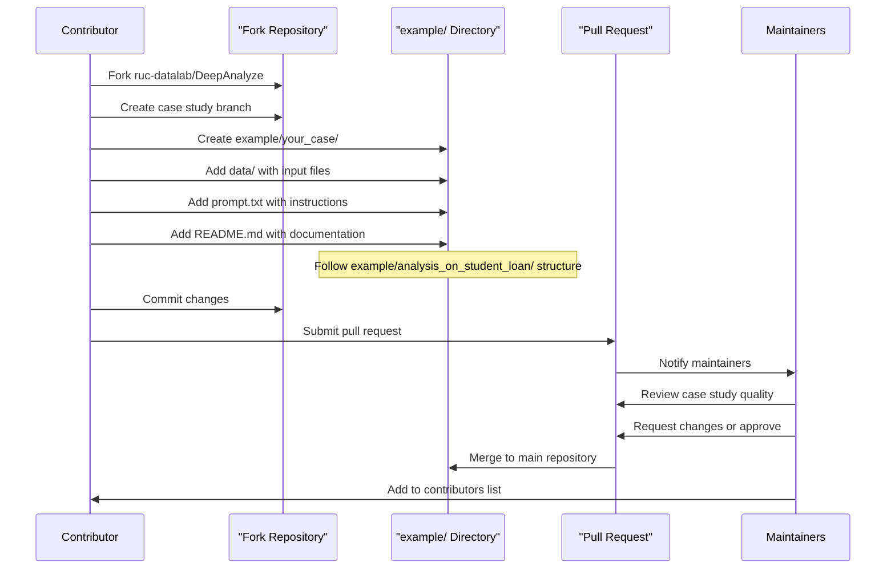
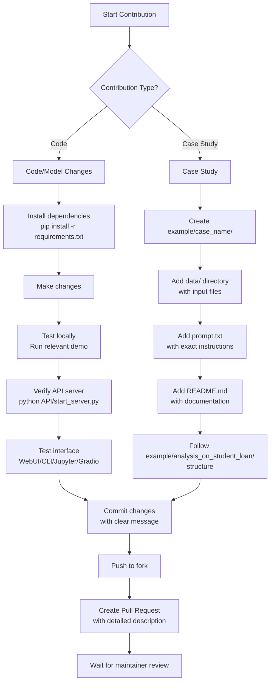

<!-- source: DeepWiki mcp.deepwiki.com · repo ruc-datalab/DeepAnalyze · page 9.3 Contributing Guidelines · fetched 2026-10-26 -->

# Contributing Guidelines

Relevant source files

The following files were used as context for generating this wiki page:

- [README.md](README.md)
- [assets/wechat.jpg](assets/wechat.jpg)
- [docs/DeepAnalyze_API_Key_Usage_Guide.md](docs/DeepAnalyze_API_Key_Usage_Guide.md)
- [docs/DeepAnalyze_API_Key_Usage_Guide_ZH.md](docs/DeepAnalyze_API_Key_Usage_Guide_ZH.md)
- [example/README.md](example/README.md)
- [quantize.py](quantize.py)
- [requirements.txt](requirements.txt)

This page provides comprehensive guidelines for contributing to the DeepAnalyze project, including code contributions, model improvements, case study submissions, and the pull request process.

---

## Overview

The DeepAnalyze project welcomes all forms of contributions. Merged pull requests will result in contributors being recognized in the project. Contributions fall into two main categories:

| Contribution Type | Description | Target Location | Examples |
|------------------|-------------|-----------------|----------|
| **Code & Model** | Docker packaging, model conversion/quantization, workflow implementations, UI improvements | Repository codebase | [quantize.py:1-145](), [demo/chat/](), [demo/jupyter/](), [demo/cli/]() |
| **Case Studies** | Real-world usage examples, feedback, comparative analyses | [example/]() directory | [example/analysis_on_student_loan/]() |

**Sources:** [README.md:346-362](), [example/README.md:1-16]()

---

## Contribution Types and Entry Points

The following diagram maps contribution types to their corresponding code entities and file paths in the repository:

```mermaid
graph TB
    subgraph "Code_Model_Contributions"
        QUANTIZE["Model Quantization<br/>quantize.py<br/>quantize_model_4bit()<br/>quantize_model_8bit()"]
        WEBUI["WebUI Frontend<br/>demo/chat/frontend/<br/>ThreePanelInterface component<br/>demo/chat/backend.py"]
        CLI["CLI Interface<br/>demo/cli/api_cli.py<br/>demo/cli/api_cli_ZH.py"]
        JUPYTER["Jupyter Integration<br/>demo/jupyter/<br/>jupyter-mcp-server"]
        GRADIO["Gradio Apps<br/>demo/deepanalyze_general/app.py<br/>demo/deepanalyze_general/app_ZH.py"]
        SDK["Python SDK<br/>deepanalyze/deepanalyze_vllm.py<br/>DeepAnalyzeVLLM.generate()"]
        API["API Server<br/>API/main.py<br/>API/chat_api.py<br/>API/file_api.py"]
    end
    
    subgraph "Case_Study_Contributions"
        EXAMPLE["example/ directory"]
        STRUCTURE["Required Structure:<br/>data/<br/>prompt.txt<br/>README.md"]
        REFERENCE["example/analysis_on_student_loan/<br/>Reference Implementation"]
    end
    
    subgraph "Training_Contributions"
        SCRIPTS["Training Scripts<br/>scripts/single.sh<br/>scripts/multi_coldstart.sh<br/>scripts/multi_rl.sh"]
        ADDVOCAB["Vocabulary Extension<br/>deepanalyze/add_vocab.py"]
    end
    
    subgraph "Documentation_Contributions"
        GUIDES["Usage Guides<br/>docs/DeepAnalyze_API_Key_Usage_Guide.md<br/>docs/DeepAnalyze_API_Key_Usage_Guide_ZH.md"]
        README["Main Documentation<br/>README.md"]
    end
    
    QUANTIZE --> PR["Pull Request<br/>github.com/ruc-datalab/DeepAnalyze"]
    WEBUI --> PR
    CLI --> PR
    JUPYTER --> PR
    GRADIO --> PR
    SDK --> PR
    API --> PR
    
    EXAMPLE --> STRUCTURE
    STRUCTURE --> REFERENCE
    REFERENCE --> PR
    
    SCRIPTS --> PR
    ADDVOCAB --> PR
    
    GUIDES --> PR
    README --> PR
```

**Sources:** [README.md:346-362](), [example/README.md:1-16](), [quantize.py:1-145]()

---

## Contributing Code and Model Improvements

### Submission Process

Code and model contributions can be submitted directly via pull request. The following areas are particularly welcome:

**Model Enhancements:**
- **Quantization**: Extend [quantize.py:1-145]() to support additional quantization formats (GGUF, AWQ, GPTQ, etc.)
- **Model Conversion**: Convert DeepAnalyze-8B to different inference frameworks
- **Performance Optimization**: Improve vLLM serving parameters in deployment scripts
- **Special Token Management**: Enhance [deepanalyze/add_vocab.py]() for custom token vocabularies

**User Interface Contributions:**
- **WebUI**: Improve React components in [demo/chat/frontend/](), enhance [demo/chat/backend.py]()
- **CLI**: Add features to [demo/cli/api_cli.py]() or [demo/cli/api_cli_ZH.py]()
- **Jupyter Integration**: Extend [demo/jupyter/]() MCP server capabilities
- **Gradio Apps**: Enhance [demo/deepanalyze_general/app.py]() or [demo/deepanalyze_general/app_ZH.py]()
- **New Interfaces**: Create alternative frontends that interact with the API server

**API Server Enhancements:**
- **Core API**: Improve endpoints in [API/chat_api.py](), [API/file_api.py](), [API/threads_api.py]()
- **Utilities**: Enhance [API/utils.py]() functions like `execute_code_safe_async()` or `WorkspaceTracker`
- **Storage**: Optimize [API/storage.py]() in-memory data structures

**Training Pipeline:**
- **Training Scripts**: Improve [scripts/single.sh](), [scripts/multi_coldstart.sh](), [scripts/multi_rl.sh]()
- **Integration with Closed-Source LLMs**: Create workflow adapters for GPT-4, Claude, etc.

**Documentation:**
- **Usage Guides**: Expand [docs/DeepAnalyze_API_Key_Usage_Guide.md]()
- **Code Examples**: Add practical examples using the DeepAnalyzeVLLM SDK

### Development Standards

Contributors should follow these guidelines:

| Aspect | Requirement | Reference |
|--------|-------------|-----------|
| **Python Version** | 3.12 or compatible | [requirements.txt:1-16]() |
| **Dependencies** | Install from `requirements.txt` | [README.md:212-227]() |
| **Code Style** | Follow PEP 8 conventions | Standard Python style |
| **Testing** | Test locally before submission | Run demos to verify changes |
| **Documentation** | Update relevant docs and docstrings | Inline documentation |

**Sources:** [README.md:346-362](), [example/README.md:4-8](), [quantize.py:1-145]()

---

## Contributing Case Studies

### Purpose and Value

Case study contributions are especially valuable for improving DeepAnalyze. The project explicitly welcomes examples where DeepAnalyze (with only 8B parameters) performs slightly worse than closed-source LLMs, as these help identify improvement areas.

### Required Folder Structure

All case studies must be placed in the `example/` directory following this standardized structure:

The reference implementation at `example/analysis_on_student_loan/` demonstrates the expected structure:

| Component | Required | Purpose | Example |
|-----------|----------|---------|---------|
| `data/` | Yes | Stores all uploaded files (CSV, Excel, JSON, etc.) | `example/analysis_on_student_loan/data/` |
| `prompt.txt` | Yes | Contains the exact input instructions given to DeepAnalyze | Complete prompt text |
| `README.md` | Yes | Comprehensive documentation of the case study | Input, output, evaluation |

**Sources:** [README.md:357-360](), [example/README.md:12-15]()

### README.md Requirements

The case study `README.md` should include the following sections:

1. **Input Section**
   - The prompt used (can reference `prompt.txt`)
   - Description of input data files
   - Any preprocessing steps taken

2. **DeepAnalyze Output**
   - Complete reasoning trace from DeepAnalyze-8B
   - Generated code and execution results
   - Final analysis and visualizations

3. **Comparative Analysis (Optional)**
   - Outputs from closed-source LLMs (GPT-4, Claude, etc.)
   - Screenshots of results are acceptable
   - Comparison methodology

4. **Evaluation and Comments**
   - Your assessment of DeepAnalyze's performance
   - Strengths observed
   - Weaknesses or failure modes identified
   - Suggestions for improvement

### Case Study Submission Workflow

**Sources:** [README.md:357-361](), [example/README.md:9-16]()

---

## Contribution Areas Mapped to Code Entities

The following table provides precise mappings between contribution areas and the specific files/classes/functions developers should target:

| Contribution Area | Primary Code Entities | File Paths | Key Functions/Classes |
|------------------|----------------------|------------|---------------------|
| **Model Quantization** | Quantization functions | [quantize.py:12-145]() | `quantize_model_4bit()`, `quantize_model_8bit()` |
| **Core SDK** | Python SDK class | `deepanalyze/deepanalyze_vllm.py` | `DeepAnalyzeVLLM`, `generate()` |
| **WebUI Frontend** | React components | [demo/chat/frontend/]() | `ThreePanelInterface`, `AssistantPanel`, `CodePanel` |
| **WebUI Backend** | FastAPI backend | [demo/chat/backend.py]() | Backend API routes |
| **CLI Interface** | Terminal UI scripts | [demo/cli/api_cli.py:1-end](), [demo/cli/api_cli_ZH.py:1-end]() | Rich-based UI implementation |
| **Jupyter Integration** | MCP server | [demo/jupyter/]() | `jupyter-mcp-server`, `mcp_tools.py` |
| **Gradio Apps** | Gradio interfaces | `demo/deepanalyze_general/app.py`, `demo/deepanalyze_general/app_ZH.py` | Gradio UI components |
| **API Server Core** | FastAPI application | [API/main.py]() | Application entry point |
| **Chat API** | Chat endpoint | [API/chat_api.py]() | `/v1/chat/completions` endpoint |
| **File Management** | File operations | [API/file_api.py]() | File upload/download endpoints |
| **Code Execution** | Utilities | [API/utils.py]() | `execute_code_safe_async()`, `WorkspaceTracker` |
| **Storage Layer** | In-memory storage | [API/storage.py]() | Thread and file storage |
| **Training Scripts** | Shell scripts | [scripts/single.sh](), [scripts/multi_coldstart.sh](), [scripts/multi_rl.sh]() | Training pipeline stages |
| **Vocabulary Extension** | Token management | `deepanalyze/add_vocab.py` | Special token addition |
| **Documentation** | Usage guides | [docs/DeepAnalyze_API_Key_Usage_Guide.md](), [docs/DeepAnalyze_API_Key_Usage_Guide_ZH.md]() | API usage documentation |

**Sources:** [README.md:346-362](), [quantize.py:1-145](), [requirements.txt:1-16]()

---

## Pull Request Process

### Standard Workflow

1. **Fork and Clone**
   - Fork the DeepAnalyze repository at `https://github.com/ruc-datalab/DeepAnalyze`
   - Clone your fork locally: `git clone https://github.com/YOUR_USERNAME/DeepAnalyze.git`
   - Set up the development environment following [requirements.txt:1-16]()

2. **Branch Creation**
   - Create a descriptive branch name (e.g., `feature/quantization-improvement`, `case-study/finance-analysis`)
   - Branch from the latest `main` branch: `git checkout -b feature/your-feature`

3. **Development**
   - Make your changes following Python conventions
   - For API changes: Test with [API/start_server.py]()
   - For UI changes: Test the specific demo (WebUI, CLI, Jupyter, or Gradio)
   - For quantization: Use [quantize.py:1-145]() as reference
   - Test your changes thoroughly with actual data

4. **Commit and Push**
   - Write clear commit messages describing the changes
   - Use conventional commit format when possible: `feat:`, `fix:`, `docs:`, etc.
   - Push to your fork: `git push origin feature/your-feature`

5. **Submit Pull Request**
   - Create a pull request against the main repository
   - Provide a detailed description of your changes
   - Include test results or screenshots for UI changes
   - Reference any related issues

6. **Review Process**
   - Maintainers will review your contribution
   - Address any requested changes
   - Once approved, your PR will be merged
   - You will be added to the contributors list

### Pre-Submission Checklist

**Sources:** [README.md:346-362](), [example/README.md:1-16](), [requirements.txt:1-16]()

---

## Contributor Recognition

All contributors whose pull requests are merged will be listed as contributors to the DeepAnalyze project. This recognition applies to both code contributions and case study submissions.

**Sources:** [CONTRIBUTION.md:2]()

---

## Additional Resources

For specific development topics, refer to these related pages:

- **Development Environment Setup:** [Getting Started](#4.1)
- **Pre-commit Hooks and Code Quality:** [Development Tools](#4.2)
- **Docker Configuration:** [Docker Environments](#4.3)
- **Documentation Building:** [Documentation System](#4.4)
- **Git Submodules:** [Git Submodules](#4.5)
- **Environment Variables:** [Environment Configuration](#4.6)

**Sources:** [CONTRIBUTION.md:1-16]()

---

