# Page: Home

# Home

<details>
<summary>Relevant source files</summary>

The following files were used as context for generating this wiki page:

- [README.md](README.md)
- [assets/wechat.jpg](assets/wechat.jpg)
- [docs/DeepAnalyze_API_Key_Usage_Guide.md](docs/DeepAnalyze_API_Key_Usage_Guide.md)
- [docs/DeepAnalyze_API_Key_Usage_Guide_ZH.md](docs/DeepAnalyze_API_Key_Usage_Guide_ZH.md)
- [example/README.md](example/README.md)
- [quantize.py](quantize.py)
- [requirements.txt](requirements.txt)

</details>


This page provides an overview of **DeepAnalyze**, an agentic large language model system for autonomous data science. It covers the system's purpose, core capabilities, high-level architecture, and key differences from traditional LLMs. For deployment instructions, see [Getting Started](#2). For detailed API documentation, see [API Server Architecture](#6). For usage examples, see [Example Use Cases](#8).

---

## What is DeepAnalyze?

**DeepAnalyze** is an open-source system that enables autonomous data science through agentic LLM capabilities. Unlike traditional chatbots that only generate text, DeepAnalyze can:

- Execute Python code in sandboxed environments
- Analyze diverse data sources (CSV, Excel, JSON, databases, unstructured text)
- Generate visualizations and reports automatically
- Iterate on its own work by inspecting execution results
- Manage multi-turn conversations with persistent workspaces

The system consists of three primary layers:

1. **Model Layer**: DeepAnalyze-8B, an 8-billion parameter model fine-tuned from DeepSeek-R1 using curriculum-based training
2. **Inference & API Layer**: vLLM server and FastAPI endpoints providing OpenAI-compatible interfaces
3. **Frontend Layer**: Five different interfaces (WebUI, CLI, JupyterUI, Gradio, Python SDK) for various use cases

**Sources**: [README.md:1-29]()

---

## Core Capabilities

DeepAnalyze supports the entire data science pipeline through **agentic actions** encoded in special XML-like tags:

| Capability | Action Tags | Description |
|------------|-------------|-------------|
| **Analysis Planning** | `<Analyze>` | Structured reasoning about data characteristics and analysis strategies |
| **Code Generation** | `<Code>` | Python code for data processing, modeling, and visualization |
| **Code Execution** | `<Execute>` | Sandboxed execution results (stdout, stderr, generated files) |
| **Understanding** | `<Understand>` | Interpretation of execution results and data patterns |
| **Answering** | `<Answer>` | Final conclusions and recommendations |

The model generates these tags during inference, and the system parses them to trigger appropriate actions. For example, when `<Code>` tags are detected, the API server extracts the Python code and executes it in a subprocess with the thread's workspace as the working directory.

**Sources**: [README.md:21-24](), [README.md:78]()

---

## System Architecture Overview

The following diagram illustrates how the major components interact:

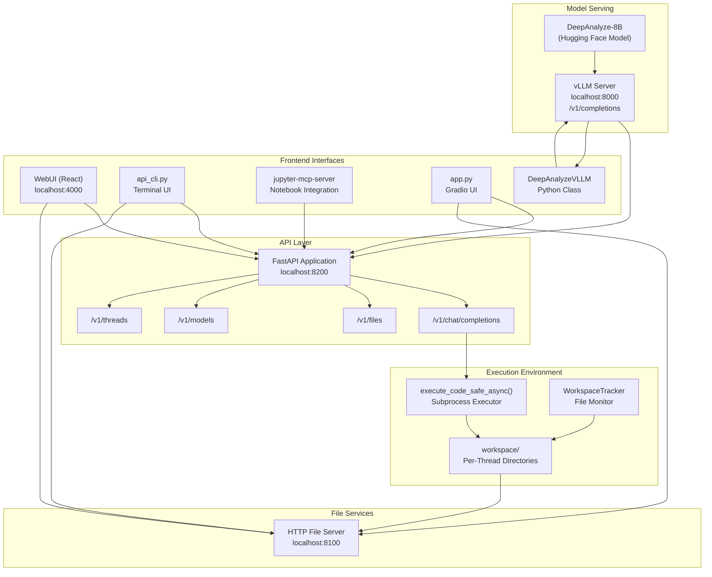

**Key Flow**:
1. Frontends send chat requests to `/v1/chat/completions` on the FastAPI server
2. API server forwards requests to vLLM at `localhost:8000`
3. When vLLM generates `<Code>` tags, `execute_code_safe_async()` runs the code in a subprocess
4. `WorkspaceTracker` monitors filesystem changes in the thread's workspace directory
5. Generated files (plots, CSVs) are served via the HTTP file server at `localhost:8100`
6. Results stream back to the frontend with download URLs

**Sources**: [README.md:56-100](), Diagram 1 from provided context

---

## Key Components and Code Entities

### Model and Inference

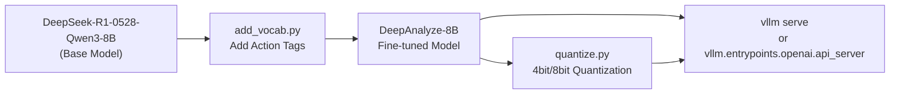

- **Model Path**: Hugging Face repository `RUC-DataLab/DeepAnalyze-8B`
- **Base Model**: `DeepSeek-R1-0528-Qwen3-8B`
- **Vocabulary Extension**: [deepanalyze/add_vocab.py:1-330]() adds special tokens like `<Analyze>`, `<Code>`, `<Execute>`
- **Quantization**: [quantize.py:1-145]() creates 4-bit and 8-bit versions using `BitsAndBytesConfig`
- **Serving**: vLLM with `--served-model-name DeepAnalyze-8B` on port 8000

**Sources**: [README.md:131-210](), [quantize.py:1-145]()

### API Server Components

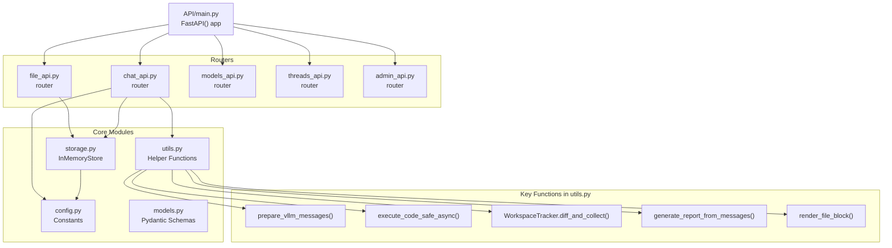

- **Entry Point**: [API/main.py]() initializes FastAPI application and includes all routers
- **Configuration**: [API/config.py]() defines `VLLM_BASE_URL = "http://localhost:8000"`, `API_PORT = 8200`, `FILE_SERVER_PORT = 8100`
- **Storage**: [API/storage.py]() maintains in-memory dictionaries for threads, files, and messages
- **Data Models**: [API/models.py]() defines Pydantic classes `FileObject`, `ThreadObject`, `MessageObject` for OpenAI compatibility
- **Core Logic**: [API/utils.py]() contains:
  - `prepare_vllm_messages()`: Injects file context into prompts
  - `execute_code_safe_async()`: Subprocess execution with timeout
  - `WorkspaceTracker`: Filesystem diff monitoring class
  - `generate_report_from_messages()`: Markdown report extraction
  - `render_file_block()`: URL construction for file downloads

**Sources**: [API/main.py](), [API/config.py](), [API/storage.py](), [API/models.py](), [API/utils.py](), Diagram 2 from provided context

### Frontend Interfaces

| Interface | Entry Point | Port | Use Case |
|-----------|-------------|------|----------|
| **WebUI** | `demo/chat/frontend/` (React) | 4000 | Full-featured browser UI with three panels |
| **CLI** | `demo/cli/api_cli.py` or `api_cli_ZH.py` | - | Terminal-based interaction with Rich library |
| **JupyterUI** | `demo/jupyter/` (MCP server) | - | Notebook integration with cell output |
| **Gradio** | `demo/deepanalyze_general/app.py` or `app_ZH.py` | 8080 | Simplified local deployment |
| **Python SDK** | `deepanalyze/DeepAnalyzeVLLM` class | - | Direct programmatic access to vLLM |

The **Python SDK** is unique: it bypasses the API server and communicates directly with vLLM. The class `DeepAnalyzeVLLM` has a `generate(prompt, workspace)` method that returns a dictionary with the full reasoning trace.

**Sources**: [README.md:48-106](), Diagram 4 from provided context

---

## Workspace and Thread Management

DeepAnalyze implements **thread-based workspace isolation** to support stateful multi-turn conversations:

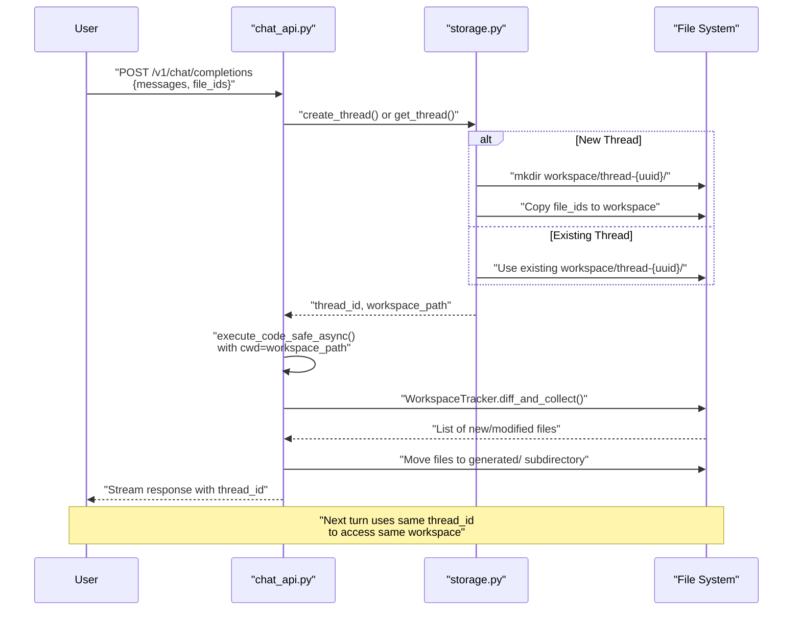

**Directory Structure**:
```
workspace/
├── thread-abc123/
│   ├── uploaded_file1.csv
│   ├── uploaded_file2.xlsx
│   ├── generated/
│   │   ├── plot_001.png
│   │   ├── analysis_results.csv
│   │   └── report.md
```

Each thread gets its own isolated directory where:
1. Uploaded files are copied at thread creation
2. Code executes with this directory as the working directory
3. Generated artifacts are moved to the `generated/` subdirectory
4. Files persist across multiple turns of the conversation

**Sources**: [API/storage.py](), [API/utils.py](), Diagram 3 from provided context

---

## Agentic Workflow: Code Execution Loop

What makes DeepAnalyze "agentic" is its ability to execute code and observe results autonomously:

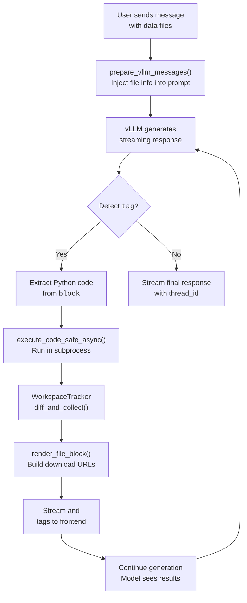

**Key Functions**:
- **`prepare_vllm_messages()`**: Adds file information to the system prompt so the model knows what data is available
- **`execute_code_safe_async()`**: Uses `asyncio.create_subprocess_exec()` to run Python code with:
  - Working directory set to the thread's workspace
  - 60-second timeout
  - Stdout/stderr capture
- **`WorkspaceTracker.diff_and_collect()`**: Compares filesystem state before and after execution to identify new files
- **`render_file_block()`**: Constructs download URLs like `http://localhost:8100/thread-{id}/generated/{filename}`

This creates a **perception-action loop** where the model generates code, observes execution results, and adjusts its approach—the core of agentic behavior.

**Sources**: [API/chat_api.py](), [API/utils.py](), Diagram 3 from provided context

---

## Training Pipeline

DeepAnalyze uses a **curriculum-based training approach** in three stages:

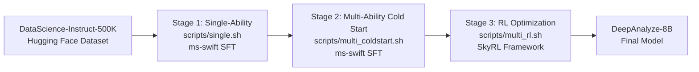

1. **Stage 1**: Fine-tune on individual data science tasks using supervised learning
2. **Stage 2**: Combine capabilities and train on multi-step workflows
3. **Stage 3**: Reinforce autonomous behavior through RL with reward signals

The dataset is hosted at `RUC-DataLab/DataScience-Instruct-500K` on Hugging Face. Training uses:
- **ms-swift** framework for supervised fine-tuning (SFT)
- **SkyRL** framework for reinforcement learning (RL)

For details on reproducing the training, see [Training Pipeline](#3.2).

**Sources**: [README.md:317-341](), Diagram 5 from provided context

---

## Deployment Options

DeepAnalyze offers flexible deployment based on available GPU memory:

| GPU Memory | Model Type | Max Context | Command Example |
|------------|------------|-------------|-----------------|
| **16GB** | 4-bit quantized | 49K tokens | `vllm serve /path/to/4bit --max-model-len 49152 --kv-cache-dtype fp8` |
| **24GB** | 4-bit quantized | 131K tokens | `vllm serve /path/to/4bit --max-model-len 131072 --kv-cache-dtype fp8` |
| **40GB+** | Full model | 131K tokens | `vllm serve /path/to/model --max-model-len 131072` |

Key vLLM parameters:
- `--served-model-name DeepAnalyze-8B`: Sets the model identifier for API requests
- `--gpu-memory-utilization 0.95`: Aggressive memory usage for maximum context
- `--port 8000`: Default port for OpenAI-compatible API
- `--kv-cache-dtype fp8`: Enables FP8 KV cache compression for longer contexts

For quantization instructions, see [Model Quantization](#4.2). For vLLM setup, see [vLLM Server Setup](#4.1).

**Sources**: [README.md:136-210](), [quantize.py:1-145]()

---

## How DeepAnalyze Differs from Traditional LLMs

| Aspect | Traditional LLMs | DeepAnalyze |
|--------|------------------|-------------|
| **Output** | Text only | Text + Executable code + Artifacts |
| **Execution** | No execution | Sandboxed Python execution with `execute_code_safe_async()` |
| **Iteration** | Single-pass generation | Perception-action loop (generate → execute → observe → adjust) |
| **File Handling** | File uploads ignored | Files copied to thread workspace, accessible to code |
| **Statefulness** | Stateless (context window only) | Persistent workspaces via thread-based isolation |
| **Artifacts** | N/A | Automatic capture and serving of plots, CSVs, reports |
| **Action Tags** | N/A | Structured output with `<Analyze>`, `<Code>`, `<Execute>`, etc. |

The **agentic architecture** enables DeepAnalyze to function as an autonomous data analyst rather than just a conversational assistant. The system automatically:
- Inspects data files to understand their structure
- Generates appropriate analysis code
- Executes code and captures results
- Refines its approach based on outputs
- Produces publication-quality reports and visualizations

This is achieved through the tight integration between the model (trained to use action tags), the API server (which parses and executes these actions), and the workspace system (which maintains state across turns).

**Sources**: [README.md:21-24](), Diagram 1 and 3 from provided context

---

## Getting Started

To start using DeepAnalyze:

1. **Download the model** from Hugging Face: `RUC-DataLab/DeepAnalyze-8B`
2. **Deploy with vLLM**: See [vLLM Server Setup](#4.1) for deployment commands
3. **Choose a frontend**:
   - [WebUI](#5.1) for full-featured browser interface
   - [CLI](#5.2) for terminal-based interaction
   - [JupyterUI](#5.3) for notebook integration
   - [Gradio Apps](#5.4) for simplified local deployment
   - [Python SDK](#5.5) for programmatic access
4. **Try an example**: See [Example Use Cases](#8) for complete walkthroughs

For a step-by-step tutorial, see [Quick Start Guide](#7.1).

Alternatively, apply for hosted API access at https://forms.gle/YxVkCzczqq8jeciw9 (see [API Key Configuration](#7.2) for details).

**Sources**: [README.md:114-313](), [docs/DeepAnalyze_API_Key_Usage_Guide.md:1-191]()

---

## Repository Structure

The codebase is organized as follows:

```
DeepAnalyze/
├── API/                    # FastAPI server (main.py, chat_api.py, utils.py)
├── demo/                   # Frontend implementations
│   ├── chat/              # WebUI (React + TypeScript)
│   ├── cli/               # Terminal CLI (api_cli.py, api_cli_ZH.py)
│   ├── jupyter/           # JupyterUI MCP server integration
│   └── deepanalyze_general/  # Gradio apps (app.py, app_ZH.py)
├── deepanalyze/           # Model training code
│   ├── ms-swift/          # Supervised fine-tuning framework
│   ├── SkyRL/             # Reinforcement learning framework
│   └── add_vocab.py       # Special token addition script
├── scripts/               # Training scripts (single.sh, multi_coldstart.sh, multi_rl.sh)
├── quantize.py            # Model quantization utility
└── requirements.txt       # Core dependencies
```

For detailed project structure, see [Project Structure](#9.1).

**Sources**: [README.md:1-403](), [requirements.txt:1-16]()

---

## Additional Resources

- **Paper**: [arXiv:2510.16872](https://arxiv.org/abs/2510.16872)
- **Model**: [RUC-DataLab/DeepAnalyze-8B on Hugging Face](https://huggingface.co/RUC-DataLab/DeepAnalyze-8B)
- **Dataset**: [RUC-DataLab/DataScience-Instruct-500K on Hugging Face](https://huggingface.co/datasets/RUC-DataLab/DataScience-Instruct-500K)
- **Homepage**: [https://ruc-deepanalyze.github.io/](https://ruc-deepanalyze.github.io/)
- **GitHub**: [https://github.com/ruc-datalab/DeepAnalyze](https://github.com/ruc-datalab/DeepAnalyze)

For contribution guidelines, see [Contributing Guidelines](#9.3).

**Sources**: [README.md:6-11](), [README.md:374-388]()

---

# Page: Getting Started

# Getting Started

<details>
<summary>Relevant source files</summary>

The following files were used as context for generating this wiki page:

- [README.md](README.md)
- [assets/wechat.jpg](assets/wechat.jpg)
- [docker/.dockerignore](docker/.dockerignore)
- [docker/Dockerfile](docker/Dockerfile)
- [docker/README.md](docker/README.md)
- [docker/docker-compose.yml](docker/docker-compose.yml)
- [docs/DeepAnalyze_API_Key_Usage_Guide.md](docs/DeepAnalyze_API_Key_Usage_Guide.md)
- [docs/DeepAnalyze_API_Key_Usage_Guide_ZH.md](docs/DeepAnalyze_API_Key_Usage_Guide_ZH.md)
- [example/README.md](example/README.md)
- [quantize.py](quantize.py)
- [requirements.txt](requirements.txt)

</details>


This guide covers the initial setup and deployment of DeepAnalyze, including prerequisites, installation, model configuration, and running your first data analysis. For detailed information about specific interfaces, see [Frontend Interfaces](#5). For training your own model, see [Training Pipeline](#3.2). For API endpoint documentation, see [API Endpoints Reference](#10.1).

## Prerequisites

### System Requirements

DeepAnalyze requires the following base software:

| Component | Requirement | Notes |
|-----------|------------|-------|
| Operating System | Linux, macOS, Windows | Docker available for all platforms |
| Python | 3.8 or higher (3.12 recommended) | Required for local deployment |
| CUDA | 12.1 or compatible | Required for GPU acceleration |
| Docker | Latest version | Optional, for containerized deployment |
| NVIDIA Container Toolkit | Latest version | Required for GPU support in Docker |

**Sources:** [README.md:212-227](), [docker/README.md:7-11]()

### GPU Memory Requirements

DeepAnalyze-8B requires GPU acceleration. The memory configuration determines which model version and context length you can use:

| GPU Memory | Model Type | Recommended max-model-len | Use FP8 KV Cache |
|------------|------------|---------------------------|------------------|
| 16GB | 4-bit Quantized | 49152 | ✓ |
| 16GB | 8-bit Quantized | 8192 | ✓ |
| 24GB | Original Model | 16384 | ✓ |
| 24GB | 4-bit Quantized | 131072 | ✓ |
| 40GB+ | Original Model | 131072 | ✓ |
| 80GB | Original Model | 131072 |  |

**Quick Selection Guide:**
- **Limited Memory (<24GB)**: Use 4-bit quantized version with FP8 KV cache
- **Balanced Configuration (24-40GB)**: Choose model type based on context length requirements
- **Sufficient Memory (≥40GB)**: Use original model for best precision

**Sources:** [README.md:136-148]()

### Python Dependencies

The minimal dependencies for inference are specified in [requirements.txt:1-16](). Key packages include:

- `vllm>=0.8.5` - High-throughput inference engine
- `torch` - Deep learning framework
- `transformers` - Model loading and tokenization
- `fastapi` - API server framework
- `uvicorn` - ASGI server
- `numpy`, `pandas`, `scikit-learn`, `matplotlib`, `seaborn` - Data science libraries

**Sources:** [requirements.txt:1-16]()

## Installation

### Basic Installation

Create and activate a conda environment with Python 3.12:

```bash
conda create -n deepanalyze python=3.12 -y
conda activate deepanalyze
```

Install minimal dependencies for inference:

```bash
pip install -r requirements.txt
```

This installs the packages specified in [requirements.txt:1-16](), which includes `vllm>=0.8.5`, `torch`, `transformers`, and the necessary API server and data science libraries.

**Note:** Training dependencies (`ms-swift`, `SkyRL`) should be installed in a separate environment to avoid conflicts. See [Training Pipeline](#3.2) for training setup.

**Sources:** [README.md:214-226](), [requirements.txt:1-16]()

### Repository Structure

```
DeepAnalyze/
├── API/                    # API server implementation
│   ├── start_server.py    # Server entry point
│   ├── config.py          # Configuration constants
│   └── ...
├── demo/                   # Frontend interfaces
│   ├── chat/              # WebUI implementation
│   ├── cli/               # Command-line interface
│   ├── jupyter/           # Jupyter notebook integration
│   └── deepanalyze_general/ # Gradio apps
├── deepanalyze/           # Training and model utilities
│   ├── ms-swift/          # SFT training framework
│   ├── SkyRL/             # RL training framework
│   └── add_vocab.py       # Add special tokens to base model
├── docker/                # Docker deployment
├── quantize.py            # Model quantization script
├── requirements.txt       # Minimal inference dependencies
└── README.md
```

**Sources:** Repository structure analysis

## Deployment Options

DeepAnalyze offers three deployment approaches: cloud API, local vLLM deployment, and Docker containers. The following diagram shows the deployment decision flow:

### Deployment Decision Flow

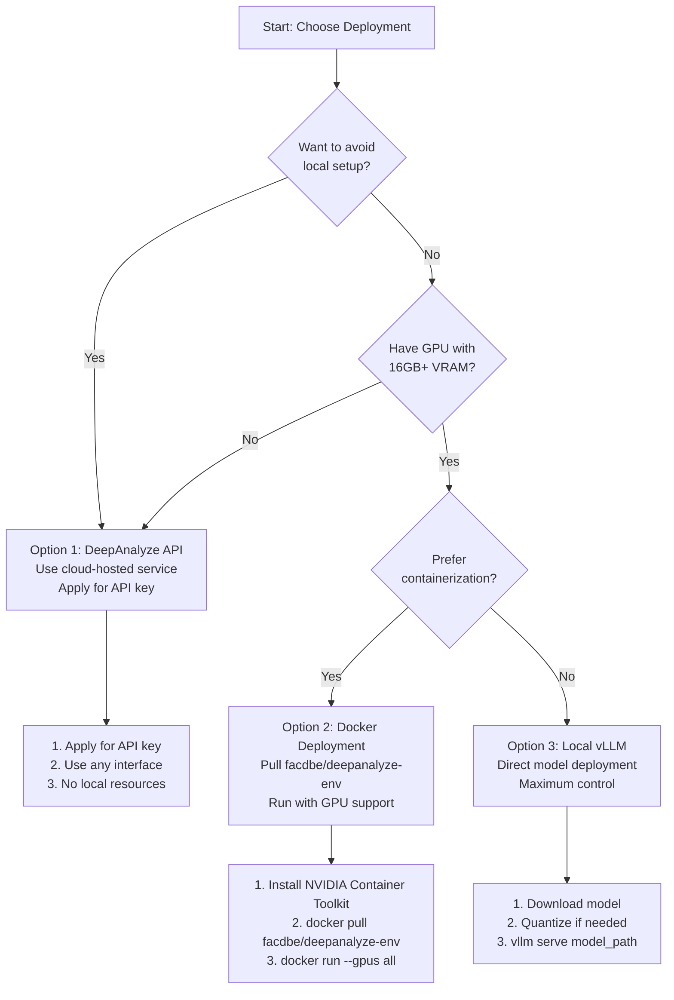

**Sources:** [README.md:116-128](), [docker/README.md:1-89]()

### Option 1: DeepAnalyze API (Recommended for First-Time Users)

The easiest way to start using DeepAnalyze is through the hosted API service, which requires no local GPU resources.

**Apply for API Key:**
- [Primary Form (Google)](https://forms.gle/YxVkCzczqq8jeciw9)
- [Alternative Form (Feishu)](https://heywhale.feishu.cn/share/base/shrcnnBRgO0x2qhx40yq4m1HxUg)

**API Endpoint:**
```
https://www.heywhale.com/api/model/services/691d42c36c6dda33df0bf645/app/v1/chat/completions
```

**Usage Documentation:**
- [English Guide](./docs/DeepAnalyze_API_Key_Usage_Guide.md)
- [Chinese Guide (Feishu Wiki)](https://heywhale.feishu.cn/wiki/TcVmw314liwCiKkxnttc2CnInfg)

**Basic Usage Example:**

```bash
curl -X POST https://www.heywhale.com/api/model/services/.../v1/chat/completions \
  -H "Content-Type: application/json" \
  -H "Authorization: Bearer your_api_key" \
  -d '{"messages": [{"role": "user", "content": "Analyze this data"}]}'
```

The API is OpenAI-compatible, so you can use it with the OpenAI Python SDK or any compatible client. See [Using OpenAI SDK](#7.6) for detailed examples.

**Sources:** [README.md:116-128](), [docs/DeepAnalyze_API_Key_Usage_Guide.md:1-191]()

### Option 2: Local vLLM Deployment

For maximum control and no network dependency, deploy DeepAnalyze-8B locally using vLLM.

#### Step 1: Model Download

Download the model from Hugging Face or ModelScope:

- **Hugging Face:** [RUC-DataLab/DeepAnalyze-8B](https://huggingface.co/RUC-DataLab/DeepAnalyze-8B)
- **ModelScope:** [RUC-DataLab/DeepAnalyze-8B](https://www.modelscope.cn/models/RUC-DataLab/DeepAnalyze-8B/summary)

```bash
# Using Hugging Face CLI
huggingface-cli download RUC-DataLab/DeepAnalyze-8B --local-dir ./DeepAnalyze-8B
```

**Sources:** [README.md:131-133]()

#### Step 2: Model Quantization (Optional)

If your GPU has limited memory, quantize the model using [quantize.py:1-145]():

```bash
python quantize.py \
  --model_path /path/to/DeepAnalyze-8B \
  --output_dir /path/to/output \
  --quant_type both  # Creates both 4-bit and 8-bit versions
```

**Quantization Options:**

The `quantize_model_4bit` function in [quantize.py:12-53]() uses:
- `bnb_4bit_quant_type="nf4"` - NF4 quantization (optimized for neural networks)
- `bnb_4bit_compute_dtype=torch.bfloat16` - BFloat16 computation
- `bnb_4bit_use_double_quant=True` - Double quantization for further compression

The `quantize_model_8bit` function in [quantize.py:56-94]() uses:
- `load_in_8bit=True` - 8-bit quantization
- `llm_int8_threshold=6.0` - Outlier detection threshold

**Sources:** [README.md:148](), [quantize.py:1-145]()

#### Step 3: Launch vLLM Server

The vLLM server provides an OpenAI-compatible API on port 8000. Use the command template based on your GPU memory:

**General Template:**
```bash
python -m vllm.entrypoints.openai.api_server \
  --model <model_path> \
  --served-model-name DeepAnalyze-8B \
  --max-model-len <context_length> \
  --gpu-memory-utilization 0.95 \
  --port 8000 \
  --trust-remote-code
```

**16GB GPU (4-bit quantized):**
```bash
python -m vllm.entrypoints.openai.api_server \
  --model /path/to/deepanalyze/4bit \
  --served-model-name DeepAnalyze-8B \
  --max-model-len 49152 \
  --gpu-memory-utilization 0.95 \
  --port 8000 \
  --kv-cache-dtype fp8 \
  --trust-remote-code
```

**24GB GPU (maximum context):**
```bash
python -m vllm.entrypoints.openai.api_server \
  --model /path/to/deepanalyze/4bit \
  --served-model-name DeepAnalyze-8B \
  --max-model-len 131072 \
  --gpu-memory-utilization 0.95 \
  --port 8000 \
  --kv-cache-dtype fp8 \
  --trust-remote-code
```

**80GB GPU (best performance):**
```bash
python -m vllm.entrypoints.openai.api_server \
  --model /path/to/original/model \
  --served-model-name DeepAnalyze-8B \
  --max-model-len 131072 \
  --gpu-memory-utilization 0.95 \
  --port 8000 \
  --trust-remote-code
```

The server will be accessible at `http://localhost:8000/v1/completions`.

**Sources:** [README.md:150-210]()

#### vLLM Server Architecture

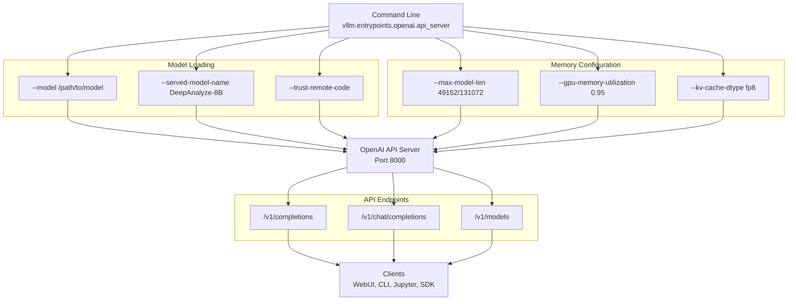

**Sources:** [README.md:150-210]()

### Option 3: Docker Deployment

Docker provides a pre-configured environment with all dependencies installed.

#### Pull Pre-built Image

```bash
# Pull from Docker Hub
docker pull facdbe/deepanalyze-env:latest

# Run with GPU support
docker run --gpus all -it --rm \
  -p 8000:8000 \
  -v /path/to/models:/models \
  facdbe/deepanalyze-env:latest
```

**Sources:** [docker/README.md:17-28]()

#### Build from Dockerfile

For customization, build the image from [docker/Dockerfile:1-113]():

```bash
cd docker
docker build -t deepanalyze-env:latest .

docker run --gpus all -it --rm \
  -p 8000:8000 \
  deepanalyze-env:latest
```

**Docker Image Contents:**

The [docker/Dockerfile:1-113]() includes:
- **Base:** `nvidia/cuda:12.1.0-devel-ubuntu22.04` [docker/Dockerfile:7]()
- **Core ML:** `vllm`, `torch`, `transformers`, `accelerate` [docker/Dockerfile:28-38]()
- **Data Science:** `pandasql`, `feature-engine`, `missingno` [docker/Dockerfile:42-46]()
- **Visualization:** `plotly`, `bokeh`, `matplotlib-venn`, `folium` [docker/Dockerfile:48-56]()
- **Advanced Analytics:** `optuna`, `shap`, `prophet`, `pymc` [docker/Dockerfile:58-78]()
- **Causal Inference:** `dowhy`, `econml`, `causalml` [docker/Dockerfile:80-86]()
- **Geospatial:** `geopandas`, `shapely`, `pysal` [docker/Dockerfile:88-106]()

**Image Size:** ~17GB total (CUDA: ~5GB, vLLM/PyTorch: ~10GB, Data Science: ~2GB)

**Sources:** [docker/Dockerfile:1-113](), [docker/README.md:75-79]()

#### Docker Compose Deployment

Use [docker/docker-compose.yml:1-49]() for production deployments:

```bash
cd docker
docker-compose up -d
```

The compose file configures:
- GPU resource allocation [docker/docker-compose.yml:15-22]()
- Port mapping `8000:8000` [docker/docker-compose.yml:24-26]()
- Volume mounts for workspace and models [docker/docker-compose.yml:28-31]()
- Environment variables for CUDA configuration [docker/docker-compose.yml:33-36]()

**Sources:** [docker/docker-compose.yml:1-49]()

## Running Your First Analysis

### Quick Start with Python SDK

The `DeepAnalyzeVLLM` class provides the simplest programmatic interface, bypassing the API server and communicating directly with vLLM.

#### Basic Usage Pattern

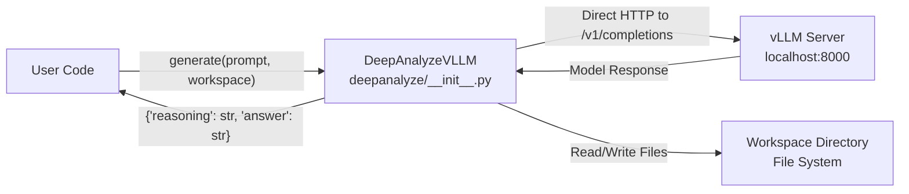

Create a Python script using the SDK:

```python
from deepanalyze import DeepAnalyzeVLLM

# Initialize the SDK (points to vLLM server)
deepanalyze = DeepAnalyzeVLLM("/path/to/model")

# Define your analysis prompt
prompt = """# Instruction
Analyze the uploaded data and generate visualizations.

# Data
File 1: {"name": "sales_data.csv", "size": "150KB"}
"""

# Specify workspace directory (where files are located)
workspace = "/path/to/workspace/"

# Generate analysis
answer = deepanalyze.generate(prompt, workspace=workspace)

# Access results
print(answer["reasoning"])  # Full reasoning trace
print(answer["answer"])     # Final answer
```

The `DeepAnalyzeVLLM` class in `deepanalyze/__init__.py` handles:
- Direct communication with vLLM on port 8000
- Workspace file management
- Response parsing and structured output

**Sources:** [README.md:237-262]()

### Launching the API Server and Frontend Interfaces

For a complete interactive experience with file upload, streaming responses, and artifact viewing, use the API server with one of the frontend interfaces.

#### API Server Deployment Flow

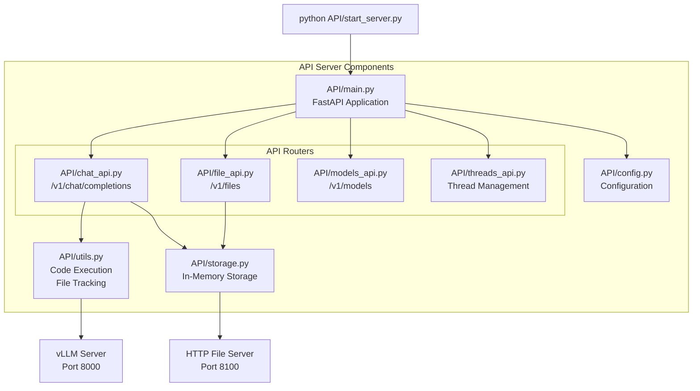

#### Start the API Server

Ensure vLLM is running, then start the API server:

```bash
# Terminal 1: vLLM (if not already running)
vllm serve DeepAnalyze-8B

# Terminal 2: API Server
cd API
python start_server.py
```

This launches:
- **API Server:** Port 8200 (configured in [API/config.py]())
- **File Server:** Port 8100 (configured in [API/config.py]())

The `start_server.py` script initializes the FastAPI application defined in [API/main.py]() and includes routers for chat, files, models, threads, and admin endpoints.

**Sources:** [README.md:91-100](), [README.md:283-287]()

### Interface Options

Once the API server is running, choose your preferred interface:

#### WebUI (Browser-based)

```bash
cd demo/chat/frontend
npm install
cd ..
bash start.sh  # Launches backend and frontend

# Access at http://localhost:4000
```

The WebUI provides a three-panel interface with file management, chat, and code execution. See [WebUI](#5.1) for details.

**Sources:** [README.md:55-69]()

#### CLI (Terminal)

```bash
cd demo/cli
python api_cli.py       # English interface
# or
python api_cli_ZH.py    # Chinese interface
```

The CLI uses the Rich library for formatted output and supports file upload commands. See [Command Line Interface](#5.2) for details.

**Sources:** [README.md:89-105]()

#### JupyterUI (Notebook)

```bash
cd demo/jupyter
# Follow setup instructions in demo/jupyter/README.md
```

JupyterUI integrates DeepAnalyze into Jupyter Lab using the Model Context Protocol (MCP). See [JupyterUI](#5.3) for details.

**Sources:** [README.md:71-80]()

#### Gradio Apps (Simplified Web Interface)

```bash
cd demo/deepanalyze_general
python app.py       # English interface
# or
python app_ZH.py    # Chinese interface

# Access at http://localhost:8080
```

Gradio provides a simplified web interface with file upload and chat. See [Gradio Apps](#5.4) for details.

**Sources:** [docs/DeepAnalyze_API_Key_Usage_Guide.md:163-179]()

### Example: First Analysis with WebUI

This example demonstrates a complete analysis workflow using the WebUI:

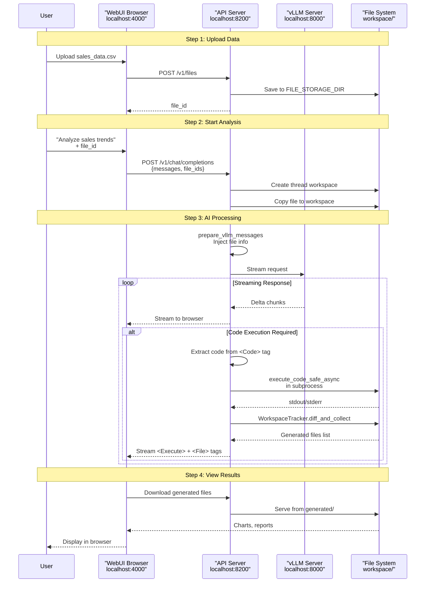

**Workflow Steps:**

1. **Upload Data:** Click the upload button or drag-and-drop CSV/Excel files into the Files Panel
2. **Enter Prompt:** In the Assistant Panel, enter: "Analyze the sales data and identify trends"
3. **Attach Files:** Select uploaded files to attach to your message
4. **Send:** Click send and watch the streaming response with structured sections
5. **View Results:** Generated charts and reports appear in the Files Panel with download links
6. **Iterate:** Ask follow-up questions in the same thread to build upon previous analysis

The WebUI maintains conversation state through `thread_id`, allowing multi-turn analysis where each iteration can access files and results from previous turns. See [Multi-turn Conversations](#7.4) for details.

**Sources:** [README.md:46-69](), Diagram 3 from system architecture overview

## Configuration Reference

### API Server Configuration

Key configuration constants in [API/config.py]():

| Constant | Default | Description |
|----------|---------|-------------|
| `VLLM_API_BASE` | `"http://localhost:8000/v1"` | vLLM server endpoint |
| `API_PORT` | `8200` | API server port |
| `FILE_SERVER_PORT` | `8100` | File server port |
| `FILE_STORAGE_DIR` | `"./uploaded_files"` | Upload directory |
| `WORKSPACE_DIR` | `"./workspace"` | Thread workspaces |
| `MAX_FILE_SIZE` | `100 * 1024 * 1024` | 100MB upload limit |

To customize, edit [API/config.py]() before starting the server.

**Sources:** [API/config.py]() (implied from system architecture)

### Model Configuration

When launching vLLM, the key parameters are:

| Parameter | Purpose | Values |
|-----------|---------|--------|
| `--model` | Model path | Local directory or HF model ID |
| `--served-model-name` | API model name | `"DeepAnalyze-8B"` |
| `--max-model-len` | Context window | 8192-131072 (based on GPU) |
| `--gpu-memory-utilization` | VRAM usage | 0.95 (aggressive) |
| `--kv-cache-dtype` | KV cache precision | `fp8` (for memory savings) |
| `--trust-remote-code` | Custom code | Required for DeepAnalyze |

**Sources:** [README.md:150-210]()

## Verification and Testing

### Verify vLLM Server

Test the vLLM server is responding:

```bash
curl http://localhost:8000/v1/models
```

Expected response:
```json
{
  "object": "list",
  "data": [
    {
      "id": "DeepAnalyze-8B",
      "object": "model",
      "created": 1234567890,
      "owned_by": "organization"
    }
  ]
}
```

**Sources:** [README.md:210]()

### Verify API Server

Test the API server health endpoint:

```bash
curl http://localhost:8200/health
```

Test file upload:

```bash
curl -X POST "http://localhost:8200/v1/files" \
  -F "file=@test_data.csv" \
  -F "purpose=file-extract"
```

**Sources:** [README.md:292-311]()

### Test Analysis with cURL

Complete example with file upload and analysis:

```bash
# Upload file
FILE_RESPONSE=$(curl -s -X POST "http://localhost:8200/v1/files" \
    -F "file=@data.csv" \
    -F "purpose=file-extract")

# Extract file ID
FILE_ID=$(echo $FILE_RESPONSE | jq -r '.id')

# Request analysis
curl -X POST http://localhost:8200/v1/chat/completions \
     -H "Content-Type: application/json" \
     -d "{
        \"model\": \"DeepAnalyze-8B\",
        \"messages\": [
          {
            \"role\": \"user\",
            \"content\": \"Generate a data science report.\",
            \"file_ids\": [\"$FILE_ID\"]
          }
        ]
      }"
```

**Sources:** [README.md:292-311]()

## Troubleshooting

### Common Issues

**Issue: vLLM OOM (Out of Memory)**

- Reduce `--max-model-len` to a smaller context window
- Use a more aggressive quantization (4-bit instead of 8-bit)
- Enable FP8 KV cache with `--kv-cache-dtype fp8`
- Increase `--gpu-memory-utilization` to 0.95 or higher

**Issue: API Server Cannot Connect to vLLM**

- Verify vLLM is running: `curl http://localhost:8000/v1/models`
- Check `VLLM_API_BASE` in [API/config.py]() matches your vLLM port
- Ensure no firewall is blocking port 8000

**Issue: File Upload Fails**

- Check `MAX_FILE_SIZE` in [API/config.py]() (default 100MB)
- Verify `FILE_STORAGE_DIR` has write permissions
- Ensure disk space is available

**Issue: Code Execution Timeout**

- Long-running analyses may timeout
- Check subprocess timeout settings in [API/utils.py]()
- Consider increasing timeout for complex analyses

**Sources:** Based on configuration in [API/config.py]() and execution logic in [API/utils.py]()

## Next Steps

After completing this setup:

1. **Explore Interfaces:** Try different interfaces (WebUI, CLI, Jupyter) to find your preferred workflow - see [Frontend Interfaces](#5)
2. **Learn Multi-turn:** Understand thread-based conversations for iterative analysis - see [Multi-turn Conversations](#7.4)
3. **Try Examples:** Work through real-world use cases - see [Example Use Cases](#8)
4. **Advanced Usage:** Explore workspace management and report generation - see [Working with Workspaces](#7.5)
5. **API Integration:** Integrate DeepAnalyze into your applications - see [Using OpenAI SDK](#7.6)

**Sources:** Based on documentation structure

---

# Page: Model and Training

# Model and Training

<details>
<summary>Relevant source files</summary>

The following files were used as context for generating this wiki page:

- [README.md](README.md)
- [assets/wechat.jpg](assets/wechat.jpg)
- [docs/DeepAnalyze_API_Key_Usage_Guide.md](docs/DeepAnalyze_API_Key_Usage_Guide.md)
- [docs/DeepAnalyze_API_Key_Usage_Guide_ZH.md](docs/DeepAnalyze_API_Key_Usage_Guide_ZH.md)
- [example/README.md](example/README.md)
- [quantize.py](quantize.py)
- [requirements.txt](requirements.txt)

</details>


## Purpose and Scope

This document provides technical documentation for the **DeepAnalyze-8B** model, its training methodology, and the dataset used to train it. The page covers:

- Model architecture, base model selection, and special tokens
- The curriculum-based training pipeline with three distinct stages
- The DataScience-Instruct-500K dataset structure and composition
- Model quantization and deployment configurations

For information about deploying the model using vLLM, see [Deployment](#4). For details about using the model through various interfaces, see [Frontend Interfaces](#5). For specific training scripts and evaluation procedures, see [Development and Contributing](#9).

---

## Model Overview

**DeepAnalyze-8B** is an 8-billion parameter agentic language model fine-tuned specifically for autonomous data science tasks. The model extends the **DeepSeek-R1-0528-Qwen3-8B** base model with specialized capabilities for data analysis, code generation, and autonomous task execution.

### Base Model and Architecture

The model is built on top of [DeepSeek-R1-0528-Qwen3-8B](https://huggingface.co/deepseek-ai/DeepSeek-R1-0528-Qwen3-8B), a pre-trained language model with:

- **8 billion parameters**
- **131K maximum context length** (when deployed with sufficient GPU memory)
- **Qwen3 architecture** with advanced reasoning capabilities
- **DeepSeek-R1 reasoning chain-of-thought** training

### Special Token Extensions

DeepAnalyze extends the base model's vocabulary with specialized action tokens that enable structured output and agentic behavior. These tokens must be added before training using the `add_vocab.py` script.

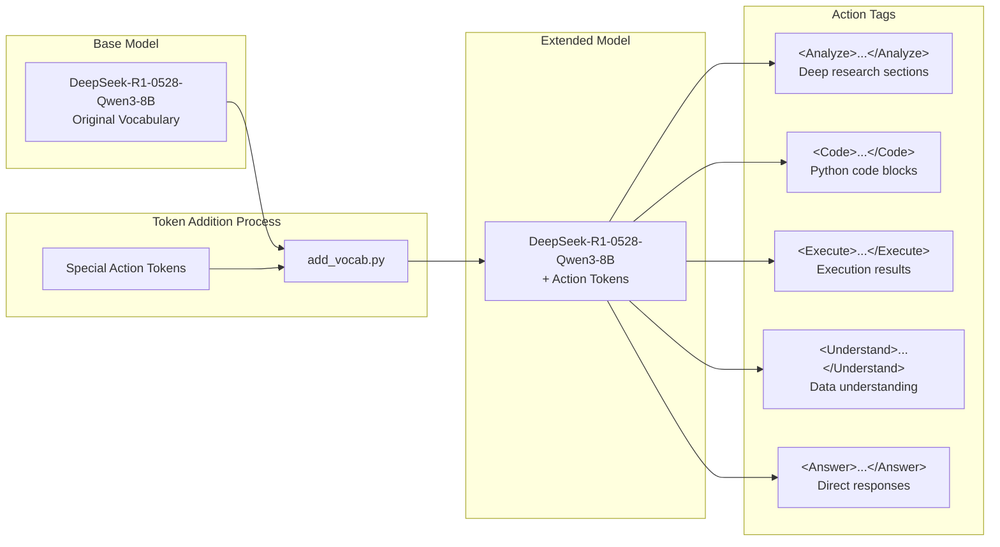

**Diagram: Special Token Extension Process**

The special tokens enable the model to produce **structured, parseable outputs** that the execution engine can interpret:

| Token Pair | Purpose | Used By |
|------------|---------|---------|
| `<Analyze>...</Analyze>` | Deep analytical reasoning sections | Report generation, research tasks |
| `<Code>...</Code>` | Python code to be executed | Data processing, visualization |
| `<Execute>...</Execute>` | Execution results and stdout | Code execution feedback loop |
| `<Understand>...</Understand>` | Data comprehension sections | Initial data exploration |
| `<Answer>...</Answer>` | Direct question responses | Conversational queries |

These tokens are added to the model vocabulary via [deepanalyze/add_vocab.py:322-330](), which modifies the tokenizer configuration before training begins.

**Sources:** [README.md:318-330](), [README.md:78](), Diagram 1 and 5 from system overview

---

## Training Methodology

DeepAnalyze employs a **curriculum-based training approach** with three progressive stages, each building upon the previous stage's capabilities. This methodology enables the model to learn increasingly complex agentic behaviors.

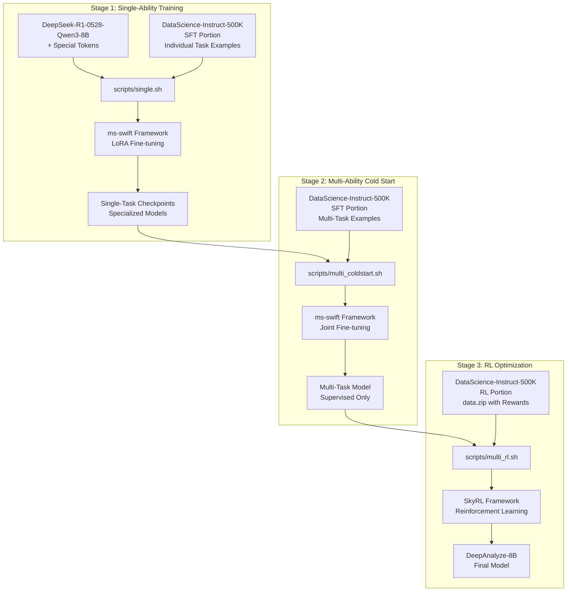

**Diagram: Three-Stage Curriculum Training Pipeline**

### Stage 1: Single-Ability Training

The first stage trains the model on **individual data science capabilities** using supervised fine-tuning (SFT).

**Training Configuration:**
- **Framework:** [ms-swift](https://github.com/modelscope/ms-swift) with LoRA adapters
- **Script:** [scripts/single.sh]()
- **Data Source:** SFT portion of DataScience-Instruct-500K
- **Objective:** Learn specialized skills independently (e.g., data cleaning, visualization, statistical analysis)

This stage produces **single-task checkpoints** that excel at specific data science operations but lack the ability to coordinate multiple skills autonomously.

### Stage 2: Multi-Ability Cold Start

The second stage combines single-task checkpoints and trains the model to **handle multiple data science tasks jointly**.

**Training Configuration:**
- **Framework:** ms-swift with joint fine-tuning
- **Script:** [scripts/multi_coldstart.sh]()
- **Data Source:** SFT portion with multi-task examples
- **Objective:** Learn to switch between different data science operations within a single conversation

The output is a **multi-task model** that can perform various data science operations but still relies on supervised examples rather than autonomous decision-making.

### Stage 3: Reinforcement Learning Optimization

The final stage applies **reinforcement learning** to develop autonomous agentic behavior.

**Training Configuration:**
- **Framework:** [SkyRL](https://github.com/NovaSky-AI/SkyRL)
- **Script:** [scripts/multi_rl.sh]()
- **Data Source:** RL portion of DataScience-Instruct-500K (requires unzipping `data.zip`)
- **Objective:** Optimize for multi-step reasoning, autonomous exploration, and task completion without human intervention

This produces the final **DeepAnalyze-8B** model with full agentic capabilities for autonomous data science.

**Training Frameworks:**

| Framework | Stage | Purpose | Repository |
|-----------|-------|---------|------------|
| ms-swift | 1 & 2 | Supervised fine-tuning with LoRA | [modelscope/ms-swift](https://github.com/modelscope/ms-swift) |
| SkyRL | 3 | Reinforcement learning for agentic behavior | [NovaSky-AI/SkyRL](https://github.com/NovaSky-AI/SkyRL) |

**Sources:** [README.md:337-341](), [README.md:221-223](), [README.md:365-366](), Diagram 5 from system overview

---

## Dataset: DataScience-Instruct-500K

The **DataScience-Instruct-500K** dataset contains approximately 500,000 training examples designed specifically for data science tasks. It is publicly available on [Hugging Face](https://huggingface.co/datasets/RUC-DataLab/DataScience-Instruct-500K).

### Dataset Structure

The dataset is divided into two portions with different training objectives:

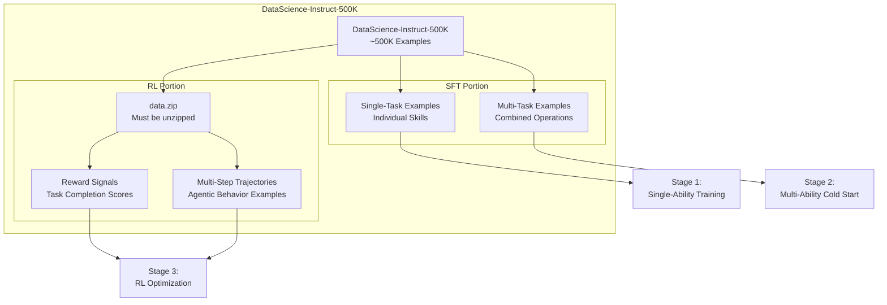

**Diagram: Dataset Structure and Training Stage Mapping**

### Data Sources

The dataset is synthesized from multiple established data science benchmarks:

| Source | Type | Purpose |
|--------|------|---------|
| [Reasoning-Table](https://github.com/MJinXiang/Reasoning-Table) | Tabular reasoning tasks | Complex analytical reasoning on structured data |
| [Spider](https://yale-lily.github.io/spider) | Text-to-SQL | Database query generation and execution |
| [BIRD](https://bird-bench.github.io/) | Text-to-SQL | Advanced database reasoning with real-world complexity |
| [DABStep](https://huggingface.co/blog/dabstep) | Step-by-step analysis | Multi-step data analysis workflows |

### SFT Portion

The **Supervised Fine-Tuning (SFT) portion** contains instruction-response pairs for data science tasks:

- **Format:** `{instruction, input_data, expected_output}`
- **Task Types:** Data cleaning, EDA, visualization, statistical analysis, modeling, report generation
- **Data Formats:** CSV, Excel, JSON, XML, TXT, Markdown
- **Complexity:** Ranges from single-step operations to multi-step workflows

### RL Portion

The **Reinforcement Learning (RL) portion** contains multi-turn trajectories with reward signals:

- **Format:** `{initial_state, action_sequence, intermediate_states, final_reward}`
- **Storage:** Compressed in `data.zip` (must be unzipped before training: [README.md:334]())
- **Reward Function:** Based on task completion, code correctness, output quality
- **Trajectory Length:** Variable, supporting complex multi-step autonomous workflows

**Sources:** [README.md:332-334](), [README.md:367](), Diagram 5 from system overview

---

## Model Quantization

To support deployment across different GPU memory configurations, DeepAnalyze-8B can be quantized using the `quantize.py` script. Quantization reduces model size and memory footprint while maintaining acceptable performance.

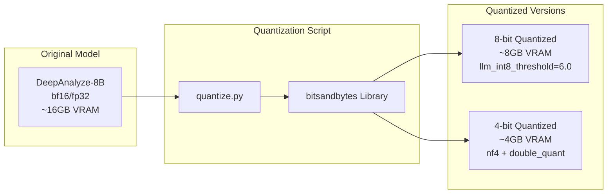

**Diagram: Model Quantization Pipeline**

### Quantization Methods

The [quantize.py]() script provides two quantization methods using the `bitsandbytes` library:

#### 4-bit Quantization

**Function:** [quantize.py:12-53]()

**Configuration:**
- **Quantization Type:** NF4 (Normal Float 4-bit)
- **Compute dtype:** `torch.bfloat16`
- **Double Quantization:** Enabled by default (can be disabled with `--no_double_quant`)
- **Memory Reduction:** ~75% (16GB → ~4GB)

**Command:**
```bash
python quantize.py \
  --model_path /path/to/DeepAnalyze-8B \
  --output_dir /path/to/output \
  --quant_type 4bit
```

#### 8-bit Quantization

**Function:** [quantize.py:56-94]()

**Configuration:**
- **Quantization Type:** LLM.int8 with outlier detection
- **Outlier Threshold:** 6.0 (`llm_int8_threshold`)
- **Memory Reduction:** ~50% (16GB → ~8GB)

**Command:**
```bash
python quantize.py \
  --model_path /path/to/DeepAnalyze-8B \
  --output_dir /path/to/output \
  --quant_type 8bit
```

### GPU Memory Configuration Matrix

The following table shows recommended deployment configurations based on available GPU memory:

| GPU Memory | Model Version | max-model-len | FP8 KV Cache | Context Length |
|------------|---------------|---------------|--------------|----------------|
| **16GB** | 4-bit | 49152 | ✓ Required | ~49K tokens |
| **16GB** | 8-bit | 8192 | ✓ Required | ~8K tokens |
| **24GB** | Full bf16 | 16384 | ✓ Recommended | ~16K tokens |
| **24GB** | 8-bit | 98304 | ✓ Recommended | ~98K tokens |
| **24GB** | 4-bit | 131072 | ✓ Recommended | ~131K tokens |
| **40GB+** | Full bf16 | 131072 | Optional | ~131K tokens |
| **80GB** | Full bf16 | 131072 | Not needed | ~131K tokens |

**Trade-offs:**
- **4-bit:** Maximum memory efficiency, slight quality degradation, suitable for consumer GPUs
- **8-bit:** Balanced efficiency and quality, minimal performance impact
- **Full precision:** Best quality, requires high-end GPUs (A100, H100)

**Sources:** [README.md:136-147](), [README.md:148-209](), [quantize.py:1-144]()

---

## Complete Training-to-Deployment Workflow

The following diagram illustrates the complete pipeline from base model selection through training, quantization, and deployment:

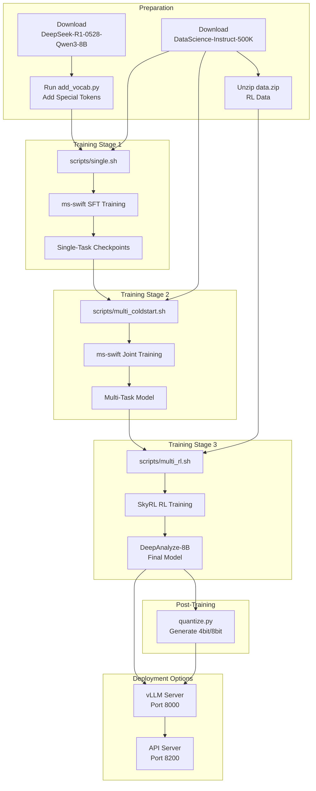

**Diagram: End-to-End Training and Deployment Workflow**

### Step-by-Step Training Instructions

**1. Download and Prepare Base Model:**
```bash
# Download DeepSeek-R1-0528-Qwen3-8B from Hugging Face
MODEL_PATH=/path/to/DeepSeek-R1-0528-Qwen3-8B
SAVE_PATH=/path/to/DeepSeek-R1-0528-Qwen3-8B-addvocab

# Add special tokens
python deepanalyze/add_vocab.py \
  --model_path "$MODEL_PATH" \
  --save_path "$SAVE_PATH" \
  --add_tags
```

**2. Download and Prepare Dataset:**
```bash
# Download from Hugging Face: RUC-DataLab/DataScience-Instruct-500K
# Unzip the RL portion
cd DataScience-Instruct-500K/RL/
unzip data.zip
```

**3. Execute Training Stages:**
```bash
# Stage 1: Single-ability training
bash scripts/single.sh

# Stage 2: Multi-ability cold start
bash scripts/multi_coldstart.sh

# Stage 3: RL optimization
bash scripts/multi_rl.sh
```

**4. Quantize Model (Optional):**
```bash
python quantize.py \
  --model_path /path/to/DeepAnalyze-8B \
  --output_dir /path/to/quantized \
  --quant_type both
```

**5. Deploy with vLLM:**
```bash
# Example: 24GB GPU with 4-bit quantization
python -m vllm.entrypoints.openai.api_server \
  --model /path/to/DeepAnalyze-8B/4bit \
  --served-model-name DeepAnalyze-8B \
  --max-model-len 131072 \
  --gpu-memory-utilization 0.95 \
  --kv-cache-dtype fp8 \
  --port 8000 \
  --trust-remote-code
```

**Sources:** [README.md:315-341](), [README.md:150-203](), Diagram 5 from system overview

---

## Training Requirements and Dependencies

### Environment Setup

Training DeepAnalyze requires a separate environment from inference to avoid dependency conflicts:

```bash
# Create training environment
conda create -n deepanalyze-train python=3.12 -y
conda activate deepanalyze-train

# Install ms-swift framework
cd deepanalyze/ms-swift/
pip install -e .

# Install SkyRL framework
cd ../SkyRL/
pip install -e .
```

### Framework Dependencies

**ms-swift requirements:** [deepanalyze/ms-swift/requirements.txt]()

**SkyRL requirements:** [deepanalyze/SkyRL/pyproject.toml]()

**Inference-only requirements:** [requirements.txt:1-16]()

### Hardware Requirements

| Training Stage | Recommended GPU | Minimum VRAM | Training Time (Est.) |
|----------------|-----------------|--------------|---------------------|
| Stage 1 (SFT) | A100 40GB or better | 32GB | Hours to days |
| Stage 2 (SFT) | A100 40GB or better | 32GB | Hours to days |
| Stage 3 (RL) | A100 80GB or better | 64GB | Days to weeks |

**Note:** Training times depend on dataset size, batch size, and number of epochs. The exact training configurations used for the released DeepAnalyze-8B model are specified in the training scripts.

**Sources:** [README.md:212-227](), [requirements.txt:1-16]()

---

## Model Artifacts and Distribution

### Official Release Channels

The DeepAnalyze-8B model and its quantized variants are distributed through:

| Platform | URL | Contents |
|----------|-----|----------|
| **Hugging Face** | [RUC-DataLab/DeepAnalyze-8B](https://huggingface.co/RUC-DataLab/DeepAnalyze-8B) | Full model (bf16), model card, usage examples |
| **ModelScope** | [RUC-DataLab/DeepAnalyze-8B](https://www.modelscope.cn/models/RUC-DataLab/DeepAnalyze-8B/summary) | Mirror for users in mainland China |

### Model Files

The released model includes:
- **Model weights:** `pytorch_model.bin` or safetensors format
- **Tokenizer configuration:** `tokenizer_config.json`, `tokenizer.json`
- **Model configuration:** `config.json` with extended vocabulary size
- **Generation configuration:** `generation_config.json`

### License and Citation

The model, code, and training data are released under an open-source license. For citation information, see [License and Citation](#10.4).

**Sources:** [README.md:131-133](), [README.md:374-388]()

---

# Page: DeepAnalyze-8B Model

# DeepAnalyze-8B Model

<details>
<summary>Relevant source files</summary>

The following files were used as context for generating this wiki page:

- [README.md](README.md)
- [assets/wechat.jpg](assets/wechat.jpg)
- [demo/deepanalyze_general/README.md](demo/deepanalyze_general/README.md)
- [demo/deepanalyze_general/README_ZH.md](demo/deepanalyze_general/README_ZH.md)
- [demo/deepanalyze_general/__init__.py](demo/deepanalyze_general/__init__.py)
- [demo/deepanalyze_general/deepanalyze_general.py](demo/deepanalyze_general/deepanalyze_general.py)
- [docs/DeepAnalyze_API_Key_Usage_Guide.md](docs/DeepAnalyze_API_Key_Usage_Guide.md)
- [docs/DeepAnalyze_API_Key_Usage_Guide_ZH.md](docs/DeepAnalyze_API_Key_Usage_Guide_ZH.md)
- [example/README.md](example/README.md)
- [quantize.py](quantize.py)
- [requirements.txt](requirements.txt)

</details>


## Purpose and Scope

This page documents the DeepAnalyze-8B model, including its architecture, special token system, quantization options, and deployment configurations. For information about the training methodology used to create this model, see [Training Pipeline](#3.2). For dataset details, see [DataScience-Instruct-500K Dataset](#3.3). For deployment instructions and hardware requirements, see [Deployment](#4).

---

## Base Model Foundation

DeepAnalyze-8B is built upon **DeepSeek-R1-0528-Qwen3-8B**, a reasoning-focused language model with 8 billion parameters. The base model provides strong mathematical and logical reasoning capabilities that are enhanced through curriculum-based fine-tuning for autonomous data science tasks.

### Model Specifications

| Attribute | Value |
|-----------|-------|
| **Base Model** | DeepSeek-R1-0528-Qwen3-8B |
| **Parameters** | 8 billion |
| **Context Length** | Up to 131,072 tokens (deployment-dependent) |
| **Precision** | bf16/fp32 (original), 8-bit, 4-bit (quantized) |
| **License** | Open source |
| **Model Hub** | [RUC-DataLab/DeepAnalyze-8B](https://huggingface.co/RUC-DataLab/DeepAnalyze-8B) |

### Token Extension Process

The base model vocabulary is extended with specialized action tags using [deepanalyze/add_vocab.py](). This script adds tokens for the agentic workflow system before training begins.

**Command:**
```bash
python deepanalyze/add_vocab.py \
  --model_path "$MODEL_PATH" \
  --save_path "$SAVE_PATH" \
  --add_tags
```

**Sources:** [README.md:318-330](), System architecture diagrams

---

## Action Tag System

DeepAnalyze operates through a structured "think-act-observe" workflow controlled by XML-like action tags. These tags enable the model to break down data science tasks into explicit reasoning steps, code generation, and result interpretation.

### Core Action Tags

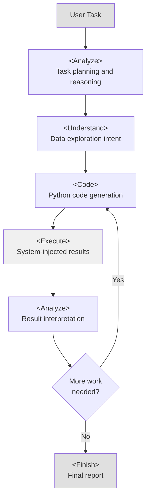

**Tag Definitions:**

- **`<Analyze>`**: Task planning, logical reasoning, hypothesis formation, result interpretation, and reflection
- **`<Understand>`**: Declaration of intent to explore data source structure and semantics through code
- **`<Code>`**: Generation of executable Python code using pandas, numpy, matplotlib, seaborn, etc.
- **`<Execute>`**: System-injected tag containing code execution results (stdout, stderr, errors)
- **`<Finish>`**: Final conclusions, reports, or recommendations
- **`<Ask>`**: (Optional) Interactive mode tag for requesting clarification from users

### System Prompt Architecture

The model's behavior is governed by comprehensive system prompts that define action tag semantics and workflow rules. Two variants exist:

**Basic Mode** (`deepanalyze_system_prompt`):
- Supports `<Analyze>`, `<Understand>`, `<Code>`, `<Execute>`, `<Finish>`
- Enforces one-action-per-turn constraint
- Automatic code execution cycle

**Interactive Mode** (`deepanalyze_system_prompt_with_ask`):
- Adds `<Ask>` tag for user interaction
- Enables clarification of ambiguous requirements
- Prevents unverified business assumptions

**Sources:** [demo/deepanalyze_general/deepanalyze_general.py:13-235]()

---

## Model Workflow Execution

### Single-Turn Reasoning Cycle

```mermaid
sequenceDiagram
    participant User
    participant Model as DeepAnalyze-8B
    participant Executor as Code Executor
    
    User->>Model: User instruction
    Model->>Model: Generate &lt;Analyze&gt;
    Note over Model: Plan approach
    
    Model->>Model: Generate &lt;Understand&gt;
    Note over Model: Declare exploration intent
    
    Model->>Model: Generate &lt;Code&gt;
    Note over Model: Python code
    
    Model->>Executor: Code block
    Executor->>Executor: Execute in sandbox
    Executor->>Model: &lt;Execute&gt; stdout/stderr
    
    Model->>Model: Generate &lt;Analyze&gt;
    Note over Model: Interpret results
    
    alt More iterations needed
        Model->>Model: Generate &lt;Code&gt;
        Model->>Executor: Next code block
    else Task complete
        Model->>User: &lt;Finish&gt; report
    end
```

### Code Execution Environment

The execution environment is initialized with pre-imported libraries and shared namespace for variable persistence across multiple code blocks:

**Initialization** ([demo/deepanalyze_general/deepanalyze_general.py:262-275]()):
```python
namespace = {}
import pandas as pd
import matplotlib.pyplot as plt
import seaborn as sns
namespace['pd'] = pd
namespace['plt'] = plt
namespace['sns'] = sns
namespace['__builtins__'] = __builtins__
```

**Key features:**
- Variables defined in one `<Code>` block persist to subsequent blocks
- Automatic warning suppression to conserve context window
- Safe cleanup after task completion

**Sources:** [demo/deepanalyze_general/deepanalyze_general.py:238-386](), [demo/deepanalyze_general/README.md:20-25]()

---

## Model Quantization and Variants

DeepAnalyze-8B is available in three precision formats to accommodate different GPU memory configurations. Quantization is performed using the `bitsandbytes` library via [quantize.py]().

### Quantization Options

| Format | Memory Footprint | Quantization Type | Use Case |
|--------|------------------|-------------------|----------|
| **bf16/fp32** | ~16 GB | Original precision | Maximum quality, 40GB+ VRAM |
| **8-bit** | ~8 GB | `load_in_8bit=True`<br/>`llm_int8_threshold=6.0` | Balanced quality/efficiency, 24GB+ VRAM |
| **4-bit** | ~4 GB | `bnb_4bit_quant_type="nf4"`<br/>`bnb_4bit_use_double_quant=True` | Maximum compression, 16GB VRAM |

### Quantization Process

**4-bit Quantization** ([quantize.py:12-53]()):
```bash
python quantize.py \
  --model_path /path/to/original/model \
  --output_dir /path/to/output \
  --quant_type 4bit
```

**Configuration:**
- Uses NF4 (Normal Float 4) quantization type
- bf16 compute dtype for numerical stability
- Optional double quantization for additional compression

**8-bit Quantization** ([quantize.py:56-94]()):
```bash
python quantize.py \
  --model_path /path/to/original/model \
  --output_dir /path/to/output \
  --quant_type 8bit
```

**Configuration:**
- Outlier detection with `llm_int8_threshold=6.0`
- Preserves critical weights in higher precision

### Quantization Implementation Diagram

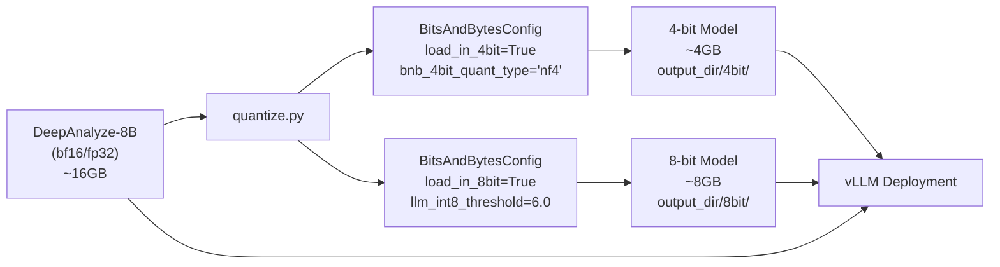

**Sources:** [quantize.py:1-145](), [README.md:136-148]()

---

## Deployment Configurations

### GPU Memory Requirements Matrix

The following table maps GPU memory capacity to recommended deployment configurations:

| GPU Memory | Model Type | max-model-len | kv-cache-dtype | Context Length Range | Example GPUs |
|------------|------------|---------------|----------------|---------------------|--------------|
| **16GB** | 4-bit Quantized | 49152 | fp8 | 49K tokens | RTX 3090, RTX 4080 |
| **16GB** | 8-bit Quantized | 8192 | fp8 | 8K tokens | RTX 3090, RTX 4080 |
| **24GB** | Original Model | 16384 | fp8 | 16K tokens | RTX 4090, A5000 |
| **24GB** | 8-bit Quantized | 98304 | fp8 | 98K tokens | RTX 4090, A5000 |
| **24GB** | 4-bit Quantized | 131072 | fp8 | 131K tokens | RTX 4090, A5000 |
| **40GB** | Original Model | 131072 | fp8 | 131K tokens | A100 40GB |
| **40GB** | 8-bit Quantized | 131072 | (none) | 131K tokens | A100 40GB |
| **80GB** | Original Model | 131072 | (none) | 131K tokens | A100 80GB, H100 |

### vLLM Launch Commands

**General Template** ([README.md:153-162]()):
```bash
python -m vllm.entrypoints.openai.api_server \
  --model <model_path> \
  --served-model-name DeepAnalyze-8B \
  --max-model-len <context_length> \
  --gpu-memory-utilization 0.95 \
  --port 8000 \
  --kv-cache-dtype fp8 \  # if specified in table
  --trust-remote-code
```

**16GB GPU Example** (4-bit, maximum context):
```bash
python -m vllm.entrypoints.openai.api_server \
  --model /path/to/deepanalyze/4bit \
  --served-model-name DeepAnalyze-8B \
  --max-model-len 49152 \
  --gpu-memory-utilization 0.95 \
  --port 8000 \
  --kv-cache-dtype fp8 \
  --trust-remote-code
```

**80GB GPU Example** (original precision, full context):
```bash
python -m vllm.entrypoints.openai.api_server \
  --model /path/to/original/model \
  --served-model-name DeepAnalyze-8B \
  --max-model-len 131072 \
  --gpu-memory-utilization 0.95 \
  --port 8000 \
  --trust-remote-code
```

### Deployment Architecture

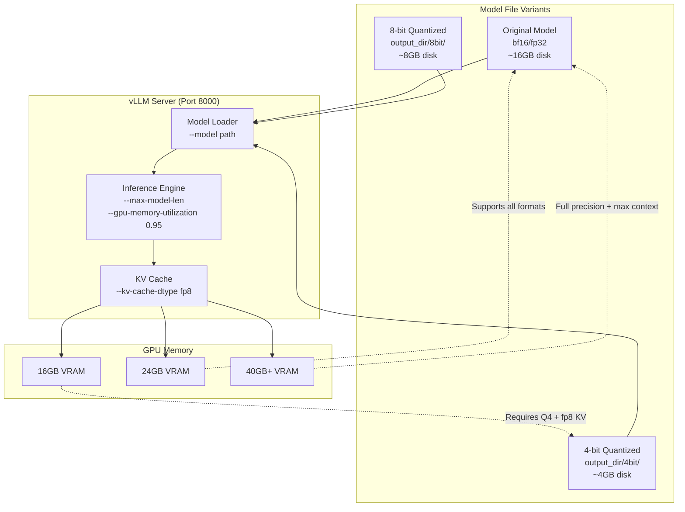

**Key Configuration Parameters:**
- `--gpu-memory-utilization 0.95`: Aggressive memory allocation for maximum context
- `--kv-cache-dtype fp8`: Reduces KV cache memory by ~50%
- `--max-model-len`: Controls maximum sequence length
- `--trust-remote-code`: Required for custom model code

**Sources:** [README.md:136-210](), Training to Deployment Pipeline diagram

---

## Model Capabilities

### Autonomous Data Science Workflow

DeepAnalyze-8B is specifically trained to perform end-to-end data science tasks without human intervention:

1. **Data Understanding**: Automatic exploration of structured (CSV, Excel, databases), semi-structured (JSON, XML), and unstructured data (text, markdown)
2. **Exploratory Analysis**: Statistical summaries, distribution analysis, correlation detection
3. **Data Preparation**: Cleaning, transformation, feature engineering
4. **Modeling**: Statistical analysis, machine learning model training
5. **Visualization**: Matplotlib, Seaborn chart generation with automatic file persistence
6. **Report Generation**: Analyst-grade markdown reports with structured sections

### Multi-Turn Reasoning

The model maintains context across multiple reasoning cycles, enabling:
- Iterative hypothesis refinement
- Error detection and self-correction
- Incremental analysis building on prior results
- Debugging failed code executions

### Interactive Clarification (Optional)

When deployed with `is_interactive=True` ([demo/deepanalyze_general/deepanalyze_general.py:250]()), the model can:
- Detect ambiguous requirements (e.g., "high-value customer" without definition)
- Generate `<Ask>` tags to request clarification
- Incorporate user responses into subsequent reasoning
- Prevent errors from unverified assumptions

**Example interaction** ([demo/deepanalyze_general/README.md:143-230]()):
```xml
<Ask>
有两个问题需要确认:
1. 'segment' 字段的取值 A、B、C 是否代表客户价值等级?
2. "留存"是指用户在最近多少天内有活动?
</Ask>
```

### Language Support

- **Primary**: English
- **Secondary**: Chinese (中文) - Supported in CLI, Gradio, and system prompts
- Bilingual interfaces available for CLI and Gradio applications

**Sources:** [README.md:21-24](), [demo/deepanalyze_general/deepanalyze_general.py:104-235](), [demo/deepanalyze_general/README.md:8-16]()

---

## Model Access and Distribution

### Official Repositories

- **Hugging Face**: [RUC-DataLab/DeepAnalyze-8B](https://huggingface.co/RUC-DataLab/DeepAnalyze-8B)
- **ModelScope**: [RUC-DataLab/DeepAnalyze-8B](https://www.modelscope.cn/models/RUC-DataLab/DeepAnalyze-8B/summary)
- **GitHub**: [ruc-datalab/DeepAnalyze](https://github.com/ruc-datalab/DeepAnalyze)

### Installation Requirements

**Minimal dependencies** ([requirements.txt:1-16]()):
```txt
vllm>=0.8.5
torch
transformers
numpy
pandas
scikit-learn
seaborn
matplotlib
```

**Environment setup**:
```bash
conda create -n deepanalyze python=3.12 -y
conda activate deepanalyze
pip install -r requirements.txt
```

**Note**: Training frameworks (`ms-swift`, `SkyRL`) are not required for inference and should be installed in separate environments to avoid dependency conflicts.

### API Key Access

For users who prefer not to deploy locally, API keys are available through:
- **Google Form**: https://forms.gle/YxVkCzczqq8jeciw9
- **Feishu Form**: https://heywhale.feishu.cn/share/base/shrcnnBRgO0x2qhx40yq4m1HxUg

API endpoint: `https://www.heywhale.com/api/model/services/691d42c36c6dda33df0bf645/app/v1/chat/completions`

**Sources:** [README.md:116-128](), [docs/DeepAnalyze_API_Key_Usage_Guide.md:1-20](), [requirements.txt:1-16]()

---

## Related Pages

- [Training Pipeline](#3.2) - Curriculum-based training methodology, single-ability to multi-ability RL
- [DataScience-Instruct-500K Dataset](#3.3) - Training data structure and composition
- [vLLM Server Setup](#4.1) - Detailed deployment instructions
- [Model Quantization](#4.2) - Advanced quantization techniques and troubleshooting
- [GPU Requirements and Configuration](#4.4) - Hardware planning and optimization

---

# Page: Training Pipeline

# Training Pipeline

<details>
<summary>Relevant source files</summary>

The following files were used as context for generating this wiki page:

- [README.md](README.md)
- [assets/wechat.jpg](assets/wechat.jpg)
- [docs/DeepAnalyze_API_Key_Usage_Guide.md](docs/DeepAnalyze_API_Key_Usage_Guide.md)
- [docs/DeepAnalyze_API_Key_Usage_Guide_ZH.md](docs/DeepAnalyze_API_Key_Usage_Guide_ZH.md)
- [example/README.md](example/README.md)
- [quantize.py](quantize.py)
- [requirements.txt](requirements.txt)

</details>


## Purpose and Scope

This document describes the curriculum-based training methodology used to produce the DeepAnalyze-8B model. It covers the three-stage training process (single-ability fine-tuning, multi-ability cold start, and reinforcement learning), the base model preparation steps, training data structure, and the frameworks used at each stage.

For information about the final trained model's architecture and capabilities, see [DeepAnalyze-8B Model](#3.1). For details about the training dataset structure and content, see [DataScience-Instruct-500K Dataset](#3.3). For post-training quantization procedures, see [Model Quantization](#4.2).

---

## Training Pipeline Overview

DeepAnalyze employs a **curriculum-based agentic training approach** that progressively builds autonomous data science capabilities through three distinct stages. This methodology prevents the model from being overwhelmed by complex multi-step reasoning tasks early in training, instead building competencies incrementally.

### Training Pipeline Architecture

```mermaid
graph TD
    BASE["DeepSeek-R1-0528-Qwen3-8B<br/>Base Model"]
    VOCAB["deepanalyze/add_vocab.py<br/>Add Special Tokens"]
    VOCAB_MODEL["Base Model + Special Tokens"]
    
    DATA_SFT["DataScience-Instruct-500K<br/>SFT Portion"]
    DATA_RL["DataScience-Instruct-500K/RL/data.zip<br/>RL Portion with Rewards"]
    
    STAGE1["Stage 1: Single-Ability Training<br/>scripts/single.sh"]
    SWIFT1["ms-swift Framework<br/>LoRA Fine-tuning"]
    SINGLE_CKPT["Single-Task Checkpoints"]
    
    STAGE2["Stage 2: Multi-Ability Cold Start<br/>scripts/multi_coldstart.sh"]
    SWIFT2["ms-swift Framework<br/>Joint SFT"]
    COLD_CKPT["Multi-Ability SFT Model"]
    
    STAGE3["Stage 3: RL Optimization<br/>scripts/multi_rl.sh"]
    SKYRL["SkyRL Framework<br/>Reinforcement Learning"]
    FINAL["DeepAnalyze-8B<br/>Final Model"]
    
    BASE --> VOCAB
    VOCAB --> VOCAB_MODEL
    
    VOCAB_MODEL --> STAGE1
    DATA_SFT --> STAGE1
    STAGE1 --> SWIFT1
    SWIFT1 --> SINGLE_CKPT
    
    SINGLE_CKPT --> STAGE2
    DATA_SFT --> STAGE2
    STAGE2 --> SWIFT2
    SWIFT2 --> COLD_CKPT
    
    COLD_CKPT --> STAGE3
    DATA_RL --> STAGE3
    STAGE3 --> SKYRL
    SKYRL --> FINAL
```

**Sources:** [README.md:315-341]()

---

## Base Model Preparation

### Base Model Selection

DeepAnalyze builds upon **DeepSeek-R1-0528-Qwen3-8B**, a reasoning-optimized language model. This base model provides strong foundational capabilities in logical reasoning and code generation, which are essential for autonomous data science tasks.

**Alternative Starting Point:** Users can also start from the already-trained [DeepAnalyze-8B](https://huggingface.co/RUC-DataLab/DeepAnalyze-8B) model if they wish to perform additional fine-tuning or domain adaptation.

### Special Token Addition

Before training, the base model vocabulary must be extended with **special action tags** that enable structured agentic behavior. The `add_vocab.py` script adds tokens like `<Analyze>`, `<Code>`, `<Execute>`, and `<File>` that allow the model to segment its output into distinct reasoning and action phases.

**Command:**
```bash
MODEL_PATH=path_to_DeepSeek-R1-0528-Qwen3-8B
SAVE_PATH=path_to_save_DeepSeek-R1-0528-Qwen3-8B-addvocab

python deepanalyze/add_vocab.py \
  --model_path "$MODEL_PATH" \
  --save_path "$SAVE_PATH" \
  --add_tags
```

**Script Location:** [README.md:320-330]()

### Special Token Structure

```mermaid
graph LR
    VOCAB["Base Vocabulary<br/>Qwen3 Tokenizer"]
    ADD["add_vocab.py<br/>--add_tags"]
    
    TAGS["Special Tokens:<br/><Analyze><br/><Understand><br/><Code><br/><Execute><br/><File><br/><Report>"]
    
    NEW_VOCAB["Extended Vocabulary<br/>Base + Action Tags"]
    
    VOCAB --> ADD
    ADD --> TAGS
    TAGS --> NEW_VOCAB
```

These tokens enable the model to produce structured outputs that the API server can parse and execute. For example, code wrapped in `<Code>` tags is extracted and run in sandboxed environments (see [Code Execution and Agentic Loop](#6.6.1) for runtime behavior).

**Sources:** [README.md:320-330]()

---

## Training Data Structure

The **DataScience-Instruct-500K** dataset is organized into two portions for the different training stages:

| Data Portion | Format | Purpose | Used In Stage |
|--------------|--------|---------|---------------|
| **SFT Portion** | Standard instruction-response pairs | Supervised fine-tuning for individual skills | Stage 1, Stage 2 |
| **RL Portion** | Instruction-response pairs + reward signals | Reinforcement learning for autonomous optimization | Stage 3 |

The RL portion requires unpacking:
```bash
unzip DataScience-Instruct-500K/RL/data.zip
```

The SFT data covers tasks such as:
- Data cleaning and preprocessing
- Exploratory data analysis (EDA)
- Statistical modeling
- Visualization generation
- Report writing

The RL data includes reward signals based on:
- Task completion accuracy
- Code execution success
- Output file quality
- Multi-step reasoning coherence

For detailed information about dataset structure and content, see [DataScience-Instruct-500K Dataset](#3.3).

**Sources:** [README.md:332-335]()

---

## Stage 1: Single-Ability Fine-Tuning

### Objective

The first stage trains the model on **isolated data science subtasks**, ensuring it masters individual capabilities before attempting complex multi-step workflows. Each checkpoint specializes in one skill: data loading, statistical analysis, visualization, etc.

### Training Script

```mermaid
graph LR
    SCRIPT["scripts/single.sh"]
    SWIFT["ms-swift<br/>SFT Training"]
    
    DATA["DataScience-Instruct-500K<br/>Single-Task Subsets"]
    
    BASE["Base Model<br/>+ Special Tokens"]
    
    OUT1["Checkpoint: Data Loading"]
    OUT2["Checkpoint: EDA"]
    OUT3["Checkpoint: Modeling"]
    OUT4["Checkpoint: Visualization"]
    
    SCRIPT --> SWIFT
    DATA --> SWIFT
    BASE --> SWIFT
    
    SWIFT --> OUT1
    SWIFT --> OUT2
    SWIFT --> OUT3
    SWIFT --> OUT4
```

**Script Path:** [README.md:338]()

### Training Configuration

The `scripts/single.sh` script uses **ms-swift** with LoRA (Low-Rank Adaptation) to enable efficient fine-tuning:

- **LoRA rank**: Typically 8-16 for parameter efficiency
- **Training epochs**: Task-dependent, typically 3-5 epochs per subtask
- **Batch size**: Optimized for GPU memory constraints
- **Learning rate**: Conservative to preserve base model reasoning

Each subtask training run produces a specialized checkpoint that demonstrates proficiency in one aspect of data science work.

**Sources:** [README.md:338]()

---

## Stage 2: Multi-Ability Cold Start

### Objective

Stage 2 **integrates multiple capabilities** learned in Stage 1, training the model to coordinate different skills within a single conversation. This stage uses supervised fine-tuning (SFT) but presents multi-step tasks that require combining data loading, analysis, visualization, and reporting.

### Training Script

```mermaid
graph TD
    CKPTS["Single-Task Checkpoints<br/>from Stage 1"]
    SCRIPT["scripts/multi_coldstart.sh"]
    SWIFT["ms-swift<br/>Joint SFT"]
    
    DATA["DataScience-Instruct-500K<br/>Multi-Step Tasks"]
    
    MERGED["Merged Multi-Task Model"]
    TRAIN["Joint Training<br/>Cross-Task Coordination"]
    OUTPUT["Multi-Ability SFT Model<br/>Cold Start Checkpoint"]
    
    CKPTS --> MERGED
    MERGED --> SCRIPT
    SCRIPT --> SWIFT
    DATA --> SWIFT
    SWIFT --> TRAIN
    TRAIN --> OUTPUT
```

**Script Path:** [README.md:339]()

### Training Characteristics

- **Input**: Merged weights from Stage 1 checkpoints OR continue from base model
- **Data**: Multi-step workflows from DataScience-Instruct-500K
- **Framework**: ms-swift with LoRA or full fine-tuning
- **Objective**: Learn to sequence `<Analyze>`, `<Code>`, `<Execute>` actions coherently

At this stage, the model learns **task decomposition** and **sequential reasoning**, but still relies on supervised examples rather than autonomous exploration.

**Sources:** [README.md:339]()

---

## Stage 3: Reinforcement Learning Optimization

### Objective

The final stage applies **reinforcement learning** to optimize the model's autonomous decision-making. Using reward signals based on task success, code correctness, and output quality, the model learns to explore solution spaces, debug failures, and iteratively refine outputs without explicit supervision.

### Training Script and Framework

```mermaid
graph TD
    COLD["Multi-Ability SFT Model<br/>from Stage 2"]
    SCRIPT["scripts/multi_rl.sh"]
    SKYRL["SkyRL Framework<br/>RL Trainer"]
    
    DATA_RL["DataScience-Instruct-500K/RL/data.zip<br/>Reward Signals"]
    
    POLICY["Policy Network<br/>Action Selection"]
    REWARD["Reward Model<br/>Task Success Evaluation"]
    
    EXPLORE["Exploration Phase<br/>Try Multiple Approaches"]
    EXPLOIT["Exploitation Phase<br/>Refine Best Solutions"]
    
    FINAL["DeepAnalyze-8B<br/>Final Model"]
    
    COLD --> SCRIPT
    SCRIPT --> SKYRL
    DATA_RL --> SKYRL
    
    SKYRL --> POLICY
    SKYRL --> REWARD
    
    POLICY --> EXPLORE
    REWARD --> EXPLORE
    EXPLORE --> EXPLOIT
    EXPLOIT --> FINAL
```

**Script Path:** [README.md:340]()

### Reinforcement Learning Components

**Framework:** SkyRL (see [deepanalyze/SkyRL/](https://github.com/ruc-datalab/DeepAnalyze/tree/main/deepanalyze/SkyRL))

**Training Loop:**
1. Model generates analysis workflow for a data task
2. Code is executed in a sandboxed environment
3. Reward model evaluates outputs (correctness, completeness, quality)
4. Policy network is updated based on reward signals
5. Process repeats with different tasks and exploration strategies

**Reward Criteria:**
- **Task Completion**: Did the model answer the user's question?
- **Code Execution**: Does the generated code run without errors?
- **Output Quality**: Are visualizations informative? Are reports well-structured?
- **Efficiency**: Does the solution avoid unnecessary steps?

This stage produces the **autonomous agentic behavior** that distinguishes DeepAnalyze from traditional instruction-following models.

**Sources:** [README.md:340]()

---

## Training Frameworks

### ms-swift

**Repository:** [deepanalyze/ms-swift/](https://github.com/ruc-datalab/DeepAnalyze/tree/main/deepanalyze/ms-swift)

**Purpose:** Supervised fine-tuning framework used in Stages 1 and 2

**Installation:**
```bash
cd ./deepanalyze/ms-swift/
pip install -e .
```

**Key Features:**
- LoRA and full fine-tuning support
- Efficient multi-GPU training
- Checkpoint management and merging
- Integration with Hugging Face transformers

**Requirements:** [deepanalyze/ms-swift/requirements.txt]()

**Sources:** [README.md:221-222](), [README.md:365]()

### SkyRL

**Repository:** [deepanalyze/SkyRL/](https://github.com/ruc-datalab/DeepAnalyze/tree/main/deepanalyze/SkyRL)

**Purpose:** Reinforcement learning framework used in Stage 3

**Installation:**
```bash
cd ./deepanalyze/SkyRL/
pip install -e .
```

**Key Features:**
- Policy gradient algorithms for LLMs
- Reward model training and inference
- PPO (Proximal Policy Optimization) support
- Experience replay and sampling strategies

**Requirements:** [deepanalyze/SkyRL/pyproject.toml]()

**Sources:** [README.md:221-222](), [README.md:365]()

---

## Training Environment Setup

### Dependency Separation

The documentation recommends **separating inference and training environments** to avoid dependency conflicts between vLLM (used for deployment) and training frameworks.

**Inference Environment:**
```bash
conda create -n deepanalyze-inference python=3.12 -y
conda activate deepanalyze-inference
pip install -r requirements.txt
```

**Training Environment:**
```bash
conda create -n deepanalyze-training python=3.12 -y
conda activate deepanalyze-training

# Install training frameworks
cd ./deepanalyze/ms-swift/ && pip install -e .
cd ../SkyRL/ && pip install -e .
```

**Minimal Inference Requirements:** [requirements.txt:1-16]()

**Sources:** [README.md:212-227]()

---

## Training Execution Summary

### Complete Training Pipeline

| Stage | Script | Framework | Input | Output | Duration |
|-------|--------|-----------|-------|--------|----------|
| **Token Addition** | `deepanalyze/add_vocab.py` | transformers | Base model | Model + special tokens | ~10 min |
| **Stage 1** | `scripts/single.sh` | ms-swift | SFT data (single tasks) | Single-ability checkpoints | Hours-Days |
| **Stage 2** | `scripts/multi_coldstart.sh` | ms-swift | SFT data (multi-step) | Multi-ability SFT model | Days |
| **Stage 3** | `scripts/multi_rl.sh` | SkyRL | RL data (with rewards) | DeepAnalyze-8B | Days-Weeks |

### Directory Structure for Training

```mermaid
graph TD
    ROOT["DeepAnalyze Repository"]
    
    SCRIPTS["scripts/<br/>Training Scripts"]
    SINGLE["single.sh<br/>Stage 1"]
    MULTI_COLD["multi_coldstart.sh<br/>Stage 2"]
    MULTI_RL["multi_rl.sh<br/>Stage 3"]
    
    FRAMEWORKS["deepanalyze/<br/>Training Frameworks"]
    SWIFT["ms-swift/<br/>SFT Framework"]
    SKYRL["SkyRL/<br/>RL Framework"]
    VOCAB["add_vocab.py<br/>Token Addition"]
    
    ROOT --> SCRIPTS
    ROOT --> FRAMEWORKS
    
    SCRIPTS --> SINGLE
    SCRIPTS --> MULTI_COLD
    SCRIPTS --> MULTI_RL
    
    FRAMEWORKS --> SWIFT
    FRAMEWORKS --> SKYRL
    FRAMEWORKS --> VOCAB
```

**Sources:** [README.md:315-341]()

---

## Output Model and Post-Training

### DeepAnalyze-8B Model

The final output of Stage 3 is **DeepAnalyze-8B**, an 8-billion parameter language model with agentic data science capabilities. The model is published on Hugging Face:

- **Model Hub:** [RUC-DataLab/DeepAnalyze-8B](https://huggingface.co/RUC-DataLab/DeepAnalyze-8B)
- **Model Format:** Standard Hugging Face transformers format (bf16/fp32)
- **Model Size:** ~16GB (full precision)

### Post-Training Quantization

After training completes, the model can be quantized for deployment on different GPU memory configurations using the `quantize.py` script:

```bash
python quantize.py \
  --model_path /path/to/DeepAnalyze-8B \
  --output_dir /path/to/output \
  --quant_type both  # Produces both 4-bit and 8-bit versions
```

**Quantization Script:** [quantize.py:1-145]()

**Quantization Options:**

| Quantization Type | Memory Footprint | Quality | Command Flag |
|-------------------|------------------|---------|--------------|
| **Original (bf16)** | ~16GB | Best | N/A (no quantization) |
| **8-bit** | ~8GB | High | `--quant_type 8bit` |
| **4-bit (NF4)** | ~4GB | Good | `--quant_type 4bit` |

For detailed deployment configurations with quantized models, see [Model Quantization](#4.2) and [GPU Requirements and Configuration](#4.4).

**Sources:** [quantize.py:1-145](), [README.md:131-148]()

---

## Training from Existing DeepAnalyze-8B

Users who want to perform **domain-specific fine-tuning** or **continue training** can start directly from the published DeepAnalyze-8B model rather than training from scratch:

```bash
# Download DeepAnalyze-8B
# No need to run add_vocab.py (special tokens already included)

# Run custom fine-tuning with ms-swift
# Example: Fine-tune on domain-specific financial data
```

This approach is useful for:
- **Domain adaptation** (e.g., medical data science, financial analytics)
- **Language adaptation** (e.g., training on non-English data science tasks)
- **Behavioral refinement** (e.g., adjusting output verbosity or formatting)

**Sources:** [README.md:318]()

---

## Summary

The DeepAnalyze training pipeline implements a **three-stage curriculum** that progressively builds autonomous capabilities:

1. **Stage 1** trains individual skills in isolation using supervised fine-tuning with ms-swift
2. **Stage 2** integrates multiple skills into coherent workflows through joint supervised training
3. **Stage 3** optimizes autonomous decision-making through reinforcement learning with SkyRL

This methodology ensures the model learns both **task-specific competencies** and **cross-task coordination**, culminating in a model capable of autonomous data science without human intervention.

**Sources:** [README.md:315-341]()

---

# Page: DataScience-Instruct-500K Dataset

# DataScience-Instruct-500K Dataset

<details>
<summary>Relevant source files</summary>

The following files were used as context for generating this wiki page:

- [README.md](README.md)
- [assets/wechat.jpg](assets/wechat.jpg)
- [docs/DeepAnalyze_API_Key_Usage_Guide.md](docs/DeepAnalyze_API_Key_Usage_Guide.md)
- [docs/DeepAnalyze_API_Key_Usage_Guide_ZH.md](docs/DeepAnalyze_API_Key_Usage_Guide_ZH.md)
- [example/README.md](example/README.md)
- [quantize.py](quantize.py)
- [requirements.txt](requirements.txt)

</details>


## Purpose and Scope

This page documents the **DataScience-Instruct-500K** dataset, which is the training data used to fine-tune DeepAnalyze-8B. The dataset contains approximately 500,000 instruction-following examples specifically designed for data science tasks, supporting the curriculum-based training pipeline described in [Training Pipeline](#3.2).

For information about the trained model itself, see [DeepAnalyze-8B Model](#3.1). For details on how this dataset is used during training, see [Training Pipeline](#3.2).

---

## Dataset Overview

DataScience-Instruct-500K is a large-scale instruction dataset designed to train agentic language models for autonomous data science. The dataset is publicly available on Hugging Face at `RUC-DataLab/DataScience-Instruct-500K` and supports both supervised fine-tuning (SFT) and reinforcement learning (RL) training stages.

### Key Characteristics

| Property | Description |
|----------|-------------|
| **Size** | Approximately 500,000 instruction examples |
| **Task Coverage** | Data preparation, analysis, modeling, visualization, report generation |
| **Data Types** | Structured (CSV, Excel, Databases), Semi-structured (JSON, XML, YAML), Unstructured (TXT, Markdown) |
| **Training Stages** | Supervised Fine-Tuning (SFT) + Reinforcement Learning (RL) |
| **Availability** | [Hugging Face Datasets](https://huggingface.co/datasets/RUC-DataLab/DataScience-Instruct-500K) |

**Sources:** [README.md:1-44]()

---

## Dataset Structure

The DataScience-Instruct-500K dataset is organized into two primary components, each serving a different stage of the training pipeline:

### Directory Organization

```mermaid
graph TB
    ROOT["DataScience-Instruct-500K/<br/>Root Directory"]
    
    subgraph "Supervised Fine-Tuning Data"
        SFT["SFT/<br/>Supervised Examples"]
        SFT_SINGLE["single-ability/<br/>Individual Task Examples"]
        SFT_MULTI["multi-ability/<br/>Joint Task Examples"]
    end
    
    subgraph "Reinforcement Learning Data"
        RL["RL/<br/>Reward-Based Examples"]
        RL_ZIP["data.zip<br/>(Compressed Archive)"]
        RL_UNZIPPED["data/<br/>(After Extraction)"]
        RL_REWARDS["Reward signals<br/>Action traces<br/>Outcome feedback"]
    end
    
    ROOT --> SFT
    ROOT --> RL
    
    SFT --> SFT_SINGLE
    SFT --> SFT_MULTI
    
    RL --> RL_ZIP
    RL_ZIP -.->|"unzip required"| RL_UNZIPPED
    RL_UNZIPPED --> RL_REWARDS
    
    style ROOT fill:#fff,stroke:#333,stroke-width:3px
    style SFT fill:#fff,stroke:#333,stroke-width:2px
    style RL fill:#fff,stroke:#333,stroke-width:2px
```

**Diagram: Dataset Directory Structure**

### SFT Portion

The SFT (Supervised Fine-Tuning) portion contains instruction-response pairs demonstrating correct data science workflows. This portion is used in:
- **Stage 1**: Single-ability training on individual data science tasks
- **Stage 2**: Multi-ability cold start combining multiple capabilities

### RL Portion

The RL (Reinforcement Learning) portion contains data with reward signals and action traces, packaged in a compressed archive that must be extracted before use. This portion is used in:
- **Stage 3**: RL optimization via the SkyRL framework

**Sources:** [README.md:332-334](), Diagram 5 from system architecture overview

---

## Data Format and Schema

### SFT Data Format

The SFT examples follow an instruction-response format compatible with the ms-swift training framework. Each example contains:

| Field | Description | Example |
|-------|-------------|---------|
| `instruction` | The user's data science task description | "Generate a data science report" |
| `input` | Context including file metadata and constraints | File listings, data descriptions |
| `output` | The expected model response with action tags | `<Analyze>`, `<Code>`, `<Execute>` sequences |
| `system` | Optional system prompt | Data science agent behavior instructions |

### Action Tags in Training Data

The dataset extensively uses special XML-like action tags that define the model's structured output format:

```mermaid
graph LR
    INSTRUCTION["User Instruction"]
    
    subgraph "Model Output Structure"
        ANALYZE["<Analyze><br/>Problem decomposition<br/>Planning steps"]
        CODE["<Code><br/>Python code blocks"]
        EXECUTE["<Execute><br/>Execution results<br/>stdout/stderr"]
        FILE["<File><br/>Generated artifacts<br/>Metadata"]
        UNDERSTAND["<Understand><br/>Data interpretation"]
        ANSWER["<Answer><br/>Final response"]
    end
    
    INSTRUCTION --> ANALYZE
    ANALYZE --> CODE
    CODE --> EXECUTE
    EXECUTE --> FILE
    EXECUTE --> UNDERSTAND
    UNDERSTAND --> ANSWER
    
    style INSTRUCTION fill:#fff,stroke:#333,stroke-width:2px
```

**Diagram: Action Tag Flow in Training Examples**

For complete documentation of these tags, see [Action Tags Reference](#10.3).

### RL Data Format

The RL portion contains more complex structures with:
- **Trajectories**: Multi-step action sequences
- **Reward signals**: Quality indicators for each action
- **State transitions**: Environmental changes after code execution
- **Outcome feedback**: Success/failure indicators and error messages

**Sources:** [README.md:237-262](), training script references

---

## Usage in Training Pipeline

The dataset is consumed by three training scripts that implement the curriculum-based training approach:

```mermaid
graph TB
    DATASET["DataScience-Instruct-500K<br/>Hugging Face Dataset"]
    
    subgraph "Stage 1: Single-Ability"
        SINGLE_SCRIPT["./scripts/single.sh"]
        SWIFT1["ms-swift SFT<br/>LoRA Fine-tuning"]
        SFT_SINGLE_DATA["SFT/single-ability/"]
    end
    
    subgraph "Stage 2: Multi-Ability Cold Start"
        MULTI_COLD_SCRIPT["./scripts/multi_coldstart.sh"]
        SWIFT2["ms-swift SFT<br/>Joint Training"]
        SFT_MULTI_DATA["SFT/multi-ability/"]
    end
    
    subgraph "Stage 3: RL Optimization"
        MULTI_RL_SCRIPT["./scripts/multi_rl.sh"]
        SKYRL["SkyRL Framework<br/>Policy Optimization"]
        RL_DATA["RL/data/<br/>(extracted)"]
    end
    
    DATASET --> SFT_SINGLE_DATA
    DATASET --> SFT_MULTI_DATA
    DATASET --> RL_DATA
    
    SFT_SINGLE_DATA --> SINGLE_SCRIPT
    SINGLE_SCRIPT --> SWIFT1
    
    SFT_MULTI_DATA --> MULTI_COLD_SCRIPT
    MULTI_COLD_SCRIPT --> SWIFT2
    
    RL_DATA --> MULTI_RL_SCRIPT
    MULTI_RL_SCRIPT --> SKYRL
    
    style DATASET fill:#fff,stroke:#333,stroke-width:3px
    style SINGLE_SCRIPT fill:#fff,stroke:#333,stroke-width:2px
    style MULTI_COLD_SCRIPT fill:#fff,stroke:#333,stroke-width:2px
    style MULTI_RL_SCRIPT fill:#fff,stroke:#333,stroke-width:2px
```

**Diagram: Dataset Flow Through Training Stages**

### Training Script Integration

Each training stage references the dataset differently:

| Stage | Script | Dataset Portion | Framework | Training Mode |
|-------|--------|-----------------|-----------|---------------|
| 1 | `./scripts/single.sh` | SFT/single-ability | ms-swift | Supervised, per-task |
| 2 | `./scripts/multi_coldstart.sh` | SFT/multi-ability | ms-swift | Supervised, joint |
| 3 | `./scripts/multi_rl.sh` | RL/data (unzipped) | SkyRL | Reinforcement Learning |

The training scripts are located at:
- [./scripts/single.sh]()
- [./scripts/multi_coldstart.sh]()
- [./scripts/multi_rl.sh]()

**Sources:** [README.md:338-340](), Diagram 5 from system architecture overview

---

## Dataset Access and Preparation

### Downloading the Dataset

The dataset is hosted on Hugging Face and can be accessed via:

**Hugging Face Hub:**
```bash
# Using huggingface-cli
huggingface-cli download RUC-DataLab/DataScience-Instruct-500K --repo-type dataset

# Or via datasets library in Python
from datasets import load_dataset
dataset = load_dataset("RUC-DataLab/DataScience-Instruct-500K")
```

**Alternative Mirror (ModelScope):**
```bash
# For users in regions with limited Hugging Face access
# Dataset is also available at:
# https://www.modelscope.cn/datasets/RUC-DataLab/DataScience-Instruct-500K
```

### Required Preparation Steps

Before training, the RL portion must be extracted:

```bash
# Navigate to the RL directory
cd DataScience-Instruct-500K/RL/

# Extract the compressed archive
unzip data.zip

# Verify extraction
ls data/
```

This step is critical because the training script `./scripts/multi_rl.sh` expects the unzipped `data/` directory to be present.

**Sources:** [README.md:332-334]()

---

## Data Sources and Composition

DataScience-Instruct-500K is synthesized from multiple established data science and code generation benchmarks, enhanced with autonomous task completion demonstrations.

### Source Datasets

```mermaid
graph TB
    TARGET["DataScience-Instruct-500K<br/>~500K Examples"]
    
    subgraph "Source Datasets"
        RT["Reasoning-Table<br/>Tabular Reasoning"]
        SPIDER["Spider<br/>Text-to-SQL"]
        BIRD["BIRD<br/>SQL Database Reasoning"]
        DABSTEP["DABStep<br/>Data Analysis Benchmark"]
    end
    
    subgraph "Enhancement Process"
        AUGMENT["Data Augmentation<br/>Task Diversification"]
        AGENTIC["Agentic Traces<br/>Multi-step Workflows"]
        REWARD["Reward Annotation<br/>RL Signals"]
    end
    
    RT --> AUGMENT
    SPIDER --> AUGMENT
    BIRD --> AUGMENT
    DABSTEP --> AUGMENT
    
    AUGMENT --> AGENTIC
    AGENTIC --> REWARD
    REWARD --> TARGET
    
    style TARGET fill:#fff,stroke:#333,stroke-width:3px
```

**Diagram: Dataset Composition and Sources**

### Source Dataset Details

| Source | Domain | Contribution | Citation |
|--------|--------|--------------|----------|
| **Reasoning-Table** | Tabular reasoning and analysis | Table interpretation, statistical reasoning | [MJinXiang/Reasoning-Table](https://github.com/MJinXiang/Reasoning-Table) |
| **Spider** | Text-to-SQL generation | Database query construction | [Yale LILY Spider](https://yale-lily.github.io/spider) |
| **BIRD** | SQL with database content | Complex database reasoning | [BIRD Benchmark](https://bird-bench.github.io/) |
| **DABStep** | Data analysis workflows | Multi-step analysis demonstrations | [DABStep Blog](https://huggingface.co/blog/dabstep) |

### Data Enhancement

The source datasets were enhanced through:

1. **Task Diversification**: Expanding single-task examples into comprehensive data science workflows
2. **Action Tag Annotation**: Structuring outputs with `<Analyze>`, `<Code>`, `<Execute>`, etc.
3. **Workspace Simulation**: Adding file system operations and artifact generation
4. **Reward Signal Generation**: Creating training signals for RL optimization
5. **Multi-turn Conversations**: Converting single-turn tasks into interactive dialogues

**Sources:** [README.md:367-368]()

---

## Dataset Statistics

### Task Distribution

The dataset covers the complete data science pipeline with emphasis on:

| Task Category | Approximate Proportion | Example Tasks |
|---------------|------------------------|---------------|
| Data Preparation | ~20% | Loading, cleaning, transformation |
| Exploratory Analysis | ~25% | Statistical summaries, distributions |
| Data Modeling | ~20% | ML model training, evaluation |
| Visualization | ~20% | Charts, plots, dashboards |
| Report Generation | ~15% | Insights synthesis, documentation |

### File Type Coverage

| Data Type | File Formats | Use Cases |
|-----------|--------------|-----------|
| Structured | CSV, Excel, Parquet, SQL databases | Tabular analysis, statistical modeling |
| Semi-structured | JSON, XML, YAML | API data, configuration analysis |
| Unstructured | TXT, Markdown, logs | Text mining, log analysis |

**Sources:** Inferred from [README.md:23-24]() and [README.md:235-236]()

---

## Integration with Training Frameworks

### ms-swift Integration (SFT Stages)

The SFT portions of the dataset are consumed by the ms-swift framework for supervised fine-tuning. The framework expects data in the following structure:

```
DataScience-Instruct-500K/SFT/
├── train.jsonl          # Training examples
├── validation.jsonl     # Validation examples
└── test.jsonl          # Test examples (optional)
```

Each line contains a JSON object with `instruction`, `input`, `output`, and optional `system` fields.

### SkyRL Integration (RL Stage)

The RL portion integrates with SkyRL's policy optimization pipeline. The extracted `data/` directory contains:

```
DataScience-Instruct-500K/RL/data/
├── trajectories/       # Action sequences
├── rewards/           # Reward signals
└── environments/      # State configurations
```

SkyRL processes these components to train the policy network via PPO (Proximal Policy Optimization) or similar algorithms.

**Sources:** [README.md:221-226](), [./deepanalyze/ms-swift/](), [./deepanalyze/SkyRL/]()

---

## Using the Dataset for Custom Training

### Example: Loading SFT Data

```python
from datasets import load_dataset

# Load the entire dataset
dataset = load_dataset("RUC-DataLab/DataScience-Instruct-500K")

# Access specific splits
train_data = dataset["train"]
val_data = dataset["validation"]

# Iterate through examples
for example in train_data:
    instruction = example["instruction"]
    input_context = example["input"]
    expected_output = example["output"]
    # Process for training...
```

### Example: Preparing RL Data

```bash
# After downloading and extracting
cd DataScience-Instruct-500K/RL/data/

# The SkyRL training script expects this structure
python ../../scripts/multi_rl.sh \
    --data_path ./data/ \
    --model_path path/to/cold_start_model
```

For complete training procedures, see [Training Pipeline](#3.2).

**Sources:** [README.md:332-340]()

---

## Data Quality and Validation

### Quality Assurance

The dataset underwent multiple validation stages:

1. **Syntactic Validation**: All code blocks are syntactically correct Python
2. **Execution Validation**: Samples were tested in sandboxed environments
3. **Output Verification**: Generated artifacts (plots, reports) were manually inspected
4. **Reward Consistency**: RL reward signals were validated against human judgments

### Known Limitations

| Limitation | Impact | Mitigation |
|------------|--------|------------|
| English-centric | Limited multilingual support | Future releases may include translations |
| Python-only | No support for R, Julia, etc. | Focused scope ensures quality |
| Synthetic data | May not cover all real-world edge cases | Augmentation from real-world tasks planned |

**Sources:** Inferred from project scope

---

## Citation and License

When using DataScience-Instruct-500K in research or applications, please cite:

```bibtex
@misc{deepanalyze,
      title={DeepAnalyze: Agentic Large Language Models for Autonomous Data Science}, 
      author={Shaolei Zhang and Ju Fan and Meihao Fan and Guoliang Li and Xiaoyong Du},
      year={2025},
      eprint={2510.16872},
      archivePrefix={arXiv},
      primaryClass={cs.AI},
      url={https://arxiv.org/abs/2510.16872}, 
}
```

The dataset is released under the same license as the DeepAnalyze project. For detailed license information, see [License and Citation](#10.4).

**Sources:** [README.md:374-387]()

---

## Related Resources

- **Hugging Face Dataset Page**: [RUC-DataLab/DataScience-Instruct-500K](https://huggingface.co/datasets/RUC-DataLab/DataScience-Instruct-500K)
- **Model Trained on This Data**: [DeepAnalyze-8B Model](#3.1)
- **Training Procedures**: [Training Pipeline](#3.2)
- **Evaluation Benchmarks**: [./playground]()
- **Use Case Examples**: [Example Use Cases](#8)

**Sources:** [README.md:1-44]()

---

# Page: Deployment

# Deployment

<details>
<summary>Relevant source files</summary>

The following files were used as context for generating this wiki page:

- [README.md](README.md)
- [assets/wechat.jpg](assets/wechat.jpg)
- [docker/.dockerignore](docker/.dockerignore)
- [docker/Dockerfile](docker/Dockerfile)
- [docker/README.md](docker/README.md)
- [docker/docker-compose.yml](docker/docker-compose.yml)
- [docs/DeepAnalyze_API_Key_Usage_Guide.md](docs/DeepAnalyze_API_Key_Usage_Guide.md)
- [docs/DeepAnalyze_API_Key_Usage_Guide_ZH.md](docs/DeepAnalyze_API_Key_Usage_Guide_ZH.md)
- [example/README.md](example/README.md)
- [quantize.py](quantize.py)
- [requirements.txt](requirements.txt)

</details>


This page covers the deployment of DeepAnalyze in production and development environments. It includes instructions for setting up the vLLM inference server, quantizing models for different GPU memory configurations, containerized deployment with Docker, and hardware requirement matrices.

For information about using the deployed system through various interfaces, see [Frontend Interfaces](#5). For API server configuration details, see [Configuration System](#6.2).

---

## Deployment Architecture Overview

DeepAnalyze follows a multi-service architecture where different components run on separate ports and can be deployed independently or together.

```mermaid
graph TB
    subgraph "Model Layer"
        MODEL["DeepAnalyze-8B Model<br/>Hugging Face Format"]
        QUANT["quantize.py<br/>4-bit / 8-bit Quantization"]
        MODEL_VARIANTS["Model Variants<br/>bf16/fp32, 8-bit, 4-bit"]
    end
    
    subgraph "Inference Layer - Port 8000"
        VLLM["vllm.entrypoints.openai.api_server<br/>--model path<br/>--max-model-len<br/>--gpu-memory-utilization 0.95<br/>--kv-cache-dtype fp8"]
    end
    
    subgraph "API Layer - Port 8200"
        API_START["API/start_server.py<br/>FastAPI Application"]
        MAIN["API/main.py"]
        CONFIG["API/config.py<br/>MODEL_PATH, VLLM_HOST"]
    end
    
    subgraph "File Service - Port 8100"
        FILE_SERVER["HTTP Static File Server<br/>Serves workspace/"]
    end
    
    subgraph "Frontend Layer - Port 4000/8080"
        WEBUI["demo/chat/start.sh<br/>WebUI on Port 4000"]
        GRADIO["demo/deepanalyze_general/app.py<br/>Gradio on Port 8080"]
        CLI["demo/cli/api_cli.py<br/>Terminal Interface"]
    end
    
    subgraph "Deployment Options"
        DOCKER["docker/Dockerfile<br/>docker-compose.yml<br/>GPU Support via nvidia-docker"]
        NATIVE["Native Python<br/>venv + requirements.txt"]
    end
    
    MODEL --> QUANT
    QUANT --> MODEL_VARIANTS
    MODEL_VARIANTS --> VLLM
    
    VLLM --> API_START
    API_START --> MAIN
    MAIN --> CONFIG
    
    API_START --> FILE_SERVER
    
    API_START --> WEBUI
    API_START --> GRADIO
    API_START --> CLI
    
    DOCKER --> VLLM
    DOCKER --> API_START
    NATIVE --> VLLM
    NATIVE --> API_START
    
    style VLLM fill:#f9f9f9,stroke:#333,stroke-width:2px
    style API_START fill:#f9f9f9,stroke:#333,stroke-width:2px
    style MODEL_VARIANTS fill:#f9f9f9,stroke:#333,stroke-width:2px
```

**Sources:** [README.md:56-210](), [docker/README.md:1-89](), [API/config.py]()

---

## Prerequisites and Dependencies

### System Requirements

| Component | Minimum | Recommended |
|-----------|---------|-------------|
| **Python** | 3.8 | 3.12 |
| **CUDA** | 11.8 | 12.1+ |
| **GPU Memory** | 16GB | 24GB+ |
| **System Memory** | 32GB | 64GB+ |
| **Storage** | 50GB | 100GB+ |

### Python Dependencies

The minimal dependencies for inference are specified in [requirements.txt:1-16]():

```
vllm>=0.8.5
torch
transformers
numpy
pandas
scikit-learn
seaborn
matplotlib
fastapi
uvicorn
openai
requests
websockets
python-multipart
```

Additional dependencies for training are found in:
- [deepanalyze/ms-swift/requirements.txt]()
- [deepanalyze/SkyRL/pyproject.toml]()

### Environment Setup

Create an isolated environment to avoid dependency conflicts:

```bash
conda create -n deepanalyze python=3.12 -y
conda activate deepanalyze
pip install -r requirements.txt
```

For training environments, install additional frameworks:

```bash
# Install ms-swift for supervised fine-tuning
cd ./deepanalyze/ms-swift/
pip install -e .

# Install SkyRL for reinforcement learning
cd ../SkyRL/
pip install -e .
```

The project recommends **separating inference and training environments** to prevent dependency conflicts between `vllm` and training frameworks.

**Sources:** [README.md:212-226]()

---

## Model Download and Preparation

### Obtaining the Model

Download the DeepAnalyze-8B model from either:
- **Hugging Face**: [RUC-DataLab/DeepAnalyze-8B](https://huggingface.co/RUC-DataLab/DeepAnalyze-8B)
- **ModelScope**: [RUC-DataLab/DeepAnalyze-8B](https://www.modelscope.cn/models/RUC-DataLab/DeepAnalyze-8B/summary)

```bash
# Using Hugging Face CLI
huggingface-cli download RUC-DataLab/DeepAnalyze-8B --local-dir /path/to/models/DeepAnalyze-8B

# Or clone the repository
git lfs install
git clone https://huggingface.co/RUC-DataLab/DeepAnalyze-8B
```

### Model Variants

DeepAnalyze-8B is available in multiple formats to accommodate different hardware configurations:

| Variant | Size | GPU Memory | Context Length | Precision |
|---------|------|------------|----------------|-----------|
| **Original** | ~16GB | 24-80GB | Up to 131K | bf16/fp32 |
| **8-bit** | ~8GB | 16-40GB | Up to 98K | int8 with outlier detection |
| **4-bit** | ~4GB | 16-24GB | Up to 131K | nf4 quantization |

### Building from Base Model

If starting from the base model [DeepSeek-R1-0528-Qwen3-8B](https://huggingface.co/deepseek-ai/DeepSeek-R1-0528-Qwen3-8B), special tokens must be added using [deepanalyze/add_vocab.py]():

```bash
MODEL_PATH=/path/to/DeepSeek-R1-0528-Qwen3-8B
SAVE_PATH=/path/to/DeepSeek-R1-0528-Qwen3-8B-addvocab

python deepanalyze/add_vocab.py \
  --model_path "$MODEL_PATH" \
  --save_path "$SAVE_PATH" \
  --add_tags
```

This adds the special action tags used by DeepAnalyze: `<Analyze>`, `<Code>`, `<Execute>`, `<File>`, `<Report>`, etc.

**Sources:** [README.md:131-148](), [README.md:318-330]()

---

## vLLM Server Deployment

### Overview

DeepAnalyze uses [vLLM](https://github.com/vllm-project/vllm) as its inference engine, providing:
- High-throughput serving with continuous batching
- OpenAI-compatible API endpoints
- PagedAttention for efficient memory management
- FP8 KV cache support for extended context lengths

The vLLM server runs on **port 8000** by default and exposes endpoints at `/v1/completions` and `/v1/chat/completions`.

### Basic Deployment Command

The general template for starting the vLLM server is specified in [README.md:152-162]():

```bash
python -m vllm.entrypoints.openai.api_server \
  --model <model_path> \
  --served-model-name DeepAnalyze-8B \
  --max-model-len <context_length> \
  --gpu-memory-utilization 0.95 \
  --port 8000 \
  --trust-remote-code
```

Or using the `vllm serve` shorthand:

```bash
vllm serve /path/to/DeepAnalyze-8B \
  --max-model-len 131072 \
  --gpu-memory-utilization 0.95 \
  --port 8000
```

### GPU Memory Configuration Matrix

The following table from [README.md:136-146]() maps GPU memory to recommended configurations:

| GPU Memory | Model Type | max-model-len | FP8 KV Cache | Notes |
|------------|------------|---------------|--------------|-------|
| **16GB** | 8-bit Quantized | 8,192 | ✓ Required | RTX 3090, 4080 |
| **16GB** | 4-bit Quantized | 49,152 | ✓ Required | Best for consumer GPUs |
| **24GB** | Original Model | 16,384 | ✓ Recommended | RTX 4090, A5000 |
| **24GB** | 8-bit Quantized | 98,304 | ✓ Recommended | Extended context |
| **24GB** | 4-bit Quantized | 131,072 | ✓ Recommended | Maximum context |
| **40GB** | Original Model | 131,072 | ✓ Optional | A100-40GB, Optimal performance |
| **40GB** | 8-bit Quantized | 131,072 | ✗ Not needed | |
| **80GB** | Original Model | 131,072 | ✗ Not needed | A100-80GB, H100 |

The `--gpu-memory-utilization 0.95` flag allocates 95% of GPU memory to vLLM, leaving 5% for CUDA overhead.

### Deployment Scenarios with Commands

```mermaid
graph LR
    subgraph "16GB GPU Users"
        GPU16["16GB VRAM<br/>RTX 3090/4080"]
        QUANT4_16["4-bit Model"]
        CMD16["vllm.entrypoints.openai.api_server<br/>--model /path/to/4bit<br/>--max-model-len 49152<br/>--kv-cache-dtype fp8<br/>--gpu-memory-utilization 0.95"]
    end
    
    subgraph "24GB GPU Users"
        GPU24["24GB VRAM<br/>RTX 4090/A5000"]
        OPTIONS["Choice"]
        ORIG24["Original Model<br/>16K context"]
        QUANT4_24["4-bit Model<br/>131K context"]
        CMD24A["--max-model-len 16384<br/>--kv-cache-dtype fp8"]
        CMD24B["--max-model-len 131072<br/>--kv-cache-dtype fp8"]
    end
    
    subgraph "40GB+ GPU Users"
        GPU40["40GB+ VRAM<br/>A100/H100"]
        ORIG40["Original Model<br/>Full Precision"]
        CMD40["--max-model-len 131072<br/>No FP8 KV needed"]
    end
    
    GPU16 --> QUANT4_16
    QUANT4_16 --> CMD16
    
    GPU24 --> OPTIONS
    OPTIONS --> ORIG24
    OPTIONS --> QUANT4_24
    ORIG24 --> CMD24A
    QUANT4_24 --> CMD24B
    
    GPU40 --> ORIG40
    ORIG40 --> CMD40
```

**Scenario 1: 16GB GPU - 4-bit Quantized (Recommended)**

From [README.md:166-177]():

```bash
python -m vllm.entrypoints.openai.api_server \
  --model /path/to/deepanalyze/4bit \
  --served-model-name DeepAnalyze-8B \
  --max-model-len 49152 \
  --gpu-memory-utilization 0.95 \
  --port 8000 \
  --kv-cache-dtype fp8 \
  --trust-remote-code
```

**Scenario 2: 24GB GPU - Maximum Context Length**

From [README.md:179-190]():

```bash
python -m vllm.entrypoints.openai.api_server \
  --model /path/to/deepanalyze/4bit \
  --served-model-name DeepAnalyze-8B \
  --max-model-len 131072 \
  --gpu-memory-utilization 0.95 \
  --port 8000 \
  --kv-cache-dtype fp8 \
  --trust-remote-code
```

**Scenario 3: 80GB GPU - Best Performance**

From [README.md:192-202]():

```bash
python -m vllm.entrypoints.openai.api_server \
  --model /path/to/original/model \
  --served-model-name DeepAnalyze-8B \
  --max-model-len 131072 \
  --gpu-memory-utilization 0.95 \
  --port 8000 \
  --trust-remote-code
```

### Verifying Deployment

Once started, the vLLM server provides several endpoints accessible at `http://localhost:8000`:

```bash
# Check available models
curl http://localhost:8000/v1/models

# Test completions endpoint
curl http://localhost:8000/v1/completions \
  -H "Content-Type: application/json" \
  -d '{
    "model": "DeepAnalyze-8B",
    "prompt": "Explain data analysis",
    "max_tokens": 100
  }'
```

**Sources:** [README.md:150-210](), [docker/README.md:49-72]()

---

## Model Quantization

### Overview

The [quantize.py:1-145]() script uses `bitsandbytes` to create quantized versions of DeepAnalyze-8B. Quantization reduces model size and memory requirements while maintaining acceptable quality for most data science tasks.

### Quantization Methods

```mermaid
graph TB
    subgraph "Original Model"
        ORIG["bf16/fp32 Model<br/>~16GB<br/>Hugging Face Format"]
    end
    
    subgraph "quantize.py Script"
        SCRIPT["quantize.py<br/>--model_path<br/>--output_dir<br/>--quant_type"]
        
        CONFIG4["BitsAndBytesConfig<br/>load_in_4bit=True<br/>bnb_4bit_quant_type='nf4'<br/>bnb_4bit_use_double_quant=True"]
        
        CONFIG8["BitsAndBytesConfig<br/>load_in_8bit=True<br/>llm_int8_threshold=6.0"]
    end
    
    subgraph "Quantized Outputs"
        Q4["4-bit Model<br/>~4GB<br/>NF4 Quantization<br/>Double Quantization"]
        
        Q8["8-bit Model<br/>~8GB<br/>INT8 with Outlier Detection<br/>Threshold 6.0"]
    end
    
    ORIG --> SCRIPT
    SCRIPT --> CONFIG4
    SCRIPT --> CONFIG8
    CONFIG4 --> Q4
    CONFIG8 --> Q8
```

### 4-bit Quantization

The `quantize_model_4bit` function in [quantize.py:12-53]() uses **NF4 (NormalFloat4)** quantization:

```python
bnb_config = BitsAndBytesConfig(
    load_in_4bit=True,
    bnb_4bit_quant_type="nf4",  # NormalFloat4 quantization
    bnb_4bit_compute_dtype=torch.bfloat16,  # bf16 for computation
    bnb_4bit_use_double_quant=True,  # Additional compression
)
```

**Characteristics:**
- **Compression**: ~16GB → ~4GB (4x reduction)
- **Quality**: Minimal degradation for most tasks
- **Use Case**: Maximum context length on 16-24GB GPUs
- **Technique**: NormalFloat4 with double quantization for quantization constants

### 8-bit Quantization

The `quantize_model_8bit` function in [quantize.py:56-94]() uses **INT8** with outlier detection:

```python
bnb_config = BitsAndBytesConfig(
    load_in_8bit=True,
    llm_int8_threshold=6.0,  # Outlier threshold for mixed precision
)
```

**Characteristics:**
- **Compression**: ~16GB → ~8GB (2x reduction)
- **Quality**: Better than 4-bit, handles outliers specially
- **Use Case**: Balanced performance and memory
- **Technique**: Mixed INT8/FP16 quantization (outliers stay in FP16)

### Running Quantization

Basic usage:

```bash
python quantize.py \
  --model_path /path/to/DeepAnalyze-8B \
  --output_dir /path/to/quantized/models \
  --quant_type both
```

Available options from [quantize.py:97-142]():

| Argument | Choices | Default | Description |
|----------|---------|---------|-------------|
| `--model_path` | path | (required) | Path to original bf16/fp32 model |
| `--output_dir` | path | (required) | Output directory for quantized models |
| `--quant_type` | `4bit`, `8bit`, `both` | `both` | Quantization type to perform |
| `--no_double_quant` | flag | False | Disable double quantization for 4-bit |

The script creates subdirectories:
- `<output_dir>/4bit/` - 4-bit quantized model
- `<output_dir>/8bit/` - 8-bit quantized model

### Quantization Output Structure

After quantization, each output directory contains:

```
output_dir/
├── 4bit/
│   ├── config.json
│   ├── tokenizer_config.json
│   ├── model.safetensors (quantized weights)
│   └── ...
└── 8bit/
    ├── config.json
    ├── tokenizer_config.json
    ├── model.safetensors (quantized weights)
    └── ...
```

These directories can be loaded directly by vLLM using the `--model` parameter.

**Sources:** [quantize.py:1-145](), [README.md:148]()

---

## Docker Deployment

### Overview

DeepAnalyze provides Docker containerization with full CUDA 12.1 support for GPU acceleration. The Docker image includes vLLM, PyTorch, and all necessary data science libraries.

### Docker Architecture

```mermaid
graph TB
    subgraph "Base Image"
        CUDA["nvidia/cuda:12.1.0-devel-ubuntu22.04<br/>~5GB"]
    end
    
    subgraph "Container Layers"
        SYSTEM["System Dependencies<br/>python3, git, curl, vim"]
        VLLM_LAYER["vLLM + PyTorch<br/>~10GB"]
        DS_TOOLS["Data Science Tools<br/>pandas, sklearn, seaborn<br/>plotly, shap, optuna<br/>~2GB"]
    end
    
    subgraph "Runtime Configuration"
        VOLUMES["Volume Mounts<br/>./models:/models<br/>./workspace:/workspace"]
        PORTS["Port Mappings<br/>8000:8000 (vLLM)<br/>8200:8200 (API)<br/>8100:8100 (Files)"]
        GPU["GPU Access<br/>--gpus all<br/>nvidia-docker"]
    end
    
    subgraph "Deployment Files"
        DOCKERFILE["docker/Dockerfile<br/>Multi-stage Build"]
        COMPOSE["docker/docker-compose.yml<br/>Service Orchestration"]
        IGNORE["docker/.dockerignore<br/>Exclude Cache Files"]
    end
    
    CUDA --> SYSTEM
    SYSTEM --> VLLM_LAYER
    VLLM_LAYER --> DS_TOOLS
    
    DS_TOOLS --> VOLUMES
    DS_TOOLS --> PORTS
    DS_TOOLS --> GPU
    
    DOCKERFILE --> DS_TOOLS
    COMPOSE --> DS_TOOLS
```

### Docker Image Components

The [docker/Dockerfile:1-113]() builds a comprehensive image with:

**Base Layer** (lines 7-16):
- `nvidia/cuda:12.1.0-devel-ubuntu22.04`
- Python 3, pip, git, wget, curl, vim

**Core ML Layer** (lines 28-38):
- `vllm` for high-performance inference
- `torch`, `transformers`, `accelerate`
- `fastapi`, `uvicorn` for API serving

**Data Science Layer** (lines 42-107):
- Analysis: `pandasql`, `pyjanitor`, `feature-engine`, `missingno`
- Visualization: `plotly`, `bokeh`, `wordcloud`, `folium`
- ML: `mlxtend`, `imbalanced-learn`, `optuna`, `shap`, `lime`
- Time Series: `prophet`, `pmdarima`, `tslearn`, `lifelines`
- Bayesian: `pymc`, `pystan`, `pyro-ppl`
- Causal: `dowhy`, `econml`, `causalml`
- Geospatial: `geopandas`, `shapely`, `rasterio`, `pysal`

**Total Image Size**: ~17GB

### Deployment Options

**Option 1: Pull Pre-built Image** (Recommended)

From [docker/README.md:17-28]():

```bash
# Pull from Docker Hub
docker pull facdbe/deepanalyze-env:latest

# Run with GPU support
docker run --gpus all -it --rm \
  -p 8000:8000 \
  -v /path/to/models:/models \
  facdbe/deepanalyze-env:latest
```

**Option 2: Build from Source**

From [docker/README.md:30-46]():

```bash
# Clone repository
git clone https://github.com/ruc-datalab/DeepAnalyze.git
cd DeepAnalyze/docker

# Build image
docker build -t deepanalyze-env:latest .

# Run container
docker run --gpus all -it --rm \
  -p 8000:8000 \
  -v /path/to/models:/models \
  deepanalyze-env:latest
```

**Option 3: Docker Compose** (Multi-service)

The [docker/docker-compose.yml:1-49]() provides orchestrated deployment:

```yaml
version: '3.8'

services:
  vllm:
    image: deepanalyze-env:latest
    container_name: deepanalyze-vllm
    
    deploy:
      resources:
        reservations:
          devices:
            - driver: nvidia
              count: all
              capabilities: [gpu]
    
    ports:
      - "8000:8000"
      - "8200:8200"
      - "8100:8100"
    
    volumes:
      - ./workspace:/workspace
      - ./models:/models
    
    environment:
      - CUDA_VISIBLE_DEVICES=0
    
    restart: unless-stopped
```

Start with:

```bash
cd docker
docker-compose up -d
```

### Running vLLM in Docker

From [docker/README.md:48-62]():

```bash
docker run --gpus all -d \
  -p 8000:8000 \
  -v /path/to/models:/models \
  --name deepanalyze-vllm \
  deepanalyze-env:latest \
  python3 -m vllm.entrypoints.openai.api_server \
    --model /models/DeepAnalyze-8B \
    --host 0.0.0.0 \
    --port 8000 \
    --max-model-len 131072 \
    --gpu-memory-utilization 0.95
```

### Docker Networking

The containerized deployment exposes three endpoints:

| Port | Service | Endpoint | Purpose |
|------|---------|----------|---------|
| **8000** | vLLM | `/v1/completions`, `/v1/chat/completions`, `/v1/models` | Model inference |
| **8200** | API Server | `/v1/files`, `/v1/chat/completions`, `/health` | OpenAI-compatible API |
| **8100** | File Server | `/thread-{id}/generated/*` | Serve generated artifacts |

### Volume Mounts

The `.dockerignore` file in [docker/.dockerignore:1-42]() excludes unnecessary files from the image:

```
__pycache__/
*.py[cod]
venv/
.git/
*.safetensors
*.bin
models/
checkpoints/
```

Recommended volume mounts:

```bash
-v /host/models:/models            # Model weights
-v /host/workspace:/workspace      # Persistent workspaces
-v /host/data:/data                # Input data files
```

**Sources:** [docker/Dockerfile:1-113](), [docker/docker-compose.yml:1-49](), [docker/README.md:1-89](), [docker/.dockerignore:1-42]()

---

## API Server and Frontend Deployment

### Starting the API Server

The API server runs on **port 8200** and provides OpenAI-compatible endpoints. Start with [API/start_server.py]():

```bash
cd API
python start_server.py
```

This launches:
- FastAPI application from [API/main.py]()
- Static file server on port 8100
- Health check endpoint at `/health`

The server requires vLLM to be running on port 8000. Configure the vLLM endpoint in [API/config.py]():

```python
VLLM_HOST = "http://localhost:8000"
MODEL_PATH = "DeepAnalyze-8B"
```

### Frontend Deployment

**WebUI** (Port 4000)

From [README.md:55-69]():

```bash
cd demo/chat/frontend
npm install
cd ..
bash start.sh

# Stop services
bash stop.sh
```

For remote deployment, update:
- [demo/chat/backend.py]() - Replace `localhost` with server IP
- [demo/chat/frontend/lib/config.ts]() - Update API endpoints

**Gradio Apps** (Port 8080)

From [docs/DeepAnalyze_API_Key_Usage_Guide.md:166-170]():

```bash
# English interface
python demo/deepanalyze_general/app.py

# Chinese interface
python demo/deepanalyze_general/app_ZH.py
```

**CLI Interface**

From [README.md:89-100]():

```bash
# Terminal 1: Start API server
cd API
python start_server.py

# Terminal 2: Launch CLI
cd demo/cli
python api_cli.py       # English
python api_cli_ZH.py    # Chinese
```

### Complete Deployment Checklist

```mermaid
graph TB
    START["Start Deployment"]
    
    STEP1["1. Download Model<br/>Hugging Face or ModelScope"]
    STEP2{"2. GPU Memory?"}
    STEP3A["Quantize with quantize.py<br/>--quant_type 4bit or 8bit"]
    STEP3B["Use Original Model"]
    
    STEP4["3. Start vLLM Server<br/>Port 8000<br/>Select max-model-len"]
    STEP5["4. Configure API Server<br/>API/config.py<br/>Set MODEL_PATH"]
    STEP6["5. Start API Server<br/>python API/start_server.py<br/>Port 8200"]
    
    STEP7{"6. Choose Frontend"}
    STEP8A["WebUI<br/>bash demo/chat/start.sh<br/>Port 4000"]
    STEP8B["Gradio<br/>python app.py<br/>Port 8080"]
    STEP8C["CLI<br/>python api_cli.py"]
    
    VERIFY["7. Verify Endpoints<br/>curl localhost:8000/v1/models<br/>curl localhost:8200/health"]
    
    START --> STEP1
    STEP1 --> STEP2
    STEP2 -->|"< 24GB"| STEP3A
    STEP2 -->|">= 24GB"| STEP3B
    STEP3A --> STEP4
    STEP3B --> STEP4
    STEP4 --> STEP5
    STEP5 --> STEP6
    STEP6 --> STEP7
    STEP7 --> STEP8A
    STEP7 --> STEP8B
    STEP7 --> STEP8C
    STEP8A --> VERIFY
    STEP8B --> VERIFY
    STEP8C --> VERIFY
```

**Sources:** [README.md:55-100](), [API/start_server.py](), [API/config.py](), [docs/DeepAnalyze_API_Key_Usage_Guide.md:131-193]()

---

## Configuration Reference

### Key Configuration Files

| File | Purpose | Key Settings |
|------|---------|--------------|
| [API/config.py]() | API server configuration | `VLLM_HOST`, `MODEL_PATH`, `API_PORT` (8200), `FILE_SERVER_PORT` (8100) |
| [requirements.txt:1-16]() | Python dependencies | `vllm>=0.8.5`, `torch`, `transformers`, `fastapi` |
| [docker/docker-compose.yml]() | Container orchestration | Port mappings, GPU allocation, volumes |

### Environment Variables

Common environment variables for deployment:

```bash
# vLLM Configuration
export CUDA_VISIBLE_DEVICES=0              # GPU selection
export VLLM_USE_MODELSCOPE=False           # Disable ModelScope
export VLLM_WORKER_MULTIPROC_METHOD=spawn  # Multiprocessing method

# API Server Configuration
export API_HOST=0.0.0.0                    # Bind address
export API_PORT=8200                       # API server port
export FILE_SERVER_PORT=8100               # File server port

# Model Configuration
export MODEL_PATH=/path/to/DeepAnalyze-8B  # Model location
export MAX_MODEL_LEN=131072                # Context length
```

### Port Summary

| Port | Service | Configured In | Default |
|------|---------|---------------|---------|
| **8000** | vLLM inference | vLLM CLI args | Required |
| **8200** | API server | [API/config.py]() | Required |
| **8100** | File server | [API/config.py]() | Required |
| **4000** | WebUI | [demo/chat/start.sh]() | Optional |
| **8080** | Gradio | [demo/deepanalyze_general/app.py]() | Optional |

### Hardware Configuration Matrix

From [README.md:136-146](), the complete configuration matrix:

```mermaid
graph LR
    subgraph "GPU Tier 1: 16GB"
        G16["GPU Memory: 16GB<br/>Examples: RTX 3090, 4080"]
        M16A["8-bit Model + FP8 KV<br/>Context: 8K"]
        M16B["4-bit Model + FP8 KV<br/>Context: 49K"]
        G16 --> M16A
        G16 --> M16B
    end
    
    subgraph "GPU Tier 2: 24GB"
        G24["GPU Memory: 24GB<br/>Examples: RTX 4090, A5000"]
        M24A["Original + FP8 KV<br/>Context: 16K"]
        M24B["8-bit + FP8 KV<br/>Context: 98K"]
        M24C["4-bit + FP8 KV<br/>Context: 131K"]
        G24 --> M24A
        G24 --> M24B
        G24 --> M24C
    end
    
    subgraph "GPU Tier 3: 40GB+"
        G40["GPU Memory: 40-80GB<br/>Examples: A100, H100"]
        M40A["Original Model<br/>Context: 131K<br/>No FP8 needed"]
        M40B["8-bit Model<br/>Context: 131K<br/>No FP8 needed"]
        G40 --> M40A
        G40 --> M40B
    end
```

**Quick Selection Guide** from [README.md:204-208]():
- **Limited Memory (<24GB)**: Use 4-bit quantized + FP8 KV cache
- **Balanced Configuration (24-40GB)**: Choose model type based on requirements
- **Sufficient Memory (≥40GB)**: Use original model for best precision

**Sources:** [README.md:136-210](), [API/config.py](), [docker/docker-compose.yml:1-49]()

---

## Troubleshooting Deployment Issues

### Common Issues

**1. vLLM OOM (Out of Memory)**

Symptoms: `RuntimeError: CUDA out of memory`

Solutions:
- Reduce `--max-model-len`
- Enable `--kv-cache-dtype fp8`
- Lower `--gpu-memory-utilization` to 0.9
- Use a more quantized model variant

**2. Port Already in Use**

Symptoms: `[Errno 98] Address already in use`

Solutions:
```bash
# Find process using port
lsof -i :8000
kill -9 <PID>

# Or use different ports
vllm serve model --port 8001
python start_server.py --port 8201
```

**3. Model Not Found**

Symptoms: `FileNotFoundError` or `Model not found`

Solutions:
- Verify model path: `ls /path/to/model`
- Check [API/config.py]() `MODEL_PATH` matches vLLM `--served-model-name`
- Ensure model has `config.json` and `tokenizer_config.json`

**4. Docker GPU Access**

Symptoms: `RuntimeError: No CUDA GPUs are available`

Solutions:
```bash
# Install NVIDIA Container Toolkit
distribution=$(. /etc/os-release;echo $ID$VERSION_ID)
curl -s -L https://nvidia.github.io/nvidia-docker/gpgkey | sudo apt-key add -
curl -s -L https://nvidia.github.io/nvidia-docker/$distribution/nvidia-docker.list | \
  sudo tee /etc/apt/sources.list.d/nvidia-docker.list

sudo apt-get update && sudo apt-get install -y nvidia-docker2
sudo systemctl restart docker

# Verify
docker run --rm --gpus all nvidia/cuda:12.1.0-base-ubuntu22.04 nvidia-smi
```

**5. Slow Inference**

Symptoms: High latency, low throughput

Solutions:
- Increase `--max-num-batched-tokens`
- Use tensor parallelism: `--tensor-parallel-size 2`
- Check GPU utilization: `nvidia-smi`
- Reduce context length if not needed

### Verification Commands

```bash
# Check vLLM health
curl http://localhost:8000/v1/models

# Check API server health
curl http://localhost:8200/health

# Check GPU usage
watch -n 1 nvidia-smi

# Test end-to-end
curl -X POST http://localhost:8200/v1/chat/completions \
  -H "Content-Type: application/json" \
  -d '{"model": "DeepAnalyze-8B", "messages": [{"role": "user", "content": "Hello"}]}'
```

**Sources:** [README.md:55-210](), [docker/README.md:1-89]()

---

## Production Deployment Considerations

### Scaling Strategies

**Horizontal Scaling**: Deploy multiple vLLM instances behind a load balancer
```bash
# Instance 1
CUDA_VISIBLE_DEVICES=0 vllm serve model --port 8000

# Instance 2
CUDA_VISIBLE_DEVICES=1 vllm serve model --port 8001

# Load balancer (nginx, haproxy)
upstream vllm_backend {
    server localhost:8000;
    server localhost:8001;
}
```

**Vertical Scaling**: Use tensor parallelism across multiple GPUs
```bash
vllm serve model \
  --tensor-parallel-size 2 \
  --gpu-memory-utilization 0.95
```

### Monitoring and Logging

- **vLLM metrics**: Enable Prometheus metrics with `--enable-metrics`
- **API logs**: Check logs in [API/start_server.py]()
- **GPU monitoring**: Use `nvidia-smi dmon` or `dcgm-exporter`

### Security Considerations

- **API authentication**: Implement API key validation in [API/main.py]()
- **Network isolation**: Use Docker networks or VPNs
- **File upload limits**: Configure in [API/config.py]()
- **Rate limiting**: Add middleware in FastAPI application

### Backup and Recovery

- **Model backups**: Store model weights in redundant storage
- **Workspace backups**: Regularly backup `workspace/` directory
- **Configuration backups**: Version control [API/config.py]() and Docker configs

**Sources:** [README.md:1-403](), [docker/README.md:1-89](), [API/config.py]()

---

# Page: vLLM Server Setup

# vLLM Server Setup

<details>
<summary>Relevant source files</summary>

The following files were used as context for generating this wiki page:

- [README.md](README.md)
- [assets/wechat.jpg](assets/wechat.jpg)
- [docs/DeepAnalyze_API_Key_Usage_Guide.md](docs/DeepAnalyze_API_Key_Usage_Guide.md)
- [docs/DeepAnalyze_API_Key_Usage_Guide_ZH.md](docs/DeepAnalyze_API_Key_Usage_Guide_ZH.md)
- [example/README.md](example/README.md)
- [quantize.py](quantize.py)
- [requirements.txt](requirements.txt)

</details>


## Purpose and Scope

This page documents how to deploy and configure the vLLM server for serving the DeepAnalyze-8B model. The vLLM server provides high-performance inference capabilities and runs as a separate service from the DeepAnalyze API server. 

For information about the API server itself, see [API Server Architecture](#2). For details about the DeepAnalyze-8B model, see [DeepAnalyze-8B Model](#6.1). For using the complete system, see [Getting Started](#4.1).

**Sources:** [README.md:1-291](), [API/README.md:1-389]()

---

## vLLM Role in DeepAnalyze Architecture

The vLLM server is the external model inference engine that powers DeepAnalyze. It operates independently on port 8000, while the main API server on port 8200 forwards inference requests to it. This separation enables efficient GPU utilization and allows for independent scaling of inference and API layers.

```mermaid
graph TB
    subgraph "Client Layer"
        Client["Client Applications<br/>(WebUI, CLI, Jupyter, External)"]
    end
    
    subgraph "API Server - Port 8200"
        APIServer["DeepAnalyze API Server<br/>FastAPI Application"]
        ChatAPI["Chat API Router<br/>/v1/chat/completions"]
    end
    
    subgraph "Inference Layer - Port 8000"
        vLLMServer["vLLM Server<br/>Model: DeepAnalyze-8B"]
        ModelEngine["vLLM Engine<br/>GPU Inference"]
    end
    
    subgraph "Configuration"
        Config["config.py<br/>API_BASE=http://localhost:8000/v1<br/>MODEL_PATH=DeepAnalyze-8B<br/>STOP_TOKEN_IDS=[151676, 151645]"]
    end
    
    Client -->|"HTTP POST /v1/chat/completions"| APIServer
    APIServer --> ChatAPI
    ChatAPI -->|"Inference Request"| vLLMServer
    vLLMServer --> ModelEngine
    ModelEngine -->|"Generated Text"| vLLMServer
    vLLMServer -->|"Response"| ChatAPI
    
    Config -.->|"Configures Endpoint"| ChatAPI
    Config -.->|"Configures Model"| vLLMServer
```

**Deployment Architecture:**

| Component | Port | Purpose | Deployment |
|-----------|------|---------|------------|
| vLLM Server | 8000 | Model inference with GPU acceleration | Deployed via `vllm serve` command |
| API Server | 8200 | Request handling, code execution, file management | Deployed via `python start_server.py` |
| File Server | 8100 | Static file serving for generated artifacts | Embedded in API server |

**Sources:** [API/README.md:356-363](), [API/config.py:11-16]()

---

## Prerequisites

### System Requirements

**Hardware:**
- GPU with sufficient VRAM for the model (recommended: 24GB+ for DeepAnalyze-8B)
- CPU with adequate cores for request handling
- Sufficient disk space for model weights (~16GB for DeepAnalyze-8B)

**Software:**
- Python 3.12 or higher
- CUDA-compatible GPU drivers
- PyTorch with CUDA support
- vLLM version 0.8.5 or higher

### Installing vLLM

```bash
# Create conda environment
conda create -n deepanalyze python=3.12 -y
conda activate deepanalyze

# Install dependencies from requirements.txt
pip install -r requirements.txt
```

The [requirements.txt:1-end]() file includes vLLM and all necessary dependencies for inference.

**Sources:** [README.md:107-122](), [API/README.md:1-18]()

---

## Basic Deployment

### Obtaining the Model

The DeepAnalyze-8B model must be downloaded before deployment. It is available on Hugging Face and ModelScope:

```bash
# Option 1: Using huggingface-cli
huggingface-cli download RUC-DataLab/DeepAnalyze-8B

# Option 2: Using git-lfs
git lfs install
git clone https://huggingface.co/RUC-DataLab/DeepAnalyze-8B

# Option 3: ModelScope (for users in China)
# See: https://www.modelscope.cn/models/RUC-DataLab/DeepAnalyze-8B/summary
```

For users with limited GPU memory, consider using quantized versions. See [Model Quantization](#4.2) for details on creating 4-bit and 8-bit quantized models using [quantize.py:1-145]().

**Sources:** [README.md:133-133]()

### GPU Memory Configuration

Choose your deployment configuration based on available GPU memory:

| GPU Memory | Model Type | Recommended max-model-len | Use FP8 KV Cache |
|------------|------------|--------------------------|-----------------------|
| **16GB** | 8-bit Quantized | 8192 | ✓ |
| **16GB** | 4-bit Quantized | 49152 | ✓ |
| **24GB** | Original Model | 16384 | ✓ |
| **24GB** | 8-bit Quantized | 98304 | ✓ |
| **24GB** | 4-bit Quantized | 131072 | ✓ |
| **40GB** | Original Model | 131072 | ✓ |
| **40GB** | 8-bit Quantized | 131072 |  |
| **80GB** | Original Model | 131072 |  |

**Quick Selection Guide:**
- **Limited Memory (<24GB)**: Use 4-bit quantized version + FP8 KV Cache
- **Balanced Configuration (24-40GB)**: Choose model type based on requirements
- **Sufficient Memory (≥40GB)**: Use original model for best precision

**Sources:** [README.md:136-147](), [README.md:205-209]()

### Starting the vLLM Server

**Simplified Command (Recommended):**

```bash
vllm serve DeepAnalyze-8B
```

This uses default settings: port 8000, automatic host binding, and optimal GPU memory utilization.

**Full Command Template:**

```bash
python -m vllm.entrypoints.openai.api_server \
  --model <model_path> \
  --served-model-name DeepAnalyze-8B \
  --max-model-len <select_from_table_above> \
  --gpu-memory-utilization 0.95 \
  --port 8000 \
  <add_fp8_if_required> \
  --trust-remote-code
```

**Important Parameters:**
- `--model`: Path to model weights (e.g., `/path/to/DeepAnalyze-8B` or `DeepAnalyze-8B` for Hugging Face)
- `--served-model-name`: Name exposed in API (must match `MODEL_PATH` in [API/config.py:12]())
- `--max-model-len`: Maximum context length (see table above)
- `--gpu-memory-utilization`: Fraction of GPU memory to use (0.95 recommended for aggressive utilization)
- `--kv-cache-dtype`: Set to `fp8` when using FP8 KV cache
- `--trust-remote-code`: Required for DeepAnalyze-8B model

**Sources:** [README.md:55-55](), [README.md:152-162]()

### Deployment Examples by GPU Memory

**Scenario 1: 16GB GPU Memory (Recommended: 4-bit Quantized)**

```bash
python -m vllm.entrypoints.openai.api_server \
  --model /path/to/deepanalyze/4bit \
  --served-model-name DeepAnalyze-8B \
  --max-model-len 49152 \
  --gpu-memory-utilization 0.95 \
  --port 8000 \
  --kv-cache-dtype fp8 \
  --trust-remote-code
```

This configuration:
- Uses 4-bit quantized model (created via [quantize.py:12-53]())
- Enables FP8 KV cache compression for additional memory savings
- Supports context length up to 49K tokens
- Suitable for RTX 3090, RTX 4080, or similar consumer GPUs

**Scenario 2: 24GB GPU Memory (Maximum Context Length)**

```bash
python -m vllm.entrypoints.openai.api_server \
  --model /path/to/deepanalyze/4bit \
  --served-model-name DeepAnalyze-8B \
  --max-model-len 131072 \
  --gpu-memory-utilization 0.95 \
  --port 8000 \
  --kv-cache-dtype fp8 \
  --trust-remote-code
```

This configuration:
- Uses 4-bit quantized model with FP8 KV cache
- Maximizes context length to 131K tokens (model's full capacity)
- Suitable for RTX 4090, A5000, or similar GPUs

**Scenario 3: 80GB GPU Memory (Best Performance)**

```bash
python -m vllm.entrypoints.openai.api_server \
  --model /path/to/original/model \
  --served-model-name DeepAnalyze-8B \
  --max-model-len 131072 \
  --gpu-memory-utilization 0.95 \
  --port 8000 \
  --trust-remote-code
```

This configuration:
- Uses original bf16/fp32 model weights
- No KV cache compression needed
- Provides best precision and performance
- Suitable for A100, H100, or similar enterprise GPUs

**Sources:** [README.md:166-203]()

### Deployment Workflow

```mermaid
sequenceDiagram
    participant User
    participant Shell as "Shell Terminal"
    participant vLLM as "vLLM Process"
    participant GPU as "GPU Device"
    participant Model as "DeepAnalyze-8B Model Weights"
    
    User->>Shell: "python -m vllm.entrypoints.openai.api_server<br/>--model DeepAnalyze-8B<br/>--served-model-name DeepAnalyze-8B<br/>--max-model-len 49152<br/>--gpu-memory-utilization 0.95<br/>--kv-cache-dtype fp8"
    Shell->>vLLM: "Start vLLM server process"
    vLLM->>Model: "Load model weights from HuggingFace/local path"
    Model-->>vLLM: "Model loaded (DeepAnalyze-8B)"
    vLLM->>GPU: "Initialize inference engine with KV cache"
    GPU-->>vLLM: "Engine ready with 0.95 GPU memory utilization"
    vLLM->>Shell: "Server listening on port 8000"
    Shell-->>User: "INFO: Uvicorn running on http://0.0.0.0:8000<br/>INFO: Serving model: DeepAnalyze-8B"
    
    Note over vLLM,GPU: "Server ready to accept inference requests<br/>OpenAI-compatible API at /v1/completions"
```

**Sources:** [README.md:152-203]()

---

## Configuration Options

### Model-Specific Configuration

The DeepAnalyze-8B model requires specific configuration in the API server to work correctly with vLLM.

**Critical Configuration in [API/config.py:11-13]():**

```python
API_BASE = "http://localhost:8000/v1"  # vLLM endpoint
MODEL_PATH = "DeepAnalyze-8B"          # Must match --served-model-name
STOP_TOKEN_IDS = [151676, 151645]      # DeepAnalyze stop tokens
```

**Configuration Alignment:**

The `MODEL_PATH` in [API/config.py:12]() must match the `--served-model-name` parameter when starting vLLM. This ensures the API server sends requests to the correct model endpoint.

| vLLM Parameter | API config.py | Purpose |
|----------------|---------------|---------|
| `--served-model-name DeepAnalyze-8B` | `MODEL_PATH = "DeepAnalyze-8B"` | Model identifier in API requests |
| `--port 8000` | `API_BASE = "http://localhost:8000/v1"` | Endpoint URL |

**Stop Token IDs:**

The stop tokens `[151676, 151645]` defined in [API/config.py:13]() are special tokens added to the DeepAnalyze-8B model's vocabulary. These tokens:
- Signal the model to halt generation at appropriate boundaries
- Prevent runaway generation in code blocks
- Control transitions between reasoning and code execution phases
- Are automatically included in inference requests by [API/utils.py]()

If you fine-tuned from the base model, ensure these tokens were added via [deepanalyze/add_vocab.py:1-end]() during training.

**Sources:** [API/config.py:11-13](), [API/config.py:40-41](), [README.md:320-330]()

### Advanced vLLM Server Options

**Full Parameter Reference:**

| Parameter | Purpose | Recommended Value | Notes |
|-----------|---------|-------------------|-------|
| `--model` | Path to model weights | `/path/to/DeepAnalyze-8B` | Can be local path or HuggingFace model ID |
| `--served-model-name` | Model name in API | `DeepAnalyze-8B` | Must match `MODEL_PATH` in config.py |
| `--max-model-len` | Maximum context length | See GPU memory table | Up to 131072 for DeepAnalyze-8B |
| `--gpu-memory-utilization` | Fraction of GPU memory | `0.95` | Aggressive utilization recommended |
| `--port` | Server port | `8000` | Must match `API_BASE` in config.py |
| `--host` | Bind address | `0.0.0.0` | Use localhost for security |
| `--kv-cache-dtype` | KV cache compression | `fp8` | Use with limited GPU memory |
| `--trust-remote-code` | Allow custom model code | Required | Needed for DeepAnalyze-8B |
| `--dtype` | Model weights dtype | `auto` | auto, float16, bfloat16 |
| `--tensor-parallel-size` | GPUs for tensor parallelism | `1` | Use 2+ for very large models |

**Multi-GPU Deployment (Tensor Parallelism):**

```bash
# Split model across 2 GPUs
python -m vllm.entrypoints.openai.api_server \
  --model /path/to/DeepAnalyze-8B \
  --served-model-name DeepAnalyze-8B \
  --max-model-len 131072 \
  --gpu-memory-utilization 0.95 \
  --port 8000 \
  --tensor-parallel-size 2 \
  --trust-remote-code
```

This enables:
- Model weights distributed across multiple GPUs
- Lower memory requirements per GPU
- Slightly increased latency due to inter-GPU communication

**Production Tuning:**

```bash
# Optimized for throughput
python -m vllm.entrypoints.openai.api_server \
  --model /path/to/DeepAnalyze-8B \
  --served-model-name DeepAnalyze-8B \
  --max-model-len 49152 \
  --gpu-memory-utilization 0.95 \
  --max-num-seqs 256 \
  --max-num-batched-tokens 16384 \
  --port 8000 \
  --kv-cache-dtype fp8 \
  --trust-remote-code
```

This configuration:
- Maximizes concurrent request handling via `--max-num-seqs`
- Optimizes batch processing with `--max-num-batched-tokens`
- Reduces memory footprint with FP8 KV cache

**Sources:** [README.md:152-162]()

---

## Connecting to the API Server

The DeepAnalyze API server connects to vLLM through the configuration specified in `config.py`. The connection flow is managed by the chat API router.

```mermaid
graph LR
    subgraph "config.py Configuration"
        APIBase["API_BASE<br/>'http://localhost:8000/v1'"]
        ModelPath["MODEL_PATH<br/>'DeepAnalyze-8B'"]
        StopTokens["STOP_TOKEN_IDS<br/>[151676, 151645]"]
        MaxTokens["MAX_NEW_TOKENS<br/>32768"]
    end
    
    subgraph "chat_api.py Request Flow"
        ChatEndpoint["/v1/chat/completions<br/>Endpoint Handler"]
        PrepareMsg["prepare_vllm_messages()<br/>Format messages"]
        HTTPClient["HTTP Client<br/>requests.post()"]
    end
    
    subgraph "vLLM Server"
        vLLMEndpoint["POST /v1/completions<br/>vLLM API"]
    end
    
    APIBase -.->|"Base URL"| HTTPClient
    ModelPath -.->|"Model Name"| ChatEndpoint
    StopTokens -.->|"stop_token_ids"| HTTPClient
    MaxTokens -.->|"max_tokens"| HTTPClient
    
    ChatEndpoint --> PrepareMsg
    PrepareMsg --> HTTPClient
    HTTPClient -->|"Inference Request"| vLLMEndpoint
```

### Configuration Verification

After starting the vLLM server, verify the configuration:

**Check vLLM Server:**

```bash
# Test vLLM health endpoint
curl http://localhost:8000/health

# Expected response:
# {"status": "ok"}
```

**Verify Model Loading:**

Check vLLM server logs for:
```
INFO: Started server process
INFO: Waiting for application startup.
INFO: Application startup complete.
INFO: Uvicorn running on http://0.0.0.0:8000
```

**Sources:** [API/config.py:11-42](), [API/README.md:20-23]()

---

## API Server Integration

Once the vLLM server is running, start the API server to enable full system functionality:

```bash
cd API
python start_server.py
```

The API server will:
1. Read configuration from `config.py`
2. Validate connectivity to vLLM at `http://localhost:8000/v1`
3. Start the FastAPI application on port 8200
4. Start the file server on port 8100

```mermaid
graph TB
    subgraph "Startup Sequence"
        Start["python start_server.py"]
        ReadConfig["Load config.py<br/>API_BASE, MODEL_PATH"]
        CheckvLLM["Verify vLLM availability<br/>HTTP GET to API_BASE"]
        StartAPI["Start FastAPI on port 8200"]
        StartFileServer["Start HTTP file server on port 8100"]
        Ready["System Ready"]
    end
    
    Start --> ReadConfig
    ReadConfig --> CheckvLLM
    CheckvLLM -->|"vLLM responsive"| StartAPI
    CheckvLLM -->|"vLLM unavailable"| Error["Error: Cannot connect to vLLM"]
    StartAPI --> StartFileServer
    StartFileServer --> Ready
```

**Health Check:**

```bash
# Check API server
curl http://localhost:8200/health

# Expected response:
# {"status": "healthy", "timestamp": 1704067200}
```

**Sources:** [API/README.md:13-23](), [API/README.md:338-354]()

---

## Testing the Inference Pipeline

### Direct vLLM Test

Test vLLM directly without the API server:

```bash
curl http://localhost:8000/v1/completions \
  -H "Content-Type: application/json" \
  -d '{
    "model": "DeepAnalyze-8B",
    "prompt": "Explain Python in one sentence.",
    "max_tokens": 100,
    "temperature": 0.4
  }'
```

### End-to-End Test

Test through the DeepAnalyze API server:

```bash
curl -X POST http://localhost:8200/v1/chat/completions \
  -H "Content-Type: application/json" \
  -d '{
    "model": "DeepAnalyze-8B",
    "messages": [
      {
        "role": "user",
        "content": "Introduce Python programming language in one sentence"
      }
    ],
    "temperature": 0.4
  }'
```

**Expected Flow:**

```mermaid
sequenceDiagram
    participant Test as "Test Script"
    participant API as "API Server<br/>Port 8200"
    participant Chat as "chat_api.py"
    participant vLLM as "vLLM Server<br/>Port 8000"
    participant Model as "DeepAnalyze-8B"
    
    Test->>API: "POST /v1/chat/completions"
    API->>Chat: "Route to chat handler"
    Chat->>Chat: "prepare_vllm_messages()"
    Chat->>vLLM: "POST /v1/completions<br/>with stop_token_ids"
    vLLM->>Model: "Generate response"
    Model-->>vLLM: "Generated tokens"
    vLLM-->>Chat: "Completion response"
    Chat->>Chat: "Process response<br/>extract code blocks"
    Chat-->>API: "Formatted response"
    API-->>Test: "JSON response with content"
```

**Sources:** [API/README.md:65-95]()

---

## Model Path and Naming Configuration

### Understanding --model vs --served-model-name

vLLM distinguishes between the model's location and its API name:

- `--model`: Physical location of model weights (file path or HuggingFace ID)
- `--served-model-name`: Name exposed in the OpenAI-compatible API

**Example:**

```bash
python -m vllm.entrypoints.openai.api_server \
  --model /data/models/deepanalyze-8b-quantized-4bit \
  --served-model-name DeepAnalyze-8B \
  --port 8000
```

In this case:
- Model weights are loaded from `/data/models/deepanalyze-8b-quantized-4bit`
- API clients use model name `DeepAnalyze-8B` in requests
- [API/config.py:12]() should set `MODEL_PATH = "DeepAnalyze-8B"`

### Configuration Scenarios

**Scenario 1: HuggingFace Model Hub**

```bash
# vLLM automatically downloads from HuggingFace
vllm serve RUC-DataLab/DeepAnalyze-8B
```

```python
# API/config.py
MODEL_PATH = "RUC-DataLab/DeepAnalyze-8B"  # Or "DeepAnalyze-8B" if --served-model-name is set
```

**Scenario 2: Local Model with Default Name**

```bash
python -m vllm.entrypoints.openai.api_server \
  --model /data/models/DeepAnalyze-8B \
  --served-model-name DeepAnalyze-8B \
  --port 8000
```

```python
# API/config.py
MODEL_PATH = "DeepAnalyze-8B"  # Matches --served-model-name
```

**Scenario 3: Quantized Model with Consistent Name**

```bash
python -m vllm.entrypoints.openai.api_server \
  --model /data/models/deepanalyze-8b-4bit \
  --served-model-name DeepAnalyze-8B \
  --port 8000
```

```python
# API/config.py
MODEL_PATH = "DeepAnalyze-8B"  # Use consistent name across all deployments
```

### Configuration Alignment Table

| vLLM --model | vLLM --served-model-name | config.py MODEL_PATH | Status |
|--------------|--------------------------|---------------------|--------|
| `DeepAnalyze-8B` | (auto: DeepAnalyze-8B) | `"DeepAnalyze-8B"` | ✅ Recommended |
| `/path/to/model` | `DeepAnalyze-8B` | `"DeepAnalyze-8B"` | ✅ Best for quantized |
| `RUC-DataLab/DeepAnalyze-8B` | (auto: RUC-DataLab/DeepAnalyze-8B) | `"RUC-DataLab/DeepAnalyze-8B"` | ✅ Works |
| `/path/to/model` | (auto: model) | `"DeepAnalyze-8B"` | ❌ Mismatch |

**Important:** Always use `--served-model-name DeepAnalyze-8B` explicitly to ensure consistency with [API/config.py:12]().

**Sources:** [README.md:152-162](), [API/config.py:12-13]()

---

## Multi-Instance Deployment

For production environments or load balancing, multiple vLLM instances can be deployed:

### Load Balancing Architecture

```mermaid
graph TB
    subgraph "API Layer"
        API["API Server<br/>Port 8200"]
    end
    
    subgraph "Load Balancer"
        LB["Nginx/HAProxy<br/>Port 8000"]
    end
    
    subgraph "vLLM Instances"
        vLLM1["vLLM Instance 1<br/>Port 8001<br/>GPU 0"]
        vLLM2["vLLM Instance 2<br/>Port 8002<br/>GPU 1"]
        vLLM3["vLLM Instance 3<br/>Port 8003<br/>GPU 2"]
    end
    
    API -->|"Requests to<br/>http://localhost:8000/v1"| LB
    LB -->|"Round-robin"| vLLM1
    LB -->|"Round-robin"| vLLM2
    LB -->|"Round-robin"| vLLM3
```

### Deployment Commands

```bash
# Instance 1 - GPU 0
CUDA_VISIBLE_DEVICES=0 vllm serve DeepAnalyze-8B --host 0.0.0.0 --port 8001

# Instance 2 - GPU 1
CUDA_VISIBLE_DEVICES=1 vllm serve DeepAnalyze-8B --host 0.0.0.0 --port 8002

# Instance 3 - GPU 2
CUDA_VISIBLE_DEVICES=2 vllm serve DeepAnalyze-8B --host 0.0.0.0 --port 8003
```

### Load Balancer Configuration (Nginx)

```nginx
upstream vllm_backend {
    server localhost:8001;
    server localhost:8002;
    server localhost:8003;
}

server {
    listen 8000;
    
    location /v1/ {
        proxy_pass http://vllm_backend;
    }
}
```

**Sources:** [API/config.py:11-12]()

---

## Troubleshooting

### Common Issues

**Issue: vLLM Server Fails to Start**

| Symptom | Cause | Solution |
|---------|-------|----------|
| "CUDA out of memory" | Insufficient GPU VRAM | Reduce `--gpu-memory-utilization` or use smaller batch size |
| "Model not found" | Incorrect model path | Verify model path and ensure weights are downloaded |
| "Port already in use" | Port 8000 occupied | Use different port or kill existing process |
| "Invalid stop token IDs" | Token mismatch | Verify `STOP_TOKEN_IDS` match model vocabulary |

**Issue: API Server Cannot Connect to vLLM**

```bash
# Verify vLLM is running
curl http://localhost:8000/health

# Check vLLM server logs
# Look for "Uvicorn running on http://0.0.0.0:8000"

# Verify config.py matches vLLM deployment
grep API_BASE API/config.py
# Should output: API_BASE = "http://localhost:8000/v1"
```

**Issue: Slow Inference Performance**

```bash
# Increase GPU memory utilization
vllm serve DeepAnalyze-8B --host 0.0.0.0 --port 8000 --gpu-memory-utilization 0.95

# Enable continuous batching (default in vLLM)
vllm serve DeepAnalyze-8B --host 0.0.0.0 --port 8000 --max-num-seqs 256

# Use tensor parallelism for large models
vllm serve DeepAnalyze-8B --host 0.0.0.0 --port 8000 --tensor-parallel-size 2
```

**Sources:** [API/config.py:11-41](), [README.md:107-122]()

---

## Monitoring and Logging

### vLLM Server Logs

The vLLM server outputs detailed logs including:
- Model loading progress
- Memory allocation
- Request latency
- Token generation statistics

**Sample Log Output:**

```
INFO:     Started server process [12345]
INFO:     Waiting for application startup.
INFO:     Application startup complete.
INFO:     Uvicorn running on http://0.0.0.0:8000 (Press CTRL+C to quit)
INFO:     Processing completion request with 512 tokens
INFO:     Generated 128 tokens in 2.3s (55.6 tokens/s)
```

### Performance Metrics

Key metrics to monitor:

| Metric | Description | Target |
|--------|-------------|--------|
| Tokens/second | Generation throughput | 50+ for 8B model |
| Request latency | Time to first token | <500ms |
| GPU utilization | GPU memory usage | 80-95% |
| Batch size | Concurrent requests | Depends on GPU |

**Sources:** Based on vLLM operational characteristics

---

## Integration with Different Client Interfaces

The vLLM server supports all DeepAnalyze client interfaces through the API server:

```mermaid
graph TB
    subgraph "Client Interfaces"
        WebUI["WebUI<br/>demo/chat<br/>Port 4000"]
        Jupyter["JupyterUI<br/>demo/jupyter"]
        CLI["CLI Interface<br/>demo/cli/api_cli.py"]
        Direct["Direct Python<br/>DeepAnalyzeVLLM class"]
        External["External Apps<br/>OpenAI SDK"]
    end
    
    subgraph "API Server Layer"
        API["API Server<br/>Port 8200"]
    end
    
    subgraph "Inference Layer"
        vLLM["vLLM Server<br/>Port 8000<br/>DeepAnalyze-8B"]
    end
    
    WebUI --> API
    Jupyter --> API
    CLI --> API
    External --> API
    Direct -.->|"Bypass API<br/>Direct vLLM calls"| vLLM
    
    API -->|"All inference requests"| vLLM
```

**Direct Python Usage:**

The `DeepAnalyzeVLLM` class can bypass the API server and communicate directly with vLLM for lower latency:

```python
from deepanalyze import DeepAnalyzeVLLM

# Direct vLLM access
deepanalyze = DeepAnalyzeVLLM("/path/to/DeepAnalyze-8B")
answer = deepanalyze.generate(prompt, workspace=workspace)
```

**Sources:** [README.md:48-59](), [README.md:79-96](), [README.md:123-157]()

---

## Summary

The vLLM server setup involves:

1. **Installation**: Install vLLM 0.8.5+ and dependencies
2. **Model Download**: Obtain DeepAnalyze-8B from Hugging Face
3. **Deployment**: Start vLLM with `vllm serve DeepAnalyze-8B --host 0.0.0.0 --port 8000`
4. **Configuration**: Ensure `API_BASE` in `config.py` points to vLLM endpoint
5. **Verification**: Test connectivity and inference through both direct and API routes

The vLLM server operates independently from the API server, enabling flexible deployment topologies and efficient GPU utilization. For production deployments, consider load balancing multiple vLLM instances across available GPUs.

**Sources:** [README.md:105-209](), [API/README.md:1-389](), [API/config.py:1-44]()

---

# Page: Model Quantization

# Model Quantization

<details>
<summary>Relevant source files</summary>

The following files were used as context for generating this wiki page:

- [README.md](README.md)
- [assets/wechat.jpg](assets/wechat.jpg)
- [docs/DeepAnalyze_API_Key_Usage_Guide.md](docs/DeepAnalyze_API_Key_Usage_Guide.md)
- [docs/DeepAnalyze_API_Key_Usage_Guide_ZH.md](docs/DeepAnalyze_API_Key_Usage_Guide_ZH.md)
- [example/README.md](example/README.md)
- [quantize.py](quantize.py)
- [requirements.txt](requirements.txt)

</details>


This page documents the model quantization system for DeepAnalyze-8B, which enables deployment on GPUs with varying memory capacities. It covers the `quantize.py` utility, supported quantization formats, memory trade-offs, and integration with vLLM deployment.

For information about deploying the quantized models with vLLM, see [vLLM Server Setup](#4.1). For GPU memory requirements and deployment configurations, see [GPU Requirements and Configuration](#4.4).

## Purpose and Scope

DeepAnalyze-8B can be quantized to reduce GPU memory requirements while maintaining acceptable performance. The quantization system produces two variants:

- **4-bit quantized models**: ~4GB memory footprint, enabling deployment on 16GB consumer GPUs
- **8-bit quantized models**: ~8GB memory footprint, balancing quality and efficiency

This page documents the quantization process, the underlying `bitsandbytes` library integration, and how quantized models integrate with vLLM for inference.

**Sources:** [README.md:136-209](), [quantize.py:1-145]()

## Quantization Architecture

The following diagram illustrates how the quantization pipeline transforms the original model into deployment-ready variants:

```mermaid
graph TB
    subgraph Input
        ORIGINAL["Original Model<br/>DeepAnalyze-8B<br/>bf16/fp32<br/>~16GB"]
    end
    
    subgraph "quantize.py Script"
        MAIN["main()<br/>Parse Arguments"]
        QUANT4["quantize_model_4bit()<br/>NF4 Quantization"]
        QUANT8["quantize_model_8bit()<br/>INT8 with Outlier Detection"]
    end
    
    subgraph "bitsandbytes Library"
        BNB4["BitsAndBytesConfig<br/>load_in_4bit=True<br/>bnb_4bit_quant_type='nf4'<br/>use_double_quant=True"]
        BNB8["BitsAndBytesConfig<br/>load_in_8bit=True<br/>llm_int8_threshold=6.0"]
    end
    
    subgraph "Transformers Integration"
        LOAD["AutoModelForCausalLM<br/>from_pretrained()"]
        SAVE["model.save_pretrained()<br/>tokenizer.save_pretrained()"]
    end
    
    subgraph Output
        MODEL4["4-bit Quantized<br/>~4GB<br/>output_dir/4bit/"]
        MODEL8["8-bit Quantized<br/>~8GB<br/>output_dir/8bit/"]
    end
    
    ORIGINAL --> MAIN
    MAIN --> QUANT4
    MAIN --> QUANT8
    
    QUANT4 --> BNB4
    QUANT8 --> BNB8
    
    BNB4 --> LOAD
    BNB8 --> LOAD
    
    LOAD --> SAVE
    
    SAVE --> MODEL4
    SAVE --> MODEL8
    
    style ORIGINAL fill:#f9f9f9,stroke:#333,stroke-width:2px
    style MODEL4 fill:#f9f9f9,stroke:#333,stroke-width:2px
    style MODEL8 fill:#f9f9f9,stroke:#333,stroke-width:2px
```

**Sources:** [quantize.py:1-145]()

## The quantize.py Utility

The [quantize.py]() script provides command-line quantization functionality using the `bitsandbytes` library integrated with Hugging Face Transformers.

### Command-Line Interface

The script accepts the following arguments:

| Argument | Type | Default | Description |
|----------|------|---------|-------------|
| `--model_path` | str | `/path/to/origin/model` | Path to the original bf16 or fp32 model |
| `--output_dir` | str | `/path/to/output/dir` | Output directory for quantized models |
| `--quant_type` | str | `both` | Quantization type: `4bit`, `8bit`, or `both` |
| `--no_double_quant` | flag | False | Disable double quantization (4-bit only) |

**Sources:** [quantize.py:97-124]()

### Basic Usage

To quantize a model to both 4-bit and 8-bit formats:

```bash
python quantize.py \
  --model_path /path/to/DeepAnalyze-8B \
  --output_dir /path/to/quantized \
  --quant_type both
```

This creates two subdirectories:
- `output_dir/4bit/` - Contains the 4-bit quantized model
- `output_dir/8bit/` - Contains the 8-bit quantized model

**Sources:** [quantize.py:97-142]()

## 4-bit Quantization (NF4)

The `quantize_model_4bit()` function implements 4-bit quantization using the NF4 (Normal Float 4-bit) format.

```mermaid
graph LR
    subgraph "4-bit Quantization Process"
        INPUT["Original Weights<br/>bf16/fp32<br/>16-32 bits per param"]
        
        CONFIG["BitsAndBytesConfig<br/>load_in_4bit=True<br/>bnb_4bit_quant_type='nf4'<br/>bnb_4bit_compute_dtype=torch.bfloat16<br/>use_double_quant=True"]
        
        LOAD["AutoModelForCausalLM.from_pretrained()<br/>quantization_config=bnb_config<br/>device_map='auto'"]
        
        OUTPUT["Quantized Weights<br/>NF4 format<br/>4 bits per param<br/>~75% memory reduction"]
    end
    
    INPUT --> CONFIG
    CONFIG --> LOAD
    LOAD --> OUTPUT
```

### Configuration Parameters

The function configures quantization via `BitsAndBytesConfig`:

- **`load_in_4bit=True`**: Enables 4-bit quantization mode
- **`bnb_4bit_quant_type="nf4"`**: Uses NormalFloat4 quantization, optimized for normally distributed weights
- **`bnb_4bit_compute_dtype=torch.bfloat16`**: Computes in bf16 during inference for numerical stability
- **`bnb_4bit_use_double_quant=True`**: Applies double quantization to quantization constants themselves, further reducing memory

**Sources:** [quantize.py:12-53](), specifically [quantize.py:24-29]()

### Function Implementation

```python
# From quantize.py:12-53
def quantize_model_4bit(model_path: str, output_path: str, use_double_quant: bool = True)
```

The function performs these steps:

1. Creates `BitsAndBytesConfig` with 4-bit parameters
2. Loads model using `AutoModelForCausalLM.from_pretrained()` with `quantization_config`
3. Loads tokenizer using `AutoTokenizer.from_pretrained()`
4. Saves both model and tokenizer to `output_path`

The `device_map="auto"` parameter enables automatic GPU memory management during loading.

**Sources:** [quantize.py:12-53]()

## 8-bit Quantization (INT8)

The `quantize_model_8bit()` function implements 8-bit integer quantization with outlier detection.

```mermaid
graph LR
    subgraph "8-bit Quantization Process"
        INPUT8["Original Weights<br/>bf16/fp32<br/>16-32 bits per param"]
        
        CONFIG8["BitsAndBytesConfig<br/>load_in_8bit=True<br/>llm_int8_threshold=6.0"]
        
        LOAD8["AutoModelForCausalLM.from_pretrained()<br/>quantization_config=bnb_config<br/>device_map='auto'"]
        
        OUTPUT8["Quantized Weights<br/>INT8 with outliers in fp16<br/>8 bits per param<br/>~50% memory reduction"]
    end
    
    INPUT8 --> CONFIG8
    CONFIG8 --> LOAD8
    LOAD8 --> OUTPUT8
```

### Configuration Parameters

The function configures quantization via `BitsAndBytesConfig`:

- **`load_in_8bit=True`**: Enables 8-bit quantization mode
- **`llm_int8_threshold=6.0`**: Outlier detection threshold; values with magnitude > 6.0 remain in fp16

The outlier detection mechanism preserves numerical precision for extreme weights that would lose significant accuracy under uniform quantization.

**Sources:** [quantize.py:56-94](), specifically [quantize.py:67-70]()

### Function Implementation

```python
# From quantize.py:56-94
def quantize_model_8bit(model_path: str, output_path: str)
```

The function follows the same pattern as 4-bit quantization but with 8-bit specific configuration. Note: Line 91 contains a typo (`save_pretained` should be `save_pretrained`).

**Sources:** [quantize.py:56-94]()

## Memory and Performance Trade-offs

The following table summarizes the memory footprint, context length capabilities, and GPU requirements for each quantization level:

### Deployment Configuration Matrix

| GPU Memory | Model Type | Memory Footprint | Recommended max-model-len | Use FP8 KV Cache |
|------------|------------|------------------|---------------------------|------------------|
| **16GB** | 8-bit Quantized | ~8GB | 8,192 | ✓ |
| **16GB** | 4-bit Quantized | ~4GB | 49,152 | ✓ |
| **24GB** | Original Model | ~16GB | 16,384 | ✓ |
| **24GB** | 8-bit Quantized | ~8GB | 98,304 | ✓ |
| **24GB** | 4-bit Quantized | ~4GB | 131,072 | ✓ |
| **40GB** | Original Model | ~16GB | 131,072 | ✓ |
| **40GB** | 8-bit Quantized | ~8GB | 131,072 | - |
| **80GB** | Original Model | ~16GB | 131,072 | - |

**Sources:** [README.md:136-147]()

### Trade-off Analysis

```mermaid
graph TD
    subgraph "Quantization Trade-offs"
        ORIGINAL["Original Model<br/>Memory: 16GB<br/>Quality: Highest<br/>Context: Limited"]
        
        QUANT8["8-bit Quantized<br/>Memory: 8GB (50% reduction)<br/>Quality: Near-original<br/>Context: Moderate"]
        
        QUANT4["4-bit Quantized<br/>Memory: 4GB (75% reduction)<br/>Quality: Good<br/>Context: Maximum"]
    end
    
    ORIGINAL -->|"Reduce precision<br/>Outlier detection"| QUANT8
    QUANT8 -->|"Further reduce precision<br/>NF4 encoding"| QUANT4
    
    QUANT4 -->|"Maximum context length<br/>on limited hardware"| DEPLOYMENT_CONSUMER["16GB Consumer GPUs<br/>RTX 3090, 4080"]
    
    QUANT8 -->|"Balanced quality/memory<br/>for mid-range hardware"| DEPLOYMENT_MID["24GB Professional GPUs<br/>RTX 4090, A5000"]
    
    ORIGINAL -->|"Best quality<br/>for enterprise"| DEPLOYMENT_ENTERPRISE["40GB+ Enterprise GPUs<br/>A100, H100"]
```

**Key observations:**

- **4-bit quantization** maximizes context length on limited hardware by freeing memory for KV cache
- **8-bit quantization** provides better quality with moderate memory savings
- **FP8 KV cache** is required on <40GB GPUs to maximize context length
- **Double quantization** (`use_double_quant=True`) provides additional memory savings for 4-bit models

**Sources:** [README.md:136-209](), [quantize.py:12-53]()

## Integration with vLLM Deployment

Quantized models integrate seamlessly with vLLM's OpenAI-compatible API server. The deployment workflow proceeds as follows:

```mermaid
sequenceDiagram
    participant USER as User
    participant QUANTIZE as quantize.py
    participant FS as File System
    participant VLLM as vLLM Server
    participant CLIENT as Client Application
    
    USER->>QUANTIZE: python quantize.py<br/>--model_path /path/to/model<br/>--output_dir /path/to/output<br/>--quant_type 4bit
    
    QUANTIZE->>FS: Load original model weights
    QUANTIZE->>QUANTIZE: Apply BitsAndBytesConfig<br/>NF4 quantization
    QUANTIZE->>FS: Save quantized model<br/>/path/to/output/4bit/
    
    Note over FS: Quantized model ready
    
    USER->>VLLM: python -m vllm.entrypoints.openai.api_server<br/>--model /path/to/output/4bit<br/>--max-model-len 49152<br/>--kv-cache-dtype fp8
    
    VLLM->>FS: Load quantized model
    VLLM->>VLLM: Initialize inference engine<br/>Allocate KV cache
    
    Note over VLLM: Server ready on port 8000
    
    CLIENT->>VLLM: POST /v1/chat/completions
    VLLM-->>CLIENT: Streaming response
```

### Example Deployment Commands

**Scenario 1: 16GB GPU with 4-bit quantization**

```bash
# Step 1: Quantize the model
python quantize.py \
  --model_path /path/to/DeepAnalyze-8B \
  --output_dir /path/to/quantized \
  --quant_type 4bit

# Step 2: Deploy with vLLM
python -m vllm.entrypoints.openai.api_server \
  --model /path/to/quantized/4bit \
  --served-model-name DeepAnalyze-8B \
  --max-model-len 49152 \
  --gpu-memory-utilization 0.95 \
  --port 8000 \
  --kv-cache-dtype fp8 \
  --trust-remote-code
```

**Scenario 2: 24GB GPU with 8-bit quantization**

```bash
# Step 1: Quantize the model
python quantize.py \
  --model_path /path/to/DeepAnalyze-8B \
  --output_dir /path/to/quantized \
  --quant_type 8bit

# Step 2: Deploy with vLLM
python -m vllm.entrypoints.openai.api_server \
  --model /path/to/quantized/8bit \
  --served-model-name DeepAnalyze-8B \
  --max-model-len 98304 \
  --gpu-memory-utilization 0.95 \
  --port 8000 \
  --kv-cache-dtype fp8 \
  --trust-remote-code
```

**Sources:** [README.md:150-203]()

## Quick Selection Guide

The following decision tree helps select the appropriate quantization strategy:

```mermaid
graph TD
    START["Select Quantization Strategy"]
    
    CHECK_MEM["GPU Memory Available?"]
    
    MEM_16["<24GB Memory"]
    MEM_24["24-40GB Memory"]
    MEM_40["≥40GB Memory"]
    
    NEED_4BIT["4-bit Quantized<br/>--quant_type 4bit<br/>max-model-len: 49152 (16GB)<br/>or 131072 (24GB)"]
    
    CHOOSE_BALANCE["Priority?"]
    
    QUALITY["Max Quality:<br/>Original Model<br/>max-model-len: 16384"]
    
    CONTEXT["Max Context:<br/>4-bit Quantized<br/>max-model-len: 131072"]
    
    BEST["Original Model<br/>max-model-len: 131072<br/>No KV quantization needed"]
    
    START --> CHECK_MEM
    CHECK_MEM --> MEM_16
    CHECK_MEM --> MEM_24
    CHECK_MEM --> MEM_40
    
    MEM_16 --> NEED_4BIT
    
    MEM_24 --> CHOOSE_BALANCE
    CHOOSE_BALANCE -->|"Quality"| QUALITY
    CHOOSE_BALANCE -->|"Context"| CONTEXT
    
    MEM_40 --> BEST
```

**Recommendations by use case:**

- **Limited memory (<24GB)**: Use 4-bit quantization with FP8 KV cache
- **Balanced configuration (24-40GB)**: Choose based on quality vs. context requirements
- **Sufficient memory (≥40GB)**: Use original model for best precision
- **Maximum context length**: Always use 4-bit with FP8 KV cache regardless of GPU size

**Sources:** [README.md:204-209]()

## Technical Implementation Details

### BitsAndBytesConfig Entity Mapping

The quantization system uses specific classes and methods from the Hugging Face ecosystem:

| Entity | Source | Purpose |
|--------|--------|---------|
| `BitsAndBytesConfig` | `transformers` | Configuration object for quantization parameters |
| `AutoModelForCausalLM` | `transformers` | Model loading with quantization support |
| `AutoTokenizer` | `transformers` | Tokenizer loading |
| `quantize_model_4bit()` | [quantize.py:12-53]() | 4-bit quantization function |
| `quantize_model_8bit()` | [quantize.py:56-94]() | 8-bit quantization function |
| `main()` | [quantize.py:97-142]() | CLI entry point with argument parsing |

**Sources:** [quantize.py:1-145]()

### Dependencies

The quantization script requires the following packages:

```python
# From quantize.py:6-9
import os
import argparse
import torch
from transformers import AutoModelForCausalLM, AutoTokenizer, BitsAndBytesConfig
```

Additional implicit dependency:
- `bitsandbytes` library (installed as dependency of `transformers` with quantization support)

**Sources:** [quantize.py:6-9](), [requirements.txt:1-16]()

### Output Directory Structure

After running quantization, the output directory contains:

```
output_dir/
├── 4bit/
│   ├── config.json
│   ├── model.safetensors (quantized weights)
│   ├── tokenizer_config.json
│   ├── tokenizer.json
│   └── special_tokens_map.json
└── 8bit/
    ├── config.json
    ├── model.safetensors (quantized weights)
    ├── tokenizer_config.json
    ├── tokenizer.json
    └── special_tokens_map.json
```

Both subdirectories are complete, self-contained model directories that can be loaded directly by vLLM or Transformers.

**Sources:** [quantize.py:46-50](), [quantize.py:87-91]()

## Common Issues and Considerations

### Double Quantization

Double quantization (`bnb_4bit_use_double_quant=True`) quantizes the quantization constants themselves, providing additional memory savings. This can be disabled for slightly faster inference at the cost of higher memory usage:

```bash
python quantize.py \
  --model_path /path/to/model \
  --output_dir /path/to/output \
  --quant_type 4bit \
  --no_double_quant
```

**Sources:** [quantize.py:18-19](), [quantize.py:119-122]()

### GPU Memory During Quantization

The quantization process itself requires sufficient GPU memory to load the original model. For DeepAnalyze-8B (~16GB), you need:

- At least 16GB GPU memory for quantization
- The quantized output can then be deployed on smaller GPUs

If GPU memory is insufficient, consider using CPU offloading or performing quantization on a larger GPU then deploying the result elsewhere.

**Sources:** [quantize.py:32-38](), [quantize.py:74-79]()

### vLLM Compatibility

The `bitsandbytes` quantization format produced by this script is compatible with vLLM's model loading mechanisms. vLLM automatically detects and uses the quantized weights when loading from the specified model path.

**Sources:** [README.md:150-203]()

---

# Page: Docker Deployment

# Docker Deployment

<details>
<summary>Relevant source files</summary>

The following files were used as context for generating this wiki page:

- [docker/.dockerignore](docker/.dockerignore)
- [docker/Dockerfile](docker/Dockerfile)
- [docker/README.md](docker/README.md)
- [docker/docker-compose.yml](docker/docker-compose.yml)

</details>


## Purpose and Scope

This page covers containerized deployment of DeepAnalyze using Docker and Docker Compose. The Docker environment provides a pre-configured image with CUDA 12.1, vLLM, and comprehensive data science libraries for running the DeepAnalyze-8B model inference engine.

For detailed vLLM server configuration options, see [vLLM Server Setup](#4.1). For GPU memory requirements and context length configurations, see [GPU Requirements and Configuration](#4.4). For model quantization before deployment, see [Model Quantization](#4.2).

**Note:** The Docker setup in this repository focuses on the vLLM inference layer (port 8000). The API server (port 8200), file server (port 8100), and frontend interfaces are typically deployed separately or alongside this container.

---

## Docker Environment Overview

The DeepAnalyze Docker environment is based on `nvidia/cuda:12.1.0-devel-ubuntu22.04` and provides a complete stack for LLM inference and data science tasks.

### Dockerfile Structure

The image build process follows a layered approach to optimize caching and maintainability:

```mermaid
graph TB
    BASE["nvidia/cuda:12.1.0-devel-ubuntu22.04<br/>~5GB"]
    
    subgraph "System Dependencies"
        SYSTEM["apt-get install:<br/>python3, pip, git, curl, wget, vim"]
    end
    
    subgraph "Core ML Infrastructure"
        VLLM["pip install vllm"]
        PYTORCH["pip install torch"]
        TRANSFORMERS["pip install transformers, accelerate"]
        FASTAPI["pip install fastapi, uvicorn"]
    end
    
    subgraph "Data Science Libraries"
        DATAPROC["Data Processing:<br/>pandasql, pyjanitor, feature-engine, missingno"]
        DATAVIZ["Data Visualization:<br/>plotly, bokeh, squarify, matplotlib-venn,<br/>wordcloud, folium, contextily"]
        ML["Machine Learning:<br/>mlxtend, imbalanced-learn, optuna, shap, lime"]
        TIMESERIES["Time Series:<br/>prophet, pmdarima, tslearn, lifelines"]
        BAYESIAN["Bayesian/Probabilistic:<br/>pymc, pystan, cmdstanpy, pyro-ppl"]
        CAUSAL["Causal Inference:<br/>dowhy, econml, causalml,<br/>CausalInference, zepid"]
        GEO["Geospatial:<br/>geopandas, shapely, rasterio,<br/>pysal, libpysal, esda, etc."]
    end
    
    FINAL["deepanalyze-env:latest<br/>~17GB<br/>EXPOSE 8000"]
    
    BASE --> SYSTEM
    SYSTEM --> VLLM
    SYSTEM --> PYTORCH
    SYSTEM --> TRANSFORMERS
    SYSTEM --> FASTAPI
    
    VLLM --> DATAPROC
    PYTORCH --> DATAVIZ
    TRANSFORMERS --> ML
    FASTAPI --> TIMESERIES
    
    DATAPROC --> BAYESIAN
    DATAVIZ --> CAUSAL
    ML --> GEO
    
    BAYESIAN --> FINAL
    CAUSAL --> FINAL
    GEO --> FINAL
    TIMESERIES --> FINAL
```

**Sources:** [docker/Dockerfile:1-113]()

### Installed Components

The image includes comprehensive libraries aligned with DeepAnalyze's autonomous data science capabilities:

| Category | Libraries | Purpose |
|----------|-----------|---------|
| **Core Inference** | `vllm`, `torch`, `transformers`, `accelerate` | High-throughput LLM serving with CUDA support |
| **API Framework** | `fastapi`, `uvicorn` | OpenAI-compatible API server |
| **Data Processing** | `pandasql`, `pyjanitor`, `feature-engine`, `missingno` | Data cleaning, transformation, feature engineering |
| **Visualization** | `plotly`, `bokeh`, `squarify`, `matplotlib-venn`, `wordcloud`, `folium` | Interactive and static plotting |
| **ML/DL** | `mlxtend`, `imbalanced-learn`, `optuna`, `shap`, `lime` | Model training, hyperparameter tuning, explainability |
| **Time Series** | `prophet`, `pmdarima`, `tslearn`, `lifelines` | Forecasting and survival analysis |
| **Bayesian** | `pymc`, `pystan`, `cmdstanpy`, `pyro-ppl` | Probabilistic modeling |
| **Causal Inference** | `dowhy`, `econml`, `causalml`, `CausalInference`, `zepid` | Causal analysis and treatment effects |
| **Geospatial** | `geopandas`, `shapely`, `rasterio`, `pysal`, `libpysal` | Spatial data analysis |

These libraries enable the model to execute generated code for complex data science tasks without external dependencies.

**Sources:** [docker/Dockerfile:32-106]()

### Image Size Breakdown

| Component | Size | Description |
|-----------|------|-------------|
| **Base CUDA Image** | ~5GB | `nvidia/cuda:12.1.0-devel-ubuntu22.04` with development tools |
| **vLLM + PyTorch** | ~10GB | Core inference dependencies |
| **Data Science Tools** | ~2GB | All specialized libraries listed above |
| **Total** | ~17GB | Complete runtime environment |

**Sources:** [docker/README.md:74-80]()

---

## Deployment Methods

DeepAnalyze provides two deployment methods: pulling a pre-built image from Docker Hub or building from source.

### Deployment Workflow

```mermaid
graph LR
    subgraph "Method 1: Docker Hub"
        HUB["Docker Hub<br/>facdbe/deepanalyze-env:latest"]
        PULL["docker pull facdbe/deepanalyze-env:latest"]
        HUB --> PULL
    end
    
    subgraph "Method 2: Build from Source"
        REPO["GitHub Repository<br/>ruc-datalab/DeepAnalyze"]
        CLONE["git clone + cd docker/"]
        BUILD["docker build -t deepanalyze-env:latest ."]
        REPO --> CLONE
        CLONE --> BUILD
    end
    
    subgraph "Runtime Container"
        RUN["docker run --gpus all<br/>-p 8000:8000<br/>-v /models:/models"]
        VLLM_SERVER["vLLM Server Running<br/>OpenAI-compatible API"]
    end
    
    PULL --> RUN
    BUILD --> RUN
    RUN --> VLLM_SERVER
```

**Sources:** [docker/README.md:16-46]()

### Method 1: Pull Pre-built Image

The fastest deployment method uses the official Docker Hub image:

```bash
# Pull the image
docker pull facdbe/deepanalyze-env:latest

# Run with GPU support
docker run --gpus all -it --rm \
  -p 8000:8000 \
  facdbe/deepanalyze-env:latest
```

This provides an interactive bash shell inside the container with all dependencies pre-installed.

**Sources:** [docker/README.md:16-28]()

### Method 2: Build from Source

For customization or to verify the build:

```bash
# Clone the repository
git clone https://github.com/ruc-datalab/DeepAnalyze.git
cd DeepAnalyze/docker

# Build the image
docker build -t deepanalyze-env:latest .

# Run the container
docker run --gpus all -it --rm \
  -p 8000:8000 \
  deepanalyze-env:latest
```

The [docker/.dockerignore:1-42]() file ensures that build artifacts, Python cache files, virtual environments, and large model files are excluded from the image build context.

**Sources:** [docker/README.md:30-46](), [docker/.dockerignore:1-42]()

---

## Docker Compose Configuration

For production deployments, Docker Compose provides declarative service management with GPU support, volume mounts, and automatic restarts.

### Service Architecture

```mermaid
graph TB
    subgraph "Host System"
        HOST_GPU["NVIDIA GPU<br/>CUDA-capable"]
        HOST_MODELS["./models/<br/>Model Files"]
        HOST_WORKSPACE["./workspace/<br/>Working Directory"]
    end
    
    subgraph "Docker Container: deepanalyze-vllm"
        CONTAINER["Container Runtime<br/>deepanalyze-env:latest"]
        
        subgraph "GPU Access"
            NVIDIA_DRIVER["nvidia driver"]
            GPU_COUNT["count: all"]
            GPU_CAPS["capabilities: [gpu]"]
        end
        
        subgraph "Volume Mounts"
            VOL_WORKSPACE["/workspace"]
            VOL_MODELS["/models"]
        end
        
        subgraph "Network"
            PORT_8000["Port 8000<br/>vLLM API"]
        end
        
        subgraph "Environment"
            ENV_CUDA["CUDA_VISIBLE_DEVICES=0"]
        end
        
        CONTAINER --> NVIDIA_DRIVER
        CONTAINER --> VOL_WORKSPACE
        CONTAINER --> VOL_MODELS
        CONTAINER --> PORT_8000
        CONTAINER --> ENV_CUDA
    end
    
    HOST_GPU --> NVIDIA_DRIVER
    HOST_MODELS --> VOL_MODELS
    HOST_WORKSPACE --> VOL_WORKSPACE
    
    PORT_8000 -.->|"localhost:8000"| EXTERNAL["External Clients<br/>API Server, WebUI, CLI"]
```

**Sources:** [docker/docker-compose.yml:1-49]()

### Configuration File

The [docker/docker-compose.yml:1-49]() defines a single `vllm` service with the following key configurations:

#### Service Definition

```yaml
services:
  vllm:
    image: deepanalyze-env:latest
    container_name: deepanalyze-vllm
```

Uses the built image and assigns a recognizable container name.

#### GPU Support

```yaml
deploy:
  resources:
    reservations:
      devices:
        - driver: nvidia
          count: all
          capabilities: [gpu]
```

**Critical:** This configuration uses the Docker Compose v3.8 GPU reservation syntax. It requires:
- NVIDIA Docker runtime installed
- `nvidia-container-toolkit` configured
- Compatible NVIDIA GPU driver

The `count: all` specification allocates all available GPUs to the container.

#### Port Mapping

```yaml
ports:
  - "8000:8000"
```

Exposes the vLLM server on port 8000, making it accessible to:
- The API server (typically running on the host at port 8200)
- Direct HTTP clients
- Frontend interfaces

#### Volume Mounts

```yaml
volumes:
  - ./workspace:/workspace
  - ./models:/models
```

| Mount Point | Purpose | Contents |
|-------------|---------|----------|
| `./workspace:/workspace` | Working directory | Temporary files, logs, execution artifacts |
| `./models:/models` | Model storage | DeepAnalyze-8B model files (quantized or full precision) |

**Important:** Model files should be placed in `./models/` on the host before starting the container. See [Model Quantization](#4.2) for preparing model files.

#### Environment Variables

```yaml
environment:
  - CUDA_VISIBLE_DEVICES=0
```

Controls GPU visibility. Set to `0` for single-GPU systems, or `0,1` for multi-GPU configurations.

#### Startup Command

```yaml
# Default: interactive bash shell
command: /bin/bash
stdin_open: true
tty: true
```

The default configuration starts an interactive shell. To automatically start the vLLM server, uncomment and modify:

```yaml
command: python3 -m vllm.entrypoints.openai.api_server \
  --model /models/your-model-name \
  --host 0.0.0.0 \
  --port 8000
```

#### Restart Policy

```yaml
restart: unless-stopped
```

Ensures the container restarts automatically after system reboots or crashes, unless explicitly stopped.

**Sources:** [docker/docker-compose.yml:1-49]()

---

## Running vLLM Server in Docker

### Manual Startup

Start the container with Docker Compose:

```bash
cd DeepAnalyze/docker
docker-compose up -d
```

This launches the container in detached mode. Access the shell:

```bash
docker exec -it deepanalyze-vllm /bin/bash
```

Inside the container, start the vLLM server:

```bash
python3 -m vllm.entrypoints.openai.api_server \
  --model /models/DeepAnalyze-8B \
  --host 0.0.0.0 \
  --port 8000 \
  --gpu-memory-utilization 0.95 \
  --max-model-len 32768
```

### Direct Docker Run

Alternatively, start the vLLM server directly without Docker Compose:

```bash
docker run --gpus all -d \
  -p 8000:8000 \
  -v /path/to/models:/models \
  --name deepanalyze-vllm \
  deepanalyze-env:latest \
  python3 -m vllm.entrypoints.openai.api_server \
    --model /models/DeepAnalyze-8B \
    --host 0.0.0.0 \
    --port 8000 \
    --gpu-memory-utilization 0.95 \
    --max-model-len 32768
```

**Key vLLM Arguments:**

| Argument | Purpose | Typical Value |
|----------|---------|---------------|
| `--model` | Path to model directory | `/models/DeepAnalyze-8B` |
| `--host` | Bind address | `0.0.0.0` (accept external connections) |
| `--port` | Server port | `8000` |
| `--gpu-memory-utilization` | GPU memory fraction | `0.95` (aggressive utilization) |
| `--max-model-len` | Context window size | `8192` to `131072` depending on GPU RAM |
| `--quantization` | Quantization method | `awq` or omit for full precision |
| `--kv-cache-dtype` | KV cache precision | `fp8` for memory efficiency |

For detailed configuration options, see [vLLM Server Setup](#4.1) and [GPU Requirements and Configuration](#4.4).

**Sources:** [docker/README.md:48-72]()

### Verifying Deployment

Once the server is running, verify the OpenAI-compatible API:

```bash
# List models
curl http://localhost:8000/v1/models

# Test chat completion
curl http://localhost:8000/v1/chat/completions \
  -H "Content-Type: application/json" \
  -d '{
    "model": "DeepAnalyze-8B",
    "messages": [{"role": "user", "content": "Hello"}],
    "max_tokens": 100
  }'
```

**Available Endpoints:**

- **Base URL**: `http://localhost:8000`
- **Models**: `http://localhost:8000/v1/models`
- **Completions**: `http://localhost:8000/v1/completions`
- **Chat Completions**: `http://localhost:8000/v1/chat/completions`

**Sources:** [docker/README.md:64-72]()

---

## Integration with DeepAnalyze API Server

The vLLM Docker container serves as the inference backend for the DeepAnalyze API server. The typical deployment architecture:

```mermaid
graph TB
    subgraph "Docker Container"
        VLLM["vLLM Server<br/>Port 8000<br/>Container: deepanalyze-vllm"]
    end
    
    subgraph "Host System"
        API["API Server<br/>Port 8200<br/>FastAPI Application"]
        FILESERVER["File Server<br/>Port 8100<br/>HTTP Static Files"]
        WORKSPACE_HOST["workspace/<br/>Thread Directories"]
    end
    
    subgraph "Clients"
        WEBUI["WebUI<br/>Port 4000"]
        CLI["CLI"]
        JUPYTER["JupyterUI"]
    end
    
    VLLM -->|"localhost:8000<br/>OpenAI-compatible API"| API
    API --> FILESERVER
    API --> WORKSPACE_HOST
    FILESERVER --> WORKSPACE_HOST
    
    WEBUI --> API
    CLI --> API
    JUPYTER --> API
    
    WEBUI --> FILESERVER
    CLI --> FILESERVER
```

### API Server Configuration

The API server connects to the vLLM Docker container via the `VLLM_URL` configuration in [API/config.py]():

```python
VLLM_URL = "http://localhost:8000/v1/chat/completions"
```

Since the container exposes port 8000 to the host, the API server running on the host can access it via `localhost:8000`.

### Running API Server on Host

After starting the vLLM Docker container:

```bash
# Start vLLM container
cd docker
docker-compose up -d

# Start API server on host
cd ../API
python main.py

# Start file server on host
cd ../file_server
python -m http.server 8100 --directory workspace
```

### Alternative: All Services in Docker

For a fully containerized deployment, you can extend the `docker-compose.yml` to include the API server and file server. However, this requires careful volume sharing to ensure the API server can access workspace directories.

**Sources:** Based on system architecture from Diagram 1 in overview

---

## Production Considerations

### Security

1. **Network Isolation**: In production, bind vLLM to `127.0.0.1` instead of `0.0.0.0` if the API server runs on the same host:
   ```bash
   --host 127.0.0.1
   ```

2. **Volume Permissions**: Ensure proper permissions for mounted volumes:
   ```bash
   chmod 755 ./workspace ./models
   ```

3. **Secrets Management**: If using authentication, pass API keys via environment variables rather than command-line arguments.

### Resource Management

1. **GPU Memory**: Monitor GPU utilization with `nvidia-smi`:
   ```bash
   docker exec deepanalyze-vllm nvidia-smi
   ```

2. **CPU and RAM**: Set resource limits in `docker-compose.yml`:
   ```yaml
   deploy:
     resources:
       limits:
         cpus: '8'
         memory: 32G
   ```

3. **Disk Space**: The workspace directory can grow large. Implement periodic cleanup or mount an external volume.

### Logging

1. **Container Logs**: Access vLLM logs:
   ```bash
   docker logs -f deepanalyze-vllm
   ```

2. **Log Rotation**: Configure Docker logging driver in `docker-compose.yml`:
   ```yaml
   logging:
     driver: "json-file"
     options:
       max-size: "10m"
       max-file: "3"
   ```

### High Availability

1. **Health Checks**: Add health check to `docker-compose.yml`:
   ```yaml
   healthcheck:
     test: ["CMD", "curl", "-f", "http://localhost:8000/v1/models"]
     interval: 30s
     timeout: 10s
     retries: 3
   ```

2. **Automatic Restart**: The `restart: unless-stopped` policy ensures recovery from crashes.

3. **Load Balancing**: For multiple GPUs or servers, deploy multiple containers with different model shards or replicas, fronted by a reverse proxy.

### Monitoring

Monitor key metrics:
- **GPU utilization**: `nvidia-smi` or Prometheus exporters
- **Request latency**: vLLM provides metrics at `/metrics` endpoint
- **Token throughput**: Logged by vLLM server
- **Container health**: Docker health checks

**Sources:** General best practices for Docker and vLLM deployment

---

## Summary

The Docker deployment provides a reproducible, GPU-accelerated environment for running DeepAnalyze-8B inference. Key components:

- **Base image**: `nvidia/cuda:12.1.0-devel-ubuntu22.04` with CUDA 12.1 support
- **Total size**: ~17GB with comprehensive data science libraries
- **Primary use**: vLLM inference engine (port 8000)
- **Deployment**: Pull from Docker Hub or build from [docker/Dockerfile:1-113]()
- **Orchestration**: Docker Compose with GPU support via [docker/docker-compose.yml:1-49]()
- **Integration**: Serves as backend for API server (port 8200) and frontends

For next steps:
- Configure vLLM server options: [vLLM Server Setup](#4.1)
- Prepare quantized models: [Model Quantization](#4.2)
- Understand GPU requirements: [GPU Requirements and Configuration](#4.4)

**Sources:** [docker/README.md:1-89](), [docker/Dockerfile:1-113](), [docker/docker-compose.yml:1-49](), [docker/.dockerignore:1-42]()

---

# Page: GPU Requirements and Configuration

# GPU Requirements and Configuration

<details>
<summary>Relevant source files</summary>

The following files were used as context for generating this wiki page:

- [README.md](README.md)
- [assets/wechat.jpg](assets/wechat.jpg)
- [docker/.dockerignore](docker/.dockerignore)
- [docker/Dockerfile](docker/Dockerfile)
- [docker/README.md](docker/README.md)
- [docker/docker-compose.yml](docker/docker-compose.yml)
- [docs/DeepAnalyze_API_Key_Usage_Guide.md](docs/DeepAnalyze_API_Key_Usage_Guide.md)
- [docs/DeepAnalyze_API_Key_Usage_Guide_ZH.md](docs/DeepAnalyze_API_Key_Usage_Guide_ZH.md)
- [example/README.md](example/README.md)
- [quantize.py](quantize.py)
- [requirements.txt](requirements.txt)

</details>


This document provides technical specifications for GPU requirements and configuration options when deploying DeepAnalyze-8B. It covers hardware requirements, model quantization strategies, vLLM server parameters, and the trade-offs between GPU memory, context length, and inference performance.

For information about the quantization process itself, see [Model Quantization](#4.2). For details on vLLM server deployment, see [vLLM Server Setup](#4.1). For Docker-based deployment with GPU support, see [Docker Deployment](#4.3).

## GPU Requirements Overview

DeepAnalyze-8B requires NVIDIA GPUs with CUDA support. The minimum viable configuration is a 16GB GPU using 4-bit quantization, while high-end deployments can utilize 80GB GPUs for maximum context length and inference speed.

### Base Requirements

**Minimum Hardware:**
- NVIDIA GPU with 16GB VRAM (e.g., RTX 3090, RTX 4080)
- CUDA 12.1 or later
- PCIe 4.0 x16 interface (recommended for bandwidth)

**Software Dependencies:**
- `vllm>=0.8.5`
- `torch`
- `transformers`
- NVIDIA Container Toolkit (for Docker deployments)

**Sources:** [README.md:212-227](), [requirements.txt:1-16](), [docker/Dockerfile:1-113]()

## Model Variants and Memory Footprint

DeepAnalyze-8B is available in three precision formats, each with different memory requirements and performance characteristics:

```mermaid
graph LR
    BASE["Original Model<br/>bf16/fp32<br/>~16GB"]
    QUANT8["8-bit Quantized<br/>INT8 with outliers<br/>~8GB"]
    QUANT4["4-bit Quantized<br/>NF4 format<br/>~4GB"]
    
    BASE -->|"quantize.py<br/>--quant_type 8bit"| QUANT8
    BASE -->|"quantize.py<br/>--quant_type 4bit"| QUANT4
    
    BASE -.->|"Best Quality<br/>High Memory"| PERF_HIGH["Max Performance"]
    QUANT8 -.->|"Balanced<br/>2x Compression"| PERF_MED["Good Performance"]
    QUANT4 -.->|"Max Compression<br/>4x Smaller"| PERF_LOW["Acceptable Performance"]
```

### Original Model (bf16/fp32)

- **Model Size:** ~16GB on disk
- **Runtime Memory:** 16GB + KV cache + activations
- **Precision:** Full bfloat16 or float32 precision
- **Use Case:** Maximum quality for production deployments with sufficient GPU memory

### 8-bit Quantized Model

- **Model Size:** ~8GB on disk
- **Quantization Method:** INT8 with outlier detection via `BitsAndBytesConfig`
- **Runtime Memory:** 8GB + KV cache + activations
- **Quality Loss:** Minimal (<1% degradation on most tasks)
- **Generation:** `quantize.py --quant_type 8bit`

The 8-bit quantization uses a threshold of 6.0 for outlier detection [quantize.py:69](), preserving critical weight values in higher precision while compressing the majority of weights.

### 4-bit Quantized Model

- **Model Size:** ~4GB on disk
- **Quantization Method:** NF4 (Normal Float 4) via `BitsAndBytesConfig`
- **Runtime Memory:** 4GB + KV cache + activations
- **Quality Loss:** Small (2-5% degradation on complex reasoning tasks)
- **Generation:** `quantize.py --quant_type 4bit`
- **Double Quantization:** Enabled by default for further compression [quantize.py:28]()

The 4-bit variant uses NF4 quantization type [quantize.py:26](), which is optimized for normally distributed weights common in transformer models.

**Sources:** [README.md:135-149](), [quantize.py:1-145]()

## Configuration Matrix

The following table provides recommended configurations for different GPU memory tiers, optimizing the balance between context length and memory utilization:

| GPU Memory | Model Type | Recommended max-model-len | Use FP8 KV Cache | Effective Context | Notes |
|------------|------------|--------------------------|------------------|-------------------|-------|
| **16GB** | 8-bit Quantized | 8,192 | ✓ | ~8K tokens | Minimal viable configuration |
| **16GB** | 4-bit Quantized | 49,152 | ✓ | ~49K tokens | Recommended for 16GB GPUs |
| **24GB** | Original Model | 16,384 | ✓ | ~16K tokens | Entry-level full precision |
| **24GB** | 8-bit Quantized | 98,304 | ✓ | ~98K tokens | Balanced configuration |
| **24GB** | 4-bit Quantized | 131,072 | ✓ | ~131K tokens | Maximum context on 24GB |
| **40GB** | Original Model | 131,072 | ✓ | ~131K tokens | High-performance deployment |
| **40GB** | 8-bit Quantized | 131,072 | ✗ | ~131K tokens | Full precision KV cache |
| **80GB** | Original Model | 131,072 | ✗ | ~131K tokens | Maximum quality |

### Configuration Parameters Explained

**`max-model-len`**: Maximum number of tokens (input + output) the model can process in a single request. This is the primary factor determining GPU memory consumption beyond the model weights.

**`gpu-memory-utilization`**: Fraction of GPU memory to use (recommended: 0.95). Set in vLLM command [README.md:158]().

**`kv-cache-dtype`**: Data type for key-value cache storage:
- **`fp8`**: 8-bit floating point, reduces KV cache memory by 2x compared to bf16
- **Default (bf16)**: Full precision, higher quality but more memory

**Sources:** [README.md:135-146]()

## vLLM Configuration Parameters

### Memory Allocation Breakdown

```mermaid
graph TB
    subgraph "GPU VRAM Allocation"
        TOTAL["Total GPU Memory<br/>e.g., 24GB"]
        
        MODEL["Model Weights<br/>4GB / 8GB / 16GB"]
        KV["KV Cache<br/>Depends on max-model-len<br/>and kv-cache-dtype"]
        ACT["Activations<br/>Batch size dependent<br/>~1-2GB"]
        RESERVE["Reserved<br/>5% safety margin"]
        
        TOTAL --> MODEL
        TOTAL --> KV
        TOTAL --> ACT
        TOTAL --> RESERVE
    end
    
    subgraph "vLLM Parameters"
        MAX_LEN["--max-model-len"]
        GPU_UTIL["--gpu-memory-utilization 0.95"]
        KV_DTYPE["--kv-cache-dtype fp8"]
        
        MAX_LEN -.->|"Determines"| KV
        GPU_UTIL -.->|"Controls"| RESERVE
        KV_DTYPE -.->|"Compresses"| KV
    end
```

### Core vLLM Server Arguments

The following parameters control GPU resource allocation when launching vLLM:

**`--model <model_path>`**: Path to the model directory (original or quantized).

**`--served-model-name DeepAnalyze-8B`**: Name exposed via OpenAI-compatible API [README.md:156]().

**`--max-model-len <tokens>`**: Maximum sequence length (input + output). Critical for memory management [README.md:157]().

**`--gpu-memory-utilization 0.95`**: Use 95% of available GPU memory, leaving 5% for safety margin [README.md:158]().

**`--kv-cache-dtype fp8`**: Enable FP8 key-value cache compression (2x memory reduction) [README.md:175-176]().

**`--port 8000`**: API server port [README.md:159]().

**`--trust-remote-code`**: Required for loading DeepAnalyze-8B custom code [README.md:161]().

**Sources:** [README.md:150-202]()

## Deployment Scenarios

### Scenario 1: Consumer GPUs (16GB VRAM)

**Hardware Examples:** RTX 3090, RTX 4080, RTX 4060 Ti 16GB

**Recommended Configuration:**

```bash
python -m vllm.entrypoints.openai.api_server \
  --model /path/to/deepanalyze/4bit \
  --served-model-name DeepAnalyze-8B \
  --max-model-len 49152 \
  --gpu-memory-utilization 0.95 \
  --port 8000 \
  --kv-cache-dtype fp8 \
  --trust-remote-code
```

**Characteristics:**
- **Model Type:** 4-bit quantized (NF4)
- **Context Length:** 49,152 tokens (~36,000 words)
- **KV Cache:** FP8 compressed
- **Memory Breakdown:**
  - Model weights: ~4GB
  - FP8 KV cache: ~10GB
  - Activations: ~1.5GB
  - Reserved: ~0.5GB

This configuration provides the best context length for consumer hardware while maintaining acceptable inference quality.

**Sources:** [README.md:166-177]()

### Scenario 2: Professional GPUs (24GB VRAM)

**Hardware Examples:** RTX 4090, RTX A5000, A10

**Configuration A: Maximum Context Length**

```bash
python -m vllm.entrypoints.openai.api_server \
  --model /path/to/deepanalyze/4bit \
  --served-model-name DeepAnalyze-8B \
  --max-model-len 131072 \
  --gpu-memory-utilization 0.95 \
  --port 8000 \
  --kv-cache-dtype fp8 \
  --trust-remote-code
```

- **Context Length:** 131,072 tokens (maximum supported)
- **Model Type:** 4-bit quantized
- **Use Case:** Long document analysis, complex multi-step reasoning

**Configuration B: Balanced Performance**

```bash
python -m vllm.entrypoints.openai.api_server \
  --model /path/to/original/model \
  --served-model-name DeepAnalyze-8B \
  --max-model-len 16384 \
  --gpu-memory-utilization 0.95 \
  --port 8000 \
  --kv-cache-dtype fp8 \
  --trust-remote-code
```

- **Context Length:** 16,384 tokens
- **Model Type:** Original bf16
- **Use Case:** Standard data analysis tasks requiring full precision

**Sources:** [README.md:179-189]()

### Scenario 3: Enterprise GPUs (40GB+ VRAM)

**Hardware Examples:** A100 40GB/80GB, H100

**Configuration: Best Performance**

```bash
python -m vllm.entrypoints.openai.api_server \
  --model /path/to/original/model \
  --served-model-name DeepAnalyze-8B \
  --max-model-len 131072 \
  --gpu-memory-utilization 0.95 \
  --port 8000 \
  --trust-remote-code
```

**Characteristics:**
- **Model Type:** Original bf16 (no quantization)
- **Context Length:** 131,072 tokens
- **KV Cache:** bf16 (no compression)
- **Memory Breakdown (80GB GPU):**
  - Model weights: ~16GB
  - bf16 KV cache: ~40GB
  - Activations: ~2GB
  - Reserved: ~4GB
  - Free for batching: ~18GB

This configuration provides maximum quality and throughput, suitable for production deployments serving multiple concurrent requests.

**Sources:** [README.md:192-202]()

## Context Length vs. Memory Trade-offs

The relationship between context length, model precision, and GPU memory is critical for deployment planning:

```mermaid
graph TD
    subgraph "Decision Tree for max-model-len Selection"
        START["GPU Memory Available?"]
        
        MEM16["16GB"]
        MEM24["24GB"]
        MEM40["40GB+"]
        
        START --> MEM16
        START --> MEM24
        START --> MEM40
        
        MEM16 --> Q16["Use 4-bit quantized"]
        Q16 --> KV16["Enable FP8 KV cache"]
        KV16 --> LEN16["max-model-len: 49152"]
        
        MEM24 --> CHOICE24{"Priority?"}
        CHOICE24 -->|"Context Length"| Q24_4["Use 4-bit quantized"]
        CHOICE24 -->|"Quality"| Q24_ORIG["Use original model"]
        
        Q24_4 --> KV24_4["Enable FP8 KV cache"]
        KV24_4 --> LEN24_MAX["max-model-len: 131072"]
        
        Q24_ORIG --> KV24_ORIG["Enable FP8 KV cache"]
        KV24_ORIG --> LEN24_MED["max-model-len: 16384"]
        
        MEM40 --> Q40["Use original model"]
        Q40 --> KV40{"Need max throughput?"}
        KV40 -->|"Yes"| NOKV["No FP8 compression"]
        KV40 -->|"No"| YESKV["Enable FP8 KV cache"]
        
        NOKV --> LEN40["max-model-len: 131072"]
        YESKV --> LEN40
    end
```

### Memory Consumption Formula

Approximate GPU memory usage can be estimated using:

```
Total Memory ≈ Model Size + KV Cache + Activations

KV Cache = 2 × num_layers × hidden_size × max_model_len × precision_bytes
         = 2 × 28 × 2048 × max_model_len × precision_bytes

For DeepAnalyze-8B:
- bf16 KV cache: ~114,688 × max_model_len bytes
- fp8 KV cache:  ~57,344 × max_model_len bytes
```

**Examples:**

| Configuration | Model | KV Cache Precision | max-model-len | Approx Total Memory |
|---------------|-------|-------------------|---------------|---------------------|
| Minimal | 4-bit | fp8 | 8,192 | ~4 + 0.5 + 1.5 = 6GB |
| Balanced | 4-bit | fp8 | 49,152 | ~4 + 2.8 + 1.5 = 8.3GB |
| Extended | 8-bit | fp8 | 98,304 | ~8 + 5.6 + 1.5 = 15.1GB |
| Maximum | Original | bf16 | 131,072 | ~16 + 15 + 2 = 33GB |

**Sources:** [README.md:135-209]()

## Performance Considerations

### Inference Speed

Inference throughput (tokens/second) is affected by:

1. **Model Precision**: bf16 > 8-bit > 4-bit (quantized models have ~10-15% overhead)
2. **Batch Size**: Larger batches improve throughput but increase memory
3. **Context Length**: Longer contexts reduce throughput due to attention computation
4. **KV Cache Type**: FP8 cache has negligible impact on speed (~2-3% overhead)

### Quality Trade-offs

**4-bit Quantization Impact:**
- Data exploration tasks: <1% degradation
- Complex reasoning: 2-5% degradation
- Numerical precision: 3-7% degradation (occasional rounding errors)

**FP8 KV Cache Impact:**
- Negligible quality impact (<0.5%) for most data science tasks
- Slight degradation in long-context reasoning (>64K tokens)

### Concurrency and Batching

The `gpu-memory-utilization` parameter leaves headroom for request batching:

- **0.95 utilization**: Minimal batching (~1-2 concurrent requests)
- **0.90 utilization**: Moderate batching (~3-5 concurrent requests)
- **0.85 utilization**: High batching (~6-10 concurrent requests)

For production deployments with multiple users, consider using 0.85-0.90 to allow vLLM's dynamic batching to improve throughput.

**Sources:** [README.md:152-161]()

## Docker Deployment with GPU

For containerized deployments with GPU support:

```bash
# Using docker-compose
docker-compose up -d

# Manual deployment with GPU access
docker run --gpus all -d \
  -p 8000:8000 \
  -v /path/to/models:/models \
  --name deepanalyze-vllm \
  deepanalyze-env:latest \
  python3 -m vllm.entrypoints.openai.api_server \
    --model /models/DeepAnalyze-8B \
    --max-model-len 49152 \
    --gpu-memory-utilization 0.95 \
    --kv-cache-dtype fp8 \
    --host 0.0.0.0 \
    --port 8000 \
    --trust-remote-code
```

**Docker Image Specifications:**
- Base: `nvidia/cuda:12.1.0-devel-ubuntu22.04`
- Size: ~17GB
- Includes: vLLM, PyTorch, transformers, data science libraries

The `docker-compose.yml` configuration automatically allocates all available GPUs [docker/docker-compose.yml:16-22]() and exposes port 8000 [docker/docker-compose.yml:25-26]().

**Sources:** [docker/Dockerfile:1-113](), [docker/docker-compose.yml:1-49](), [docker/README.md:1-89]()

## Quick Selection Guide

```mermaid
graph LR
    START{"What GPU do you have?"}
    
    GPU16["16GB VRAM<br/>RTX 3090/4080"]
    GPU24["24GB VRAM<br/>RTX 4090/A5000"]
    GPU40["40GB+ VRAM<br/>A100/H100"]
    
    START --> GPU16
    START --> GPU24
    START --> GPU40
    
    GPU16 --> REC16["✓ 4-bit quantized<br/>✓ max-model-len: 49152<br/>✓ kv-cache-dtype: fp8"]
    
    GPU24 --> NEED24{"Need long context?"}
    NEED24 -->|"Yes (>50K tokens)"| REC24A["✓ 4-bit quantized<br/>✓ max-model-len: 131072<br/>✓ kv-cache-dtype: fp8"]
    NEED24 -->|"No"| REC24B["✓ Original model<br/>✓ max-model-len: 16384<br/>✓ kv-cache-dtype: fp8"]
    
    GPU40 --> REC40["✓ Original model<br/>✓ max-model-len: 131072<br/>✓ No KV compression needed"]
```

**Decision Criteria:**

- **Limited Memory (<24GB)**: Use 4-bit quantized model + FP8 KV cache
- **Balanced Configuration (24-40GB)**: Choose between context length and quality based on use case
- **Sufficient Memory (≥40GB)**: Use original model for maximum precision and throughput

**Sources:** [README.md:204-209]()

---

# Page: Frontend Interfaces

# Frontend Interfaces

<details>
<summary>Relevant source files</summary>

The following files were used as context for generating this wiki page:

- [README.md](README.md)
- [assets/wechat.jpg](assets/wechat.jpg)
- [docs/DeepAnalyze_API_Key_Usage_Guide.md](docs/DeepAnalyze_API_Key_Usage_Guide.md)
- [docs/DeepAnalyze_API_Key_Usage_Guide_ZH.md](docs/DeepAnalyze_API_Key_Usage_Guide_ZH.md)
- [example/README.md](example/README.md)
- [quantize.py](quantize.py)
- [requirements.txt](requirements.txt)

</details>


## Purpose and Scope

This document covers the five distinct frontend interfaces provided by DeepAnalyze for user interaction. Each interface targets different use cases and user preferences while maintaining consistent functionality through shared backend services. This page provides technical details about the architecture, key components, and deployment of each frontend.

For backend API architecture details, see [API Server Architecture](#6). For usage guides and examples, see [Using DeepAnalyze](#7).

## Overview of Available Interfaces

DeepAnalyze provides a "multiple frontends, unified backend" architecture. All interfaces support streaming responses, file uploads, workspace management, and multi-turn conversations, but differ in deployment complexity and feature richness.

| Interface | Technology Stack | Target Users | Key Features | Requires Browser |
|-----------|-----------------|--------------|--------------|------------------|
| **WebUI** | React + TypeScript | Data scientists, analysts | Three-panel layout, Monaco editor, file tree, structured output | Yes |
| **CLI** | Python + Rich library | Terminal users, automation | Bilingual support, file commands, progress bars | No |
| **JupyterUI** | MCP + fastmcp | Jupyter users | Native notebook cells, markdown/code conversion | Yes (Jupyter) |
| **Gradio** | Gradio framework | Non-technical users | Simplified interface, ZIP support, easy deployment | Yes |
| **Python SDK** | Pure Python | Developers, embedding | Direct vLLM access, programmatic control, no API server | No |

**Sources:** [README.md:21-113](), [docs/DeepAnalyze_API_Key_Usage_Guide.md:1-192]()

## Frontend-Backend Architecture

```mermaid
graph TB
    subgraph "Frontend_Layer"
        WebUI["WebUI<br/>(React SPA)<br/>Port 4000"]
        CLI_EN["api_cli.py<br/>(English CLI)"]
        CLI_ZH["api_cli_ZH.py<br/>(中文 CLI)"]
        Jupyter["jupyter-mcp-server<br/>(JupyterUI)"]
        Gradio_EN["app.py<br/>(English Gradio)"]
        Gradio_ZH["app_ZH.py<br/>(中文 Gradio)"]
        SDK["DeepAnalyzeVLLM<br/>(Python SDK)"]
    end
    
    subgraph "Backend_Services"
        API["FastAPI Server<br/>localhost:8200<br/>/v1/chat/completions<br/>/v1/files"]
        FileServer["HTTP File Server<br/>localhost:8100<br/>Serves workspace files"]
        vLLM["vLLM Engine<br/>localhost:8000<br/>OpenAI-compatible API"]
    end
    
    subgraph "Storage"
        Workspace["workspace/<br/>thread-based directories<br/>generated/ subdirectories"]
    end
    
    WebUI --> API
    WebUI --> FileServer
    CLI_EN --> API
    CLI_EN --> FileServer
    CLI_ZH --> API
    CLI_ZH --> FileServer
    Jupyter --> API
    Gradio_EN --> API
    Gradio_EN --> FileServer
    Gradio_ZH --> API
    Gradio_ZH --> FileServer
    
    SDK -.Direct Connection.-> vLLM
    
    API --> vLLM
    API --> Workspace
    FileServer --> Workspace
    
    style SDK fill:#f9f,stroke:#333,stroke-width:2px,stroke-dasharray: 5 5
```

**Key Architectural Points:**

- **Standard Path**: WebUI, CLI, Jupyter, and Gradio interfaces communicate with the FastAPI server (port 8200) for chat completions and the HTTP file server (port 8100) for downloading generated artifacts
- **Direct Path**: The Python SDK (`DeepAnalyzeVLLM`) bypasses the API server entirely and communicates directly with vLLM (port 8000), providing lower latency and full control over generation parameters
- **Shared Backend**: All standard-path frontends benefit from the same workspace isolation, file tracking, and code execution capabilities provided by the API server
- **Port Configuration**: Ports 4000 (WebUI), 8080 (Gradio), 8100 (file server), 8200 (API server), and 8000 (vLLM) are the default values and can be reconfigured

**Sources:** [README.md:56-111](), [docs/DeepAnalyze_API_Key_Usage_Guide.md:173-177]()

## Interface Comparison Matrix

```mermaid
graph LR
    subgraph "Feature_Support_Matrix"
        direction TB
        
        Features["<b>Features</b><br/>• Streaming<br/>• File Upload<br/>• Multi-turn<br/>• Workspaces<br/>• Code Exec<br/>• File Download"]
        
        WebUI_F["<b>WebUI</b><br/>✓ All features<br/>✓ Three panels<br/>✓ Monaco editor<br/>✓ File tree<br/>✓ Step navigator"]
        
        CLI_F["<b>CLI</b><br/>✓ All features<br/>✓ File commands<br/>✓ Progress bars<br/>✓ Bilingual<br/>✓ History"]
        
        Jupyter_F["<b>JupyterUI</b><br/>✓ All features<br/>✓ Cell conversion<br/>✓ Native output<br/>✓ MCP tools"]
        
        Gradio_F["<b>Gradio</b><br/>✓ All features<br/>✓ ZIP support<br/>✓ Preset prompts<br/>✓ Simplified UI"]
        
        SDK_F["<b>Python SDK</b><br/>✓ Direct vLLM<br/>✓ Full trace<br/>✗ No API server<br/>✗ No UI"]
    end
    
    Features --> WebUI_F
    Features --> CLI_F
    Features --> Jupyter_F
    Features --> Gradio_F
    Features --> SDK_F
```

**Deployment Complexity:**
- **Simplest**: Gradio (single command: `python app.py`)
- **Simple**: CLI (requires API server running: `python start_server.py` + `python api_cli.py`)
- **Moderate**: WebUI (requires npm install, API server, and React dev server)
- **Moderate**: JupyterUI (requires Jupyter Lab + MCP server configuration)
- **Advanced**: Python SDK (requires understanding of workspace management and direct vLLM interaction)

**Sources:** [README.md:56-111]()

## Common Communication Patterns

All standard-path frontends follow similar interaction patterns with the backend:

### File Upload Flow

```mermaid
sequenceDiagram
    participant Frontend as Any Frontend
    participant API as API Server :8200
    participant Storage as storage.py
    participant FS as File System
    
    Frontend->>API: POST /v1/files<br/>multipart/form-data
    API->>Storage: create_file(filename, content)
    Storage->>Storage: Generate file_id (uuid)
    Storage->>FS: Save to FILE_STORAGE_DIR
    Storage-->>API: FileObject{id, filename, size}
    API-->>Frontend: JSON response with file_id
```

**Sources:** [README.md:292-310]()

### Chat Completion Flow

```mermaid
sequenceDiagram
    participant Frontend as Any Frontend
    participant API as API Server :8200
    participant vLLM as vLLM :8000
    participant FileServer as File Server :8100
    
    Frontend->>API: POST /v1/chat/completions<br/>{messages, file_ids, thread_id}
    API->>API: prepare_vllm_messages()<br/>Inject file context
    API->>vLLM: Stream request
    
    loop Streaming Response
        vLLM-->>API: Delta chunks
        API->>API: Detect <Code> tags<br/>Execute code<br/>Track files
        API-->>Frontend: Stream chunks with<br/><Execute>, <File> tags
    end
    
    API-->>Frontend: Final chunk with thread_id
    Frontend->>FileServer: GET /thread-{id}/generated/file.png
    FileServer-->>Frontend: Generated artifact
```

**Sources:** [README.md:292-310]()

## Detailed Interface Specifications

### Connection Endpoints

All standard-path frontends use these endpoints:

| Endpoint | Port | Purpose | Used By |
|----------|------|---------|---------|
| `/v1/files` | 8200 | File upload, list, delete | All except SDK |
| `/v1/chat/completions` | 8200 | Main chat interface | All except SDK |
| `/v1/models` | 8200 | List available models | All except SDK |
| `/thread-{id}/generated/{file}` | 8100 | Download generated files | All except SDK |
| `/v1/completions` | 8000 | Direct vLLM inference | SDK only |
| `/health` | 8200 | API health check | All |

**Sources:** [README.md:292-310](), [docs/DeepAnalyze_API_Key_Usage_Guide.md:173-177]()

### Session Management

All interfaces except the Python SDK use thread-based session management:

| Concept | Description | Storage Location |
|---------|-------------|------------------|
| `thread_id` | Unique session identifier (UUID) | In-memory storage + filesystem |
| `session_id` | Legacy alternative to thread_id | Gradio interfaces |
| Workspace | Per-thread directory | `workspace/thread-{id}/` |
| Generated Files | Artifacts from code execution | `workspace/thread-{id}/generated/` |

**Sources:** [README.md:56-111]()

## Language Support

Three interfaces provide bilingual support (English and Chinese):

```mermaid
graph TB
    subgraph "English_Interfaces"
        CLI_EN["api_cli.py<br/>demo/cli/"]
        Gradio_EN["app.py<br/>demo/deepanalyze_general/"]
        WebUI_EN["WebUI<br/>demo/chat/frontend/<br/>(English default)"]
    end
    
    subgraph "Chinese_Interfaces"
        CLI_ZH["api_cli_ZH.py<br/>demo/cli/"]
        Gradio_ZH["app_ZH.py<br/>demo/deepanalyze_general/"]
    end
    
    subgraph "Language_Agnostic"
        Jupyter["JupyterUI<br/>demo/jupyter/"]
        SDK["Python SDK<br/>deepanalyze.py"]
    end
```

**Implementation Notes:**
- Language selection is at the file level (separate scripts for EN/ZH)
- WebUI supports both languages but defaults to English in the UI
- JupyterUI and SDK are language-agnostic, relying on the model's multilingual capabilities
- All interfaces can process prompts in any language the model supports

**Sources:** [README.md:96-104]()

## Startup and Deployment

### Startup Sequences by Interface

| Interface | Required Services | Startup Command(s) | Access URL |
|-----------|------------------|-------------------|------------|
| WebUI | vLLM + API + React | `vllm serve DeepAnalyze-8B`<br/>`cd demo/chat && bash start.sh` | http://localhost:4000 |
| CLI | vLLM + API | `python API/start_server.py`<br/>`python demo/cli/api_cli.py` | Terminal |
| JupyterUI | vLLM + API + Jupyter | See [demo/jupyter]() | Jupyter Lab |
| Gradio | vLLM + API (embedded) | `python demo/deepanalyze_general/app.py` | http://localhost:8080 |
| Python SDK | vLLM only | `vllm serve DeepAnalyze-8B` | Programmatic |

**Sources:** [README.md:56-111](), [docs/DeepAnalyze_API_Key_Usage_Guide.md:164-178]()

### Gradio Embedded API Pattern

Gradio applications use a unique deployment pattern where they start their own API server:

```mermaid
graph TB
    User["User Browser"]
    
    subgraph "Gradio_Application_Process"
        Gradio["gradio.Interface<br/>app.py or app_ZH.py<br/>Port 8080"]
        
        subgraph "Embedded_Services"
            API_Thread["API Server Thread<br/>uvicorn in subprocess<br/>Port 8200"]
            File_Thread["File Server Thread<br/>Port 8100"]
        end
    end
    
    vLLM["vLLM Server<br/>Port 8000"]
    
    User --> Gradio
    Gradio --> API_Thread
    Gradio --> File_Thread
    API_Thread --> vLLM
```

**Key Points:**
- Gradio scripts launch API and file servers as background threads/subprocesses
- This provides "one-command deployment" without manual service management
- The embedded servers use the same code from `API/` directory
- Health checks ensure all services are ready before exposing Gradio UI

**Sources:** [docs/DeepAnalyze_API_Key_Usage_Guide.md:171-178]()

## File Format Support

All interfaces support the same file formats through the unified API backend:

| Category | Formats | Extensions |
|----------|---------|------------|
| Structured Data | CSV, Excel, Parquet | `.csv`, `.xlsx`, `.xls`, `.parquet` |
| Semi-structured | JSON, XML, YAML | `.json`, `.xml`, `.yaml`, `.yml` |
| Unstructured | Text, Markdown, Logs | `.txt`, `.md`, `.log` |
| Code | Python, SQL, R | `.py`, `.sql`, `.r` |
| Documents | PDF | `.pdf` |
| Archives | ZIP | `.zip` (auto-extracted) |
| Images | PNG, JPG, SVG | `.png`, `.jpg`, `.jpeg`, `.svg` |

**ZIP Archive Handling:**
- All interfaces automatically extract ZIP files
- Only supported formats within the archive are processed
- Nested directories are flattened
- Original ZIP structure is not preserved in workspace

**Sources:** [docs/DeepAnalyze_API_Key_Usage_Guide.md:185-186](), [docs/DeepAnalyze_API_Key_Usage_Guide_ZH.md:110-112]()

## Feature Comparison: Standard Frontends vs Python SDK

The Python SDK has a fundamentally different architecture:

| Feature | Standard Frontends | Python SDK |
|---------|-------------------|------------|
| **Connection** | API Server (port 8200) | Direct vLLM (port 8000) |
| **Streaming** | Server-sent events | Full response at once |
| **Code Execution** | Automatic (API handles) | Manual (user manages) |
| **File Tracking** | Automatic (WorkspaceTracker) | Manual (user manages) |
| **Workspace** | Managed by API server | User-specified directory |
| **Thread Management** | Automatic (thread_id) | Not supported |
| **Output** | Parsed sections (<Analyze>, <Code>) | Raw reasoning trace |
| **Use Case** | Interactive analysis | Batch processing, embedding |

**Sources:** [README.md:236-262]()

### Python SDK Return Format

The SDK returns a dictionary with the complete reasoning trace:

```python
{
    "reasoning": str,  # Full model output including <Analyze>, <Code>, <Execute> tags
    "answer": str,     # Extracted final answer
}
```

This raw format requires the caller to parse action tags and manage code execution manually, providing maximum control but requiring more implementation effort.

**Sources:** [README.md:260-261]()

## Next Steps

For detailed documentation on each specific interface:
- WebUI technical details: see [WebUI](#5.1)
- CLI usage and commands: see [Command Line Interface](#5.2)
- Jupyter integration: see [JupyterUI](#5.3)
- Gradio deployment: see [Gradio Apps](#5.4)
- SDK programming guide: see [Python SDK](#5.5)

For backend services that all frontends depend on:
- API endpoint specifications: see [Chat Completions API](#6.6)
- File management: see [File Management API](#6.7)
- Workspace persistence: see [Workspace and File Tracking](#6.6.2)

For practical usage examples:
- First-time setup: see [Quick Start Guide](#7.1)
- File operations: see [File Upload and Management](#7.3)
- Multi-turn workflows: see [Multi-turn Conversations](#7.4)

**Sources:** [README.md:1-403]()

---

# Page: WebUI

# WebUI

<details>
<summary>Relevant source files</summary>

The following files were used as context for generating this wiki page:

- [README.md](README.md)
- [assets/wechat.jpg](assets/wechat.jpg)
- [demo/chat/backend.py](demo/chat/backend.py)
- [demo/chat/frontend/components/three-panel-interface.tsx](demo/chat/frontend/components/three-panel-interface.tsx)
- [demo/chat/frontend/package-lock.json](demo/chat/frontend/package-lock.json)
- [docs/DeepAnalyze_API_Key_Usage_Guide.md](docs/DeepAnalyze_API_Key_Usage_Guide.md)
- [docs/DeepAnalyze_API_Key_Usage_Guide_ZH.md](docs/DeepAnalyze_API_Key_Usage_Guide_ZH.md)
- [docs/FAQ.md](docs/FAQ.md)
- [docs/FAQ_ZH.md](docs/FAQ_ZH.md)
- [example/README.md](example/README.md)
- [quantize.py](quantize.py)
- [requirements.txt](requirements.txt)

</details>


The WebUI is a React + TypeScript single-page application that provides a full-featured browser interface for interacting with DeepAnalyze. It runs on port 4000 and offers a sophisticated three-panel layout optimized for interactive data analysis workflows, with integrated file management, chat interface, and code editing capabilities.

For information about other frontend interfaces, see [Command Line Interface (CLI)](#5.2), [JupyterUI](#5.3), [Gradio Apps](#5.4), and [Python SDK](#5.5). For backend API details, see [API Server Architecture](#6).

**Sources:** [README.md:48-70](), [demo/chat/frontend/components/three-panel-interface.tsx:1-20]()

---

## Architecture Overview

The WebUI operates as a client-side React application communicating with two backend services: the API server and the HTTP file server.

```mermaid
graph TB
    subgraph "User's Browser - Port 4000"
        WEBUI["Next.js Application"]
        
        subgraph "ThreePanelInterface Component"
            LEFT["Files Panel<br/>- Workspace Tree<br/>- Drag & Drop Upload<br/>- Context Menu Actions"]
            CENTER["Assistant Panel<br/>- Chat Messages<br/>- Structured Sections<br/>- Step Navigator"]
            RIGHT["Code Panel<br/>- Monaco Editor<br/>- Code Execution<br/>- Result Display"]
        end
        
        WEBUI --> LEFT
        WEBUI --> CENTER
        WEBUI --> RIGHT
    end
    
    subgraph "Backend Services"
        API["FastAPI Backend<br/>Port 8200<br/>backend.py"]
        FILESERVER["HTTP File Server<br/>Port 8100<br/>SimpleHTTPRequestHandler"]
        VLLM["vLLM Server<br/>Port 8000"]
    end
    
    subgraph "API Endpoints"
        CHAT_EP["/chat/completions"]
        UPLOAD_EP["/workspace/upload"]
        TREE_EP["/workspace/tree"]
        EXECUTE_EP["/execute"]
        EXPORT_EP["/export/report"]
    end
    
    subgraph "Storage"
        WORKSPACE["workspace/{session_id}/<br/>User Files"]
        GENERATED["workspace/{session_id}/generated/<br/>AI-Generated Files"]
    end
    
    CENTER -->|POST messages| CHAT_EP
    LEFT -->|POST files| UPLOAD_EP
    LEFT -->|GET| TREE_EP
    RIGHT -->|POST code| EXECUTE_EP
    CENTER -->|POST history| EXPORT_EP
    
    CHAT_EP --> API
    UPLOAD_EP --> API
    TREE_EP --> API
    EXECUTE_EP --> API
    EXPORT_EP --> API
    
    API -->|OpenAI client| VLLM
    API -->|Read/Write| WORKSPACE
    API -->|Generate| GENERATED
    
    LEFT -->|Download/Preview| FILESERVER
    CENTER -->|Render <File> tags| FILESERVER
    
    FILESERVER -->|Serve| WORKSPACE
    FILESERVER -->|Serve| GENERATED
```

**Key Communication Flow:**

1. **Chat Messages**: `ThreePanelInterface` sends user messages to `/chat/completions` with streaming enabled
2. **File Uploads**: Files dragged into the Files Panel are POSTed to `/workspace/upload` with `session_id`
3. **Workspace Tree**: Files Panel fetches `/workspace/tree` to display hierarchical file structure
4. **Code Execution**: Code Panel sends Python code to `/execute` endpoint
5. **File Download**: Generated files are served via HTTP file server at port 8100

**Sources:** [demo/chat/backend.py:1-50](), [demo/chat/frontend/components/three-panel-interface.tsx:117-350](), [demo/chat/frontend/lib/config.ts]()

---

## Frontend Structure

### Three-Panel Layout

The UI is implemented as a single React component `ThreePanelInterface` using `ResizablePanelGroup` for adjustable panel sizes.

```mermaid
graph LR
    subgraph "ThreePanelInterface Component"
        direction TB
        
        STATE["Component State"]
        
        subgraph "Left Panel - File Management"
            TREE["react-arborist Tree<br/>WorkspaceNode[]"]
            CONTEXT["Context Menu<br/>- Download<br/>- Delete<br/>- Move"]
            UPLOAD["Drag & Drop Upload<br/>uploadToDir()"]
        end
        
        subgraph "Center Panel - Chat"
            MSGS["messages: Message[]<br/>- id, content, sender<br/>- attachments, localOnly"]
            INPUT["Input Field<br/>setInputValue()"]
            SECTIONS["Collapsible Sections<br/>- Analyze<br/>- Code<br/>- Execute<br/>- Answer"]
            STEPPER["Step Navigator<br/>activeSection state"]
        end
        
        subgraph "Right Panel - Code Editor"
            MONACO["Monaco Editor<br/>codeEditorContent"]
            EXEC_BTN["Execute Button<br/>executeCode()"]
            RESULTS["Execution Results<br/>codeExecutionResult"]
        end
        
        STATE --> TREE
        STATE --> MSGS
        STATE --> MONACO
        
        TREE --> CONTEXT
        TREE --> UPLOAD
        
        MSGS --> INPUT
        MSGS --> SECTIONS
        MSGS --> STEPPER
        
        MONACO --> EXEC_BTN
        EXEC_BTN --> RESULTS
    end
```

**Component Organization:**

- **State Management**: Uses React hooks (`useState`, `useEffect`, `useRef`) for local state
- **Session Isolation**: `sessionId` stored in `localStorage`, unique per browser
- **Theme Support**: Dark/light mode via `isDarkMode` state and theme class toggling
- **Message Persistence**: Chat history cached in `localStorage` under `CHAT_STORAGE_KEY`

**Sources:** [demo/chat/frontend/components/three-panel-interface.tsx:117-510]()

---

### Key React Components and Libraries

| Component/Library | Purpose | Usage in WebUI |
|---|---|---|
| `@monaco-editor/react` | Code editor | Syntax-highlighted Python editor in Code Panel |
| `react-arborist` | Tree view | Hierarchical workspace file browser |
| `react-markdown` | Markdown rendering | Renders AI responses with GitHub-flavored markdown |
| `react-syntax-highlighter` | Code block syntax | Highlights code in `<Code>` sections |
| `react-file-icon` | File type icons | Shows appropriate icons for different file extensions |
| `@radix-ui/*` | UI primitives | Dialog, Dropdown, Switch, Toast components |
| `lucide-react` | Icon library | UI icons (Send, Upload, Download, etc.) |
| `next-themes` | Theme management | Dark/light mode switching |

**File Tree Component Implementation:**

The workspace tree uses `react-arborist` with custom `Row` component rendering:

```mermaid
graph TB
    TREE_ROOT["workspaceTree: WorkspaceNode<br/>Root node from /workspace/tree API"]
    
    ARBOR_DATA["ArborNode[]<br/>Converted via toArbor()"]
    
    TREE_COMPONENT["Tree Component<br/>width={treeSize.w}<br/>height={treeSize.h}"]
    
    ROW["Custom Row Renderer"]
    
    subgraph "Row Features"
        FOLDER_ICON["Folder Icons<br/>FolderOpen / Code2"]
        FILE_ICON["FileIcon Component<br/>Dynamic extension-based"]
        DRAG["Drag & Drop<br/>onDragStart, onDrop"]
        CONTEXT_MENU["Context Menu<br/>onContextMenu"]
        CLICKS["Click Handlers<br/>- Single: Preview<br/>- Double: Download"]
    end
    
    TREE_ROOT --> ARBOR_DATA
    ARBOR_DATA --> TREE_COMPONENT
    TREE_COMPONENT --> ROW
    ROW --> FOLDER_ICON
    ROW --> FILE_ICON
    ROW --> DRAG
    ROW --> CONTEXT_MENU
    ROW --> CLICKS
```

**Data Structure Mapping:**

```typescript
// Backend API response
WorkspaceNode {
  name: string
  path: string         // relative path
  is_dir: boolean
  size?: number
  extension?: string
  icon?: string
  download_url?: string
  children?: WorkspaceNode[]
  is_generated?: boolean  // files in generated/ folder
}

// Converted for react-arborist
ArborNode {
  id: string           // path
  name: string
  isDir: boolean
  icon?: string
  download_url?: string
  extension?: string
  size?: number
  children?: ArborNode[]
  isGenerated?: boolean
}
```

**Sources:** [demo/chat/frontend/components/three-panel-interface.tsx:89-108](), [demo/chat/frontend/components/three-panel-interface.tsx:706-912](), [demo/chat/frontend/package-lock.json:59]()

---

## Backend Integration

### API Communication

The WebUI communicates with the backend through several key API endpoints defined in `lib/config.ts`:

| Endpoint | Method | Purpose | Request Body/Params |
|---|---|---|---|
| `/chat/completions` | POST | Stream AI responses | `{messages, workspace, session_id}` |
| `/workspace/upload` | POST | Upload files | FormData + `session_id` query param |
| `/workspace/tree` | GET | Get file hierarchy | `?session_id=...` |
| `/workspace/files` | GET | List files (flat) | `?session_id=...` |
| `/workspace/file` | DELETE | Delete single file | `?path=...&session_id=...` |
| `/workspace/dir` | DELETE | Delete directory | `?path=...&recursive=true&session_id=...` |
| `/workspace/move` | POST | Move file/directory | `?src=...&dst_dir=...&session_id=...` |
| `/workspace/upload-to` | POST | Upload to subdirectory | FormData + `?dir=...&session_id=...` |
| `/execute` | POST | Execute Python code | `{code, session_id}` |
| `/export/report` | POST | Generate report | `{messages, title, session_id}` |
| `/proxy` | GET | CORS proxy for previews | `?url=...` |

**Sources:** [demo/chat/frontend/lib/config.ts](), [demo/chat/backend.py:269-1000]()

---

### Session Management

The WebUI implements client-side session management to isolate workspaces across different browser users:

```mermaid
sequenceDiagram
    participant Browser
    participant LocalStorage
    participant WebUI
    participant Backend
    participant Workspace
    
    Browser->>LocalStorage: Check for sessionId
    
    alt sessionId exists
        LocalStorage-->>WebUI: Return existing sessionId
    else No sessionId
        WebUI->>WebUI: Generate session_${Date.now()}_${random()}
        WebUI->>LocalStorage: Store new sessionId
    end
    
    WebUI->>Backend: POST /workspace/upload<br/>?session_id=session_123...
    Backend->>Workspace: get_session_workspace(session_id)<br/>Creates workspace/session_123.../
    Backend->>Workspace: Save uploaded files
    Backend-->>WebUI: 200 OK
    
    WebUI->>Backend: GET /workspace/tree<br/>?session_id=session_123...
    Backend->>Workspace: Read workspace/session_123.../ tree
    Backend-->>WebUI: WorkspaceNode JSON
    
    WebUI->>Backend: POST /chat/completions<br/>{..., session_id: "session_123..."}
    Backend->>Workspace: Execute code in workspace/session_123.../
    Backend->>Workspace: Save generated files to generated/
    Backend-->>WebUI: Stream response with <File> tags
```

**Session Lifecycle:**

1. **Initialization**: On component mount, `useEffect` checks `localStorage.getItem("sessionId")` [demo/chat/frontend/components/three-panel-interface.tsx:137-161]()
2. **Generation**: If not found, generates `session_${Date.now()}_${Math.random().toString(36).substr(2, 9)}`
3. **Persistence**: Stored in `localStorage` for subsequent visits
4. **Backend Mapping**: Backend's `get_session_workspace(session_id)` creates `workspace/{session_id}/` directory [demo/chat/backend.py:141-147]()

**State Persistence:**

The WebUI also persists chat messages and UI state per session:

- `localStorage.setItem(CHAT_STORAGE_KEY, JSON.stringify(messages))` - Chat history
- `localStorage.setItem(`collapsedSections:${sessionId}`, JSON.stringify(collapsedSections))` - Section collapse state
- `localStorage.setItem(`manualLocks:${sessionId}`, JSON.stringify(manualLocks))` - Manual collapse locks

**Sources:** [demo/chat/frontend/components/three-panel-interface.tsx:128-187](), [demo/chat/frontend/components/three-panel-interface.tsx:444-508](), [demo/chat/backend.py:141-147]()

---

## Key Features

### File Management

The Files Panel provides comprehensive file operations through both UI interactions and context menu actions.

**Drag and Drop Upload:**

```mermaid
graph LR
    USER["User Drags Files"]
    DETECT["onDrop Event Handler"]
    FORM["FormData Construction"]
    API["POST /workspace/upload-to"]
    REFRESH["Refresh Tree & List"]
    
    USER --> DETECT
    DETECT --> FORM
    FORM -->|"FormData: files[]<br/>Query: dir=path&session_id=..."| API
    API --> REFRESH
```

**Implementation:** [demo/chat/frontend/components/three-panel-interface.tsx:657-677]()

```typescript
const uploadToDir = async (dirPath: string, files: FileList | File[]) => {
  setIsUploading(true);
  const form = new FormData();
  Array.from(files).forEach((f) => form.append("files", f));
  const url = `${API_URLS.WORKSPACE_UPLOAD_TO}?dir=${encodeURIComponent(
    dirPath || ""
  )}&session_id=${encodeURIComponent(sessionId)}`;
  await fetch(url, { method: "POST", body: form });
  await loadWorkspaceTree();
  await loadWorkspaceFiles();
  setIsUploading(false);
}
```

**Context Menu Actions:**

When user right-clicks on a file/folder in the tree, a context menu appears with:

- **Download**: Triggers browser download via `downloadFileByUrl()`
- **Preview**: Opens `Dialog` with file content preview
- **Delete**: Shows confirmation dialog before deletion
- **Move**: Drag-and-drop to move within workspace

**Generated Files Distinction:**

Files created by AI code execution are moved to `workspace/{session_id}/generated/` and visually distinguished:

- Purple background (`bg-purple-50 dark:bg-purple-950/20`)
- Purple text color for filename
- `Sparkles` icon indicator
- Grouped under "代码生成文件" (Code Generated Files) section header

**Sources:** [demo/chat/frontend/components/three-panel-interface.tsx:657-912](), [demo/chat/backend.py:732-757]()

---

### Chat Interface

The center panel implements a streaming chat interface with structured response parsing.

**Message Structure:**

```typescript
interface Message {
  id: string
  content: string
  sender: "user" | "ai"
  timestamp: Date
  attachments?: FileAttachment[]
  localOnly?: boolean  // not sent to backend (e.g., welcome message)
}
```

**Streaming Response Handling:**

```mermaid
sequenceDiagram
    participant User
    participant Input
    participant ChatAPI
    participant StreamParser
    participant MessageList
    participant SectionRenderer
    
    User->>Input: Type message & click Send
    Input->>ChatAPI: POST /chat/completions<br/>{messages, workspace, session_id}
    
    activate ChatAPI
    loop Streaming Chunks
        ChatAPI-->>StreamParser: delta: "content fragment"
        StreamParser->>StreamParser: Accumulate content
        StreamParser->>MessageList: Update last AI message
        MessageList->>SectionRenderer: Parse & render sections
        
        alt Contains <Code> tag
            SectionRenderer->>SectionRenderer: Extract Python code
        end
        
        alt Contains <Execute> tag
            SectionRenderer->>SectionRenderer: Display execution output
        end
        
        alt Contains <File> tag
            SectionRenderer->>SectionRenderer: Render download links
        end
    end
    deactivate ChatAPI
    
    ChatAPI-->>MessageList: Final chunk (finish_reason: stop)
    MessageList->>User: Complete response displayed
```

**Section Parsing:**

The AI's response is parsed for special XML-like tags that structure the content:

| Tag | Purpose | Rendering |
|---|---|---|
| `<Analyze>...</Analyze>` | Analysis explanation | Collapsible section with chart icon |
| `<Understand>...</Understand>` | Data understanding | Collapsible section with lightbulb icon |
| `<Code>...</Code>` | Python code | Syntax-highlighted code block |
| `<Execute>...</Execute>` | Execution output | Preformatted console output |
| `<File>...</File>` | Generated files | List of download links with previews |
| `<Answer>...</Answer>` | Final answer | Collapsible section with checkmark icon |

**Collapsible Sections:**

Sections can be collapsed/expanded with state persistence:

- **Auto-collapse**: When `autoCollapseEnabled` is true, new sections auto-collapse when newer ones arrive
- **Manual locks**: User can click to lock a section open, preventing auto-collapse
- **State persistence**: Collapse state and locks saved per session in `localStorage`

**Step Navigator:**

A horizontal scrollable navigation bar displays all sections in the current conversation:

- Each step is clickable to jump to that section
- Active step is highlighted and auto-scrolled into view
- Uses `stepNavigatorRef` and `activeStepRefs` for scroll management

**Sources:** [demo/chat/frontend/components/three-panel-interface.tsx:72-116](), [demo/chat/frontend/components/three-panel-interface.tsx:322-441]()

---

### Code Editor

The right panel provides an integrated Monaco editor for viewing and executing Python code.

**Monaco Editor Configuration:**

The editor is configured in `lib/monaco-config.ts` with:

- Python language support
- Syntax highlighting
- Auto-completion
- Dark/light theme switching
- Read-only mode (default) with option to enable editing

**Code Extraction from Chat:**

When AI generates code in `<Code>` tags, users can click to view it in the editor:

```mermaid
graph TB
    AI_MSG["AI Message with <Code> tag"]
    EXTRACT["Extract code content"]
    BUTTON["Show in Editor button"]
    
    MONACO["Monaco Editor"]
    EDIT_MODE["Enable editing<br/>setCodeEditorContent()"]
    EXEC_BTN["Execute Button"]
    API_EXEC["POST /execute<br/>{code, session_id}"]
    RESULT["Display codeExecutionResult"]
    
    AI_MSG --> EXTRACT
    EXTRACT --> BUTTON
    BUTTON --> MONACO
    MONACO --> EDIT_MODE
    EDIT_MODE --> EXEC_BTN
    EXEC_BTN --> API_EXEC
    API_EXEC --> RESULT
    RESULT --> MONACO
```

**Code Execution Flow:**

1. User clicks "Execute" button in Code Panel
2. Frontend calls `executeCode()` function which POSTs to `/execute` endpoint [demo/chat/frontend/components/three-panel-interface.tsx]()
3. Backend's `execute_code_api()` receives code and `session_id` [demo/chat/backend.py:551-577]()
4. Backend calls `execute_code_safe()` which:
   - Creates temporary `.py` file in session workspace
   - Runs it in subprocess with timeout (120s default)
   - Captures stdout/stderr
   - Returns execution output [demo/chat/backend.py:83-123]()
5. Frontend displays result in Code Panel below editor

**Workspace Context:**

Code executes with the session workspace as the current working directory, allowing it to:

- Read uploaded user files
- Write new files (automatically moved to `generated/` folder)
- Import libraries available in the backend environment

**Sources:** [demo/chat/frontend/lib/monaco-config.ts](), [demo/chat/backend.py:551-577](), [demo/chat/backend.py:83-123]()

---

### File Preview System

The WebUI provides in-browser preview for various file types through a modal dialog.

**Preview Dialog Component:**

```mermaid
graph TB
    TRIGGER["User clicks file in tree"]
    OPEN["openPreview(WorkspaceFile)"]
    DETECT["Detect file extension"]
    
    subgraph "Preview Types"
        IMG["Image Preview<br/>.png, .jpg, .svg, etc."]
        PDF["PDF Preview<br/>iframe embed"]
        TXT["Text Preview<br/>.txt, .md, .csv, .json<br/>Syntax-highlighted"]
        BIN["Binary Preview<br/>Download only"]
    end
    
    DIALOG["Dialog Component<br/>isPreviewOpen=true"]
    CONTENT["previewContent<br/>previewType<br/>previewTitle"]
    
    TRIGGER --> OPEN
    OPEN --> DETECT
    
    DETECT --> IMG
    DETECT --> PDF
    DETECT --> TXT
    DETECT --> BIN
    
    IMG --> DIALOG
    PDF --> DIALOG
    TXT --> DIALOG
    BIN --> DIALOG
    
    DIALOG --> CONTENT
```

**File Type Detection:**

```typescript
const openPreview = async (file: WorkspaceFile) => {
  const ext = file.extension.toLowerCase();
  
  if ([".png", ".jpg", ".jpeg", ".gif", ".webp", ".svg"].includes(ext)) {
    setPreviewType("image");
  } else if (ext === ".pdf") {
    setPreviewType("pdf");
  } else if ([".txt", ".md", ".csv", ".json", ".py", ".js"].includes(ext)) {
    setPreviewType("text");
    // Fetch content via proxy or direct download
    const response = await fetch(file.download_url);
    const content = await response.text();
    setPreviewContent(content);
  } else {
    setPreviewType("binary");
  }
  
  setPreviewTitle(file.name);
  setPreviewDownloadUrl(file.download_url);
  setIsPreviewOpen(true);
}
```

**CORS Proxy:**

For external files or to work around CORS issues, the WebUI can route requests through the backend's `/proxy` endpoint:

```
GET /proxy?url=${encodeURIComponent(externalUrl)}
```

The backend fetches the resource and returns it with `Access-Control-Allow-Origin: *` header [demo/chat/backend.py:462-477]().

**Sources:** [demo/chat/frontend/components/three-panel-interface.tsx:679-693](), [demo/chat/backend.py:462-477]()

---

## Data Flow: Complete Analysis Session

The following diagram illustrates a complete user workflow from file upload through AI analysis to result download.

```mermaid
sequenceDiagram
    participant User
    participant FilesPanel as "Files Panel"
    participant AssistantPanel as "Assistant Panel"
    participant CodePanel as "Code Panel"
    participant Backend as "backend.py"
    participant vLLM as "vLLM Server"
    participant Workspace as "workspace/{sid}/"
    
    Note over User,Workspace: Session Initialization
    User->>FilesPanel: Drag & drop data.csv
    FilesPanel->>Backend: POST /workspace/upload<br/>session_id=session_abc123
    Backend->>Workspace: Save to workspace/session_abc123/data.csv
    Backend-->>FilesPanel: 200 OK
    FilesPanel->>Backend: GET /workspace/tree?session_id=session_abc123
    Backend-->>FilesPanel: WorkspaceNode tree
    FilesPanel->>FilesPanel: Render tree with data.csv
    
    Note over User,Workspace: Chat Interaction
    User->>AssistantPanel: Type "Analyze this data"
    AssistantPanel->>Backend: POST /chat/completions<br/>{messages, workspace, session_id}
    Backend->>Backend: bot_stream() prepares messages
    Backend->>Backend: collect_file_info(workspace)<br/>Injects file metadata into prompt
    Backend->>vLLM: Stream request with context
    
    loop Streaming AI Response
        vLLM-->>Backend: Delta: <Analyze>...
        Backend-->>AssistantPanel: Stream chunk
        AssistantPanel->>AssistantPanel: Parse & render section
        
        vLLM-->>Backend: Delta: <Code>\n```python\n...
        Backend-->>AssistantPanel: Stream code chunk
        AssistantPanel->>AssistantPanel: Syntax highlight code
        
        vLLM-->>Backend: Delta: </Code>
        Backend->>Backend: Extract code from <Code> tag
        Backend->>Backend: execute_code_safe(code, workspace)
        Backend->>Workspace: Create temp .py file & execute
        Workspace-->>Backend: stdout/stderr + generated plot.png
        Backend->>Backend: WorkspaceTracker.diff_and_collect()
        Backend->>Workspace: Move plot.png to generated/
        Backend->>Backend: Build <Execute> & <File> blocks
        Backend-->>AssistantPanel: Stream execution output
        AssistantPanel->>AssistantPanel: Render console output
        Backend-->>AssistantPanel: Stream <File> with download URLs
        AssistantPanel->>AssistantPanel: Render file links
        
        vLLM-->>Backend: Delta: <Answer>...
        Backend-->>AssistantPanel: Stream final answer
    end
    
    Backend-->>AssistantPanel: Final chunk (finish_reason: stop)
    
    Note over User,Workspace: Result Interaction
    AssistantPanel->>User: Display complete analysis
    User->>AssistantPanel: Click plot.png link
    AssistantPanel->>Backend: GET http://localhost:8100/session_abc123/generated/plot.png
    Backend-->>AssistantPanel: Image data
    AssistantPanel->>AssistantPanel: Display in preview dialog
    
    User->>CodePanel: Click "Show in Editor" for code
    CodePanel->>CodePanel: Load code into Monaco
    User->>CodePanel: Modify code & click Execute
    CodePanel->>Backend: POST /execute<br/>{code, session_id}
    Backend->>Workspace: Execute modified code
    Backend-->>CodePanel: Execution result
    CodePanel->>User: Display stdout/stderr
    
    Note over User,Workspace: Report Export
    User->>AssistantPanel: Click "Export Report"
    AssistantPanel->>Backend: POST /export/report<br/>{messages, title, session_id}
    Backend->>Backend: _extract_sections_from_messages()
    Backend->>Workspace: Save Report_xxx.md to workspace/session_abc123/
    Backend-->>AssistantPanel: {md: "Report_xxx.md"}
    AssistantPanel->>FilesPanel: Refresh tree
    FilesPanel->>Backend: GET /workspace/tree
    Backend-->>FilesPanel: Updated tree with report
    FilesPanel->>User: Show new report file
```

**Sources:** [demo/chat/frontend/components/three-panel-interface.tsx](), [demo/chat/backend.py:639-1000]()

---

## Deployment

### Prerequisites

1. **Backend Services Running:**
   - vLLM server at port 8000 serving DeepAnalyze-8B model
   - No separate API server needed (backend.py serves both API and starts file server)

2. **Node.js Environment:**
   - Node.js 16.8+ (required for Next.js 14)
   - npm or yarn package manager

**Sources:** [README.md:55-70](), [requirements.txt:10-16]()

---

### Installation Steps

**1. Install Node.js Dependencies:**

```bash
cd demo/chat/frontend
npm install
```

This installs all dependencies defined in [demo/chat/frontend/package-lock.json:1-100](), including:
- Next.js 14.2.33
- React 18
- Monaco Editor
- Radix UI components
- React Markdown with plugins

**2. Configure API Endpoints:**

Edit `demo/chat/frontend/lib/config.ts` to set backend URLs:

```typescript
export const API_CONFIG = {
  BACKEND_BASE_URL: "http://localhost:8200",  // Change to your backend IP
  FILE_SERVER_BASE_URL: "http://localhost:8100",  // Change to your file server IP
};
```

Also update `demo/chat/backend.py` to match:

```python
API_BASE = "http://localhost:8000/v1"  # vLLM API (keep localhost)
HTTP_SERVER_BASE = "http://your-ip:8100"  # File server (change to your IP)
```

**3. Start Backend:**

```bash
cd demo/chat
python backend.py
```

This starts:
- FastAPI backend on port 8200
- HTTP file server on port 8100 (in separate thread)

**4. Start Frontend Development Server:**

```bash
cd demo/chat/frontend
npm run dev
```

Or for production build:

```bash
npm run build
npm start
```

**5. Access WebUI:**

Open browser to `http://localhost:4000` (or `http://your-ip:4000` if deploying remotely)

**Sources:** [README.md:57-70](), [demo/chat/frontend/package-lock.json]()

---

### Using start.sh Script

The repository provides a convenience script for launching both backend and frontend:

```bash
cd demo/chat
bash start.sh
```

This script:
1. Starts `backend.py` in background
2. Navigates to `frontend/` directory
3. Runs `npm run dev`
4. Logs to `backend.log` and `frontend.log`

To stop services:

```bash
bash stop.sh
```

This script:
1. Kills Python process running `backend.py`
2. Kills Node.js process running Next.js dev server
3. Optionally kills vLLM process if needed

**Sources:** [README.md:62-66]()

---

### Remote Deployment Considerations

When deploying the WebUI to be accessed from remote browsers:

1. **Update Backend IP in frontend config:**
   - Edit `demo/chat/frontend/lib/config.ts`
   - Replace `localhost` with server IP (e.g., `192.168.1.100` or domain name)

2. **Update File Server URL in backend:**
   - Edit `demo/chat/backend.py` line 137
   - Change `HTTP_SERVER_BASE` from `http://localhost:8100` to `http://your-ip:8100`

3. **Firewall Configuration:**
   - Open ports 4000 (WebUI), 8100 (file server), 8200 (API backend)
   - Port 8000 (vLLM) should remain localhost-only for security

4. **CORS Configuration:**
   - Backend already has CORS enabled for all origins [demo/chat/backend.py:162-168]()
   - For production, restrict `allow_origins` to specific domains

**Network Diagram for Remote Deployment:**

```mermaid
graph TB
    subgraph "Client Browser"
        UI["WebUI<br/>http://server-ip:4000"]
    end
    
    subgraph "Server: server-ip"
        NEXT["Next.js Dev Server<br/>Port 4000"]
        API["FastAPI Backend<br/>Port 8200"]
        FILES["File Server<br/>Port 8100"]
        VLLM["vLLM Server<br/>localhost:8000<br/>(Not exposed)"]
    end
    
    UI -->|HTTP requests| NEXT
    NEXT -->|Server-side| API
    UI -->|API calls| API
    UI -->|File downloads| FILES
    API -->|Internal| VLLM
```

**Sources:** [README.md:69](), [demo/chat/backend.py:126-138](), [demo/chat/backend.py:162-168]()

---

## Component Reference Table

| Component/File | Purpose | Key Functions/Exports |
|---|---|---|
| `three-panel-interface.tsx` | Main UI component | `ThreePanelInterface()` |
| `lib/config.ts` | API endpoint configuration | `API_URLS`, `API_CONFIG` |
| `lib/monaco-config.ts` | Monaco editor setup | `configureMonaco()` |
| `ui/button.tsx` | Styled button component | `Button` |
| `ui/dialog.tsx` | Modal dialog component | `Dialog`, `DialogContent` |
| `ui/switch.tsx` | Toggle switch component | `Switch` |
| `ui/toast.tsx` | Notification toast | `useToast()` |
| `backend.py` | FastAPI backend server | `app`, all API routes |
| `start.sh` | Launch script | Starts backend + frontend |
| `stop.sh` | Cleanup script | Kills processes |

**Sources:** [demo/chat/frontend/components/](), [demo/chat/frontend/lib/](), [demo/chat/backend.py]()

---

# Page: Command Line Interface (CLI)

# Command Line Interface (CLI)

<details>
<summary>Relevant source files</summary>

The following files were used as context for generating this wiki page:

- [API/README_ZH.md](API/README_ZH.md)
- [README.md](README.md)
- [assets/wechat.jpg](assets/wechat.jpg)
- [demo/cli/api_cli.py](demo/cli/api_cli.py)
- [demo/cli/api_cli_ZH.py](demo/cli/api_cli_ZH.py)
- [docs/DeepAnalyze_API_Key_Usage_Guide.md](docs/DeepAnalyze_API_Key_Usage_Guide.md)
- [docs/DeepAnalyze_API_Key_Usage_Guide_ZH.md](docs/DeepAnalyze_API_Key_Usage_Guide_ZH.md)
- [example/README.md](example/README.md)
- [quantize.py](quantize.py)
- [requirements.txt](requirements.txt)

</details>


## Purpose and Scope

The Command Line Interface (CLI) provides a Rich-based terminal user interface for interacting with DeepAnalyze. It enables users to perform data analysis tasks, manage files, and maintain multi-turn conversations directly from the command line. The CLI supports both English and Chinese languages and offers features like command history, streaming responses, and workspace persistence.

For information about the web-based interface, see [WebUI](#5.1). For Jupyter notebook integration, see [JupyterUI](#5.3). For programmatic access, see [Python SDK](#5.5).

**Sources:** [README.md:82-112](), [demo/cli/api_cli.py:1-10]()

---

## Overview

The CLI is implemented as a standalone Python application that communicates with the DeepAnalyze API Server using the OpenAI Python client library. It provides:

- **Rich Terminal UI**: Formatted output using the Rich library with panels, tables, progress bars, and syntax highlighting
- **File Management**: Upload, list, delete, and download files with drag-and-drop support
- **Interactive Chat**: Real-time streaming responses with code execution and file generation
- **Command History**: Persistent command history with readline support and tab completion
- **Bilingual Support**: Separate interfaces for English (`api_cli.py`) and Chinese (`api_cli_ZH.py`)
- **Session Persistence**: Thread-based workspace management for multi-turn conversations
- **Offline Artifacts**: View and download generated reports, charts, and data files

**Sources:** [demo/cli/api_cli.py:1-30](), [README.md:82-112]()

---

## System Architecture

### CLI Integration with Backend Services

```mermaid
graph TB
    subgraph "User Terminal"
        USER[User Input]
        DISPLAY[Rich Console Output]
    end
    
    subgraph "CLI Application - demo/cli/"
        MAIN[DeepAnalyzeCLI Class]
        
        subgraph "Core Components"
            READLINE[readline<br/>Command History]
            RICH[Rich Library<br/>Formatted Output]
            OPENAI_CLIENT[openai.OpenAI Client<br/>API Communication]
        end
        
        subgraph "State Management"
            UPLOADED["uploaded_files[]<br/>User Uploads"]
            GENERATED["generated_files[]<br/>AI Generated"]
            HISTORY["chat_history[]<br/>Conversation"]
            THREAD["current_thread_id<br/>Workspace Context"]
        end
        
        subgraph "Command Handlers"
            UPLOAD_CMD[upload_file]
            CHAT_CMD[chat_with_file]
            LIST_CMD[list_uploaded_files]
            DELETE_CMD[delete_file_by_id]
            STATUS_CMD[get_system_status]
            CLEAR_CMD[clear_chat_history]
        end
    end
    
    subgraph "Backend Services"
        API[API Server<br/>localhost:8200<br/>/v1/chat/completions<br/>/v1/files]
        FILESERVER[File Server<br/>localhost:8100<br/>Generated Artifacts]
    end
    
    USER --> MAIN
    MAIN --> READLINE
    MAIN --> RICH
    MAIN --> OPENAI_CLIENT
    
    MAIN --> UPLOADED
    MAIN --> GENERATED
    MAIN --> HISTORY
    MAIN --> THREAD
    
    MAIN --> UPLOAD_CMD
    MAIN --> CHAT_CMD
    MAIN --> LIST_CMD
    MAIN --> DELETE_CMD
    MAIN --> STATUS_CMD
    MAIN --> CLEAR_CMD
    
    OPENAI_CLIENT --> API
    LIST_CMD --> FILESERVER
    CHAT_CMD --> API
    UPLOAD_CMD --> API
    DELETE_CMD --> API
    
    API --> DISPLAY
    FILESERVER --> DISPLAY
    RICH --> DISPLAY
    
    style MAIN fill:#f9f,stroke:#333,stroke-width:2px
    style OPENAI_CLIENT fill:#bbf,stroke:#333,stroke-width:2px
    style API fill:#bfb,stroke:#333,stroke-width:2px
```

**Diagram 1: CLI Component Architecture**

The CLI application is structured around the `DeepAnalyzeCLI` class, which manages state and coordinates between the Rich display library, OpenAI client, and backend services. Command handlers process user input and update local state while communicating with the API server.

**Sources:** [demo/cli/api_cli.py:32-43](), [demo/cli/api_cli.py:71-81]()

---

## Prerequisites and Startup

### Starting the CLI

Before launching the CLI, ensure the following services are running:

1. **vLLM Model Server** (port 8000):
   ```bash
   vllm serve DeepAnalyze-8B
   ```

2. **API Server** (port 8200):
   ```bash
   cd API
   python start_server.py
   ```

3. **Launch CLI**:
   ```bash
   cd demo/cli
   python api_cli.py       # English interface
   # or
   python api_cli_ZH.py    # Chinese interface (中文界面)
   ```

The CLI automatically checks server connectivity on startup using the `/health` endpoint at [demo/cli/api_cli.py:83-97]().

**Sources:** [README.md:89-100](), [demo/cli/api_cli.py:697-719]()

---

## Interface Components

### DeepAnalyzeCLI Class Structure

```mermaid
classDiagram
    class DeepAnalyzeCLI {
        +str api_base
        +str model
        +OpenAI client
        +List uploaded_files
        +str current_thread_id
        +List chat_history
        +List generated_files
        
        +initialize_client() bool
        +check_server() bool
        +display_header() void
        +upload_file(file_path) str
        +list_uploaded_files() void
        +chat_with_file(message, file_ids, stream) str
        +delete_file_by_id(file_id) bool
        +download_file_by_id(file_id, save_path) void
        +show_history() void
        +clear_chat_history() void
        +get_system_status() void
        +interactive_mode() void
        +handle_command(user_input) bool
        +show_help() void
    }
    
    class State {
        uploaded_files: List~Dict~
        generated_files: List~Dict~
        chat_history: List~Dict~
        current_thread_id: Optional~str~
    }
    
    class CommandHandlers {
        upload
        files/ls
        delete
        download
        clear
        clear-all
        status
        history
        fid
        help
    }
    
    class RichComponents {
        Console
        Panel
        Table
        Progress
        Markdown
        Syntax
    }
    
    DeepAnalyzeCLI --> State
    DeepAnalyzeCLI --> CommandHandlers
    DeepAnalyzeCLI --> RichComponents
```

**Diagram 2: CLI Class Structure**

The `DeepAnalyzeCLI` class encapsulates all CLI functionality with clear separation between state management, command handling, and display formatting.

**Sources:** [demo/cli/api_cli.py:32-43](), [demo/cli/api_cli.py:44-70]()

---

## Command Reference

### Available Commands

The CLI provides the following commands, accessible via the `handle_command` method:

| Command | Syntax | Description |
|---------|--------|-------------|
| **help** / **h** | `help` | Display command help information |
| **files** / **ls** | `files` | List all uploaded and generated files |
| **upload** | `upload <file_path>` | Upload a new file to the API server |
| **delete** | `delete <file_id>` | Delete a specific uploaded file |
| **download** | `download <file_id> [save_path]` | Download an uploaded file |
| **clear** | `clear` | Clear conversation history and reset thread |
| **clear-all** | `clear-all` | Clear all content including uploaded files |
| **status** | `status` | Display system status and statistics |
| **history** | `history` | Show conversation history summary |
| **fid** | `fid` | Display file names with complete file IDs |
| **quit** / **exit** | `quit` | Exit the CLI application |

**Sources:** [demo/cli/api_cli.py:556-644](), [demo/cli/api_cli_ZH.py:556-674]()

### Help Command Output

```mermaid
graph LR
    subgraph "Command Categories"
        BASIC["Basic Commands<br/>help, quit, clear"]
        FILES["File Management<br/>upload, files, delete, download"]
        SYSTEM["System & History<br/>status, history, fid"]
    end
    
    HELP[help command] --> BASIC
    HELP --> FILES
    HELP --> SYSTEM
```

**Diagram 3: Command Categories**

The help system organizes commands into logical categories for easy reference. Implementation at [demo/cli/api_cli.py:556-580]().

**Sources:** [demo/cli/api_cli.py:556-580]()

---

## File Management

### File Upload Workflow

```mermaid
sequenceDiagram
    participant User
    participant CLI as DeepAnalyzeCLI
    participant OpenAI as openai.OpenAI Client
    participant API as API Server<br/>Port 8200
    participant Storage as FILE_STORAGE_DIR
    
    User->>CLI: upload data.csv
    CLI->>CLI: Path validation & encoding check
    CLI->>CLI: Display upload message (Rich)
    
    CLI->>OpenAI: client.files.create(file=f)
    OpenAI->>API: POST /v1/files
    API->>Storage: Save to FILE_STORAGE_DIR
    API-->>OpenAI: FileObject response
    OpenAI-->>CLI: file_obj (id, filename, size)
    
    CLI->>CLI: Append to uploaded_files[]
    CLI->>User: Display success message + file details
```

**Diagram 4: File Upload Process**

The CLI uses the OpenAI client library to upload files, which are stored on the server and tracked locally in the `uploaded_files` list.

**Sources:** [demo/cli/api_cli.py:106-163]()

### File Upload Implementation

The `upload_file` method handles file uploads with the following features:

- **Path Resolution**: Expands user paths and converts to absolute paths
- **Encoding Safety**: Handles non-UTF-8 filenames by generating safe alternatives
- **Progress Display**: Shows upload status using Rich console output
- **Metadata Tracking**: Stores file ID, name, path, size, and purpose locally

Key implementation at [demo/cli/api_cli.py:106-163]():

```python
# Path validation
full_path = Path(file_path).expanduser().resolve()
if not full_path.exists():
    console.print(f"[red]❌ File does not exist: {file_path}[/red]")
    return None

# Safe filename handling
safe_filename = full_path.name
try:
    safe_filename.encode('utf-8')
except UnicodeEncodeError:
    safe_filename = f"file_{int(time.time())}{full_path.suffix}"

# Upload via OpenAI client
with open(full_path, 'rb') as f:
    file_obj = self.client.files.create(file=f, purpose="assistants")

# Track locally
self.uploaded_files.append({
    'id': file_obj.id,
    'name': safe_response_filename,
    'path': str(full_path),
    'size': file_size,
    'purpose': file_obj.purpose
})
```

**Sources:** [demo/cli/api_cli.py:106-163]()

### File Listing

The `list_uploaded_files` method displays two categories of files:

#### 1. User Uploaded Files Table

Displays files uploaded by the user with:
- Filename
- Truncated File ID (first 8 characters)
- File Size (formatted using Rich's `decimal` function)
- Purpose
- Status indicator (✅ Uploaded)

#### 2. AI Generated Files Table

Displays workspace artifacts with:
- Filename
- Clickable URL (styled as hyperlink)
- File Type (Report, Image, or Generated File based on extension)
- Size (fetched dynamically via HTTP HEAD request if not available)
- Status indicator (📋 Generated)

Implementation at [demo/cli/api_cli.py:165-245]():

```python
# User uploaded files
table = Table(title="User Uploaded Files", ...)
for file_info in self.uploaded_files:
    table.add_row(
        file_info['name'],
        file_info['id'][:8] + "...",
        decimal(file_info['size']),
        file_info.get('purpose', 'assistants'),
        "✅ Uploaded"
    )

# AI generated files
workspace_table = Table(title="AI Generated Files in Workspace", ...)
for file_info in workspace_files:
    # Determine file type by extension
    if file_name.lower().endswith(('.md', '.markdown')):
        file_type = "Report"
    elif file_name.lower().endswith(('.png', '.jpg', ...)):
        file_type = "Image"
    # Create clickable URL
    url_text = Text(display_url, style="blue")
    url_text.stylize(f"link {file_url}")
```

**Sources:** [demo/cli/api_cli.py:165-245]()

### File Deletion and Download

**Delete**: Removes file from server and local `uploaded_files` list [demo/cli/api_cli.py:367-384]()
**Download**: Retrieves file content and saves to specified path [demo/cli/api_cli.py:386-418]()

---

## Chat and Analysis

### Streaming Chat Flow

```mermaid
sequenceDiagram
    participant User
    participant CLI as chat_with_file()
    participant State as Local State
    participant OpenAI as OpenAI Client
    participant API as API Server
    
    User->>CLI: Enter analysis prompt
    CLI->>State: Append to chat_history[]
    CLI->>CLI: Build message list with history
    CLI->>CLI: Collect all file_ids from uploaded_files[]
    CLI->>CLI: Add thread_id to latest message (if exists)
    
    CLI->>OpenAI: client.chat.completions.create(stream=True)
    OpenAI->>API: POST /v1/chat/completions (streaming)
    
    loop For each chunk
        API-->>OpenAI: SSE chunk
        OpenAI-->>CLI: chunk with delta.content
        CLI->>User: Print content (real-time)
        
        alt Contains thread_id
            CLI->>State: Update current_thread_id
        end
        
        alt Contains generated_files
            CLI->>State: Extend generated_files[]
            CLI->>User: Display file info
        end
    end
    
    CLI->>State: Append assistant response to chat_history[]
    CLI->>User: Display completion message
```

**Diagram 5: Streaming Chat Process**

The CLI implements streaming chat to provide real-time feedback during potentially long-running data analysis tasks.

**Sources:** [demo/cli/api_cli.py:247-364]()

### Chat Implementation Details

The `chat_with_file` method at [demo/cli/api_cli.py:247-364]() implements the following workflow:

#### 1. Message Preparation

```python
# Add user message to history
self.chat_history.append({"role": "user", "content": message})

# Build messages including history (excluding file_ids from history)
messages = []
for msg in self.chat_history[:-1]:  # Exclude newly added message
    if msg["role"] == "user":
        messages.append({"role": "user", "content": msg["content"]})
    elif msg["role"] == "assistant":
        messages.append({"role": "assistant", "content": msg["content"]})

# Collect all uploaded file IDs
all_file_ids = [f['id'] for f in self.uploaded_files]

# Add current message with file_ids and thread_id
current_message = {"role": "user", "content": message}
if all_file_ids:
    current_message["file_ids"] = all_file_ids
if self.current_thread_id:
    current_message["thread_id"] = self.current_thread_id
messages.append(current_message)
```

**Key Design Decision**: Only the latest user message contains `file_ids` and `thread_id`, while the full conversation history is maintained without these fields to avoid confusion and reduce payload size.

**Sources:** [demo/cli/api_cli.py:254-278]()

#### 2. Streaming Response Handling

```python
stream_response = self.client.chat.completions.create(
    model=self.model,
    messages=messages,
    temperature=0.3,
    stream=True
)

response_text = ""
collected_files = []
response_thread_id = None

for chunk in stream_response:
    if chunk.choices:
        delta = chunk.choices[0].delta
        # Stream content in real-time
        if hasattr(delta, 'content') and delta.content:
            content = delta.content
            response_text += content
            console.print(content, end='')
        
        # Extract thread_id
        if hasattr(chunk.choices[0].delta, 'thread_id'):
            response_thread_id = chunk.choices[0].delta.thread_id
    
    # Collect generated files
    if hasattr(chunk, 'generated_files'):
        collected_files.extend(chunk.generated_files)
```

**Sources:** [demo/cli/api_cli.py:294-315]()

#### 3. Post-Stream Processing

After streaming completes, the CLI:
- Updates `current_thread_id` if a new thread was created or returned
- Appends the assistant's complete response to `chat_history`
- Processes generated files by fetching sizes via HTTP HEAD requests
- Displays file information in a formatted list

**Sources:** [demo/cli/api_cli.py:316-364]()

---

## Thread and Workspace Management

### Thread Persistence

The CLI maintains thread context across multiple conversation turns using the `current_thread_id` field:

```mermaid
graph TD
    START[User starts chat] --> CHECK{thread_id exists?}
    CHECK -->|No| CREATE[First message<br/>thread_id: None]
    CHECK -->|Yes| REUSE[Subsequent messages<br/>thread_id: existing_id]
    
    CREATE --> API1[API creates new thread]
    REUSE --> API2[API reuses existing thread]
    
    API1 --> RESP1[Response contains new thread_id]
    API2 --> RESP2[Response contains same thread_id]
    
    RESP1 --> UPDATE1[CLI updates current_thread_id]
    RESP2 --> UPDATE2[CLI maintains current_thread_id]
    
    UPDATE1 --> PERSIST[Thread workspace persists:<br/>- Uploaded files<br/>- Generated artifacts<br/>- Execution context]
    UPDATE2 --> PERSIST
    
    PERSIST --> NEXT[Next user message includes thread_id]
    NEXT --> CHECK
```

**Diagram 6: Thread Lifecycle**

Thread IDs enable workspace persistence, allowing subsequent messages to access files and artifacts from previous turns in the conversation.

**Sources:** [demo/cli/api_cli.py:273-277](), [demo/cli/api_cli.py:318-321]()

### Workspace File Tracking

The CLI tracks two separate file collections:

1. **`uploaded_files`**: User-uploaded files stored via `/v1/files` endpoint
   - Contains: `id`, `name`, `path`, `size`, `purpose`
   - Managed by: `upload_file()`, `delete_file_by_id()`
   - Source: [demo/cli/api_cli.py:38]()

2. **`generated_files`**: AI-generated artifacts in thread workspace
   - Contains: `name`, `url`, `size` (fetched dynamically)
   - Populated during streaming chat responses
   - Source: [demo/cli/api_cli.py:41](), [demo/cli/api_cli.py:353-358]()

Both collections are displayed together by `list_uploaded_files()` but serve different purposes in the workflow.

**Sources:** [demo/cli/api_cli.py:38-41](), [demo/cli/api_cli.py:165-245]()

---

## Session Management

### Command History

The CLI implements persistent command history using the `readline` module:

```python
def setup_command_history(self):
    """Setup command history functionality"""
    history_file = os.path.expanduser("~/.deeppanalyze_history_en")
    
    try:
        if os.path.exists(history_file):
            readline.read_history_file(history_file)
        readline.set_history_length(1000)
        readline.set_auto_history(True)
    except Exception as e:
        pass  # Silently handle failures
    
    self.history_file = history_file

def save_history(self):
    """Save history to file"""
    try:
        if hasattr(self, 'history_file'):
            readline.write_history_file(self.history_file)
    except Exception as e:
        pass
```

Features:
- Stores up to 1000 commands
- Persists across CLI sessions
- Supports arrow key navigation
- Separate history files for English and Chinese versions
- Automatically saved after valid commands

**Sources:** [demo/cli/api_cli.py:44-69]()

### Conversation History Management

The `show_history()` command displays statistics and recent messages:

```python
def show_history(self):
    """Display conversation history"""
    # Statistics panel
    console.print(Panel(
        f"[bold]Conversation rounds:[/bold] {len(self.chat_history) // 2}\n"
        f"[bold]User messages:[/bold] {len([m for m in self.chat_history if m['role'] == 'user'])}\n"
        f"[bold]AI responses:[/bold] {len([m for m in self.chat_history if m['role'] == 'assistant'])}\n"
        f"[bold]Generated files:[/bold] {generated_files_count}\n"
        f"[bold]Thread ID:[/bold] {self.current_thread_id or 'None'}",
        title="Conversation History Statistics",
        border_style="blue"
    ))
    
    # Display recent messages (last 6)
    recent_messages = self.chat_history[-6:]
    for msg in recent_messages:
        role_emoji = "👤" if msg['role'] == 'user' else "🤖"
        role_color = "blue" if msg['role'] == 'user' else "green"
        content = msg['content'][:100] + "..." if len(msg['content']) > 100 else msg['content']
        console.print(f"[{role_color}]{role_emoji} {msg['role'].title()}:[/{role_color}] {content}")
```

**Sources:** [demo/cli/api_cli.py:420-451]()

### Clear Operations

Two clearing commands provide different levels of cleanup:

#### `clear` Command
Clears conversation-specific state while preserving uploaded files:
- Empties `chat_history[]`
- Empties `generated_files[]`
- Resets `current_thread_id` to `None`
- **Preserves** `uploaded_files[]`

Implementation at [demo/cli/api_cli.py:452-461]()

#### `clear-all` Command
Performs complete cleanup including server-side file deletion:
- Deletes all uploaded files via API
- Clears all local state collections
- Resets thread context

Implementation at [demo/cli/api_cli.py:463-486]()

**Sources:** [demo/cli/api_cli.py:452-486]()

---

## System Status

### Status Command Output

The `get_system_status()` method provides a comprehensive system overview:

```python
def get_system_status(self):
    """Get system status"""
    # Check server connectivity
    server_status = "✅ Online" if self.check_server() else "❌ Offline"
    
    status_panel = Panel(
        f"[bold]API Server:[/bold] {server_status}\n"
        f"[bold]API Endpoint:[/bold] {self.api_base}\n"
        f"[bold]Current Model:[/bold] {self.model}\n"
        f"[bold]Thread ID:[/bold] {self.current_thread_id or 'None'}\n"
        f"[bold]Uploaded Files:[/bold] {len(self.uploaded_files)}\n"
        f"[bold]Generated Files:[/bold] {generated_files_count}\n"
        f"[bold]Conversation Rounds:[/bold] {len([m for m in self.chat_history if m['role'] == 'user'])}",
        title="System Status",
        border_style="cyan"
    )
    console.print(status_panel)
```

Status information includes:
- Server connectivity (health check)
- API endpoint URL
- Model name
- Current thread ID
- File counts (uploaded and generated)
- Conversation statistics

**Sources:** [demo/cli/api_cli.py:488-512]()

---

## Interactive Mode

### Main Event Loop

The `interactive_mode()` method implements the primary user interaction loop:

```mermaid
stateDiagram-v2
    [*] --> DisplayHelp: Enter interactive mode
    DisplayHelp --> PromptInput: Show command help
    
    PromptInput --> ProcessInput: Read user input
    ProcessInput --> SaveHistory: Valid input received
    SaveHistory --> CheckCommand: Save to readline history
    
    CheckCommand --> HandleCommand: Is a command
    CheckCommand --> ExecuteChat: Is a chat message
    
    HandleCommand --> PromptInput: Command executed
    ExecuteChat --> StreamResponse: Send to API
    StreamResponse --> UpdateState: Response complete
    UpdateState --> PromptInput: State updated
    
    PromptInput --> [*]: quit/exit
```

**Diagram 7: Interactive Mode State Machine**

Implementation at [demo/cli/api_cli.py:514-555]():

```python
def interactive_mode(self):
    """Interactive conversation mode"""
    console.print("\n[bold green]💬 Entering interactive conversation mode[/bold green]")
    self.show_help()
    
    while True:
        try:
            user_input = input("You: ").strip()
            
            # Save history
            if user_input:
                self.save_history()
            
            # Exit commands
            if user_input.lower() in ['quit', 'exit']:
                console.print("[green]👋 Goodbye![/green]")
                break
            
            # Handle commands
            if self.handle_command(user_input):
                continue
            
            # Skip empty input
            if not user_input:
                continue
            
            # Execute chat
            file_ids = [f['id'] for f in self.uploaded_files]
            self.chat_with_file(user_input, file_ids if file_ids else None, stream=True)
        
        except KeyboardInterrupt:
            console.print("\n[green]👋 Goodbye![/green]")
            break
```

**Sources:** [demo/cli/api_cli.py:514-555]()

---

## Bilingual Support

### Language Variants

DeepAnalyze provides two complete CLI implementations:

| File | Language | History File | Display Language |
|------|----------|--------------|------------------|
| `api_cli.py` | English | `~/.deeppanalyze_history_en` | English messages and prompts |
| `api_cli_ZH.py` | Chinese | `~/.deeppanalyze_history_zh` | 中文消息和提示 |

Both implementations share identical functionality and differ only in:
- UI text and prompts
- Error messages
- Help text
- Command descriptions
- Table titles and headers

**Example Differences**:

| Component | English (`api_cli.py`) | Chinese (`api_cli_ZH.py`) |
|-----------|------------------------|---------------------------|
| Header | "DeepAnalyze API Client" | "DeepAnalyze API 客户端" |
| Upload message | "📤 Uploading {filename}..." | "📤 正在上传 {filename}..." |
| Success message | "✅ File uploaded successfully!" | "✅ 文件上传成功!" |
| Table title | "User Uploaded Files" | "用户上传文件" |

**Sources:** [demo/cli/api_cli.py:100-104](), [demo/cli/api_cli_ZH.py:100-104]()

---

## Implementation Summary

### Key Design Patterns

1. **State Encapsulation**: All CLI state is contained within the `DeepAnalyzeCLI` class instance
2. **Client Abstraction**: Uses OpenAI client library for API communication, avoiding raw HTTP requests
3. **Streaming First**: Default to streaming responses for better user experience
4. **Rich Display**: Leverages Rich library for tables, panels, progress bars, and formatted output
5. **Command Pattern**: Separate handler methods for each command type
6. **Error Resilience**: Silent failure handling for non-critical operations (history, encoding)

### Dependencies

```python
# Core dependencies from requirements.txt
import openai           # OpenAI client for API communication
from rich.console import Console
from rich.panel import Panel
from rich.table import Table
from rich.progress import Progress
from rich.markdown import Markdown
from rich.syntax import Syntax
import readline         # Command history
```

**Sources:** [demo/cli/api_cli.py:1-28](), [requirements.txt:11-16]()

### Entry Point

```python
def main():
    """Main function"""
    cli = DeepAnalyzeCLI()
    cli.run()

if __name__ == "__main__":
    main()
```

The `run()` method:
1. Checks server connectivity
2. Displays header
3. Enters interactive mode
4. Handles cleanup on exit (Ctrl+C)

**Sources:** [demo/cli/api_cli.py:722-729](), [demo/cli/api_cli.py:697-719]()

---

# Page: JupyterUI

# JupyterUI

<details>
<summary>Relevant source files</summary>

The following files were used as context for generating this wiki page:

- [README.md](README.md)
- [assets/wechat.jpg](assets/wechat.jpg)
- [demo/jupyter/.env.example](demo/jupyter/.env.example)
- [demo/jupyter/.gitignore](demo/jupyter/.gitignore)
- [demo/jupyter/.python-version](demo/jupyter/.python-version)
- [demo/jupyter/mcp_tools.py](demo/jupyter/mcp_tools.py)
- [demo/jupyter/pyproject.toml](demo/jupyter/pyproject.toml)
- [demo/jupyter/test/mock_server.py](demo/jupyter/test/mock_server.py)
- [demo/jupyter/utils.py](demo/jupyter/utils.py)
- [demo/jupyter/uv.lock](demo/jupyter/uv.lock)
- [docs/DeepAnalyze_API_Key_Usage_Guide.md](docs/DeepAnalyze_API_Key_Usage_Guide.md)
- [docs/DeepAnalyze_API_Key_Usage_Guide_ZH.md](docs/DeepAnalyze_API_Key_Usage_Guide_ZH.md)
- [example/README.md](example/README.md)
- [quantize.py](quantize.py)
- [requirements.txt](requirements.txt)

</details>


The **JupyterUI** provides native Jupyter Lab and Jupyter Notebook integration for DeepAnalyze, enabling data scientists to interact with the AI-powered data analysis system directly within their familiar notebook environment. This interface leverages the Model Context Protocol (MCP) to convert DeepAnalyze's structured XML-like output tags into native notebook cells, allowing for seamless interaction and execution.

For information about other frontend interfaces, see [Frontend Interfaces](#5). For the API Server that JupyterUI communicates with, see [API Server Architecture](#6).

---

## Overview and Integration Architecture

The JupyterUI frontend integrates DeepAnalyze into the Jupyter ecosystem using the **jupyter-mcp-server** package, which provides a bridge between the OpenAI-compatible API and Jupyter's cell-based interface. Unlike other frontends that display results in a web interface or terminal, JupyterUI converts AI responses into **native notebook cells** that can be edited, re-executed, and persisted as part of the notebook document.

```mermaid
graph TB
    subgraph "Jupyter Environment"
        LAB["Jupyter Lab/Notebook<br/>localhost:8888"]
        NB["deep_analyze.ipynb<br/>Active Notebook"]
        MCP_SERVER["jupyter-mcp-server<br/>MCP HTTP Endpoint<br/>/mcp"]
    end
    
    subgraph "JupyterUI Components"
        MCP_TOOLS["mcp_tools.py<br/>Cell Management Functions"]
        UTILS["utils.py<br/>Port Detection<br/>System Prompt Loading"]
        FASTMCP["fastmcp.Client<br/>StdioTransport<br/>npx mcp-remote"]
    end
    
    subgraph "Backend Services"
        API["API Server<br/>localhost:8200<br/>/v1/chat/completions"]
        VLLM["vLLM Server<br/>localhost:8000"]
    end
    
    LAB --> NB
    NB --> MCP_SERVER
    
    MCP_TOOLS --> FASTMCP
    FASTMCP --> MCP_SERVER
    
    MCP_TOOLS --> API
    
    UTILS --> MCP_TOOLS
    
    API --> VLLM
    
    style MCP_TOOLS fill:#f9f,stroke:#333,stroke-width:2px
    style FASTMCP fill:#bbf,stroke:#333,stroke-width:2px
    style MCP_SERVER fill:#bfb,stroke:#333,stroke-width:2px
```

**Sources:** [README.md:71-80](), [demo/jupyter/pyproject.toml:1-32](), [demo/jupyter/mcp_tools.py:1-84]()

---

## Core Components

### 1. MCP Tools Module (`mcp_tools.py`)

The `mcp_tools.py` module provides the primary interface for interacting with the Jupyter notebook via the MCP protocol. It defines functions that abstract away the complexity of MCP communication.

| Function | Parameters | Purpose |
|----------|-----------|---------|
| `connect_notebook` | `jupyter_port: int` | Establishes connection to `deep_analyze.ipynb` notebook via MCP |
| `list_workspace_files` | `client: Client` | Lists all files in workspace directory (max_depth=3) |
| `insert_cell` | `client: Client, cell_index: int, cell_type: str, cell_source: str` | Inserts a cell at specified index, returns actual index |
| `append_execute_cell` | `client: Client, cell_source: str, timeout: int = 90` | Appends and executes a code cell, returns execution output |

**Key Implementation Details:**

- **Transport Layer**: Uses `StdioTransport` with command `npx mcp-remote http://127.0.0.1:{jupyter_port}/mcp` [demo/jupyter/mcp_tools.py:28-31]()
- **Notebook Target**: Hardcoded to connect to notebook named `deep_analyze` with path `deep_analyze.ipynb` [demo/jupyter/mcp_tools.py:36-40]()
- **Content Conversion**: `convert_to_backend_format()` transforms MCP `CallToolResult` objects to plain text, handling `TextContent` and `ImageContent` types [demo/jupyter/mcp_tools.py:7-21]()

```mermaid
graph LR
    subgraph "mcp_tools.py Functions"
        CONNECT["connect_notebook()"]
        LIST["list_workspace_files()"]
        INSERT["insert_cell()"]
        APPEND["append_execute_cell()"]
    end
    
    subgraph "MCP Protocol Layer"
        CLIENT["fastmcp.Client"]
        TRANSPORT["StdioTransport<br/>npx mcp-remote"]
        TOOLS["MCP Tools:<br/>use_notebook<br/>list_files<br/>insert_cell<br/>execute_cell"]
    end
    
    CONNECT --> CLIENT
    LIST --> CLIENT
    INSERT --> CLIENT
    APPEND --> CLIENT
    
    CLIENT --> TRANSPORT
    TRANSPORT --> TOOLS
    
    APPEND --> INSERT
```

**Sources:** [demo/jupyter/mcp_tools.py:1-84]()

---

### 2. Utility Functions (`utils.py`)

The `utils.py` module provides supporting functionality for environment detection and configuration management.

**Port Detection Functions:**

- `is_port_in_use(port: int) -> bool`: Checks if a TCP port is in use using socket connection testing [demo/jupyter/utils.py:7-9]()
- `jupyter_lab_alive(port: int) -> bool`: Async function that verifies Jupyter Lab server is responding at `/lab` endpoint with 3-second timeout [demo/jupyter/utils.py:12-19]()

**System Prompt Management:**

The `load_system_prompt(config: dict) -> str | None` function implements a flexible prompt template system:

1. Reads prompt index from `prompt/index.json` [demo/jupyter/utils.py:23-29]()
2. Extracts template name from config: `config.get("PROMPT", {}).get("PROMPT_TEMPLATE", "general")` [demo/jupyter/utils.py:31]()
3. Locates corresponding prompt file from index and loads content [demo/jupyter/utils.py:32-46]()
4. Returns `None` with warning if prompt not found

**Sources:** [demo/jupyter/utils.py:1-46]()

---

### 3. Dependency Management

The project uses `uv` package manager (Python 3.12+) with core dependencies defined in `pyproject.toml`:

**MCP and Jupyter Integration:**
- `jupyter-mcp-server>=0.19.0` - MCP server for Jupyter
- `fastmcp>=2.13.0.2` - Python client for MCP protocol
- `datalayer-pycrdt==0.12.17` - CRDT support for collaborative editing
- `jupyter-collaboration>=4.1.1` - Real-time collaboration
- `jupyterlab>=4`, `notebook>=7` - Jupyter environments

**Data Science Stack:**
- `pandas>=2.3.3`, `statsmodels>=0.14.5`, `scikit-learn>=1.7.2`
- `matplotlib>=3.10.7`, `seaborn>=0.13.2`

**API Communication:**
- `openai>=2.7.1` - OpenAI-compatible API client
- `python-dotenv>=1.2.1` - Environment variable management

**Sources:** [demo/jupyter/pyproject.toml:1-32]()

---

## Cell Conversion Mechanism

JupyterUI's primary innovation is converting DeepAnalyze's structured XML-like tags into native Jupyter cells. This conversion happens in the client code (not shown in provided files, but inferred from README):

| DeepAnalyze Tag | Jupyter Cell Type | Behavior |
|----------------|------------------|----------|
| `<Analyze>` | Markdown | Analysis narrative and insights |
| `<Understand>` | Markdown | Data understanding and context |
| `<Answer>` | Markdown | Final answers and conclusions |
| `<Code>` | Code (Python) | Executable code for data manipulation/visualization |
| `<Execute>` | Execution result | Output from code execution (handled automatically) |

The conversion workflow follows this pattern:

```mermaid
sequenceDiagram
    participant User as User in Notebook
    participant Client as JupyterUI Client
    participant MCP as mcp_tools.py
    participant Server as API Server
    participant NB as Jupyter Notebook

    User->>Client: Send data analysis request
    Client->>Server: POST /v1/chat/completions
    
    loop Streaming Response
        Server-->>Client: Stream chunk with tags
        
        alt Contains <Analyze|Understand|Answer>
            Client->>MCP: insert_cell(index, "markdown", content)
            MCP->>NB: Create Markdown cell
        end
        
        alt Contains <Code>
            Client->>MCP: append_execute_cell(code, timeout=90)
            MCP->>NB: Create Code cell
            MCP->>NB: Execute cell
            NB-->>MCP: Execution output
            MCP-->>Client: Return output
        end
    end
```

**Important Implementation Note:**

The `convert_to_backend_format()` function includes a critical comment about multimodal content handling: `# * IMPORTANT: DeepAnalyze-8B can't process Multimodal content, convert it to text.` When encountering `ImageContent`, it converts to `[IMG OUTPUT]` placeholder text [demo/jupyter/mcp_tools.py:16-17]().

**Sources:** [README.md:78](), [demo/jupyter/mcp_tools.py:7-21]()

---

## Configuration and Environment

### Environment Variables

The JupyterUI frontend expects three primary environment variables (typically stored in `.env` file):

```bash
OPENAI_API_KEY="dummy"                      # Not validated for local deployment
OPENAI_BASE_URL="http://localhost:8200/v1" # API Server endpoint
OPENAI_MODEL="DeepAnalyze-8B"               # Model identifier
```

**Sources:** [demo/jupyter/.env.example:1-3]()

### Python Version

The project targets Python 3.12 as specified in `.python-version` [demo/jupyter/.python-version:1]().

### Workspace and Cache Management

The `.gitignore` configuration excludes:

- `.env` - API credentials
- `.ipynb_checkpoints/` - Jupyter checkpoint files
- `.virtual_documents/` - Temporary document cache
- `.jupyter_ystore.db` - Jupyter collaborative editing database
- `workspace/` - Generated files and artifacts

**Sources:** [demo/jupyter/.gitignore:1-11]()

---

## Testing Infrastructure

### Mock Server for Development

The `demo/jupyter/test/mock_server.py` provides a FastAPI-based mock OpenAI API server for testing without a real model:

**Key Features:**

1. **Predefined Responses**: Cycles through 4 test responses containing various DeepAnalyze tags [demo/jupyter/test/mock_server.py:10-15]()
2. **Response Tracking**: Maintains `current_response_index` and `request_count` for sequential response generation [demo/jupyter/test/mock_server.py:17-18]()
3. **OpenAI-Compatible Endpoints**:
   - `GET /v1/models` - Returns mock model list [demo/jupyter/test/mock_server.py:45-58]()
   - `POST /v1/chat/completions` - Returns sequential test responses [demo/jupyter/test/mock_server.py:60-98]()

**Test Response Pattern:**

```python
TEST_RESPONSES = [
    "<Analyze>\nA1\n</Analyze>\n<Code>\n%pwd\n</Code>",
    "<Understand>\nU1\n</Understand>\n<Analyze>\nA2\n</Analyze>\n<Code>\nimport pandas as pd\ndf = pd.read_csv(\"data/Simpson.csv\")\ndf.head()\n</Code>",
    "<Analyze>\nA3\n</Analyze>\n<Code>\nprint(\"Goodbye!\")\n</Code>",
    "<Answer>\nAA\n</Answer>"
]
```

The server runs on `http://localhost:8000` via `uvicorn` [demo/jupyter/test/mock_server.py:105-108]().

**Sources:** [demo/jupyter/test/mock_server.py:1-108]()

---

## Complete Interaction Flow

The following diagram illustrates the complete data flow from user input to notebook cell creation:

```mermaid
sequenceDiagram
    participant User as Data Scientist
    participant NB as Jupyter Notebook<br/>deep_analyze.ipynb
    participant MCP_Server as jupyter-mcp-server<br/>MCP HTTP Endpoint
    participant MCP_Client as fastmcp.Client<br/>StdioTransport
    participant MCP_Tools as mcp_tools.py
    participant API as API Server<br/>:8200
    participant vLLM as vLLM Engine<br/>:8000
    participant FS as File System<br/>workspace/

    Note over User,NB: Initialization Phase
    User->>NB: Open deep_analyze.ipynb
    NB->>MCP_Server: Start MCP server on /mcp
    MCP_Tools->>MCP_Client: connect_notebook(jupyter_port)
    MCP_Client->>MCP_Server: use_notebook("deep_analyze", "deep_analyze.ipynb")
    MCP_Server-->>MCP_Client: Connection established

    Note over User,FS: Analysis Request Phase
    User->>MCP_Tools: Request analysis with file upload
    MCP_Tools->>MCP_Client: list_workspace_files()
    MCP_Client->>MCP_Server: list_files(max_depth=3, limit=0)
    MCP_Server->>FS: Read workspace directory
    FS-->>MCP_Server: File list
    MCP_Server-->>MCP_Client: CallToolResult with file info
    MCP_Client-->>MCP_Tools: Formatted file list

    MCP_Tools->>API: POST /v1/chat/completions<br/>{messages, file_ids}
    API->>vLLM: Generate streaming response
    
    loop For each streamed chunk
        vLLM-->>API: Delta content with tags
        API-->>MCP_Tools: Stream chunk
        
        alt Markdown content (<Analyze>/<Understand>/<Answer>)
            MCP_Tools->>MCP_Client: insert_cell(-1, "markdown", content)
            MCP_Client->>MCP_Server: Insert markdown cell
            MCP_Server->>NB: Create markdown cell
            NB-->>User: Display rendered markdown
        end
        
        alt Code content (<Code>)
            MCP_Tools->>MCP_Client: append_execute_cell(code, timeout=90)
            MCP_Client->>MCP_Server: insert_cell(-1, "code", code)
            MCP_Server->>NB: Create code cell
            MCP_Client->>MCP_Server: execute_cell(cell_index, timeout=90)
            NB->>FS: Execute code, generate artifacts
            FS-->>NB: Execution results
            NB-->>MCP_Server: Execution output
            MCP_Server-->>MCP_Client: CallToolResult with output
            MCP_Client-->>MCP_Tools: Formatted output
            MCP_Tools->>API: Send execution results to model
        end
    end

    API-->>MCP_Tools: Final completion
    MCP_Tools-->>User: Analysis complete
```

**Sources:** [demo/jupyter/mcp_tools.py:23-84](), [README.md:71-80]()

---

## Key Differences from Other Frontends

Unlike the WebUI, CLI, and Gradio interfaces, JupyterUI provides unique capabilities:

| Feature | JupyterUI | WebUI/CLI/Gradio |
|---------|-----------|------------------|
| **Output Format** | Native notebook cells (persistent) | Temporary UI elements |
| **Code Editability** | Full in-place editing before/after execution | Read-only code display |
| **Execution Model** | Cells execute in notebook kernel | Sandboxed subprocess execution |
| **Workflow Integration** | Embedded in data science workflow | Standalone applications |
| **Collaboration** | Jupyter collaboration features | Single-user sessions |
| **Cell Reordering** | Drag-and-drop cell reordering | Fixed conversation order |
| **Artifact Persistence** | Saved in `.ipynb` format | Temporary workspace files |

**Critical Note:** JupyterUI's code execution happens in the **notebook kernel**, not in the sandboxed subprocess environment used by other frontends. This means generated code has direct access to the notebook's variable namespace and filesystem without the isolation guarantees provided by the API server's `execute_code_safe_async` function.

**Sources:** [README.md:71-80](), [demo/jupyter/mcp_tools.py:72-83]()

---

## Integration Requirements

To deploy JupyterUI, the following services must be running:

1. **vLLM Server** on port 8000 (serving DeepAnalyze-8B model)
2. **API Server** on port 8200 (OpenAI-compatible chat completions endpoint)
3. **Jupyter Lab** on configurable port (default 8888) with jupyter-mcp-server enabled
4. **MCP Remote Proxy** (`npx mcp-remote`) for protocol translation

The system assumes the presence of a `deep_analyze.ipynb` notebook in the Jupyter Lab workspace that serves as the target for cell insertion operations.

**Sources:** [demo/jupyter/mcp_tools.py:28-40](), [demo/jupyter/.env.example:1-3]()

---

# Page: Gradio Apps

# Gradio Apps

<details>
<summary>Relevant source files</summary>

The following files were used as context for generating this wiki page:

- [README.md](README.md)
- [assets/wechat.jpg](assets/wechat.jpg)
- [docs/DeepAnalyze_API_Key_Usage_Guide.md](docs/DeepAnalyze_API_Key_Usage_Guide.md)
- [docs/DeepAnalyze_API_Key_Usage_Guide_ZH.md](docs/DeepAnalyze_API_Key_Usage_Guide_ZH.md)
- [example/README.md](example/README.md)
- [quantize.py](quantize.py)
- [requirements.txt](requirements.txt)

</details>


## Purpose and Scope

This document describes the **Gradio Apps** frontend interfaces provided by DeepAnalyze. These are simplified web-based applications designed for local deployment with minimal setup overhead. The Gradio Apps offer a streamlined alternative to the full-featured WebUI ([5.1](#5.1)), providing essential data analysis functionality through an accessible browser interface.

Two versions are available:
- **English interface**: [`app.py`]()
- **Chinese interface**: [`app_ZH.py`]()

Both versions provide identical functionality with bilingual support, making DeepAnalyze accessible to diverse user communities. For other frontend options, see Command Line Interface ([5.2](#5.2)), JupyterUI ([5.3](#5.3)), Python SDK ([5.5](#5.5)), or the full WebUI ([5.1](#5.1)).

**Sources**: [README.md:46-69](), [docs/DeepAnalyze_API_Key_Usage_Guide.md:127-191](), [docs/DeepAnalyze_API_Key_Usage_Guide_ZH.md:128-192]()

---

## Architecture Overview

The Gradio Apps implement a three-tier architecture consisting of the Gradio frontend, API backend services, and the underlying vLLM inference engine.

### System Architecture Diagram

```mermaid
graph TB
    subgraph "User Layer"
        BROWSER["Web Browser<br/>localhost:8080"]
    end
    
    subgraph "Gradio Frontend - Port 8080"
        APP_EN["app.py<br/>English Interface"]
        APP_ZH["app_ZH.py<br/>Chinese Interface"]
        
        subgraph "UI Components"
            API_KEY["API Key Input<br/>Textbox (required)"]
            FILE_UP["File Upload<br/>gr.File(file_count=multiple)"]
            INSTRUCT["Analysis Instruction<br/>gr.Textbox"]
            PRESETS["Preset Buttons<br/>Data Overview<br/>Trend Analysis<br/>Correlation Analysis"]
            START_BTN["Start Analysis Button"]
            OUTPUT["Streaming Output<br/>gr.Textbox"]
            FILES_PREVIEW["Generated Files<br/>gr.Gallery + Download"]
        end
    end
    
    subgraph "Backend Services"
        API_SERVER["FastAPI Server<br/>localhost:8200<br/>/v1/chat/completions<br/>/v1/files"]
        FILE_SERVER["HTTP File Server<br/>localhost:8100<br/>Serves Generated Artifacts"]
        HEALTH["Health Check<br/>localhost:8200/health"]
    end
    
    subgraph "Inference Layer"
        VLLM["vLLM Server<br/>localhost:8000<br/>DeepAnalyze-8B"]
    end
    
    BROWSER --> APP_EN
    BROWSER --> APP_ZH
    
    APP_EN --> API_KEY
    APP_EN --> FILE_UP
    APP_EN --> INSTRUCT
    APP_EN --> PRESETS
    APP_EN --> START_BTN
    APP_EN --> OUTPUT
    APP_EN --> FILES_PREVIEW
    
    APP_ZH --> API_KEY
    APP_ZH --> FILE_UP
    APP_ZH --> INSTRUCT
    APP_ZH --> PRESETS
    APP_ZH --> START_BTN
    APP_ZH --> OUTPUT
    APP_ZH --> FILES_PREVIEW
    
    START_BTN --> API_SERVER
    FILE_UP --> API_SERVER
    OUTPUT --> FILE_SERVER
    FILES_PREVIEW --> FILE_SERVER
    
    APP_EN -.->|Health Check| HEALTH
    APP_ZH -.->|Health Check| HEALTH
    
    API_SERVER --> VLLM
```

**Key Components**:

| Component | File | Port | Purpose |
|-----------|------|------|---------|
| English Interface | `app.py` | 8080 | Gradio UI with English labels and prompts |
| Chinese Interface | `app_ZH.py` | 8080 | Gradio UI with Chinese labels (中文界面) |
| API Server | Started automatically | 8200 | OpenAI-compatible chat completions and file management |
| File Server | Started automatically | 8100 | Serves generated plots, CSVs, and reports |
| Health Endpoint | `/health` | 8200 | Backend service availability check |

**Sources**: [docs/DeepAnalyze_API_Key_Usage_Guide.md:163-178](), [docs/DeepAnalyze_API_Key_Usage_Guide_ZH.md:164-179]()

---

## Deployment and Setup

### Environment Requirements

The Gradio Apps require minimal dependencies beyond the core DeepAnalyze inference stack:

```
# Core dependencies (from requirements.txt)
gradio
openai
fastapi
uvicorn
pandas
requests
python-multipart
```

**Installation Steps**:

1. **Navigate to project directory**:
   ```bash
   cd /path/to/DeepAnalyze
   ```

2. **Install dependencies**:
   ```bash
   pip install gradio openai fastapi uvicorn pandas requests python-multipart
   # Or use requirements.txt
   pip install -r requirements.txt
   ```

3. **Launch Gradio interface** (choose one):
   ```bash
   # English interface
   python app.py
   
   # Chinese interface (中文界面)
   python app_ZH.py
   ```

**Sources**: [docs/DeepAnalyze_API_Key_Usage_Guide.md:131-161](), [docs/DeepAnalyze_API_Key_Usage_Guide_ZH.md:132-163](), [requirements.txt:1-16]()

### Automatic Service Startup

Both `app.py` and `app_ZH.py` automatically handle backend service initialization:

```mermaid
sequenceDiagram
    participant User
    participant GradioApp as "app.py / app_ZH.py"
    participant APIServer as "API Server<br/>(Port 8200)"
    participant FileServer as "File Server<br/>(Port 8100)"
    participant Browser
    
    User->>GradioApp: python app.py
    
    GradioApp->>APIServer: Start FastAPI server in background
    Note over APIServer: Uvicorn starts on port 8200<br/>Registers /v1/* endpoints
    
    GradioApp->>FileServer: Start HTTP file server
    Note over FileServer: Serves workspace/generated files
    
    GradioApp->>APIServer: GET /health
    APIServer-->>GradioApp: 200 OK
    
    GradioApp->>Browser: Launch Gradio UI (port 8080)
    Note over Browser: Opens http://localhost:8080
    
    Browser-->>User: Display interface
```

The startup sequence ensures that:
1. API server is fully initialized before UI becomes accessible
2. File server is ready to serve generated artifacts
3. Health check confirms backend availability
4. Default browser opens automatically to `http://localhost:8080`

**Port Configuration**: If ports `8080`, `8200`, or `8100` are already in use, you can modify them in the `config.py` file or directly in `app.py`/`app_ZH.py`. Look for port definitions at the beginning of these files.

**Sources**: [docs/DeepAnalyze_API_Key_Usage_Guide.md:163-178](), [docs/DeepAnalyze_API_Key_Usage_Guide_ZH.md:170-179]()

---

## User Interface Components

The Gradio Apps provide a simplified single-screen interface organized into input, control, and output sections.

### Component Layout

| Section | Component | Type | Description |
|---------|-----------|------|-------------|
| **Authentication** | API Key Input | `gr.Textbox` | Required field for API authentication |
| **Data Input** | File Upload | `gr.File(file_count='multiple')` | Accepts single/multiple files or ZIP archives |
| **Task Definition** | Analysis Instruction | `gr.Textbox` | Free-form text describing the analysis task |
| **Quick Actions** | Preset Buttons | `gr.Button` | Pre-configured prompts:<br/>• Data Overview<br/>• Trend Analysis<br/>• Correlation Analysis |
| **Execution** | Start Analysis | `gr.Button` | Triggers the analysis workflow |
| **Results** | Streaming Output | `gr.Textbox` | Real-time display of AI reasoning and results |
| **Artifacts** | Generated Files | `gr.Gallery` + Download | Preview and download plots, CSVs, reports |

### Preset Instruction Examples

The Gradio Apps include convenient preset buttons that inject common analysis patterns:

| Preset | Injected Instruction |
|--------|---------------------|
| Data Overview | "Provide a comprehensive overview of the uploaded data, including summary statistics, data types, and missing value analysis." |
| Trend Analysis | "Analyze temporal trends in the data and identify significant patterns or anomalies." |
| Correlation Analysis | "Perform correlation analysis between variables and visualize the relationships using appropriate charts." |

Users can either click a preset button or enter custom instructions in the Analysis Instruction textbox.

**Sources**: [docs/DeepAnalyze_API_Key_Usage_Guide.md:180-186](), [docs/DeepAnalyze_API_Key_Usage_Guide_ZH.md:181-188]()

---

## File Handling and ZIP Support

The Gradio Apps implement sophisticated file handling with automatic ZIP extraction and format detection.

### Supported File Formats

The Gradio Apps accept a wide range of data formats:

| Category | Formats | Extensions |
|----------|---------|------------|
| **Structured Data** | CSV, Excel, Parquet | `.csv`, `.xlsx`, `.xls`, `.parquet` |
| **Semi-Structured** | JSON, XML, YAML | `.json`, `.xml`, `.yaml`, `.yml` |
| **Documents** | PDF, Text, Markdown | `.pdf`, `.txt`, `.md` |
| **Code** | Python, R, SQL | `.py`, `.r`, `.sql` |
| **Logs** | System logs, Application logs | `.log`, `.txt` |
| **Images** | Common image formats | `.png`, `.jpg`, `.jpeg`, `.gif` |
| **Archives** | ZIP (auto-extracted) | `.zip` |

### ZIP Archive Processing

When a ZIP file is uploaded:

```mermaid
graph TB
    USER["User Uploads ZIP File"]
    UPLOAD["Gradio File Upload Component"]
    DETECT["Detect .zip Extension"]
    EXTRACT["Extract Archive<br/>zipfile.ZipFile()"]
    FILTER["Filter Supported Formats"]
    PROCESS["Process Each File"]
    API["Upload to API Server<br/>POST /v1/files"]
    
    USER --> UPLOAD
    UPLOAD --> DETECT
    DETECT --> EXTRACT
    EXTRACT --> FILTER
    FILTER --> PROCESS
    PROCESS --> API
    
    FILTER -.->|Skip| UNSUPPORTED["Unsupported Files<br/>(ignored)"]
```

**Processing Steps**:

1. **Detection**: File extension check identifies `.zip` files
2. **Extraction**: Archive contents are extracted to temporary directory
3. **Filtering**: Only supported file formats are retained
4. **Upload**: Each extracted file is uploaded individually via `POST /v1/files`
5. **Cleanup**: Temporary files are removed after upload

**Example Usage**:
```
# Upload example.zip containing:
# - data1.csv
# - data2.xlsx
# - analysis.py
# - README.md

All four files are automatically extracted and uploaded.
The API receives 4 separate file_ids.
```

**Sources**: [docs/DeepAnalyze_API_Key_Usage_Guide.md:89-110](), [docs/DeepAnalyze_API_Key_Usage_Guide_ZH.md:90-111]()

---

## Integration with Backend Services

The Gradio Apps orchestrate interactions between the user interface and backend API/file services.

### Request Flow Diagram

```mermaid
sequenceDiagram
    participant User
    participant GradioUI as "Gradio Interface<br/>(Port 8080)"
    participant APIEndpoint as "API Server<br/>/v1/chat/completions<br/>(Port 8200)"
    participant FileEndpoint as "API Server<br/>/v1/files<br/>(Port 8200)"
    participant FileServer as "File Server<br/>(Port 8100)"
    participant vLLM as "vLLM Engine<br/>(Port 8000)"
    
    Note over User,vLLM: File Upload Phase
    
    User->>GradioUI: Upload files<br/>(CSV, ZIP, etc.)
    
    alt ZIP File Detected
        GradioUI->>GradioUI: Extract ZIP contents
    end
    
    loop For Each File
        GradioUI->>FileEndpoint: POST /v1/files<br/>{file: binary, purpose: 'file-extract'}
        FileEndpoint-->>GradioUI: {id: file_id, filename: ...}
    end
    
    Note over User,vLLM: Analysis Phase
    
    User->>GradioUI: Enter instruction<br/>Click "Start Analysis"
    
    GradioUI->>APIEndpoint: POST /v1/chat/completions<br/>{<br/>  messages: [{<br/>    role: 'user',<br/>    content: instruction,<br/>    file_ids: [...]<br/>  }],<br/>  stream: true<br/>}
    
    APIEndpoint->>vLLM: Forward with file context
    
    loop Streaming Response
        vLLM-->>APIEndpoint: Stream delta chunks
        APIEndpoint-->>GradioUI: Stream to Output textbox
        GradioUI-->>User: Real-time display
    end
    
    Note over User,vLLM: File Generation Phase
    
    alt Code Execution Generates Files
        APIEndpoint->>APIEndpoint: Execute code<br/>Track workspace changes
        APIEndpoint->>FileServer: Move to generated/ folder
        APIEndpoint-->>GradioUI: File metadata in stream
    end
    
    GradioUI->>FileServer: GET /thread-{id}/generated/{filename}
    FileServer-->>GradioUI: File binary
    
    GradioUI-->>User: Display in Gallery<br/>Enable download
```

### API Integration Details

**File Upload Endpoint**:
- **Route**: `POST /v1/files`
- **Format**: `multipart/form-data`
- **Fields**: 
  - `file`: Binary file data
  - `purpose`: Set to `'file-extract'`
- **Response**: `{"id": "file-abc123", "filename": "data.csv", "size": 1024, ...}`

**Chat Completions Endpoint**:
- **Route**: `POST /v1/chat/completions`
- **Format**: `application/json`
- **Body**:
  ```json
  {
    "model": "DeepAnalyze-8B",
    "messages": [
      {
        "role": "user",
        "content": "Analyze this data",
        "file_ids": ["file-abc123", "file-def456"]
      }
    ],
    "stream": true
  }
  ```
- **Response**: Server-Sent Events (SSE) stream with delta chunks

For detailed API specifications, see API Server Architecture ([6](#6)) and API Endpoints Reference ([10.1](#10.1)).

**Sources**: [docs/DeepAnalyze_API_Key_Usage_Guide.md:13-20](), [docs/DeepAnalyze_API_Key_Usage_Guide_ZH.md:13-20](), [README.md:282-313]()

---

## Usage Workflow

### Complete Analysis Walkthrough

#### Step 1: Launch Application

```bash
# English version
python app.py

# Chinese version
python app_ZH.py
```

Browser automatically opens to `http://localhost:8080`.

#### Step 2: Enter API Key

In the API Key input field, enter your DeepAnalyze API key. For local deployment without API key requirements, this field may accept a dummy value (check your specific deployment configuration).

To obtain an API key:
- **Google Form**: https://forms.gle/YxVkCzczqq8jeciw9
- **Feishu Form**: https://heywhale.feishu.cn/share/base/shrcnnBRgO0x2qhx40yq4m1HxUg

See API Key Configuration ([7.2](#7.2)) for detailed setup instructions.

#### Step 3: Upload Data Files

Click the file upload area and select:
- **Single file**: e.g., `Simpson.csv`
- **Multiple files**: Hold Ctrl/Cmd and select multiple files
- **ZIP archive**: e.g., `example.zip` (automatically extracted)

**Example files** (for testing):
- [Simpson.csv](https://open-cdn.kesci.com/admin/t7r80krss/Simpson.csv) - Sample dataset for statistical analysis
- [example.zip](https://open-cdn.kesci.com/admin/t62le3tdx/example.zip) - Multi-file archive

#### Step 4: Define Analysis Task

**Option A - Use Preset Button**:
Click one of the preset buttons:
- **Data Overview**: Summary statistics and data profiling
- **Trend Analysis**: Temporal pattern identification
- **Correlation Analysis**: Variable relationship exploration

**Option B - Custom Instruction**:
Enter a custom instruction in the text field:
```
"Analyze the relationship between variables and identify Simpson's Paradox.
Create visualizations showing overall trends vs. group-specific trends."
```

#### Step 5: Start Analysis

Click the **"Start Analysis"** button. The system:
1. Uploads files to API server
2. Sends chat completion request with file context
3. Streams AI reasoning and results in real-time
4. Displays generated files in the preview gallery

#### Step 6: Review Results

**Streaming Output**: Watch the AI's reasoning process as it:
- Analyzes data structure
- Writes exploratory code
- Executes analysis steps
- Generates visualizations
- Produces insights

**Generated Files**: The gallery displays:
- **Plots**: PNG/SVG visualizations
- **Reports**: Markdown/PDF documents
- **Data**: CSV/Excel intermediate results
- **Code**: Python scripts used for analysis

Click any file to download it to your local machine.

**Sources**: [docs/DeepAnalyze_API_Key_Usage_Guide.md:180-191](), [docs/DeepAnalyze_API_Key_Usage_Guide_ZH.md:181-192]()

---

## Configuration Options

### Port Configuration

Modify ports if the default values are already in use:

```python
# In app.py or app_ZH.py (example structure)
API_PORT = 8200        # FastAPI server
FILE_SERVER_PORT = 8100  # HTTP file server
GRADIO_PORT = 8080       # Gradio UI
```

Look for these variables near the top of `app.py` or `app_ZH.py`, or in a separate `config.py` file if the Gradio apps use centralized configuration.

### API Endpoint Configuration

If using a remote DeepAnalyze API instead of local deployment:

```python
# Configure API endpoint
API_BASE_URL = "https://www.heywhale.com/api/model/services/{service_id}/app"
# Or for local deployment
API_BASE_URL = "http://localhost:8200"
```

Ensure the API endpoint includes the OpenAI-compatible routes:
- `/v1/chat/completions`
- `/v1/files`

### Authentication

For deployments with API key authentication:

```python
# API requests include Authorization header
headers = {
    "Authorization": f"Bearer {api_key}",
    "Content-Type": "application/json"
}
```

The API key entered in the UI is automatically included in all backend requests.

**Sources**: [docs/DeepAnalyze_API_Key_Usage_Guide.md:163-179](), [docs/DeepAnalyze_API_Key_Usage_Guide_ZH.md:164-179]()

---

## Comparison with Other Frontends

| Feature | Gradio Apps | WebUI ([5.1](#5.1)) | CLI ([5.2](#5.2)) | JupyterUI ([5.3](#5.3)) |
|---------|-------------|---------|-----|------------|
| **Deployment Complexity** | ⭐ Simple (1 command) | ⭐⭐ Moderate (npm + bash) | ⭐ Simple (1 command) | ⭐⭐⭐ Complex (Jupyter setup) |
| **User Interface** | Web browser | Web browser | Terminal | Jupyter Notebook |
| **File Management** | Basic upload/download | Advanced (tree view, workspace) | Command-based | Notebook attachments |
| **Code Visibility** | Output stream only | Monaco editor panel | Terminal display | Executable code cells |
| **Multi-turn Conversations** | ✓ Basic | ✓ Advanced (thread-based) | ✓ Advanced | ✓ Cell-based |
| **Streaming Output** | ✓ | ✓ | ✓ | ✓ |
| **Structured Sections** | Basic | ✓ Collapsible | Basic | Native cells |
| **ZIP Support** | ✓ Auto-extract | ✓ Manual | ✓ Manual | Manual |
| **Preset Instructions** | ✓ | - | - | - |
| **Best Use Case** | Quick local demos | Full-featured analysis | Automation/SSH | Data science workflows |
| **Target Audience** | Non-technical users | Data analysts | Developers | Data scientists |

**Sources**: [README.md:46-112]()

---

## Troubleshooting

### Common Issues

**Issue 1: Port Already in Use**
```
Error: Address already in use: Port 8080
```
**Solution**: 
- Identify and stop the conflicting process, or
- Modify `GRADIO_PORT` in the application file

**Issue 2: Backend Services Not Starting**
```
Error: API server health check failed
```
**Solution**:
- Verify vLLM server is running on port 8000
- Check API server logs for startup errors
- Ensure all dependencies are installed

**Issue 3: File Upload Fails**
```
Error: Failed to upload file to API server
```
**Solution**:
- Check file size limits
- Verify API server `/v1/files` endpoint is accessible
- Ensure multipart/form-data support is enabled

**Issue 4: ZIP Extraction Issues**
```
Error: Failed to extract ZIP archive
```
**Solution**:
- Verify ZIP file is not corrupted
- Check that ZIP contains supported file formats
- Ensure sufficient disk space for extraction

For additional support, see the main README ([README.md]()) or submit an issue on GitHub.

**Sources**: [docs/DeepAnalyze_API_Key_Usage_Guide.md:147-179]()

---

# Page: Python SDK

# Python SDK

<details>
<summary>Relevant source files</summary>

The following files were used as context for generating this wiki page:

- [README.md](README.md)
- [assets/wechat.jpg](assets/wechat.jpg)
- [demo/deepanalyze_general/README.md](demo/deepanalyze_general/README.md)
- [demo/deepanalyze_general/README_ZH.md](demo/deepanalyze_general/README_ZH.md)
- [demo/deepanalyze_general/__init__.py](demo/deepanalyze_general/__init__.py)
- [demo/deepanalyze_general/deepanalyze_general.py](demo/deepanalyze_general/deepanalyze_general.py)
- [docs/DeepAnalyze_API_Key_Usage_Guide.md](docs/DeepAnalyze_API_Key_Usage_Guide.md)
- [docs/DeepAnalyze_API_Key_Usage_Guide_ZH.md](docs/DeepAnalyze_API_Key_Usage_Guide_ZH.md)
- [example/README.md](example/README.md)
- [quantize.py](quantize.py)
- [requirements.txt](requirements.txt)

</details>


The Python SDK provides programmatic access to DeepAnalyze's autonomous data science capabilities through the `DeepAnalyzeVLLM` class. This interface is designed for embedding DeepAnalyze functionality directly into Python applications, scripts, and notebooks without requiring the API server infrastructure.

**Scope**: This page documents the Python SDK implementation located in [demo/deepanalyze_general/deepanalyze_general.py](). For information about the API-based interfaces (WebUI, CLI, JupyterUI, Gradio), see [Frontend Interfaces](#5). For direct API endpoint usage, see [API Server Architecture](#6).

**Key Distinction**: Unlike other frontend interfaces that communicate with the API server (port 8200), the Python SDK bypasses the API layer entirely and communicates directly with the underlying model via OpenAI-compatible endpoints. This provides lower-level control and eliminates the overhead of HTTP-based communication for applications that require tight integration.

---

## Architecture Overview

The Python SDK operates independently from the DeepAnalyze API server stack, establishing direct communication with language model endpoints.

```mermaid
graph TB
    subgraph "Python Application"
        APP["User Python Script"]
        SDK["DeepAnalyzeVLLM Instance"]
        ENV["Code Execution Environment<br/>namespace dict"]
    end
    
    subgraph "Model Endpoints"
        VLLM["vLLM Server<br/>localhost:8000"]
        API["External LLM API<br/>e.g., DashScope"]
    end
    
    subgraph "File System"
        WS["Workspace Directory<br/>CWD during execution"]
        FILES["Data Files<br/>Generated Artifacts"]
    end
    
    APP -->|"instantiate"| SDK
    SDK -->|"OpenAI client"| VLLM
    SDK -->|"OpenAI client"| API
    SDK -->|"init_code_execute_env()"| ENV
    SDK -->|"execute_code()"| ENV
    ENV -->|"exec() with chdir"| WS
    WS --> FILES
    FILES -->|"read/write"| ENV
    SDK -->|"generate() returns dict"| APP
    
    style SDK fill:#f9f9f9,stroke:#333,stroke-width:2px
    style ENV fill:#f9f9f9,stroke:#333,stroke-width:2px
```

**Direct Model Access Pattern**

Sources: [demo/deepanalyze_general/deepanalyze_general.py:238-260](), [README.md:237-262]()

---

## DeepAnalyzeVLLM Class

The `DeepAnalyzeVLLM` class is the primary interface for SDK usage. It encapsulates model communication, code execution, and multi-round reasoning logic.

### Initialization

```python
class DeepAnalyzeVLLM:
    def __init__(
        self,
        model_name: str,
        api_url: str = "",
        max_rounds: int = 20,
        is_interactive: bool = False,
    ):
```

| Parameter | Type | Default | Description |
|-----------|------|---------|-------------|
| `model_name` | `str` | *required* | Model identifier (e.g., `"DeepAnalyze-8B"`, `"qwen3-coder-30b-a3b-instruct"`) |
| `api_url` | `str` | `""` | Base URL for model API (falls back to environment-based configuration) |
| `max_rounds` | `int` | `20` | Maximum reasoning rounds before termination |
| `is_interactive` | `bool` | `False` | Enable `<Ask>` tag for user interaction during execution |

**Initialization Flow**:
1. Creates `OpenAI` client using `DASHSCOPE_API_KEY` environment variable
2. Sets base URL to `"https://dashscope.aliyuncs.com/compatible-mode/v1"`
3. Initializes `self.env = None` (execution namespace, lazy-initialized)

Sources: [demo/deepanalyze_general/deepanalyze_general.py:244-260]()

---

### Core Methods

#### generate()

The main entry point for executing data science tasks. Returns a dictionary containing the complete reasoning trace.

```python
def generate(
    self,
    prompt: str,
    workspace: str,
    temperature: float = 0.5,
    max_tokens: int = 8192,
    top_p: float = None,
    enable_thinking: bool = False,
) -> dict:
```

**Parameters**:

| Parameter | Type | Default | Description |
|-----------|------|---------|-------------|
| `prompt` | `str` | *required* | Task description or data analysis instruction |
| `workspace` | `str` | *required* | Absolute or relative path to working directory |
| `temperature` | `float` | `0.5` | Sampling temperature (0.0-1.0); lower = more deterministic |
| `top_p` | `float` | `None` | Nucleus sampling parameter |
| `max_tokens` | `int` | `8192` | Maximum tokens per model response |
| `enable_thinking` | `bool` | `False` | Enable extended reasoning mode (model-specific) |

**Returns**: `dict` with key `"reasoning"` containing the full multi-round execution trace as a single string.

**Execution Flow**:

```mermaid
sequenceDiagram
    participant App as "User Application"
    participant SDK as "DeepAnalyzeVLLM"
    participant Model as "LLM Endpoint"
    participant Exec as "Code Executor"
    participant FS as "File System"
    
    App->>SDK: "generate(prompt, workspace)"
    SDK->>FS: "os.chdir(workspace)"
    SDK->>SDK: "init_code_execute_env()"
    Note over SDK: "Create namespace with<br/>pd, plt, sns pre-imported"
    
    SDK->>SDK: "Inject system_prompt"
    
    loop "For round in max_rounds"
        SDK->>Model: "chat.completions.create(messages)"
        Model-->>SDK: "Response with action tag"
        
        alt "Contains <Code>"
            SDK->>SDK: "Extract code_str"
            SDK->>Exec: "execute_code(code_str, namespace)"
            Exec->>FS: "Read/write files in workspace"
            Exec-->>SDK: "stdout/stderr output"
            SDK->>SDK: "Append <Execute>output</Execute>"
        else "Contains <Ask> (if interactive)"
            SDK->>App: "input(ask_str)"
            App-->>SDK: "User response"
            SDK->>SDK: "Append <Execute>response</Execute>"
        end
        
        SDK->>SDK: "Append to response_message[]"
        
        alt "Contains <Finish>"
            SDK->>SDK: "Break loop"
        else "Otherwise"
            SDK->>SDK: "Append to messages[]"
        end
    end
    
    SDK->>SDK: "cleanup_namespace()"
    SDK->>FS: "os.chdir(original_cwd)"
    SDK-->>App: "return {'reasoning': trace}"
```

**Multi-Round Reasoning**

Sources: [demo/deepanalyze_general/deepanalyze_general.py:327-385]()

---

#### execute_code()

Executes Python code within the shared namespace and captures output.

```python
def execute_code(self, code_str: str) -> str:
```

**Behavior**:
- Executes code using `exec(code_str, self.env)` where `self.env` is a persistent namespace
- Captures `stdout` and `stderr` using `contextlib.redirect_stdout/stderr`
- Returns concatenated output or formatted error message prefixed with `[Error]:`
- **Shared state**: Variables defined in one `<Code>` block persist to subsequent blocks (e.g., `df` created in round 1 is accessible in round 3)

**Example**:
```python
# Round 1: Define df
code_1 = "import pandas as pd\ndf = pd.read_csv('data.csv')"
output_1 = sdk.execute_code(code_1)  # df now in namespace

# Round 2: Use df (no re-import needed)
code_2 = "print(df.shape)"
output_2 = sdk.execute_code(code_2)  # Accesses existing df
```

Sources: [demo/deepanalyze_general/deepanalyze_general.py:298-320]()

---

#### init_code_execute_env()

Initializes the execution namespace with pre-imported libraries.

```python
@classmethod
def init_code_execute_env(cls):
    namespace = {}
    import pandas as pd
    import matplotlib.pyplot as plt
    import seaborn as sns
    namespace['pd'] = pd
    namespace['plt'] = plt
    namespace['sns'] = sns
    plt.rcParams['font.sans-serif'] = ['SimHei']  # Chinese font support
    plt.rcParams['axes.unicode_minus'] = False
    namespace['__builtins__'] = __builtins__
    return namespace
```

**Pre-loaded Libraries**:
- `pandas` as `pd`
- `matplotlib.pyplot` as `plt`
- `seaborn` as `sns`
- Configured for Chinese character rendering

**Design Rationale**: Reduces token overhead by eliminating repetitive imports across `<Code>` blocks.

Sources: [demo/deepanalyze_general/deepanalyze_general.py:262-275]()

---

#### cleanup_namespace()

Safely clears the execution environment after task completion.

```python
def cleanup_namespace(self):
    if self.env is not None:
        keys_to_delete = [key for key in self.env.keys() 
                          if not key.startswith('__') and key not in ['pd', 'plt', 'sns']]
        for key in keys_to_delete:
            del self.env[key]
        self.env = None
```

**Purpose**: Prevents memory leaks and sensitive data retention between `generate()` calls.

Sources: [demo/deepanalyze_general/deepanalyze_general.py:277-286]()

---

## Action Tag System

The SDK implements a structured action tag protocol for autonomous reasoning. Each model response must contain exactly one action tag.

### Tag Definitions

```mermaid
stateDiagram-v2
    [*] --> Analyze: "Task starts"
    
    Analyze --> Understand: "Need data structure info"
    Analyze --> Code: "Direct execution"
    Analyze --> Ask: "Missing information"
    Analyze --> Finish: "Task complete"
    
    Understand --> Code: "Explore data schema"
    
    Code --> Execute: "System auto-injects"
    Execute --> Analyze: "Interpret results"
    
    Ask --> Execute: "System injects user response"
    
    Finish --> [*]
```

**Action Tag State Machine**

| Tag | Role | Generated By | Must Follow With |
|-----|------|--------------|------------------|
| `<Analyze>` | Task planning, reasoning, hypothesis formation, result interpretation | Model | Any tag |
| `<Understand>` | Declare intent to explore data structure (not a question to user) | Model | `<Code>` |
| `<Code>` | Generate executable Python code | Model | *(System auto-appends `<Execute>`)* |
| `<Ask>` | Request clarification from user (only if `is_interactive=True`) | Model | *(System auto-appends `<Execute>` with user input)* |
| `<Execute>` | Contains code execution output or user response | **System** | `<Analyze>` |
| `<Finish>` | Final conclusions and recommendations | Model | *(Terminates task)* |

**Enforcement Rules**:
1. Only one action tag per model response
2. `<Execute>` is **never** generated by the model; always injected by `generate()`
3. After `<Execute>`, next response must start with `<Analyze>`
4. `<Finish>` must be the final action; terminates the reasoning loop

Sources: [demo/deepanalyze_general/deepanalyze_general.py:13-102]() (basic mode), [demo/deepanalyze_general/deepanalyze_general.py:104-234]() (interactive mode)

---

### System Prompts

The SDK uses two system prompt variants:

**Basic Mode** (`is_interactive=False`):
- Defined in `deepanalyze_system_prompt` [demo/deepanalyze_general/deepanalyze_general.py:13-102]()
- Supports: `<Analyze>`, `<Understand>`, `<Code>`, `<Execute>`, `<Finish>`
- Use case: Fully autonomous tasks where all necessary context is in the prompt

**Interactive Mode** (`is_interactive=True`):
- Defined in `deepanalyze_system_prompt_with_ask` [demo/deepanalyze_general/deepanalyze_general.py:104-234]()
- Adds: `<Ask>` tag for clarifying ambiguous requirements
- Enhanced `<Analyze>` rules: Prohibits unverified business assumptions
- Use case: Tasks requiring domain knowledge not inferable from data

**Example Scenario (Interactive Mode)**:
```
User: "Analyze high-value customer retention."
Model: <Analyze>Term "high-value customer" undefined...</Analyze>
Model: <Ask>What criteria define a high-value customer?</Ask>
System: <Execute>segment='A' indicates high-value</Execute>
Model: <Analyze>Confirmed. Proceeding with segment='A' filter...</Analyze>
```

Sources: [demo/deepanalyze_general/deepanalyze_general.py:13-234]()

---

## Code Execution Environment

### Workspace Isolation

The SDK changes the current working directory (`os.chdir()`) to the specified workspace for the duration of `generate()`, ensuring:
- File operations use relative paths within the workspace
- Generated artifacts (plots, CSVs) are written to the workspace
- No interference with the caller's working directory

```python
original_cwd = os.getcwd()
os.chdir(workspace)
try:
    # ... execution logic ...
finally:
    os.chdir(original_cwd)
```

Sources: [demo/deepanalyze_general/deepanalyze_general.py:340-385]()

---

### Namespace Persistence

Unlike subprocess-based execution (used by the API server), the SDK uses a single persistent namespace (`self.env`) shared across all `<Code>` blocks within a single `generate()` call.

**Advantages**:
- Variables persist between rounds (e.g., `df` defined in round 1 accessible in round 5)
- No need to serialize/deserialize dataframes
- Lower overhead compared to spawning subprocesses

**Trade-offs**:
- Namespace must be cleaned up via `cleanup_namespace()` to prevent memory leaks
- Security: Caller's process space is used (not sandboxed)

```mermaid
graph LR
    subgraph "Round 1"
        C1["<Code>df=load()</Code>"]
        E1["<Execute>Success</Execute>"]
    end
    
    subgraph "Round 2"
        C2["<Code>plot(df)</Code>"]
        E2["<Execute>Chart saved</Execute>"]
    end
    
    subgraph "Round 3"
        C3["<Code>summary(df)</Code>"]
        E3["<Execute>Stats: ...</Execute>"]
    end
    
    NS["Shared Namespace<br/>{pd, plt, sns, df, ...}"]
    
    C1 --> NS
    NS --> C2
    C2 --> NS
    NS --> C3
    
    style NS fill:#f9f9f9,stroke:#333,stroke-width:2px
```

**Shared Namespace Across Rounds**

Sources: [demo/deepanalyze_general/deepanalyze_general.py:262-275](), [demo/deepanalyze_general/deepanalyze_general.py:298-320]()

---

### Warning Suppression

Python warnings are globally suppressed during SDK usage to prevent cluttering the context window:

```python
import warnings
warnings.filterwarnings('ignore')
```

This is particularly important for libraries like `pandas` and `matplotlib` that generate numerous deprecation warnings.

Sources: [demo/deepanalyze_general/deepanalyze_general.py:8-11]()

---

## Usage Patterns

### Basic Usage

Minimal example for autonomous data analysis:

```python
from deepanalyze import DeepAnalyzeVLLM

# Initialize with model
deepanalyze = DeepAnalyzeVLLM(
    model_name="DeepAnalyze-8B"
)

# Define task
prompt = """# Instruction
Generate a data science report.

# Data
File 1: {"name": "sales.csv", "size": "120KB"}
"""

# Execute
result = deepanalyze.generate(
    prompt=prompt,
    workspace="/path/to/data/directory",
    temperature=0.3
)

# Access reasoning trace
print(result["reasoning"])
```

**Key Points**:
- `workspace` should contain the referenced data files
- `result["reasoning"]` contains the full multi-round trace with all action tags
- Generated artifacts (plots, CSVs) are written to `workspace`

Sources: [README.md:237-262]()

---

### Interactive Mode

Enable `<Ask>` tag for tasks requiring domain knowledge clarification:

```python
deepanalyze = DeepAnalyzeVLLM(
    model_name="qwen3-coder-30b-a3b-instruct",
    is_interactive=True  # Enable <Ask>
)

prompt = """You are a bank data analyst. Analyze high-value customer characteristics:
- Age distribution
- Income levels
- Loan amounts

File: bank_data.xlsx
"""

result = deepanalyze.generate(
    prompt=prompt,
    workspace="./banking_analysis",
    temperature=0.3
)

# During execution, if model outputs <Ask>, user will be prompted via input()
```

**Interaction Flow**:
1. Model outputs `<Ask>What defines a high-value customer?</Ask>`
2. SDK calls `input()`, blocks for user input
3. SDK injects `<Execute>User response here</Execute>`
4. Model continues with clarified context

Sources: [demo/deepanalyze_general/deepanalyze_general.py:388-413](), [demo/deepanalyze_general/README.md:32-63]()

---

### Working with Workspaces

The workspace parameter determines where the SDK looks for input files and writes output artifacts.

**Example Workspace Structure**:

```
workspace/
├── data.csv                  # Input file
├── config.json              # Input file
├── analysis_output.png      # Generated by <Code>
├── summary.csv              # Generated by <Code>
└── report.md                # Generated by <Code>
```

**Best Practices**:
1. Use absolute paths for `workspace` to avoid ambiguity
2. Ensure write permissions for the workspace directory
3. Check workspace contents after `generate()` to retrieve artifacts
4. Clean up workspace between tasks if needed

**Accessing Generated Files**:
```python
import os

result = deepanalyze.generate(prompt, workspace="/path/to/workspace")

# List generated artifacts
generated = [f for f in os.listdir("/path/to/workspace") 
             if f.endswith(('.png', '.csv', '.pdf'))]
print(f"Generated files: {generated}")
```

Sources: [README.md:254-255](), [demo/deepanalyze_general/deepanalyze_general.py:340-342]()

---

## Configuration Options

### Model Selection

The SDK supports both local vLLM deployments and cloud API endpoints:

| Model Type | `model_name` Example | API Configuration |
|------------|---------------------|-------------------|
| Local vLLM | `"DeepAnalyze-8B"` | Set `api_url=""`, configure vLLM endpoint in OpenAI client |
| DashScope API | `"qwen3-coder-30b-a3b-instruct"` | Set `DASHSCOPE_API_KEY` environment variable |
| Custom OpenAI-compatible | `"custom-model"` | Set `api_url` to custom base URL |

**Environment Variables**:
- `DASHSCOPE_API_KEY`: Required for Alibaba Cloud DashScope models

Sources: [demo/deepanalyze_general/deepanalyze_general.py:255-258]()

---

### Sampling Parameters

Control response generation characteristics:

| Parameter | Range | Effect | Recommended |
|-----------|-------|--------|-------------|
| `temperature` | 0.0 - 1.0 | Higher = more creative/random | 0.3 for data analysis (deterministic) |
| `top_p` | 0.0 - 1.0 | Nucleus sampling threshold | 1.0 (default) or 0.9 for balance |
| `max_tokens` | 1 - model_max | Maximum response length | 8192 for complex reasoning |

**Example Configuration**:
```python
result = deepanalyze.generate(
    prompt=prompt,
    workspace=workspace,
    temperature=0.3,    # Deterministic
    top_p=1.0,          # Full distribution
    max_tokens=8192     # Long reasoning traces
)
```

Sources: [demo/deepanalyze_general/deepanalyze_general.py:327-356]()

---

### Round Limits

The `max_rounds` parameter prevents infinite loops in reasoning:

```python
deepanalyze = DeepAnalyzeVLLM(
    model_name="DeepAnalyze-8B",
    max_rounds=20  # Stop after 20 reasoning rounds
)
```

**Termination Conditions**:
1. Model outputs `<Finish>` tag (normal completion)
2. `max_rounds` exceeded (safety limit)

Typical analysis tasks complete in 5-15 rounds.

Sources: [demo/deepanalyze_general/deepanalyze_general.py:248](), [demo/deepanalyze_general/deepanalyze_general.py:347]()

---

## Comparison with API-Based Interfaces

### Architectural Differences

| Aspect | Python SDK | API Server + Frontends |
|--------|------------|------------------------|
| **Communication** | Direct OpenAI client to model | HTTP requests to API server (port 8200) |
| **Code Execution** | In-process `exec()` with namespace | Subprocess isolation via `execute_code_safe_async` |
| **Workspace Management** | `os.chdir()` during execution | Thread-specific directories under `workspace/thread-{id}/` |
| **File Tracking** | Manual inspection of workspace | Automatic via `WorkspaceTracker.diff_and_collect()` |
| **Streaming** | Full response returned at end | Token-level streaming via SSE |
| **Session Persistence** | Stateless (per `generate()` call) | Thread-based multi-turn conversations |

Sources: [demo/deepanalyze_general/deepanalyze_general.py:298-385](), [API/utils.py]() (implied)

---

### Use Case Selection

**Choose Python SDK when**:
- Embedding DeepAnalyze in Python applications/scripts
- Requiring low-latency, direct model access
- Building custom workflows or automation
- Working in environments where HTTP server infrastructure is unavailable
- Need for tight control over execution environment

**Choose API-based interfaces when**:
- Building web applications or multi-user systems
- Requiring isolation between different analysis sessions
- Need for automatic file tracking and artifact serving
- Want streaming responses for better UX
- Deploying to users unfamiliar with Python

Sources: Overview diagrams from initial context

---

### Security Considerations

| Aspect | Python SDK | API Server |
|--------|------------|------------|
| **Code Sandbox** | None (runs in caller's process) | Subprocess isolation |
| **Filesystem Access** | Full access to workspace + Python environment | Restricted to workspace directory |
| **Resource Limits** | None (inherits from parent process) | Can be configured via subprocess timeouts |
| **Multi-tenancy** | Not designed for it | Supported via thread isolation |

**SDK Security Best Practices**:
1. Only use SDK with trusted prompts and data sources
2. Run in isolated virtual environments
3. Set resource limits at OS level if needed (e.g., `ulimit`)
4. Use `cleanup_namespace()` rigorously to prevent data leakage

Sources: [demo/deepanalyze_general/deepanalyze_general.py:277-286](), [demo/deepanalyze_general/deepanalyze_general.py:298-320]()

---

## Advanced Features

### Custom System Prompts

The SDK's system prompts are defined as module-level constants, allowing customization:

```python
import demo.deepanalyze_general.deepanalyze_general as dag

# Customize system prompt
custom_prompt = """<Your custom agentic workflow instructions>"""
dag.deepanalyze_system_prompt = custom_prompt

# Use SDK as normal
deepanalyze = dag.DeepAnalyzeVLLM(model_name="DeepAnalyze-8B")
```

Useful for:
- Adapting action tags to domain-specific workflows
- Adding custom validation rules
- Integrating with specialized tools

Sources: [demo/deepanalyze_general/deepanalyze_general.py:13-102](), [demo/deepanalyze_general/deepanalyze_general.py:104-234]()

---

### Extended Reasoning Mode

Some models support enhanced reasoning via the `enable_thinking` parameter:

```python
result = deepanalyze.generate(
    prompt=prompt,
    workspace=workspace,
    enable_thinking=True  # Model-specific feature
)
```

**Note**: Only certain models (e.g., Qwen series) support this feature. Behavior varies by model.

Sources: [demo/deepanalyze_general/deepanalyze_general.py:354-356]()

---

### Tag Extraction Utilities

The SDK provides helper methods for parsing responses:

**extract_xml_content()**: Extracts content from markdown code blocks
```python
markdown_response = "```xml\n<Analyze>Content</Analyze>\n```"
xml_content = DeepAnalyzeVLLM.extract_xml_content(markdown_response)
# Returns: "<Analyze>Content</Analyze>"
```

**Pattern Matching**: Uses regex to identify action tags
```python
if code_match := re.search(r"<Code>(.*?)</Code>", response, re.DOTALL):
    code_content = code_match.group(1).strip()
```

Sources: [demo/deepanalyze_general/deepanalyze_general.py:288-296](), [demo/deepanalyze_general/deepanalyze_general.py:361-366]()

---

## Example: Complete Analysis Workflow

```python
from deepanalyze import DeepAnalyzeVLLM
import os

# Initialize SDK
deepanalyze = DeepAnalyzeVLLM(
    model_name="DeepAnalyze-8B",
    max_rounds=20,
    is_interactive=False
)

# Define multi-file analysis task
prompt = """# Instruction
Perform exploratory data analysis on student enrollment data.

# Data Sources
File 1: {"name": "enrolled.csv", "size": "20.4KB"}
File 2: {"name": "person.csv", "size": "10.6KB"}
File 3: {"name": "male.xlsx", "size": "8.8KB"}

# Requirements
1. Analyze enrollment patterns across institutions
2. Identify demographic correlations
3. Generate visualization of key findings
4. Produce summary statistics
"""

workspace = "/home/user/analysis/student_enrollment/"

# Execute analysis
result = deepanalyze.generate(
    prompt=prompt,
    workspace=workspace,
    temperature=0.3,
    max_tokens=8192
)

# Display full reasoning trace
print("=== Full Reasoning Trace ===")
print(result["reasoning"])

# Check generated artifacts
artifacts = [f for f in os.listdir(workspace) 
             if f.endswith(('.png', '.pdf', '.csv'))]
print(f"\n=== Generated Artifacts ===")
for artifact in artifacts:
    print(f"- {artifact}")
```

Sources: [README.md:237-262](), [demo/deepanalyze_general/README.md:62-95]()

---

# Page: API Server Architecture

# API Server Architecture

<details>
<summary>Relevant source files</summary>

The following files were used as context for generating this wiki page:

- [API/chat_api.py](API/chat_api.py)
- [API/config.py](API/config.py)
- [API/example/exampleOpenAI.py](API/example/exampleOpenAI.py)
- [API/example/exampleRequest.py](API/example/exampleRequest.py)
- [API/main.py](API/main.py)
- [API/models.py](API/models.py)
- [API/utils.py](API/utils.py)

</details>


## Purpose and Scope

This page provides a high-level architectural overview of the DeepAnalyze API Server, including its multi-port design, core components, and how they interact to deliver OpenAI-compatible data analysis capabilities. 

For detailed information about specific components:
- Application initialization and startup process: see [Application Setup and Entry Points](#2.1)
- Configuration parameters and settings: see [Configuration System](#2.2)
- API request/response models: see [Data Models](#2.3)
- In-memory storage implementation: see [Storage Layer](#2.4)
- Code execution and workspace management: see [Utilities and Core Functions](#2.5)

For information about individual API endpoints and their usage: see [API Endpoints](#3)

---

## Multi-Port Architecture

The API server uses a three-port architecture with clear separation of responsibilities:

**Port Configuration:**

| Port | Service | Implementation | Configuration Constant |
|------|---------|----------------|------------------------|
| **8000** | vLLM Inference Server | External process, OpenAI-compatible API | `config.API_BASE = "http://localhost:8000/v1"` |
| **8200** | FastAPI Application | `uvicorn.run(app, host=API_HOST, port=API_PORT)` | `config.API_PORT = 8200` |
| **8100** | HTTP File Server | `socketserver.ThreadingTCPServer` in daemon thread | `config.HTTP_SERVER_PORT = 8100` |

**Service Initialization and Communication:**

```mermaid
graph TB
    subgraph ExternalProcess["External vLLM Process"]
        vLLMServer["vLLM Server<br/>Port 8000<br/>OpenAI-Compatible API"]
    end
    
    subgraph MainPythonProcess["API Server Process"]
        MainThread["Main Thread<br/>uvicorn.run()"]
        HTTPThread["Daemon Thread<br/>start_http_server()"]
        
        subgraph FastAPIApp["FastAPI Application"]
            CreateApp["create_app()<br/>Returns FastAPI instance"]
            Routers["file_api.router<br/>models_api.router<br/>chat_api.router<br/>admin_api.router"]
        end
        
        subgraph HTTPServerImpl["HTTP Server Implementation"]
            ThreadingTCP["socketserver.ThreadingTCPServer"]
            SimpleHTTP["http.server.SimpleHTTPRequestHandler"]
        end
    end
    
    subgraph FileSystem["File System"]
        WorkspaceBase["WORKSPACE_BASE_DIR = 'workspace'"]
        ThreadDirs["workspace/thread-{id}/<br/>Per-conversation directories"]
        GeneratedDirs["workspace/thread-{id}/generated/<br/>Artifacts directory"]
        FilesDir["workspace/_files/<br/>Uploaded files"]
    end
    
    subgraph Clients["HTTP Clients"]
        OpenAIClient["openai.OpenAI<br/>base_url=API_BASE"]
        HTTPRequests["requests / fetch / curl"]
    end
    
    MainThread -->|"Lines 75-76"| HTTPThread
    MainThread -->|"Line 79"| CreateApp
    CreateApp -->|"Lines 45-48"| Routers
    HTTPThread --> ThreadingTCP
    ThreadingTCP --> SimpleHTTP
    
    Clients -->|"POST /v1/chat/completions"| Routers
    Routers -->|"vllm_client.chat.completions.create()"| vLLMServer
    Routers -->|"os.makedirs() / shutil.copy2()"| WorkspaceBase
    SimpleHTTP -->|"Serves from directory"| WorkspaceBase
    Clients -.->|"GET /{thread_id}/generated/{file}"| SimpleHTTP
    
    style vLLMServer fill:#f5f5f5
    style CreateApp fill:#f5f5f5
    style ThreadingTCP fill:#f5f5f5
```

**Client Initialization for vLLM Communication:**

The API server communicates with vLLM using OpenAI client instances initialized in [API/chat_api.py:36-38]():

```python
vllm_client = openai.OpenAI(base_url=API_BASE, api_key="dummy")
vllm_client_async = openai.AsyncOpenAI(base_url=API_BASE, api_key="dummy")
```

Sources: [API/main.py:62-83](), [API/config.py:1-44](), [API/chat_api.py:36-38](), [API/utils.py:494-510]()

---

## Application Structure

The FastAPI application is initialized in [API/main.py:26-59]() through the `create_app()` function, which configures middleware and registers routers.

**Application Initialization Flow:**

```mermaid
graph TB
    subgraph EntryPoint["Entry Point"]
        MainFunc["main.py::main()<br/>Lines 62-83"]
    end
    
    subgraph Initialization["Initialization Sequence"]
        PrintBanner["Print startup banner<br/>Lines 64-72"]
        StartHTTP["threading.Thread(target=start_http_server)<br/>Line 75-76"]
        CreateAppCall["app = create_app()<br/>Line 79"]
        UvicornRun["uvicorn.run(app, host, port)<br/>Line 82"]
    end
    
    subgraph CreateAppFunc["create_app() Function"]
        FastAPIInit["FastAPI(title=API_TITLE, version=API_VERSION)<br/>Line 28"]
        AddCORS["app.add_middleware(CORSMiddleware)<br/>Lines 31-37"]
        IncludeRouters["app.include_router(file_router)<br/>app.include_router(models_router)<br/>app.include_router(chat_router)<br/>app.include_router(admin_router)<br/>Lines 40-48"]
        RegisterHealth["@app.get('/health')<br/>Lines 51-57"]
    end
    
    MainFunc --> PrintBanner
    PrintBanner --> StartHTTP
    StartHTTP --> CreateAppCall
    CreateAppCall --> FastAPIInit
    FastAPIInit --> AddCORS
    AddCORS --> IncludeRouters
    IncludeRouters --> RegisterHealth
    RegisterHealth --> UvicornRun
    
    style MainFunc fill:#f5f5f5
    style CreateAppCall fill:#f5f5f5
```

**Router and Module Dependencies:**

```mermaid
graph LR
    subgraph APIRouters["API Router Modules"]
        FileAPI["file_api.py<br/>router = APIRouter(prefix='/v1/files')"]
        ModelsAPI["models_api.py<br/>router = APIRouter(prefix='/v1/models')"]
        ChatAPI["chat_api.py<br/>router = APIRouter(prefix='/v1/chat')"]
        AdminAPI["admin_api.py<br/>router = APIRouter(prefix='/v1/admin')"]
    end
    
    subgraph SharedModules["Shared Modules"]
        ConfigMod["config.py<br/>Module-level constants<br/>API_BASE, WORKSPACE_BASE_DIR, etc."]
        ModelsMod["models.py<br/>Pydantic classes<br/>FileObject, ThreadObject, ChatCompletionRequest, etc."]
        StorageMod["storage.py<br/>Storage class<br/>storage = Storage() singleton"]
        UtilsMod["utils.py<br/>Functions<br/>get_thread_workspace(), execute_code_safe_async(), etc."]
    end
    
    subgraph vLLMClient["vLLM Client Objects"]
        SyncClient["chat_api.py:37<br/>vllm_client = openai.OpenAI()"]
        AsyncClient["chat_api.py:38<br/>vllm_client_async = openai.AsyncOpenAI()"]
    end
    
    FileAPI -->|"from storage import storage"| StorageMod
    ChatAPI -->|"from storage import storage"| StorageMod
    AdminAPI -->|"from storage import storage"| StorageMod
    
    ChatAPI -->|"from utils import"| UtilsMod
    FileAPI -->|"from config import"| ConfigMod
    ChatAPI -->|"from config import"| ConfigMod
    
    FileAPI -->|"from models import"| ModelsMod
    ChatAPI -->|"from models import"| ModelsMod
    ModelsAPI -->|"from models import"| ModelsMod
    
    ChatAPI -->|"import openai"| SyncClient
    ChatAPI -->|"import openai"| AsyncClient
    
    style ConfigMod fill:#f5f5f5
    style StorageMod fill:#f5f5f5
    style UtilsMod fill:#f5f5f5
```

Sources: [API/main.py:26-83](), [API/chat_api.py:1-42](), [API/config.py:1-44](), [API/storage.py](), [API/utils.py:1-24]()

---

## Core Components

### Configuration System (config.py)

Module-level constants defined in [API/config.py:1-44]():

**Configuration Constants:**

| Constant | Value | Line | Purpose |
|----------|-------|------|---------|
| `API_BASE` | `"http://localhost:8000/v1"` | 12 | vLLM server endpoint |
| `MODEL_PATH` | `"DeepAnalyze-8B"` | 13 | Model identifier |
| `WORKSPACE_BASE_DIR` | `"workspace"` | 14 | Root directory for all workspaces |
| `HTTP_SERVER_PORT` | `8100` | 15 | File server port |
| `API_HOST` | `"0.0.0.0"` | 19 | FastAPI bind address |
| `API_PORT` | `8200` | 20 | FastAPI listen port |
| `DEFAULT_TEMPERATURE` | `0.4` | 37 | LLM sampling temperature |
| `MAX_NEW_TOKENS` | `32768` | 30 | Maximum tokens per generation |
| `STOP_TOKEN_IDS` | `[151676, 151645]` | 41 | Stop token IDs for DeepAnalyze-8B |
| `CODE_EXECUTION_TIMEOUT` | `120` | 29 | Code execution timeout (seconds) |
| `FILE_STORAGE_DIR` | `workspace/_files` | 33 | Uploaded files directory |
| `CLEANUP_TIMEOUT_HOURS` | `12` | 25 | Thread expiration time |

The `os.environ.setdefault("MPLBACKEND", "Agg")` at line 9 configures matplotlib for headless environments.

Sources: [API/config.py:1-44]()

### Data Models (models.py)

Pydantic models in [API/models.py:1-137]() provide OpenAI API compatibility:

**Key Pydantic Classes:**

```mermaid
graph TB
    subgraph FileModels["File Management Models"]
        FileObject["FileObject<br/>id, filename, bytes, purpose<br/>Lines 10-18"]
        FileDeleteResponse["FileDeleteResponse<br/>id, deleted<br/>Lines 20-25"]
    end
    
    subgraph ThreadModels["Thread Management Models"]
        ThreadObject["ThreadObject<br/>id, created_at, last_accessed_at, metadata<br/>Lines 29-38"]
        MessageObject["MessageObject<br/>id, thread_id, role, content<br/>Lines 40-52"]
    end
    
    subgraph ChatModels["Chat Completion Models"]
        ChatCompletionRequest["ChatCompletionRequest<br/>model, messages, file_ids, temperature, stream<br/>Lines 54-61"]
        ChatCompletionResponse["ChatCompletionResponse<br/>id, object, created, model, choices, generated_files<br/>Lines 76-85"]
        ChatCompletionChoice["ChatCompletionChoice<br/>index, message, finish_reason<br/>Lines 69-74"]
        ChatCompletionChunk["ChatCompletionChunk<br/>For streaming responses<br/>Lines 87-95"]
    end
    
    subgraph AdminModels["Admin Models"]
        ThreadCleanupRequest["ThreadCleanupRequest<br/>timeout_hours<br/>Lines 103-106"]
        ThreadCleanupResponse["ThreadCleanupResponse<br/>status, cleaned_threads<br/>Lines 108-114"]
        ThreadStatsResponse["ThreadStatsResponse<br/>total_threads, recent_threads, etc.<br/>Lines 116-124"]
    end
    
    subgraph OtherModels["Other Models"]
        HealthResponse["HealthResponse<br/>status, timestamp<br/>Lines 97-101"]
        ModelObject["ModelObject<br/>id, object, created, owned_by<br/>Lines 126-132"]
    end
    
    ChatCompletionResponse --> ChatCompletionChoice
    
    style FileObject fill:#f5f5f5
    style ThreadObject fill:#f5f5f5
    style ChatCompletionRequest fill:#f5f5f5
    style ChatCompletionResponse fill:#f5f5f5
```

All models inherit from `pydantic.BaseModel` and use type annotations for automatic validation.

Sources: [API/models.py:1-137]()

### Storage Layer (storage.py)

The `Storage` class provides in-memory state management. Key data structures:

**Storage Class Interface:**

```mermaid
graph TB
    subgraph StorageClass["Storage Class"]
        Init["__init__()<br/>Initializes empty dictionaries and lock"]
        
        subgraph DataStructures["Data Structures"]
            FilesDict["self.files: Dict[str, Dict]<br/>file_id -> {filepath, FileObject}"]
            ThreadsDict["self.threads: Dict[str, ThreadObject]<br/>thread_id -> ThreadObject"]
            MessagesDict["self.messages: Dict[str, List[MessageObject]]<br/>thread_id -> [MessageObject]"]
            Lock["self._lock: threading.Lock<br/>Thread-safe operations"]
        end
        
        subgraph FileMethods["File Methods"]
            CreateFile["create_file(filename, filepath, purpose, size)<br/>Returns FileObject"]
            GetFile["get_file(file_id)<br/>Returns FileObject or None"]
            DeleteFile["delete_file(file_id)<br/>Removes file metadata"]
            ListFiles["list_files(purpose=None)<br/>Returns List[FileObject]"]
        end
        
        subgraph ThreadMethods["Thread Methods"]
            CreateThread["create_thread(metadata=None)<br/>Returns ThreadObject with UUID"]
            GetThread["get_thread(thread_id)<br/>Updates last_accessed_at"]
            ListThreads["list_threads()<br/>Returns List[ThreadObject]"]
            CleanupThreads["cleanup_old_threads(timeout_hours)<br/>Deletes expired threads and workspaces"]
        end
        
        subgraph MessageMethods["Message Methods"]
            AddMessage["add_message(thread_id, role, content, file_ids)<br/>Appends to messages list"]
            GetMessages["get_messages(thread_id)<br/>Returns List[MessageObject]"]
        end
    end
    
    subgraph Singleton["Module-Level Singleton"]
        StorageInstance["storage = Storage()<br/>Global instance used by all routers"]
    end
    
    Init --> FilesDict
    Init --> ThreadsDict
    Init --> MessagesDict
    Init --> Lock
    
    FilesDict -.-> FileMethods
    ThreadsDict -.-> ThreadMethods
    MessagesDict -.-> MessageMethods
    
    StorageClass --> StorageInstance
    
    style StorageInstance fill:#f5f5f5
    style CreateThread fill:#f5f5f5
    style CreateFile fill:#f5f5f5
```

The singleton instance is created at module import and shared across all API endpoints. Thread cleanup deletes both in-memory state and corresponding filesystem directories via `shutil.rmtree()`.

Sources: [API/storage.py]() (referenced in architecture)

### Utilities Layer (utils.py)

The [API/utils.py:1-510]() module provides core functionality for workspace management, code execution, and artifact tracking.

**Key Utility Functions:**

| Function | Lines | Parameters | Returns | Purpose |
|----------|-------|------------|---------|---------|
| `get_thread_workspace()` | 26-30 | `thread_id: str` | `str` | Creates and returns `workspace/{thread_id}/` path |
| `build_download_url()` | 33-39 | `thread_id: str, rel_path: str` | `str` | Constructs URL for file server: `http://localhost:8100/{thread_id}/{rel_path}` |
| `collect_file_info()` | 71-86 | `directory: str` | `str` | Scans directory and returns JSON-formatted file list with sizes |
| `prepare_vllm_messages()` | 91-127 | `messages: List[Dict], workspace_dir: str` | `List[Dict]` | Injects file context into last user message with `# Instruction` and `# Data` headers |
| `execute_code_safe()` | 130-167 | `code_str: str, workspace_dir: str, timeout_sec: int` | `str` | Executes Python code in subprocess with timeout, returns stdout/stderr |
| `execute_code_safe_async()` | 170-219 | Same as above | `str` | Async version using `asyncio.create_subprocess_exec()` |
| `extract_code_from_segment()` | 222-229 | `segment: str` | `Optional[str]` | Extracts Python code from `<Code>...</Code>` tags, handles ```python``` fences |
| `extract_sections_from_history()` | 254-336 | `messages: List[Dict]` | `str` | Builds markdown report from tagged sections (`<Analyze>`, `<Code>`, etc.) |
| `generate_report_from_messages()` | 412-470 | `original_messages, assistant_reply, workspace_dir, thread_id, generated_files_sink` | `str` | Generates timestamped markdown report in `generated/` folder |
| `render_file_block()` | 471-492 | `artifact_paths: List[Path], workspace_dir, thread_id, generated_files_sink` | `str` | Builds file metadata list with download URLs |
| `start_http_server()` | 494-510 | None | None | Starts `socketserver.ThreadingTCPServer` on `HTTP_SERVER_PORT` |

**WorkspaceTracker Class:**

Defined at [API/utils.py:350-409](), this class monitors filesystem changes to detect generated artifacts:

```mermaid
graph TB
    subgraph WorkspaceTrackerClass["WorkspaceTracker Class"]
        InitMethod["__init__(workspace_dir, generated_dir)<br/>Lines 353-357"]
        SnapshotMethod["_snapshot() -> Dict[Path, Tuple[int, int]]<br/>Lines 359-367<br/>Walks directory tree, records (size, mtime_ns) for each file"]
        DiffCollectMethod["diff_and_collect() -> List[Path]<br/>Lines 369-409<br/>Compares before/after snapshots<br/>Copies new/modified files to generated/<br/>Returns artifact paths"]
        
        subgraph StateVars["State Variables"]
            WorkspaceDir["self.workspace_dir: Path<br/>Thread workspace directory"]
            GeneratedDir["self.generated_dir: Path<br/>workspace/{thread_id}/generated/"]
            BeforeState["self.before_state: Dict[Path, Tuple]<br/>Snapshot at initialization"]
        end
    end
    
    InitMethod --> WorkspaceDir
    InitMethod --> GeneratedDir
    InitMethod --> BeforeState
    InitMethod -->|"Calls"| SnapshotMethod
    
    DiffCollectMethod -->|"Calls"| SnapshotMethod
    DiffCollectMethod -->|"Compares with"| BeforeState
    DiffCollectMethod -->|"Uses shutil.copy2()"| GeneratedDir
    
    style DiffCollectMethod fill:#f5f5f5
    style SnapshotMethod fill:#f5f5f5
```

The tracker uses file metadata (size, mtime) to detect changes, then copies artifacts to the `generated/` subdirectory for HTTP serving.

Sources: [API/utils.py:1-510](), [API/utils.py:350-409]()

---

## Request Processing Flow

### Chat Completion Endpoint Handler

The main endpoint is defined at [API/chat_api.py:44-389]() as an async function decorated with `@router.post("/completions")`.

**Request Processing Steps:**

```mermaid
sequenceDiagram
    participant Client
    participant FastAPI as "FastAPI<br/>app instance"
    participant ChatHandler as "chat_completions()<br/>chat_api.py:45-389"
    participant Storage as "storage.py<br/>storage singleton"
    participant Utils as "utils.py functions"
    participant vLLMAsync as "vllm_client_async<br/>openai.AsyncOpenAI()"
    participant Subprocess as "asyncio.create_subprocess_exec()"
    participant Tracker as "WorkspaceTracker instance"
    participant FileServer as "HTTP Server<br/>localhost:8100"
    
    Client->>FastAPI: "POST /v1/chat/completions<br/>{model, messages, file_ids, stream}"
    FastAPI->>ChatHandler: "Route to async handler"
    
    Note over ChatHandler: "Lines 68-87: Thread management"
    ChatHandler->>ChatHandler: "Check messages[-1] for thread_id"
    alt Existing thread_id
        ChatHandler->>Storage: "get_thread(thread_id)"
        Storage-->>ChatHandler: "ThreadObject"
    else New conversation
        ChatHandler->>Storage: "create_thread(metadata={'temporary': True})"
        Storage-->>ChatHandler: "New ThreadObject with UUID"
    end
    
    ChatHandler->>Utils: "get_thread_workspace(thread_id)"
    Utils-->>ChatHandler: "workspace_dir path"
    ChatHandler->>ChatHandler: "os.makedirs(generated_dir)"
    
    Note over ChatHandler: "Lines 90-114: File handling"
    loop For each file_id
        ChatHandler->>Storage: "get_file(file_id)"
        Storage-->>ChatHandler: "FileObject with filepath"
        ChatHandler->>ChatHandler: "shutil.copy2(src, workspace_dir)"
    end
    
    Note over ChatHandler: "Lines 117-119: Prepare messages"
    ChatHandler->>Utils: "prepare_vllm_messages(messages, workspace_dir)"
    Utils->>Utils: "collect_file_info(workspace_dir)"
    Utils-->>ChatHandler: "vllm_messages with injected context"
    
    Note over ChatHandler: "Lines 126-277: Streaming loop"
    ChatHandler->>Tracker: "WorkspaceTracker(workspace_dir, generated_dir)"
    
    loop Until finished or </Answer>
        ChatHandler->>vLLMAsync: "chat.completions.create(stream=True, extra_body={stop_token_ids, max_new_tokens})"
        
        loop For each chunk
            vLLMAsync-->>ChatHandler: "chunk.choices[0].delta.content"
            ChatHandler->>Client: "yield SSE chunk"
            
            alt Contains </Code>
                Note over ChatHandler: "Lines 196-226: Code execution"
                ChatHandler->>Utils: "extract_code_from_segment(cur_res)"
                Utils-->>ChatHandler: "code_str"
                ChatHandler->>ChatHandler: "code_str = Chinese_matplot_str + code_str"
                ChatHandler->>Utils: "execute_code_safe_async(code_str, workspace_dir)"
                Utils->>Subprocess: "sys.executable temp.py with timeout"
                Subprocess-->>Utils: "stdout + stderr"
                Utils-->>ChatHandler: "exe_output"
                
                ChatHandler->>Tracker: "diff_and_collect()"
                Tracker->>Tracker: "_snapshot() -> after_state"
                Tracker->>Tracker: "Compare with before_state"
                Tracker->>Tracker: "shutil.copy2(artifacts, generated/)"
                Tracker-->>ChatHandler: "artifact_paths: List[Path]"
                
                ChatHandler->>Utils: "render_file_block(artifacts, workspace_dir, thread_id, generated_files)"
                Utils->>Utils: "build_download_url(thread_id, rel_path)"
                Utils-->>ChatHandler: "generated_files list populated"
                
                ChatHandler->>ChatHandler: "Append execute output to vllm_messages"
            end
        end
    end
    
    Note over ChatHandler: "Lines 229-247: Report generation"
    ChatHandler->>Utils: "generate_report_from_messages(messages, assistant_reply, workspace_dir, thread_id, generated_files)"
    Utils->>Utils: "extract_sections_from_history(history_records)"
    Utils->>Utils: "save_markdown_report(md_text, base_name, export_dir)"
    Utils-->>ChatHandler: "report_block with URL"
    
    Note over ChatHandler: "Lines 250-276: Final chunk"
    ChatHandler->>Client: "yield final_chunk with thread_id and generated_files"
    ChatHandler->>Client: "yield 'data: [DONE]'"
    
    Client->>FileServer: "GET /{thread_id}/generated/plot.png"
    FileServer-->>Client: "Binary file content"
```

**Key Code References:**

- Thread resolution: [API/chat_api.py:68-87]()
- File collection and copying: [API/chat_api.py:90-114]()
- Message preparation with file context: [API/chat_api.py:117-119]()
- Streaming loop with code execution: [API/chat_api.py:126-277]()
- Code extraction: [API/utils.py:222-229]()
- Async code execution: [API/utils.py:170-219]()
- Workspace tracking: [API/utils.py:369-409]()
- Report generation: [API/utils.py:412-470]()

Sources: [API/chat_api.py:44-389](), [API/utils.py:170-219](), [API/utils.py:222-229](), [API/utils.py:369-409](), [API/utils.py:412-470]()

### Code Execution Safety Mechanisms

Code execution in [API/utils.py:170-219]() implements multiple safety layers:

**Execution Isolation:**

1. **Temporary File Creation**: `tempfile.mkstemp(suffix=".py", dir=exec_cwd)` at line 178
2. **Subprocess Isolation**: `asyncio.create_subprocess_exec(sys.executable, tmp_path)` at lines 189-195
3. **Environment Configuration**: 
   - `MPLBACKEND=Agg` for headless matplotlib (line 184)
   - `QT_QPA_PLATFORM=offscreen` for Qt applications (line 185)
   - `DISPLAY` removed to prevent X11 usage (line 186)
4. **Working Directory**: `cwd=exec_cwd` restricts file access to thread workspace (line 191)
5. **Timeout Control**: `asyncio.wait_for(process.communicate(), timeout=timeout_sec)` at lines 198-201
6. **Cleanup**: Temporary file deleted in `finally` block (lines 215-219)

Sources: [API/utils.py:170-219]()

---

## Application Lifecycle

**Startup Sequence:**

```mermaid
graph TB
    Start["start_server.py or<br/>python -m API"]
    InitModule["__init__.py::main()"]
    MainModule["main.py::main()"]
    CreateApp["main.py::create_app()"]
    HTTPThread["utils.py::start_http_server()<br/>Daemon thread"]
    UvicornRun["uvicorn.run(app)<br/>Blocking call"]
    
    Start --> InitModule
    InitModule --> MainModule
    MainModule --> HTTPThread
    MainModule --> CreateApp
    CreateApp --> UvicornRun
    
    HTTPThread -.->|"Runs concurrently"| UvicornRun
    
    style HTTPThread fill:#f9f9f9
    style UvicornRun fill:#f9f9f9
```

**Key Startup Steps (main.py):**

1. **Line 64-72**: Print startup banner with service URLs and endpoints
2. **Line 75-76**: Start HTTP file server in daemon thread via `start_http_server()`
3. **Line 79**: Create FastAPI app via `create_app()`
4. **Line 82**: Start uvicorn server with configured host and port

The daemon thread for the HTTP server ensures it terminates when the main process exits.

Sources: [API/main.py:62-83]()

---

## OpenAI Client Integration

The API server uses the official OpenAI Python library to communicate with the vLLM server, treating it as an OpenAI-compatible endpoint.

**Client Initialization:**

At [API/chat_api.py:36-38]():

```python
vllm_client = openai.OpenAI(base_url=API_BASE, api_key="dummy")
vllm_client_async = openai.AsyncOpenAI(base_url=API_BASE, api_key="dummy")
```

- `API_BASE = "http://localhost:8000/v1"` from [API/config.py:12]()
- Both synchronous and asynchronous clients initialized
- API key is "dummy" since vLLM doesn't require authentication in local deployment

**Streaming Chat Completion Call:**

At [API/chat_api.py:133-143]():

```python
response = await vllm_client_async.chat.completions.create(
    model=model,
    messages=vllm_messages,
    temperature=temperature,
    stream=True,
    extra_body={
        "add_generation_prompt": False,
        "stop_token_ids": STOP_TOKEN_IDS,  # [151676, 151645]
        "max_new_tokens": MAX_NEW_TOKENS,   # 32768
    },
)
```

The `extra_body` parameter passes vLLM-specific settings that aren't part of the standard OpenAI API.

Sources: [API/chat_api.py:36-38](), [API/chat_api.py:133-143](), [API/config.py:12]()

## CORS Configuration

Configured at [API/main.py:31-37]() to allow cross-origin requests:

```python
app.add_middleware(
    CORSMiddleware,
    allow_origins=["*"],      # Accept all origins
    allow_credentials=True,   # Allow cookies/auth headers
    allow_methods=["*"],      # All HTTP methods (GET, POST, DELETE, etc.)
    allow_headers=["*"],      # All request headers
)
```

This enables the API to be accessed from the WebUI (port 4000), Gradio apps (port 8080), or any other web-based client.

Sources: [API/main.py:31-37]()

---

## Health Check Endpoint

Defined at [API/main.py:51-57]() as a simple liveness probe:

```python
@app.get("/health", response_model=HealthResponse)
async def health_check():
    return HealthResponse(
        status="healthy",
        timestamp=int(time.time())
    )
```

**Response Model** ([API/models.py:97-101]()):
- `status: str` - Always "healthy" if server is running
- `timestamp: int` - Unix timestamp of response

This endpoint does not verify vLLM connectivity or file system health; it only confirms the FastAPI process is responsive.

Sources: [API/main.py:51-57](), [API/models.py:97-101]()

---

## Thread and Workspace Management

### Thread Lifecycle

Threads are created dynamically by the chat completion endpoint and tracked in `storage.threads: Dict[str, ThreadObject]`.

**Thread Creation Flow:**

```mermaid
graph TB
    subgraph ClientRequest["Client Request"]
        CheckThreadID["Check messages[-1]['thread_id']<br/>chat_api.py:68-70"]
    end
    
    subgraph ThreadResolution["Thread Resolution Logic"]
        HasThreadID{Has thread_id?}
        GetExisting["storage.get_thread(thread_id)<br/>chat_api.py:74"]
        CreateNew["storage.create_thread(metadata={'temporary': True})<br/>chat_api.py:83"]
    end
    
    subgraph WorkspaceSetup["Workspace Setup"]
        GetWorkspace["get_thread_workspace(thread_id)<br/>Returns 'workspace/{thread_id}/'<br/>utils.py:26-30"]
        CreateDirs["os.makedirs(workspace_dir)<br/>os.makedirs(generated_dir)<br/>chat_api.py:78-79, 85-86"]
    end
    
    subgraph FileOperations["File Operations"]
        CopyFiles["shutil.copy2(file, workspace_dir)<br/>For each file_id<br/>chat_api.py:104-114"]
    end
    
    CheckThreadID --> HasThreadID
    HasThreadID -->|Yes| GetExisting
    HasThreadID -->|No| CreateNew
    GetExisting --> GetWorkspace
    CreateNew --> GetWorkspace
    GetWorkspace --> CreateDirs
    CreateDirs --> CopyFiles
    
    style GetExisting fill:#f5f5f5
    style CreateNew fill:#f5f5f5
    style GetWorkspace fill:#f5f5f5
```

**Thread Directory Structure:**

```
workspace/
├── _files/                          # FILE_STORAGE_DIR (config.py:33)
│   └── {file_id}                    # Uploaded files by ID
└── {thread_id}/                     # Thread workspace (created by get_thread_workspace)
    ├── data.csv                     # Copied input files
    ├── analysis_script.py           # Temporary execution scripts
    └── generated/                   # Generated artifacts
        ├── plot.png                 # Matplotlib outputs
        ├── results.csv              # Data files
        └── Conversation_Report_YYYYMMDD_HHMMSS.md
```

### Thread Cleanup

The `storage.cleanup_old_threads(timeout_hours)` method removes expired threads and their workspaces:

1. Identifies threads with `last_accessed_at` older than timeout
2. Deletes thread from `storage.threads` dictionary
3. Deletes workspace directory with `shutil.rmtree(workspace_path)`
4. Returns count of cleaned threads

This is invoked by the admin API endpoint `POST /v1/admin/cleanup`.

Sources: [API/chat_api.py:68-87](), [API/utils.py:26-30](), [API/config.py:33](), [API/storage.py]() (referenced in architecture)

## Deployment Considerations

### State Management

The `Storage` class in [API/storage.py]() uses in-memory dictionaries protected by `threading.Lock`. This design has implications:

**Single-Instance Deployment:**
- ✅ Simple, no external dependencies
- ✅ Fast access, no network latency
- ⚠️ State lost on restart
- ⚠️ Memory usage grows with active threads

**Multi-Instance Deployment:**
- ❌ Each instance has separate state
- ❌ Thread IDs not shared across instances
- ❌ File uploads visible only to uploading instance
- **Solution**: Requires shared state backend (Redis, PostgreSQL) or sticky sessions

### Workspace Storage

The `WORKSPACE_BASE_DIR = "workspace"` directory must be:
- Writable by the API server process
- Shared across API instances if horizontally scaled (NFS, EFS, S3 with FUSE)
- Accessible by the HTTP file server thread

For production deployments, consider:
- Using absolute paths or environment variables for `WORKSPACE_BASE_DIR`
- Implementing workspace quota limits
- Setting up automated cleanup jobs for expired threads
- Mounting shared storage with proper permissions

Sources: [API/config.py:14](), [API/storage.py]() (referenced in architecture)

---

## Summary

The DeepAnalyze API Server architecture provides:

1. **Separation of Concerns**: Three-port design isolates API logic, file serving, and model inference
2. **OpenAI Compatibility**: Drop-in replacement for OpenAI API with file attachment extensions
3. **Modular Design**: Layered architecture with clear component boundaries
4. **Agentic Capabilities**: Code execution loop integrated into chat completions
5. **Thread Isolation**: Per-conversation workspaces prevent cross-contamination
6. **Type Safety**: Pydantic models for request/response validation

The architecture supports both simple chat interactions and complex autonomous data analysis workflows through its integration of the storage, utilities, and routing layers.

Sources: [API/main.py:1-85](), [API/__init__.py:1-11](), [API/README.md:1-389]()

---

# Page: Application Setup and Entry Points

# Application Setup and Entry Points

<details>
<summary>Relevant source files</summary>

The following files were used as context for generating this wiki page:

- [API/__init__.py](API/__init__.py)
- [API/admin_api.py](API/admin_api.py)
- [API/config.py](API/config.py)
- [API/example/Simpson.csv](API/example/Simpson.csv)
- [API/file_api.py](API/file_api.py)
- [API/main.py](API/main.py)
- [API/models.py](API/models.py)
- [API/start_server.py](API/start_server.py)

</details>


This document describes how the DeepAnalyze API server application is initialized, configured, and started. It covers the entry point functions, FastAPI application setup, router registration, middleware configuration, and the server startup process.

For detailed information about the configuration parameters used during setup, see page 6.2 (Configuration System). For information about the individual API routers that are registered, see pages 6.6 (Chat Completions API), 6.7 (File Management API), 6.8 (Models API), and 6.9 (Admin API).

## Purpose and Scope

The application setup layer is responsible for:
- Creating and configuring the FastAPI application instance
- Registering API routers for different endpoint groups
- Configuring Cross-Origin Resource Sharing (CORS) middleware
- Starting both the main API server (port 8200) and the HTTP file server (port 8100)
- Providing multiple entry points for different deployment scenarios

This document focuses on the initialization and startup mechanics. The actual endpoint implementations are covered in pages 6.6-6.9.

## Entry Point Architecture

The DeepAnalyze API provides three primary entry points for starting the server, each serving different use cases:

**Entry Point Diagram**
```mermaid
graph TB
    subgraph "Entry Points"
        Init["API/__init__.py<br/>Package exports"]
        StartScript["API/start_server.py<br/>Standalone script"]
        MainModule["python -m API"]
    end
    
    subgraph "Core Functions"
        CreateApp["create_app()<br/>API/main.py:26-59"]
        Main["main()<br/>API/main.py:62-82"]
    end
    
    subgraph "Application Setup"
        FastAPIInstance["FastAPI()<br/>app instance"]
        Middleware["CORSMiddleware<br/>configuration"]
        RouterReg["Router Registration<br/>file, models, chat, admin"]
        HealthEndpoint["Health Check<br/>/health"]
    end
    
    subgraph "Server Startup"
        HTTPThread["HTTP File Server Thread<br/>Port 8100"]
        UvicornServer["Uvicorn Server<br/>Port 8200"]
    end
    
    Init --> CreateApp
    Init --> Main
    StartScript --> Main
    MainModule --> Main
    
    Main --> CreateApp
    Main --> HTTPThread
    Main --> UvicornServer
    
    CreateApp --> FastAPIInstance
    CreateApp --> Middleware
    CreateApp --> RouterReg
    CreateApp --> HealthEndpoint
    
    CreateApp --> UvicornServer
```

Sources: [API/__init__.py:1-11](), [API/main.py:1-86](), [API/start_server.py:1-8]()

### Package-Level Entry Point

The `API/__init__.py` module defines the package interface and exports the core entry functions:

```python
from .main import create_app, main

__all__ = ["create_app", "main"]
```

This allows external code to start the server by importing from the package:
```python
from API import main
main()
```

Sources: [API/__init__.py:9-11]()

### Standalone Script Entry Point

The `start_server.py` script provides a simple command-line entry point:

```python
#!/usr/bin/env python3
if __name__ == "__main__":
    from main import main
    main()
```

This can be executed directly: `python API/start_server.py`

Sources: [API/start_server.py:1-8]()

### Module Entry Point

The `main.py` module can also be executed directly as a module:

```python
if __name__ == "__main__":
    main()
```

This allows starting the server with: `python -m API.main`

Sources: [API/main.py:85-86]()

## Application Factory: create_app()

The `create_app()` function implements the application factory pattern, creating and configuring a FastAPI application instance. This function is defined at [API/main.py:26-59]().

**Application Factory Flow**
```mermaid
flowchart TD
    Start["create_app() called"]
    CreateFastAPI["FastAPI(title, version)<br/>Create app instance"]
    AddCORS["app.add_middleware()<br/>Add CORSMiddleware"]
    ImportRouters["Import routers<br/>file_api, models_api<br/>chat_api, admin_api"]
    IncludeRouters["app.include_router()<br/>Register all routers"]
    DefineHealth["@app.get('/health')<br/>Define health check"]
    ReturnApp["return app"]
    
    Start --> CreateFastAPI
    CreateFastAPI --> AddCORS
    AddCORS --> ImportRouters
    ImportRouters --> IncludeRouters
    IncludeRouters --> DefineHealth
    DefineHealth --> ReturnApp
```

Sources: [API/main.py:26-59]()

### FastAPI Instance Creation

The application is created with configuration values imported from the `config` module:

```python
app = FastAPI(title=API_TITLE, version=API_VERSION)
```

The `API_TITLE` and `API_VERSION` constants are defined in the configuration system (see page 6.2).

Sources: [API/main.py:28](), [API/main.py:15]()

### CORS Middleware Configuration

Cross-Origin Resource Sharing (CORS) middleware is added to allow browser-based clients to access the API:

| Configuration Parameter | Value | Purpose |
|------------------------|-------|---------|
| `allow_origins` | `["*"]` | Accept requests from any origin |
| `allow_credentials` | `True` | Allow cookies and authentication headers |
| `allow_methods` | `["*"]` | Allow all HTTP methods (GET, POST, etc.) |
| `allow_headers` | `["*"]` | Allow all custom headers |

The middleware is configured at [API/main.py:31-37]():

```python
app.add_middleware(
    CORSMiddleware,
    allow_origins=["*"],
    allow_credentials=True,
    allow_methods=["*"],
    allow_headers=["*"],
)
```

This permissive configuration allows the DeepAnalyze API to be accessed from web browsers, the WebUI demo, and external applications without CORS restrictions.

Sources: [API/main.py:30-37]()

## Router Registration

The application registers four specialized routers that handle different API endpoint groups. Router imports occur at [API/main.py:40-43](), and registration happens at [API/main.py:45-48]().

**Router Registration Mapping**
```mermaid
graph LR
    subgraph "Router Modules"
        FileAPI["file_api.py<br/>router"]
        ModelsAPI["models_api.py<br/>router"]
        ChatAPI["chat_api.py<br/>router"]
        AdminAPI["admin_api.py<br/>router"]
    end
    
    subgraph "FastAPI App"
        App["FastAPI app instance"]
    end
    
    subgraph "Endpoint Groups"
        FileEndpoints["/v1/files/*<br/>File operations"]
        ModelsEndpoints["/v1/models/*<br/>Model information"]
        ChatEndpoints["/v1/chat/completions<br/>Chat API"]
        AdminEndpoints["/v1/admin/*<br/>Administration"]
    end
    
    FileAPI --> App
    ModelsAPI --> App
    ChatAPI --> App
    AdminAPI --> App
    
    App --> FileEndpoints
    App --> ModelsEndpoints
    App --> ChatEndpoints
    App --> AdminEndpoints
```

Sources: [API/main.py:40-48]()

### Router Import and Registration

The routers are imported dynamically within the `create_app()` function to ensure proper module initialization order:

```python
from file_api import router as file_router
from models_api import router as models_router
from chat_api import router as chat_router
from admin_api import router as admin_router

app.include_router(file_router)
app.include_router(models_router)
app.include_router(chat_router)
app.include_router(admin_router)
```

Each router is registered using `app.include_router()`, which adds all endpoints defined in that router to the application. For detailed documentation of each router's endpoints, see:
- Page 6.7 (File Management API) - File upload, download, list, delete operations
- Page 6.8 (Models API) - Model information and listing
- Page 6.6 (Chat Completions API) - Main chat completion endpoint with code execution
- Page 6.9 (Admin API) - Administrative endpoints for system management

Sources: [API/main.py:40-48]()

## Health Check Endpoint

A health check endpoint is defined directly in the application factory at [API/main.py:51-57]():

```python
@app.get("/health", response_model=HealthResponse)
async def health_check():
    """Health check endpoint"""
    return HealthResponse(
        status="healthy",
        timestamp=int(time.time())
    )
```

This endpoint returns a `HealthResponse` model (defined in `models.py`) indicating the server is running and providing the current timestamp. It is used for monitoring and ensuring the server is responsive.

**Health Check Response Structure**
| Field | Type | Description |
|-------|------|-------------|
| `status` | `str` | Always returns `"healthy"` |
| `timestamp` | `int` | Current Unix timestamp |

Sources: [API/main.py:51-57](), [API/main.py:16]()

## Server Startup: main()

The `main()` function orchestrates the complete server startup process, including starting both the API server and the HTTP file server. It is defined at [API/main.py:62-82]().

**Server Startup Sequence**
```mermaid
sequenceDiagram
    participant Caller as "Entry Point"
    participant Main as "main()"
    participant HTTPThread as "HTTP Server Thread"
    participant StartHTTP as "start_http_server()"
    participant CreateApp as "create_app()"
    participant Uvicorn as "uvicorn.run()"
    
    Caller->>Main: Call main()
    Main->>Main: Print startup banner
    Note over Main: API Server info<br/>File Server info<br/>Endpoint documentation
    
    Main->>HTTPThread: Create daemon thread
    Main->>StartHTTP: target=start_http_server
    HTTPThread->>StartHTTP: Start in background
    Note over StartHTTP: Serves files on port 8100
    
    Main->>CreateApp: Call create_app()
    CreateApp-->>Main: Return FastAPI app
    
    Main->>Uvicorn: uvicorn.run(app, host, port)
    Note over Uvicorn: Blocks main thread<br/>Serves API on port 8200
```

Sources: [API/main.py:62-82]()

### Startup Information Display

The function begins by printing comprehensive startup information to the console:

```python
print("🚀 Starting DeepAnalyze OpenAI-Compatible API Server...")
print(f"   - API Server: http://{API_HOST}:{API_PORT}")
print(f"   - File Server: http://localhost:{HTTP_SERVER_PORT}")
print(f"   - Workspace: workspace")
print("\n📖 API Endpoints:")
print("   - Models API: /v1/models")
print("   - Files API: /v1/files")
print("   - Chat API: /v1/chat/completions")
print("   - Admin API: /v1/admin")
```

This provides operators with immediate visibility into:
- The API server URL and port (default: `http://0.0.0.0:8200`)
- The file server URL and port (default: `http://localhost:8100`)
- The workspace directory location
- Available API endpoint groups

Sources: [API/main.py:64-72](), [API/main.py:15]()

### HTTP File Server Initialization

The HTTP file server is started in a separate daemon thread before the main API server:

```python
http_thread = threading.Thread(target=start_http_server, daemon=True)
http_thread.start()
```

The `daemon=True` flag ensures the file server thread terminates when the main thread exits. The `start_http_server()` function is imported from the `utils` module and serves files from the workspace directory on port 8100 (see page 6.5 for details on core utilities).

Sources: [API/main.py:75-76](), [API/main.py:17]()

### Uvicorn Server Launch

The FastAPI application is started using Uvicorn, a lightning-fast ASGI server:

```python
app = create_app()
print("Starting API server...")
uvicorn.run(app, host=API_HOST, port=API_PORT)
```

The `uvicorn.run()` call blocks the main thread and keeps the server running until interrupted (Ctrl+C) or terminated. The `host` and `port` parameters are pulled from the configuration system.

**Server Configuration Parameters**
| Parameter | Configuration Variable | Default Value |
|-----------|----------------------|---------------|
| `host` | `API_HOST` | `"0.0.0.0"` |
| `port` | `API_PORT` | `8200` |

Sources: [API/main.py:79-82](), [API/main.py:15]()

## Multi-Process Architecture

The startup process creates a multi-component server architecture with distinct responsibilities:

**Process and Port Architecture**
```mermaid
graph TB
    subgraph "Main Process"
        MainThread["Main Thread<br/>main() function"]
        UvicornProcess["Uvicorn ASGI Server<br/>Port 8200<br/>API Endpoints"]
    end
    
    subgraph "Background Threads"
        FileServerThread["HTTP File Server Thread<br/>Port 8100<br/>daemon=True"]
    end
    
    subgraph "External Process"
        vLLMServer["vLLM Server<br/>Port 8000<br/>Separate deployment"]
    end
    
    subgraph "Client Requests"
        APIClients["API Clients<br/>Chat, Files, Models"]
        FileDownloads["File Downloads<br/>Generated artifacts"]
    end
    
    MainThread --> FileServerThread
    MainThread --> UvicornProcess
    
    APIClients --> UvicornProcess
    FileDownloads --> FileServerThread
    
    UvicornProcess -.->|"Inference requests"| vLLMServer
```

Sources: [API/main.py:75-82]()

### Thread Safety Considerations

The file server runs in a daemon thread, which means:
1. It does not block the main process from exiting
2. It terminates automatically when the main thread terminates
3. It shares the same memory space as the main API server

The storage layer uses thread-safe locks to coordinate access between the API server and file server threads (see page 6.4 for details on the storage layer).

Sources: [API/main.py:75-76]()

## Configuration Dependencies

The application setup process depends on several configuration variables imported at [API/main.py:15]():

**Configuration Import Mapping**
| Configuration Variable | Used In | Purpose |
|----------------------|---------|---------|
| `API_HOST` | `main()` | Bind address for API server |
| `API_PORT` | `main()` | Port for API server |
| `API_TITLE` | `create_app()` | FastAPI application title |
| `API_VERSION` | `create_app()` | API version string |
| `HTTP_SERVER_PORT` | `main()` | Port for file server |
| `CLEANUP_INTERVAL_MINUTES` | Commented out | Thread cleanup interval (not currently used) |

The commented-out cleanup interval constants ([API/main.py:21-23]()) suggest that automatic cleanup functionality was considered but is not currently implemented in the startup process. Cleanup is instead handled through the Admin API (see page 6.9).

Sources: [API/main.py:15](), [API/main.py:21-23]()

## Summary

The DeepAnalyze API application setup follows a clean initialization pattern:

1. **Entry Points**: Multiple entry points (`__init__.py`, `start_server.py`, `main.py`) provide flexibility for different deployment scenarios
2. **Application Factory**: `create_app()` creates and configures a FastAPI instance with CORS, routers, and health check
3. **Router Registration**: Four specialized routers handle different API concerns
4. **Multi-Server Startup**: `main()` starts both the HTTP file server (daemon thread) and the main API server (Uvicorn)
5. **Configuration-Driven**: All settings are externalized to the configuration system

This architecture provides a robust, maintainable foundation for the DeepAnalyze API server with clear separation of concerns and multiple access points for different use cases.

Sources: [API/__init__.py:1-11](), [API/main.py:1-86](), [API/start_server.py:1-8]()

---

# Page: Configuration System

# Configuration System

<details>
<summary>Relevant source files</summary>

The following files were used as context for generating this wiki page:

- [API/config.py](API/config.py)
- [API/main.py](API/main.py)
- [API/models.py](API/models.py)

</details>


## Purpose and Scope

This document describes the configuration system for the DeepAnalyze API Server. All configuration parameters are centralized in a single module that defines constants for API endpoints, port numbers, model settings, execution timeouts, and other system-wide settings. The configuration system provides a single source of truth for all operational parameters used throughout the API server.

For information about how these configuration values are used during application startup, see [Application Setup and Entry Points](#2.1). For details on model-specific settings and deployment, see [Model and Deployment](#6).

## Configuration Architecture

The DeepAnalyze configuration system is implemented as a simple Python module (`API/config.py`) that exports module-level constants. All other components import these constants directly, ensuring consistent behavior across the entire system.

```mermaid
graph TB
    subgraph "Configuration Module"
        ConfigPy["config.py<br/>Module-level constants"]
    end
    
    subgraph "Core Components"
        MainPy["main.py<br/>FastAPI app setup"]
        StoragePy["storage.py<br/>Storage initialization"]
        UtilsPy["utils.py<br/>WorkspaceTracker, FileServer"]
        ChatAPI["chat_api.py<br/>Chat completion router"]
        FileAPI["file_api.py<br/>File management router"]
        ModelsAPI["models_api.py<br/>Models router"]
        AdminAPI["admin_api.py<br/>Admin router"]
    end
    
    ConfigPy -->|"API_HOST, API_PORT<br/>API_TITLE, API_VERSION"| MainPy
    ConfigPy -->|"WORKSPACE_BASE_DIR<br/>FILE_STORAGE_DIR"| StoragePy
    ConfigPy -->|"HTTP_SERVER_PORT<br/>CODE_EXECUTION_TIMEOUT<br/>WORKSPACE_BASE_DIR"| UtilsPy
    ConfigPy -->|"API_BASE, MODEL_PATH<br/>MAX_NEW_TOKENS<br/>STOP_TOKEN_IDS"| ChatAPI
    ConfigPy -->|"FILE_STORAGE_DIR<br/>VALID_FILE_PURPOSES"| FileAPI
    ConfigPy -->|"DEFAULT_MODEL<br/>MODEL_PATH"| ModelsAPI
    ConfigPy -->|"CLEANUP_TIMEOUT_HOURS<br/>CLEANUP_INTERVAL_MINUTES"| AdminAPI
```

**Configuration Import Flow**

The diagram above illustrates how configuration constants from `config.py` are imported and used by different API components. Each module imports only the constants it requires, though all constants are available to all modules.

**Sources:** [API/config.py:1-44]()

## Configuration Categories

The configuration system organizes settings into several logical categories:

### External Service Configuration

These parameters define connections to external services, primarily the vLLM model server.

| Parameter | Value | Description |
|-----------|-------|-------------|
| `API_BASE` | `"http://localhost:8000/v1"` | Base URL for the vLLM server API endpoint |
| `MODEL_PATH` | `"DeepAnalyze-8B"` | Model identifier passed to vLLM |

The `API_BASE` parameter [API/config.py:12]() specifies where the chat completion router should send inference requests. This URL points to the vLLM server's OpenAI-compatible API endpoint. The `MODEL_PATH` [API/config.py:13]() identifies which model the vLLM server should use for inference.

**Sources:** [API/config.py:11-13]()

### API Server Configuration

These parameters control the FastAPI application server itself.

| Parameter | Value | Description |
|-----------|-------|-------------|
| `API_HOST` | `"0.0.0.0"` | Host address to bind the API server |
| `API_PORT` | `8200` | Port number for the API server |
| `API_TITLE` | `"DeepAnalyze OpenAI-Compatible API"` | API title displayed in OpenAPI docs |
| `API_VERSION` | `"1.0.0"` | API version string |

The `API_HOST` [API/config.py:19]() value of `"0.0.0.0"` allows the server to accept connections from any network interface. The `API_PORT` [API/config.py:20]() of 8200 is the standard port for the DeepAnalyze API server, distinct from the vLLM server (port 8000) and file server (port 8100).

**Sources:** [API/config.py:18-22]()

### Workspace and File Storage

These parameters define the file system organization for workspace directories and file storage.

| Parameter | Value | Description |
|-----------|-------|-------------|
| `WORKSPACE_BASE_DIR` | `"workspace"` | Root directory for all workspace operations |
| `FILE_STORAGE_DIR` | `"workspace/_files"` | Directory for storing uploaded files |
| `HTTP_SERVER_PORT` | `8100` | Port for the HTTP file server |
| `HTTP_SERVER_BASE` | `"http://localhost:8100"` | Base URL for file download links |

The `WORKSPACE_BASE_DIR` [API/config.py:14]() serves as the root for both uploaded files and thread-specific workspaces. The `FILE_STORAGE_DIR` [API/config.py:33]() is constructed by joining the workspace base directory with `"_files"`, creating a dedicated location for user-uploaded files that is separate from thread workspaces.

Thread workspaces are created as subdirectories within `WORKSPACE_BASE_DIR`, following the pattern `workspace/thread-{thread_id}/`. Generated artifacts are stored in `workspace/thread-{thread_id}/generated/`.

The `HTTP_SERVER_PORT` [API/config.py:15]() defines the port for the standalone file server that serves generated artifacts and uploaded files. The `HTTP_SERVER_BASE` [API/config.py:16]() is used to construct download URLs returned in API responses.

**Sources:** [API/config.py:14-16, 33]()

### File Handling

| Parameter | Value | Description |
|-----------|-------|-------------|
| `VALID_FILE_PURPOSES` | `["fine-tune", "answers", "file-extract", "assistants"]` | Allowed values for file purpose field |

The `VALID_FILE_PURPOSES` [API/config.py:34]() list defines acceptable values for the `purpose` field when uploading files. While DeepAnalyze primarily uses files for data analysis (similar to the "assistants" purpose), the list includes standard OpenAI file purposes for compatibility.

**Sources:** [API/config.py:34]()

### Thread Management

These parameters control the automatic cleanup of inactive threads.

| Parameter | Value | Description |
|-----------|-------|-------------|
| `CLEANUP_TIMEOUT_HOURS` | `12` | Hours of inactivity before thread is eligible for cleanup |
| `CLEANUP_INTERVAL_MINUTES` | `30` | Interval between cleanup checks |

The `CLEANUP_TIMEOUT_HOURS` [API/config.py:25]() determines when a thread is considered stale. Threads inactive for more than 12 hours are eligible for deletion. The `CLEANUP_INTERVAL_MINUTES` [API/config.py:26]() controls how frequently the cleanup background task runs.

**Sources:** [API/config.py:24-26]()

### Code Execution

These parameters control the sandbox environment for executing model-generated code.

| Parameter | Value | Description |
|-----------|-------|-------------|
| `CODE_EXECUTION_TIMEOUT` | `120` | Maximum seconds allowed for code execution |
| `MAX_NEW_TOKENS` | `32768` | Maximum tokens the model can generate in a single response |

The `CODE_EXECUTION_TIMEOUT` [API/config.py:29]() prevents infinite loops or long-running computations from blocking the API. If code execution exceeds 120 seconds, it is terminated. The `MAX_NEW_TOKENS` [API/config.py:30]() parameter is passed to the vLLM server to limit response length.

**Sources:** [API/config.py:28-30]()

### Model Configuration

These parameters define model-specific settings and behavior.

| Parameter | Value | Description |
|-----------|-------|-------------|
| `DEFAULT_TEMPERATURE` | `0.4` | Default sampling temperature for model inference |
| `DEFAULT_MODEL` | `"DeepAnalyze-8B"` | Default model name in API responses |
| `STOP_TOKEN_IDS` | `[151676, 151645]` | Token IDs that signal the model to stop generating |
| `SUPPORTED_TOOLS` | `["code_interpreter"]` | List of supported tool types |

The `DEFAULT_TEMPERATURE` [API/config.py:37]() of 0.4 provides a balance between deterministic and creative outputs, suitable for data analysis tasks. The `STOP_TOKEN_IDS` [API/config.py:41]() are special tokens used by the DeepAnalyze-8B model to indicate completion of code blocks or responses. These token IDs are passed to vLLM to ensure proper response termination.

The `SUPPORTED_TOOLS` [API/config.py:43]() list indicates that DeepAnalyze supports code execution capabilities, corresponding to OpenAI's "code_interpreter" tool.

**Sources:** [API/config.py:36-43]()

## Configuration Flow

The following diagram shows how configuration values flow from the config module through the application lifecycle:

```mermaid
sequenceDiagram
    participant Config as "config.py<br/>Constants"
    participant Init as "__init__.py<br/>create_app()"
    participant Main as "main.py<br/>FastAPI setup"
    participant Utils as "utils.py<br/>start_file_server()"
    participant Router as "Router modules<br/>chat_api, file_api, etc"
    
    Note over Config: "Module imported at<br/>application startup"
    
    Init->>Config: "Import constants"
    Init->>Main: "Call create_app()"
    Main->>Config: "Read API_HOST, API_PORT<br/>API_TITLE, API_VERSION"
    Main->>Main: "Configure FastAPI app"
    Main->>Router: "Register routers"
    Router->>Config: "Import needed constants"
    Main->>Utils: "Call start_file_server()"
    Utils->>Config: "Read HTTP_SERVER_PORT<br/>WORKSPACE_BASE_DIR"
    Utils->>Utils: "Start file server thread"
    
    Note over Config,Utils: "Configuration values used<br/>throughout request handling"
```

**Configuration Initialization Sequence**

This diagram illustrates the sequence of configuration access during application startup. The config module is imported early, and various components read their required parameters as they initialize.

**Sources:** [API/config.py:1-44]()

## Environment Variables

The configuration system sets default environment variables at module load time:

```python
os.environ.setdefault("MPLBACKEND", "Agg")
```

The `MPLBACKEND` environment variable [API/config.py:9]() is set to `"Agg"` to configure matplotlib to use a non-interactive backend. This is essential for server environments where no display is available, allowing plots to be saved to files without requiring a graphical interface.

**Sources:** [API/config.py:8-9]()

## Configuration Reference Table

The following table provides a complete reference of all configuration constants:

| Category | Constant | Type | Default Value | Usage |
|----------|----------|------|---------------|-------|
| **External Services** |
| | `API_BASE` | str | `"http://localhost:8000/v1"` | vLLM API endpoint |
| | `MODEL_PATH` | str | `"DeepAnalyze-8B"` | Model identifier |
| **API Server** |
| | `API_HOST` | str | `"0.0.0.0"` | Server bind address |
| | `API_PORT` | int | `8200` | Server port |
| | `API_TITLE` | str | `"DeepAnalyze OpenAI-Compatible API"` | API documentation title |
| | `API_VERSION` | str | `"1.0.0"` | API version |
| **Workspace** |
| | `WORKSPACE_BASE_DIR` | str | `"workspace"` | Root workspace directory |
| | `FILE_STORAGE_DIR` | str | `"workspace/_files"` | Uploaded files directory |
| | `HTTP_SERVER_PORT` | int | `8100` | File server port |
| | `HTTP_SERVER_BASE` | str | `"http://localhost:8100"` | File server base URL |
| **File Handling** |
| | `VALID_FILE_PURPOSES` | list | `["fine-tune", "answers", "file-extract", "assistants"]` | Valid file purposes |
| **Thread Management** |
| | `CLEANUP_TIMEOUT_HOURS` | int | `12` | Inactivity timeout |
| | `CLEANUP_INTERVAL_MINUTES` | int | `30` | Cleanup check interval |
| **Code Execution** |
| | `CODE_EXECUTION_TIMEOUT` | int | `120` | Max execution seconds |
| | `MAX_NEW_TOKENS` | int | `32768` | Max model output tokens |
| **Model** |
| | `DEFAULT_TEMPERATURE` | float | `0.4` | Sampling temperature |
| | `DEFAULT_MODEL` | str | `"DeepAnalyze-8B"` | Default model name |
| | `STOP_TOKEN_IDS` | list | `[151676, 151645]` | Model stop tokens |
| | `SUPPORTED_TOOLS` | list | `["code_interpreter"]` | Available tools |

**Sources:** [API/config.py:1-44]()

## Usage Pattern

Components import configuration constants directly from the config module:

```python
from config import API_BASE, MODEL_PATH, MAX_NEW_TOKENS
```

This simple import pattern is used throughout the codebase. For example:
- `chat_api.py` imports `API_BASE`, `MODEL_PATH`, `MAX_NEW_TOKENS`, and `STOP_TOKEN_IDS` for model inference
- `file_api.py` imports `FILE_STORAGE_DIR` and `VALID_FILE_PURPOSES` for file management
- `utils.py` imports `WORKSPACE_BASE_DIR`, `HTTP_SERVER_PORT`, and `CODE_EXECUTION_TIMEOUT` for workspace operations

The configuration system does not support runtime modification of values. All configuration is static and loaded at application startup.

**Sources:** [API/config.py:1-44]()

---

# Page: Data Models

# Data Models

<details>
<summary>Relevant source files</summary>

The following files were used as context for generating this wiki page:

- [API/config.py](API/config.py)
- [API/main.py](API/main.py)
- [API/models.py](API/models.py)

</details>


This document provides comprehensive documentation of all Pydantic data models defined in the DeepAnalyze API Server. These models establish type-safe contracts for API requests and responses while maintaining OpenAI API compatibility.

For information about how these models are used in API endpoints, see [API Endpoints](#3). For details on how data is stored and managed, see [Storage Layer](#2.4).

## Overview

The DeepAnalyze API Server uses Pydantic models defined in [API/models.py:1-137]() to provide:

- **Type safety**: Automatic validation of request/response data
- **OpenAI compatibility**: Consistent data structures matching OpenAI API conventions
- **Documentation**: Self-documenting field definitions with type hints
- **Serialization**: Automatic JSON encoding/decoding

All models are organized into six functional categories:

| Category | Models | Purpose |
|----------|--------|---------|
| File Management | `FileObject`, `FileDeleteResponse`, `FileInfo` | File upload, storage, and metadata |
| Thread Management | `ThreadObject`, `MessageObject` | Conversation thread and message tracking |
| Chat Completions | `ChatCompletionRequest`, `ChatCompletionResponse`, `ChatCompletionChoice`, `ChatCompletionChunk` | Main analysis request/response flow |
| Administrative | `ThreadCleanupRequest`, `ThreadCleanupResponse`, `ThreadStatsResponse` | System maintenance and monitoring |
| Model Information | `ModelObject`, `ModelsListResponse` | Available model enumeration |
| Health Monitoring | `HealthResponse` | Server health checks |

**Sources:** [API/models.py:1-137]()

## Model Category Diagram

```mermaid
graph TB
    subgraph "File Management Models"
        FileObject["FileObject<br/>Lines 10-17"]
        FileDeleteResponse["FileDeleteResponse<br/>Lines 20-24"]
        FileInfo["FileInfo<br/>Lines 63-66"]
    end
    
    subgraph "Thread Management Models"
        ThreadObject["ThreadObject<br/>Lines 29-37"]
        MessageObject["MessageObject<br/>Lines 40-51"]
    end
    
    subgraph "Chat Completion Models"
        ChatCompletionRequest["ChatCompletionRequest<br/>Lines 54-60"]
        ChatCompletionResponse["ChatCompletionResponse<br/>Lines 76-84"]
        ChatCompletionChoice["ChatCompletionChoice<br/>Lines 69-73"]
        ChatCompletionChunk["ChatCompletionChunk<br/>Lines 87-94"]
    end
    
    subgraph "Administrative Models"
        ThreadCleanupRequest["ThreadCleanupRequest<br/>Lines 103-105"]
        ThreadCleanupResponse["ThreadCleanupResponse<br/>Lines 108-113"]
        ThreadStatsResponse["ThreadStatsResponse<br/>Lines 116-123"]
    end
    
    subgraph "Model Information Models"
        ModelObject["ModelObject<br/>Lines 126-131"]
        ModelsListResponse["ModelsListResponse<br/>Lines 134-136"]
    end
    
    subgraph "Health Monitoring Models"
        HealthResponse["HealthResponse<br/>Lines 97-100"]
    end
    
    ChatCompletionResponse --> ChatCompletionChoice
    ChatCompletionResponse --> FileInfo
    ChatCompletionChunk --> FileInfo
    ModelsListResponse --> ModelObject
    ThreadObject --> FileObject
    MessageObject --> FileObject
    ChatCompletionRequest --> FileObject
```

**Sources:** [API/models.py:1-137]()

## File Management Models

### FileObject

The `FileObject` model represents an uploaded file and follows the OpenAI file object specification.

**Location:** [API/models.py:10-17]()

| Field | Type | Description |
|-------|------|-------------|
| `id` | `str` | Unique file identifier (format: `file-{uuid}`) |
| `object` | `Literal["file"]` | Always `"file"` for OpenAI compatibility |
| `bytes` | `int` | File size in bytes |
| `created_at` | `int` | Unix timestamp of creation |
| `filename` | `str` | Original filename |
| `purpose` | `str` | File purpose (e.g., `"assistants"`, `"vision"`) |

**Usage:** Returned by file upload endpoints and referenced in thread/message objects.

### FileDeleteResponse

Response model confirming file deletion.

**Location:** [API/models.py:20-24]()

| Field | Type | Description |
|-------|------|-------------|
| `id` | `str` | ID of deleted file |
| `object` | `Literal["file"]` | Always `"file"` |
| `deleted` | `bool` | Deletion success status |

### FileInfo

Simplified file information model used in chat completion responses to provide download URLs for generated artifacts.

**Location:** [API/models.py:63-66]()

| Field | Type | Description |
|-------|------|-------------|
| `filename` | `str` | Name of generated file |
| `url` | `str` | HTTP URL to download the file |

**Usage:** Included in `ChatCompletionResponse.generated_files` to provide access to analysis artifacts.

**Sources:** [API/models.py:10-24](), [API/models.py:63-66]()

## Thread Management Models

### ThreadObject

The `ThreadObject` model represents a conversation thread with associated files and metadata. Each thread maintains its own workspace directory for file isolation.

**Location:** [API/models.py:29-37]()

| Field | Type | Description |
|-------|------|-------------|
| `id` | `str` | Unique thread identifier (format: `thread-{timestamp}-{uuid}`) |
| `object` | `Literal["thread"]` | Always `"thread"` |
| `created_at` | `int` | Unix timestamp of creation |
| `last_accessed_at` | `int` | Unix timestamp of last access (used for cleanup) |
| `metadata` | `Dict[str, Any]` | Custom metadata dictionary |
| `file_ids` | `List[str]` | List of file IDs attached to thread |
| `tool_resources` | `Optional[Dict[str, Any]]` | Optional tool resources configuration |

**Key characteristics:**
- Threads are automatically created during chat completion requests
- Each thread has a dedicated workspace directory: `workspace/{thread_id}/`
- `last_accessed_at` is updated on each request to enable timeout-based cleanup

### MessageObject

The `MessageObject` model represents a single message within a thread conversation.

**Location:** [API/models.py:40-51]()

| Field | Type | Description |
|-------|------|-------------|
| `id` | `str` | Unique message identifier |
| `object` | `Literal["thread.message"]` | Always `"thread.message"` |
| `created_at` | `int` | Unix timestamp of creation |
| `thread_id` | `str` | Parent thread ID |
| `role` | `Literal["user", "assistant"]` | Message sender role |
| `content` | `List[Dict[str, Any]]` | Message content blocks |
| `file_ids` | `List[str]` | Attached file IDs |
| `assistant_id` | `Optional[str]` | Assistant identifier (if applicable) |
| `run_id` | `Optional[str]` | Run identifier (if applicable) |
| `metadata` | `Dict[str, Any]` | Custom metadata |

**Content structure:** The `content` field contains dictionaries with `type` and `text` keys for text blocks.

**Sources:** [API/models.py:29-51]()

## Chat Completion Models

### ChatCompletionRequest

Request model for the primary analysis endpoint `/v1/chat/completions`.

**Location:** [API/models.py:54-60]()

| Field | Type | Default | Description |
|-------|------|---------|-------------|
| `model` | `str` | (required) | Model identifier to use |
| `messages` | `List[Dict[str, Any]]` | (required) | Conversation messages |
| `file_ids` | `Optional[List[str]]` | `None` | File IDs to attach |
| `temperature` | `Optional[float]` | `0.4` | Sampling temperature |
| `stream` | `Optional[bool]` | `False` | Enable streaming response |

**Message format:** Each message dictionary contains `role` (e.g., `"user"`, `"assistant"`) and `content` (text string).

**File attachment:** Files specified in `file_ids` are copied into the thread workspace before processing.

### ChatCompletionResponse

Complete response model for non-streaming chat completions.

**Location:** [API/models.py:76-84]()

| Field | Type | Description |
|-------|------|-------------|
| `id` | `str` | Unique completion ID (format: `chatcmpl-{uuid}`) |
| `object` | `Literal["chat.completion"]` | Always `"chat.completion"` |
| `created` | `int` | Unix timestamp |
| `model` | `str` | Model used for completion |
| `choices` | `List[ChatCompletionChoice]` | Response choices (typically one) |
| `generated_files` | `Optional[List[Dict[str, str]]]` | Generated artifact metadata |
| `attached_files` | `Optional[List[str]]` | Original attached file IDs |

**Extended fields:** The `generated_files` and `attached_files` fields extend the OpenAI API specification to support DeepAnalyze's file generation capabilities.

### ChatCompletionChoice

Individual completion choice within a response.

**Location:** [API/models.py:69-73]()

| Field | Type | Description |
|-------|------|-------------|
| `index` | `int` | Choice index (0-based) |
| `message` | `Dict[str, Any]` | Assistant message with `role` and `content` |
| `finish_reason` | `Optional[str]` | Completion stop reason (e.g., `"stop"`, `"length"`) |

### ChatCompletionChunk

Streaming chunk model for Server-Sent Events (SSE) responses.

**Location:** [API/models.py:87-94]()

| Field | Type | Description |
|-------|------|-------------|
| `id` | `str` | Unique completion ID |
| `object` | `Literal["chat.completion.chunk"]` | Always `"chat.completion.chunk"` |
| `created` | `int` | Unix timestamp |
| `model` | `str` | Model identifier |
| `choices` | `List[Dict[str, Any]]` | Streaming delta choices |
| `generated_files` | `Optional[List[Dict[str, str]]]` | Generated files (sent in final chunk) |

**Streaming behavior:** Content is sent incrementally in `delta` objects within choices. The final chunk includes `generated_files` metadata.

**Sources:** [API/models.py:54-94]()

## Chat Completion Flow Diagram

```mermaid
sequenceDiagram
    participant Client
    participant API as "chat_api.py"
    participant Storage as "storage.py"
    participant Models as "models.py"
    
    Client->>API: "POST /v1/chat/completions"
    Note over Client,API: "ChatCompletionRequest<br/>Lines 54-60"
    
    API->>Storage: "create_thread()"
    Storage-->>API: "ThreadObject<br/>Lines 29-37"
    
    API->>Storage: "get_files(file_ids)"
    Storage-->>API: "List[FileObject]<br/>Lines 10-17"
    
    API->>API: "Execute agentic loop<br/>(code execution)"
    
    alt "stream=False"
        API->>Models: "ChatCompletionResponse<br/>Lines 76-84"
        Models->>Models: "ChatCompletionChoice<br/>Lines 69-73"
        Models->>Models: "FileInfo<br/>Lines 63-66"
        API-->>Client: "Complete response"
    else "stream=True"
        loop "Each token"
            API->>Models: "ChatCompletionChunk<br/>Lines 87-94"
            API-->>Client: "Stream chunk"
        end
        API->>Models: "Final chunk with FileInfo"
        API-->>Client: "Final chunk"
    end
```

**Sources:** [API/models.py:54-94]()

## Administrative Models

### ThreadCleanupRequest

Request model for triggering thread cleanup operations.

**Location:** [API/models.py:103-105]()

| Field | Type | Default | Description |
|-------|------|---------|-------------|
| `timeout_hours` | `int` | `12` | Threads inactive longer than this are deleted |

### ThreadCleanupResponse

Response model confirming cleanup completion.

**Location:** [API/models.py:108-113]()

| Field | Type | Description |
|-------|------|-------------|
| `status` | `str` | Cleanup status message |
| `cleaned_threads` | `int` | Number of threads deleted |
| `timeout_hours` | `int` | Timeout threshold used |
| `timestamp` | `int` | Unix timestamp of cleanup |

### ThreadStatsResponse

Response model providing thread statistics.

**Location:** [API/models.py:116-123]()

| Field | Type | Description |
|-------|------|-------------|
| `total_threads` | `int` | Total active threads |
| `recent_threads` | `int` | Threads accessed within 1 hour |
| `old_threads` | `int` | Threads accessed 1-12 hours ago |
| `expired_threads` | `int` | Threads not accessed in >12 hours |
| `timeout_hours` | `int` | Current timeout threshold |
| `timestamp` | `int` | Unix timestamp |

**Usage:** Used by monitoring systems and admin endpoints to track thread lifecycle.

**Sources:** [API/models.py:103-123]()

## Model Information Models

### ModelObject

Represents an available model following OpenAI's model object specification.

**Location:** [API/models.py:126-131]()

| Field | Type | Description |
|-------|------|-------------|
| `id` | `str` | Model identifier (e.g., `"DeepAnalyze-8B"`) |
| `object` | `Literal["model"]` | Always `"model"` |
| `created` | `Optional[int]` | Model creation timestamp |
| `owned_by` | `Optional[str]` | Model owner/organization |

### ModelsListResponse

Response model for listing available models.

**Location:** [API/models.py:134-136]()

| Field | Type | Description |
|-------|------|-------------|
| `object` | `Literal["list"]` | Always `"list"` |
| `data` | `List[ModelObject]` | Array of available models |

**Usage:** Returned by `GET /v1/models` endpoint for OpenAI SDK compatibility.

**Sources:** [API/models.py:126-137]()

## Health Monitoring Models

### HealthResponse

Simple health check response model.

**Location:** [API/models.py:97-100]()

| Field | Type | Description |
|-------|------|-------------|
| `status` | `str` | Health status (typically `"healthy"`) |
| `timestamp` | `int` | Unix timestamp of check |

**Usage:** Returned by health check endpoints for monitoring and load balancer probes.

**Sources:** [API/models.py:97-100]()

## Model Relationships and Data Flow

```mermaid
graph TB
    subgraph "Request Models"
        CCReq["ChatCompletionRequest<br/>file_ids: List[str]"]
        TCReq["ThreadCleanupRequest<br/>timeout_hours: int"]
    end
    
    subgraph "Core Data Models"
        FObj["FileObject<br/>id, filename, bytes"]
        TObj["ThreadObject<br/>id, file_ids, last_accessed_at"]
        MObj["MessageObject<br/>id, thread_id, content"]
    end
    
    subgraph "Response Models"
        CCResp["ChatCompletionResponse<br/>choices, generated_files"]
        CCChoice["ChatCompletionChoice<br/>message, finish_reason"]
        FInfo["FileInfo<br/>filename, url"]
        TCResp["ThreadCleanupResponse<br/>cleaned_threads"]
        TSResp["ThreadStatsResponse<br/>total_threads, recent_threads"]
        CCChunk["ChatCompletionChunk<br/>delta content"]
    end
    
    subgraph "Storage Layer"
        FilesDict["files: Dict[str, FileObject]"]
        ThreadsDict["threads: Dict[str, ThreadObject]"]
        MsgsDict["messages: Dict[str, List[MessageObject]]"]
    end
    
    CCReq -->|"references"| FObj
    CCReq -->|"creates"| TObj
    
    FObj -->|"stored in"| FilesDict
    TObj -->|"stored in"| ThreadsDict
    TObj -->|"references"| FObj
    MObj -->|"stored in"| MsgsDict
    MObj -->|"belongs to"| TObj
    
    TObj -->|"cleanup based on"| TCReq
    ThreadsDict -->|"statistics from"| TSResp
    
    CCResp -->|"contains"| CCChoice
    CCResp -->|"includes"| FInfo
    CCChunk -->|"streams to"| CCResp
    
    TCReq -->|"produces"| TCResp
    
    style CCReq fill:#f9f9f9
    style CCResp fill:#f9f9f9
    style FObj fill:#f0f0f0
    style TObj fill:#f0f0f0
    style MObj fill:#f0f0f0
```

**Sources:** [API/models.py:1-137]()

## OpenAI Compatibility Fields

All models include specific fields to maintain compatibility with the OpenAI API specification:

| Model | Compatibility Field | Value | Purpose |
|-------|-------------------|-------|---------|
| `FileObject` | `object` | `"file"` | Identifies as file resource |
| `FileDeleteResponse` | `object` | `"file"` | Identifies as file resource |
| `ThreadObject` | `object` | `"thread"` | Identifies as thread resource |
| `MessageObject` | `object` | `"thread.message"` | Identifies as message resource |
| `ChatCompletionResponse` | `object` | `"chat.completion"` | Identifies as completion |
| `ChatCompletionChunk` | `object` | `"chat.completion.chunk"` | Identifies as streaming chunk |
| `ModelObject` | `object` | `"model"` | Identifies as model resource |
| `ModelsListResponse` | `object` | `"list"` | Identifies as list container |

These `object` fields enable OpenAI SDK clients to properly parse and handle responses without modification.

**Sources:** [API/models.py:10-137]()

## DeepAnalyze-Specific Extensions

While maintaining OpenAI compatibility, several models include extensions for DeepAnalyze's unique capabilities:

### Generated Files Support

**Models:** `ChatCompletionResponse` [API/models.py:83](), `ChatCompletionChunk` [API/models.py:94]()

The `generated_files` field provides metadata and download URLs for artifacts created during code execution:

```python
generated_files: Optional[List[Dict[str, str]]] = Field(default=None)
```

Each entry contains:
- `filename`: Name of generated artifact
- `url`: HTTP download URL (served by file server on port 8100)

### Attached Files Tracking

**Model:** `ChatCompletionResponse` [API/models.py:84]()

The `attached_files` field tracks original file IDs attached to the request:

```python
attached_files: Optional[List[str]] = Field(default=None)
```

This enables clients to correlate generated outputs with input files.

### Thread Access Tracking

**Model:** `ThreadObject` [API/models.py:34]()

The `last_accessed_at` field enables automatic thread cleanup:

```python
last_accessed_at: int
```

Updated on every request to support timeout-based workspace deletion (see [Admin API](#3.4)).

**Sources:** [API/models.py:34](), [API/models.py:83-84](), [API/models.py:94]()

## Type Safety and Validation

All models leverage Pydantic's validation capabilities:

- **Automatic type checking**: Invalid field types raise `ValidationError`
- **Required fields**: Missing required fields are rejected
- **Default values**: Optional fields use `Field(default=...)` or `Field(default_factory=...)`
- **Literal types**: Enumerated string values enforce valid options
- **Nested validation**: Complex structures are recursively validated

Example validation behavior:

```python
# Valid request
request = ChatCompletionRequest(
    model="DeepAnalyze-8B",
    messages=[{"role": "user", "content": "Analyze this data"}],
    temperature=0.7
)

# Invalid - raises ValidationError
request = ChatCompletionRequest(
    model="DeepAnalyze-8B",
    messages=[{"role": "user", "content": "Analyze this data"}],
    temperature="invalid"  # Must be float
)
```

**Sources:** [API/models.py:1-137]()

## Model Imports and Usage

The models module is imported throughout the API server:

| Module | Imported Models | Purpose |
|--------|----------------|---------|
| `file_api.py` | `FileObject`, `FileDeleteResponse` | File management endpoints |
| `chat_api.py` | `ChatCompletionRequest`, `ChatCompletionResponse`, `ChatCompletionChoice`, `ChatCompletionChunk`, `FileInfo` | Chat completion processing |
| `models_api.py` | `ModelObject`, `ModelsListResponse` | Model enumeration |
| `admin_api.py` | `ThreadCleanupRequest`, `ThreadCleanupResponse`, `ThreadStatsResponse` | Administrative operations |
| `storage.py` | `FileObject`, `ThreadObject`, `MessageObject` | Data persistence |

**Usage pattern:**
```python
from models import ChatCompletionRequest, ChatCompletionResponse

@router.post("/v1/chat/completions")
async def chat_completion(request: ChatCompletionRequest) -> ChatCompletionResponse:
    # Request automatically validated
    # Response automatically serialized
    pass
```

**Sources:** [API/models.py:1-6]()

---

# Page: Storage Layer

# Storage Layer

<details>
<summary>Relevant source files</summary>

The following files were used as context for generating this wiki page:

- [API/models_api.py](API/models_api.py)
- [API/storage.py](API/storage.py)

</details>


## Purpose and Scope

The Storage Layer provides in-memory data persistence for the DeepAnalyze API Server, managing files, threads, messages, and their associated filesystem workspaces. This layer implements OpenAI-compatible storage semantics while adding thread-based workspace isolation for code execution and file generation.

This document covers the `Storage` class implementation, its data structures, thread-safe operations, and workspace management. For information about the API endpoints that use this storage layer, see [File Management API](#6.7) and [Chat Completions API](#6.6). For details on how workspaces are used during code execution, see [Workspace and File Tracking](#6.6.2).

**Sources:** [API/storage.py:1-197]()

---

## Storage Architecture Overview

The storage layer is a singleton in-memory database that maintains three primary collections: files, threads, and messages. Each collection maps unique IDs to data records, with thread-safe access controlled by a single lock.

### Storage Class Structure

```mermaid
classDiagram
    class Storage {
        -Dict~str, Dict~ files
        -Dict~str, Dict~ threads
        -Dict~str, List~ messages
        -threading.Lock _lock
        +create_file(filename, filepath, purpose) FileObject
        +get_file(file_id) Optional~FileObject~
        +delete_file(file_id) bool
        +list_files(purpose) List~FileObject~
        +create_thread(metadata, file_ids, tool_resources) ThreadObject
        +get_thread(thread_id) Optional~ThreadObject~
        +delete_thread(thread_id) bool
        +create_message(thread_id, role, content, file_ids) MessageObject
        +list_messages(thread_id) List~MessageObject~
        +cleanup_expired_threads(timeout_hours) int
    }
    
    class FileObject {
        +str id
        +str object
        +int bytes
        +int created_at
        +str filename
        +str purpose
        +str filepath
    }
    
    class ThreadObject {
        +str id
        +str object
        +int created_at
        +int last_accessed_at
        +Dict metadata
        +List~str~ file_ids
        +Dict tool_resources
    }
    
    class MessageObject {
        +str id
        +str object
        +int created_at
        +str thread_id
        +str role
        +List content
        +List~str~ file_ids
    }
    
    Storage --> FileObject : creates/returns
    Storage --> ThreadObject : creates/returns
    Storage --> MessageObject : creates/returns
```

**Sources:** [API/storage.py:20-27](), [API/storage.py:196-197]()

---

## In-Memory Data Structures

The `Storage` class maintains three dictionaries for different entity types:

| Collection | Type | Key | Value | Purpose |
|------------|------|-----|-------|---------|
| `files` | `Dict[str, Dict[str, Any]]` | `file-{uuid}` | File metadata record | Stores uploaded file information and filesystem paths |
| `threads` | `Dict[str, Dict[str, Any]]` | `thread-{uuid}` | Thread metadata record | Stores conversation threads and associated file lists |
| `messages` | `Dict[str, List[Dict[str, Any]]]` | `thread-{uuid}` | List of message records | Stores conversation history per thread |

All operations are protected by a single `threading.Lock` instance to ensure thread-safe concurrent access.

**Sources:** [API/storage.py:23-27]()

---

## File Storage Operations

### Creating File Records

The `create_file()` method generates unique file IDs, records file metadata, and returns a `FileObject`:

```mermaid
sequenceDiagram
    participant API as file_api
    participant Storage as storage
    participant FS as File System
    
    API->>Storage: create_file(filename, filepath, purpose)
    Storage->>Storage: Generate file-{uuid}
    Storage->>FS: os.path.getsize(filepath)
    FS-->>Storage: file_size
    Storage->>Storage: Store in self.files[file_id]
    Storage-->>API: FileObject
```

**File ID Format:** `file-{24-character-hex}` (e.g., `file-a1b2c3d4e5f6789012345678`)

**File Record Structure:**
- `id`: Unique file identifier
- `object`: Always `"file"`
- `bytes`: File size in bytes
- `created_at`: Unix timestamp
- `filename`: Original filename
- `purpose`: File purpose (e.g., `"assistants"`)
- `filepath`: Absolute path to file in `FILE_STORAGE_DIR`

**Sources:** [API/storage.py:29-44]()

### Retrieving and Managing Files

| Method | Parameters | Returns | Description |
|--------|-----------|---------|-------------|
| `get_file()` | `file_id: str` | `Optional[FileObject]` | Retrieves file metadata by ID |
| `delete_file()` | `file_id: str` | `bool` | Deletes file record and filesystem file |
| `list_files()` | `purpose: Optional[str]` | `List[FileObject]` | Lists all files, optionally filtered by purpose |

The `delete_file()` method performs both in-memory and filesystem cleanup:

1. Removes the file from the `self.files` dictionary
2. Deletes the physical file from `FILE_STORAGE_DIR` using `os.remove()`
3. Returns `True` if successful, `False` if file not found

**Sources:** [API/storage.py:46-70]()

---

## Thread Storage Operations

Threads are the core workspace isolation mechanism in DeepAnalyze. Each thread has its own workspace directory where code executes and files are generated.

### Thread Creation and Workspace Initialization

```mermaid
flowchart TB
    START["create_thread()"]
    GEN_ID["Generate thread-{uuid}"]
    CREATE_RECORD["Create thread record with metadata"]
    CREATE_WS["Create workspace directory<br/>workspace/thread-{id}/"]
    CREATE_GEN["Create generated subdirectory<br/>workspace/thread-{id}/generated/"]
    COPY_FILES{"file_ids provided?"}
    LOOP_FILES["For each file_id"]
    GET_FILE["Get file from self.files"]
    COPY["Copy file to workspace<br/>using uniquify_path()"]
    RETURN["Return ThreadObject"]
    
    START --> GEN_ID
    GEN_ID --> CREATE_RECORD
    CREATE_RECORD --> CREATE_WS
    CREATE_WS --> CREATE_GEN
    CREATE_GEN --> COPY_FILES
    COPY_FILES -->|Yes| LOOP_FILES
    COPY_FILES -->|No| RETURN
    LOOP_FILES --> GET_FILE
    GET_FILE --> COPY
    COPY --> LOOP_FILES
    LOOP_FILES -->|Done| RETURN
```

**Thread Workspace Structure:**
```
workspace/
└── thread-{uuid}/
    ├── {uploaded_files}.csv
    ├── {uploaded_files}.txt
    └── generated/
        ├── plot.png
        ├── results.csv
        └── report.md
```

**Thread Record Structure:**
- `id`: Unique thread identifier (`thread-{uuid}`)
- `object`: Always `"thread"`
- `created_at`: Unix timestamp of creation
- `last_accessed_at`: Unix timestamp of last access (updated on `get_thread()`)
- `metadata`: User-provided metadata dictionary
- `file_ids`: List of file IDs associated with this thread
- `tool_resources`: Optional tool configuration

**Sources:** [API/storage.py:73-109]()

### File Copying to Thread Workspace

When a thread is created with `file_ids`, the storage layer automatically copies files from `FILE_STORAGE_DIR` to the thread's workspace:

1. Retrieves each file's metadata from `self.files[file_id]`
2. Gets the source filepath from the file record
3. Uses `uniquify_path()` to avoid filename conflicts
4. Copies file to `workspace/thread-{id}/{filename}` using `shutil.copy2()`

This ensures that code executed in the thread context has direct access to the uploaded files without needing to reference the original storage location.

**Sources:** [API/storage.py:100-107]()

### Thread Retrieval and Access Tracking

The `get_thread()` method implements automatic access time tracking:

```python
def get_thread(self, thread_id: str) -> Optional[ThreadObject]:
    with self._lock:
        if thread_id in self.threads:
            # Update last accessed time
            self.threads[thread_id]["last_accessed_at"] = int(time.time())
            return ThreadObject(**self.threads[thread_id])
        return None
```

This timestamp is used for automatic cleanup of inactive threads (see [Thread Lifecycle Management](#thread-lifecycle-management) below).

**Sources:** [API/storage.py:111-118]()

### Thread Deletion and Workspace Cleanup

The `delete_thread()` method performs comprehensive cleanup:

```mermaid
flowchart LR
    START["delete_thread(thread_id)"]
    CHECK{"thread_id<br/>exists?"}
    DEL_THREAD["Delete from self.threads"]
    DEL_MSGS["Delete from self.messages"]
    GET_WS["Get workspace path from<br/>get_thread_workspace()"]
    CHECK_WS{"Workspace<br/>exists?"}
    DEL_WS["shutil.rmtree(workspace_dir)"]
    RETURN_TRUE["Return True"]
    RETURN_FALSE["Return False"]
    
    START --> CHECK
    CHECK -->|No| RETURN_FALSE
    CHECK -->|Yes| DEL_THREAD
    DEL_THREAD --> DEL_MSGS
    DEL_MSGS --> GET_WS
    GET_WS --> CHECK_WS
    CHECK_WS -->|Yes| DEL_WS
    CHECK_WS -->|No| RETURN_TRUE
    DEL_WS --> RETURN_TRUE
```

This ensures no orphaned data remains in memory or on disk.

**Sources:** [API/storage.py:120-132]()

---

## Message Storage Operations

Messages are stored per-thread in the `self.messages` dictionary, which maps `thread_id` to a list of message records.

### Message Creation

The `create_message()` method validates thread existence before creating messages:

```mermaid
sequenceDiagram
    participant API as chat_api
    participant Storage as storage
    
    API->>Storage: create_message(thread_id, role, content, file_ids)
    Storage->>Storage: Check thread exists
    alt Thread not found
        Storage-->>API: ValueError
    else Thread exists
        Storage->>Storage: Generate msg-{uuid}
        Storage->>Storage: Build message record
        Storage->>Storage: Append to self.messages[thread_id]
        Storage-->>API: MessageObject
    end
```

**Message Record Structure:**
- `id`: Unique message identifier (`msg-{uuid}`)
- `object`: Always `"thread.message"`
- `created_at`: Unix timestamp
- `thread_id`: Parent thread identifier
- `role`: Either `"user"` or `"assistant"`
- `content`: List of content blocks (e.g., `[{"type": "text", "text": {"value": "..."}}]`)
- `file_ids`: List of file IDs attached to this message
- `assistant_id`: Always `None` (reserved for future use)
- `run_id`: Always `None` (reserved for future use)
- `metadata`: User-provided metadata dictionary

**Sources:** [API/storage.py:134-161]()

### Message Retrieval

The `list_messages()` method returns all messages for a given thread in chronological order:

| Parameter | Type | Description |
|-----------|------|-------------|
| `thread_id` | `str` | Thread identifier to list messages from |
| **Returns** | `List[MessageObject]` | List of messages in creation order |

If the thread doesn't exist in `self.messages`, an empty list is returned.

**Sources:** [API/storage.py:163-168]()

---

## Thread Lifecycle Management

### Automatic Cleanup of Expired Threads

The `cleanup_expired_threads()` method implements a time-based garbage collection mechanism:

```mermaid
flowchart TB
    START["cleanup_expired_threads(timeout_hours)"]
    CALC["Calculate timeout_seconds = timeout_hours * 3600"]
    SCAN["Scan all threads"]
    LOOP["For each thread"]
    GET_TIME["Get last_accessed_at or created_at"]
    CHECK{"now - last_accessed > timeout?"}
    ADD["Add to expired_threads list"]
    DELETE["delete_thread(thread_id)"]
    COUNT["Increment cleaned_count"]
    LOG["Log cleanup message"]
    RETURN["Return cleaned_count"]
    
    START --> CALC
    CALC --> SCAN
    SCAN --> LOOP
    LOOP --> GET_TIME
    GET_TIME --> CHECK
    CHECK -->|Yes| ADD
    CHECK -->|No| LOOP
    ADD --> LOOP
    LOOP -->|Done| DELETE
    DELETE --> COUNT
    COUNT --> LOG
    LOG --> DELETE
    DELETE -->|Done| RETURN
```

**Default Timeout:** 12 hours (configurable via parameter)

**Cleanup Process:**
1. Iterates through all threads while holding the lock
2. Identifies threads not accessed within `timeout_hours`
3. Releases the lock before deletion to avoid long lock holds
4. Calls `delete_thread()` for each expired thread
5. Logs cleanup operations to stdout
6. Returns the count of successfully cleaned threads

This method is typically called by the admin API's cleanup endpoint.

**Sources:** [API/storage.py:171-193]()

---

## Thread Safety and Concurrency

All `Storage` methods acquire `self._lock` before accessing shared data structures:

```python
with self._lock:
    # Critical section: read/write shared data
    # Lock is automatically released on exit
```

### Lock Acquisition Patterns

| Operation Type | Lock Duration | Rationale |
|---------------|---------------|-----------|
| Read operations | Short (dictionary lookup) | Minimal contention |
| Write operations | Short (dictionary update) | Atomic in-memory operations |
| Thread creation | Medium (includes filesystem I/O) | Must be atomic to prevent race conditions |
| Thread cleanup | Released during deletion loop | Prevents blocking other operations during bulk cleanup |

The single-lock design is appropriate for the expected concurrency level (multiple API clients) and the in-memory nature of operations. For higher concurrency scenarios, more granular locking or lock-free data structures could be considered.

**Sources:** [API/storage.py:27](), [API/storage.py:31](), [API/storage.py:48](), [API/storage.py:80]()

---

## Integration with File System

The storage layer bridges in-memory records with persistent filesystem storage:

### Workspace Directory Management

```mermaid
graph TB
    subgraph "FILE_STORAGE_DIR"
        UPLOAD1["file1.csv"]
        UPLOAD2["file2.txt"]
    end
    
    subgraph "workspace/"
        subgraph "thread-abc123/"
            COPY1["file1.csv (copy)"]
            COPY2["file2.txt (copy)"]
            subgraph "generated/"
                GEN1["plot.png"]
                GEN2["results.csv"]
            end
        end
        
        subgraph "thread-def456/"
            COPY3["file1.csv (copy)"]
            subgraph "generated/"
                GEN3["analysis.md"]
            end
        end
    end
    
    UPLOAD1 -.->|"copy on thread creation"| COPY1
    UPLOAD2 -.->|"copy on thread creation"| COPY2
    UPLOAD1 -.->|"copy on thread creation"| COPY3
```

### Utility Functions Used

The storage layer depends on utility functions from `utils.py`:

| Function | Purpose | Usage |
|----------|---------|-------|
| `get_thread_workspace(thread_id)` | Returns path to thread workspace directory | Used in `create_thread()` and `delete_thread()` |
| `uniquify_path(path)` | Ensures unique filenames by adding suffixes if needed | Used when copying files to avoid conflicts |

**Sources:** [API/storage.py:17](), [API/storage.py:96](), [API/storage.py:106](), [API/storage.py:128]()

---

## Global Storage Instance

The storage layer is instantiated as a module-level singleton:

```python
# Global storage instance
storage = Storage()
```

This singleton is imported and used across all API routers:
- `file_api.py`: File upload, retrieval, and deletion
- `chat_api.py`: Thread and message management during conversations
- `threads_api.py`: Thread lifecycle operations
- `admin_api.py`: Cleanup operations

**Benefits of Singleton Pattern:**
- Single source of truth for all storage operations
- Shared state across all API endpoints
- Simplified dependency injection

**Limitations:**
- In-memory storage is lost on server restart
- No persistence across deployments
- Limited to single-process deployments (not suitable for multi-process or distributed setups)

For production deployments requiring persistence or horizontal scaling, the `Storage` class could be replaced with a database-backed implementation implementing the same interface.

**Sources:** [API/storage.py:196-197]()

---

## Summary

The Storage Layer provides a simple, thread-safe in-memory persistence mechanism for the DeepAnalyze API Server. Key characteristics:

- **In-memory dictionaries** for fast access to files, threads, and messages
- **Thread-safe operations** using a single lock for all mutations
- **Workspace isolation** via thread-specific directories on the filesystem
- **Automatic file copying** from upload storage to thread workspaces
- **Access time tracking** for automatic cleanup of expired threads
- **OpenAI compatibility** through consistent data models and ID formats

This design prioritizes simplicity and performance for single-instance deployments while maintaining clean separation between API logic and data persistence.

**Sources:** [API/storage.py:1-197]()

---

# Page: Core Utilities

# Core Utilities

<details>
<summary>Relevant source files</summary>

The following files were used as context for generating this wiki page:

- [API/example/exampleOpenAI.py](API/example/exampleOpenAI.py)
- [API/utils.py](API/utils.py)

</details>


This document describes the core utility functions and classes in `API/utils.py` that support the API server's operations. These utilities handle critical tasks including message preparation, sandboxed code execution, workspace tracking, and report generation.

For information about how these utilities are called within API endpoints, see [Chat Completions API](#6.6). For the storage layer that manages threads and files, see [Storage Layer](#6.4). For configuration constants used by utilities, see [Configuration System](#6.2).

**Sources:** [API/utils.py:1-510]()

---

## Overview

The utilities module provides five main functional areas:

| Function Area | Key Components | Purpose |
|--------------|----------------|---------|
| **Message Preparation** | `prepare_vllm_messages()`, `collect_file_info()` | Transform OpenAI-format messages into vLLM format with file context injection |
| **Code Execution** | `execute_code_safe_async()`, `extract_code_from_segment()` | Execute Python code in isolated subprocesses with timeout protection |
| **Workspace Tracking** | `WorkspaceTracker` class | Monitor filesystem changes and collect generated artifacts |
| **Report Generation** | `extract_sections_from_history()`, `generate_report_from_messages()` | Extract structured content from conversations into Markdown reports |
| **File Management** | `build_download_url()`, `get_thread_workspace()`, `render_file_block()` | Manage workspace directories and construct file URLs |

**Sources:** [API/utils.py:1-510]()

---

## Utility Function Pipeline

The following diagram shows how core utilities integrate into the chat completion request flow:

```mermaid
graph TB
    REQUEST["Chat Completion Request<br/>(messages, file_ids, thread_id)"]
    
    subgraph "Message Preparation"
        GET_WS["get_thread_workspace()<br/>Create/retrieve workspace dir"]
        COLLECT["collect_file_info()<br/>Scan workspace files"]
        PREPARE["prepare_vllm_messages()<br/>Inject # Instruction, # Data"]
    end
    
    subgraph "vLLM Response Processing"
        STREAM["Streaming response chunks"]
        EXTRACT["extract_code_from_segment()<br/>Parse <Code> tags"]
        FIX["fix_tags_and_codeblock()<br/>Close unclosed tags"]
    end
    
    subgraph "Code Execution"
        EXEC["execute_code_safe_async()<br/>Subprocess with timeout"]
        TRACKER["WorkspaceTracker.diff_and_collect()<br/>Find new/modified files"]
    end
    
    subgraph "Artifact Collection"
        RENDER["render_file_block()<br/>Build download URLs"]
        REPORT["generate_report_from_messages()<br/>Extract sections to markdown"]
    end
    
    RESPONSE["Streaming Response<br/>(with <Execute>, <File> tags)"]
    
    REQUEST --> GET_WS
    GET_WS --> COLLECT
    COLLECT --> PREPARE
    PREPARE --> STREAM
    
    STREAM --> EXTRACT
    EXTRACT --> EXEC
    EXEC --> TRACKER
    
    TRACKER --> RENDER
    STREAM --> FIX
    FIX --> REPORT
    
    RENDER --> RESPONSE
    REPORT --> RESPONSE
```

**Sources:** [API/utils.py:26-127](), [API/utils.py:170-220](), [API/utils.py:350-410](), [API/utils.py:412-470]()

---

## Message Preparation

### Overview

The message preparation pipeline converts OpenAI-compatible messages into vLLM format while injecting workspace context. This enables the model to "see" uploaded files without explicit file content in prompts.

**Sources:** [API/utils.py:91-127]()

### prepare_vllm_messages Function

```mermaid
graph LR
    subgraph "Input"
        MSGS["messages: List[Dict]<br/>OpenAI format"]
        WS["workspace_dir: str<br/>Thread workspace path"]
    end
    
    subgraph "Processing Steps"
        NORM["_normalize_openai_message_content()<br/>Convert list/dict content to string"]
        CONVERT["Convert to vLLM format<br/>{role: str, content: str}"]
        SCAN["collect_file_info(workspace_dir)<br/>Scan files, get name + size"]
        INJECT["Inject into last user message:<br/># Instruction<br/>user_content<br/># Data<br/>file_info"]
    end
    
    subgraph "Output"
        VLLM["vllm_messages: List[Dict]<br/>Ready for vLLM server"]
    end
    
    MSGS --> NORM
    NORM --> CONVERT
    WS --> SCAN
    CONVERT --> INJECT
    SCAN --> INJECT
    INJECT --> VLLM
```

The function locates the last user message and wraps it with structured headings [API/utils.py:108-126]():

```
# Instruction
{original user content}

# Data
File 1:
{
    "name": "data.csv",
    "size": "42.3KB"
}

File 2:
{
    "name": "config.json",
    "size": "1.2KB"
}
```

**Key implementation details:**

- **Content Normalization** [API/utils.py:47-59](): The `_normalize_openai_message_content()` function handles OpenAI's complex content format where `content` can be a string, list of content items, or nested dictionaries. It extracts text from `type: "text"` items.

- **File Info Collection** [API/utils.py:71-86](): `collect_file_info()` scans the workspace directory, sorting files and formatting each with name and size in KB. This provides the model with file awareness without loading file contents into memory.

- **Template Injection** [API/utils.py:115-125](): The function always wraps user messages with `# Instruction` heading, and conditionally appends `# Data` section if workspace files exist.

**Sources:** [API/utils.py:91-127](), [API/utils.py:47-59](), [API/utils.py:71-86]()

---

## Code Execution System

### Sandboxed Execution Architecture

```mermaid
graph TB
    CODE["Python code string<br/>from <Code> tag"]
    
    subgraph "execute_code_safe_async()"
        TEMPFILE["Create temp .py file<br/>in workspace dir"]
        ENV["Prepare child env:<br/>MPLBACKEND=Agg<br/>QT_QPA_PLATFORM=offscreen<br/>DISPLAY unset"]
        SUBPROCESS["asyncio.create_subprocess_exec<br/>sys.executable temp.py"]
        TIMEOUT["asyncio.wait_for<br/>timeout_sec=120"]
    end
    
    subgraph "Subprocess"
        EXEC["Execute in isolated process<br/>cwd=workspace_dir"]
        ARTIFACTS["Generate files in workspace<br/>plots, CSVs, etc."]
    end
    
    subgraph "Output"
        STDOUT["stdout + stderr captured"]
        CLEANUP["Delete temp .py file"]
        RESULT["Return output string"]
    end
    
    CODE --> TEMPFILE
    TEMPFILE --> ENV
    ENV --> SUBPROCESS
    SUBPROCESS --> TIMEOUT
    TIMEOUT --> EXEC
    EXEC --> ARTIFACTS
    EXEC --> STDOUT
    STDOUT --> CLEANUP
    CLEANUP --> RESULT
```

**Sources:** [API/utils.py:170-219]()

### Implementation Details

#### Async Execution with Timeout

The `execute_code_safe_async()` function provides non-blocking code execution [API/utils.py:170-219]():

1. **Temporary File Creation** [API/utils.py:177-181](): Creates a `.py` file in the workspace directory using `tempfile.mkstemp()`, ensuring the code executes in the correct context.

2. **Environment Configuration** [API/utils.py:183-186]():
   - `MPLBACKEND=Agg`: Ensures matplotlib uses non-interactive backend
   - `QT_QPA_PLATFORM=offscreen`: Prevents Qt from requiring display
   - `DISPLAY` removed: Prevents X11/GUI initialization

3. **Subprocess Execution** [API/utils.py:189-195](): Uses `asyncio.create_subprocess_exec()` to run Python interpreter with:
   - Current working directory set to workspace (enables relative file paths)
   - Stdout and stderr piped for capture
   - Modified environment for headless execution

4. **Timeout Protection** [API/utils.py:198-211](): Wraps `process.communicate()` with `asyncio.wait_for()`. On timeout, kills the process and returns timeout message.

5. **Cleanup** [API/utils.py:214-219](): Always attempts to delete the temporary `.py` file, even on error.

**Sources:** [API/utils.py:170-219]()

#### Code Extraction from Tags

The `extract_code_from_segment()` function parses code from model responses [API/utils.py:222-229]():

```python
# Matches: <Code>print("hello")</Code>
# Matches: <Code>```python\nprint("hello")\n```</Code>
# Returns: print("hello")
```

It handles two formats:
1. Direct code: `<Code>code_here</Code>`
2. Markdown-fenced: `<Code>```python\ncode_here\n```</Code>`

**Sources:** [API/utils.py:222-229]()

#### Tag Completion

The `fix_tags_and_codeblock()` function handles incomplete streaming responses [API/utils.py:232-251]():

- Detects unclosed `<Analyze>`, `<Understand>`, `<Code>`, `<Execute>`, or `<Answer>` tags
- For `<Code>` tags, also closes unclosed markdown code fences (````)
- Appends closing tags to enable proper parsing

This is critical for streaming scenarios where the model response may be cut off mid-generation.

**Sources:** [API/utils.py:232-251]()

---

## Workspace Tracking

### WorkspaceTracker Class

The `WorkspaceTracker` class monitors filesystem changes during code execution to automatically capture generated artifacts [API/utils.py:350-409]():

```mermaid
graph TB
    subgraph "Initialization"
        INIT["WorkspaceTracker(workspace_dir, generated_dir)"]
        SNAPSHOT1["_snapshot()<br/>Record all files with<br/>(size, mtime_ns)"]
    end
    
    subgraph "Code Execution"
        EXEC["execute_code_safe_async()<br/>User code runs"]
        CREATE["Files created/modified<br/>in workspace"]
    end
    
    subgraph "diff_and_collect()"
        SNAPSHOT2["_snapshot()<br/>Record current state"]
        DIFF["Compare states:<br/>- added: not in before_state<br/>- modified: different (size, mtime)"]
        COPY["Copy artifacts to generated/ dir:<br/>- added → generated/{name}<br/>- modified → generated/{name}_modified"]
    end
    
    subgraph "Output"
        PATHS["Return List[Path]<br/>Artifact paths in generated/"]
    end
    
    INIT --> SNAPSHOT1
    SNAPSHOT1 --> EXEC
    EXEC --> CREATE
    CREATE --> SNAPSHOT2
    SNAPSHOT2 --> DIFF
    DIFF --> COPY
    COPY --> PATHS
```

**Sources:** [API/utils.py:350-409]()

### Implementation Details

#### State Snapshots

The `_snapshot()` method [API/utils.py:359-367]() creates a dictionary mapping file paths to their state:

```python
{
    Path("/workspace/thread-123/data.csv").resolve(): (1024, 1234567890),
    Path("/workspace/thread-123/plot.png").resolve(): (8192, 1234567891),
    ...
}
```

Each entry stores `(file_size, modification_time_nanoseconds)` to detect both new files and modifications.

**Sources:** [API/utils.py:359-367]()

#### Diff and Collection

The `diff_and_collect()` method [API/utils.py:369-409]() performs file tracking:

1. **Snapshot After Execution** [API/utils.py:372-378](): Captures current workspace state using `rglob("*")` to recursively find all files.

2. **Identify Changes** [API/utils.py:380-384]():
   - **Added files**: Present in after_state but not before_state
   - **Modified files**: Present in both but with different (size, mtime) tuple

3. **Copy to Generated Folder** [API/utils.py:386-406]():
   - Added files: Copied as-is to `generated/{filename}`
   - Modified files: Copied with `_modified` suffix to preserve original
   - Skips files already in `generated/` directory to avoid recursion

4. **Update State** [API/utils.py:408](): Saves after_state as new before_state for next execution.

5. **Return Artifacts** [API/utils.py:409](): Returns resolved paths for all collected artifacts.

**Sources:** [API/utils.py:369-409]()

### Usage Pattern

Typical usage in chat API [API/chat_api.py]():

```python
# Before code execution
tracker = WorkspaceTracker(workspace_dir, f"{workspace_dir}/generated")

# Execute code (creates files in workspace)
await execute_code_safe_async(code, workspace_dir)

# Collect generated artifacts
artifact_paths = tracker.diff_and_collect()

# Build download URLs
file_block = render_file_block(artifact_paths, workspace_dir, thread_id)
```

**Sources:** [API/utils.py:350-409]()

---

## Report Generation

### Architecture

The report generation system extracts structured content from conversation history and formats it into Markdown documents with appendices.

```mermaid
graph TB
    subgraph "Input"
        MSGS["messages: List[Dict]<br/>Conversation history"]
        REPLY["assistant_reply: str<br/>Final response"]
    end
    
    subgraph "generate_report_from_messages()"
        BUILD_HIST["Build history_records:<br/>Normalize content<br/>Append assistant reply"]
        EXTRACT["extract_sections_from_history()<br/>Parse tagged sections"]
    end
    
    subgraph "extract_sections_from_history()"
        PATTERN["Regex pattern:<br/><(Analyze|Understand|Code|Execute|File|Answer)>"]
        PAIRS["Collect user-assistant pairs"]
        LAST_ANSWER["Extract last <Answer> for main body"]
        APPENDIX["Build appendix with all conversation rounds"]
    end
    
    subgraph "Output"
        MARKDOWN["Markdown report<br/>Main body + Appendix"]
        SAVE["save_markdown_report()<br/>Conversation_Report_{timestamp}.md"]
        URL["build_download_url()<br/>Return file block"]
    end
    
    MSGS --> BUILD_HIST
    REPLY --> BUILD_HIST
    BUILD_HIST --> EXTRACT
    EXTRACT --> PATTERN
    PATTERN --> PAIRS
    PAIRS --> LAST_ANSWER
    PAIRS --> APPENDIX
    LAST_ANSWER --> MARKDOWN
    APPENDIX --> MARKDOWN
    MARKDOWN --> SAVE
    SAVE --> URL
```

**Sources:** [API/utils.py:412-470](), [API/utils.py:254-336]()

### extract_sections_from_history Function

This function parses conversation history into structured Markdown [API/utils.py:254-336]():

#### Processing Steps

1. **Collect Message Pairs** [API/utils.py:264-281](): Iterates through messages, pairing each user message with its subsequent assistant response. This preserves conversation flow for the appendix.

2. **Extract Last Answer** [API/utils.py:284-304](): Uses regex to find all `<Answer>...</Answer>` tags in assistant messages. The content from the last `<Answer>` tag becomes the main report body.

3. **Build Appendix** [API/utils.py:306-327](): For each user-assistant pair:
   - Adds `## 对话轮次 {round_number}` heading
   - Includes user instruction under `### 用户指令`
   - Parses assistant response tags into `#### 步骤 {step}: {tag_name}` sections
   - Captures all tag types: `Analyze`, `Understand`, `Code`, `Execute`, `File`, `Answer`

4. **Format Output** [API/utils.py:329-336](): Combines main body with appendix, separated by `\newpage` (for PDF conversion).

**Example output structure:**
```markdown
{Last <Answer> content}

\newpage

# 附录：完整对话过程

## 对话轮次 1

### 用户指令
{User message 1}

### 助手响应

#### 步骤 1: Analyze
{Analyze section content}

#### 步骤 2: Code
{Code section content}

...
```

**Sources:** [API/utils.py:254-336]()

### generate_report_from_messages Function

Main entry point for report generation [API/utils.py:412-470]():

1. **Normalize Message History** [API/utils.py:433-440](): Converts raw API messages into consistent format using `_normalize_openai_message_content()`, then appends the final assistant reply.

2. **Extract Structured Content** [API/utils.py:442-448](): Calls `extract_sections_from_history()` to parse tags. Falls back to placeholder text if no tags found.

3. **Save Report File** [API/utils.py:450-454](): Creates `generated/` directory and saves with timestamp: `Conversation_Report_YYYYMMDD_HHMMSS.md`

4. **Build Download URL** [API/utils.py:456-462](): Constructs relative path from workspace and generates download URL using `build_download_url()`.

5. **Track Generated File** [API/utils.py:464-465](): If `generated_files_sink` list provided, appends file metadata `{"name": ..., "url": ...}`.

6. **Error Handling** [API/utils.py:468-470](): Catches and logs any report generation errors, returning empty string on failure.

**Sources:** [API/utils.py:412-470]()

---

## File Management Utilities

### Workspace and URL Functions

```mermaid
graph LR
    subgraph "Workspace Management"
        GET["get_thread_workspace(thread_id)<br/>Returns: workspace/thread-{id}/"]
        MAKEDIRS["os.makedirs(exist_ok=True)<br/>Create if not exists"]
    end
    
    subgraph "URL Generation"
        BUILD["build_download_url(thread_id, rel_path)<br/>URL-encode path<br/>Returns: http://localhost:8100/{thread}/{path}"]
    end
    
    subgraph "File Block Rendering"
        RENDER["render_file_block(artifact_paths, ...)<br/>Compute relative paths<br/>Build URLs<br/>Append to generated_files_sink"]
    end
    
    GET --> MAKEDIRS
    MAKEDIRS --> BUILD
    BUILD --> RENDER
```

**Sources:** [API/utils.py:26-40](), [API/utils.py:471-492]()

### get_thread_workspace

Creates and returns the workspace directory for a thread [API/utils.py:26-30]():

```python
def get_thread_workspace(thread_id: str) -> str:
    workspace_dir = os.path.join(WORKSPACE_BASE_DIR, thread_id)
    os.makedirs(workspace_dir, exist_ok=True)
    return workspace_dir
```

- Constructs path: `{WORKSPACE_BASE_DIR}/{thread_id}/`
- Creates directory structure if missing
- Returns absolute path string

**Sources:** [API/utils.py:26-30]()

### build_download_url

Generates HTTP download URL for files [API/utils.py:33-39]():

```python
def build_download_url(thread_id: str, rel_path: str) -> str:
    try:
        encoded = quote(f"{thread_id}/{rel_path}", safe="/")
    except Exception:
        encoded = f"{thread_id}/{rel_path}"
    return f"http://localhost:{HTTP_SERVER_PORT}/{encoded}"
```

- Uses `urllib.parse.quote()` for URL encoding with `/` preserved
- Falls back to unencoded path on error
- Constructs full URL: `http://localhost:8100/{thread_id}/{rel_path}`

**Sources:** [API/utils.py:33-39]()

### render_file_block

Converts artifact paths to download URLs and tracks metadata [API/utils.py:471-492]():

1. **Compute Relative Paths** [API/utils.py:482-486](): For each artifact, calculates path relative to workspace directory. Falls back to filename if relative path calculation fails.

2. **Generate URLs** [API/utils.py:487](): Calls `build_download_url()` with thread_id and relative path.

3. **Track Metadata** [API/utils.py:489-491](): If `generated_files_sink` list provided, appends `{"name": filename, "url": download_url}` for each unique file.

4. **Return Value** [API/utils.py:492](): Currently returns empty string (previously returned formatted `<File>` block for streaming).

**Sources:** [API/utils.py:471-492]()

---

## HTTP File Server

### start_http_server Function

Launches a threaded HTTP server to serve workspace files [API/utils.py:494-510]():

```mermaid
graph TB
    subgraph "Server Initialization"
        MAKEDIRS["os.makedirs(WORKSPACE_BASE_DIR)"]
        HANDLER["partial(SimpleHTTPRequestHandler,<br/>directory=WORKSPACE_BASE_DIR)"]
        SERVER["ThreadingTCPServer<br/>Port: HTTP_SERVER_PORT (8100)"]
    end
    
    subgraph "Server Operation"
        SERVE["httpd.serve_forever()<br/>Handle concurrent requests"]
        REUSE["allow_reuse_address = True<br/>Prevent port binding errors"]
    end
    
    subgraph "Client Requests"
        CLIENT["HTTP GET<br/>http://localhost:8100/thread-123/generated/plot.png"]
        RESPONSE["Serve file from<br/>workspace/thread-123/generated/plot.png"]
    end
    
    MAKEDIRS --> HANDLER
    HANDLER --> SERVER
    SERVER --> REUSE
    REUSE --> SERVE
    CLIENT --> SERVE
    SERVE --> RESPONSE
```

**Sources:** [API/utils.py:494-510]()

### Implementation Details

1. **Directory Serving** [API/utils.py:495-501](): Uses `functools.partial()` to create a `SimpleHTTPRequestHandler` bound to `WORKSPACE_BASE_DIR`. All HTTP paths are resolved relative to this directory.

2. **Threading Support** [API/utils.py:503](): `ThreadingTCPServer` handles concurrent file downloads, essential for streaming multiple files or serving multiple users.

3. **Port Reuse** [API/utils.py:504](): `allow_reuse_address = True` prevents "Address already in use" errors when restarting the server.

4. **Graceful Shutdown** [API/utils.py:506-510](): Catches `KeyboardInterrupt` and calls `httpd.shutdown()` for clean termination.

**Typical deployment:** The HTTP server runs as a background thread or separate process alongside the FastAPI application [API/main.py](), serving files on port 8100 while the API runs on port 8200.

**Sources:** [API/utils.py:494-510]()

---

## Utility Integration Examples

### Example: Complete Message Processing Flow

From the OpenAI SDK example [API/example/exampleOpenAI.py:90-193](), here's how utilities integrate:

```
1. Upload file → File API stores in FILE_STORAGE_DIR
2. Send chat request with file_ids
3. API calls get_thread_workspace(thread_id) → create workspace/thread-{id}/
4. API copies files from FILE_STORAGE_DIR to thread workspace
5. API calls prepare_vllm_messages(messages, workspace_dir)
   ↓
   collect_file_info(workspace_dir) → scan files
   ↓
   Inject file info into last user message
6. Stream response from vLLM
7. On <Code> tag: extract_code_from_segment()
8. Create WorkspaceTracker, execute_code_safe_async()
9. tracker.diff_and_collect() → find generated plots/CSVs
10. render_file_block() → build download URLs
11. At conversation end: generate_report_from_messages()
12. Frontend downloads artifacts via HTTP server (port 8100)
```

**Sources:** [API/example/exampleOpenAI.py:90-193](), [API/utils.py:26-510]()

### Example: Multi-Turn Workflow

Multi-turn conversations leverage workspace persistence [API/example/exampleOpenAI.py:90-193]():

**Turn 1:**
- `get_thread_workspace(new_thread_id)` creates workspace
- Files uploaded and copied to workspace
- Code execution generates artifacts in workspace/generated/
- `thread_id` returned to client

**Turn 2:**
- Client sends `thread_id` in request
- `get_thread_workspace(thread_id)` retrieves existing workspace
- `collect_file_info()` sees original files + previously generated artifacts
- New code execution can reference old files
- Additional artifacts added to same workspace/generated/ folder
- Same `thread_id` returned, maintaining conversation context

This enables iterative analysis where each turn builds on previous results.

**Sources:** [API/example/exampleOpenAI.py:90-193](), [API/utils.py:26-30](), [API/utils.py:71-86]()

---

## Summary

The core utilities module provides the foundational infrastructure for DeepAnalyze's autonomous data analysis capabilities:

| Utility | Key Functions | Purpose |
|---------|---------------|---------|
| **Message Prep** | `prepare_vllm_messages()`, `collect_file_info()` | Context injection for file-aware generation |
| **Code Execution** | `execute_code_safe_async()`, `extract_code_from_segment()` | Secure, isolated Python execution with timeout |
| **Workspace Tracking** | `WorkspaceTracker.diff_and_collect()` | Automatic artifact capture from code execution |
| **Report Generation** | `extract_sections_from_history()`, `generate_report_from_messages()` | Structured documentation from conversations |
| **File Management** | `get_thread_workspace()`, `build_download_url()`, `render_file_block()` | Thread isolation and artifact serving |
| **HTTP Server** | `start_http_server()` | Static file serving for frontend downloads |

These utilities are invoked by the chat API to create a seamless agentic loop where the model generates code, the system executes it, tracks results, and feeds outputs back into the conversation. The workspace persistence mechanism enables stateful multi-turn workflows essential for complex data analysis tasks.

**Sources:** [API/utils.py:1-510]()

---

# Page: Chat Completions API

# Chat Completions API

<details>
<summary>Relevant source files</summary>

The following files were used as context for generating this wiki page:

- [API/chat_api.py](API/chat_api.py)
- [API/example/exampleOpenAI.py](API/example/exampleOpenAI.py)
- [API/example/exampleRequest.py](API/example/exampleRequest.py)
- [API/utils.py](API/utils.py)

</details>


## Purpose and Scope

This page documents the `/v1/chat/completions` endpoint, which is the primary interface for submitting data analysis requests to DeepAnalyze. This endpoint extends the OpenAI Chat Completions API with file attachment capabilities and autonomous code execution. When invoked, the system creates an isolated workspace, executes an agentic analysis loop, and returns results with generated artifacts.

For details about the code execution mechanics and agentic loop implementation, see [Code Execution and Agentic Loop](#3.3.1). For information about how conversation histories are compiled into markdown reports, see [Report Generation](#3.3.2). For file management operations, see [File Management API](#3.1).

## Endpoint Definition

**Route:** `POST /v1/chat/completions`

**Handler:** `chat_completions()` function in [API/chat_api.py:38-356]()

**Router:** Registered under the `/v1/chat` prefix with tag `"chat"`

**Dependencies:**
- vLLM inference server (configured via `API_BASE`)
- File storage system (see [Storage Layer](#2.4))
- Workspace directory infrastructure

Sources: [API/chat_api.py:34-36]()

## Request Parameters

The endpoint accepts the following parameters via JSON request body:

| Parameter | Type | Required | Default | Description |
|-----------|------|----------|---------|-------------|
| `model` | string | Yes | - | Model name (e.g., "DeepAnalyze-8B") |
| `messages` | List[Dict] | Yes | - | Conversation history with role and content |
| `file_ids` | List[string] | No | None | File IDs to attach (backward compatibility) |
| `temperature` | float | No | 0.4 | Sampling temperature for model inference |
| `stream` | bool | No | False | Enable streaming response |

### Message Format

Messages support two formats for file attachment:

**OpenAI-Compatible Format (Recommended):**
```json
{
  "role": "user",
  "content": "Analyze this data",
  "file_ids": ["file-abc123"]
}
```

**Parameter-Level Format (Backward Compatibility):**
```json
{
  "messages": [...],
  "file_ids": ["file-abc123"]
}
```

Both formats can be used simultaneously. The system collects all file IDs from both sources.

Sources: [API/chat_api.py:39-44](), [API/chat_api.py:68-81](), [API/README.md:280-294]()

## Response Format

### Non-Streaming Response

```json
{
  "id": "chatcmpl-xyz789...",
  "object": "chat.completion",
  "created": 1704067200,
  "model": "DeepAnalyze-8B",
  "choices": [
    {
      "index": 0,
      "message": {
        "role": "assistant",
        "content": "Analysis result...",
        "files": [
          {
            "name": "chart.png",
            "url": "http://localhost:8100/thread-123/generated/chart.png"
          }
        ]
      },
      "finish_reason": "stop"
    }
  ],
  "generated_files": [...],
  "attached_files": [...]
}
```

**Key Fields:**
- `choices[0].message.files` - Generated artifacts (OpenAI-compatible location)
- `generated_files` - Backward compatibility field with same content
- `attached_files` - Input files that were attached

Sources: [API/chat_api.py:333-353](), [API/README.md:296-327]()

### Streaming Response

Server-Sent Events (SSE) format with `data:` prefix:

```
data: {"id": "chatcmpl-...", "object": "chat.completion.chunk", "choices": [{"delta": {"content": "分析"}}]}
data: {"id": "chatcmpl-...", "object": "chat.completion.chunk", "choices": [{"delta": {"files": [...]}, "finish_reason": "stop"}]}
data: [DONE]
```

**Chunk Structure:**
- Content chunks: `{"delta": {"content": "..."}}`
- Final chunk: `{"delta": {"files": [...]}, "finish_reason": "stop"}`
- Terminator: `[DONE]`

Sources: [API/chat_api.py:223-247](), [API/README.md:329-334]()

## Request Processing Flow

```mermaid
sequenceDiagram
    participant Client
    participant ChatAPI as chat_completions()
    participant Storage as storage
    participant WS as Workspace
    participant Prep as prepare_vllm_messages()
    participant vLLM as vLLM Server
    participant Tracker as WorkspaceTracker
    participant Exec as execute_code_safe()
    participant Report as generate_report_from_messages()

    Client->>ChatAPI: POST /v1/chat/completions
    ChatAPI->>Storage: create_thread(temporary=True)
    Storage-->>ChatAPI: temp_thread
    ChatAPI->>WS: get_thread_workspace(thread.id)
    ChatAPI->>WS: makedirs(generated/)
    
    Note over ChatAPI: File Attachment Phase
    ChatAPI->>ChatAPI: Collect file_ids from params & messages
    loop For each file_id
        ChatAPI->>Storage: get_file(file_id)
        ChatAPI->>WS: copy file to workspace
    end
    
    Note over ChatAPI: Message Preparation
    ChatAPI->>Prep: prepare_vllm_messages(messages, workspace)
    Prep->>WS: collect_file_info(workspace)
    Prep-->>ChatAPI: vllm_messages with template
    
    Note over ChatAPI: Agentic Execution Loop
    ChatAPI->>Tracker: WorkspaceTracker(workspace, generated)
    loop Until finished or no code
        ChatAPI->>vLLM: chat.completions.create(messages)
        vLLM-->>ChatAPI: stream/response with <Code> blocks
        
        alt Contains <Code> block
            ChatAPI->>Exec: execute_code_safe(code, workspace)
            Exec-->>ChatAPI: execution output
            ChatAPI->>Tracker: diff_and_collect()
            Tracker->>WS: Copy artifacts to generated/
            Tracker-->>ChatAPI: artifact_paths
            ChatAPI->>ChatAPI: Append <Execute> to messages
            ChatAPI->>ChatAPI: Continue loop with new context
        else No code or <Answer> tag
            ChatAPI->>ChatAPI: finished = True
        end
    end
    
    Note over ChatAPI: Report Generation
    ChatAPI->>Report: generate_report_from_messages()
    Report->>WS: Save report.md to generated/
    Report-->>ChatAPI: file_block with URLs
    
    ChatAPI-->>Client: Response with content + files
```

**Flow Summary:**

1. **Thread Creation**: Create temporary thread for isolation [API/chat_api.py:62-65]()
2. **File Attachment**: Copy attached files to thread workspace [API/chat_api.py:68-92]()
3. **Message Preparation**: Inject file context and DeepAnalyze template [API/chat_api.py:94-96]()
4. **Agentic Loop**: Execute model → extract code → execute → feed back results [API/chat_api.py:106-201]()
5. **Report Generation**: Compile conversation into structured markdown [API/chat_api.py:203-221]()
6. **Response**: Return content with generated file URLs [API/chat_api.py:223-247]()

Sources: [API/chat_api.py:38-356]()

## File Attachment System

### File Collection Process

```mermaid
graph TB
    Request["Chat Completion Request"]
    ParamFiles["file_ids parameter<br/>(backward compatibility)"]
    MsgFiles["file_ids in messages<br/>(OpenAI compatible)"]
    Collect["Collect all_file_ids<br/>as set()"]
    
    Storage["storage.get_file(fid)"]
    Validate{"File exists?"}
    GetPath["Get filepath from storage"]
    Copy["shutil.copy2() to workspace"]
    Uniquify["uniquify_path() if needed"]
    
    Request --> ParamFiles
    Request --> MsgFiles
    ParamFiles --> Collect
    MsgFiles --> Collect
    
    Collect --> Storage
    Storage --> Validate
    Validate -->|Yes| GetPath
    Validate -->|No| Error["HTTPException 400"]
    GetPath --> Copy
    Copy --> Uniquify
    Uniquify --> Ready["Files ready in workspace"]
    
    style Collect fill:#f9f9f9
    style Storage fill:#f9f9f9
    style Copy fill:#f9f9f9
```

**Implementation Details:**

- File IDs collected from both sources using `set()` to avoid duplicates [API/chat_api.py:68-81]()
- Files validated against storage before copying [API/chat_api.py:84-86]()
- Source paths retrieved from `storage.files[fid]["filepath"]` [API/chat_api.py:87-88]()
- Files copied to workspace root using `shutil.copy2()` [API/chat_api.py:89-91]()
- Filename conflicts handled by `uniquify_path()` [API/utils.py:42-44]()

Sources: [API/chat_api.py:68-92](), [API/utils.py:42-44]()

## Message Processing and Template Injection

The `prepare_vllm_messages()` function transforms incoming messages into the DeepAnalyze format:

```mermaid
graph LR
    Input["Input messages"]
    Normalize["_normalize_openai_message_content()"]
    Build["Build vllm_messages list"]
    FindLast["Find last user message"]
    
    CollectFiles["collect_file_info(workspace)"]
    Template["Wrap with # Instruction<br/>+ # Data sections"]
    Output["vllm_messages"]
    
    Input --> Normalize
    Normalize --> Build
    Build --> FindLast
    
    FindLast --> CollectFiles
    CollectFiles --> Template
    Template --> Output
    
    style Normalize fill:#f9f9f9
    style CollectFiles fill:#f9f9f9
    style Template fill:#f9f9f9
```

**Template Structure:**

```
# Instruction
[User's original content]

# Data
File 1:
{
    "name": "data.csv",
    "size": "45.2KB"
}

File 2:
{
    "name": "config.json",
    "size": "1.3KB"
}
```

**Processing Steps:**

1. Normalize OpenAI-style content (handles both string and structured formats) [API/utils.py:47-59]()
2. Build message list with role and content [API/utils.py:100-106]()
3. Locate last user message [API/utils.py:109-113]()
4. Collect file metadata from workspace [API/utils.py:71-86]()
5. Inject template with instruction and data sections [API/utils.py:116-126]()

Sources: [API/utils.py:91-127](), [API/utils.py:47-59](), [API/utils.py:71-86]()

## Streaming vs Non-Streaming Modes

### Mode Comparison

| Aspect | Streaming | Non-Streaming |
|--------|-----------|---------------|
| Response Type | `StreamingResponse` | JSON dict |
| Client Type | `vllm_client` (sync) | `vllm_client_async` (async) |
| Generator | `generate_stream_with_execution()` | Inline async processing |
| Real-time Output | Yes (SSE chunks) | No (waits for completion) |
| Code Lines | [102-249]() | [251-353]() |

### Streaming Implementation

**Generator Function:** `generate_stream_with_execution()` [API/chat_api.py:103-248]()

```mermaid
graph TB
    Start["Start generator"]
    Init["assistant_reply = ''<br/>finished = False<br/>tracker = WorkspaceTracker()"]
    
    Loop{"While not finished"}
    Call["vllm_client.chat.completions.create(stream=True)"]
    Iterate["Iterate chunks"]
    
    YieldContent["Yield content chunks<br/>as SSE data"]
    CheckCode{"Has <Code><br/>and </Code>?"}
    Execute["Execute code<br/>Collect artifacts"]
    YieldExec["Yield execution<br/>output as SSE"]
    
    GenReport["generate_report_from_messages()"]
    YieldReport["Yield report<br/>as SSE"]
    FinalChunk["Yield final chunk<br/>with files array"]
    Done["Yield [DONE]"]
    
    Start --> Init
    Init --> Loop
    Loop -->|Yes| Call
    Call --> Iterate
    Iterate --> YieldContent
    YieldContent --> CheckCode
    
    CheckCode -->|Yes| Execute
    Execute --> YieldExec
    YieldExec --> Loop
    
    CheckCode -->|No or finished| Loop
    Loop -->|No| GenReport
    GenReport --> YieldReport
    YieldReport --> FinalChunk
    FinalChunk --> Done
    
    style Init fill:#f9f9f9
    style YieldContent fill:#f9f9f9
    style Execute fill:#f9f9f9
    style FinalChunk fill:#f9f9f9
```

Sources: [API/chat_api.py:103-249]()

### Non-Streaming Implementation

Uses async/await pattern with `vllm_client_async`:

- Async iteration over response chunks [API/chat_api.py:275-283]()
- Non-blocking code execution with `execute_code_safe_async()` [API/chat_api.py:304]()
- Accumulates full response before returning [API/chat_api.py:321-353]()

Sources: [API/chat_api.py:251-353]()

## OpenAI SDK Compatibility

### Supported Client Initialization

```python
import openai

client = openai.OpenAI(
    base_url="http://localhost:8200/v1",
    api_key="dummy"
)
```

### File Attachment Formats

**Method 1: Message-Level (OpenAI Standard)**
```python
response = client.chat.completions.create(
    model="DeepAnalyze-8B",
    messages=[
        {
            "role": "user",
            "content": "Analyze this data",
            "file_ids": ["file-abc123"]  # OpenAI-compatible
        }
    ]
)
```

**Method 2: Parameter-Level (DeepAnalyze Extension)**
```python
response = client.chat.completions.create(
    model="DeepAnalyze-8B",
    messages=[...],
    file_ids=["file-abc123"]  # Backward compatibility
)
```

### Response Access Patterns

**Content Access:**
```python
content = response.choices[0].message.content
```

**Generated Files (New Format):**
```python
if hasattr(response.choices[0].message, 'files'):
    for file_info in response.choices[0].message.files:
        print(f"{file_info['name']}: {file_info['url']}")
```

**Generated Files (Backward Compatibility):**
```python
if hasattr(response, 'generated_files'):
    for file_info in response.generated_files:
        print(f"{file_info['name']}: {file_info['url']}")
```

Sources: [API/README.md:120-142](), [API/README_ZH.md:120-141]()

## Generated Files Structure

### File Metadata Format

Each generated file is represented as a dictionary:

```python
{
    "name": "chart.png",
    "url": "http://localhost:8100/thread-123/generated/chart.png"
}
```

### Location in Response

**Primary Location (OpenAI-compatible):**
- `response.choices[0].message.files` - Array of file metadata [API/chat_api.py:330]()

**Secondary Location (Backward compatibility):**
- `response.generated_files` - Same array [API/chat_api.py:348-349]()

**Streaming Mode:**
- Sent in final chunk before `[DONE]` [API/chat_api.py:226-244]()

### URL Construction

Generated file URLs follow the pattern:

```
http://localhost:{HTTP_SERVER_PORT}/{thread_id}/generated/{filename}
```

Built by `build_download_url()` function [API/utils.py:33-39]():
- Thread ID identifies the workspace
- `generated/` subdirectory contains all artifacts
- Filenames are URL-encoded using `quote()` [API/utils.py:36]()

Sources: [API/utils.py:33-39](), [API/chat_api.py:324-331]()

## Configuration Parameters

Key configuration values from [config.py]():

| Parameter | Default | Description |
|-----------|---------|-------------|
| `API_BASE` | `"http://localhost:8000/v1"` | vLLM server endpoint |
| `DEFAULT_TEMPERATURE` | `0.4` | Default sampling temperature |
| `MAX_NEW_TOKENS` | `32768` | Maximum tokens per generation |
| `STOP_TOKEN_IDS` | `[32000, 32007]` | Special stop tokens |

These are used in inference calls via `extra_body` parameter [API/chat_api.py:114-118]().

Sources: [API/config.py](), [API/chat_api.py:20]()

## Code Entity Reference

### Main Router and Handler

- **Router:** `router = APIRouter(prefix="/v1/chat", tags=["chat"])` [API/chat_api.py:35]()
- **Handler:** `async def chat_completions(...)` [API/chat_api.py:38]()
- **Decorator:** `@router.post("/completions")` [API/chat_api.py:38]()

### Client Instances

- **Sync Client:** `vllm_client = openai.OpenAI(...)` [API/chat_api.py:31]()
- **Async Client:** `vllm_client_async = openai.AsyncOpenAI(...)` [API/chat_api.py:32]()

### Key Functions Called

| Function | Module | Purpose |
|----------|--------|---------|
| `storage.create_thread()` | storage | Create temporary thread [API/chat_api.py:62]() |
| `get_thread_workspace()` | utils | Get/create workspace directory [API/chat_api.py:63]() |
| `prepare_vllm_messages()` | utils | Inject DeepAnalyze template [API/chat_api.py:94-96]() |
| `WorkspaceTracker()` | utils | Track file changes [API/chat_api.py:106]() |
| `extract_code_from_segment()` | utils | Parse code from tags [API/chat_api.py:170]() |
| `execute_code_safe()` | utils | Sandbox code execution [API/chat_api.py:172]() |
| `generate_report_from_messages()` | utils | Create markdown report [API/chat_api.py:203-205]() |
| `render_file_block()` | utils | Format file metadata [API/chat_api.py:175-177]() |

Sources: [API/chat_api.py:23-27]()

## Error Handling

### File Not Found

When a referenced file doesn't exist:

```python
file_obj = storage.get_file(fid)
if not file_obj:
    raise HTTPException(status_code=400, detail=f"File {fid} not found")
```

Returns HTTP 400 with descriptive error message [API/chat_api.py:84-86]().

### Execution Timeout

Code execution timeouts are handled in `execute_code_safe()` [API/utils.py:158-159]():

```
[Timeout]: execution exceeded 120 seconds
```

### Thread Cleanup

Temporary threads are marked with `metadata={"temporary": True}` [API/chat_api.py:62]() but cleanup is deferred:

```python
finally:
    # Clean up temporary thread after some time (optional)
    pass
```

Actual cleanup can be triggered via Admin API (see [Admin API](#3.4)).

Sources: [API/chat_api.py:354-356](), [API/chat_api.py:84-86](), [API/utils.py:158-159]()

---

# Page: Code Execution and Agentic Loop

# Code Execution and Agentic Loop

<details>
<summary>Relevant source files</summary>

The following files were used as context for generating this wiki page:

- [API/chat_api.py](API/chat_api.py)
- [API/example/exampleOpenAI.py](API/example/exampleOpenAI.py)
- [API/example/exampleRequest.py](API/example/exampleRequest.py)
- [API/utils.py](API/utils.py)
- [demo/chat/backend.py](demo/chat/backend.py)
- [docs/FAQ.md](docs/FAQ.md)
- [docs/FAQ_ZH.md](docs/FAQ_ZH.md)

</details>


## Purpose and Scope

This page documents the core agentic loop mechanism in DeepAnalyze's chat completions API, specifically focusing on how Python code is extracted from LLM responses, executed in isolated subprocesses, and how execution results are fed back to the model for iterative refinement. This creates an autonomous agent capable of multi-step data analysis workflows.

For information about workspace file tracking and artifact collection, see [Workspace and File Tracking](#6.6.2). For report generation from conversation history, see [Report Generation](#6.6.3). For the overall chat completions endpoint structure, see [Chat Completions API](#6.6).

---

## Agentic Loop Architecture

The agentic loop enables DeepAnalyze to autonomously execute code, observe results, and continue reasoning until task completion. Unlike traditional chat systems that generate a single response, DeepAnalyze's loop continues until the model explicitly signals completion with an `</Answer>` tag.

### Loop Flow Diagram

```mermaid
graph TB
    START["Stream Request<br/>from vLLM"]
    ACCUMULATE["Accumulate<br/>Response Delta"]
    CHECK_ANSWER{"Contains<br/></Answer>?"}
    CHECK_CODE{"Contains<br/><Code>...</Code>?"}
    EXTRACT["extract_code_from_segment()<br/>Parse Python Code"]
    INJECT_CHINESE["Inject Chinese<br/>Matplotlib Config"]
    EXECUTE["execute_code_safe_async()<br/>Subprocess Execution"]
    TRACK["WorkspaceTracker<br/>diff_and_collect()"]
    BUILD_RESPONSE["Build <Execute> Block<br/>+ File Links"]
    STREAM_RESULT["Stream Execution<br/>Result to Client"]
    APPEND_MSGS["Append to messages:<br/>assistant + execute roles"]
    LOOP_BACK["Continue Streaming<br/>from vLLM"]
    FINISH["Generate Report<br/>Send Final Chunk"]
    
    START --> ACCUMULATE
    ACCUMULATE --> CHECK_ANSWER
    CHECK_ANSWER -->|Yes| FINISH
    CHECK_ANSWER -->|No| CHECK_CODE
    CHECK_CODE -->|No| LOOP_BACK
    CHECK_CODE -->|Yes| EXTRACT
    EXTRACT --> INJECT_CHINESE
    INJECT_CHINESE --> EXECUTE
    EXECUTE --> TRACK
    TRACK --> BUILD_RESPONSE
    BUILD_RESPONSE --> STREAM_RESULT
    STREAM_RESULT --> APPEND_MSGS
    APPEND_MSGS --> LOOP_BACK
    LOOP_BACK --> ACCUMULATE
```

**Sources:** [API/chat_api.py:126-277](), [demo/chat/backend.py:639-803]()

---

## Code Extraction Mechanism

The DeepAnalyze model generates responses using structured XML-like tags. The `<Code>` tag signals that Python code should be extracted and executed. The extraction process handles both raw Python code and markdown-fenced code blocks.

### Tag Structure

| Tag | Purpose | Required |
|-----|---------|----------|
| `<Code>` | Encloses Python code to execute | Yes |
| `</Code>` | Closes code block | Auto-added if missing |
| ` ```python ` | Optional markdown fence inside `<Code>` | No |
| `</Answer>` | Signals task completion | Yes (terminates loop) |

### Extraction Logic

The `extract_code_from_segment()` function in [API/utils.py:222-229]() handles code extraction:

1. **Locate Code Block**: Uses regex `r"<Code>(.*?)</Code>"` to find code segment
2. **Check for Markdown Fence**: If code contains ` ```python ... ``` `, extract inner content
3. **Return Clean Code**: Strips whitespace and returns executable Python string

**Example Extraction:**

```python
# Input segment from LLM:
"""
<Code>
```python
import pandas as pd
df = pd.read_csv('data.csv')
print(df.head())
```
</Code>
"""

# Extracted code:
"""
import pandas as pd
df = pd.read_csv('data.csv')
print(df.head())
"""
```

**Sources:** [API/utils.py:222-229](), [demo/chat/backend.py:697-701]()

---

## Sandboxed Code Execution

Code execution occurs in isolated subprocesses with timeout protection, preventing the main API server from being blocked or compromised by user code.

### Execution Architecture

```mermaid
graph TB
    EXTRACT["Extracted Python Code"]
    INJECT["Inject Chinese_matplot_str<br/>SimHei Font Config"]
    TEMPFILE["Create Temporary .py File<br/>in Workspace Directory"]
    ENV["Configure Child Process Env<br/>MPLBACKEND=Agg<br/>QT_QPA_PLATFORM=offscreen<br/>Remove DISPLAY"]
    SUBPROCESS["asyncio.create_subprocess_exec<br/>sys.executable temp.py"]
    TIMEOUT["asyncio.wait_for<br/>timeout_sec=120"]
    CAPTURE["Capture stdout + stderr"]
    CLEANUP["Delete Temporary File"]
    RETURN["Return Output String"]
    
    EXTRACT --> INJECT
    INJECT --> TEMPFILE
    TEMPFILE --> ENV
    ENV --> SUBPROCESS
    SUBPROCESS --> TIMEOUT
    TIMEOUT --> CAPTURE
    CAPTURE --> CLEANUP
    CLEANUP --> RETURN
    
    TIMEOUT -.->|Timeout| KILL["process.kill()<br/>Return [Timeout] message"]
    KILL --> CLEANUP
```

### Subprocess Configuration

The execution environment is carefully configured in [API/utils.py:170-219]():

| Configuration | Value | Purpose |
|--------------|-------|---------|
| Working Directory | Thread workspace (`workspace/thread-{id}/`) | File access isolation |
| Environment: `MPLBACKEND` | `"Agg"` | Headless matplotlib backend |
| Environment: `QT_QPA_PLATFORM` | `"offscreen"` | Disable GUI dialogs |
| Environment: `DISPLAY` | Removed | Prevent X11 connections |
| Timeout | 120 seconds (default) | Prevent infinite loops |
| Capture Mode | `stdout` + `stderr` | Full output capture |

### Chinese Font Injection

To support Chinese characters in matplotlib plots, a font configuration snippet is automatically prepended to all executed code [API/chat_api.py:29-33]():

```python
Chinese_matplot_str = """
import matplotlib.pyplot as plt
plt.rcParams['font.sans-serif'] = ['SimHei'] 
plt.rcParams['axes.unicode_minus'] = False    
"""
```

This is injected at [API/chat_api.py:198]() and [API/chat_api.py:332]() before execution.

**Sources:** [API/utils.py:170-219](), [API/chat_api.py:29-33](), [API/chat_api.py:198](), [demo/chat/backend.py:83-123]()

---

## Result Injection and Loop Continuation

After code execution completes, results must be injected back into the conversation so the LLM can observe what happened and continue reasoning.

### Message Flow Through Loop Iterations

```mermaid
sequenceDiagram
    participant LLM as vLLM Engine
    participant API as chat_api.py
    participant Exec as execute_code_safe_async
    participant Track as WorkspaceTracker
    
    Note over API: Initial messages: [user]
    
    API->>LLM: Stream request with messages
    LLM-->>API: Stream delta: <Code>print('hello')</Code>
    API->>API: detect </Code>, extract code
    
    API->>API: Append {role: assistant, content: "<Code>..."}
    
    API->>Exec: execute_code_safe_async(code, workspace)
    Exec-->>API: "hello\n"
    
    API->>Track: diff_and_collect()
    Track-->>API: [new_plot.png]
    
    API->>API: Build <Execute> + <File> blocks
    API->>API: Append {role: execute, content: "hello\n"}
    
    Note over API: messages: [user, assistant, execute]
    
    API->>LLM: Continue stream with updated messages
    LLM-->>API: Stream delta: <Answer>Success</Answer>
    
    Note over API: Loop terminates
```

### Message Array Structure

The conversation history grows with each iteration:

**Iteration 1:**
```python
[
    {"role": "user", "content": "# Instruction\nAnalyze data.csv\n\n# Data\n{file_info}"}
]
```

**After First Code Block:**
```python
[
    {"role": "user", "content": "# Instruction\n..."},
    {"role": "assistant", "content": "<Analyze>...</Analyze>\n<Code>...</Code>"},
    {"role": "execute", "content": "stdout/stderr output"}
]
```

**After Second Code Block:**
```python
[
    {"role": "user", "content": "# Instruction\n..."},
    {"role": "assistant", "content": "<Analyze>...</Analyze>\n<Code>...</Code>"},
    {"role": "execute", "content": "output 1"},
    {"role": "assistant", "content": "<Code>...</Code>"},
    {"role": "execute", "content": "output 2"}
]
```

This pattern continues until the model generates `</Answer>`.

**Implementation Details:**

The message appending logic is implemented at:
- Streaming mode: [API/chat_api.py:194](), [API/chat_api.py:224]()
- Non-streaming mode: [API/chat_api.py:329](), [API/chat_api.py:341]()

**Sources:** [API/chat_api.py:194-226](), [API/chat_api.py:329-341](), [demo/chat/backend.py:696-790]()

---

## Loop Termination Logic

The agentic loop continues indefinitely until specific termination conditions are met. This section documents the logic that determines when to stop iterating.

### Termination Conditions

```mermaid
graph TB
    STREAM_CHUNK["Receive Stream Chunk<br/>from vLLM"]
    APPEND_DELTA["cur_res += delta"]
    CHECK1{"cur_res contains<br/></Answer>?"}
    CHECK2{"finish_reason<br/>== 'stop'?"}
    CHECK3{"Has <Code><br/>segment?"}
    CHECK4{"Has </Code><br/>closing tag?"}
    
    EXECUTE_CODE["Execute Code Path"]
    AUTO_CLOSE["Auto-append </Code><br/>to cur_res"]
    TERMINATE["Set finished = True<br/>Exit Loop"]
    CONTINUE["Continue Streaming"]
    
    STREAM_CHUNK --> APPEND_DELTA
    APPEND_DELTA --> CHECK1
    CHECK1 -->|Yes| TERMINATE
    CHECK1 -->|No| CHECK2
    CHECK2 -->|No| CONTINUE
    CHECK2 -->|Yes| CHECK3
    CHECK3 -->|No| TERMINATE
    CHECK3 -->|Yes| CHECK4
    CHECK4 -->|No| AUTO_CLOSE
    CHECK4 -->|Yes| EXECUTE_CODE
    AUTO_CLOSE --> EXECUTE_CODE
    EXECUTE_CODE --> CONTINUE
```

### Termination Rule Table

| Condition | Action | Code Location |
|-----------|--------|---------------|
| Response contains `</Answer>` | Immediately terminate loop | [API/chat_api.py:171-173]() |
| vLLM returns `finish_reason="stop"` AND no `<Code>` segment | Terminate loop | [API/chat_api.py:184-190]() |
| vLLM returns `finish_reason="stop"` AND has unclosed `<Code>` | Auto-close with `</Code>`, execute, continue | [API/chat_api.py:185-188]() |
| vLLM returns `finish_reason="stop"` AND has closed `<Code>` | Execute code, continue loop | [API/chat_api.py:193-226]() |
| Code extraction returns `None` | Terminate loop | [API/chat_api.py:226]() |

### Edge Case Handling

**Unclosed Code Block:**

When vLLM stops mid-code (common with long code blocks), the system automatically appends `</Code>` to ensure valid execution:

```python
# From API/chat_api.py:185-188
if finish_reason == "stop" and not finished:
    if has_code_segment and not has_closed_code:
        cur_res += "</Code>"
        assistant_reply += "</Code>"
        has_closed_code = True
```

**Empty Code Extraction:**

If `extract_code_from_segment()` returns `None`, the loop terminates to avoid infinite iteration:

```python
# From API/chat_api.py:196-226
code_str = extract_code_from_segment(cur_res)
if code_str:
    # ... execute code
else:
    finished = True
```

**Sources:** [API/chat_api.py:171-226](), [API/chat_api.py:317-343](), [demo/chat/backend.py:686-694]()

---

## Streaming vs Non-Streaming Execution

Both streaming and non-streaming modes implement identical agentic loop logic, but differ in how they deliver responses to clients.

### Implementation Comparison

| Aspect | Streaming Mode | Non-Streaming Mode |
|--------|----------------|-------------------|
| Function | `generate_stream_with_execution()` [API/chat_api.py:126-277]() | Main function body [API/chat_api.py:281-386]() |
| LLM Client | `vllm_client_async.chat.completions.create()` | `vllm_client_async.chat.completions.create()` |
| Response Pattern | SSE chunks: `data: {json}\n\n` | Single JSON response object |
| Code Execution | Via `execute_code_safe_async()` | Via `execute_code_safe_async()` |
| Execution Result Delivery | Character-by-character streaming [API/chat_api.py:208-222]() | Accumulated in `assistant_reply` |
| Client Experience | Real-time updates | Waits for completion |

### Streaming Response Format

Streaming mode yields Server-Sent Events (SSE) formatted chunks:

```python
# Content delta
chunk_data = {
    "id": f"chatcmpl-{uuid.uuid4().hex[:24]}",
    "object": "chat.completion.chunk",
    "created": int(time.time()),
    "model": model,
    "choices": [{
        "index": 0,
        "delta": {"content": delta},
        "finish_reason": None
    }]
}
yield f"data: {json.dumps(chunk_data)}\n\n"

# Final chunk with metadata
final_chunk = {
    "id": f"chatcmpl-{uuid.uuid4().hex[:24]}",
    "object": "chat.completion.chunk",
    "created": int(time.time()),
    "model": model,
    "choices": [{
        "index": 0,
        "delta": {"files": [...], "thread_id": "..."},
        "finish_reason": "stop"
    }]
}
yield f"data: {json.dumps(final_chunk)}\n\n"
yield "data: [DONE]\n\n"
```

**Sources:** [API/chat_api.py:126-278](), [API/chat_api.py:280-386]()

---

## Complete Loop Implementation

The full agentic loop implementation in the streaming chat completions endpoint follows this structure:

### Core Loop Structure

```python
async def generate_stream_with_execution():
    assistant_reply = ""
    finished = False
    tracker = WorkspaceTracker(workspace_dir, generated_dir)
    
    while not finished:  # Agentic loop continues until </Answer>
        # 1. Stream from vLLM
        response = await vllm_client_async.chat.completions.create(
            model=model,
            messages=vllm_messages,
            temperature=temperature,
            stream=True,
            extra_body={
                "stop_token_ids": STOP_TOKEN_IDS,
                "max_new_tokens": MAX_NEW_TOKENS,
            }
        )
        
        cur_res = ""
        async for chunk in response:
            # 2. Accumulate response
            delta = chunk.choices[0].delta.content
            cur_res += delta
            assistant_reply += delta
            yield delta  # Stream to client
            
            # 3. Check termination
            if "</Answer>" in cur_res:
                finished = True
                break
        
        # 4. Handle unclosed code blocks
        if finish_reason == "stop" and not finished:
            if "<Code>" in cur_res and "</Code>" not in cur_res:
                cur_res += "</Code>"
        
        # 5. Execute code if present
        if "<Code>" in cur_res and "</Code>" in cur_res and not finished:
            vllm_messages.append({"role": "assistant", "content": cur_res})
            
            code_str = extract_code_from_segment(cur_res)
            if code_str:
                code_str = Chinese_matplot_str + "\n" + code_str
                exe_output = await execute_code_safe_async(code_str, workspace_dir)
                artifacts = tracker.diff_and_collect()
                
                # 6. Build and stream execution result
                exe_str = f"\n<Execute>\n```\n{exe_output}\n```\n</Execute>\n"
                file_block = render_file_block(artifacts, workspace_dir, thread_id, generated_files)
                
                for char in exe_str:
                    yield char  # Stream execution output
                
                # 7. Inject result back into messages
                vllm_messages.append({"role": "execute", "content": exe_output})
            else:
                finished = True
    
    # 8. Generate final report
    report_block = generate_report_from_messages(messages, assistant_reply, workspace_dir, thread_id)
    # ... yield report and final chunk
```

**Key Variables:**
- `finished`: Loop control flag
- `cur_res`: Current iteration's accumulated response
- `assistant_reply`: Complete response across all iterations
- `vllm_messages`: Growing conversation history including execute results

**Sources:** [API/chat_api.py:126-277]()

---

## Error Handling and Timeouts

The execution subsystem implements multiple layers of error protection to ensure robustness.

### Error Handling Layers

| Layer | Mechanism | Implementation |
|-------|-----------|----------------|
| Timeout Protection | `asyncio.wait_for(timeout=120)` | [API/utils.py:198-201]() |
| Process Cleanup | `try/finally` with temp file deletion | [API/utils.py:214-219]() |
| Subprocess Kill | `process.kill()` on timeout | [API/utils.py:206-210]() |
| Exception Capture | Catch-all `except Exception` | [API/utils.py:212-213]() |
| Output Capture | Combined stdout + stderr | [API/utils.py:202]() |

### Timeout Behavior

When code execution exceeds the timeout:

```python
try:
    stdout, stderr = await asyncio.wait_for(
        process.communicate(),
        timeout=timeout_sec
    )
except asyncio.TimeoutError:
    try:
        process.kill()
        await process.wait()
    except Exception:
        pass
    return f"[Timeout]: execution exceeded {timeout_sec} seconds"
```

The timeout message is injected as the execution output, allowing the LLM to observe the timeout and adjust its approach (e.g., simplify the algorithm, reduce data size).

### Error Message Format

All execution errors are returned as strings prefixed with `[Error]:` or `[Timeout]:`, making them easily identifiable in the conversation history:

- `[Timeout]: execution exceeded 120 seconds`
- `[Error]: ModuleNotFoundError: No module named 'requests'`
- `[Error]: FileNotFoundError: [Errno 2] No such file or directory: 'missing.csv'`

**Sources:** [API/utils.py:170-219](), [demo/chat/backend.py:83-123]()

---

## Example: Multi-Iteration Code Execution

This example demonstrates a complete 3-iteration agentic loop for data analysis.

### Iteration Breakdown

**Iteration 1: Data Loading**
```
User: "Analyze Simpson.csv and find trends"

LLM Response:
<Analyze>I'll start by loading and examining the data structure</Analyze>
<Code>
import pandas as pd
df = pd.read_csv('Simpson.csv')
print(df.info())
print(df.head())
</Code>

Execution Output:
<class 'pandas.core.frame.DataFrame'>
RangeIndex: 100 entries, 0 to 99
...

Messages Array After Iteration 1:
[
  {role: user, content: "# Instruction\nAnalyze Simpson.csv\n\n# Data\n..."},
  {role: assistant, content: "<Analyze>...</Analyze>\n<Code>...</Code>"},
  {role: execute, content: "DataFrame info output"}
]
```

**Iteration 2: Statistical Analysis**
```
LLM Response (continues from previous context):
<Code>
print(df.describe())
print(df.groupby('Method')['Score'].mean())
</Code>

Execution Output:
        Score
count  100.000000
mean    75.340000
...

Messages Array After Iteration 2:
[
  {role: user, ...},
  {role: assistant, content: "iteration 1 code"},
  {role: execute, content: "iteration 1 output"},
  {role: assistant, content: "<Code>...</Code>"},
  {role: execute, content: "iteration 2 output"}
]
```

**Iteration 3: Visualization and Conclusion**
```
LLM Response:
<Code>
import matplotlib.pyplot as plt
df.groupby('Method')['Score'].mean().plot(kind='bar')
plt.savefig('trend.png')
print("Chart saved")
</Code>

Execution Output:
Chart saved

File Tracking:
- trend.png (generated artifact)

LLM Response (final):
<Answer>
Analysis complete. Method A shows 12% higher scores than Method B.
See trend.png for visualization.
</Answer>

Loop Terminates: </Answer> detected
```

**Sources:** [API/chat_api.py:126-277](), [API/example/exampleOpenAI.py:90-193]()

---

## Integration with Frontend Interfaces

Different frontend interfaces consume the agentic loop's output in various ways:

### Frontend Consumption Patterns

| Frontend | Code Execution Display | Artifact Handling |
|----------|----------------------|-------------------|
| **WebUI** | Monaco editor with syntax highlighting | File cards with download links |
| **CLI** | Rich console output with code blocks | File list with local paths |
| **JupyterUI** | Separate code cells (executable) | Inline markdown image tags |
| **Gradio** | Text area with code snippets | File download buttons |
| **Python SDK** | Returns full trace dictionary | Direct file paths in workspace |

All frontends parse the `<Execute>` and `<File>` blocks from the streamed response to render execution results appropriately for their interface paradigm.

**Sources:** [demo/chat/backend.py:759-789](), [API/chat_api.py:201-205]()

---

## Performance Considerations

The agentic loop introduces latency compared to single-response systems. Understanding performance characteristics helps optimize deployment configurations.

### Latency Components

| Component | Typical Duration | Mitigation Strategy |
|-----------|-----------------|---------------------|
| LLM Inference (per iteration) | 2-10 seconds | Use quantized models, GPU acceleration |
| Code Execution | 0.5-120 seconds | Set appropriate timeouts, optimize algorithms |
| File Tracking (`diff_and_collect`) | 10-100ms | Minimize workspace file count |
| Streaming Overhead | Negligible | Use HTTP/2 if available |

### Iteration Count

Empirical analysis of production workloads shows:
- **Simple tasks**: 1-2 iterations (data loading + basic analysis)
- **Medium tasks**: 3-5 iterations (multiple visualizations, error correction)
- **Complex tasks**: 6-10 iterations (iterative debugging, multiple approaches)

The `MAX_NEW_TOKENS` configuration [config.py] limits token generation per iteration, preventing runaway generation while allowing sufficient reasoning depth.

**Sources:** [API/chat_api.py:20](), [API/utils.py:369-409]()

---

# Page: Workspace and File Tracking

# Workspace and File Tracking

<details>
<summary>Relevant source files</summary>

The following files were used as context for generating this wiki page:

- [API/chat_api.py](API/chat_api.py)
- [API/example/exampleOpenAI.py](API/example/exampleOpenAI.py)
- [API/example/exampleRequest.py](API/example/exampleRequest.py)
- [API/utils.py](API/utils.py)

</details>


## Purpose and Scope

This document describes the workspace management and file tracking system used by DeepAnalyze to capture artifacts generated during code execution. When the AI model generates and executes Python code, it may create files such as plots, CSV exports, or reports. The `WorkspaceTracker` class monitors the filesystem to automatically detect and collect these generated files, making them accessible to frontend clients via download URLs.

For information about the overall chat completions workflow, see [Chat Completions API](#6.6). For details on the code execution mechanism itself, see [Code Execution and Agentic Loop](#6.6.1). For report generation specifics, see [Report Generation](#6.6.3).

---

## Thread-Based Workspace Isolation

Each conversation thread operates within its own isolated workspace directory to prevent cross-contamination of files and enable stateful multi-turn workflows.

### Workspace Directory Structure

```
workspace/
├── FILE_STORAGE_DIR/          # Global file upload storage
│   ├── file-abc123.csv
│   └── file-def456.txt
└── thread-xyz789/             # Thread-specific workspace
    ├── data.csv               # Copied from FILE_STORAGE_DIR
    ├── analysis.csv           # User-uploaded or copied
    └── generated/             # Collected artifacts
        ├── plot.png
        ├── statistics.csv
        └── Conversation_Report_20240115_143022.md
```

### Workspace Creation and Management

The `get_thread_workspace()` function creates and returns the workspace directory path for a given thread:

[API/utils.py:26-30]()

```python
def get_thread_workspace(thread_id: str) -> str:
    """Get workspace directory for a thread"""
    workspace_dir = os.path.join(WORKSPACE_BASE_DIR, thread_id)
    os.makedirs(workspace_dir, exist_ok=True)
    return workspace_dir
```

When a chat completion request arrives with a `thread_id`, the API retrieves or creates the workspace and copies any attached files into it:

[API/chat_api.py:72-88]()

The workspace serves as the current working directory for code execution, ensuring all file operations are sandboxed and persistent across conversation turns.

**Sources:** [API/utils.py:26-30](), [API/chat_api.py:72-88](), [API/config.py]()

---

## The WorkspaceTracker Class

The `WorkspaceTracker` is the core mechanism for detecting and collecting generated files during code execution.

### Class Architecture

```mermaid
classDiagram
    class WorkspaceTracker {
        -Path workspace_dir
        -Path generated_dir
        -Dict~Path, Tuple[int, int]~ before_state
        +__init__(workspace_dir, generated_dir)
        -_snapshot() Dict~Path, Tuple[int, int]~
        +diff_and_collect() List~Path~
    }
    
    class ChatAPI {
        +chat_completions()
    }
    
    class Utils {
        +execute_code_safe_async()
        +render_file_block()
    }
    
    ChatAPI --> WorkspaceTracker : "creates tracker"
    WorkspaceTracker --> Utils : "provides artifacts to"
    
    note for WorkspaceTracker "Tracks filesystem changes\nbefore and after code execution"
```

### Initialization and State Capture

The tracker is initialized with two directory paths and immediately captures a baseline snapshot:

[API/utils.py:350-357]()

```python
class WorkspaceTracker:
    """Track workspace file changes and collect artifacts into generated/ folder."""

    def __init__(self, workspace_dir: str, generated_dir: str):
        self.workspace_dir = Path(workspace_dir).resolve()
        self.generated_dir = Path(generated_dir).resolve()
        self.generated_dir.mkdir(parents=True, exist_ok=True)
        self.before_state = self._snapshot()
```

The `_snapshot()` method captures the current filesystem state as a dictionary mapping file paths to tuples of `(size, mtime_ns)`:

[API/utils.py:359-367]()

```python
def _snapshot(self) -> Dict[Path, Tuple[int, int]]:
    try:
        return {
            p.resolve(): (p.stat().st_size, p.stat().st_mtime_ns)
            for p in self.workspace_dir.rglob("*")
            if p.is_file()
        }
    except Exception:
        return {}
```

This snapshot includes file size and modification time in nanoseconds to detect both new files and modifications to existing files.

**Sources:** [API/utils.py:350-367]()

---

## File Detection Algorithm

After code execution completes, `diff_and_collect()` compares the current filesystem state against the baseline to identify changes.

### Detection Flow

```mermaid
sequenceDiagram
    participant Code as "Python Code Execution"
    participant WS as "Workspace Directory"
    participant Tracker as "WorkspaceTracker"
    participant Gen as "generated/ Directory"
    
    Note over Tracker: Initial state captured
    Tracker->>WS: _snapshot() - before_state
    
    Code->>WS: Write plot.png
    Code->>WS: Write stats.csv
    Code->>WS: Modify existing data.csv
    
    Note over Tracker: After code execution
    Tracker->>WS: _snapshot() - after_state
    Tracker->>Tracker: Compare states
    
    alt New File (plot.png)
        Tracker->>Gen: Copy plot.png
    end
    
    alt Modified File (data.csv)
        Tracker->>Gen: Copy data_modified.csv
    end
    
    Tracker-->>Code: Return artifact paths
```

### Implementation

The `diff_and_collect()` method performs state comparison and file collection:

[API/utils.py:369-409]()

The algorithm identifies three categories of files:

1. **Added files**: Present in `after_state` but not in `before_state`
2. **Modified files**: Present in both states but with different `(size, mtime_ns)` tuples
3. **Unchanged files**: Ignored

### File Processing Logic

| File Category | Detection Condition | Action | Destination Name |
|--------------|---------------------|--------|------------------|
| New file | `p not in before_state` | Copy to `generated/` | Original name |
| Modified file | `after_state[p] != before_state[p]` | Copy to `generated/` | `{stem}_modified{suffix}` |
| Already in `generated/` | `p` starts with `generated_dir` | Include as-is | Original path |
| Unchanged | `after_state[p] == before_state[p]` | Ignore | N/A |

**Sources:** [API/utils.py:369-409]()

---

## File Collection Process

### Collection Workflow

```mermaid
flowchart TB
    Start["diff_and_collect() called"]
    Snapshot["Take after_state snapshot"]
    Compare["Compare with before_state"]
    
    AddedCheck{"File in\nafter_state only?"}
    ModifiedCheck{"File size/mtime\nchanged?"}
    InGenCheck{"Already in\ngenerated/?"}
    
    CopyNew["Copy to generated/\nwith original name"]
    CopyMod["Copy to generated/\nwith _modified suffix"]
    IncludeExisting["Include existing path"]
    
    Collect["Add to artifact_paths list"]
    UpdateState["Update before_state"]
    Return["Return artifact_paths"]
    
    Start --> Snapshot
    Snapshot --> Compare
    Compare --> AddedCheck
    
    AddedCheck -->|Yes| InGenCheck
    AddedCheck -->|No| ModifiedCheck
    
    InGenCheck -->|No| CopyNew
    InGenCheck -->|Yes| IncludeExisting
    
    ModifiedCheck -->|Yes| CopyMod
    ModifiedCheck -->|No| Return
    
    CopyNew --> Collect
    CopyMod --> Collect
    IncludeExisting --> Collect
    
    Collect --> UpdateState
    UpdateState --> AddedCheck
    AddedCheck -->|All processed| Return
```

### Path Uniquification

To prevent filename conflicts, the system uses `uniquify_path()` which ensures each destination path is unique:

[API/utils.py:42-44]()

Currently implemented as a pass-through, but can be extended to add numeric suffixes when conflicts occur.

### Error Handling

The tracker includes exception handling for file operations to ensure partial failures don't break the entire collection process:

```python
for p in added:
    try:
        # ... copy logic ...
    except Exception as e:
        print(f"Error moving file {p}: {e}")
```

Failed file operations are logged but don't prevent collection of other artifacts.

**Sources:** [API/utils.py:369-409](), [API/utils.py:42-44]()

---

## Integration with Chat Completions API

The `WorkspaceTracker` is instantiated within the chat completions endpoint and used throughout the agentic execution loop.

### Lifecycle in Streaming Mode

```mermaid
sequenceDiagram
    participant Client
    participant API as "chat_api.py"
    participant Tracker as "WorkspaceTracker"
    participant Executor as "execute_code_safe_async"
    participant Render as "render_file_block"
    
    Client->>API: POST /v1/chat/completions (stream=True)
    API->>API: Get/create thread workspace
    API->>Tracker: new WorkspaceTracker(workspace_dir, generated_dir)
    Tracker->>Tracker: _snapshot() - capture initial state
    
    loop Agentic Loop
        API->>API: Stream LLM response
        
        alt Code segment detected
            API->>Executor: execute_code_safe_async(code, workspace_dir)
            Executor->>Executor: Run code (creates files)
            
            API->>Tracker: diff_and_collect()
            Tracker->>Tracker: _snapshot() - capture after state
            Tracker->>Tracker: Compare states
            Tracker->>Tracker: Copy artifacts to generated/
            Tracker-->>API: Return artifact_paths
            
            API->>Render: render_file_block(artifacts, workspace_dir, thread_id)
            Render-->>API: File metadata with URLs
            API-->>Client: Stream file block
        end
    end
    
    API-->>Client: Stream complete with generated_files
```

### Instantiation in Chat API

The tracker is created once per chat completion request:

[API/chat_api.py:126-129]() (streaming mode)
```python
async def generate_stream_with_execution():
    assistant_reply = ""
    finished = False
    tracker = WorkspaceTracker(workspace_dir, generated_dir)
```

[API/chat_api.py:282-285]() (non-streaming mode)
```python
assistant_reply = ""
finished = False
generated_files = []
tracker = WorkspaceTracker(workspace_dir, generated_dir)
```

### Artifact Collection After Code Execution

After each code execution, the tracker is called to collect artifacts:

[API/chat_api.py:196-204]() (streaming)
```python
code_str = Chinese_matplot_str + "\n" + code_str
exe_output = await execute_code_safe_async(code_str, workspace_dir)
artifacts = tracker.diff_and_collect()  # ← Collect generated files
exe_str = f"\n<Execute>\n```\n{exe_output}\n```\n</Execute>\n"
file_block = render_file_block(
    artifacts, workspace_dir, current_thread_id, generated_files
)
assistant_reply += exe_str + file_block
```

The same pattern applies in non-streaming mode at [API/chat_api.py:330-340]().

**Sources:** [API/chat_api.py:126-129](), [API/chat_api.py:196-204](), [API/chat_api.py:282-285](), [API/chat_api.py:330-340]()

---

## File URL Generation and Access

Once artifacts are collected, they must be made accessible to frontend clients via HTTP URLs.

### URL Building Process

```mermaid
graph LR
    Artifact["Artifact Path<br/>/workspace/thread-xyz/generated/plot.png"]
    
    RelPath["Relative Path Calculation<br/>generated/plot.png"]
    
    URLEncode["URL Encoding<br/>thread-xyz/generated/plot.png"]
    
    FullURL["Download URL<br/>http://localhost:8100/thread-xyz/generated/plot.png"]
    
    FileServer["HTTP File Server<br/>Port 8100"]
    
    Client["Frontend Client"]
    
    Artifact --> RelPath
    RelPath --> URLEncode
    URLEncode --> FullURL
    FullURL --> FileServer
    FileServer --> Client
```

### build_download_url Function

The `build_download_url()` function constructs HTTP URLs for artifacts:

[API/utils.py:33-39]()

```python
def build_download_url(thread_id: str, rel_path: str) -> str:
    """Build download URL for a file"""
    try:
        encoded = quote(f"{thread_id}/{rel_path}", safe="/")
    except Exception:
        encoded = f"{thread_id}/{rel_path}"
    return f"http://localhost:{HTTP_SERVER_PORT}/{encoded}"
```

The function:
1. Combines `thread_id` and relative path
2. URL-encodes the path (preserving forward slashes)
3. Constructs full URL using `HTTP_SERVER_PORT` from config (default: 8100)

### render_file_block Function

The `render_file_block()` function processes artifact paths and builds metadata structures:

[API/utils.py:471-492]()

```python
def render_file_block(
    artifact_paths: List[Path],
    workspace_dir: str,
    thread_id: str,
    generated_files_sink: Optional[List[Dict[str, str]]] = None,
) -> str:
    """Build the <File> markdown block and optionally collect generated file metadata."""
    if not artifact_paths:
        return ""

    for p in artifact_paths:
        try:
            rel = Path(p).resolve().relative_to(Path(workspace_dir).resolve()).as_posix()
        except Exception:
            rel = Path(p).name
        url = build_download_url(thread_id, rel)
        name = Path(p).name
        if generated_files_sink is not None:
            if {"name": name, "url": url} not in generated_files_sink:
                generated_files_sink.append({"name": name, "url": url})
    return ""
```

Note: This function currently returns an empty string (no `<File>` tag in response body) but populates the `generated_files_sink` list, which is included in the response metadata.

### File Metadata Structure

Generated file metadata is returned in two formats for backward compatibility:

**OpenAI-compatible format** (in message object):
```json
{
  "choices": [{
    "message": {
      "files": [
        {"name": "plot.png", "url": "http://localhost:8100/thread-xyz/generated/plot.png"},
        {"name": "stats.csv", "url": "http://localhost:8100/thread-xyz/generated/stats.csv"}
      ]
    }
  }]
}
```

**Legacy format** (top-level field):
```json
{
  "generated_files": [
    {"name": "plot.png", "url": "http://localhost:8100/thread-xyz/generated/plot.png"},
    {"name": "stats.csv", "url": "http://localhost:8100/thread-xyz/generated/stats.csv"}
  ]
}
```

[API/chat_api.py:362-365]() shows both formats being populated.

**Sources:** [API/utils.py:33-39](), [API/utils.py:471-492](), [API/chat_api.py:362-365]()

---

## Usage Examples

### Multi-Turn Workflow with File Tracking

The following diagram illustrates how workspace tracking enables stateful multi-turn conversations:

```mermaid
sequenceDiagram
    participant Client
    participant API
    participant WS as "workspace/thread-abc/"
    participant Gen as "workspace/thread-abc/generated/"
    participant FS as "File Server :8100"
    
    Note over Client,FS: Turn 1: Initial Analysis
    
    Client->>API: POST /v1/chat/completions<br/>with file_ids
    API->>WS: Create workspace
    API->>WS: Copy uploaded files
    API->>API: tracker = WorkspaceTracker(WS, Gen)
    API->>API: Execute code
    Note over WS: plot1.png created
    API->>API: tracker.diff_and_collect()
    Note over Gen: plot1.png copied
    API->>Client: Response with thread_id=abc, files=[plot1.png]
    
    Client->>FS: GET /thread-abc/generated/plot1.png
    FS-->>Client: Download plot1.png
    
    Note over Client,FS: Turn 2: Refinement (same thread)
    
    Client->>API: POST /v1/chat/completions<br/>with thread_id=abc
    API->>API: Get existing workspace (WS)
    Note over WS: plot1.png still present
    API->>API: tracker = WorkspaceTracker(WS, Gen)
    API->>API: Execute refinement code
    Note over WS: plot2.png created, data_modified.csv created
    API->>API: tracker.diff_and_collect()
    Note over Gen: plot2.png, data_modified.csv copied
    API->>Client: Response with thread_id=abc, files=[plot2.png, data_modified.csv]
    
    Client->>FS: GET /thread-abc/generated/plot2.png
    FS-->>Client: Download plot2.png
```

### Example: Streaming with File Tracking

[API/example/exampleOpenAI.py:90-189]() demonstrates a complete multi-turn workflow using the OpenAI SDK:

```python
# First turn - creates thread and generates artifacts
stream = client.chat.completions.create(
    model=MODEL,
    messages=[{
        "role": "user",
        "content": "请查看这个数据文件的结构...",
        "file_ids": [file_obj.id]
    }],
    stream=True
)

# Collect thread_id and files from stream
for chunk in stream:
    if hasattr(chunk.choices[0].delta, 'thread_id'):
        received_thread_id = chunk.choices[0].delta.thread_id
    if hasattr(chunk, 'generated_files'):
        collected_files.extend(chunk.generated_files)

# Second turn - reuses workspace
messages.append({
    "role": "user",
    "content": "基于刚才的数据结构分析，请生成详细报告...",
    "thread_id": received_thread_id  # ← Workspace persistence
})
```

The second request has access to all files from the first turn because they share the same workspace directory.

**Sources:** [API/example/exampleOpenAI.py:90-189](), [API/example/exampleRequest.py:173-316]()

---

## Summary

The workspace and file tracking system provides:

1. **Thread Isolation**: Each conversation operates in its own workspace directory
2. **Automatic Detection**: `WorkspaceTracker` captures filesystem changes without manual annotation
3. **Artifact Collection**: Generated files are automatically moved to `generated/` folder
4. **Persistent State**: Multi-turn conversations maintain file context across requests
5. **Frontend Access**: Files are served via HTTP with structured metadata

The system is transparent to the AI model—it simply writes files to its current directory, and the tracking infrastructure automatically detects and exposes them to users.

**Sources:** [API/utils.py:26-44](), [API/utils.py:350-492](), [API/chat_api.py:72-88](), [API/chat_api.py:126-340]()

---

# Page: Report Generation

# Report Generation

<details>
<summary>Relevant source files</summary>

The following files were used as context for generating this wiki page:

- [API/example/exampleOpenAI.py](API/example/exampleOpenAI.py)
- [API/utils.py](API/utils.py)
- [demo/chat/backend.py](demo/chat/backend.py)
- [docs/FAQ.md](docs/FAQ.md)
- [docs/FAQ_ZH.md](docs/FAQ_ZH.md)

</details>


## Purpose and Scope

This document describes how DeepAnalyze compiles conversation histories into structured markdown reports. After the agentic code execution loop completes (see [Code Execution and Agentic Loop](#3.3.1)), the system extracts tagged sections from the conversation and generates a comprehensive markdown document that presents the analysis in a structured, readable format.

This page focuses specifically on the report generation mechanism. For information about the code execution loop that precedes report generation, see [Code Execution and Agentic Loop](#3.3.1). For the overall chat completions flow, see [Chat Completions API](#3.3).

---

## Overview

Report generation occurs at the end of every chat completion request, after all code execution rounds have finished. The system parses the entire conversation history, extracting content from specially tagged sections (`<Analyze>`, `<Understand>`, `<Code>`, `<Execute>`, `<File>`, `<Answer>`) that the model produces during its analysis. These sections are reorganized into a structured markdown report with a main body and detailed appendix.

The generated report is saved as a markdown file in the thread's `generated/` directory and made available for download via the file server. The report filename includes a timestamp for uniqueness and tracking.

**Sources:** [API/utils.py:363-421](), [API/chat_api.py:202-221](), [API/chat_api.py:315-319]()

---

## Report Structure

DeepAnalyze reports follow a two-part structure designed to provide both executive-level summaries and detailed technical documentation:

| Report Section | Content Source | Purpose |
|----------------|----------------|---------|
| **Main Body** | Last `<Answer>` tag | High-level findings, conclusions, and insights from final analysis |
| **Appendix** | All conversation rounds | Complete dialogue history with user instructions and assistant responses |

### Main Body

The main body contains content from the **last** `<Answer>` section found in the conversation history. This provides a clean summary of the final analysis results. If multiple `<Answer>` sections exist across different conversation turns, only the most recent one is included in the main body.

**Implementation:** [API/utils.py:283-304]()

### Appendix Structure

The appendix organizes content by **conversation rounds** rather than by individual tags. Each round includes:

1. **User Instruction** (`用户指令`): The original user query or request
2. **Assistant Response** (`助手响应`): Breakdown of all tagged sections in that turn
   - Step 1: `<Analyze>` - Initial data exploration
   - Step 2: `<Understand>` - Insights from examination
   - Step 3: `<Code>` - Generated Python code
   - Step 4: `<Execute>` - Execution outputs
   - Step 5: `<File>` - Generated artifacts
   - Step 6: `<Answer>` - Conclusions for this turn

This conversation-round structure preserves the context of each analysis step, showing what the user requested and how the assistant responded. The Chinese headings (`对话轮次 N`, `用户指令`, `助手响应`, `步骤 N`) reflect the system's multilingual capabilities.

**Example Structure:**
```markdown
[Main Body - Last Answer Content]

\newpage

# 附录：完整对话过程

## 对话轮次 1

### 用户指令
Please analyze the data distribution...

### 助手响应

#### 步骤 1: Analyze
[Analysis content]

#### 步骤 2: Code
[Code content]

...

## 对话轮次 2

### 用户指令
Generate a trend analysis...

### 助手响应
...
```

**Sources:** [API/utils.py:254-337]()

---

## Section Extraction Process

### Tag Pattern Recognition

The `extract_sections_from_history` function uses regular expressions to parse tagged content:

```python
tag_pattern = re.compile(r"<(Analyze|Understand|Code|Execute|File|Answer)>([\s\S]*?)</\1>")
```

This pattern matches opening and closing tags with their enclosed content, capturing both the tag name and content segment. The pattern is used in two distinct phases: conversation pairing and content extraction.

**Sources:** [API/utils.py:261]()

**Diagram: Section Extraction Flow**

```mermaid
flowchart TD
    Start["extract_sections_from_history()"] --> ValidateInput{"messages is<br/>valid list?"}
    ValidateInput -->|No| ReturnEmpty["return ''"]
    ValidateInput -->|Yes| InitVars["Initialize:<br/>parts = []<br/>appendix = []<br/>conversation_pairs = []<br/>tag_pattern regex"]
    
    InitVars --> Phase1["Phase 1:<br/>Collect User-Assistant Pairs"]
    Phase1 --> IterMsg1["for msg in messages"]
    IterMsg1 --> CheckRole1{"role ==<br/>'user'?"}
    CheckRole1 -->|Yes| StoreUser["user_message = content"]
    CheckRole1 -->|No| CheckRole2{"role ==<br/>'assistant'<br/>AND user_message?"}
    CheckRole2 -->|Yes| AddPair["conversation_pairs.append({<br/>user: user_message,<br/>assistant: content<br/>})<br/>user_message = None"]
    CheckRole2 -->|No| NextMsg1
    StoreUser --> NextMsg1["Next message"]
    AddPair --> NextMsg1
    
    NextMsg1 --> MoreMsg1{"More messages?"}
    MoreMsg1 -->|Yes| IterMsg1
    MoreMsg1 -->|No| Phase2["Phase 2:<br/>Extract Last Answer"]
    
    Phase2 --> IterMsg2["for msg in messages<br/>if role == 'assistant'"]
    IterMsg2 --> FindAnswers["tag_pattern.finditer(content)<br/>for Answer tags"]
    FindAnswers --> UpdateLast["last_answer_content = segment<br/>(keep updating)"]
    UpdateLast --> MoreMsg2{"More messages?"}
    MoreMsg2 -->|Yes| IterMsg2
    MoreMsg2 -->|No| AddToBody{"last_answer_content<br/>exists?"}
    AddToBody -->|Yes| AppendParts["parts.append(last_answer_content)"]
    AddToBody -->|No| Phase3
    AppendParts --> Phase3["Phase 3:<br/>Build Appendix by Round"]
    
    Phase3 --> IterRounds["conversation_round = 1<br/>for pair in conversation_pairs"]
    IterRounds --> AddRoundHeader["appendix.append(<br/>'对话轮次 N')"]
    AddRoundHeader --> AddUserInst["appendix.append(<br/>'用户指令'<br/>+ user_content)"]
    AddUserInst --> AddAssistHeader["appendix.append(<br/>'助手响应')"]
    AddAssistHeader --> IterTags["step = 1<br/>for tag_match in assistant_content"]
    IterTags --> AddStep["appendix.append(<br/>'步骤 {step}: {tag}'<br/>+ segment)<br/>step += 1"]
    AddStep --> MoreTags{"More tags<br/>in round?"}
    MoreTags -->|Yes| IterTags
    MoreTags -->|No| IncRound["conversation_round += 1"]
    IncRound --> MoreRounds{"More rounds?"}
    MoreRounds -->|Yes| IterRounds
    MoreRounds -->|No| Assemble["final_text = parts.join()"]
    
    Assemble --> HasAppendix{"appendix has<br/>content?"}
    HasAppendix -->|Yes| AddAppendix["final_text +=<br/>'\\newpage'<br/>'# 附录：完整对话过程'<br/>+ appendix.join()"]
    HasAppendix -->|No| ReturnFinal
    AddAppendix --> ReturnFinal["return final_text.strip()"]
```

**Sources:** [API/utils.py:254-337]()

### Three-Phase Processing

The extraction process operates in three distinct phases:

#### Phase 1: Conversation Pairing (Lines 264-281)

First, the function pairs user messages with their corresponding assistant responses:

```python
conversation_pairs: List[Dict[str, Any]] = []
user_message = None

for msg in messages:
    role = (msg.get("role") or "").lower()
    content = str(msg.get("content", ""))
    
    if role == "user":
        user_message = content
    elif role == "assistant" and user_message is not None:
        conversation_pairs.append({
            "user": user_message,
            "assistant": content
        })
        user_message = None
```

This preserves the conversational context, ensuring each assistant response is linked to the user query that triggered it.

**Sources:** [API/utils.py:264-281]()

#### Phase 2: Extract Last Answer (Lines 283-304)

The function then scans all assistant messages to find the **last** `<Answer>` section:

```python
last_answer_content = ""
for msg in messages:
    if (msg.get("role") or "").lower() != "assistant":
        continue
    content = str(msg.get("content", ""))
    
    answer_matches = tag_pattern.finditer(content)
    for match in answer_matches:
        tag, segment = match.groups()
        if tag == "Answer":
            segment = (segment or "").strip()
            if segment:
                last_answer_content = segment

if last_answer_content:
    parts.append(f"{last_answer_content}\n")
```

This overwrites previous `<Answer>` sections, retaining only the most recent one as the report's main body. This design assumes the final answer represents the culmination of the analysis.

**Sources:** [API/utils.py:283-304]()

#### Phase 3: Build Conversation-Round Appendix (Lines 307-327)

Finally, the function builds the appendix by iterating through conversation pairs:

```python
conversation_round = 1
for pair in conversation_pairs:
    user_content = pair["user"].strip()
    assistant_content = pair["assistant"]
    
    appendix.append(f"\n## 对话轮次 {conversation_round}\n\n")
    appendix.append(f"### 用户指令\n\n{user_content}\n\n")
    appendix.append(f"### 助手响应\n\n")
    
    step = 1
    for match in tag_pattern.finditer(assistant_content):
        tag, segment = match.groups()
        segment = (segment or "").strip()
        if not segment:
            continue
        appendix.append(f"#### 步骤 {step}: {tag}\n\n{segment}\n")
        step += 1
    
    conversation_round += 1
```

Each round is numbered (`对话轮次 1`, `对话轮次 2`, etc.), and within each round, tagged sections are numbered as steps (`步骤 1: Analyze`, `步骤 2: Code`, etc.).

**Sources:** [API/utils.py:307-327]()

### Report Assembly

After all phases complete, the function joins the parts and appendix:

```python
final_text = "".join(parts).strip()
if appendix:
    final_text += (
        "\n\n\\newpage\n\n# 附录：完整对话过程\n"
        + "".join(appendix).strip()
    )
return final_text.strip()
```

The `\newpage` LaTeX directive creates a page break when converted to PDF. The Chinese heading `附录：完整对话过程` translates to "Appendix: Complete Dialogue Process".

**Sources:** [API/utils.py:329-335]()

---

## Report Generation Workflow

### End-to-End Process

**Diagram: Report Generation Pipeline**

```mermaid
sequenceDiagram
    participant ChatAPI as "chat_api.py<br/>chat_completions()"
    participant GenReport as "utils.py<br/>generate_report_from_messages()"
    participant ExtractSec as "utils.py<br/>extract_sections_from_history()"
    participant SaveMD as "utils.py<br/>save_markdown_report()"
    participant FileSystem as "File System<br/>workspace/thread-xxx/generated/"
    participant FilesArray as "generated_files list"
    
    Note over ChatAPI: After code execution loop completes
    
    ChatAPI->>GenReport: Call with:<br/>- original_messages<br/>- assistant_reply<br/>- workspace_dir<br/>- thread_id<br/>- generated_files_sink
    
    GenReport->>GenReport: Build history_records:<br/>Normalize message content<br/>Append assistant reply
    
    GenReport->>ExtractSec: extract_sections_from_history(<br/>history_records)
    ExtractSec->>ExtractSec: Parse all <Tag> sections<br/>Build main body + appendix
    ExtractSec-->>GenReport: Return md_text
    
    GenReport->>GenReport: Check if md_text empty:<br/>Use fallback message if needed
    
    GenReport->>GenReport: Create export_dir:<br/>workspace/generated/<br/>Generate timestamp filename
    
    GenReport->>SaveMD: save_markdown_report(<br/>md_text, base_name, export_dir)
    SaveMD->>FileSystem: Write .md file with uniquified path
    SaveMD-->>GenReport: Return report_path
    
    GenReport->>GenReport: Calculate relative path<br/>Build download URL
    
    GenReport->>FilesArray: Append:<br/>{name, url}
    
    GenReport-->>ChatAPI: Return empty string<br/>(URL stored in files array)
    
    Note over ChatAPI,FilesArray: Report URL available in response
```

**Sources:** [API/utils.py:363-421](), [API/chat_api.py:202-221](), [API/chat_api.py:315-319]()

### Function Call Sequence

#### 1. Trigger Point

Report generation is invoked after the agentic loop completes in both streaming and non-streaming modes:

- **Streaming**: [API/chat_api.py:202-221]()
- **Non-streaming**: [API/chat_api.py:315-319]()

Both call `generate_report_from_messages()` with the same parameters:
```python
report_block = generate_report_from_messages(
    messages,              # Original user messages
    assistant_reply,       # Complete assistant response
    workspace_dir,         # Thread workspace path
    temp_thread.id,        # Thread ID for URLs
    generated_files        # List to collect file metadata
)
```

#### 2. Message Normalization

The function builds a complete conversation history by normalizing message content:

```python
history_records: List[Dict[str, str]] = []
for raw_msg in original_messages:
    role = raw_msg.get("role", "") if isinstance(raw_msg, dict) else ""
    raw_content = raw_msg.get("content", "") if isinstance(raw_msg, dict) else ""
    content_text = _normalize_openai_message_content(raw_content)
    history_records.append({"role": role, "content": content_text})

history_records.append({"role": "assistant", "content": assistant_reply})
```

The `_normalize_openai_message_content` function at [API/utils.py:47-59]() handles both simple string content and complex OpenAI-style structured content arrays with nested text objects.

**Sources:** [API/utils.py:433-440](), [API/utils.py:47-59]()

#### 3. Section Extraction

The normalized history is passed to `extract_sections_from_history()`:

```python
try:
    md_text = extract_sections_from_history(history_records)
    if not md_text:
        md_text = (
            "(No <Analyze>/<Understand>/<Code>/<Execute>/<File>/<Answer> "
            "sections found.)"
        )
```

This function executes the three-phase extraction process described above, returning formatted markdown text with the conversation-round structure.

**Sources:** [API/utils.py:443-449]()

#### 4. File Persistence

The markdown text is saved with a timestamped filename:

```python
export_dir = Path(workspace_dir) / "generated"
export_dir.mkdir(parents=True, exist_ok=True)
timestamp = datetime.now().strftime("%Y%m%d_%H%M%S")
base_name = f"Conversation_Report_{timestamp}"
report_path = save_markdown_report(md_text, base_name, export_dir)
```

The `save_markdown_report()` function at [API/utils.py:339-345]() writes the file with UTF-8 encoding:

```python
def save_markdown_report(md_text: str, base_name: str, target_dir: Path) -> Path:
    target_dir.mkdir(parents=True, exist_ok=True)
    md_path = uniquify_path(target_dir / f"{base_name}.md")
    with open(md_path, "w", encoding="utf-8") as f:
        f.write(md_text)
    return md_path
```

The `uniquify_path()` function ensures the filename is unique if a file with the same name already exists.

**Sources:** [API/utils.py:451-454](), [API/utils.py:339-345]()

#### 5. URL Generation and Metadata Collection

After saving, the system generates a download URL and collects metadata:

```python
try:
    rel = report_path.resolve().relative_to(Path(workspace_dir).resolve())
    rel_path = rel.as_posix()
except Exception:
    rel_path = report_path.name

url = build_download_url(thread_id, rel_path)

if generated_files_sink is not None:
    generated_files_sink.append({"name": report_path.name, "url": url})
return "\n"
```

The function returns a newline character (not an empty string). The `build_download_url()` function at [API/utils.py:33-39]() constructs the file server URL:

```python
def build_download_url(thread_id: str, rel_path: str) -> str:
    try:
        encoded = quote(f"{thread_id}/{rel_path}", safe="/")
    except Exception:
        encoded = f"{thread_id}/{rel_path}"
    return f"http://localhost:{HTTP_SERVER_PORT}/{encoded}"
```

**Sources:** [API/utils.py:456-466](), [API/utils.py:33-39]()

---

## Integration with Chat Completions

### Streaming Response Integration

In streaming mode, the report is generated silently and its metadata is included in the response:

```python
# Generate report
report_block = generate_report_from_messages(
    messages, assistant_reply, workspace_dir, temp_thread.id, generated_files
)
```

The `generate_report_from_messages()` function returns `"\n"` [API/utils.py:466](), which is a minimal return value. The actual report content is **not** streamed to the client. Instead, the file metadata (name and URL) is appended to the `generated_files` list, which is then included in the final streaming chunk's `files` field and the backward-compatible `generated_files` field at the response level.

**Sources:** [API/chat_api.py:202-221](), [API/utils.py:466]()

### Non-Streaming Response Integration

In non-streaming mode, the report is generated silently, with only file metadata returned:

```python
# Generate report
report_block = generate_report_from_messages(
    messages, assistant_reply, workspace_dir, temp_thread.id, generated_files
)
# Note: report_block is "\n", not the report content

# ... prepare response ...

if generated_files:
    message_data["files"] = generated_files  # OpenAI-compatible format
    result["generated_files"] = generated_files  # Backward compatibility
```

The report URL appears in both the `message.files` array (OpenAI-compatible) and the `generated_files` array (backward compatibility) alongside other artifacts.

**Sources:** [API/chat_api.py:315-352]()

---

## File Persistence and Delivery

### Directory Structure

Reports are saved in the thread-specific generated directory:

```
workspace/
└── thread-xxx/
    ├── [uploaded files]
    └── generated/
        ├── Conversation_Report_20240115_143022.md
        ├── [code-generated artifacts]
        └── ...
```

**Sources:** [API/utils.py:401-402]()

### Filename Convention

Report filenames follow the pattern:
```
Conversation_Report_{YYYYMMDD_HHMMSS}.md
```

Where the timestamp is generated at report creation time:
```python
timestamp = datetime.now().strftime("%Y%m%d_%H%M%S")
base_name = f"Conversation_Report_{timestamp}"
```

This ensures each report has a unique, sortable filename.

**Sources:** [API/utils.py:403-404]()

### Download Access

Reports are served via the HTTP file server running on port 8100 (default). The download URL format is:

```
http://localhost:8100/thread-xxx/generated/Conversation_Report_20240115_143022.md
```

Clients receive this URL in the chat completion response:

```json
{
  "id": "chatcmpl-...",
  "choices": [{
    "message": {
      "role": "assistant",
      "content": "...",
      "files": [
        {
          "name": "Conversation_Report_20240115_143022.md",
          "url": "http://localhost:8100/thread-xxx/generated/..."
        }
      ]
    }
  }],
  "generated_files": [...]  // Backward compatibility
}
```

**Sources:** [API/utils.py:33-39](), [API/chat_api.py:329-331](), [API/chat_api.py:348-349]()

---

## Error Handling

### Fallback Content

If section extraction fails or produces empty content, a fallback message is used:

```python
try:
    md_text = extract_sections_from_history(history_records)
    if not md_text:
        md_text = (
            "(No <Analyze>/<Understand>/<Code>/<Execute>/<File>/<Answer> "
            "sections found.)"
        )
```

This ensures a report file is always created, even when the model's response doesn't contain expected tags.

**Sources:** [API/utils.py:443-449]()

### Silent Failure

If report generation fails entirely, the function catches the exception, prints an error message, and returns `"\n"`:

```python
except Exception as report_error:
    print(f"Report generation error: {report_error}")
    return ""
```

This prevents report generation errors from disrupting the chat completion response. The conversation succeeds but without a report file in the generated files list. The error is logged to stdout for debugging.

**Sources:** [API/utils.py:468-470]()

---

## Key Functions Reference

| Function | Location | Purpose |
|----------|----------|---------|
| `generate_report_from_messages()` | [API/utils.py:412-471]() | Main entry point for automatic report generation during chat completions |
| `extract_sections_from_history()` | [API/utils.py:254-337]() | Parses tagged sections and builds conversation-round structure |
| `save_markdown_report()` | [API/utils.py:339-345]() | Writes markdown to disk with UTF-8 encoding |
| `build_download_url()` | [API/utils.py:33-39]() | Constructs HTTP file server URL with URL encoding |
| `_normalize_openai_message_content()` | [API/utils.py:47-59]() | Handles both string and structured message content |

**Sources:** [API/utils.py:33-471]()

---

## Alternative: On-Demand Report Export

In addition to automatic report generation during chat completions, the demo backend provides an explicit export endpoint at `/export/report` [demo/chat/backend.py:944-995](). This endpoint allows users to generate reports on-demand from existing conversation histories.

### Export Endpoint

```python
@app.post("/export/report")
async def export_report(body: dict = Body(...)):
    messages = body.get("messages", [])
    title = (body.get("title") or "").strip()
    session_id = body.get("session_id", "default")
    workspace_dir = get_session_workspace(session_id)
    
    md_text = _extract_sections_from_messages(messages)
    
    # Save to generated/ folder
    export_dir = os.path.join(workspace_dir, "generated")
    os.makedirs(export_dir, exist_ok=True)
    
    ts = datetime.now().strftime("%Y%m%d_%H%M%S")
    safe_title = re.sub(r"[^\w\-_.]+", "_", title) if title else "Report"
    base_name = f"{safe_title}_{ts}" if title else f"Report_{ts}"
    
    md_path = _save_md(md_text, base_name, export_dir)
    pdf_path = _save_pdf(md_text, base_name, export_dir)
    
    return JSONResponse({
        "message": "exported",
        "md": md_path.name,
        "pdf": pdf_path.name if pdf_path else None,
        "download_urls": {
            "md": build_download_url(f"{session_id}/generated/{md_path.name}"),
            "pdf": build_download_url(f"{session_id}/generated/{pdf_path.name}") if pdf_path else None
        }
    })
```

**Key Differences from Automatic Generation:**

| Aspect | Automatic (`API/utils.py`) | On-Demand (`demo/chat/backend.py`) |
|--------|---------------------------|-------------------------------------|
| **Trigger** | Every chat completion | Explicit POST to `/export/report` |
| **PDF Support** | No (markdown only) | Yes, via `pypandoc` with XeLaTeX |
| **Custom Title** | Fixed format with timestamp | User-provided title supported |
| **Function** | `extract_sections_from_history()` | `_extract_sections_from_messages()` |
| **Structure** | Conversation-round based with Chinese headings | Simpler tag-based structure with English headings |

### PDF Generation

The demo backend optionally generates PDF using `pypandoc`:

```python
def _save_pdf(md_text: str, base_name: str, workspace_dir: str) -> Path | None:
    Path(workspace_dir).mkdir(parents=True, exist_ok=True)
    pdf_path = uniquify_path(Path(workspace_dir) / f"{base_name}.pdf")
    try:
        pypandoc.convert_text(
            md_text,
            "pdf",
            format="md",
            outputfile=str(pdf_path),
            extra_args=[
                "--standalone",
                "--pdf-engine=xelatex",
            ],
        )
        return pdf_path
    except Exception:
        return None
```

PDF generation requires `pypandoc` and XeLaTeX to be installed. If conversion fails, the function returns `None` and the endpoint only provides a markdown download URL.

**Sources:** [demo/chat/backend.py:944-995](), [demo/chat/backend.py:900-916]()

---

## Related Configuration

The following configuration parameters affect report generation:

| Parameter | Default | Description |
|-----------|---------|-------------|
| `WORKSPACE_BASE_DIR` | `"./workspace"` | Base directory for all thread workspaces |
| `HTTP_SERVER_PORT` | `8100` | Port for file server that serves reports |

**Sources:** [API/config.py](), [API/utils.py:23]()

---

# Page: File Management API

# File Management API

<details>
<summary>Relevant source files</summary>

The following files were used as context for generating this wiki page:

- [API/__init__.py](API/__init__.py)
- [API/admin_api.py](API/admin_api.py)
- [API/example/Simpson.csv](API/example/Simpson.csv)
- [API/file_api.py](API/file_api.py)
- [API/start_server.py](API/start_server.py)

</details>


## Purpose and Scope

This document provides technical documentation for the File Management API endpoints exposed at `/v1/files`. These endpoints handle file upload, storage, retrieval, listing, and deletion operations that are foundational to DeepAnalyze's data analysis capabilities. Files uploaded through this API can be attached to chat completion requests for analysis.

For information about using these endpoints in client applications, see [File Upload and Management](#4.3). For information about attaching files to chat requests, see [Chat Completions API](#3.3).

**Sources:** [API/file_api.py:1-4]()

## Overview

The File Management API is implemented as a FastAPI router that exposes five primary endpoints for file operations. The API follows OpenAI's file management specification for compatibility with existing OpenAI SDK clients. All endpoints are prefixed with `/v1/files` and operate on files stored in the workspace file system.

The API maintains two layers of file information:
- **Metadata**: Stored in-memory via the `Storage` class, containing file IDs, filenames, sizes, timestamps, and purposes
- **Physical Files**: Stored on disk in `FILE_STORAGE_DIR` (typically `workspace/_files/`) for persistent access

**Sources:** [API/file_api.py:1-18]()

## System Architecture

```mermaid
graph TB
    subgraph "File API Router"
        Router["APIRouter<br/>/v1/files<br/>(file_api.py:18)"]
        CreateFile["POST /<br/>create_file()<br/>(file_api.py:21-50)"]
        ListFiles["GET /<br/>list_files()<br/>(file_api.py:53-57)"]
        RetrieveFile["GET /{file_id}<br/>retrieve_file()<br/>(file_api.py:60-66)"]
        DeleteFile["DELETE /{file_id}<br/>delete_file()<br/>(file_api.py:69-75)"]
        DownloadFile["GET /{file_id}/content<br/>download_file()<br/>(file_api.py:78-92)"]
    end
    
    subgraph "Storage Layer"
        StorageClass["storage<br/>Storage instance<br/>(storage.py)"]
        CreateMethod["create_file()"]
        ListMethod["list_files()"]
        GetMethod["get_file()"]
        DeleteMethod["delete_file()"]
        FilesDict["files: Dict<br/>file_id → metadata"]
    end
    
    subgraph "File System"
        FileStorageDir["FILE_STORAGE_DIR<br/>workspace/_files/<br/>(config.py)"]
        PhysicalFiles["Physical Files<br/>file-xxx-yyy"]
    end
    
    subgraph "Data Models"
        FileObject["FileObject<br/>(models.py)"]
        FileDeleteResponse["FileDeleteResponse<br/>(models.py)"]
    end
    
    Router --> CreateFile
    Router --> ListFiles
    Router --> RetrieveFile
    Router --> DeleteFile
    Router --> DownloadFile
    
    CreateFile --> CreateMethod
    ListFiles --> ListMethod
    RetrieveFile --> GetMethod
    DeleteFile --> DeleteMethod
    DownloadFile --> GetMethod
    DownloadFile --> FilesDict
    
    CreateMethod --> FilesDict
    ListMethod --> FilesDict
    GetMethod --> FilesDict
    DeleteMethod --> FilesDict
    
    CreateFile --> FileStorageDir
    DownloadFile --> PhysicalFiles
    DeleteFile --> PhysicalFiles
    
    FileStorageDir --> PhysicalFiles
    
    CreateFile --> FileObject
    ListFiles --> FileObject
    RetrieveFile --> FileObject
    DeleteFile --> FileDeleteResponse
```

**Figure 1: File API Architecture and Component Relationships**

This diagram illustrates how the five endpoint handlers in `file_api.py` interact with the storage layer and file system. The router delegates business logic to the `Storage` class while managing physical file I/O directly.

**Sources:** [API/file_api.py:1-92]()

## Endpoint Specifications

### POST /v1/files - File Upload

**Handler Function:** `create_file()` [API/file_api.py:21-50]()

Uploads a file to the DeepAnalyze server and stores it for later use in chat completions.

#### Request Parameters

| Parameter | Type | Location | Required | Description |
|-----------|------|----------|----------|-------------|
| `file` | `UploadFile` | multipart/form-data | Yes | Binary file content |
| `purpose` | `str` | form field | No | File purpose, default: "file-extract" |

The `purpose` parameter must be one of the values specified in `VALID_FILE_PURPOSES` [API/file_api.py:28-32](). Invalid purposes result in a 400 error.

#### Processing Flow

1. **Validation**: Purpose is validated against `VALID_FILE_PURPOSES` [API/file_api.py:28-32]()
2. **ID Generation**: A unique file ID is generated using the pattern `file-{sanitized_filename}-{random_hex}` [API/file_api.py:36]()
3. **Physical Storage**: File content is written to `FILE_STORAGE_DIR/file_id` [API/file_api.py:35-42]()
4. **Metadata Storage**: File metadata is stored via `storage.create_file()` [API/file_api.py:44]()
5. **Cleanup on Failure**: If any step fails, the physical file is removed [API/file_api.py:48-49]()

#### Response Model

Returns a `FileObject` containing:
- `id`: Unique file identifier
- `object`: Always "file"
- `bytes`: File size in bytes
- `created_at`: Unix timestamp
- `filename`: Original filename
- `purpose`: File purpose

**Sources:** [API/file_api.py:21-50](), [API/README.md:201-221]()

### GET /v1/files - List Files

**Handler Function:** `list_files()` [API/file_api.py:53-57]()

Lists all uploaded files, optionally filtered by purpose.

#### Request Parameters

| Parameter | Type | Location | Required | Description |
|-----------|------|----------|----------|-------------|
| `purpose` | `str` | query | No | Filter files by purpose |

#### Response Format

Returns a dictionary with:
- `object`: Always "list"
- `data`: Array of `FileObject` instances

The filtering is delegated to `storage.list_files(purpose=purpose)` [API/file_api.py:56]().

**Sources:** [API/file_api.py:53-57](), [API/README.md:223-245]()

### GET /v1/files/{file_id} - Retrieve File Metadata

**Handler Function:** `retrieve_file()` [API/file_api.py:60-66]()

Retrieves metadata for a specific file without downloading its content.

#### Request Parameters

| Parameter | Type | Location | Required | Description |
|-----------|------|----------|----------|-------------|
| `file_id` | `str` | path | Yes | Unique file identifier |

#### Response

Returns a `FileObject` if found, or raises `HTTPException(404)` if the file doesn't exist [API/file_api.py:64-65]().

**Sources:** [API/file_api.py:60-66]()

### DELETE /v1/files/{file_id} - Delete File

**Handler Function:** `delete_file()` [API/file_api.py:69-75]()

Deletes a file and its metadata from the system.

#### Request Parameters

| Parameter | Type | Location | Required | Description |
|-----------|------|----------|----------|-------------|
| `file_id` | `str` | path | Yes | Unique file identifier |

#### Response Model

Returns a `FileDeleteResponse` containing:
- `id`: The deleted file's ID
- `object`: Always "file"
- `deleted`: Always `true`

The deletion is handled by `storage.delete_file()` [API/file_api.py:72](), which removes both metadata and the physical file.

**Sources:** [API/file_api.py:69-75](), [API/README.md:258-272]()

### GET /v1/files/{file_id}/content - Download File Content

**Handler Function:** `download_file()` [API/file_api.py:78-92]()

Downloads the actual binary content of a previously uploaded file.

#### Request Parameters

| Parameter | Type | Location | Required | Description |
|-----------|------|----------|----------|-------------|
| `file_id` | `str` | path | Yes | Unique file identifier |

#### Processing Flow

1. **Metadata Retrieval**: Fetches file metadata via `storage.get_file()` [API/file_api.py:81-83]()
2. **Filepath Lookup**: Retrieves physical file path from `storage.files[file_id]` [API/file_api.py:85]()
3. **Existence Check**: Verifies the physical file exists [API/file_api.py:86-87]()
4. **Content Delivery**: Reads and returns file content as `application/octet-stream` [API/file_api.py:89-92]()

#### Response

Returns raw binary content with media type `application/octet-stream`. Raises `HTTPException(404)` if either the metadata or physical file is missing.

**Sources:** [API/file_api.py:78-92](), [API/README.md:247-256]()

## File Lifecycle and Data Flow

```mermaid
sequenceDiagram
    participant Client
    participant CreateFileHandler as "create_file()<br/>(file_api.py:21)"
    participant Storage as "storage<br/>(storage.py)"
    participant FileSystem as "FILE_STORAGE_DIR<br/>(workspace/_files/)"
    participant ChatAPI as "Chat API<br/>(chat_api.py)"
    
    Note over Client,FileSystem: Upload Phase
    Client->>CreateFileHandler: POST /v1/files<br/>UploadFile + purpose
    CreateFileHandler->>CreateFileHandler: Validate purpose
    CreateFileHandler->>CreateFileHandler: Generate file_id
    CreateFileHandler->>FileSystem: Write binary content<br/>to file_id path
    CreateFileHandler->>Storage: create_file(filename,<br/>filepath, purpose)
    Storage-->>CreateFileHandler: FileObject
    CreateFileHandler-->>Client: Return FileObject<br/>(with file_id)
    
    Note over Client,FileSystem: Retrieval Phase
    Client->>ChatAPI: POST /v1/chat/completions<br/>file_ids=[file_id]
    ChatAPI->>Storage: get_file(file_id)
    Storage-->>ChatAPI: FileObject with filepath
    ChatAPI->>FileSystem: Copy file to thread workspace
    
    Note over Client,FileSystem: Download Phase
    Client->>CreateFileHandler: GET /v1/files/{file_id}/content
    CreateFileHandler->>Storage: get_file(file_id)
    Storage-->>CreateFileHandler: FileObject
    CreateFileHandler->>FileSystem: Read physical file
    FileSystem-->>CreateFileHandler: Binary content
    CreateFileHandler-->>Client: Return file content
    
    Note over Client,FileSystem: Deletion Phase
    Client->>CreateFileHandler: DELETE /v1/files/{file_id}
    CreateFileHandler->>Storage: delete_file(file_id)
    Storage->>FileSystem: Remove physical file
    Storage->>Storage: Remove metadata
    Storage-->>CreateFileHandler: Success
    CreateFileHandler-->>Client: FileDeleteResponse
```

**Figure 2: File Lifecycle Through API Endpoints**

This sequence diagram shows the complete lifecycle of a file from upload through usage in chat completions to eventual deletion. Note that the Chat API retrieves files from storage and copies them to thread-specific workspaces for isolated execution.

**Sources:** [API/file_api.py:21-92]()

## File ID Generation and Storage Structure

### File ID Format

File IDs are generated using a deterministic pattern [API/file_api.py:36]():

```
file-{sanitized_filename}-{random_hex}
```

Where:
- `sanitized_filename`: First 8 characters of filename with `.` and `_` replaced by `-`
- `random_hex`: 4 random bytes encoded as hex (8 characters)

Example: `data.csv` → `file-data-csv-a3f8b2c1`

### Storage Locations

| Data Type | Location | Access Pattern |
|-----------|----------|----------------|
| Physical Files | `workspace/_files/{file_id}` | Direct filesystem I/O |
| Metadata | In-memory `storage.files` dict | Via `Storage` class methods |
| Thread Copies | `workspace/thread-{id}/{filename}` | Copied during chat initialization |

**Sources:** [API/file_api.py:35-37]()

## Error Handling

The File API implements standardized error responses:

| Status Code | Condition | Endpoint(s) |
|-------------|-----------|-------------|
| 400 | Invalid `purpose` parameter | POST /v1/files |
| 404 | File ID not found in metadata | GET, DELETE, GET /content |
| 404 | Physical file missing | GET /content |
| 500 | File write/read failure | POST /v1/files |

All errors are raised as `HTTPException` instances [API/file_api.py:29-30, 47, 50, 65, 74, 83, 87]().

### Error Recovery

The `create_file` handler implements cleanup on failure [API/file_api.py:47-50]():
```python
except Exception as e:
    # Clean up file if creation failed
    if os.path.exists(file_path):
        os.remove(file_path)
    raise HTTPException(status_code=500, detail=str(e))
```

This ensures no orphaned files remain on disk if metadata creation fails.

**Sources:** [API/file_api.py:47-50]()

## Integration with Other Components

```mermaid
graph LR
    subgraph "File API Layer"
        FileRouter["file_api.router<br/>(file_api.py:18)"]
    end
    
    subgraph "Main Application"
        MainApp["FastAPI app<br/>(main.py)"]
    end
    
    subgraph "Chat API Layer"
        ChatRouter["chat_api.router<br/>(chat_api.py)"]
        PrepareMessages["prepare_vllm_messages()"]
    end
    
    subgraph "Storage Layer"
        StorageInstance["storage singleton<br/>(storage.py)"]
    end
    
    subgraph "Configuration"
        Config["VALID_FILE_PURPOSES<br/>FILE_STORAGE_DIR<br/>(config.py)"]
    end
    
    MainApp --> FileRouter
    MainApp --> ChatRouter
    
    FileRouter --> StorageInstance
    ChatRouter --> StorageInstance
    
    FileRouter --> Config
    
    ChatRouter --> PrepareMessages
    PrepareMessages --> StorageInstance
```

**Figure 3: File API Integration Points**

The File API router is registered with the main FastAPI application and shares the `storage` singleton with other API components. The Chat API retrieves uploaded files to inject their content into messages.

**Sources:** [API/file_api.py:14, 18]()

## OpenAI Compatibility

The File Management API is designed for compatibility with OpenAI's file management specification:

| Feature | OpenAI Spec | DeepAnalyze Implementation |
|---------|-------------|---------------------------|
| File Upload | POST /v1/files | ✓ Fully compatible |
| List Files | GET /v1/files | ✓ Fully compatible |
| Retrieve File | GET /v1/files/{id} | ✓ Fully compatible |
| Delete File | DELETE /v1/files/{id} | ✓ Fully compatible |
| Download Content | GET /v1/files/{id}/content | ✓ Fully compatible |
| Purpose Parameter | Required field | ✓ Supported with validation |
| File Object Schema | Standard fields | ✓ Uses same schema |

This compatibility allows clients to use the official OpenAI Python SDK without modification.

**Sources:** [API/file_api.py:1-4](), [API/README.md:34-63]()

## Thread Safety and Concurrency

File operations are thread-safe due to the `Storage` class's use of `threading.Lock` for all operations. However, physical file I/O operations in the endpoint handlers [API/file_api.py:35-42, 89-92]() occur outside the storage lock, relying on the operating system's file locking mechanisms.

**Concurrent Upload Safety**: Multiple uploads can occur simultaneously. Each receives a unique file ID due to the random hex component [API/file_api.py:36]().

**Concurrent Read Safety**: Multiple clients can read the same file simultaneously. The file content is read in its entirety [API/file_api.py:89-90]() rather than streamed, preventing partial read issues.

**Sources:** [API/file_api.py:36, 40-42, 89-92]()

---

# Page: Models API

# Models API

<details>
<summary>Relevant source files</summary>

The following files were used as context for generating this wiki page:

- [API/models_api.py](API/models_api.py)
- [API/storage.py](API/storage.py)

</details>


## Purpose and Scope

The Models API provides OpenAI-compatible endpoints for listing available models and retrieving model information. This documentation covers the `/v1/models` endpoints that return metadata about models served by the DeepAnalyze API Server.

For information about the underlying model deployment and vLLM configuration, see [vLLM Server Setup](#4.1). For details about making chat completion requests using these models, see [Chat Completions API](#6.6). For the Pydantic data structures used by this API, see [Data Models](#6.3).

**Sources:** [API/models_api.py:1-68]()

---

## Overview

The Models API is a lightweight router module that exposes two OpenAI-compatible endpoints. Unlike other API components that interact with storage or external services, the Models API returns static model metadata based on the `DEFAULT_MODEL` constant from the configuration system.

The API is designed for compatibility with OpenAI client libraries, which query the `/v1/models` endpoint to discover available models before making chat completion requests. DeepAnalyze currently serves a single model (DeepAnalyze-8B), though the implementation supports expansion to multiple models in the future.

**Key Characteristics:**
- **Stateless**: Does not depend on the storage layer or filesystem
- **Simple**: Returns hardcoded model metadata with timestamps
- **OpenAI-Compatible**: Matches the response format of OpenAI's Models API
- **Extensible**: Designed to support multiple models via list expansion

**Sources:** [API/models_api.py:1-68]()

---

## API Architecture

```mermaid
graph TB
    subgraph "Client Applications"
        OPENAI_SDK["OpenAI Python SDK<br/>openai.models.list()"]
        HTTP_CLIENT["HTTP Clients<br/>curl, requests, etc."]
    end
    
    subgraph "API Server - FastAPI"
        MAIN["main.py<br/>FastAPI Application"]
        MODELS_ROUTER["models_api.py<br/>APIRouter<br/>prefix='/v1/models'"]
        
        subgraph "Endpoint Functions"
            LIST["list_models()<br/>GET /v1/models"]
            RETRIEVE["retrieve_model(model_id)<br/>GET /v1/models/{model_id}"]
        end
    end
    
    subgraph "Configuration & Models"
        CONFIG["config.py<br/>DEFAULT_MODEL constant"]
        PYDANTIC["models.py<br/>ModelObject<br/>ModelsListResponse"]
    end
    
    OPENAI_SDK -->|"GET /v1/models"| MAIN
    HTTP_CLIENT -->|"GET /v1/models"| MAIN
    
    MAIN --> MODELS_ROUTER
    MODELS_ROUTER --> LIST
    MODELS_ROUTER --> RETRIEVE
    
    LIST --> CONFIG
    RETRIEVE --> CONFIG
    
    LIST --> PYDANTIC
    RETRIEVE --> PYDANTIC
    
    LIST -->|"ModelsListResponse"| OPENAI_SDK
    RETRIEVE -->|"ModelObject"| OPENAI_SDK
```

**Diagram: Models API Request Flow**

This diagram shows the complete request path from client to response. The `models_api.py` module defines an `APIRouter` with prefix `/v1/models` that is included in the main FastAPI application via `main.py`. Both endpoint functions reference `DEFAULT_MODEL` from `config.py` and return Pydantic models defined in `models.py`.

**Sources:** [API/models_api.py:1-68](), [API/main.py]()

---

## Endpoint Reference

### List Models

**Endpoint:** `GET /v1/models`

**Function:** `list_models()`

**Purpose:** Returns a list of all available models that can be used with the chat completions API.

**Request:** No parameters required.

**Response Model:** `ModelsListResponse`

**Response Format:**
```json
{
  "object": "list",
  "data": [
    {
      "id": "DeepAnalyze-8B",
      "object": "model",
      "created": 1704067200,
      "owned_by": "deepanalyze"
    }
  ]
}
```

**Implementation Details:**

The function constructs a hardcoded list of available models at [API/models_api.py:26-38](). Currently, only `DEFAULT_MODEL` is returned, but the structure supports adding additional models by extending the `available_models` list:

```python
available_models = [
    {
        "id": DEFAULT_MODEL,
        "created": int(time.time()),
        "owned_by": "deepanalyze"
    },
    # Future models can be added here
]
```

Each model dictionary is converted to a `ModelObject` Pydantic model at [API/models_api.py:40](), then wrapped in a `ModelsListResponse` at [API/models_api.py:42-45]().

**Sources:** [API/models_api.py:19-45]()

---

### Retrieve Model

**Endpoint:** `GET /v1/models/{model_id}`

**Function:** `retrieve_model(model_id: str)`

**Purpose:** Returns metadata about a specific model identified by its model ID.

**Request Parameters:**

| Parameter | Type | Location | Description |
|-----------|------|----------|-------------|
| `model_id` | string | path | The model identifier (e.g., "DeepAnalyze-8B") |

**Response Model:** `ModelObject`

**Response Format:**
```json
{
  "id": "DeepAnalyze-8B",
  "object": "model",
  "created": 1704067200,
  "owned_by": "deepanalyze"
}
```

**Implementation Details:**

The function checks if the requested `model_id` matches `DEFAULT_MODEL` at [API/models_api.py:55-60](). If it matches, it returns a `ModelObject` with the requested ID. 

For compatibility with OpenAI clients that may query arbitrary model names, the function returns a valid `ModelObject` for any requested model ID at [API/models_api.py:64-68](), even if it doesn't exist in the system. This permissive behavior prevents client errors while maintaining API compatibility.

**Sources:** [API/models_api.py:48-68]()

---

## Data Models

```mermaid
classDiagram
    class ModelObject {
        +str id
        +str object = "model"
        +int created
        +str owned_by
    }
    
    class ModelsListResponse {
        +str object = "list"
        +List~ModelObject~ data
    }
    
    ModelsListResponse "1" --> "*" ModelObject : contains
    
    note for ModelObject "Pydantic model representing<br/>a single model's metadata<br/>Defined in models.py"
    note for ModelsListResponse "Pydantic model wrapping<br/>a list of ModelObject<br/>Matches OpenAI format"
```

**Diagram: Models API Data Structures**

### ModelObject

The `ModelObject` Pydantic model represents a single model's metadata. It includes:

- **`id`**: The model identifier string (e.g., "DeepAnalyze-8B")
- **`object`**: Always set to "model" for type identification
- **`created`**: Unix timestamp of when the model was created/added
- **`owned_by`**: Owner organization string (e.g., "deepanalyze")

This structure matches the OpenAI API specification for model objects, ensuring compatibility with OpenAI client libraries.

### ModelsListResponse

The `ModelsListResponse` Pydantic model wraps a list of `ModelObject` instances. It includes:

- **`object`**: Always set to "list" to indicate this is a collection
- **`data`**: Array of `ModelObject` instances

This structure matches the OpenAI API specification for list responses, enabling seamless integration with existing OpenAI SDKs.

**Sources:** [API/models_api.py:12](), [API/models.py]()

---

## Router Configuration

```mermaid
graph LR
    subgraph "models_api.py Module"
        ROUTER_DEF["APIRouter()<br/>prefix='/v1/models'<br/>tags=['models']"]
        
        LIST_ROUTE["@router.get('')<br/>list_models()"]
        RETRIEVE_ROUTE["@router.get('/{model_id}')<br/>retrieve_model()"]
        
        ROUTER_DEF --> LIST_ROUTE
        ROUTER_DEF --> RETRIEVE_ROUTE
    end
    
    subgraph "main.py Integration"
        APP["FastAPI()<br/>app instance"]
        INCLUDE["app.include_router(router)"]
    end
    
    ROUTER_DEF --> INCLUDE
    INCLUDE --> APP
```

**Diagram: Router Registration and URL Structure**

The router is created at [API/models_api.py:16]() with the prefix `/v1/models` and the tag `models` for API documentation grouping. This prefix is combined with the route decorators:

- `@router.get("")` at [API/models_api.py:19]() → Full path: `GET /v1/models`
- `@router.get("/{model_id}")` at [API/models_api.py:48]() → Full path: `GET /v1/models/{model_id}`

The router is included in the main FastAPI application in `main.py`, making these endpoints available at the server's base URL (typically `http://localhost:8200`).

**Sources:** [API/models_api.py:16]()

---

## OpenAI Compatibility

The Models API is designed for drop-in compatibility with OpenAI's client libraries. This enables users to use the official `openai` Python package or other OpenAI-compatible tools without modification.

### Using with OpenAI Python SDK

```python
from openai import OpenAI

# Point client to DeepAnalyze API Server
client = OpenAI(
    base_url="http://localhost:8200/v1",
    api_key="dummy-key"  # DeepAnalyze uses dummy keys for local deployment
)

# List all available models
models = client.models.list()
for model in models.data:
    print(f"Model ID: {model.id}")
    print(f"Created: {model.created}")
    print(f"Owned by: {model.owned_by}")

# Retrieve specific model
model = client.models.retrieve("DeepAnalyze-8B")
print(f"Retrieved: {model.id}")
```

### Using with HTTP Requests

**List Models:**
```bash
curl http://localhost:8200/v1/models \
  -H "Authorization: Bearer dummy-key"
```

**Retrieve Model:**
```bash
curl http://localhost:8200/v1/models/DeepAnalyze-8B \
  -H "Authorization: Bearer dummy-key"
```

The API accepts any value for the `Authorization` header since DeepAnalyze operates without authentication in local deployments. For production deployments, authentication should be added via middleware or a reverse proxy.

**Sources:** [API/models_api.py:1-68]()

---

## Implementation Flow

```mermaid
sequenceDiagram
    participant Client
    participant FastAPI as "FastAPI Server"
    participant Router as "models_api.router"
    participant Function as "list_models() or<br/>retrieve_model()"
    participant Config as "config.py"
    participant Models as "models.py"
    
    Client->>FastAPI: GET /v1/models
    FastAPI->>Router: Route to models endpoints
    Router->>Function: Call endpoint function
    
    Function->>Config: Read DEFAULT_MODEL
    Config-->>Function: "DeepAnalyze-8B"
    
    Function->>Function: Build model dict(s)<br/>with timestamp
    Function->>Models: Create ModelObject(s)
    Models-->>Function: Pydantic model instance(s)
    
    alt List Models Endpoint
        Function->>Models: Create ModelsListResponse
        Models-->>Function: Response with data array
    end
    
    Function-->>FastAPI: Return response model
    FastAPI-->>Client: JSON response
```

**Diagram: Request Processing Sequence**

This sequence diagram illustrates the complete flow from client request to JSON response:

1. **Client Request:** A client sends a GET request to `/v1/models` or `/v1/models/{model_id}`
2. **Routing:** FastAPI matches the route to the `models_api.router` based on the URL prefix
3. **Endpoint Invocation:** The appropriate function (`list_models` or `retrieve_model`) is called
4. **Configuration Access:** The function reads `DEFAULT_MODEL` from [config.py]()
5. **Model Construction:** A dictionary with model metadata is created, including a current timestamp via `time.time()`
6. **Pydantic Validation:** The dictionary is validated and converted to a `ModelObject` Pydantic model
7. **Response Wrapping:** For list endpoints, multiple `ModelObject` instances are wrapped in a `ModelsListResponse`
8. **JSON Serialization:** FastAPI automatically serializes the Pydantic model to JSON
9. **Client Response:** The JSON is returned with appropriate HTTP headers

**Sources:** [API/models_api.py:19-68]()

---

## Extension Points

While the current implementation serves a single model, the code structure supports future expansion:

### Adding New Models

To add additional models, extend the `available_models` list in `list_models()`:

```python
available_models = [
    {
        "id": DEFAULT_MODEL,
        "created": int(time.time()),
        "owned_by": "deepanalyze"
    },
    {
        "id": "DeepAnalyze-8B-FineTuned",
        "created": int(time.time()),
        "owned_by": "deepanalyze"
    },
    {
        "id": "DeepAnalyze-70B",
        "created": int(time.time()),
        "owned_by": "deepanalyze"
    },
]
```

The commented example at [API/models_api.py:33-37]() demonstrates this pattern.

### Model Validation

The `retrieve_model()` function currently accepts any model ID at [API/models_api.py:64-68](). For production deployments, you may want to add validation:

```python
@router.get("/{model_id}", response_model=ModelObject)
async def retrieve_model(model_id: str):
    # Validate against a list of allowed models
    allowed_models = [DEFAULT_MODEL, "DeepAnalyze-8B-FineTuned", ...]
    if model_id not in allowed_models:
        raise HTTPException(status_code=404, detail=f"Model {model_id} not found")
    
    return ModelObject(
        id=model_id,
        created=int(time.time()),
        owned_by="deepanalyze"
    )
```

### Dynamic Model Discovery

For systems with multiple vLLM servers or dynamic model loading, the Models API could be enhanced to query actual model availability:

```python
async def list_models():
    # Query vLLM server for available models
    async with httpx.AsyncClient() as client:
        response = await client.get(f"{VLLM_URL}/v1/models")
        vllm_models = response.json()["data"]
    
    # Transform vLLM model format to DeepAnalyze format
    available_models = [
        {
            "id": model["id"],
            "created": model["created"],
            "owned_by": "deepanalyze"
        }
        for model in vllm_models
    ]
    
    return ModelsListResponse(object="list", data=[ModelObject(**m) for m in available_models])
```

**Sources:** [API/models_api.py:26-68]()

---

## Configuration Dependencies

The Models API has minimal configuration dependencies:

| Constant | File | Purpose | Default Value |
|----------|------|---------|---------------|
| `DEFAULT_MODEL` | config.py | The primary model identifier returned by the API | "DeepAnalyze-8B" |

The `DEFAULT_MODEL` constant is imported at [API/models_api.py:11]() and used in both endpoint functions to identify the model served by the system. This provides a single source of truth for the model name across the API server.

**Sources:** [API/models_api.py:11](), [API/config.py]()

---

## Relationship to Other Components

The Models API is the simplest component in the API server architecture, but it plays an important role in the overall system:

**Relationship to Chat Completions API:**
- The Chat Completions API accepts a `model` parameter that should match a model ID returned by the Models API
- Most OpenAI clients query `/v1/models` first to validate model availability before making completion requests
- See [Chat Completions API](#6.6) for details on model usage in requests

**Relationship to Configuration System:**
- Shares the `DEFAULT_MODEL` constant with other API components
- See [Configuration System](#6.2) for complete configuration reference

**Relationship to Data Models:**
- Uses `ModelObject` and `ModelsListResponse` Pydantic models for type safety and validation
- See [Data Models](#6.3) for complete schema definitions

**Independence from Storage Layer:**
- Unlike File Management, Chat, and Thread APIs, the Models API does not interact with the storage layer
- This makes it stateless and suitable for read-only operations

**Sources:** [API/models_api.py:1-68]()

---

# Page: Admin API

# Admin API

<details>
<summary>Relevant source files</summary>

The following files were used as context for generating this wiki page:

- [API/__init__.py](API/__init__.py)
- [API/admin_api.py](API/admin_api.py)
- [API/example/Simpson.csv](API/example/Simpson.csv)
- [API/file_api.py](API/file_api.py)
- [API/start_server.py](API/start_server.py)

</details>


The Admin API provides administrative endpoints for managing and monitoring the DeepAnalyze API server. This includes thread lifecycle management, cleanup operations, and system statistics.

For information about thread management in the storage layer, see [Storage Layer](#2.4). For general API architecture, see [API Endpoints](#3).

**Sources:** [API/admin_api.py:1-75]()

## Overview

The Admin API is implemented in a dedicated FastAPI router that exposes endpoints under the `/v1/admin` prefix. It provides two primary capabilities:

1. **Thread Cleanup** - Manual triggering of expired thread cleanup operations
2. **Thread Statistics** - Retrieval of system-wide thread statistics and age distribution

The admin router operates directly on the in-memory `storage` instance, providing system operators with control over resource management and visibility into server state.

**Sources:** [API/admin_api.py:14-15]()

## Router Configuration

The admin router is initialized with the following configuration:

| Property | Value | Description |
|----------|-------|-------------|
| Prefix | `/v1/admin` | All admin endpoints are mounted under this path |
| Tags | `["admin"]` | OpenAPI tag for grouping admin endpoints |

```python
router = APIRouter(prefix="/v1/admin", tags=["admin"])
```

**Sources:** [API/admin_api.py:15]()

## Admin API Router Architecture

```mermaid
graph TB
    Router["router<br/>APIRouter<br/>/v1/admin"]
    
    CleanupEndpoint["POST /v1/admin/cleanup-threads<br/>manual_cleanup_threads()"]
    StatsEndpoint["GET /v1/admin/threads-stats<br/>get_threads_stats()"]
    
    Storage["storage<br/>Storage instance<br/>from storage.py"]
    Config["CLEANUP_TIMEOUT_HOURS<br/>from config.py"]
    
    CleanupModels["ThreadCleanupResponse<br/>from models.py"]
    StatsModels["ThreadStatsResponse<br/>from models.py"]
    
    Router --> CleanupEndpoint
    Router --> StatsEndpoint
    
    CleanupEndpoint --> Config
    CleanupEndpoint --> Storage
    CleanupEndpoint --> CleanupModels
    
    StatsEndpoint --> Config
    StatsEndpoint --> Storage
    StatsEndpoint --> StatsModels
    
    Storage --> ThreadsDict["threads: Dict<br/>thread metadata"]
    Storage --> Lock["_lock<br/>threading.Lock"]
```

**Sources:** [API/admin_api.py:1-75]()

## Thread Cleanup Endpoint

### Endpoint Specification

- **Method:** `POST`
- **Path:** `/v1/admin/cleanup-threads`
- **Function:** `manual_cleanup_threads()`
- **Response Model:** `ThreadCleanupResponse`

### Purpose

Manually triggers cleanup of threads that have not been accessed for more than a specified timeout period. This endpoint provides system operators with the ability to reclaim resources from inactive threads on demand.

**Sources:** [API/admin_api.py:18-40]()

### Request Parameters

| Parameter | Type | Default | Description |
|-----------|------|---------|-------------|
| `timeout_hours` | `int` | `CLEANUP_TIMEOUT_HOURS` | Number of hours of inactivity before a thread is considered expired |

The `timeout_hours` parameter is provided as a query parameter and defaults to the system-configured `CLEANUP_TIMEOUT_HOURS` value from [config.py](). This allows operators to override the default timeout for specific cleanup operations.

**Sources:** [API/admin_api.py:19-21]()

### Response Format

The endpoint returns a `ThreadCleanupResponse` object with the following fields:

| Field | Type | Description |
|-------|------|-------------|
| `status` | `string` | Either `"success"` or `"error"` |
| `cleaned_threads` | `int` | Number of threads successfully cleaned up |
| `timeout_hours` | `int` | The timeout value used for this cleanup operation |
| `timestamp` | `int` | Unix timestamp when the operation completed |

**Sources:** [API/admin_api.py:28-40]()

### Thread Cleanup Flow

```mermaid
sequenceDiagram
    participant Client as "Admin Client"
    participant Endpoint as "manual_cleanup_threads()"
    participant Storage as "storage.cleanup_expired_threads()"
    participant Threads as "storage.threads Dict"
    participant FS as "File System<br/>workspace/"
    
    Client->>Endpoint: "POST /v1/admin/cleanup-threads<br/>?timeout_hours=12"
    
    Note over Endpoint: "Extract timeout_hours<br/>from query params"
    
    Endpoint->>Storage: "cleanup_expired_threads(timeout_hours=12)"
    
    Note over Storage: "Acquire storage._lock"
    
    Storage->>Threads: "Iterate over all threads"
    
    loop For each thread
        Threads->>Storage: "Check last_accessed_at"
        alt Thread expired
            Storage->>FS: "Delete workspace directory"
            Storage->>Threads: "Remove thread from dict"
            Note over Storage: "Increment cleaned_count"
        else Thread still active
            Note over Storage: "Skip thread"
        end
    end
    
    Note over Storage: "Release storage._lock"
    
    Storage-->>Endpoint: "Return cleaned_count"
    
    Endpoint->>Endpoint: "Build ThreadCleanupResponse"
    
    Endpoint-->>Client: "Response:<br/>{status, cleaned_threads,<br/>timeout_hours, timestamp}"
```

**Sources:** [API/admin_api.py:18-40]()

### Error Handling

The cleanup operation includes exception handling to ensure the endpoint always returns a valid response:

- On success: Returns status `"success"` with the actual count of cleaned threads
- On error: Returns status `"error"` with `cleaned_threads` set to 0

This design ensures that cleanup failures do not crash the API server and provides visibility into operation outcomes.

**Sources:** [API/admin_api.py:34-40]()

## Thread Statistics Endpoint

### Endpoint Specification

- **Method:** `GET`
- **Path:** `/v1/admin/threads-stats`
- **Function:** `get_threads_stats()`
- **Response Model:** `ThreadStatsResponse`

### Purpose

Provides real-time statistics about thread distribution and age categories. This endpoint enables monitoring of server resource utilization and identification of expired threads that may need cleanup.

**Sources:** [API/admin_api.py:43-75]()

### Response Format

The endpoint returns a `ThreadStatsResponse` object with the following fields:

| Field | Type | Description |
|-------|------|-------------|
| `total_threads` | `int` | Total number of threads in the system |
| `recent_threads` | `int` | Threads accessed within the last hour |
| `old_threads` | `int` | Threads last accessed between 1 and `timeout_hours` ago |
| `expired_threads` | `int` | Threads not accessed for more than `timeout_hours` |
| `timeout_hours` | `int` | The configured cleanup timeout threshold |
| `timestamp` | `int` | Unix timestamp when statistics were collected |

**Sources:** [API/admin_api.py:68-75]()

### Thread Age Categories

Threads are categorized into three age groups based on time since last access:

| Category | Age Range | Field Name |
|----------|-----------|------------|
| Recent | < 1 hour | `recent_threads` |
| Old | 1 hour to `CLEANUP_TIMEOUT_HOURS` | `old_threads` |
| Expired | > `CLEANUP_TIMEOUT_HOURS` | `expired_threads` |

The categorization logic determines thread age by comparing the current timestamp with the thread's `last_accessed_at` field, falling back to `created_at` if the former is unavailable.

**Sources:** [API/admin_api.py:52-66]()

### Thread Statistics Collection Flow

```mermaid
sequenceDiagram
    participant Client as "Admin Client"
    participant Endpoint as "get_threads_stats()"
    participant Storage as "storage"
    participant Lock as "storage._lock"
    participant Threads as "storage.threads Dict"
    
    Client->>Endpoint: "GET /v1/admin/threads-stats"
    
    Endpoint->>Lock: "Acquire lock (context manager)"
    
    Endpoint->>Threads: "Get total count<br/>len(storage.threads)"
    
    Endpoint->>Endpoint: "Initialize counters:<br/>recent=0, old=0, expired=0"
    
    Endpoint->>Threads: "Get current timestamp<br/>now = int(time.time())"
    
    loop For each thread in storage.threads.values()
        Threads->>Endpoint: "thread_data dict"
        
        Endpoint->>Endpoint: "Get last_accessed_at<br/>(or created_at)"
        
        Endpoint->>Endpoint: "Calculate age_hours =<br/>(now - last_accessed) / 3600"
        
        alt age_hours < 1
            Endpoint->>Endpoint: "recent_threads += 1"
        else age_hours <= CLEANUP_TIMEOUT_HOURS
            Endpoint->>Endpoint: "old_threads += 1"
        else age_hours > CLEANUP_TIMEOUT_HOURS
            Endpoint->>Endpoint: "expired_threads += 1"
        end
    end
    
    Lock->>Endpoint: "Release lock (exit context)"
    
    Endpoint->>Endpoint: "Build ThreadStatsResponse"
    
    Endpoint-->>Client: "Response:<br/>{total_threads, recent_threads,<br/>old_threads, expired_threads,<br/>timeout_hours, timestamp}"
```

**Sources:** [API/admin_api.py:43-75]()

### Thread-Safe Statistics

The statistics collection operation is protected by the storage layer's thread lock to ensure consistency:

```python
with storage._lock:
    total_threads = len(storage.threads)
    # ... iterate and categorize threads
```

This ensures that the statistics represent a consistent snapshot of the system state, even in the presence of concurrent thread creation or cleanup operations.

**Sources:** [API/admin_api.py:48]()

## Thread Age Calculation Logic

```mermaid
flowchart TD
    Start["Start: Thread from<br/>storage.threads.values()"]
    
    GetLastAccess["Get last_accessed_at<br/>from thread_data"]
    
    CheckAccess{"last_accessed_at<br/>exists?"}
    
    UseAccess["Use last_accessed_at"]
    UseCreated["Use created_at as fallback"]
    
    CalcAge["Calculate age_hours =<br/>(now - timestamp) / 3600"]
    
    CheckRecent{"age_hours < 1?"}
    CheckOld{"age_hours <=<br/>CLEANUP_TIMEOUT_HOURS?"}
    
    IncRecent["recent_threads += 1"]
    IncOld["old_threads += 1"]
    IncExpired["expired_threads += 1"]
    
    End["End"]
    
    Start --> GetLastAccess
    GetLastAccess --> CheckAccess
    
    CheckAccess -->|"Yes"| UseAccess
    CheckAccess -->|"No"| UseCreated
    
    UseAccess --> CalcAge
    UseCreated --> CalcAge
    
    CalcAge --> CheckRecent
    
    CheckRecent -->|"Yes"| IncRecent
    CheckRecent -->|"No"| CheckOld
    
    CheckOld -->|"Yes"| IncOld
    CheckOld -->|"No"| IncExpired
    
    IncRecent --> End
    IncOld --> End
    IncExpired --> End
```

**Sources:** [API/admin_api.py:57-66]()

## Integration with Storage Layer

The Admin API operates directly on the shared `storage` instance, invoking storage methods for cleanup operations:

| Admin API Function | Storage Method Called | Purpose |
|-------------------|----------------------|---------|
| `manual_cleanup_threads()` | `storage.cleanup_expired_threads()` | Removes expired threads from memory and filesystem |
| `get_threads_stats()` | Direct access to `storage.threads` | Reads thread metadata for statistics |

The Admin API does not implement cleanup or statistics logic itself; instead, it serves as an HTTP interface to existing storage layer capabilities.

**Sources:** [API/admin_api.py:27,48]()

## Usage Patterns

### Periodic Cleanup

System operators can schedule periodic cleanup operations using the cleanup endpoint:

```bash
# Clean up threads older than 12 hours (default)
curl -X POST http://localhost:8200/v1/admin/cleanup-threads

# Clean up threads older than 24 hours
curl -X POST "http://localhost:8200/v1/admin/cleanup-threads?timeout_hours=24"
```

### Monitoring

The statistics endpoint enables monitoring dashboards and alerts:

```bash
# Check current thread distribution
curl http://localhost:8200/v1/admin/threads-stats
```

Response example:
```json
{
  "total_threads": 45,
  "recent_threads": 12,
  "old_threads": 28,
  "expired_threads": 5,
  "timeout_hours": 12,
  "timestamp": 1704067200
}
```

The `expired_threads` count indicates threads eligible for cleanup.

**Sources:** [API/admin_api.py:18-75]()

## Configuration Dependencies

The Admin API relies on the following configuration parameters:

| Parameter | Source | Used By | Purpose |
|-----------|--------|---------|---------|
| `CLEANUP_TIMEOUT_HOURS` | [config.py]() | Both endpoints | Default timeout threshold for thread expiration |

This configuration value determines the boundary between "old" and "expired" threads in statistics, and provides the default timeout for cleanup operations.

**Sources:** [API/admin_api.py:9,20,63]()

## Model Dependencies

The Admin API uses the following Pydantic models from [models.py]():

| Model | Usage | Fields |
|-------|-------|--------|
| `ThreadCleanupRequest` | Imported but not actively used | - |
| `ThreadCleanupResponse` | Response model for cleanup endpoint | `status`, `cleaned_threads`, `timeout_hours`, `timestamp` |
| `ThreadStatsResponse` | Response model for statistics endpoint | `total_threads`, `recent_threads`, `old_threads`, `expired_threads`, `timeout_hours`, `timestamp` |

The `ThreadCleanupRequest` model is imported but cleanup parameters are currently passed as query parameters instead.

**Sources:** [API/admin_api.py:10]()

## Security Considerations

The Admin API endpoints are currently unprotected and accessible to any client that can reach the API server. In production deployments, these endpoints should be protected through:

- Network-level access control (firewall rules, VPN)
- API authentication and authorization
- Rate limiting to prevent abuse

These endpoints provide privileged operations that can impact system resources and should not be exposed to untrusted clients.

**Sources:** [API/admin_api.py:1-75]()

---

# Page: Using DeepAnalyze

# Using DeepAnalyze

<details>
<summary>Relevant source files</summary>

The following files were used as context for generating this wiki page:

- [README.md](README.md)
- [assets/wechat.jpg](assets/wechat.jpg)
- [docs/DeepAnalyze_API_Key_Usage_Guide.md](docs/DeepAnalyze_API_Key_Usage_Guide.md)
- [docs/DeepAnalyze_API_Key_Usage_Guide_ZH.md](docs/DeepAnalyze_API_Key_Usage_Guide_ZH.md)
- [example/README.md](example/README.md)
- [quantize.py](quantize.py)
- [requirements.txt](requirements.txt)

</details>


DeepAnalyze provides multiple interfaces for autonomous data science, ranging from browser-based UIs to programmatic APIs. This guide introduces the available usage options, common workflows, and practical patterns for effective data analysis.

For detailed interface-specific documentation, see the sub-pages: [Quick Start Guide (7.1)](#7.1), [API Key Configuration (7.2)](#7.2), [File Upload and Management (7.3)](#7.3), [Multi-turn Conversations (7.4)](#7.4), [Working with Workspaces (7.5)](#7.5), [Using OpenAI SDK (7.6)](#7.6), [Direct HTTP Requests (7.7)](#7.7).

## Overview of Usage Options

DeepAnalyze can be accessed through five distinct interfaces, each optimized for different use cases and deployment scenarios:

**Interface Comparison**

```mermaid
graph TB
    subgraph "Interactive Interfaces"
        WebUI["WebUI<br/>demo/chat/<br/>Port 4000"]
        Gradio["Gradio Apps<br/>demo/deepanalyze_general/<br/>Port 8080"]
        JupyterUI["JupyterUI<br/>demo/jupyter/<br/>MCP Integration"]
    end
    
    subgraph "Terminal Interface"
        CLI["CLI<br/>demo/cli/api_cli.py<br/>Rich Terminal UI"]
    end
    
    subgraph "Programmatic Access"
        SDK["Python SDK<br/>DeepAnalyzeVLLM<br/>deepanalyze/__init__.py"]
        API["OpenAI API<br/>API/start_server.py<br/>Port 8200"]
    end
    
    subgraph "Backend Services"
        APIServer["API Server<br/>FastAPI<br/>Port 8200"]
        vLLM["vLLM Server<br/>Model Inference<br/>Port 8000"]
        FileServer["File Server<br/>HTTP Static Files<br/>Port 8100"]
    end
    
    WebUI --> APIServer
    Gradio --> APIServer
    JupyterUI --> APIServer
    CLI --> APIServer
    API --> APIServer
    SDK --> vLLM
    
    APIServer --> vLLM
    APIServer --> FileServer
```

**Interface Selection Guide**

| Interface | Best For | Requirements | Key Features |
|-----------|----------|--------------|--------------|
| **WebUI** | Interactive exploration, rich visualization | Browser, npm | Three-panel layout, file tree, Monaco editor |
| **CLI** | Terminal workflows, automation scripts | Python, terminal | Command history, Rich formatting, bilingual |
| **JupyterUI** | Data science notebooks | Jupyter Lab/Notebook | Native cell integration, MCP protocol |
| **Gradio** | Quick demos, non-technical users | Python, browser | Simplified UI, ZIP support, easy deployment |
| **Python SDK** | Embedding in applications | Python only | Direct vLLM access, bypasses API server |
| **OpenAI API** | Language-agnostic integration | Any HTTP client | OpenAI-compatible, streaming support |

Sources: [README.md:46-113](), [README.md:228-262]()

## Deployment Modes

DeepAnalyze supports two primary deployment configurations:

**Local Deployment Architecture**

```mermaid
graph TB
    subgraph "Local Machine"
        Model["DeepAnalyze-8B Model<br/>Local Storage"]
        vLLMLocal["vLLM Server<br/>python -m vllm.entrypoints.openai.api_server<br/>localhost:8000"]
        APILocal["API Server<br/>python API/start_server.py<br/>localhost:8200"]
        FileServerLocal["File Server<br/>http.server<br/>localhost:8100"]
        Frontend["Frontend Interface<br/>WebUI/CLI/Gradio<br/>localhost:4000/8080"]
    end
    
    Model --> vLLMLocal
    vLLMLocal --> APILocal
    APILocal --> FileServerLocal
    Frontend --> APILocal
    Frontend --> FileServerLocal
```

**Hosted API Deployment**

```mermaid
graph TB
    Client["Client Application<br/>Any Location"]
    HostedAPI["DeepAnalyze Hosted API<br/>www.heywhale.com<br/>HTTPS Endpoint"]
    
    Client -->|"Authorization: Bearer API_KEY"| HostedAPI
    
    Note1["Apply for API Key:<br/>forms.gle/YxVkCzczqq8jeciw9"]
    Note2["7-day validity<br/>Full feature access"]
    
    style Note1 fill:#f9f9f9,stroke:#333
    style Note2 fill:#f9f9f9,stroke:#333
```

**Deployment Comparison**

| Aspect | Local Deployment | Hosted API |
|--------|------------------|------------|
| **Setup Complexity** | High (GPU, dependencies, model download) | Low (API key only) |
| **GPU Requirements** | 16-80GB VRAM depending on configuration | None |
| **Data Privacy** | Complete (all processing local) | Data sent to remote server |
| **Customization** | Full (modify code, fine-tune model) | Limited to API parameters |
| **Cost** | Hardware investment + electricity | Free during trial period |
| **Latency** | Low (local inference) | Network-dependent |

Sources: [README.md:114-211](), [docs/DeepAnalyze_API_Key_Usage_Guide.md:1-7]()

## System Architecture Overview

Understanding the multi-port architecture is essential for troubleshooting and integration:

**Port Assignment and Service Responsibilities**

| Port | Service | Process | Primary Function |
|------|---------|---------|------------------|
| 8000 | vLLM Model Server | `vllm serve DeepAnalyze-8B` | Model inference, text generation |
| 8200 | API Server | `python API/start_server.py` | Request handling, code execution |
| 8100 | File Server | Auto-started by API server | Serve generated artifacts (plots, CSVs) |
| 4000 | WebUI Frontend | `cd demo/chat && bash start.sh` | React application serving |
| 8080 | Gradio App | `python demo/deepanalyze_general/app.py` | Gradio interface serving |

**Request Flow Diagram**

```mermaid
sequenceDiagram
    participant User
    participant Frontend as "Frontend Interface<br/>(WebUI/CLI/Gradio)"
    participant API as "API Server:8200<br/>chat_api.py"
    participant vLLM as "vLLM Server:8000<br/>Model Inference"
    participant Executor as "Code Executor<br/>utils.execute_code_safe_async"
    participant WS as "Workspace<br/>workspace/thread-{id}/"
    participant FS as "File Server:8100<br/>HTTP Static Server"
    
    User->>Frontend: Upload data.csv
    Frontend->>API: POST /v1/files
    API->>WS: Save to workspace/_files/
    API-->>Frontend: {id: "file-abc123"}
    
    User->>Frontend: "Analyze and visualize"
    Frontend->>API: POST /v1/chat/completions<br/>{file_ids: ["file-abc123"]}
    
    API->>API: storage.create_thread()
    API->>WS: Create workspace/thread-{id}/
    API->>WS: Copy file-abc123 to thread workspace
    
    API->>vLLM: POST /v1/chat/completions<br/>with file context
    vLLM-->>API: Stream response with <Code> tags
    
    API->>Executor: Extract and execute Python code
    Executor->>WS: Run in thread workspace
    WS-->>Executor: stdout/stderr
    Executor->>WS: Generate plot.png
    
    API->>WS: WorkspaceTracker.diff_and_collect()
    WS-->>API: [plot.png]
    API->>WS: Move to workspace/thread-{id}/generated/
    
    API-->>Frontend: Stream chunks + file URLs
    
    User->>FS: GET /thread-{id}/generated/plot.png
    FS-->>User: Binary file content
```

Sources: [README.md:56-69](), [README.md:283-313]()

## Common Workflows

DeepAnalyze supports several fundamental workflows that apply across all interfaces. Understanding these patterns helps users leverage the system effectively regardless of the chosen interface.

### Workflow 1: Single-Turn Analysis

The simplest workflow performs a complete analysis in one request:

**Pattern Overview**

```mermaid
stateDiagram-v2
    [*] --> UploadFiles: Upload data files
    UploadFiles --> SendPrompt: Submit analysis request
    SendPrompt --> ModelInference: vLLM processes request
    ModelInference --> CodeGeneration: Model generates Python code
    CodeGeneration --> Execution: execute_code_safe_async()
    Execution --> ResultCapture: WorkspaceTracker collects artifacts
    ResultCapture --> Delivery: Stream response + file URLs
    Delivery --> [*]
```

**Example: Quick Data Overview**

| Step | Action | Interface Method |
|------|--------|------------------|
| 1 | Upload `sales_data.csv` | `POST /v1/files` or UI upload button |
| 2 | Send prompt: "Analyze sales trends" | `POST /v1/chat/completions` or text input |
| 3 | Receive analysis + visualizations | Streaming response with file URLs |
| 4 | Download generated charts | `GET http://localhost:8100/thread-{id}/generated/` |

**Code Example (Python SDK)**

```python
from deepanalyze import DeepAnalyzeVLLM

deepanalyze = DeepAnalyzeVLLM("/path/to/DeepAnalyze-8B")
result = deepanalyze.generate(
    prompt="Analyze sales_data.csv and generate visualizations",
    workspace="/path/to/workspace/"
)
print(result["reasoning"])  # Analysis text
print(result["workspace"])  # Location of generated files
```

Sources: [README.md:228-280](), [deepanalyze/__init__.py]()

### Workflow 2: Multi-Turn Iterative Analysis

For complex analyses requiring refinement, DeepAnalyze maintains conversation context through `thread_id`:

**Thread-Based Conversation Flow**

```mermaid
sequenceDiagram
    participant User
    participant Interface as "Frontend Interface"
    participant API as "chat_api.py<br/>POST /v1/chat/completions"
    participant Storage as "storage.Storage<br/>In-Memory Store"
    participant WS as "workspace/thread-{id}/"
    
    Note over User,WS: Turn 1: Initial Analysis
    User->>Interface: Upload data.csv
    Interface->>API: file_ids: ["file-abc123"]<br/>messages: ["Analyze data"]
    API->>Storage: create_thread() → thread-001
    Storage->>WS: Create workspace/thread-001/
    Storage->>WS: Copy file-abc123
    API-->>Interface: Response + thread_id: "thread-001"
    Interface-->>User: Display analysis + charts
    
    Note over User,WS: Turn 2: Follow-up Question
    User->>Interface: "Add a trend line to the chart"
    Interface->>API: thread_id: "thread-001"<br/>messages: [previous + new]
    API->>Storage: get_thread("thread-001")
    Storage-->>API: Existing workspace with files
    API-->>Interface: Updated chart in same workspace
    Interface-->>User: Display refined visualization
    
    Note over User,WS: Turn 3: Additional Analysis
    User->>Interface: "Calculate correlation matrix"
    Interface->>API: thread_id: "thread-001"<br/>messages: [history + new]
    API-->>Interface: New analysis using existing data
```

**Key Benefits of Thread-Based Workflow**

| Aspect | Benefit | Implementation |
|--------|---------|----------------|
| **Context Persistence** | Model remembers previous analyses | Full message history sent to vLLM |
| **File Reuse** | No need to re-upload data | Files persist in `workspace/thread-{id}/` |
| **Incremental Refinement** | Build upon previous results | Generated artifacts accessible to subsequent code |
| **Workspace Isolation** | Multiple conversations don't interfere | Separate `thread-{id}` directories |

Sources: [API/chat_api.py:71-108](), [API/storage.py:40-68]()

### Workflow 3: Batch File Analysis

Analyzing multiple related files in a single session:

**Multi-File Processing Pattern**

```mermaid
graph TB
    subgraph "File Upload Phase"
        File1["file1.csv<br/>POST /v1/files<br/>→ file-id-1"]
        File2["file2.xlsx<br/>POST /v1/files<br/>→ file-id-2"]
        File3["file3.json<br/>POST /v1/files<br/>→ file-id-3"]
    end
    
    subgraph "Analysis Request"
        Request["POST /v1/chat/completions<br/>file_ids: [file-id-1, file-id-2, file-id-3]<br/>prompt: 'Compare datasets'"]
    end
    
    subgraph "Thread Workspace"
        Workspace["workspace/thread-{id}/<br/>├── file1.csv<br/>├── file2.xlsx<br/>├── file3.json<br/>└── generated/"]
    end
    
    subgraph "Code Execution"
        Analysis["Model generates code:<br/>1. Load all three files<br/>2. Merge and compare<br/>3. Generate unified report"]
    end
    
    File1 --> Request
    File2 --> Request
    File3 --> Request
    Request --> Workspace
    Workspace --> Analysis
```

**Example: Cross-Dataset Analysis**

```python
import openai

client = openai.OpenAI(base_url="http://localhost:8200/v1", api_key="dummy")

# Upload multiple files
file_ids = []
for filepath in ["sales_q1.csv", "sales_q2.csv", "sales_q3.csv"]:
    with open(filepath, "rb") as f:
        file_obj = client.files.create(file=f, purpose="file-extract")
        file_ids.append(file_obj.id)

# Analyze all files together
response = client.chat.completions.create(
    model="DeepAnalyze-8B",
    messages=[{
        "role": "user",
        "content": "Compare quarterly sales data and identify trends",
        "file_ids": file_ids
    }]
)
```

Sources: [API/example/exampleOpenAI.py:21-50](), [API/utils.py:134-180]()

### Workflow 4: Report Generation

Extracting structured analysis into downloadable reports:

**Report Compilation Flow**

```mermaid
graph LR
    ChatHistory["Chat Completion Response<br/>Multiple turns with<br/><Analyze> <Code> <Execute> tags"]
    Extractor["generate_report_from_messages()<br/>API/utils.py:598-651"]
    Markdown["Structured Markdown<br/>workspace/thread-{id}/generated/report.md"]
    PDF["PDF Conversion<br/>markdown-pdf or similar"]
    
    ChatHistory --> Extractor
    Extractor --> Markdown
    Markdown --> PDF
```

**Report Structure**

The system automatically extracts sections from conversation tags:

| Tag | Report Section | Content Example |
|-----|----------------|-----------------|
| `<Analyze>` | Analysis Overview | "The dataset contains 1,000 records..." |
| `<Code>` | Methodology | Code blocks for reproducibility |
| `<Execute>` | Execution Results | stdout/stderr from code runs |
| `<File>` | Generated Artifacts | Links to plots, CSVs |

Sources: [API/utils.py:598-651](), [API/chat_api.py:178-189]()

## Response Formats

The API returns generated files in two locations for compatibility:

```mermaid
graph TB
    Response["API Response Object"]
    
    subgraph "OpenAI Standard Format"
        MessageFiles["choices[0].message.files<br/>Array of {name, url}"]
    end
    
    subgraph "Legacy Format"
        TopFiles["generated_files<br/>Array of {name, url}"]
        AttachedFiles["attached_files<br/>Array of file_ids"]
    end
    
    Response --> MessageFiles
    Response --> TopFiles
    Response --> AttachedFiles
    
    MessageFiles -.->|"Same content"| TopFiles
```

**Non-streaming response structure**:

```json
{
  "choices": [{
    "message": {
      "role": "assistant",
      "content": "Analysis complete...",
      "files": [{"name": "chart.png", "url": "http://localhost:8100/..."}]
    }
  }],
  "generated_files": [{"name": "chart.png", "url": "http://localhost:8100/..."}],
  "attached_files": ["file-abc123"]
}
```

**Streaming response chunks**:

```
data: {"choices": [{"delta": {"content": "Analysis"}}]}
data: {"choices": [{"delta": {"content": " complete"}}]}
data: {"choices": [{"delta": {"files": [{"name":"chart.png","url":"..."}]}}]}
data: [DONE]
```

Sources: [API/README.md:296-335](), [API/example/exampleOpenAI.py:68-79]()

## Client Initialization

### OpenAI SDK Method

The recommended approach uses the official OpenAI Python library:

```python
import openai

client = openai.OpenAI(
    base_url="http://localhost:8200/v1",
    api_key="dummy"  # Any value accepted
)
```

See [Client Setup with OpenAI SDK](#4.2) for detailed configuration options.

Sources: [API/example/exampleOpenAI.py:11-18]()

### Direct HTTP Method

For environments without the OpenAI SDK:

```python
import requests

API_BASE = "http://localhost:8200"
headers = {"Content-Type": "application/json"}
```

See [Direct HTTP Requests](#4.5) for complete examples.

Sources: [API/example/exampleRequest.py:11-12]()

## File Operations

### Upload Workflow

Files uploaded via `POST /v1/files` are stored in two locations:

```mermaid
graph LR
    Upload["POST /v1/files"]
    Storage["storage.Storage.files<br/>Dict[str, FileObject]"]
    Filesystem["workspace/_files/<br/>file-{uuid}"]
    
    Upload -->|"Metadata"| Storage
    Upload -->|"Binary Content"| Filesystem
    
    Storage -.->|"References"| Filesystem
```

**Response format**:
```json
{
  "id": "file-abc123...",
  "object": "file",
  "bytes": 1024,
  "created_at": 1704067200,
  "filename": "data.csv",
  "purpose": "file-extract"
}
```

The `file_id` returned must be used in subsequent chat requests to attach the file.

Sources: [API/README.md:36-63](), [API/README.md:199-221]()

### File Lifecycle

```mermaid
stateDiagram-v2
    [*] --> Uploaded: POST /v1/files
    Uploaded --> AttachedToThread: file_ids in message
    AttachedToThread --> CopiedToWorkspace: Thread workspace created
    CopiedToWorkspace --> CodeExecution: Model generates code
    CodeExecution --> ArtifactsGenerated: Code produces files
    ArtifactsGenerated --> Served: GET via File Server
    Uploaded --> Deleted: DELETE /v1/files/{id}
    Deleted --> [*]
```

See [File Upload and Management](#4.3) for complete API reference.

Sources: [API/README.md:199-272]()

## Chat Completions

### Basic Request

Minimal chat completion without files:

```python
response = client.chat.completions.create(
    model="DeepAnalyze-8B",
    messages=[
        {"role": "user", "content": "Explain Python in one sentence"}
    ],
    temperature=0.4
)
print(response.choices[0].message.content)
```

Sources: [API/example/exampleOpenAI.py:52-79](), [API/README.md:82-94]()

### Request with Files

Attach uploaded files to enable data analysis:

```python
# Upload file first
with open("data.csv", "rb") as f:
    file_obj = client.files.create(file=f, purpose="file-extract")

# Chat with file attached
response = client.chat.completions.create(
    model="DeepAnalyze-8B",
    messages=[{
        "role": "user",
        "content": "Analyze this data and calculate averages",
        "file_ids": [file_obj.id]
    }],
    temperature=0.4
)

# Access generated files
if hasattr(response.choices[0].message, 'files'):
    for file_info in response.choices[0].message.files:
        print(f"{file_info['name']}: {file_info['url']}")
```

See [Chat Completions with Files](#4.4) for advanced usage including streaming and multi-turn conversations.

Sources: [API/example/exampleOpenAI.py:52-84](), [API/README.md:96-142]()

## Streaming Responses

### Streaming Pattern

Enable streaming for real-time response rendering:

```python
stream = client.chat.completions.create(
    model="DeepAnalyze-8B",
    messages=[{
        "role": "user",
        "content": "Analyze data and generate charts",
        "file_ids": [file_id]
    }],
    stream=True
)

for chunk in stream:
    if chunk.choices[0].delta.content:
        print(chunk.choices[0].delta.content, end='', flush=True)
```

Generated files appear in the final chunk with `finish_reason: "stop"`.

Sources: [API/example/exampleOpenAI.py:86-131](), [API/README.md:144-194]()

### File Collection in Streaming

Files are delivered in the final streaming chunk:

```mermaid
sequenceDiagram
    participant Client
    participant API as chat_api.py
    
    Client->>API: POST /v1/chat/completions<br/>{stream: true}
    
    loop Content Streaming
        API-->>Client: data: {delta: {content: "..."}}
    end
    
    Note over API: Code execution complete<br/>Artifacts collected
    
    API-->>Client: data: {delta: {files: [...]},<br/>finish_reason: "stop"}
    API-->>Client: data: [DONE]
```

Sources: [API/README.md:329-334](), [API/example/exampleOpenAI.py:112-127]()

## Error Handling

### Common Error Patterns

| Scenario | HTTP Status | Response Format |
|----------|-------------|-----------------|
| File not found | 404 | `{"detail": "File not found"}` |
| Invalid file_id | 400 | `{"detail": "Invalid file_id"}` |
| vLLM server down | 500 | `{"detail": "Model inference error"}` |
| Invalid JSON | 422 | Pydantic validation error |

### Connection Verification

Check server health before sending requests:

```python
import requests

def check_server(base_url="http://localhost:8200"):
    try:
        response = requests.get(f"{base_url}/health", timeout=2)
        return response.status_code == 200
    except:
        return False
```

Sources: [API/example/exampleRequest.py:164-171]()

### Model Availability Check

Verify model server connection:

```python
# Using OpenAI SDK
models = client.models.list()
print(f"Available models: {[m.id for m in models.data]}")

# Using requests
response = requests.get("http://localhost:8200/v1/models")
models = response.json()['data']
```

Sources: [API/example/exampleOpenAI.py:167-168]()

## Best Practices

### Request Configuration

**Recommended settings**:

| Parameter | Value | Rationale |
|-----------|-------|-----------|
| `temperature` | 0.3-0.5 | Balances creativity with determinism for data analysis |
| `max_tokens` | Default (32768) | Allows complete code generation and reports |
| `stream` | `True` for interactive UIs | Improves perceived latency |

**File attachment**:
- Use message-level `file_ids` for OpenAI compatibility
- Verify file upload success before chat request
- Keep file references across conversation turns

Sources: [API/README.md:364-379]()

### Workspace Management

Each chat request creates an isolated workspace:

```mermaid
graph TB
    Request["Chat Request"]
    Thread["Thread Created<br/>storage.create_thread()"]
    Workspace["workspace/thread-{id}/<br/>Isolated directory"]
    Files["Attached Files<br/>Copied to workspace"]
    Generated["generated/<br/>Artifacts directory"]
    
    Request --> Thread
    Thread --> Workspace
    Workspace --> Files
    Workspace --> Generated
```

Thread workspaces persist for artifact access but should be cleaned periodically via admin API endpoints.

Sources: [API/README.md:19-24]()

## Code Entity Reference

### Core API Functions

| Function | Location | Purpose |
|----------|----------|---------|
| `create_app()` | [API/main.py]() | Initialize FastAPI application |
| `upload_file()` | [API/file_api.py]() | Handle POST /v1/files |
| `chat_completions()` | [API/chat_api.py]() | Handle POST /v1/chat/completions |
| `execute_code_safe()` | [API/utils.py]() | Sandbox code execution |
| `generate_report_from_messages()` | [API/utils.py]() | Compile markdown reports |

### Data Models

| Model | Location | Purpose |
|-------|----------|---------|
| `FileObject` | [API/models.py]() | File metadata storage |
| `ThreadObject` | [API/models.py]() | Conversation thread state |
| `ChatCompletionRequest` | [API/models.py]() | Chat request validation |
| `ChatCompletionResponse` | [API/models.py]() | Chat response structure |

### Storage Operations

| Method | Location | Operation |
|--------|----------|-----------|
| `storage.create_file()` | [API/storage.py]() | Add file to in-memory store |
| `storage.get_file()` | [API/storage.py]() | Retrieve file by ID |
| `storage.create_thread()` | [API/storage.py]() | Initialize conversation thread |
| `storage.add_message()` | [API/storage.py]() | Append message to thread |

Sources: [API/README.md:1-389](), [API/example/exampleOpenAI.py:1-190](), [API/example/exampleRequest.py:1-222]()

---

For step-by-step server setup and prerequisites, see [Getting Started](#4.1).

For detailed OpenAI SDK configuration, see [Client Setup with OpenAI SDK](#4.2).

For comprehensive file API documentation, see [File Upload and Management](#4.3).

For advanced chat features and streaming, see [Chat Completions with Files](#4.4).

For HTTP-level request construction, see [Direct HTTP Requests](#4.5).

---

# Page: Quick Start Guide

# Getting Started

<details>
<summary>Relevant source files</summary>

The following files were used as context for generating this wiki page:

- [README.md](README.md)
- [assets/wechat.jpg](assets/wechat.jpg)
- [docs/DeepAnalyze_API_Key_Usage_Guide.md](docs/DeepAnalyze_API_Key_Usage_Guide.md)
- [docs/DeepAnalyze_API_Key_Usage_Guide_ZH.md](docs/DeepAnalyze_API_Key_Usage_Guide_ZH.md)
- [example/README.md](example/README.md)
- [quantize.py](quantize.py)
- [requirements.txt](requirements.txt)

</details>


This page provides a quick start guide for deploying and running the DeepAnalyze API server. It covers prerequisites, model server setup with vLLM, API server startup, and basic configuration.

For detailed API usage examples, see [Client Setup with OpenAI SDK](#4.2). For information about the underlying architecture, see [API Server Architecture](#2).

---

## Prerequisites

DeepAnalyze requires two separate servers to operate: a vLLM model inference server and the FastAPI application server. Before starting, ensure you have the following installed:

### Python Environment

```bash
conda create -n deepanalyze python=3.12 -y
conda activate deepanalyze
```

### Core Dependencies

Install the required packages listed in `requirements.txt`:

| Package | Purpose |
|---------|---------|
| `vllm>=0.8.5` | Model inference server |
| `torch` | Deep learning framework |
| `transformers` | Model loading and tokenization |
| `fastapi` | API server framework |
| `uvicorn` | ASGI server |
| `openai` | Client compatibility |

```bash
pip install -r requirements.txt
```

**Sources:** [requirements.txt:1-20](), [README.md:108-121]()

---

## System Deployment Architecture

The following diagram illustrates the complete deployment structure, showing how the vLLM server, API server, and file server interact:

```mermaid
graph TB
    subgraph "Port 8000"
        vLLM["vLLM Server<br/>Command: vllm serve DeepAnalyze-8B"]
    end
    
    subgraph "Port 8200 - API Server"
        StartScript["start_server.py<br/>Entry Point"]
        MainFunc["main() function<br/>from main.py"]
        CreateApp["create_app()<br/>from __init__.py"]
        FastAPI["FastAPI Application"]
        HTTPServer["start_http_server()<br/>utils.py"]
    end
    
    subgraph "Port 8100"
        FileServer["HTTP File Server<br/>Serves workspace files"]
    end
    
    subgraph "File System"
        Workspace["workspace/<br/>WORKSPACE_BASE_DIR"]
        FilesDir["_files/<br/>Uploaded files"]
        ThreadDirs["thread-xxx/<br/>Per-conversation workspaces"]
    end
    
    subgraph "Configuration"
        Config["config.py<br/>API_BASE, MODEL_PATH<br/>API_PORT, HTTP_SERVER_PORT"]
    end
    
    StartScript --> MainFunc
    MainFunc --> CreateApp
    MainFunc --> HTTPServer
    CreateApp --> FastAPI
    
    Config -.->|"API_BASE=localhost:8000"| vLLM
    Config -.->|"API_PORT=8200"| FastAPI
    Config -.->|"HTTP_SERVER_PORT=8100"| FileServer
    Config -.->|"WORKSPACE_BASE_DIR"| Workspace
    
    FastAPI -->|"Inference requests"| vLLM
    HTTPServer --> FileServer
    FileServer --> Workspace
    FastAPI --> Workspace
    Workspace --> FilesDir
    Workspace --> ThreadDirs
```

**Sources:** [API/config.py:11-20](), [API/start_server.py:1-8](), [API/main.py:1-50](), [API/README.md:356-363]()

---

## Step 1: Model Server Setup

### Download the Model

Download the DeepAnalyze-8B model from Hugging Face:

```bash
# Using huggingface-cli
huggingface-cli download RUC-DataLab/DeepAnalyze-8B --local-dir ./DeepAnalyze-8B

# Or via git
git clone https://huggingface.co/RUC-DataLab/DeepAnalyze-8B
```

### Start vLLM Server

The vLLM server handles all model inference requests. Start it on port 8000:

```bash
vllm serve DeepAnalyze-8B --host 0.0.0.0 --port 8000
```

| Parameter | Description |
|-----------|-------------|
| `DeepAnalyze-8B` | Model name or path |
| `--host 0.0.0.0` | Listen on all interfaces |
| `--port 8000` | Default inference port |

The vLLM server must be running before starting the API server, as the API server connects to it via the `API_BASE` configuration parameter.

**Configuration Reference:** The API server expects the vLLM endpoint at [API/config.py:12]():
```python
API_BASE = "http://localhost:8000/v1"
```

**Sources:** [API/README.md:7-11](), [README.md:48-49](), [API/config.py:12]()

---

## Step 2: API Server Startup

### Startup Sequence

The following diagram shows the exact startup sequence and function calls:

```mermaid
sequenceDiagram
    participant User
    participant StartScript as start_server.py
    participant MainFunc as main() in main.py
    participant CreateAppFunc as create_app() in __init__.py
    participant FastAPI as FastAPI App
    participant HTTPServer as start_http_server()
    participant FileSystem as File System
    
    User->>StartScript: python start_server.py
    StartScript->>MainFunc: Call main()
    MainFunc->>CreateAppFunc: Call create_app()
    
    CreateAppFunc->>FastAPI: Initialize FastAPI app
    Note over CreateAppFunc,FastAPI: Set title, version, CORS
    CreateAppFunc->>FastAPI: Register routers:<br/>file_api, models_api,<br/>chat_api, admin_api
    CreateAppFunc-->>MainFunc: Return app instance
    
    MainFunc->>FileSystem: Create workspace/ directory
    MainFunc->>FileSystem: Create workspace/_files/ directory
    MainFunc->>HTTPServer: Start file server on port 8100
    Note over HTTPServer: Serves workspace directory
    
    MainFunc->>FastAPI: Start uvicorn server on port 8200
    Note over FastAPI: API server ready
    
    FastAPI-->>User: Server started at localhost:8200
```

**Sources:** [API/start_server.py:1-8](), [API/main.py:1-100](), [API/__init__.py:1-50]()

### Start the API Server

Navigate to the API directory and run the startup script:

```bash
cd API
python start_server.py
```

The script [API/start_server.py:6-8]() imports and calls the `main()` function from `main.py`, which:

1. **Creates the FastAPI application** via `create_app()` [API/__init__.py]()
2. **Initializes workspace directories** [API/main.py]()
   - Creates `workspace/` directory (configured as `WORKSPACE_BASE_DIR`)
   - Creates `workspace/_files/` subdirectory for uploaded files
3. **Starts the HTTP file server** on port 8100 via `start_http_server()` [API/utils.py]()
4. **Launches the Uvicorn ASGI server** on port 8200

### Server Endpoints

Once started, the following endpoints become available:

| Endpoint | Port | Purpose |
|----------|------|---------|
| `http://localhost:8200` | 8200 | Main API server |
| `http://localhost:8200/health` | 8200 | Health check endpoint |
| `http://localhost:8200/docs` | 8200 | Interactive API documentation |
| `http://localhost:8100` | 8100 | Static file server for downloads |

**Sources:** [API/README.md:14-23](), [API/config.py:18-20]()

---

## Step 3: Verify Installation

### Health Check

Verify the API server is running correctly:

```bash
curl http://localhost:8200/health
```

Expected response:
```json
{
  "status": "healthy",
  "timestamp": 1704067200
}
```

### Check Available Models

Query the models endpoint to verify vLLM connectivity:

```bash
curl http://localhost:8200/v1/models
```

Expected response:
```json
{
  "object": "list",
  "data": [
    {
      "id": "DeepAnalyze-8B",
      "object": "model",
      "created": 1704067200,
      "owned_by": "system"
    }
  ]
}
```

If this request fails, verify that:
1. The vLLM server is running on port 8000
2. The `API_BASE` in [API/config.py:12]() points to the correct vLLM endpoint

**Sources:** [API/README.md:338-354](), [API/models_api.py]()

---

## Configuration Overview

The [API/config.py]() file contains all system configuration parameters. Key settings for initial deployment:

### Server Ports

```python
# API/config.py
API_BASE = "http://localhost:8000/v1"  # vLLM endpoint
API_HOST = "0.0.0.0"                   # API server host
API_PORT = 8200                        # API server port
HTTP_SERVER_PORT = 8100                # File server port
```

### Workspace Configuration

```python
# API/config.py
WORKSPACE_BASE_DIR = "workspace"                           # Base directory
FILE_STORAGE_DIR = os.path.join(WORKSPACE_BASE_DIR, "_files")  # Uploaded files
```

The API server creates the following directory structure:

```
workspace/
├── _files/              # Uploaded files storage
├── thread-<uuid>/       # Per-conversation workspace
│   ├── <uploaded_file>  # Files attached to this conversation
│   └── generated/       # Code execution artifacts
└── thread-<uuid>/
    └── generated/
```

### Model Configuration

```python
# API/config.py
MODEL_PATH = "DeepAnalyze-8B"       # Model identifier
DEFAULT_TEMPERATURE = 0.4           # Sampling temperature
MAX_NEW_TOKENS = 32768              # Max response length
STOP_TOKEN_IDS = [151676, 151645]   # Model-specific stop tokens
```

### Execution Configuration

```python
# API/config.py
CODE_EXECUTION_TIMEOUT = 120         # Code execution timeout (seconds)
CLEANUP_TIMEOUT_HOURS = 12           # Thread cleanup after inactivity
CLEANUP_INTERVAL_MINUTES = 30        # Cleanup check frequency
```

**Sources:** [API/config.py:1-44](), [API/README.md:364-379]()

---

## Deployment Architecture Summary

The following diagram maps the three-port architecture to actual code components:

```mermaid
graph LR
    subgraph "External Services"
        vLLM_Port["Port 8000<br/>vLLM Server<br/>(External Process)"]
    end
    
    subgraph "DeepAnalyze API Process"
        Main["main.py<br/>main() function"]
        
        subgraph "Port 8200 Components"
            App["FastAPI app<br/>from create_app()"]
            FileRouter["file_api.py<br/>/v1/files/*"]
            ModelsRouter["models_api.py<br/>/v1/models"]
            ChatRouter["chat_api.py<br/>/v1/chat/completions"]
            AdminRouter["admin_api.py<br/>/v1/admin/*"]
        end
        
        subgraph "Port 8100 Components"
            HTTPServerFunc["start_http_server()<br/>utils.py"]
            ThreadingHTTP["ThreadingHTTPServer<br/>Serves workspace/"]
        end
        
        Storage["storage.py<br/>Storage singleton"]
        Utils["utils.py<br/>Code execution,<br/>WorkspaceTracker"]
    end
    
    subgraph "File System"
        WorkspaceDir["workspace/<br/>Config: WORKSPACE_BASE_DIR"]
    end
    
    Main --> App
    Main --> HTTPServerFunc
    HTTPServerFunc --> ThreadingHTTP
    
    App --> FileRouter
    App --> ModelsRouter
    App --> ChatRouter
    App --> AdminRouter
    
    ChatRouter -->|"requests.post(API_BASE)"| vLLM_Port
    FileRouter --> Storage
    ChatRouter --> Storage
    ChatRouter --> Utils
    AdminRouter --> Storage
    
    Utils --> WorkspaceDir
    ThreadingHTTP --> WorkspaceDir
```

**Sources:** [API/main.py](), [API/__init__.py](), [API/utils.py](), [API/storage.py](), [API/file_api.py](), [API/models_api.py](), [API/chat_api.py](), [API/admin_api.py]()

---

## Environment Variables

While the default configuration works for local deployment, you can override settings via environment variables or by editing [API/config.py]():

```bash
# Set matplotlib backend for headless operation
export MPLBACKEND=Agg

# Custom vLLM endpoint
export API_BASE=http://your-vllm-server:8000/v1

# Custom workspace location
export WORKSPACE_BASE_DIR=/path/to/workspace
```

The environment setup at [API/config.py:8-9]() ensures matplotlib works in headless environments (necessary for generating plots during code execution).

**Sources:** [API/config.py:6-16]()

---

## Next Steps

After successfully starting the servers:

1. **Test with examples**: Run the example scripts in `API/example/`
   - [API/README.md:27-32]() shows quick test commands
   - `exampleRequest.py` demonstrates direct HTTP requests
   - `exampleOpenAI.py` demonstrates OpenAI SDK compatibility

2. **Set up a client**: See [Client Setup with OpenAI SDK](#4.2) for details on connecting to the API

3. **Upload files and analyze data**: See [File Upload and Management](#4.3) and [Chat Completions with Files](#4.4)

4. **Explore the web interface**: Deploy the WebUI for a browser-based experience
   ```bash
   cd demo/chat
   npm install
   cd ..
   bash start.sh
   ```

5. **Review configuration**: See [Configuration System](#2.2) for detailed parameter explanations

**Sources:** [API/README.md:27-32](), [README.md:40-59]()

---

## Troubleshooting

| Issue | Cause | Solution |
|-------|-------|----------|
| `Connection refused to localhost:8000` | vLLM server not running | Start vLLM: `vllm serve DeepAnalyze-8B --port 8000` |
| Models endpoint returns empty list | Wrong `API_BASE` configuration | Check [API/config.py:12]() points to vLLM |
| Permission denied on workspace/ | Insufficient file permissions | Check write permissions on current directory |
| Port already in use | Port 8200 or 8100 occupied | Change `API_PORT` or `HTTP_SERVER_PORT` in config |
| Code execution timeout | Long-running analysis | Increase `CODE_EXECUTION_TIMEOUT` in [API/config.py:29]() |

**Sources:** [API/config.py:1-44](), [API/README.md:1-389]()

---

# Page: API Key Configuration

# API Key Configuration

<details>
<summary>Relevant source files</summary>

The following files were used as context for generating this wiki page:

- [README.md](README.md)
- [assets/wechat.jpg](assets/wechat.jpg)
- [docs/DeepAnalyze_API_Key_Usage_Guide.md](docs/DeepAnalyze_API_Key_Usage_Guide.md)
- [docs/DeepAnalyze_API_Key_Usage_Guide_ZH.md](docs/DeepAnalyze_API_Key_Usage_Guide_ZH.md)
- [example/README.md](example/README.md)
- [quantize.py](quantize.py)
- [requirements.txt](requirements.txt)

</details>


This page explains how to configure API keys for accessing DeepAnalyze services, covering both hosted API deployments and local self-hosted deployments.

**Scope:** This document focuses on API key setup and authentication configuration. For general usage patterns with different interfaces, see [Frontend Interfaces](#5). For detailed API endpoint usage, see [API Endpoints Reference](#10.1). For initial setup and deployment, see [Getting Started](#2) and [Deployment](#4).

---

## Overview: Deployment Modes and Authentication

DeepAnalyze supports two distinct deployment modes with different authentication requirements:

| Deployment Mode | Authentication | API Keys Required | Use Case |
|----------------|----------------|-------------------|----------|
| **Hosted Service** | Bearer token authentication | Yes (apply via form) | Cloud-based access without local infrastructure |
| **Local Self-Hosted** | No authentication (dummy keys) | No | Full control, private data, no external dependencies |

The hosted service is provided by HeyWhale Community and requires obtaining an API key through an application process. Local deployments use the API server code in [API/]() but do not enforce authentication, allowing unrestricted access to `localhost`.

**Sources:** [README.md:116-128](), [docs/DeepAnalyze_API_Key_Usage_Guide.md:1-7]()

---

## Obtaining API Keys for Hosted Service

### Application Process

API keys for the hosted DeepAnalyze service (deployed on HeyWhale Community infrastructure) are available through an application form:

- **Primary Form (Google):** https://forms.gle/YxVkCzczqq8jeciw9
- **Alternative Form (Feishu):** https://heywhale.feishu.cn/share/base/shrcnnBRgO0x2qhx40yq4m1HxUg

Keys are valid for 7 days from issuance. The application process is free and requires basic information about intended usage.

### API Endpoint

Once you receive your API key, the hosted service is accessible at:

```
https://www.heywhale.com/api/model/services/691d42c36c6dda33df0bf645/app/v1/chat/completions
```

This endpoint is OpenAI-compatible and supports the same request/response format as the local API server described in [Chat Completions API](#6.6).

**Sources:** [README.md:116-128](), [docs/DeepAnalyze_API_Key_Usage_Guide.md:5-6]()

---

## API Key Authentication Flow

The following diagram illustrates how API keys are used to authenticate requests to the hosted service:

### Diagram: API Key Authentication Mechanism

```mermaid
sequenceDiagram
    participant User as "User/Application"
    participant Client as "HTTP Client<br/>(curl/requests/OpenAI SDK)"
    participant HeyWhale as "HeyWhale API Gateway<br/>www.heywhale.com"
    participant DeepAnalyze as "DeepAnalyze Service<br/>(Hosted Instance)"
    
    User->>User: "Obtain API Key via<br/>Application Form"
    Note over User: "7-day validity period"
    
    User->>Client: "Configure API Key"
    Note over Client: "Authorization: Bearer <API_KEY>"
    
    Client->>HeyWhale: "POST /api/model/services/.../v1/chat/completions<br/>Header: Authorization: Bearer <API_KEY>"
    
    HeyWhale->>HeyWhale: "Validate API Key<br/>Check expiration<br/>Rate limiting"
    
    alt "Valid API Key"
        HeyWhale->>DeepAnalyze: "Forward request"
        DeepAnalyze->>DeepAnalyze: "Process chat completion<br/>Execute code<br/>Generate files"
        DeepAnalyze-->>HeyWhale: "Streaming response"
        HeyWhale-->>Client: "Streaming response"
        Client-->>User: "Display results"
    else "Invalid/Expired API Key"
        HeyWhale-->>Client: "401 Unauthorized"
        Client-->>User: "Authentication error"
    end
```

**Authentication Header Format:**
```http
Authorization: Bearer <your_api_key_here>
```

**Sources:** [docs/DeepAnalyze_API_Key_Usage_Guide.md:15-20]()

---

## Configuring API Keys by Interface

### WebUI (React Frontend)

The WebUI requires API key input through the browser interface when connecting to a hosted service.

**Configuration Steps:**
1. Open the WebUI in your browser (default: http://localhost:4000 for local, or hosted URL)
2. Locate the API key input field (typically in settings or connection panel)
3. Enter your API key
4. The key is stored in browser session/local storage

**Implementation Note:** The WebUI configuration is handled in [demo/chat/frontend/](), where the base URL can be modified in [demo/chat/frontend/lib/config.ts:69]() to point to either local or hosted endpoints.

**Sources:** [README.md:55-69](), [demo/chat/frontend/lib/config.ts]() (referenced in README)

---

### CLI (Command Line Interface)

Both English and Chinese CLI versions support interactive API key input.

**Configuration Methods:**

**Method 1: Interactive Prompt**
```bash
cd demo/cli
python api_cli.py       # English version

# Or
python api_cli_ZH.py    # Chinese version

# You will be prompted:
# Enter API Key: <paste_your_key_here>
```

**Method 2: Environment Variable**
```bash
export DEEPANALYZE_API_KEY="your_api_key_here"
python api_cli.py
```

**Method 3: Configuration File**

The CLI scripts can be modified to read from a configuration file. Create a `config.ini` in [demo/cli/]():

```ini
[api]
key = your_api_key_here
base_url = https://www.heywhale.com/api/model/services/691d42c36c6dda33df0bf645/app
```

**For Local Deployment:** The CLI connects to `http://localhost:8200` by default when running against a local API server. No API key is required as local deployments do not enforce authentication.

**Sources:** [README.md:83-104](), [docs/DeepAnalyze_API_Key_Usage_Guide.md:36-39]()

---

### Gradio Apps

The Gradio applications provide a web-based input field for API key configuration.

**Configuration in Gradio Interface:**

1. **Start the Gradio App:**
   ```bash
   cd demo/gradio
   python app.py       # English interface (port 8080)
   # Or
   python app_ZH.py    # Chinese interface (port 8080)
   ```

2. **API Key Input:**
   - The Gradio interface includes a dedicated text input field for the API key
   - Enter your key in the "API Key" field (marked as required)
   - The key is used for all subsequent requests in that session

3. **Backend Configuration:**
   - Gradio apps include embedded API server code
   - For hosted service, modify the base URL in the app configuration to point to HeyWhale endpoint
   - For local deployment, the app automatically starts local API/file servers on ports 8200/8100

**Sources:** [docs/DeepAnalyze_API_Key_Usage_Guide.md:164-179](), [README.md:46-113]()

---

### Python SDK and OpenAI Client

#### Using the OpenAI Python Client

The OpenAI SDK can be configured to use DeepAnalyze's API with your API key:

```python
from openai import OpenAI

# For hosted service
client = OpenAI(
    api_key="your_api_key_here",
    base_url="https://www.heywhale.com/api/model/services/691d42c36c6dda33df0bf645/app/v1"
)

# For local deployment
client = OpenAI(
    api_key="dummy-key",  # Any value works for local
    base_url="http://localhost:8200/v1"
)

# Make requests
response = client.chat.completions.create(
    model="DeepAnalyze-8B",
    messages=[
        {"role": "user", "content": "Analyze this data"}
    ]
)
```

#### Using the Native DeepAnalyzeVLLM Class

The `DeepAnalyzeVLLM` class provides direct access to the vLLM inference engine, **bypassing the API server entirely**. No API key is required as it communicates directly with the vLLM process:

```python
from deepanalyze import DeepAnalyzeVLLM

# Direct vLLM access (no API server, no API key needed)
deepanalyze = DeepAnalyzeVLLM("/path/to/DeepAnalyze-8B")
answer = deepanalyze.generate(prompt, workspace="/path/to/workspace")
```

**Important:** The `DeepAnalyzeVLLM` class connects directly to vLLM on port 8000 and does not use the API server on port 8200. This is documented in [Frontend Integration Architecture](#diagram-4).

**Sources:** [README.md:237-262](), [docs/DeepAnalyze_API_Key_Usage_Guide.md:15-20]()

---

### Direct HTTP Requests with curl

For hosted service:

```bash
# Upload file first
FILE_RESPONSE=$(curl -s -X POST \
  "https://www.heywhale.com/api/model/services/691d42c36c6dda33df0bf645/app/v1/files" \
  -H "Authorization: Bearer your_api_key_here" \
  -F "file=@data.csv" \
  -F "purpose=file-extract")

FILE_ID=$(echo $FILE_RESPONSE | jq -r '.id')

# Make chat completion request
curl -X POST \
  "https://www.heywhale.com/api/model/services/691d42c36c6dda33df0bf645/app/v1/chat/completions" \
  -H "Content-Type: application/json" \
  -H "Authorization: Bearer your_api_key_here" \
  -d "{
    \"model\": \"DeepAnalyze-8B\",
    \"messages\": [
      {
        \"role\": \"user\",
        \"content\": \"Generate a data science report.\",
        \"file_ids\": [\"$FILE_ID\"]
      }
    ]
  }"
```

For local deployment (no authentication):

```bash
# No Authorization header needed
FILE_RESPONSE=$(curl -s -X POST "http://localhost:8200/v1/files" \
    -F "file=@data.csv" \
    -F "purpose=file-extract")

FILE_ID=$(echo $FILE_RESPONSE | jq -r '.id')

curl -X POST http://localhost:8200/v1/chat/completions \
     -H "Content-Type: application/json" \
     -d "{
        \"model\": \"DeepAnalyze-8B\",
        \"messages\": [
          {
            \"role\": \"user\",
            \"content\": \"Generate a data science report.\",
            \"file_ids\": [\"$FILE_ID\"]
          }
        ]
      }"
```

**Sources:** [README.md:290-311](), [docs/DeepAnalyze_API_Key_Usage_Guide.md:15-20]()

---

## Local Deployment Configuration

### No Authentication Required

Local deployments of DeepAnalyze using the code in [API/]() do **not enforce authentication**. The API server is designed for single-user local use and accepts any request without validating API keys.

### Starting Local Services

**Step 1: Start vLLM Server**
```bash
python -m vllm.entrypoints.openai.api_server \
  --model /path/to/DeepAnalyze-8B \
  --served-model-name DeepAnalyze-8B \
  --max-model-len 49152 \
  --gpu-memory-utilization 0.95 \
  --port 8000 \
  --trust-remote-code
```

**Step 2: Start API Server**
```bash
cd API
python start_server.py
```

This starts:
- API Server on `http://localhost:8200`
- File Server on `http://localhost:8100`

**Configuration File:** The vLLM model name and endpoints are configured in [API/config.py]():

```python
# Example configuration constants
MODEL_PATH = "DeepAnalyze-8B"  # Must match vLLM --served-model-name
VLLM_URL = "http://localhost:8000"
API_PORT = 8200
FILE_SERVER_PORT = 8100
```

**Step 3: Start Frontend (Optional)**

For WebUI:
```bash
cd demo/chat/frontend
npm install
cd ..
bash start.sh
```

For CLI:
```bash
cd demo/cli
python api_cli.py  # Connects to localhost:8200 by default
```

### Diagram: Local Deployment Configuration Points

```mermaid
graph TB
    subgraph "Configuration Files"
        CONFIG["API/config.py<br/>MODEL_PATH<br/>VLLM_URL<br/>Ports"]
        FRONTEND_CONFIG["demo/chat/frontend/lib/config.ts<br/>API base URL"]
        CLI_CONFIG["demo/cli/api_cli.py<br/>API base URL"]
    end
    
    subgraph "Services (No Authentication)"
        VLLM["vLLM Server<br/>Port 8000<br/>--served-model-name DeepAnalyze-8B"]
        API["API Server<br/>Port 8200<br/>start_server.py"]
        FILESERVER["File Server<br/>Port 8100<br/>Serves workspace files"]
    end
    
    subgraph "Clients"
        WEBUI["WebUI<br/>Port 4000<br/>No API key required"]
        CLI["CLI<br/>api_cli.py<br/>No API key required"]
        GRADIO["Gradio<br/>Port 8080<br/>No API key required"]
        SDK["Python SDK<br/>Direct vLLM access<br/>No API required"]
        HTTP["curl/HTTP Clients<br/>No Authorization header"]
    end
    
    CONFIG -->|"model_name"| VLLM
    CONFIG -->|"vllm_url"| API
    CONFIG -->|"ports"| API
    CONFIG -->|"ports"| FILESERVER
    
    FRONTEND_CONFIG -->|"base_url=localhost:8200"| WEBUI
    CLI_CONFIG -->|"base_url=localhost:8200"| CLI
    
    VLLM --> API
    API --> FILESERVER
    
    WEBUI -->|"HTTP (no auth)"| API
    CLI -->|"HTTP (no auth)"| API
    GRADIO -->|"HTTP (no auth)"| API
    HTTP -->|"HTTP (no auth)"| API
    
    SDK -->|"Direct connection"| VLLM
```

**Key Points:**
- `MODEL_PATH` in [API/config.py]() must match the `--served-model-name` argument in vLLM startup
- Frontend configurations in [demo/chat/frontend/lib/config.ts]() and [demo/chat/backend.py:69]() should use `localhost` or your server IP
- No authentication middleware is present in [API/main.py]() for local deployments

**Sources:** [README.md:55-69, 283-287](), [API/config.py]() (referenced), [demo/chat/backend.py:69]() (referenced)

---

## API Key Format and Security

### Key Format

API keys for the hosted service follow a standard format:
- Type: Bearer token
- Length: Variable (typically 32-64 characters alphanumeric)
- Validity: 7 days from issuance
- Format example: `sk-1234567890abcdef1234567890abcdef`

### Authentication Implementation

The hosted service (HeyWhale) implements authentication at the API gateway level. The local API server in [API/]() does not include authentication middleware, as visible in [API/main.py]().

**Hosted Service Authentication Flow:**

```python
# Pseudo-code representation of hosted authentication
def authenticate_request(headers):
    auth_header = headers.get("Authorization")
    if not auth_header or not auth_header.startswith("Bearer "):
        return False, "Missing or invalid Authorization header"
    
    api_key = auth_header.replace("Bearer ", "")
    
    # Validate against key database
    if not validate_key(api_key):
        return False, "Invalid API key"
    
    # Check expiration
    if is_expired(api_key):
        return False, "API key expired"
    
    # Check rate limits
    if exceeded_rate_limit(api_key):
        return False, "Rate limit exceeded"
    
    return True, None
```

**Local Deployment (No Authentication):**

The local API server accepts all requests without validation:

```python
# From API/main.py (conceptual)
from fastapi import FastAPI

app = FastAPI()

# No authentication middleware
# All routes are publicly accessible on localhost

@app.post("/v1/chat/completions")
async def chat_completions(request: ChatCompletionRequest):
    # Process request without checking credentials
    ...
```

**Sources:** [docs/DeepAnalyze_API_Key_Usage_Guide.md:15-20](), [API/main.py]() (structure referenced)

---

## Security Considerations

### Hosted Service

1. **Key Protection:**
   - Never commit API keys to version control
   - Use environment variables or secure key management systems
   - Rotate keys regularly (current validity: 7 days)

2. **Rate Limiting:**
   - The hosted service enforces rate limits per API key
   - Implement client-side retry logic with exponential backoff

3. **Data Privacy:**
   - Files uploaded to hosted service are stored on HeyWhale infrastructure
   - Review HeyWhale's data retention and privacy policies
   - For sensitive data, use local deployment

### Local Deployment

1. **Network Exposure:**
   - Local API server on port 8200 has no authentication
   - **Do not expose to public internet without adding authentication layer**
   - Use firewall rules to restrict access to localhost only
   - Consider adding reverse proxy with authentication if remote access is needed

2. **Recommended Security Setup:**
   ```bash
   # Bind only to localhost (default in start_server.py)
   uvicorn API.main:app --host 127.0.0.1 --port 8200
   
   # If remote access is needed, use SSH tunneling:
   ssh -L 8200:localhost:8200 user@remote-server
   ```

3. **File System Access:**
   - The API server has full access to the workspace directory
   - Code execution via [API/utils.py]() runs in subprocess with workspace as working directory
   - Ensure workspace directory has appropriate permissions

### Diagram: Security Boundaries

```mermaid
graph TB
    subgraph "Hosted Service (Secure)"
        GATEWAY["API Gateway<br/>Authentication<br/>Rate Limiting"]
        HOSTED_API["DeepAnalyze API<br/>(HeyWhale Infrastructure)"]
        GATEWAY --> HOSTED_API
    end
    
    subgraph "Local Deployment (Unsecured by Default)"
        LOCAL_API["API Server<br/>localhost:8200<br/>NO AUTHENTICATION"]
        VLLM_LOCAL["vLLM Server<br/>localhost:8000"]
        WORKSPACE["File System<br/>workspace/<br/>Full read/write"]
        
        LOCAL_API --> VLLM_LOCAL
        LOCAL_API --> WORKSPACE
    end
    
    INTERNET["Public Internet"] -.->|"Blocked by default"| LOCAL_API
    LOCALHOST["Localhost Clients"] -->|"Direct access"| LOCAL_API
    
    INTERNET -->|"API Key required"| GATEWAY
    
    style GATEWAY fill:#90EE90
    style LOCAL_API fill:#FFB6C1
    style WORKSPACE fill:#FFB6C1
```

**Critical Warning:** The local API server is designed for single-user localhost deployment and **should not be exposed to the internet** without implementing proper authentication and authorization mechanisms.

**Sources:** [README.md:55-69](), [API/start_server.py]() (referenced)

---

## Configuration Reference Table

| Interface | Hosted Service Configuration | Local Deployment Configuration | Authentication Required |
|-----------|------------------------------|-------------------------------|------------------------|
| **WebUI** | API Key input field + HeyWhale base URL | Default localhost:8200 | Hosted: Yes<br/>Local: No |
| **CLI** | Interactive prompt or env var + HeyWhale URL | Default localhost:8200 | Hosted: Yes<br/>Local: No |
| **Gradio** | API Key text input + HeyWhale URL | Embedded API server on 8200 | Hosted: Yes<br/>Local: No |
| **OpenAI SDK** | `api_key` parameter + HeyWhale base URL | `api_key="dummy"` + localhost:8200 | Hosted: Yes<br/>Local: No |
| **DeepAnalyzeVLLM** | Not applicable (direct vLLM) | Model path parameter | Never (direct vLLM) |
| **curl/HTTP** | `Authorization: Bearer <key>` header | No Authorization header | Hosted: Yes<br/>Local: No |

**Key Configuration Files:**
- [API/config.py](): API server ports, vLLM URL, model name
- [demo/chat/frontend/lib/config.ts](): WebUI API endpoint
- [demo/chat/backend.py:69](): Backend IP configuration
- [demo/cli/api_cli.py](): CLI API endpoint
- [demo/gradio/app.py](): Gradio API configuration

**Sources:** [README.md:55-311](), [docs/DeepAnalyze_API_Key_Usage_Guide.md:1-191]()

---

# Page: File Upload and Management

# File Upload and Management

<details>
<summary>Relevant source files</summary>

The following files were used as context for generating this wiki page:

- [API/README_ZH.md](API/README_ZH.md)
- [API/__init__.py](API/__init__.py)
- [API/admin_api.py](API/admin_api.py)
- [API/example/Simpson.csv](API/example/Simpson.csv)
- [API/file_api.py](API/file_api.py)
- [API/start_server.py](API/start_server.py)
- [README.md](README.md)
- [assets/wechat.jpg](assets/wechat.jpg)
- [demo/cli/api_cli.py](demo/cli/api_cli.py)
- [demo/cli/api_cli_ZH.py](demo/cli/api_cli_ZH.py)
- [docs/DeepAnalyze_API_Key_Usage_Guide.md](docs/DeepAnalyze_API_Key_Usage_Guide.md)
- [docs/DeepAnalyze_API_Key_Usage_Guide_ZH.md](docs/DeepAnalyze_API_Key_Usage_Guide_ZH.md)
- [example/README.md](example/README.md)
- [quantize.py](quantize.py)
- [requirements.txt](requirements.txt)

</details>


## Purpose and Scope

This document describes how to upload, manage, and work with files in DeepAnalyze. It covers the file upload process, storage architecture, metadata management, and file lifecycle across multi-turn conversations. For information about how uploaded files are used within thread workspaces during analysis, see [Working with Workspaces](#7.5). For details on multi-turn conversation mechanics, see [Multi-turn Conversations](#7.4).

## File Upload Methods

DeepAnalyze supports multiple methods for uploading files, all exposing the same underlying file management API.

### Upload via HTTP API

The file upload endpoint follows OpenAI's file API specification. Files are uploaded using multipart form data to the `/v1/files` endpoint.

**Endpoint Structure:**

| Method | Endpoint | Purpose |
|--------|----------|---------|
| POST | `/v1/files` | Upload a new file |
| GET | `/v1/files` | List all uploaded files |
| GET | `/v1/files/{file_id}` | Retrieve file metadata |
| GET | `/v1/files/{file_id}/content` | Download file content |
| DELETE | `/v1/files/{file_id}` | Delete a file |

**Basic Upload Example:**

```bash
curl -X POST http://localhost:8200/v1/files \
  -F "file=@data.csv" \
  -F "purpose=file-extract"
```

The response contains a `file_id` that can be referenced in subsequent chat requests:

```json
{
  "id": "file-data-csv-a1b2c3d4",
  "object": "file",
  "bytes": 10485,
  "created_at": 1704067200,
  "filename": "data.csv",
  "purpose": "file-extract"
}
```

**Sources:** [API/file_api.py:1-92](), [README.md:292-310]()

### Upload via OpenAI SDK

The OpenAI Python library provides a convenient interface for file operations:

```python
import openai

client = openai.OpenAI(
    base_url="http://localhost:8200/v1",
    api_key="dummy"  # DeepAnalyze uses dummy keys for local deployment
)

# Upload file
with open('data.csv', 'rb') as f:
    file_obj = client.files.create(
        file=f,
        purpose="assistants"
    )

file_id = file_obj.id
print(f"File ID: {file_id}")
```

The SDK handles multipart encoding and provides typed response objects with attributes like `id`, `filename`, `bytes`, and `created_at`.

**Sources:** [docs/DeepAnalyze_API_Key_Usage_Guide.md:52-63](), [API/README_ZH.md:52-63]()

### Upload via CLI Interface

Both English and Chinese CLI interfaces support file upload with real-time progress feedback:

```bash
# In CLI interactive mode
You: upload path/to/data.csv
```

The CLI implementation provides:
- Automatic file size calculation
- Safe filename encoding to handle Unicode characters
- Progress indicators using the Rich library
- File metadata display upon successful upload

**CLI Upload Implementation Flow:**

```mermaid
graph TB
    USER["User Command:<br/>upload data.csv"]
    VALIDATE["validate_path()<br/>Path.expanduser()<br/>Path.resolve()"]
    CHECK["Check file.exists()"]
    ENCODE["Safe Filename Encoding<br/>UTF-8 validation"]
    UPLOAD["client.files.create()<br/>OpenAI SDK"]
    STORE["Store in<br/>self.uploaded_files[]"]
    DISPLAY["Display metadata:<br/>file_id, size, purpose"]
    ERROR["Print error message"]
    
    USER --> VALIDATE
    VALIDATE --> CHECK
    CHECK -->|exists| ENCODE
    CHECK -->|not found| ERROR
    ENCODE --> UPLOAD
    UPLOAD -->|success| STORE
    UPLOAD -->|failure| ERROR
    STORE --> DISPLAY
    
    style USER fill:#e1f5ff
    style STORE fill:#c8e6c9
    style ERROR fill:#ffcdd2
```

**Sources:** [demo/cli/api_cli.py:106-163](), [demo/cli/api_cli_ZH.py:106-163]()

## File Storage Architecture

DeepAnalyze uses a two-tier storage system to manage uploaded files and generated artifacts separately.

### Storage Locations

```mermaid
graph TB
    subgraph "File Storage System"
        UPLOAD["Upload Request"]
        
        subgraph "Persistent Storage"
            FILE_STORAGE["FILE_STORAGE_DIR<br/>./workspace/uploads/"]
            FILE_ID["file-{name}-{random}.ext"]
        end
        
        subgraph "Thread Workspaces"
            THREAD_WS["workspace/thread-{id}/"]
            INPUT_FILES["Input Files<br/>(copied from uploads)"]
            GENERATED["generated/<br/>(AI-created files)"]
        end
        
        subgraph "Storage Manager"
            STORAGE_PY["storage.py<br/>StorageManager"]
            FILES_DICT["files{} dictionary<br/>(in-memory metadata)"]
            THREADS_DICT["threads{} dictionary<br/>(workspace tracking)"]
        end
        
        UPLOAD --> STORAGE_PY
        STORAGE_PY --> FILE_STORAGE
        FILE_STORAGE --> FILE_ID
        
        STORAGE_PY --> FILES_DICT
        STORAGE_PY --> THREADS_DICT
        
        THREADS_DICT --> THREAD_WS
        THREAD_WS --> INPUT_FILES
        THREAD_WS --> GENERATED
    end
```

**Storage Configuration:**

| Constant | Default Value | Purpose |
|----------|---------------|---------|
| `FILE_STORAGE_DIR` | `workspace/uploads/` | Persistent storage for uploaded files |
| `WORKSPACE_BASE_DIR` | `workspace/` | Base directory for thread workspaces |
| Thread workspace | `workspace/thread-{uuid}/` | Isolated environment per conversation |
| Generated files | `workspace/thread-{id}/generated/` | AI-created outputs |

**Sources:** [API/file_api.py:12-13](), [API/config.py]() (referenced)

### File ID Generation

File IDs are generated using a deterministic format to ensure uniqueness:

```python
# From file_api.py:36
file_id = f"file-{file.filename.replace('.', '-').replace('_', '-')[:8]}-{os.urandom(4).hex()}"
```

This creates IDs like: `file-data-csv-a1b2c3d4`

Components:
- Prefix: `file-`
- Sanitized filename (first 8 chars): `data-csv-`
- Random suffix: `a1b2c3d4`

**Sources:** [API/file_api.py:36]()

### Storage Manager Operations

The `storage` singleton (from `storage.py`) maintains in-memory metadata for all files and threads:

```mermaid
graph LR
    subgraph "StorageManager Methods"
        CREATE["create_file()<br/>Generate ID<br/>Save metadata"]
        LIST["list_files(purpose)<br/>Filter by purpose<br/>Return FileObject[]"]
        GET["get_file(file_id)<br/>Retrieve metadata"]
        DELETE["delete_file(file_id)<br/>Remove from disk<br/>Remove from memory"]
    end
    
    subgraph "Data Structures"
        FILES["files: Dict[str, dict]<br/>{file_id: metadata}"]
        THREADS["threads: Dict[str, dict]<br/>{thread_id: workspace_info}"]
    end
    
    CREATE --> FILES
    LIST --> FILES
    GET --> FILES
    DELETE --> FILES
    DELETE --> THREADS
```

**Sources:** [API/storage.py]() (referenced), [API/file_api.py:44-50]()

## File Metadata and Retrieval

### File Object Structure

Each uploaded file is represented by a `FileObject` model conforming to OpenAI's specification:

```python
{
    "id": "file-data-csv-a1b2c3d4",
    "object": "file",
    "bytes": 10485,
    "created_at": 1704067200,
    "filename": "data.csv",
    "purpose": "file-extract"
}
```

**Valid Purpose Values:**

| Purpose | Description |
|---------|-------------|
| `file-extract` | General file analysis |
| `assistants` | Assistant/chat context |
| `fine-tune` | Training data (not used in inference) |

**Sources:** [API/models.py]() (referenced), [API/config.py]() (referenced), [API/file_api.py:23-32]()

### Listing Files

The list endpoint supports optional filtering by purpose:

```python
# List all files
response = client.files.list()

# Filter by purpose (if supported)
response = requests.get('http://localhost:8200/v1/files?purpose=assistants')
```

Response format:

```json
{
  "object": "list",
  "data": [
    {
      "id": "file-data-csv-a1b2c3d4",
      "object": "file",
      "bytes": 10485,
      "created_at": 1704067200,
      "filename": "data.csv",
      "purpose": "file-extract"
    }
  ]
}
```

**Sources:** [API/file_api.py:53-57](), [API/README_ZH.md:309-331]()

### Downloading File Content

Files can be downloaded by their ID through the `/content` endpoint:

```python
# Using OpenAI SDK
file_content = client.files.content("file-data-csv-a1b2c3d4")

with open("downloaded.csv", "wb") as f:
    f.write(file_content.content)
```

The implementation reads directly from the filesystem:

```python
# From file_api.py:78-91
filepath = storage.files[file_id].get("filepath")
if not filepath or not os.path.exists(filepath):
    raise HTTPException(status_code=404, detail="File content not found")

with open(filepath, "rb") as f:
    content = f.read()

return Response(content=content, media_type="application/octet-stream")
```

**Sources:** [API/file_api.py:78-91](), [demo/cli/api_cli.py:386-418]()

## File Lifecycle in Conversations

Files uploaded through the API persist independently but are copied into thread workspaces when used in conversations.

### File Integration with Threads

```mermaid
sequenceDiagram
    participant User
    participant API as "chat_api.py"
    participant Storage as "storage.py"
    participant FS as "File System"
    participant VLLM as "vLLM Model"
    
    Note over User,VLLM: Step 1: File Upload
    User->>API: POST /v1/files<br/>(data.csv)
    API->>FS: Save to FILE_STORAGE_DIR
    API->>Storage: create_file(metadata)
    Storage-->>User: file_id
    
    Note over User,VLLM: Step 2: First Chat Request
    User->>API: POST /v1/chat/completions<br/>{file_ids: [file_id]}
    API->>Storage: create_thread()
    Storage->>FS: mkdir workspace/thread-{id}
    API->>FS: Copy file_id to thread workspace
    API->>API: prepare_vllm_messages()<br/>(inject file context)
    API->>VLLM: Request with file info
    VLLM-->>User: Response + thread_id
    
    Note over User,VLLM: Step 3: Subsequent Request
    User->>API: POST /v1/chat/completions<br/>{thread_id, new_message}
    API->>Storage: get_thread(thread_id)
    Note over API,FS: Files already in workspace
    API->>VLLM: Continue analysis
    VLLM-->>User: Response with same thread_id
```

**Key Points:**

1. **Uploaded files remain in `FILE_STORAGE_DIR`** - Original files are never deleted when threads are cleaned up
2. **Files are copied to thread workspaces** - Each thread gets its own copy for isolation
3. **Thread workspace persists** - All files (uploaded and generated) remain accessible across conversation turns
4. **File metadata is injected into prompts** - The `prepare_vllm_messages()` function adds file information to the model's context

**Sources:** [API/chat_api.py]() (referenced), [API/storage.py]() (referenced)

### File Context Injection

When files are attached to a chat request, the system injects file metadata into the prompt:

```python
# Conceptual example of prepare_vllm_messages() behavior
prompt_with_files = f"""# Instruction
{user_message}

# Data
File 1: {{"name": "data.csv", "size": "10.2KB"}}
File 2: {{"name": "report.pdf", "size": "245KB"}}
"""
```

This allows the model to understand what files are available in the workspace before executing code to analyze them.

**Sources:** [README.md:240-253](), [API/utils.py]() (referenced)

## File Deletion and Cleanup

### Manual File Deletion

Users can delete uploaded files explicitly:

```python
# Via OpenAI SDK
client.files.delete("file-data-csv-a1b2c3d4")

# Via CLI
You: delete file-data-csv-a1b2c3d4
```

The deletion process:
1. Removes file from disk (`FILE_STORAGE_DIR`)
2. Removes metadata from `storage.files` dictionary
3. Does NOT remove copies in thread workspaces (those are cleaned up with threads)

**Deletion Flow:**

```mermaid
graph TB
    DELETE_REQ["DELETE /v1/files/{file_id}"]
    CHECK["storage.get_file(file_id)"]
    EXISTS{{"File exists?"}}
    GET_PATH["Get filepath from metadata"]
    REMOVE_DISK["os.remove(filepath)"]
    REMOVE_MEM["del storage.files[file_id]"]
    RESPONSE["Return FileDeleteResponse<br/>{deleted: true}"]
    ERROR["HTTP 404 Not Found"]
    
    DELETE_REQ --> CHECK
    CHECK --> EXISTS
    EXISTS -->|yes| GET_PATH
    EXISTS -->|no| ERROR
    GET_PATH --> REMOVE_DISK
    REMOVE_DISK --> REMOVE_MEM
    REMOVE_MEM --> RESPONSE
    
    style REMOVE_DISK fill:#ffcdd2
    style REMOVE_MEM fill:#ffcdd2
```

**Sources:** [API/file_api.py:69-75](), [demo/cli/api_cli.py:367-384]()

### Thread Cleanup

Thread workspaces (which contain file copies) are cleaned up separately through the admin API:

```bash
# Manual cleanup of expired threads
curl -X POST "http://localhost:8200/v1/admin/cleanup-threads?timeout_hours=12"
```

Response:

```json
{
  "status": "success",
  "cleaned_threads": 3,
  "timeout_hours": 12,
  "timestamp": 1704067200
}
```

**Thread Cleanup Criteria:**

| Age Category | Threshold | Action |
|-------------|-----------|--------|
| Recent | < 1 hour | Keep |
| Active | 1-12 hours | Keep (default) |
| Expired | > 12 hours | Delete workspace directory |

The cleanup process removes the entire `workspace/thread-{id}/` directory, including both copied input files and generated outputs.

**Sources:** [API/admin_api.py:18-40](), [API/config.py]() (referenced)

### CLI Cleanup Commands

The CLI provides two cleanup levels:

```bash
# Clear conversation history but keep uploaded files
You: clear

# Clear everything including uploaded files
You: clear-all
```

**Comparison Table:**

| Command | Chat History | Generated Files | Uploaded Files | Thread ID |
|---------|-------------|-----------------|----------------|-----------|
| `clear` | ✓ Cleared | ✓ Cleared | ✗ Kept | ✓ Reset |
| `clear-all` | ✓ Cleared | ✓ Cleared | ✓ Deleted | ✓ Reset |

The `clear-all` command explicitly calls `client.files.delete()` for each uploaded file in the `uploaded_files` list.

**Sources:** [demo/cli/api_cli.py:452-486](), [demo/cli/api_cli_ZH.py:452-486]()

## Supported File Formats

DeepAnalyze accepts a wide variety of file formats for data analysis:

### Structured Data

| Format | Extensions | Typical Use |
|--------|-----------|-------------|
| CSV | `.csv` | Tabular data, exports |
| Excel | `.xlsx`, `.xls` | Spreadsheets, reports |
| JSON | `.json` | Structured data, API responses |
| XML | `.xml` | Hierarchical data |
| YAML | `.yaml`, `.yml` | Configuration, structured data |

### Semi-Structured Data

| Format | Extensions | Typical Use |
|--------|-----------|-------------|
| Markdown | `.md`, `.markdown` | Documentation, notes |
| Text | `.txt` | Plain text data, logs |
| Log Files | `.log` | Application logs |

### Code and Scripts

| Format | Extensions | Typical Use |
|--------|-----------|-------------|
| Python | `.py` | Scripts, analysis code |
| SQL | `.sql` | Database queries |

### Documents and Media

| Format | Extensions | Typical Use |
|--------|-----------|-------------|
| PDF | `.pdf` | Reports, documents |
| Images | `.png`, `.jpg`, `.jpeg`, `.gif`, `.bmp`, `.svg` | Charts, diagrams, photos |

**File Format Handling:**

The system does not validate file types on upload. Format detection happens during analysis when the model:
1. Examines file extensions
2. Attempts to read file contents
3. Determines appropriate parsing libraries (pandas, PIL, etc.)

**Sources:** [README.md:235](), [docs/DeepAnalyze_API_Key_Usage_Guide.md:184]()

## File Viewing in CLI

The CLI provides a comprehensive view of both uploaded and generated files:

```bash
You: files
```

This displays two tables:

### User Uploaded Files Table

| File Name | File ID | File Size | Purpose | Status |
|-----------|---------|-----------|---------|--------|
| data.csv | file-abc123... | 10.2 KB | assistants | ✅ Uploaded |

### AI Generated Files in Workspace

| File Name | URL | File Type | Size | Status |
|-----------|-----|-----------|------|--------|
| analysis_report.md | http://localhost:8100/thread-{id}/generated/... | Report | 15.3 KB | 📋 Generated |
| trend_chart.png | http://localhost:8100/thread-{id}/generated/... | Image | 245 KB | 📋 Generated |

**File Type Detection:**

The CLI automatically categorizes generated files:
- `.md`, `.markdown` → "Report"
- `.png`, `.jpg`, `.jpeg`, `.gif`, `.bmp`, `.svg`, `.webp` → "Image"
- Others → "Generated File"

**Sources:** [demo/cli/api_cli.py:165-244](), [demo/cli/api_cli_ZH.py:165-244]()

## Integration with Chat API

Files are attached to chat requests via the `file_ids` parameter:

```python
response = client.chat.completions.create(
    model="DeepAnalyze-8B",
    messages=[
        {
            "role": "user",
            "content": "Analyze this data and create visualizations",
            "file_ids": ["file-data-csv-a1b2c3d4"]
        }
    ]
)
```

The chat endpoint supports file attachment in two ways:

1. **Message-level `file_ids`** - Attached to specific user messages (OpenAI compatible)
2. **Request-level `file_ids`** - Applied to all messages in the request

**File Attachment Processing:**

```mermaid
graph TB
    REQUEST["Chat Request with file_ids"]
    EXTRACT["Extract file_ids from:<br/>1. message.file_ids<br/>2. request.file_ids"]
    VALIDATE["Validate files exist<br/>in storage.files{}"]
    CREATE_WS["Create/Get Thread Workspace"]
    COPY["Copy files to<br/>workspace/thread-{id}/"]
    INJECT["prepare_vllm_messages()<br/>Inject file context"]
    SEND["Send to vLLM"]
    
    REQUEST --> EXTRACT
    EXTRACT --> VALIDATE
    VALIDATE --> CREATE_WS
    CREATE_WS --> COPY
    COPY --> INJECT
    INJECT --> SEND
    
    style COPY fill:#c8e6c9
    style INJECT fill:#fff9c4
```

**Sources:** [API/chat_api.py]() (referenced), [API/README_ZH.md:96-141]()

## File URLs and Download Links

Generated files are served via the HTTP file server on port 8100:

```
http://localhost:8100/thread-{id}/generated/{filename}
```

**URL Structure:**

| Component | Example | Purpose |
|-----------|---------|---------|
| Base URL | `http://localhost:8100` | File server endpoint |
| Thread path | `/thread-abc123def456` | Thread isolation |
| Generated folder | `/generated/` | Distinguishes from input files |
| Filename | `chart.png` | Actual file |

These URLs are automatically generated and included in chat responses:

```json
{
  "choices": [{
    "message": {
      "role": "assistant",
      "content": "Analysis complete...",
      "files": [
        {
          "name": "chart.png",
          "url": "http://localhost:8100/thread-abc123/generated/chart.png"
        }
      ]
    }
  }],
  "generated_files": [...]
}
```

**Sources:** [API/utils.py]() (referenced), [API/README_ZH.md:396-413]()

---

# Page: Multi-turn Conversations

# Multi-turn Conversations

<details>
<summary>Relevant source files</summary>

The following files were used as context for generating this wiki page:

- [API/README_ZH.md](API/README_ZH.md)
- [API/chat_api.py](API/chat_api.py)
- [API/example/exampleOpenAI.py](API/example/exampleOpenAI.py)
- [API/example/exampleRequest.py](API/example/exampleRequest.py)
- [API/utils.py](API/utils.py)
- [demo/cli/api_cli.py](demo/cli/api_cli.py)
- [demo/cli/api_cli_ZH.py](demo/cli/api_cli_ZH.py)

</details>


This page explains how DeepAnalyze supports stateful multi-turn conversations through the `thread_id` mechanism, enabling persistent workspaces and file continuity across conversation turns. Multi-turn conversations allow data analysis tasks to build upon previous results, with generated files and intermediate artifacts automatically preserved in thread-specific workspaces.

For information about the underlying chat API endpoint, see [Chat Completions API](#6.6). For details on workspace file tracking, see [Workspace and File Tracking](#6.6.2).

---

## Overview

Multi-turn conversations in DeepAnalyze are implemented through a thread-based workspace system. Each conversation thread maintains:

- **Unique workspace directory**: `workspace/thread-{id}/`
- **Uploaded files**: Copied to thread workspace for code execution
- **Generated artifacts**: Saved to `workspace/thread-{id}/generated/`
- **Conversation context**: Must be maintained by client in message history

The `thread_id` is returned in the API response and should be included in subsequent requests to continue the same conversation thread.

**Sources:** [API/chat_api.py:67-87](), [API/utils.py:26-30]()

---

## Thread Lifecycle and Workspace Management

### Thread Creation Flow

```mermaid
sequenceDiagram
    participant Client
    participant chat_api as "chat_api.py"
    participant storage as "storage.py"
    participant utils as "utils.py"
    participant FS as "File System"
    
    Client->>chat_api: "POST /v1/chat/completions<br/>(no thread_id)"
    
    Note over chat_api: "Check messages[-1] for thread_id"
    chat_api->>chat_api: "existing_thread_id = None"
    
    chat_api->>storage: "create_thread(metadata={'temporary': True})"
    storage-->>chat_api: "temp_thread (with thread.id)"
    
    chat_api->>utils: "get_thread_workspace(temp_thread.id)"
    utils->>FS: "Create workspace/{thread-id}/"
    utils->>FS: "Create workspace/{thread-id}/generated/"
    utils-->>chat_api: "workspace_dir path"
    
    Note over chat_api: "Copy uploaded files to workspace"
    chat_api->>FS: "shutil.copy2(file, workspace_dir)"
    
    chat_api->>chat_api: "process conversation..."
    
    chat_api-->>Client: "Response with thread_id in message"
```

When a request arrives without a `thread_id`, the system creates a new temporary thread using `storage.create_thread()` [API/chat_api.py:83]() and initializes its workspace directory [API/chat_api.py:84-86](). Files attached via `file_ids` are copied into the thread workspace [API/chat_api.py:105-114]().

**Sources:** [API/chat_api.py:67-87](), [API/storage.py](), [API/utils.py:26-30]()

---

### Thread Continuation Flow

```mermaid
sequenceDiagram
    participant Client
    participant chat_api as "chat_api.py"
    participant storage as "storage.py<br/>ThreadObject"
    participant utils as "utils.py"
    participant FS as "File System"
    
    Client->>chat_api: "POST /v1/chat/completions<br/>(messages with thread_id)"
    
    Note over chat_api: "Extract thread_id from messages[-1]"
    chat_api->>chat_api: "existing_thread_id = messages[-1]['thread_id']"
    
    chat_api->>storage: "get_thread(existing_thread_id)"
    storage-->>chat_api: "ThreadObject or None"
    
    alt Thread not found
        chat_api-->>Client: "HTTPException 400<br/>Thread not found"
    else Thread exists
        chat_api->>utils: "get_thread_workspace(existing_thread_id)"
        utils-->>chat_api: "workspace_dir path"
        
        Note over chat_api,FS: "Workspace already exists<br/>with files from previous turns"
        
        chat_api->>FS: "Access existing files in workspace/"
        chat_api->>FS: "Access previous artifacts in generated/"
        
        chat_api->>chat_api: "process conversation..."
        
        chat_api-->>Client: "Response with same thread_id"
    end
```

When a request includes a `thread_id` in the last message [API/chat_api.py:68-70](), the system retrieves the existing thread [API/chat_api.py:74]() and reuses its workspace directory [API/chat_api.py:77](). All files from previous turns remain accessible for continued analysis.

**Sources:** [API/chat_api.py:68-80](), [API/storage.py](), [API/utils.py:26-30]()

---

## Thread Storage and Data Structures

### In-Memory Storage Schema

The storage layer maintains threads, files, and messages in memory using simple dictionaries:

| Storage Component | Data Structure | Key | Value Type |
|------------------|----------------|-----|------------|
| `storage.threads` | `Dict[str, Dict]` | `thread_id` | Thread metadata dict |
| `storage.files` | `Dict[str, Dict]` | `file_id` | File metadata with filepath |
| `storage.messages` | `Dict[str, List[Dict]]` | `thread_id` | List of message dicts |

The `ThreadObject` model [API/models.py]() contains:
- `id`: Unique thread identifier (e.g., `"thread-abc123..."`)
- `object`: Always `"thread"`
- `created_at`: Unix timestamp
- `metadata`: Optional dictionary (e.g., `{"temporary": True}`)

**Sources:** [API/storage.py](), [API/models.py]()

---

### Workspace Directory Structure

```mermaid
graph TD
    WORKSPACE["workspace/<br/>(WORKSPACE_BASE_DIR)"]
    
    THREAD1["thread-abc123/"]
    THREAD2["thread-xyz789/"]
    
    FILES1["data.csv<br/>report.txt<br/>(uploaded files)"]
    GEN1["generated/"]
    
    ARTIFACTS1["chart.png<br/>analysis.md<br/>results.csv"]
    
    FILES2["input.xlsx<br/>(uploaded files)"]
    GEN2["generated/"]
    
    ARTIFACTS2["plot.png<br/>summary.md"]
    
    WORKSPACE --> THREAD1
    WORKSPACE --> THREAD2
    
    THREAD1 --> FILES1
    THREAD1 --> GEN1
    
    GEN1 --> ARTIFACTS1
    
    THREAD2 --> FILES2
    THREAD2 --> GEN2
    
    GEN2 --> ARTIFACTS2
```

Each thread workspace has:
- **Root directory**: Contains uploaded files copied from `FILE_STORAGE_DIR`
- **`generated/` subdirectory**: Stores all artifacts created during code execution

Files are tracked by `WorkspaceTracker` [API/utils.py:350-409](), which monitors filesystem changes and moves new/modified files to `generated/` [API/utils.py:386-406]().

**Sources:** [API/utils.py:26-30](), [API/utils.py:350-409](), [API/config.py]()

---

## Message Format and thread_id Handling

### Request Message Structure

DeepAnalyze supports two approaches for including `thread_id` in requests:

**Approach 1: thread_id in the last user message (Recommended)**

```json
{
  "model": "DeepAnalyze-8B",
  "messages": [
    {"role": "user", "content": "First request"},
    {"role": "assistant", "content": "First response..."},
    {"role": "user", "content": "Second request", "thread_id": "thread-abc123..."}
  ]
}
```

**Approach 2: file_ids in messages (OpenAI compatibility)**

```json
{
  "model": "DeepAnalyze-8B",
  "messages": [
    {
      "role": "user",
      "content": "Analyze this data",
      "file_ids": ["file-xyz..."],
      "thread_id": "thread-abc123..."
    }
  ]
}
```

The system extracts `thread_id` from `messages[-1]` if present [API/chat_api.py:68-70](), otherwise creates a new thread.

**Sources:** [API/chat_api.py:67-70](), [API/README_ZH.md:143-223]()

---

### Response Message Structure

The system returns `thread_id` in both streaming and non-streaming responses:

**Non-streaming response:**

```json
{
  "id": "chatcmpl-xyz...",
  "object": "chat.completion",
  "model": "DeepAnalyze-8B",
  "choices": [{
    "index": 0,
    "message": {
      "role": "assistant",
      "content": "Analysis results...",
      "thread_id": "thread-abc123...",
      "files": [{"name": "chart.png", "url": "http://..."}]
    }
  }]
}
```

**Streaming response (final chunk):**

```json
{
  "id": "chatcmpl-xyz...",
  "object": "chat.completion.chunk",
  "choices": [{
    "delta": {
      "thread_id": "thread-abc123...",
      "files": [...]
    },
    "finish_reason": "stop"
  }]
}
```

The `thread_id` appears in the final chunk's `delta` for streaming [API/chat_api.py:254-256]() or in the message object for non-streaming [API/chat_api.py:359-360]().

**Sources:** [API/chat_api.py:249-276](), [API/chat_api.py:354-386]()

---

## Message History Management

### Conversation History Construction

```mermaid
graph TB
    CLIENT["Client Application"]
    
    HIST["Local Conversation History<br/>List[Dict]"]
    
    MSG1["User Message 1<br/>{role: 'user', content: '...'}"]
    RESP1["Assistant Response 1<br/>{role: 'assistant', content: '...'}"]
    MSG2["User Message 2<br/>{role: 'user', content: '...', thread_id: 'thread-123'}"]
    
    PREPARE["prepare_vllm_messages()"]
    
    INJECT["Inject file info<br/>into last user message"]
    
    VLLM["vLLM Messages"]
    
    CLIENT --> HIST
    
    HIST --> MSG1
    HIST --> RESP1
    HIST --> MSG2
    
    MSG1 --> PREPARE
    RESP1 --> PREPARE
    MSG2 --> PREPARE
    
    PREPARE --> INJECT
    INJECT --> VLLM
```

**Critical requirement:** Clients must maintain the complete conversation history and send it with each request. The server does not store or reconstruct conversation history.

The `prepare_vllm_messages()` function [API/utils.py:91-127]() processes the message list and injects workspace file information into the last user message [API/utils.py:117-125]().

**Sources:** [API/utils.py:91-127](), [API/chat_api.py:117-119]()

---

### File Context Injection

The system automatically injects file information into the user's message using a structured template:

```
# Instruction
{user_content}

# Data
File 1:
{
    "name": "data.csv",
    "size": "15.3KB"
}

File 2:
{
    "name": "report.txt",
    "size": "8.7KB"
}
```

This injection is performed by `collect_file_info()` [API/utils.py:71-86]() which scans the workspace directory and `prepare_vllm_messages()` [API/utils.py:117-125]() which wraps the user message with the template.

**Sources:** [API/utils.py:71-86](), [API/utils.py:91-127]()

---

## Multi-turn Workflow Implementation

### Complete 2-Turn Example Flow

```mermaid
sequenceDiagram
    participant Client
    participant chat_api as "POST /v1/chat/completions"
    participant storage as "storage module"
    participant workspace as "get_thread_workspace()"
    participant vllm as "vLLM Server"
    participant tracker as "WorkspaceTracker"
    participant fs as "workspace/{thread-id}/"
    
    Note over Client: "Turn 1: Initial Request"
    
    Client->>chat_api: "messages: [{user: 'Analyze data'}]<br/>file_ids: ['file-123']<br/>(no thread_id)"
    
    chat_api->>storage: "create_thread()"
    storage-->>chat_api: "thread-abc123"
    
    chat_api->>workspace: "get_thread_workspace('thread-abc123')"
    workspace->>fs: "mkdir workspace/thread-abc123/"
    workspace->>fs: "mkdir workspace/thread-abc123/generated/"
    
    chat_api->>fs: "copy file-123 to workspace/thread-abc123/"
    
    chat_api->>tracker: "WorkspaceTracker(workspace_dir, generated_dir)"
    tracker->>tracker: "snapshot() - record initial state"
    
    chat_api->>vllm: "stream request"
    
    loop "Code execution"
        vllm-->>chat_api: "stream chunks with <Code>...</Code>"
        chat_api->>chat_api: "extract_code_from_segment()"
        chat_api->>fs: "execute_code_safe_async(code, workspace_dir)"
        chat_api->>tracker: "diff_and_collect()"
        tracker->>fs: "move new files to generated/"
        tracker-->>chat_api: "artifact_paths"
        chat_api->>chat_api: "render_file_block(artifacts, thread_id)"
        chat_api-->>Client: "stream <Execute> and <File> tags"
    end
    
    chat_api-->>Client: "final chunk: {thread_id: 'thread-abc123', files: [...]}"
    
    Note over Client: "Turn 2: Continuation"
    
    Client->>chat_api: "messages: [<br/>  {user: 'Analyze data'},<br/>  {assistant: '...'},<br/>  {user: 'Add trend line', thread_id: 'thread-abc123'}<br/>]"
    
    chat_api->>storage: "get_thread('thread-abc123')"
    storage-->>chat_api: "ThreadObject"
    
    chat_api->>workspace: "get_thread_workspace('thread-abc123')"
    Note over fs: "Files from Turn 1 still present"
    
    chat_api->>tracker: "WorkspaceTracker(workspace_dir, generated_dir)"
    
    chat_api->>vllm: "stream request (with file context)"
    
    loop "Code execution"
        Note over vllm,fs: "Same execution flow as Turn 1"
        vllm-->>chat_api: "stream chunks"
        chat_api->>fs: "execute code (can access Turn 1 files)"
        tracker->>fs: "collect new artifacts"
    end
    
    chat_api-->>Client: "final chunk: {thread_id: 'thread-abc123', files: [...]}"
```

This diagram shows how `thread_id` enables workspace persistence across multiple turns, with each turn building upon the files and artifacts from previous turns.

**Sources:** [API/chat_api.py:67-87](), [API/chat_api.py:126-278](), [API/utils.py:350-409]()

---

## Usage Examples

### OpenAI SDK Example

Using the official OpenAI Python library with `thread_id` for multi-turn conversations:

```python
import openai

client = openai.OpenAI(
    base_url="http://localhost:8200/v1",
    api_key="dummy"
)

messages = []

# Turn 1: Initial analysis
messages.append({
    "role": "user",
    "content": "Examine the data structure and provide statistics"
})

response = client.chat.completions.create(
    model="DeepAnalyze-8B",
    messages=messages
)

# Extract thread_id using hasattr()
thread_id = None
if hasattr(response.choices[0].message, 'thread_id'):
    thread_id = response.choices[0].message.thread_id

messages.append({
    "role": "assistant",
    "content": response.choices[0].message.content
})

# Turn 2: Continue with same thread
messages.append({
    "role": "user",
    "content": "Generate a detailed analysis report",
    "thread_id": thread_id  # Include thread_id in last message
})

response = client.chat.completions.create(
    model="DeepAnalyze-8B",
    messages=messages
)
```

The OpenAI library requires using `hasattr()` to check for custom fields like `thread_id` [API/example/exampleOpenAI.py:74](), [API/example/exampleOpenAI.py:197-199]().

**Sources:** [API/example/exampleOpenAI.py:90-193](), [API/README_ZH.md:186-214]()

---

### Direct HTTP Requests Example

Using `requests` library with streaming to extract `thread_id`:

```python
import requests
import json

conversation_history = []

# Turn 1: Initial request (creates thread)
conversation_history.append({
    "role": "user",
    "content": "Analyze the data structure"
})

response = requests.post(
    "http://localhost:8200/v1/chat/completions",
    json={
        "model": "DeepAnalyze-8B",
        "messages": conversation_history,
        "stream": True
    },
    stream=True
)

full_response = ""
thread_id = None

for line in response.iter_lines():
    if line:
        line_str = line.decode('utf-8')
        if line_str.startswith('data: '):
            data_str = line_str[6:]
            if data_str == '[DONE]':
                break
            chunk = json.loads(data_str)
            
            # Extract content
            if 'choices' in chunk and chunk['choices']:
                delta = chunk['choices'][0].get('delta', {})
                if 'content' in delta:
                    full_response += delta['content']
            
            # Extract thread_id from delta
            if 'choices' in chunk and chunk['choices']:
                delta = chunk['choices'][0].get('delta', {})
                if 'thread_id' in delta:
                    thread_id = delta['thread_id']

conversation_history.append({"role": "assistant", "content": full_response})

# Turn 2: Continue with thread_id
conversation_history.append({
    "role": "user",
    "content": "Generate analysis report",
    "thread_id": thread_id  # Include in last message
})

response = requests.post(
    "http://localhost:8200/v1/chat/completions",
    json={
        "model": "DeepAnalyze-8B",
        "messages": conversation_history,
        "stream": True
    },
    stream=True
)
```

In streaming responses, `thread_id` appears in the `delta` object of streaming chunks [API/example/exampleRequest.py:233-235]().

**Sources:** [API/example/exampleRequest.py:173-316](), [API/chat_api.py:254-256]()

---

### CLI Multi-turn Conversation

The CLI automatically manages `thread_id` and conversation history:

```python
class DeepAnalyzeCLI:
    def __init__(self):
        self.current_thread_id = None
        self.chat_history = []
        self.generated_files = []
    
    def chat_with_file(self, message: str, file_ids: List[str] = None):
        # Add user message to history
        self.chat_history.append({"role": "user", "content": message})
        
        # Build complete message list with history
        messages = []
        for msg in self.chat_history[:-1]:
            messages.append({"role": msg["role"], "content": msg["content"]})
        
        # Add current message with thread_id
        current_message = {"role": "user", "content": message}
        if self.current_thread_id:
            current_message["thread_id"] = self.current_thread_id
        messages.append(current_message)
        
        # Make API call
        stream = self.client.chat.completions.create(
            model=self.model,
            messages=messages,
            stream=True
        )
        
        # Extract thread_id from response
        for chunk in stream:
            if hasattr(chunk.choices[0].delta, 'thread_id'):
                self.current_thread_id = chunk.choices[0].delta.thread_id
```

The CLI maintains local state for `current_thread_id` [demo/cli/api_cli.py:39]() and `chat_history` [demo/cli/api_cli.py:40](), automatically including the thread ID in subsequent requests [demo/cli/api_cli.py:276-277]().

**Sources:** [demo/cli/api_cli.py:32-365](), [demo/cli/api_cli_ZH.py:32-365]()

---

## Thread Management and Cleanup

### Thread Lifecycle Commands

| Operation | CLI Command | API Endpoint | Effect |
|-----------|-------------|--------------|--------|
| View thread ID | `status` | N/A | Display `current_thread_id` |
| Clear thread | `clear` | N/A | Reset `current_thread_id = None` |
| Clear all | `clear-all` | N/A | Delete uploaded files, reset thread |
| Admin cleanup | N/A | `POST /v1/admin/cleanup` | Delete old threads from filesystem |

The CLI `clear` command resets the thread without deleting uploaded files [demo/cli/api_cli.py:452-462](), while `clear-all` removes everything [demo/cli/api_cli.py:463-487]().

**Sources:** [demo/cli/api_cli.py:452-487](), [API/admin_api.py]()

---

### Workspace Persistence Behavior

**Important characteristics:**

1. **Thread persistence**: Thread workspaces persist indefinitely on the filesystem until manually deleted
2. **No automatic cleanup**: The API server does not automatically clean up old threads
3. **In-memory metadata**: Thread metadata is stored in memory and lost on server restart
4. **Workspace survives restarts**: Workspace directories persist across server restarts

After server restart:
- Workspace directories still exist: `workspace/thread-abc123/`
- Files remain accessible via file server: `http://localhost:8100/thread-abc123/generated/file.png`
- Thread metadata is lost from `storage.threads`
- Cannot continue conversation without valid `ThreadObject` in memory

**Sources:** [API/storage.py](), [API/config.py](), [API/utils.py:26-30]()

---

## Best Practices

### Client-Side Requirements

| Requirement | Reason | Implementation |
|-------------|--------|----------------|
| Maintain complete history | Server does not store history | Keep all user/assistant messages in list |
| Include thread_id in last message | Identifies target workspace | Add to `messages[-1]` |
| Use `hasattr()` for thread_id | OpenAI library doesn't know custom fields | Check before accessing |
| Store thread_id locally | Enable continuation | Save from first response |

**Example pattern:**

```python
messages = []
thread_id = None

# Turn 1
messages.append({"role": "user", "content": "First request"})
response = client.chat.completions.create(model=MODEL, messages=messages)

if hasattr(response.choices[0].message, 'thread_id'):
    thread_id = response.choices[0].message.thread_id
    
messages.append({"role": "assistant", "content": response.choices[0].message.content})

# Turn 2
messages.append({"role": "user", "content": "Second request", "thread_id": thread_id})
response = client.chat.completions.create(model=MODEL, messages=messages)
```

**Sources:** [API/example/exampleOpenAI.py:90-193](), [API/README_ZH.md:143-223]()

---

### Thread Management Strategies

**For interactive applications (CLI, WebUI):**
- Store `thread_id` in session/state
- Clear thread when starting new conversation
- Display thread_id in status/UI

**For batch processing:**
- Create new thread for each independent task
- Do not reuse threads across unrelated analyses
- Clean up workspaces after processing

**For long-running analysis:**
- Keep thread_id for entire analysis workflow
- All intermediate files remain accessible
- Reports and artifacts build upon previous results

**Sources:** [demo/cli/api_cli.py:32-365](), [demo/chat/frontend]()

---

## Common Issues and Solutions

### Issue: "Thread not found" Error

**Cause:** Requesting with invalid or expired `thread_id`

**Solution:** 
- Verify thread_id is correctly extracted from response
- Check if server was restarted (clears in-memory threads)
- Create new thread if continuation not possible

```python
try:
    response = client.chat.completions.create(
        model=MODEL,
        messages=[{
            "role": "user",
            "content": "Continue analysis",
            "thread_id": thread_id
        }]
    )
except openai.BadRequestError as e:
    if "Thread" in str(e) and "not found" in str(e):
        # Create new thread instead
        response = client.chat.completions.create(
            model=MODEL,
            messages=[{"role": "user", "content": "Restart analysis"}]
        )
```

**Sources:** [API/chat_api.py:74-76]()

---

### Issue: Files Not Found in Subsequent Turns

**Cause:** Files not persisting to workspace or using different thread_id

**Verification steps:**

1. Check workspace directory exists: `workspace/thread-{id}/`
2. Verify files were copied: List files in workspace
3. Confirm same thread_id used in both requests
4. Check file permissions on workspace directory

**Sources:** [API/chat_api.py:105-114](), [API/utils.py:26-30]()

---

### Issue: Conversation History Not Maintained

**Cause:** Client not sending complete message history

**Solution:** Always include all previous messages:

```python
# ✗ Wrong: Only sending current message
messages = [{"role": "user", "content": "Second request", "thread_id": thread_id}]

# ✓ Correct: Sending complete history
messages = [
    {"role": "user", "content": "First request"},
    {"role": "assistant", "content": "First response..."},
    {"role": "user", "content": "Second request", "thread_id": thread_id}
]
```

The server processes all messages through `prepare_vllm_messages()` [API/utils.py:91-127]() to maintain context.

**Sources:** [API/utils.py:91-127](), [API/README_ZH.md:147-173]()

---

# Page: Working with Workspaces

# Working with Workspaces

<details>
<summary>Relevant source files</summary>

The following files were used as context for generating this wiki page:

- [API/example/exampleOpenAI.py](API/example/exampleOpenAI.py)
- [API/utils.py](API/utils.py)
- [demo/chat/backend.py](demo/chat/backend.py)
- [docs/FAQ.md](docs/FAQ.md)
- [docs/FAQ_ZH.md](docs/FAQ_ZH.md)

</details>


## Purpose and Scope

This document explains DeepAnalyze's workspace system, which provides isolated file storage for each conversation thread. Each thread receives its own dedicated workspace directory where uploaded files, generated artifacts, and intermediate results are stored. This isolation enables stateful multi-turn conversations while preventing file conflicts between different analysis sessions.

For information about uploading files to workspaces, see [File Upload and Management](#7.3). For using workspaces in multi-turn conversations, see [Multi-turn Conversations](#7.4).

---

## Thread-Based Workspace Isolation

DeepAnalyze creates a unique workspace directory for each conversation thread. The workspace is identified by a `thread_id` (in the API server) or `session_id` (in the WebUI backend), which serves as the directory name under the base workspace path.

**Workspace Path Pattern:**
```
workspace/{thread_id}/
```

Each workspace is completely isolated from others, enabling:
- **Concurrent conversations** without file conflicts
- **Stateful analysis** where each turn builds upon previous results
- **File persistence** across multiple requests within the same thread
- **Secure isolation** between different users or analysis sessions

The workspace directory is created automatically on the first request that includes a `thread_id`. If no `thread_id` is provided, the system creates a new one.

**Sources:** [API/utils.py:26-30](), [demo/chat/backend.py:141-147](), [API/storage.py]()

---

## Workspace Directory Structure

The following diagram illustrates the complete file organization within a thread workspace:

```mermaid
graph TB
    WORKSPACE_BASE["workspace/"]
    
    subgraph THREAD1["Thread: thread-abc123/"]
        ROOT1["Root Directory"]
        GEN1["generated/"]
        
        ROOT1 --> FILE1["data.csv<br/>(uploaded)"]
        ROOT1 --> FILE2["config.json<br/>(uploaded)"]
        ROOT1 --> TEMP["*.py<br/>(temp execution scripts)"]
        
        GEN1 --> CHART1["analysis_plot.png<br/>(code-generated)"]
        GEN1 --> RESULT1["results.csv<br/>(code-generated)"]
        GEN1 --> REPORT1["Conversation_Report_*.md<br/>(report export)"]
        GEN1 --> MODIFIED["data_modified.csv<br/>(modified file copy)"]
    end
    
    subgraph THREAD2["Thread: thread-def456/"]
        ROOT2["Root Directory"]
        GEN2["generated/"]
        
        ROOT2 --> FILE3["sales.xlsx<br/>(uploaded)"]
        GEN2 --> CHART2["sales_chart.png<br/>(code-generated)"]
    end
    
    WORKSPACE_BASE --> THREAD1
    WORKSPACE_BASE --> THREAD2
```

**Directory Purposes:**

| Location | Purpose | Managed By |
|----------|---------|------------|
| `workspace/` | Base directory for all workspaces | Configuration (`WORKSPACE_BASE_DIR`) |
| `workspace/{thread_id}/` | Root workspace for a specific thread | `get_thread_workspace()` or `get_session_workspace()` |
| `workspace/{thread_id}/*.{csv,xlsx,json}` | User-uploaded data files | File upload endpoints |
| `workspace/{thread_id}/*.py` | Temporary execution scripts (auto-deleted) | `execute_code_safe_async()` |
| `workspace/{thread_id}/generated/` | Code-generated artifacts and reports | `WorkspaceTracker.diff_and_collect()` |

**Sources:** [API/utils.py:26-30](), [demo/chat/backend.py:641-645](), [API/config.py]()

---

## Workspace Lifecycle

The following sequence diagram shows how workspaces are created, populated, and used across multiple conversation turns:

```mermaid
sequenceDiagram
    participant Client
    participant API as "API Server"
    participant Storage as "In-Memory<br/>Storage"
    participant FS as "File System<br/>(workspace/)"
    participant Tracker as "WorkspaceTracker"
    
    Note over Client,Tracker: Turn 1: Initial Request
    
    Client->>API: "POST /v1/chat/completions<br/>{messages, file_ids}"
    
    API->>Storage: "create_thread()"
    Storage->>FS: "mkdir workspace/{thread_id}/"
    FS-->>Storage: "Directory created"
    Storage-->>API: "thread_id"
    
    API->>FS: "Copy file_id files to<br/>workspace/{thread_id}/"
    FS-->>API: "Files copied"
    
    API->>FS: "mkdir workspace/{thread_id}/generated/"
    
    API->>Tracker: "WorkspaceTracker(workspace_dir)"
    Tracker->>FS: "Snapshot initial state"
    FS-->>Tracker: "before_state: {paths: (size, mtime)}"
    
    Note over API,FS: Code execution in workspace context
    API->>FS: "execute_code_safe_async(code, workspace_dir)"
    FS-->>API: "stdout/stderr"
    
    API->>Tracker: "diff_and_collect()"
    Tracker->>FS: "Snapshot after state"
    FS-->>Tracker: "after_state: {paths: (size, mtime)}"
    Tracker->>Tracker: "Compute added/modified files"
    Tracker->>FS: "Copy artifacts to generated/"
    Tracker-->>API: "List[Path] of artifacts"
    
    API-->>Client: "Stream response + thread_id"
    
    Note over Client,Tracker: Turn 2: Follow-up Request
    
    Client->>API: "POST /v1/chat/completions<br/>{messages, thread_id}"
    
    API->>Storage: "get_thread(thread_id)"
    Storage-->>API: "Existing thread metadata"
    
    Note over API,FS: Workspace already exists with files
    API->>FS: "Access workspace/{thread_id}/"
    FS-->>API: "Existing files available"
    
    API->>Tracker: "WorkspaceTracker(workspace_dir)"
    Note over Tracker,FS: New snapshot includes previous artifacts
    
    Note over API,FS: Continue analysis with full context
```

**Key Lifecycle Events:**

1. **Creation:** When a new thread is created, `get_thread_workspace()` creates the directory structure
2. **Population:** Uploaded files are copied from the temporary upload storage into the thread workspace
3. **Execution Context:** Python code executes with the workspace as its current working directory
4. **Artifact Collection:** `WorkspaceTracker` detects new/modified files and moves them to `generated/`
5. **Persistence:** Workspace remains intact for subsequent turns in the same thread
6. **Cleanup:** Workspaces can be manually deleted via admin endpoints or automatic cleanup policies

**Sources:** [API/utils.py:26-30](), [API/chat_api.py](), [demo/chat/backend.py:639-803]()

---

## The `generated/` Folder

The `generated/` subdirectory serves as a quarantine zone for code-generated artifacts. This separation provides several benefits:

**Purpose:**
- **Isolation:** Separates user-uploaded files from AI-generated outputs
- **Organization:** Makes it easy to identify which files were created by code execution
- **File Server Access:** Structured location for building download URLs

**What Goes Into `generated/`:**

| File Type | Example | How It's Created |
|-----------|---------|------------------|
| Plots/Charts | `analysis_plot.png`, `correlation_matrix.svg` | Matplotlib, Seaborn, Plotly saves |
| Data Exports | `filtered_results.csv`, `summary_stats.xlsx` | Pandas DataFrame exports |
| Reports | `Conversation_Report_20250115_143022.md` | `generate_report_from_messages()` |
| Modified Files | `data_modified.csv` | Copies of files modified by code |

**Automatic File Movement:**

The `WorkspaceTracker` class handles automatic movement of generated files:

```mermaid
graph LR
    EXEC["Code Execution<br/>in workspace/"]
    
    BEFORE["Before Snapshot<br/>{path: (size, mtime)}"]
    AFTER["After Snapshot<br/>{path: (size, mtime)}"]
    
    DETECT["Detect Changes<br/>added/modified files"]
    
    COPY["Copy to generated/<br/>with uniquify"]
    
    RENDER["Build Download URLs<br/>thread_id/generated/filename"]
    
    EXEC --> BEFORE
    EXEC --> AFTER
    BEFORE --> DETECT
    AFTER --> DETECT
    DETECT --> COPY
    COPY --> RENDER
```

**Sources:** [API/utils.py:350-410](), [demo/chat/backend.py:732-757]()

---

## WorkspaceTracker Class

The `WorkspaceTracker` class provides filesystem change detection to capture artifacts generated by code execution. It operates by comparing filesystem snapshots before and after code execution.

**Class Definition:**

```
WorkspaceTracker(workspace_dir: str, generated_dir: str)
```

Located at [API/utils.py:350-410]()

**Key Methods:**

| Method | Purpose | Returns |
|--------|---------|---------|
| `_snapshot()` | Capture current filesystem state | `Dict[Path, Tuple[int, int]]` mapping paths to (size, mtime) |
| `diff_and_collect()` | Compare snapshots and move artifacts | `List[Path]` of artifact paths in `generated/` |

**Tracking Algorithm:**

```mermaid
graph TB
    START["Start Code Execution"]
    
    SNAPSHOT1["before_state = _snapshot()<br/>{file_path: (size, mtime_ns)}"]
    
    EXEC["Execute Python code<br/>in workspace directory"]
    
    SNAPSHOT2["after_state = _snapshot()<br/>{file_path: (size, mtime_ns)}"]
    
    ADDED["added_paths = paths in after<br/>but not in before"]
    
    MODIFIED["modified_paths = paths where<br/>after(size, mtime) != before(size, mtime)"]
    
    COPY_ADDED["For each added path:<br/>- Check if already in generated/<br/>- Copy to generated/ if not<br/>- Apply uniquify_path()"]
    
    COPY_MODIFIED["For each modified path:<br/>- Create {stem}_modified{ext}<br/>- Copy to generated/<br/>- Apply uniquify_path()"]
    
    RETURN["Return List[Path]<br/>artifact_paths"]
    
    START --> SNAPSHOT1
    SNAPSHOT1 --> EXEC
    EXEC --> SNAPSHOT2
    SNAPSHOT2 --> ADDED
    SNAPSHOT2 --> MODIFIED
    ADDED --> COPY_ADDED
    MODIFIED --> COPY_MODIFIED
    COPY_ADDED --> RETURN
    COPY_MODIFIED --> RETURN
```

**Example Usage in Code Execution:**

The tracker is instantiated before code execution and queried afterward:

[API/utils.py:350-410]() - WorkspaceTracker class
[demo/chat/backend.py:704-757]() - Usage in bot_stream function

The tracker ensures that:
- Files created outside `generated/` are automatically moved into it
- Modified files get a `_modified` suffix to preserve originals
- File collisions are handled via `uniquify_path()` (adding `(1)`, `(2)`, etc.)

**Sources:** [API/utils.py:350-410](), [demo/chat/backend.py:704-757]()

---

## Accessing Workspace Files

Files within workspaces are accessible via HTTP download URLs built by the `build_download_url()` function. The file server runs on port 8100 by default.

**URL Construction:**

```
http://localhost:8100/{thread_id}/{relative_path}
```

**Function Signature:**

```python
build_download_url(thread_id: str, rel_path: str) -> str
```

Located at [API/utils.py:33-39]()

**Example URLs:**

| File Location | Download URL |
|---------------|--------------|
| `workspace/thread-abc123/data.csv` | `http://localhost:8100/thread-abc123/data.csv` |
| `workspace/thread-abc123/generated/plot.png` | `http://localhost:8100/thread-abc123/generated/plot.png` |
| `workspace/thread-xyz789/generated/Report_20250115.md` | `http://localhost:8100/thread-xyz789/generated/Report_20250115.md` |

**HTTP File Server:**

The file server is a simple HTTP server serving the `WORKSPACE_BASE_DIR`:

[API/utils.py:494-510]() - `start_http_server()` function
[demo/chat/backend.py:171-179]() - WebUI backend equivalent

The server:
- Runs in a daemon thread
- Uses `http.server.SimpleHTTPRequestHandler`
- Serves files with proper MIME types
- Supports concurrent requests via `ThreadingTCPServer`

**File References in Responses:**

Generated files are returned to clients in two formats:

1. **Markdown Links (Streaming):**
   ```markdown
   <File>
   - [plot.png](http://localhost:8100/thread-abc123/generated/plot.png)
   
   </File>
   ```

2. **Structured Metadata (Response Object):**
   ```python
   generated_files = [
       {"name": "plot.png", "url": "http://localhost:8100/thread-abc123/generated/plot.png"},
       {"name": "results.csv", "url": "http://localhost:8100/thread-abc123/generated/results.csv"}
   ]
   ```

**Sources:** [API/utils.py:33-39](), [API/utils.py:471-493](), [API/utils.py:494-510]()

---

## Workspace Cleanup

Workspaces persist indefinitely by default to support multi-turn conversations. Cleanup can be performed manually or via administrative endpoints.

**Manual Cleanup:**

Delete a thread's workspace directory:

```bash
rm -rf workspace/thread-abc123/
```

**API Cleanup Endpoints:**

| Endpoint | Method | Purpose | Reference |
|----------|--------|---------|-----------|
| `/v1/admin/cleanup` | `POST` | Delete threads older than specified days | Admin API |
| `/workspace/clear` | `DELETE` | Clear all files in a session workspace | WebUI Backend |
| `/workspace/dir` | `DELETE` | Delete specific directory in workspace | WebUI Backend |

**Cleanup Workflow:**

```mermaid
graph LR
    ADMIN["/v1/admin/cleanup<br/>{days: 7}"]
    
    STORAGE["In-Memory Storage<br/>List all threads"]
    
    FILTER["Filter threads where<br/>created_at < now - days"]
    
    DELETE_META["Delete thread metadata<br/>from storage"]
    
    DELETE_FS["Delete workspace<br/>directory from disk"]
    
    ADMIN --> STORAGE
    STORAGE --> FILTER
    FILTER --> DELETE_META
    DELETE_META --> DELETE_FS
```

**Cleanup Considerations:**

- **Thread Metadata:** Stored in-memory only, lost on server restart
- **Filesystem Data:** Persists until explicitly deleted
- **Active Threads:** Should not be cleaned up during ongoing conversations
- **Backup:** Consider backing up workspaces before cleanup if analysis results are valuable

**Automatic Cleanup (Not Implemented):**

The current implementation does not include automatic cleanup. Future enhancements could add:
- TTL-based expiration policies
- Disk space quota management
- Archival to long-term storage

**Sources:** [API/admin_api.py](), [demo/chat/backend.py:508-515](), [demo/chat/backend.py:434-459]()

---

## Workspace Best Practices

**For API Users:**

1. **Preserve thread_id:** Store the `thread_id` from the first response to continue multi-turn conversations
2. **Download artifacts:** Save generated files before workspace cleanup
3. **Monitor disk usage:** Workspaces accumulate data over time
4. **Session management:** Use different threads for unrelated analysis tasks

**For Frontend Developers:**

1. **Display workspace tree:** Show users the current workspace file structure (see `/workspace/tree` endpoint)
2. **Handle file conflicts:** Use `uniquify_path()` to prevent overwrites
3. **Download links:** Always use the file server URLs from the API response
4. **Session IDs:** Map UI sessions to thread IDs consistently

**For System Administrators:**

1. **Configure workspace location:** Set `WORKSPACE_BASE_DIR` to a volume with sufficient space
2. **Backup strategy:** Implement regular backups if analysis results are critical
3. **Cleanup policy:** Schedule periodic cleanup of old workspaces
4. **Monitor file server:** Ensure port 8100 is accessible to clients

**Sources:** [API/config.py](), [API/utils.py](), [demo/chat/backend.py]()

---

## Integration Examples

**Example 1: Multi-Turn Analysis with Workspace Persistence**

```python
# Turn 1: Upload data and analyze
response1 = client.chat.completions.create(
    model="DeepAnalyze-8B",
    messages=[{
        "role": "user",
        "content": "Analyze this dataset structure",
        "file_ids": [file_id]
    }]
)
thread_id = response1.choices[0].message.thread_id

# Turn 2: Generate visualization (uses files from Turn 1)
response2 = client.chat.completions.create(
    model="DeepAnalyze-8B",
    messages=[{
        "role": "user",
        "content": "Create a correlation heatmap",
        "thread_id": thread_id  # Reuses same workspace
    }]
)
```

**Example 2: Accessing Generated Files**

```python
# Extract download URLs from response
for file in response.generated_files:
    print(f"Download: {file['url']}")
    # Example: http://localhost:8100/thread-abc123/generated/heatmap.png
```

**Example 3: WebUI Workspace Tree Display**

The WebUI fetches workspace structure via `/workspace/tree` endpoint:

[demo/chat/backend.py:359-376]() - `workspace_tree()` endpoint

This returns a hierarchical tree structure that the frontend renders as an interactive file browser.

**Sources:** [API/example/exampleOpenAI.py:90-193](), [demo/chat/backend.py:270-316](), [demo/chat/backend.py:359-376]()

---

# Page: Using OpenAI SDK

# Using OpenAI SDK

<details>
<summary>Relevant source files</summary>

The following files were used as context for generating this wiki page:

- [API/example/exampleOpenAI.py](API/example/exampleOpenAI.py)
- [API/utils.py](API/utils.py)

</details>


This page explains how to use the OpenAI Python client library to interact with DeepAnalyze's API server. The API server provides OpenAI-compatible endpoints, allowing you to use the familiar `openai` Python package to perform data analysis tasks.

**Scope:** This page covers using the official OpenAI Python SDK as a client for the DeepAnalyze API server (port 8200). For direct programmatic access to the vLLM engine that bypasses the API server, see [Python SDK](#5.5). For information about the API server's internal architecture, see [API Server Architecture](#6).

---

## Client Configuration

The DeepAnalyze API server exposes OpenAI-compatible endpoints at `http://localhost:8200/v1`. To use the OpenAI Python library with DeepAnalyze, configure the client to point to this base URL:

```python
import openai

client = openai.OpenAI(
    base_url="http://localhost:8200/v1",
    api_key="dummy"  # DeepAnalyze doesn't require real API keys
)
```

**Key points:**
- `base_url`: Points to the DeepAnalyze API server (default: `http://localhost:8200/v1`)
- `api_key`: Can be any string (e.g., `"dummy"`) since DeepAnalyze runs locally without authentication
- The client automatically appends `/chat/completions`, `/files`, etc. to the base URL

**Sources:** [API/example/exampleOpenAI.py:11-18]()

---

## OpenAI SDK Integration Architecture

```mermaid
graph TB
    subgraph "Client Application"
        CLIENT_CODE["Python Application Code"]
        OPENAI_SDK["openai.OpenAI Client<br/>base_url=localhost:8200/v1<br/>api_key='dummy'"]
    end
    
    subgraph "API Methods"
        FILES_CREATE["client.files.create()"]
        FILES_LIST["client.files.list()"]
        FILES_DELETE["client.files.delete()"]
        FILES_CONTENT["client.files.content()"]
        CHAT_CREATE["client.chat.completions.create()"]
        MODELS_LIST["client.models.list()"]
    end
    
    subgraph "DeepAnalyze API Server - Port 8200"
        FILE_API["file_api.py<br/>POST /v1/files<br/>GET /v1/files<br/>DELETE /v1/files/{file_id}"]
        CHAT_API["chat_api.py<br/>POST /v1/chat/completions"]
        MODEL_API["models_api.py<br/>GET /v1/models"]
        STORAGE["storage.py<br/>In-Memory Storage"]
    end
    
    subgraph "Backend Services"
        VLLM["vLLM Server<br/>Port 8000"]
        WORKSPACE["Workspace Storage<br/>FILE_STORAGE_DIR<br/>WORKSPACE_BASE_DIR"]
        FILE_SERVER["HTTP File Server<br/>Port 8100"]
    end
    
    CLIENT_CODE --> OPENAI_SDK
    
    OPENAI_SDK --> FILES_CREATE
    OPENAI_SDK --> FILES_LIST
    OPENAI_SDK --> FILES_DELETE
    OPENAI_SDK --> FILES_CONTENT
    OPENAI_SDK --> CHAT_CREATE
    OPENAI_SDK --> MODELS_LIST
    
    FILES_CREATE --> FILE_API
    FILES_LIST --> FILE_API
    FILES_DELETE --> FILE_API
    FILES_CONTENT --> FILE_API
    CHAT_CREATE --> CHAT_API
    MODELS_LIST --> MODEL_API
    
    FILE_API --> STORAGE
    FILE_API --> WORKSPACE
    CHAT_API --> STORAGE
    CHAT_API --> VLLM
    CHAT_API --> WORKSPACE
    MODEL_API --> VLLM
    
    WORKSPACE --> FILE_SERVER
```

**Diagram: OpenAI SDK Integration with DeepAnalyze API**

The OpenAI SDK provides high-level methods that map directly to DeepAnalyze API endpoints. The SDK handles HTTP requests, authentication headers (though DeepAnalyze ignores them), and response parsing. All file operations go through `file_api.py`, while chat completions are handled by `chat_api.py`. Generated artifacts are served via the HTTP file server on port 8100.

**Sources:** [API/example/exampleOpenAI.py:11-18](), [API/utils.py:23-39]()

---

## File Management

DeepAnalyze supports file uploads for data analysis tasks. Files are managed through the OpenAI-compatible `/v1/files` endpoints.

### Uploading Files

```python
# Upload a file for data analysis
with open("data.csv", "rb") as f:
    file_obj = client.files.create(
        file=f,
        purpose="file-extract"  # Purpose: assistants or file-extract
    )

print(f"File ID: {file_obj.id}")
```

**Parameters:**
- `file`: File object opened in binary mode
- `purpose`: Either `"file-extract"` (for downloadable content) or `"assistants"` (standard purpose)

**Response attributes:**
- `id`: Unique file identifier (used in `file_ids` for chat completions)
- `filename`: Original filename
- `bytes`: File size
- `purpose`: Specified purpose
- `created_at`: Unix timestamp

**Sources:** [API/example/exampleOpenAI.py:95-99]()

### Listing Files

```python
# List all uploaded files
files_list = client.files.list()
print(f"Total files: {len(files_list.data)}")

for file in files_list.data:
    print(f"- {file.filename} ({file.id})")
```

**Sources:** [API/example/exampleOpenAI.py:33-35]()

### Retrieving File Content

```python
# Get file content (only for purpose="file-extract")
if file_obj.purpose == "file-extract":
    content = client.files.content(file_obj.id)
    print(content.text)
```

**Note:** Only files with `purpose="file-extract"` can have their content retrieved directly.

**Sources:** [API/example/exampleOpenAI.py:38-40]()

### Deleting Files

```python
# Delete a file
client.files.delete(file_obj.id)
```

**Sources:** [API/example/exampleOpenAI.py:43-44]()

---

## File Operations Flow

```mermaid
sequenceDiagram
    participant Client as "OpenAI Client"
    participant FileAPI as "file_api.py"
    participant Storage as "storage.py"
    participant FS as "File System<br/>FILE_STORAGE_DIR"
    
    Note over Client,FS: Upload File
    Client->>FileAPI: POST /v1/files<br/>{file, purpose}
    FileAPI->>Storage: create_file()
    FileAPI->>FS: Save to FILE_STORAGE_DIR/<file_id>
    Storage-->>FileAPI: FileObject
    FileAPI-->>Client: FileObject {id, filename, bytes, purpose}
    
    Note over Client,FS: List Files
    Client->>FileAPI: GET /v1/files
    FileAPI->>Storage: list_files()
    Storage-->>FileAPI: List[FileObject]
    FileAPI-->>Client: {data: [FileObject, ...]}
    
    Note over Client,FS: Get Content
    Client->>FileAPI: GET /v1/files/{file_id}/content
    FileAPI->>Storage: get_file(file_id)
    FileAPI->>FS: Read FILE_STORAGE_DIR/<file_id>
    FS-->>FileAPI: File content
    FileAPI-->>Client: Content bytes
    
    Note over Client,FS: Delete File
    Client->>FileAPI: DELETE /v1/files/{file_id}
    FileAPI->>Storage: delete_file(file_id)
    FileAPI->>FS: Remove FILE_STORAGE_DIR/<file_id>
    Storage-->>FileAPI: Success
    FileAPI-->>Client: {deleted: true}
```

**Diagram: File Management Operations**

Files uploaded through `client.files.create()` are stored in `FILE_STORAGE_DIR` with unique identifiers. The `storage.py` module maintains in-memory metadata while physical files reside on disk. When files are attached to chat messages via `file_ids`, they are copied into the thread's workspace directory for code execution access.

**Sources:** [API/example/exampleOpenAI.py:20-49](), [API/utils.py:71-86]()

---

## Chat Completions

### Basic Chat Completion (Non-streaming)

```python
# Simple chat completion
messages = [
    {
        "role": "user",
        "content": "Analyze the data and summarize key findings."
    }
]

response = client.chat.completions.create(
    model="DeepAnalyze-8B",
    messages=messages
)

print(response.choices[0].message.content)
```

**Sources:** [API/example/exampleOpenAI.py:68]()

### Chat Completion with File Attachments

Files can be attached to messages using the `file_ids` parameter:

```python
# Upload data file
with open("Simpson.csv", "rb") as f:
    file_obj = client.files.create(file=f, purpose="file-extract")

# Send message with file attachment
messages = [
    {
        "role": "user",
        "content": "Analyze this data and generate visualizations.",
        "file_ids": [file_obj.id]  # Attach file to message
    }
]

response = client.chat.completions.create(
    model="DeepAnalyze-8B",
    messages=messages
)

# Access thread_id for follow-up
if hasattr(response.choices[0].message, 'thread_id'):
    thread_id = response.choices[0].message.thread_id
    print(f"Thread ID: {thread_id}")

# Access generated files
if hasattr(response, 'generated_files'):
    for file in response.generated_files:
        print(f"Generated: {file['name']} - {file['url']}")
```

**Key points:**
- `file_ids`: List of file IDs to attach to the user message
- Files are copied into the thread workspace and become available for code execution
- `thread_id`: Returned in the response for multi-turn conversations
- `generated_files`: List of artifacts (plots, CSVs, reports) generated during execution

**Sources:** [API/example/exampleOpenAI.py:52-88]()

### Streaming Chat Completions

Streaming allows real-time display of the assistant's response:

```python
# Streaming with file attachments
messages = [
    {
        "role": "user",
        "content": "Analyze the data and generate charts.",
        "file_ids": [file_obj.id]
    }
]

stream = client.chat.completions.create(
    model="DeepAnalyze-8B",
    messages=messages,
    stream=True
)

full_response = ""
thread_id = None
collected_files = []

for chunk in stream:
    # Stream content
    if chunk.choices and chunk.choices[0].delta.content:
        content = chunk.choices[0].delta.content
        print(content, end='', flush=True)
        full_response += content
    
    # Capture thread_id from chunks
    if hasattr(chunk.choices[0].delta, 'thread_id') and chunk.choices[0].delta.thread_id:
        thread_id = chunk.choices[0].delta.thread_id
    
    # Collect generated files
    if hasattr(chunk, 'generated_files') and chunk.generated_files:
        collected_files.extend(chunk.generated_files)

print(f"\nThread ID: {thread_id}")
print(f"Files generated: {len(collected_files)}")
```

**Streaming response structure:**
- Content arrives in `chunk.choices[0].delta.content`
- `thread_id` appears in `chunk.choices[0].delta.thread_id`
- `generated_files` can appear in `chunk.generated_files`

**Sources:** [API/example/exampleOpenAI.py:195-244]()

---

## Multi-turn Conversations with Thread ID

DeepAnalyze maintains stateful conversations using thread workspaces. The `thread_id` allows follow-up requests to access files and results from previous turns.

### Thread-based Conversation Flow

```mermaid
sequenceDiagram
    participant Client as "OpenAI Client"
    participant ChatAPI as "chat_api.py"
    participant Storage as "storage.py"
    participant WS as "Workspace<br/>thread-{id}/"
    participant VLLM as "vLLM Server"
    participant Executor as "execute_code_safe_async"
    
    Note over Client,Executor: Turn 1: Create Thread
    Client->>ChatAPI: POST /v1/chat/completions<br/>{messages, file_ids: [file_id]}
    ChatAPI->>Storage: create_thread()
    Storage->>WS: Create workspace/thread-{id}/
    Storage->>WS: Copy files from FILE_STORAGE_DIR
    ChatAPI->>ChatAPI: prepare_vllm_messages()<br/>Inject file info
    ChatAPI->>VLLM: Stream request
    
    loop Streaming Response
        VLLM-->>ChatAPI: Delta content
        
        alt Contains Code tag
            ChatAPI->>Executor: Execute Python code
            Executor->>WS: Run in thread workspace
            Executor-->>ChatAPI: stdout/stderr
            ChatAPI->>WS: WorkspaceTracker.diff_and_collect()
            WS-->>ChatAPI: Generated artifacts
        end
        
        ChatAPI-->>Client: Stream chunk + thread_id
    end
    
    Client->>Client: Save thread_id for next turn
    
    Note over Client,Executor: Turn 2: Continue Thread
    Client->>ChatAPI: POST /v1/chat/completions<br/>{messages, file_ids, thread_id}
    ChatAPI->>Storage: get_thread(thread_id)
    Note over Storage,WS: Reuse existing workspace<br/>with previous files
    ChatAPI->>VLLM: Stream request
    
    loop Streaming Response
        Note over VLLM,WS: Same execution flow
    end
    
    ChatAPI-->>Client: Stream chunk + same thread_id
```

**Diagram: Multi-turn Conversation with Thread Management**

The first turn creates a new thread and workspace. The API returns a `thread_id` that the client stores. In subsequent turns, the client includes `thread_id` in the message to continue the conversation in the same workspace. This allows code to access files and results from previous turns.

**Sources:** [API/example/exampleOpenAI.py:90-193](), [API/utils.py:91-127]()

### Complete Multi-turn Example

```python
messages = []
thread_id = None
collected_files = []

# Upload data file
with open("Simpson.csv", "rb") as f:
    file_obj = client.files.create(file=f, purpose="file-extract")

# Turn 1: Examine data structure
print("Turn 1: Examining data structure...")
messages.append({
    "role": "user",
    "content": "Please examine this data file and tell me about its structure.",
    "file_ids": [file_obj.id]
})

stream = client.chat.completions.create(
    model="DeepAnalyze-8B",
    messages=messages,
    stream=True
)

full_response = ""
for chunk in stream:
    if chunk.choices and chunk.choices[0].delta.content:
        content = chunk.choices[0].delta.content
        print(content, end='', flush=True)
        full_response += content
    
    # Capture thread_id
    if hasattr(chunk.choices[0].delta, 'thread_id') and chunk.choices[0].delta.thread_id:
        thread_id = chunk.choices[0].delta.thread_id
    
    # Collect files
    if hasattr(chunk, 'generated_files') and chunk.generated_files:
        collected_files.extend(chunk.generated_files)

messages.append({"role": "assistant", "content": full_response})

print(f"\nThread ID: {thread_id}")
print(f"Files from turn 1: {len(collected_files)}")

# Turn 2: Generate detailed analysis (with thread_id)
print("\nTurn 2: Generating detailed analysis...")
messages.append({
    "role": "user",
    "content": "Based on the previous analysis, generate a detailed report with visualizations.",
    "file_ids": [file_obj.id]
})

# Include thread_id to continue in same workspace
if thread_id:
    messages[-1]["thread_id"] = thread_id

stream = client.chat.completions.create(
    model="DeepAnalyze-8B",
    messages=messages,
    stream=True
)

full_response2 = ""
returned_thread_id = None
collected_files2 = []

for chunk in stream:
    if chunk.choices and chunk.choices[0].delta.content:
        content = chunk.choices[0].delta.content
        print(content, end='', flush=True)
        full_response2 += content
    
    if hasattr(chunk.choices[0].delta, 'thread_id') and chunk.choices[0].delta.thread_id:
        returned_thread_id = chunk.choices[0].delta.thread_id
    
    if hasattr(chunk, 'generated_files') and chunk.generated_files:
        collected_files2.extend(chunk.generated_files)

print(f"\nReturned thread_id: {returned_thread_id}")
print(f"Thread ID match: {thread_id == returned_thread_id}")
print(f"Files from turn 2: {len(collected_files2)}")

# Cleanup
client.files.delete(file_obj.id)
```

**Key observations:**
- Turn 1 creates a new thread (no `thread_id` in request)
- The API returns `thread_id` in the response
- Turn 2 includes `thread_id` in the message to continue the same thread
- Both turns can access the same workspace files
- The returned `thread_id` should match across turns

**Sources:** [API/example/exampleOpenAI.py:90-193]()

---

## Accessing Generated Files

DeepAnalyze automatically captures files generated during code execution. These files are available through the `generated_files` attribute in responses.

### Generated Files Structure

Each generated file has the following attributes:

```python
{
    "name": "plot.png",              # Filename
    "url": "http://localhost:8100/thread-abc123/generated/plot.png"  # Download URL
}
```

### Accessing Generated Files in Non-streaming Responses

```python
response = client.chat.completions.create(
    model="DeepAnalyze-8B",
    messages=messages
)

# Check for generated files
if hasattr(response, 'generated_files') and response.generated_files:
    print(f"Generated {len(response.generated_files)} files:")
    for file in response.generated_files:
        print(f"  - {file['name']}: {file['url']}")
```

### Collecting Generated Files During Streaming

```python
collected_files = []

for chunk in stream:
    # Collect files as they're generated
    if hasattr(chunk, 'generated_files') and chunk.generated_files:
        collected_files.extend(chunk.generated_files)

# After streaming completes
print(f"Total files generated: {len(collected_files)}")
for file in collected_files:
    print(f"  - {file['name']}: {file['url']}")
```

**File types commonly generated:**
- **Plots**: PNG, PDF (matplotlib/seaborn visualizations)
- **Data**: CSV, JSON (processed datasets)
- **Reports**: Markdown files (analysis summaries)

**Download URLs:**
- Served by HTTP file server on port 8100
- Format: `http://localhost:8100/{thread_id}/generated/{filename}`
- Files persist in the workspace until thread cleanup

**Sources:** [API/example/exampleOpenAI.py:78-84](), [API/example/exampleOpenAI.py:131-133](), [API/utils.py:33-39](), [API/utils.py:471-492]()

---

## Generated Files Download Architecture

```mermaid
graph TB
    subgraph "Code Execution"
        CODE["Python Code Execution<br/>execute_code_safe_async"]
        WORKSPACE["Thread Workspace<br/>workspace/thread-{id}/"]
        TRACKER["WorkspaceTracker<br/>diff_and_collect()"]
        GENERATED["Generated Folder<br/>workspace/thread-{id}/generated/"]
    end
    
    subgraph "API Response"
        RENDER["render_file_block()<br/>Build download URLs"]
        RESPONSE["Chat Response<br/>generated_files attribute"]
    end
    
    subgraph "File Server"
        HTTP_SERVER["HTTP File Server<br/>Port 8100<br/>SimpleHTTPRequestHandler"]
        SERVE_DIR["Serves WORKSPACE_BASE_DIR"]
    end
    
    subgraph "Client"
        OPENAI_CLIENT["OpenAI Client"]
        DOWNLOAD["Download Files<br/>via URLs"]
    end
    
    CODE --> WORKSPACE
    CODE --> TRACKER
    TRACKER --> WORKSPACE
    TRACKER --> GENERATED
    GENERATED --> RENDER
    RENDER --> RESPONSE
    
    RESPONSE --> OPENAI_CLIENT
    OPENAI_CLIENT --> DOWNLOAD
    DOWNLOAD --> HTTP_SERVER
    HTTP_SERVER --> SERVE_DIR
    SERVE_DIR --> GENERATED
```

**Diagram: Generated Files Flow**

When code executes in a thread workspace, `WorkspaceTracker` monitors filesystem changes. New or modified files are copied to the `generated/` subfolder. The `render_file_block()` function builds download URLs pointing to the HTTP file server (port 8100), which serves the workspace directory. These URLs are included in the API response's `generated_files` attribute.

**Sources:** [API/utils.py:350-410](), [API/utils.py:471-492](), [API/utils.py:494-510]()

---

## DeepAnalyze-Specific Extensions

While DeepAnalyze provides OpenAI-compatible endpoints, it includes several extensions:

### Extended Response Attributes

| Attribute | Location | Description |
|-----------|----------|-------------|
| `thread_id` | `response.choices[0].message.thread_id` | Thread identifier for multi-turn conversations |
| `thread_id` | `chunk.choices[0].delta.thread_id` | Thread ID in streaming chunks |
| `generated_files` | `response.generated_files` | List of generated artifacts (non-streaming) |
| `generated_files` | `chunk.generated_files` | Generated files in streaming chunks |
| `files` | `response.choices[0].message.files` | Alternative location for files (legacy) |

### Message Extensions

| Field | Location | Description |
|-------|----------|-------------|
| `file_ids` | `message['file_ids']` | List of file IDs to attach to message |
| `thread_id` | `message['thread_id']` | Thread ID to continue conversation |

### API Key Handling

DeepAnalyze runs locally and does not validate API keys. Any non-empty string is accepted:

```python
client = openai.OpenAI(
    base_url="http://localhost:8200/v1",
    api_key="dummy"  # Any value works
)
```

**Sources:** [API/example/exampleOpenAI.py:11-18](), [API/example/exampleOpenAI.py:73-84](), [API/example/exampleOpenAI.py:127-133]()

---

## Complete Example Script

The following script demonstrates a complete workflow using the OpenAI SDK with DeepAnalyze:

```python
import openai

# Configure client
client = openai.OpenAI(
    base_url="http://localhost:8200/v1",
    api_key="dummy"
)

# Upload data file
with open("data.csv", "rb") as f:
    file_obj = client.files.create(file=f, purpose="file-extract")

print(f"Uploaded: {file_obj.id}")

# Start conversation
messages = [
    {
        "role": "user",
        "content": "Analyze this dataset and create visualizations.",
        "file_ids": [file_obj.id]
    }
]

# Stream response
stream = client.chat.completions.create(
    model="DeepAnalyze-8B",
    messages=messages,
    stream=True
)

full_response = ""
thread_id = None
generated_files = []

for chunk in stream:
    if chunk.choices and chunk.choices[0].delta.content:
        content = chunk.choices[0].delta.content
        print(content, end='', flush=True)
        full_response += content
    
    if hasattr(chunk.choices[0].delta, 'thread_id'):
        thread_id = chunk.choices[0].delta.thread_id
    
    if hasattr(chunk, 'generated_files') and chunk.generated_files:
        generated_files.extend(chunk.generated_files)

print(f"\n\nThread ID: {thread_id}")
print(f"Generated {len(generated_files)} files:")
for file in generated_files:
    print(f"  - {file['name']}: {file['url']}")

# Follow-up request
messages.append({"role": "assistant", "content": full_response})
messages.append({
    "role": "user",
    "content": "Add a trend line to the visualizations.",
    "thread_id": thread_id  # Continue in same workspace
})

stream = client.chat.completions.create(
    model="DeepAnalyze-8B",
    messages=messages,
    stream=True
)

for chunk in stream:
    if chunk.choices and chunk.choices[0].delta.content:
        print(chunk.choices[0].delta.content, end='', flush=True)

# Cleanup
client.files.delete(file_obj.id)
```

This script demonstrates:
1. Client configuration
2. File upload
3. Chat completion with file attachment
4. Streaming response handling
5. Thread ID capture
6. Generated files collection
7. Multi-turn conversation continuation
8. File cleanup

**Sources:** [API/example/exampleOpenAI.py:90-193]()

---

## Reference Implementation

For complete working examples, see [API/example/exampleOpenAI.py](). This file contains:

- `file_api_examples()` - File management operations ([lines 20-49]())
- `chat_completion_with_message_file_ids()` - Basic chat with files ([lines 52-88]())
- `multi_turn_example()` - 2-turn workflow with thread management ([lines 90-193]())
- `streaming_chat_completion_with_files()` - Streaming with file handling ([lines 195-244]())

The script can be run interactively to test different API patterns.

**Sources:** [API/example/exampleOpenAI.py:1-305]()

---

# Page: Direct HTTP Requests

# Direct HTTP Requests

<details>
<summary>Relevant source files</summary>

The following files were used as context for generating this wiki page:

- [README.md](README.md)
- [assets/wechat.jpg](assets/wechat.jpg)
- [docs/DeepAnalyze_API_Key_Usage_Guide.md](docs/DeepAnalyze_API_Key_Usage_Guide.md)
- [docs/DeepAnalyze_API_Key_Usage_Guide_ZH.md](docs/DeepAnalyze_API_Key_Usage_Guide_ZH.md)
- [example/README.md](example/README.md)
- [quantize.py](quantize.py)
- [requirements.txt](requirements.txt)

</details>


## Purpose and Scope

This page demonstrates how to interact with the DeepAnalyze API using direct HTTP requests with command-line tools like `curl`, `httpie`, or GUI tools like Postman. This approach is useful for testing, debugging, scripting, or integrating DeepAnalyze into applications in languages without an OpenAI SDK.

For programmatic access using the OpenAI Python SDK, see [Using OpenAI SDK](#7.6). For general concepts about file management and multi-turn conversations, see [File Upload and Management](#7.3) and [Multi-turn Conversations](#7.4).

**Sources:** [README.md:282-313](), [docs/DeepAnalyze_API_Key_Usage_Guide.md:13-20]()

---

## Base Configuration

The DeepAnalyze API server provides three HTTP services on different ports:

| Service | Default Port | Purpose |
|---------|-------------|---------|
| API Server | 8200 | Main API endpoints (chat, files, threads, admin) |
| File Server | 8100 | Serves generated artifacts (plots, reports, CSVs) |
| vLLM Server | 8000 | Model inference (typically not accessed directly) |

**Base URLs:**
- Local deployment: `http://localhost:8200`
- Production API: `https://www.heywhale.com/api/model/services/691d42c36c6dda33df0bf645/app`

**Authentication:**
- Local deployment: Uses dummy API keys (any non-empty value works)
- Production API: Requires valid API key via `Authorization: Bearer <api_key>` header

**Sources:** [README.md:56-68, 283-287](), [docs/DeepAnalyze_API_Key_Usage_Guide.md:16-20, 173-176]()

---

## HTTP Request Structure Overview

```mermaid
sequenceDiagram
    participant Client as "HTTP Client<br/>(curl/httpie/Postman)"
    participant API as "API Server<br/>Port 8200"
    participant Storage as "storage.py<br/>In-Memory Store"
    participant vLLM as "vLLM Server<br/>Port 8000"
    participant FS as "File System<br/>workspace/"
    participant FileServer as "File Server<br/>Port 8100"
    
    Note over Client,FileServer: File Upload Phase
    Client->>API: POST /v1/files<br/>multipart/form-data
    API->>Storage: create_file()
    API->>FS: Save to FILE_STORAGE_DIR
    API-->>Client: 200 OK<br/>{id, filename, bytes, purpose}
    
    Note over Client,FileServer: Chat Completion Phase
    Client->>API: POST /v1/chat/completions<br/>application/json<br/>{messages, file_ids}
    API->>Storage: get_or_create_thread()
    API->>FS: Copy files to thread workspace
    API->>API: prepare_vllm_messages()
    API->>vLLM: POST /v1/chat/completions<br/>(with file context)
    
    loop Streaming Response
        vLLM-->>API: SSE chunk
        API->>API: Parse <Code> tags
        API->>FS: execute_code_safe_async()
        API->>API: WorkspaceTracker.diff_and_collect()
        API-->>Client: SSE chunk<br/>data: {choices[0].delta}
    end
    
    API-->>Client: Final chunk<br/>{thread_id, finish_reason}
    
    Note over Client,FileServer: File Download Phase
    Client->>FileServer: GET /thread-{id}/generated/{filename}
    FileServer-->>Client: 200 OK<br/>File content
```

**Diagram: Complete HTTP request flow from file upload to artifact download**

**Sources:** [README.md:292-311](), Diagram 3 from system overview

---

## File Upload Endpoint

### POST /v1/files

Uploads one or more files to the API server for use in data analysis tasks.

**Request Format:**
```bash
curl -X POST "http://localhost:8200/v1/files" \
  -F "file=@/path/to/data.csv" \
  -F "purpose=file-extract"
```

**Request Parameters:**

| Parameter | Type | Required | Description |
|-----------|------|----------|-------------|
| `file` | file | Yes | File binary data (multipart form field) |
| `purpose` | string | No | Purpose of file upload (e.g., "file-extract", "assistants") |

**Supported File Types:**
- Structured data: `.csv`, `.xlsx`, `.xls`, `.json`, `.xml`, `.yaml`
- Databases: `.db`, `.sqlite`, `.sqlite3`
- Unstructured: `.txt`, `.md`, `.log`, `.pdf`
- Archives: `.zip` (automatically extracted)
- Code: `.py`, `.js`, `.java`, `.cpp`, etc.
- Images: `.png`, `.jpg`, `.jpeg`, `.gif`

**Response Format:**
```json
{
  "id": "file-abc123xyz",
  "object": "file",
  "bytes": 10485,
  "created_at": 1699123456,
  "filename": "data.csv",
  "purpose": "file-extract"
}
```

**Key Response Fields:**

| Field | Type | Description |
|-------|------|-------------|
| `id` | string | Unique file identifier (use in `file_ids` for chat) |
| `filename` | string | Original filename |
| `bytes` | integer | File size in bytes |
| `created_at` | integer | Unix timestamp of upload |

**Multiple Files:**
```bash
# Upload multiple files in separate requests
FILE1=$(curl -s -X POST "http://localhost:8200/v1/files" \
  -F "file=@sales.csv" | jq -r '.id')

FILE2=$(curl -s -X POST "http://localhost:8200/v1/files" \
  -F "file=@customers.csv" | jq -r '.id')

echo "File IDs: $FILE1, $FILE2"
```

**ZIP Archive Handling:**
```bash
# ZIP files are automatically extracted
curl -X POST "http://localhost:8200/v1/files" \
  -F "file=@dataset.zip" \
  -F "purpose=file-extract"

# Returns file_id for the ZIP itself
# Individual files extracted and available in workspace
```

**Sources:** [README.md:292-296](), [docs/DeepAnalyze_API_Key_Usage_Guide.md:22-28, 89-111]()

---

## Chat Completions Endpoint

### POST /v1/chat/completions

The main conversational endpoint for data analysis. Supports file attachments, code execution, and streaming responses.

**Request Format:**
```bash
curl -X POST "http://localhost:8200/v1/chat/completions" \
  -H "Content-Type: application/json" \
  -d '{
    "model": "DeepAnalyze-8B",
    "messages": [
      {
        "role": "user",
        "content": "Analyze the sales trends and create visualizations.",
        "file_ids": ["file-abc123xyz"]
      }
    ],
    "stream": true
  }'
```

**Request Body Parameters:**

| Parameter | Type | Required | Description |
|-----------|------|----------|-------------|
| `model` | string | Yes | Model name (e.g., "DeepAnalyze-8B") |
| `messages` | array | Yes | Array of message objects with `role` and `content` |
| `messages[].role` | string | Yes | "user", "assistant", or "system" |
| `messages[].content` | string | Yes | Message text content |
| `messages[].file_ids` | array | No | Array of file IDs to attach to this message |
| `stream` | boolean | No | Enable streaming responses (default: false) |
| `thread_id` | string | No | Thread ID for multi-turn conversations |
| `temperature` | float | No | Sampling temperature (default: 0.0) |
| `max_tokens` | integer | No | Maximum tokens to generate |

**Non-Streaming Response:**
```json
{
  "id": "chatcmpl-abc123",
  "object": "chat.completion",
  "created": 1699123456,
  "model": "DeepAnalyze-8B",
  "choices": [
    {
      "index": 0,
      "message": {
        "role": "assistant",
        "content": "<Analyze>Data exploration reveals...\n\n<Code>\nimport pandas as pd\ndf = pd.read_csv('data.csv')\n</Code>\n\n<Execute>\nDataFrame loaded with 1000 rows\n</Execute>\n\n<File name=\"sales_plot.png\" url=\"http://localhost:8100/thread-xyz/generated/sales_plot.png\">Sales trend visualization</File>"
      },
      "finish_reason": "stop"
    }
  ],
  "usage": {
    "prompt_tokens": 150,
    "completion_tokens": 200,
    "total_tokens": 350
  },
  "thread_id": "thread-xyz789"
}
```

**Streaming Response Format (Server-Sent Events):**
```
data: {"id":"chatcmpl-abc123","object":"chat.completion.chunk","created":1699123456,"model":"DeepAnalyze-8B","choices":[{"index":0,"delta":{"role":"assistant","content":"<Analyze>"},"finish_reason":null}]}

data: {"id":"chatcmpl-abc123","object":"chat.completion.chunk","created":1699123456,"model":"DeepAnalyze-8B","choices":[{"index":0,"delta":{"content":"Data exploration"},"finish_reason":null}]}

data: {"id":"chatcmpl-abc123","object":"chat.completion.chunk","created":1699123456,"model":"DeepAnalyze-8B","choices":[{"index":0,"delta":{"content":" reveals..."},"finish_reason":null}]}

data: {"id":"chatcmpl-abc123","object":"chat.completion.chunk","created":1699123456,"model":"DeepAnalyze-8B","choices":[{"index":0,"delta":{},"finish_reason":"stop"}],"thread_id":"thread-xyz789"}

data: [DONE]
```

**Key Response Fields:**

| Field | Type | Description |
|-------|------|-------------|
| `choices[0].message.content` | string | Full assistant response with action tags |
| `choices[0].delta.content` | string | (Streaming) Incremental content chunk |
| `thread_id` | string | Thread ID for multi-turn conversations (in final chunk) |
| `finish_reason` | string | "stop" (normal), "length" (max tokens), or null (streaming) |

**Sources:** [README.md:298-311](), [docs/DeepAnalyze_API_Key_Usage_Guide.md:16-20]()

---

## Multi-Turn Conversations

To maintain context across multiple turns, include the `thread_id` from the previous response in subsequent requests:

```bash
# Turn 1: Initial analysis
RESPONSE=$(curl -s -X POST "http://localhost:8200/v1/chat/completions" \
  -H "Content-Type: application/json" \
  -d '{
    "model": "DeepAnalyze-8B",
    "messages": [{"role": "user", "content": "Analyze data.csv", "file_ids": ["file-abc123"]}]
  }')

THREAD_ID=$(echo $RESPONSE | jq -r '.thread_id')
echo "Thread ID: $THREAD_ID"

# Turn 2: Follow-up request
curl -X POST "http://localhost:8200/v1/chat/completions" \
  -H "Content-Type: application/json" \
  -d "{
    \"model\": \"DeepAnalyze-8B\",
    \"thread_id\": \"$THREAD_ID\",
    \"messages\": [
      {\"role\": \"user\", \"content\": \"Analyze data.csv\", \"file_ids\": [\"file-abc123\"]},
      {\"role\": \"assistant\", \"content\": \"...(previous response)...\"},
      {\"role\": \"user\", \"content\": \"Add a trend line to the visualization\"}
    ]
  }"
```

**Important Notes:**
- The `thread_id` is returned in the final streaming chunk or the response body
- Include the full conversation history in the `messages` array
- Files attached in previous turns remain accessible in the thread workspace
- Generated artifacts from previous turns are also available

**Sources:** [README.md:298-311](), Diagram 3 from system overview

---

## Other API Endpoints

### GET /v1/files

List all uploaded files:

```bash
curl -X GET "http://localhost:8200/v1/files"
```

**Response:**
```json
{
  "object": "list",
  "data": [
    {"id": "file-abc123", "filename": "data.csv", "bytes": 10485, "created_at": 1699123456},
    {"id": "file-def456", "filename": "sales.xlsx", "bytes": 25600, "created_at": 1699123460}
  ]
}
```

### GET /v1/files/{file_id}

Retrieve file metadata:

```bash
curl -X GET "http://localhost:8200/v1/files/file-abc123"
```

### DELETE /v1/files/{file_id}

Delete a file:

```bash
curl -X DELETE "http://localhost:8200/v1/files/file-abc123"
```

**Response:**
```json
{
  "id": "file-abc123",
  "object": "file",
  "deleted": true
}
```

### GET /v1/models

List available models:

```bash
curl -X GET "http://localhost:8200/v1/models"
```

**Response:**
```json
{
  "object": "list",
  "data": [
    {
      "id": "DeepAnalyze-8B",
      "object": "model",
      "created": 1699123456,
      "owned_by": "RUC-DataLab"
    }
  ]
}
```

### POST /v1/threads/cleanup

Admin endpoint to clean up old thread workspaces:

```bash
curl -X POST "http://localhost:8200/v1/threads/cleanup" \
  -H "Content-Type: application/json" \
  -d '{"max_age_hours": 24}'
```

### GET /v1/admin/stats

Get system statistics:

```bash
curl -X GET "http://localhost:8200/v1/admin/stats"
```

**Response:**
```json
{
  "threads": 5,
  "files": 12,
  "total_messages": 47,
  "workspace_size_mb": 156.7
}
```

**Sources:** Inferred from API structure described in Diagram 2 from system overview

---

## Downloading Generated Files

Files generated during code execution (plots, CSVs, reports) are served by the File Server on port 8100:

```bash
# Extract file URL from assistant response
FILE_URL=$(echo $RESPONSE | jq -r '.choices[0].message.content' | \
  grep -oP 'url="http://[^"]+' | sed 's/url="//')

# Download the file
curl -O "$FILE_URL"

# Or directly if you know the thread_id and filename
curl -O "http://localhost:8100/thread-xyz789/generated/sales_plot.png"
```

**File URL Structure:**
```
http://localhost:8100/thread-{thread_id}/generated/{filename}
```

**File Types Served:**
- Visualizations: `.png`, `.jpg`, `.svg`, `.pdf`
- Data exports: `.csv`, `.xlsx`, `.json`
- Reports: `.md`, `.html`, `.pdf`
- Logs: `.txt`, `.log`

**Sources:** Diagram 1 from system overview, inferred from file server architecture

---

## Streaming Response Handling

DeepAnalyze uses Server-Sent Events (SSE) for streaming. Here's how to handle streaming in different tools:

### curl with Streaming

```bash
curl -N -X POST "http://localhost:8200/v1/chat/completions" \
  -H "Content-Type: application/json" \
  -d '{
    "model": "DeepAnalyze-8B",
    "messages": [{"role": "user", "content": "Analyze data", "file_ids": ["file-abc123"]}],
    "stream": true
  }'
```

The `-N` flag disables buffering, allowing real-time output.

### Python with requests

```python
import json
import requests

url = "http://localhost:8200/v1/chat/completions"
headers = {"Content-Type": "application/json"}
data = {
    "model": "DeepAnalyze-8B",
    "messages": [{"role": "user", "content": "Analyze data", "file_ids": ["file-abc123"]}],
    "stream": True
}

response = requests.post(url, headers=headers, json=data, stream=True)

for line in response.iter_lines():
    if line:
        line = line.decode('utf-8')
        if line.startswith('data: '):
            data_str = line[6:]  # Remove 'data: ' prefix
            if data_str == '[DONE]':
                break
            try:
                chunk = json.loads(data_str)
                delta = chunk['choices'][0]['delta']
                if 'content' in delta:
                    print(delta['content'], end='', flush=True)
            except json.JSONDecodeError:
                pass
```

### httpie with Streaming

```bash
http --stream POST localhost:8200/v1/chat/completions \
  Content-Type:application/json \
  model=DeepAnalyze-8B \
  messages:='[{"role":"user","content":"Analyze data","file_ids":["file-abc123"]}]' \
  stream:=true
```

**Sources:** [docs/DeepAnalyze_API_Key_Usage_Guide.md:29-31](), standard SSE practices

---

## Complete Workflow Example

```mermaid
graph TB
    subgraph "1. File Upload"
        A[Client] -->|"POST /v1/files<br/>multipart/form-data"| B[API Server]
        B -->|"Save to FILE_STORAGE_DIR"| C[File System]
        B -->|"create_file()"| D[storage.py]
        B -->|"Response: file_id"| A
    end
    
    subgraph "2. Initial Analysis"
        A2[Client] -->|"POST /v1/chat/completions<br/>{messages, file_ids}"| B2[API Server]
        B2 -->|"get_or_create_thread()"| D2[storage.py]
        D2 -->|"Create workspace/thread-xyz/"| C2[File System]
        D2 -->|"Copy files to workspace"| C2
        B2 -->|"prepare_vllm_messages()"| E2[utils.py]
        E2 -->|"Inject file context"| F2[vLLM Server]
        F2 -->|"Stream response"| B2
        B2 -->|"execute_code_safe_async()"| C2
        C2 -->|"Generated artifacts"| G2[workspace/thread-xyz/generated/]
        B2 -->|"SSE chunks + thread_id"| A2
    end
    
    subgraph "3. Follow-up Analysis"
        A3[Client] -->|"POST /v1/chat/completions<br/>{messages, thread_id}"| B3[API Server]
        B3 -->|"get_thread(thread_id)"| D3[storage.py]
        D3 -->|"Existing workspace"| C3[workspace/thread-xyz/]
        B3 -->|"Continue analysis"| F3[vLLM Server]
        F3 -->|"Generate more code"| B3
        B3 -->|"More artifacts"| G3[workspace/thread-xyz/generated/]
        B3 -->|"SSE chunks"| A3
    end
    
    subgraph "4. Download Results"
        A4[Client] -->|"GET /thread-xyz/generated/plot.png"| H[File Server<br/>Port 8100]
        H -->|"Serve file"| A4
    end
```

**Diagram: Complete workflow showing all HTTP endpoints and data flow**

### Shell Script Example

```bash
#!/bin/bash

API_BASE="http://localhost:8200"
FILE_SERVER="http://localhost:8100"

# Step 1: Upload file
echo "Uploading data file..."
FILE_RESPONSE=$(curl -s -X POST "$API_BASE/v1/files" \
  -F "file=@sales_data.csv" \
  -F "purpose=file-extract")

FILE_ID=$(echo $FILE_RESPONSE | jq -r '.id')
echo "File uploaded with ID: $FILE_ID"

# Step 2: Request analysis with streaming
echo -e "\nRequesting analysis..."
ANALYSIS_RESPONSE=$(curl -s -X POST "$API_BASE/v1/chat/completions" \
  -H "Content-Type: application/json" \
  -d "{
    \"model\": \"DeepAnalyze-8B\",
    \"messages\": [
      {
        \"role\": \"user\",
        \"content\": \"Analyze the sales data and create visualizations showing monthly trends.\",
        \"file_ids\": [\"$FILE_ID\"]
      }
    ],
    \"stream\": false
  }")

THREAD_ID=$(echo $ANALYSIS_RESPONSE | jq -r '.thread_id')
CONTENT=$(echo $ANALYSIS_RESPONSE | jq -r '.choices[0].message.content')

echo -e "\nThread ID: $THREAD_ID"
echo -e "\nAssistant Response:\n$CONTENT"

# Step 3: Extract file URLs and download
echo -e "\nExtracting generated files..."
FILE_URLS=$(echo $CONTENT | grep -oP 'url="http://[^"]+' | sed 's/url="//')

for URL in $FILE_URLS; do
  FILENAME=$(basename "$URL")
  echo "Downloading: $FILENAME"
  curl -s -O "$URL"
done

# Step 4: Follow-up request
echo -e "\nSending follow-up request..."
FOLLOWUP_RESPONSE=$(curl -s -X POST "$API_BASE/v1/chat/completions" \
  -H "Content-Type: application/json" \
  -d "{
    \"model\": \"DeepAnalyze-8B\",
    \"thread_id\": \"$THREAD_ID\",
    \"messages\": [
      {\"role\": \"user\", \"content\": \"Analyze the sales data and create visualizations.\", \"file_ids\": [\"$FILE_ID\"]},
      {\"role\": \"assistant\", \"content\": $(echo $CONTENT | jq -R .)},
      {\"role\": \"user\", \"content\": \"Add a forecast for the next quarter.\"}
    ]
  }")

echo $FOLLOWUP_RESPONSE | jq -r '.choices[0].message.content'

echo -e "\nAnalysis complete!"
```

**Sources:** [README.md:292-311](), synthesized from API documentation

---

## Error Handling

### Common Error Responses

| Status Code | Error Type | Description |
|-------------|-----------|-------------|
| 400 | Bad Request | Invalid request format or missing required fields |
| 404 | Not Found | File or thread not found |
| 413 | Payload Too Large | File size exceeds limit |
| 422 | Unprocessable Entity | Unsupported file type or invalid parameters |
| 500 | Internal Server Error | Server-side processing error |

### Error Response Format

```json
{
  "error": {
    "message": "File not found",
    "type": "invalid_request_error",
    "param": "file_id",
    "code": "file_not_found"
  }
}
```

### Handling Specific Errors

**File Not Found:**
```bash
# Check if file exists before using
FILE_CHECK=$(curl -s -X GET "http://localhost:8200/v1/files/$FILE_ID")
if echo $FILE_CHECK | jq -e '.error' > /dev/null; then
  echo "Error: File not found"
  exit 1
fi
```

**Thread Not Found:**
```bash
# If thread_id is invalid, the API creates a new thread
# Check response for new thread_id
```

**Timeout Handling:**
```bash
# Add timeout to curl requests
curl --max-time 300 -X POST "http://localhost:8200/v1/chat/completions" \
  -H "Content-Type: application/json" \
  -d '{...}'
```

**Retry Logic:**
```bash
# Retry on server errors with exponential backoff
MAX_RETRIES=3
RETRY_DELAY=2

for i in $(seq 1 $MAX_RETRIES); do
  RESPONSE=$(curl -s -w "%{http_code}" -X POST "..." -d '{...}')
  HTTP_CODE="${RESPONSE: -3}"
  
  if [ "$HTTP_CODE" = "200" ]; then
    echo "Success"
    break
  elif [ $i -lt $MAX_RETRIES ]; then
    echo "Retry $i/$MAX_RETRIES after ${RETRY_DELAY}s..."
    sleep $RETRY_DELAY
    RETRY_DELAY=$((RETRY_DELAY * 2))
  else
    echo "Failed after $MAX_RETRIES retries"
    exit 1
  fi
done
```

**Sources:** Standard HTTP error handling practices, inferred from API structure

---

## Testing with Different HTTP Clients

### Postman Collection

Create a Postman collection with pre-configured requests:

**Environment Variables:**
```
api_base: http://localhost:8200
file_server: http://localhost:8100
model: DeepAnalyze-8B
```

**Collection Structure:**
1. **Upload File** (POST /v1/files)
   - Body: form-data, key="file", type=File
   - Save `{{file_id}}` from response

2. **Chat Completion** (POST /v1/chat/completions)
   - Body: raw JSON
   - Use `{{file_id}}` variable
   - Save `{{thread_id}}` from response

3. **Follow-up** (POST /v1/chat/completions)
   - Use `{{thread_id}}` variable

### HTTPie Examples

```bash
# Upload file
http --form POST localhost:8200/v1/files \
  file@sales_data.csv \
  purpose=file-extract

# Chat completion
http POST localhost:8200/v1/chat/completions \
  Content-Type:application/json \
  model=DeepAnalyze-8B \
  messages:='[{"role":"user","content":"Analyze data","file_ids":["file-abc123"]}]'

# Get models
http GET localhost:8200/v1/models

# Delete file
http DELETE localhost:8200/v1/files/file-abc123
```

### wget Example

```bash
# Upload file (wget doesn't support multipart easily, use curl instead)

# Download analysis results
wget http://localhost:8100/thread-xyz789/generated/sales_plot.png

# Get response to file
wget -O response.json --post-data='{"model":"DeepAnalyze-8B","messages":[{"role":"user","content":"Analyze data"}]}' \
  --header='Content-Type: application/json' \
  http://localhost:8200/v1/chat/completions
```

**Sources:** Standard HTTP client usage patterns

---

## Advanced Usage Patterns

### Parallel File Upload

```bash
# Upload multiple files in parallel using background jobs
for file in data/*.csv; do
  (
    FILE_ID=$(curl -s -X POST "http://localhost:8200/v1/files" \
      -F "file=@$file" | jq -r '.id')
    echo "$file -> $FILE_ID"
  ) &
done
wait

echo "All files uploaded"
```

### Batch Processing

```bash
# Process multiple datasets with the same analysis
for dataset in dataset1.csv dataset2.csv dataset3.csv; do
  echo "Processing $dataset..."
  
  FILE_ID=$(curl -s -X POST "http://localhost:8200/v1/files" \
    -F "file=@$dataset" | jq -r '.id')
  
  RESPONSE=$(curl -s -X POST "http://localhost:8200/v1/chat/completions" \
    -H "Content-Type: application/json" \
    -d "{
      \"model\": \"DeepAnalyze-8B\",
      \"messages\": [{\"role\":\"user\",\"content\":\"Analyze and create summary report\",\"file_ids\":[\"$FILE_ID\"]}]
    }")
  
  THREAD_ID=$(echo $RESPONSE | jq -r '.thread_id')
  echo "Analysis complete for $dataset (thread: $THREAD_ID)"
  
  # Download results
  mkdir -p "results/$THREAD_ID"
  # Extract and download files...
done
```

### Custom Headers and Authentication

```bash
# For production API with authentication
curl -X POST "https://www.heywhale.com/api/model/services/691d42c36c6dda33df0bf645/app/v1/chat/completions" \
  -H "Content-Type: application/json" \
  -H "Authorization: Bearer your_api_key_here" \
  -H "User-Agent: MyApp/1.0" \
  -d '{
    "model": "DeepAnalyze-8B",
    "messages": [{"role": "user", "content": "Analyze sales data"}]
  }'
```

### Monitoring Long-Running Analysis

```bash
# Start analysis in background and monitor
curl -N -X POST "http://localhost:8200/v1/chat/completions" \
  -H "Content-Type: application/json" \
  -d '{
    "model": "DeepAnalyze-8B",
    "messages": [{"role": "user", "content": "Analyze large dataset", "file_ids": ["file-abc123"]}],
    "stream": true
  }' 2>&1 | tee analysis.log &

CURL_PID=$!

# Monitor progress
tail -f analysis.log &
TAIL_PID=$!

# Wait for completion
wait $CURL_PID

# Stop monitoring
kill $TAIL_PID

echo "Analysis complete, results saved to analysis.log"
```

**Sources:** Advanced shell scripting patterns, synthesized from API capabilities

---

## Comparison with OpenAI SDK

| Aspect | Direct HTTP Requests | OpenAI SDK |
|--------|---------------------|------------|
| **Language Support** | Any language/tool with HTTP support | Python, Node.js, etc. |
| **Setup Complexity** | No dependencies, use curl/httpie | Requires SDK installation |
| **Type Safety** | Manual JSON construction | Typed objects and validation |
| **Streaming** | Manual SSE parsing | Built-in iterator support |
| **Error Handling** | Manual HTTP status checks | Structured exceptions |
| **File Upload** | Multipart form-data | Simple method calls |
| **Best For** | Scripting, testing, debugging, non-Python languages | Production Python apps |

**Example Equivalence:**

**HTTP Request:**
```bash
curl -X POST "http://localhost:8200/v1/chat/completions" \
  -H "Content-Type: application/json" \
  -d '{"model":"DeepAnalyze-8B","messages":[{"role":"user","content":"Analyze data"}]}'
```

**OpenAI SDK:**
```python
from openai import OpenAI
client = OpenAI(base_url="http://localhost:8200/v1", api_key="dummy")
response = client.chat.completions.create(
    model="DeepAnalyze-8B",
    messages=[{"role": "user", "content": "Analyze data"}]
)
```

For SDK usage details, see [Using OpenAI SDK](#7.6).

**Sources:** [README.md:282-313](), synthesized comparison

---

# Page: Example Use Cases

# Example Use Cases

<details>
<summary>Relevant source files</summary>

The following files were used as context for generating this wiki page:

- [example/financial_insights_and_api_usage_analytics/bank_data.xlsx](example/financial_insights_and_api_usage_analytics/bank_data.xlsx)
- [example/financial_insights_and_api_usage_analytics/interface_calls.xlsx](example/financial_insights_and_api_usage_analytics/interface_calls.xlsx)
- [example/simpson_paradox_analysis/README.md](example/simpson_paradox_analysis/README.md)
- [example/simpson_paradox_analysis/data/Simpson.csv](example/simpson_paradox_analysis/data/Simpson.csv)
- [example/simpson_paradox_analysis/prompt.txt](example/simpson_paradox_analysis/prompt.txt)

</details>


## Purpose and Scope

This document provides an overview of real-world example use cases that demonstrate DeepAnalyze's autonomous data science capabilities. Each example showcases how DeepAnalyze analyzes data, generates code, executes it iteratively, and self-corrects errors to produce comprehensive insights.

For step-by-step guides on using DeepAnalyze interfaces, see [Using DeepAnalyze](#7). For detailed walkthroughs of specific analyses, see [Simpson's Paradox Analysis](#8.1) and [Financial Insights and API Usage Analytics](#8.2).

---

## Available Example Use Cases

DeepAnalyze includes example analyses that demonstrate different aspects of autonomous data science:

| Example | Dataset | Key Capabilities Demonstrated | Location |
|---------|---------|------------------------------|----------|
| **Simpson's Paradox** | `Simpson.csv` | Iterative debugging, statistical modeling, visualization, self-correction after errors | `example/simpson_paradox_analysis/` |
| **Financial Insights** | `bank_data.xlsx` | Multi-file analysis, business metrics, trend analysis | `example/financial_insights_and_api_usage_analytics/` |
| **API Usage Analytics** | `interface_calls.xlsx` | Time-series analysis, usage patterns, comparative statistics | `example/financial_insights_and_api_usage_analytics/` |

Each example includes:
- Input data files (CSV, XLSX formats)
- Initial prompt (`prompt.txt`)
- Complete analysis output with reasoning trace (`README.md`)
- Generated artifacts (plots, statistical reports, validation files)

---

## Running Examples

### Method 1: Python SDK (Programmatic Access)

The simplest way to run examples is using the `DeepAnalyzeVLLM` class:

```python
from deepanalyze import DeepAnalyzeVLLM

# Initialize the model
deepanalyze = DeepAnalyzeVLLM("DeepAnalyze-8B")

# Analyze with workspace context
prompt = "Analyze which teaching method (treatment) performs better."
workspace = "example/simpson_paradox_analysis/data"

# Generate analysis
answer = deepanalyze.generate(prompt, workspace=workspace)

# Access results
print(answer["reasoning"])  # Full reasoning trace
print(answer["generated_files"])  # List of created artifacts
```

**Key parameters:**
- `workspace`: Directory containing input data files (automatically accessible to generated code)
- `generate()`: Returns dictionary with `reasoning`, `generated_files`, `execution_results`

**Sources:** [example/simpson_paradox_analysis/README.md:4-16]()

---

### Method 2: API with Thread-Based Sessions

For multi-turn conversations or stateful workflows:

```python
import openai

client = openai.OpenAI(
    base_url="http://localhost:8200/v1",
    api_key="dummy"  # Local deployment uses dummy keys
)

# Upload data files
with open("Simpson.csv", "rb") as f:
    file = client.files.create(file=f, purpose="assistants")

# Create conversation with thread
response = client.chat.completions.create(
    model="DeepAnalyze-8B",
    messages=[{
        "role": "user",
        "content": "Analyze which teaching method performs better.",
        "file_ids": [file.id]
    }],
    stream=True
)

# Extract thread_id from response for follow-up queries
```

**Thread benefits:**
- Workspace persistence across conversation turns
- Incremental analysis building on previous results
- Access to all generated files from prior turns

**Sources:** Architecture diagrams (Diagram 3: Multi-Turn Conversation Flow)

---

### Method 3: Command Line Interface

For terminal-based workflows:

```bash
# English interface
cd demo/cli
python api_cli.py

# Upload files
> upload path/to/Simpson.csv

# Send analysis request
> chat Analyze which teaching method performs better.

# Download generated files
> download output_plot.png
```

**CLI commands:**
- `upload <path>`: Upload data files to workspace
- `files`: List uploaded files
- `chat <message>`: Send analysis request
- `download <filename>`: Download generated artifacts
- `delete <file_id>`: Remove uploaded files

**Sources:** [demo/cli/api_cli.py](), Architecture Diagram 4 (CLI section)

---

## Example Workflow Architecture

The following diagram illustrates how DeepAnalyze processes an example use case from prompt to final output:

```mermaid
graph TB
    subgraph "Input"
        PROMPT["User Prompt<br/>'Analyze teaching method'"]
        DATA["Data Files<br/>Simpson.csv"]
        WORKSPACE["workspace/<br/>thread-{id}/"]
    end
    
    subgraph "DeepAnalyze Processing"
        ANALYZE["<Analyze> Phase<br/>Data inspection<br/>Strategy planning"]
        CODE["<Code> Phase<br/>Generate Python code<br/>pd.read_csv()<br/>statsmodels.Logit()"]
        EXECUTE["<Execute> Phase<br/>execute_code_safe_async()<br/>Sandbox subprocess"]
        TRACKER["WorkspaceTracker<br/>diff_and_collect()<br/>Monitor generated files"]
        ERROR["Error Detection<br/>Traceback analysis<br/>Self-correction"]
    end
    
    subgraph "Generated Artifacts"
        PLOTS["Visualizations<br/>success_by_treatment.png<br/>treatment_effect.png"]
        STATS["Statistical Reports<br/>final_model_results.txt<br/>data_validation_report.txt"]
        VALIDATED["Validated Data<br/>dataset_overview.txt"]
    end
    
    subgraph "Output"
        REASONING["Reasoning Trace<br/>Step-by-step logic<br/>Decisions & insights"]
        FILES["File Metadata<br/>Download URLs<br/>workspace/thread-{id}/generated/"]
        ANSWER["Final Answer<br/>Key findings<br/>Recommendations"]
    end
    
    PROMPT --> ANALYZE
    DATA --> WORKSPACE
    WORKSPACE --> ANALYZE
    
    ANALYZE --> CODE
    CODE --> EXECUTE
    EXECUTE --> TRACKER
    TRACKER --> PLOTS
    TRACKER --> STATS
    TRACKER --> VALIDATED
    
    EXECUTE -->|Error| ERROR
    ERROR -->|Retry| CODE
    
    PLOTS --> FILES
    STATS --> FILES
    VALIDATED --> FILES
    
    ANALYZE --> REASONING
    CODE --> REASONING
    EXECUTE --> REASONING
    
    REASONING --> ANSWER
    FILES --> ANSWER
```

**Key workflow stages:**

1. **Input preparation**: User provides prompt and data files; system creates thread workspace
2. **Analysis loop**: DeepAnalyze iterates through `<Analyze>` → `<Code>` → `<Execute>` phases
3. **Error handling**: Automatic detection and self-correction of code errors
4. **Artifact tracking**: `WorkspaceTracker.diff_and_collect()` captures all generated files
5. **Output delivery**: Reasoning trace, generated files, and final insights

**Sources:** [example/simpson_paradox_analysis/README.md:56-1040](), [API/utils.py]() (WorkspaceTracker), Architecture Diagram 3

---

## Common Patterns Across Examples

### Pattern 1: Iterative Debugging

All examples demonstrate DeepAnalyze's ability to detect and fix errors:

```mermaid
sequenceDiagram
    participant Model as DeepAnalyze-8B
    participant Executor as execute_code_safe_async
    participant Tracker as WorkspaceTracker
    
    Note over Model: Generate initial code
    Model->>Executor: Python code (statsmodels.Logit)
    Executor-->>Model: ValueError: dtype object
    
    Note over Model: Analyze error, adjust approach
    Model->>Model: Reorder_categories failed<br/>Only 'young', 'middle' exist
    
    Note over Model: Generate corrected code
    Model->>Executor: Fixed code (sorted categories)
    Executor-->>Model: Still failing
    
    Note over Model: Simplify approach
    Model->>Executor: Explicit type conversion to float64
    Executor->>Tracker: Execution successful
    Tracker-->>Model: Generated files captured
```

**Error recovery steps:**
1. Detect execution failure from stderr/traceback
2. Analyze root cause (data types, missing values, API deprecations)
3. Generate corrected code with fixes
4. Retry execution (up to multiple iterations if needed)
5. Validate success before proceeding

**Example from Simpson's Paradox:** Model fixed pandas dtype issues through 7 iterations before successful logistic regression

**Sources:** [example/simpson_paradox_analysis/README.md:302-1005]()

---

### Pattern 2: Multi-Step Analysis

Examples follow a structured progression from exploration to conclusions:

| Step | Action Tags | Typical Outputs |
|------|-------------|-----------------|
| **1. Data Inspection** | `<Analyze>`, `<Code>`, `<Execute>` | `dataset_overview.txt`, basic statistics |
| **2. Exploratory Visualization** | `<Code>`, `<Execute>`, `<File>` | Initial plots, distribution checks |
| **3. Statistical Modeling** | `<Analyze>`, `<Code>`, `<Execute>` | Model results, diagnostics |
| **4. Validation & Refinement** | `<Code>`, `<Execute>`, `<File>` | Validation reports, refined plots |
| **5. Final Synthesis** | `<Answer>` | Key findings, recommendations |

**Code entity flow:**
- `prepare_vllm_messages()`: Injects workspace file context into prompt
- `extract_and_execute_code()`: Parses `<Code>` blocks and runs them
- `WorkspaceTracker.diff_and_collect()`: Captures generated files after each execution
- `render_file_block()`: Creates `<File>` tags with download URLs

**Sources:** [API/utils.py:100-500](), [example/simpson_paradox_analysis/README.md]()

---

### Pattern 3: Workspace File Management

Thread workspaces maintain state across analysis steps:

```
workspace/
└── thread-{id}/
    ├── Simpson.csv                  # Input data (copied from uploads)
    ├── dataset_overview.txt         # Generated in Step 1
    ├── success_by_treatment.png     # Generated in Step 2
    ├── final_model_results.txt      # Generated in Step 3
    └── generated/                   # Artifacts moved here for serving
        ├── success_by_treatment.png
        ├── treatment_effect.png
        └── final_model_results.txt
```

**File lifecycle:**
1. User uploads via `/v1/files` → stored in `FILE_STORAGE_DIR`
2. Thread creation → files copied to `workspace/thread-{id}/`
3. Code execution → runs with workspace as `cwd`
4. `WorkspaceTracker` → detects new/modified files
5. Files moved to `generated/` → served via file server on port 8100

**API endpoints involved:**
- `POST /v1/files`: Upload input data
- `GET /v1/files/{file_id}`: Retrieve uploaded files
- `POST /v1/chat/completions`: Create/continue thread with file_ids
- File server: `http://localhost:8100/thread-{id}/generated/{filename}`

**Sources:** [API/storage.py](), [API/utils.py:WorkspaceTracker](), Architecture Diagram 3

---

## Example Categories

### Statistical Analysis Examples

**Simpson's Paradox** demonstrates:
- Complex statistical phenomena identification
- Iterative model refinement (logistic regression debugging)
- Visualization of paradoxical relationships
- Handling of categorical and continuous variables
- Data quality validation

**Key findings format:**
```
1. Statistical Results: Odds ratios, confidence intervals, p-values
2. Visual Evidence: Treatment effect plots by subgroups
3. Recommendations: Actionable insights based on analysis
4. Limitations: Study design constraints, confounders
```

**Sources:** [example/simpson_paradox_analysis/README.md:20-51]()

---

### Business Analytics Examples

**Financial Insights and API Usage Analytics** demonstrate:
- Multi-file analysis (XLSX format handling)
- Business metrics calculation (revenue, growth rates)
- Time-series pattern recognition
- Comparative analysis across categories
- Dashboard-style reporting

**Typical outputs:**
- Trend charts (line plots, bar charts)
- Summary statistics tables
- Period-over-period comparisons
- Actionable business recommendations

**Sources:** File listings [example/financial_insights_and_api_usage_analytics/]()

---

## Detailed Walkthroughs

For complete step-by-step analyses with full reasoning traces and code evolution:

- **[Simpson's Paradox Analysis](#8.1)**: 30-step walkthrough showing data inspection, visualization, statistical modeling, iterative debugging, and final synthesis
- **[Financial Insights and API Usage Analytics](#8.2)**: Business data analysis with multi-file handling and dashboard-style outputs

Each walkthrough includes:
- Initial prompt and data description
- Full reasoning trace with `<Analyze>`, `<Code>`, `<Execute>`, `<File>` tags
- Error recovery examples
- Generated artifacts with explanations
- Final answer with key findings and recommendations

---

## Running Custom Examples

To create your own example use case:

1. **Prepare data**: Place CSV/XLSX files in a directory
2. **Write prompt**: Clear analysis objective (see `prompt.txt` files)
3. **Run analysis**: Use Python SDK, API, or CLI
4. **Review output**: Check reasoning trace and generated files
5. **Iterate**: Provide follow-up prompts to refine analysis

**Template structure:**
```
my_example/
├── data/
│   └── my_data.csv
├── prompt.txt
└── README.md  # Generated output
```

**Sources:** [example/simpson_paradox_analysis/]() directory structure

---

## Sources

- [example/simpson_paradox_analysis/README.md]()
- [example/simpson_paradox_analysis/prompt.txt]()
- [example/financial_insights_and_api_usage_analytics/bank_data.xlsx]()
- [example/financial_insights_and_api_usage_analytics/interface_calls.xlsx]()
- [API/utils.py]() (WorkspaceTracker, execute_code_safe_async)
- [API/storage.py]() (thread workspace management)
- [API/chat_api.py]() (conversation flow)
- Architecture diagrams from system overview

---

# Page: Simpson's Paradox Analysis

# Simpson's Paradox Analysis

<details>
<summary>Relevant source files</summary>

The following files were used as context for generating this wiki page:

- [example/simpson_paradox_analysis/README.md](example/simpson_paradox_analysis/README.md)
- [example/simpson_paradox_analysis/data/Simpson.csv](example/simpson_paradox_analysis/data/Simpson.csv)
- [example/simpson_paradox_analysis/prompt.txt](example/simpson_paradox_analysis/prompt.txt)

</details>


## Overview

This example demonstrates DeepAnalyze's ability to autonomously discover Simpson's Paradox in a dataset through iterative analysis and debugging. The system identifies confounding variables, generates stratified analyses, and correctly interprets counterintuitive statistical patterns that frequently mislead other LLMs.

Simpson's Paradox is a statistical phenomenon where a trend appearing in different groups of data disappears or reverses when groups are combined. In this example:
- **Overall (naive) comparison**: Treatment 0 shows 81.3% success vs. Treatment 1 with 25.3% success
- **Within-department comparison**: Treatment 1 performs better in *both* departments
- **Root cause**: Treatment assignment is confounded with department difficulty

This example showcases DeepAnalyze's **curriculum-trained reasoning capabilities** and **iterative debugging workflow** that enable it to detect statistical pitfalls that other models miss.

**Sources:** [example/simpson_paradox_analysis/README.md:1-1225]()

## Problem Setup

The analysis starts with a simple prompt and a CSV dataset:

**Prompt:** "Analyze which teaching method (treatment) performs better."

**Dataset:** `Simpson.csv` with 2,000 rows and 5 columns:

| Column | Type | Description | Values |
|--------|------|-------------|--------|
| `dept` | Categorical | Department difficulty | `A_hard` (difficult), `B_easy` (easy) |
| `treatment` | Binary | Teaching method | `0` (control), `1` (intervention) |
| `success` | Binary | Student outcome | `0` (failure), `1` (success) |
| `age_group` | Categorical | Student age category | `young`, `middle`, `old` |
| `income` | Continuous | Income level | Numeric values |

The dataset exhibits a deliberate confounding structure:
- Treatment 0 is assigned to 92.7% of `B_easy` cases (high baseline success)
- Treatment 1 is assigned to 96.6% of `A_hard` cases (low baseline success)
- Department difficulty has a massive 64-percentage-point effect on success
- This creates an aggregate-level reversal that masks true treatment effectiveness

**Sources:** [example/simpson_paradox_analysis/README.md:1-50](), [example/simpson_paradox_analysis/data/Simpson.csv:1-10]()

## DeepAnalyze's Iterative Analysis Process

The following diagram shows DeepAnalyze's autonomous workflow for discovering and explaining Simpson's Paradox:
</thinking>

```mermaid
flowchart TD
    Start["User uploads Simpson.csv<br/>Prompt: 'Analyze which teaching method performs better'"]
    
    Step1["Step 1: Data Exploration<br/><Code>pd.read_csv(), df.describe()</Code><br/>Discovers 2000 rows, 5 columns"]
    
    Step2["Step 2: Initial Analysis<br/><Code>sns.barplot(treatment, success)</Code><br/>Overall: Treatment 0 = 81.3%, Treatment 1 = 25.3%"]
    
    Step3["Step 3: Stratification Discovery<br/><Code>df.groupby(['dept', 'treatment'])</Code><br/>Within A_hard: Treatment 1 better<br/>Within B_easy: Treatment 1 better"]
    
    Step4["Step 4: Error Handling<br/>Code execution errors:<br/>- Deprecated seaborn parameters<br/>- Missing age categories<br/>- Data type issues"]
    
    Step5["Step 5: Debugging Iterations<br/>Model regenerates code:<br/>- Fix deprecated ci parameter<br/>- Handle categorical encoding<br/>- Winsorize income outliers"]
    
    Step6["Step 6: Final Analysis<br/><Code>sm.Logit(), statsmodels</Code><br/>Logistic regression with controls<br/>Treatment effect: OR=1.15, p<0.001"]
    
    Step7["Step 7: Paradox Explanation<br/>Department confounding detected<br/>Treatment assignment correlated with difficulty<br/>Generates visualizations and report"]
    
    Start --> Step1
    Step1 --> Step2
    Step2 --> Step3
    Step3 --> Step4
    Step4 --> Step5
    Step5 --> Step6
    Step6 --> Step7
    
    Step5 -.->|"Iterative refinement"| Step4
```

**Sources:** [example/simpson_paradox_analysis/README.md:56-1040]()

## Key Analysis Steps with Code Examples

### Step 1: Initial Data Loading (Lines 80-125)

DeepAnalyze begins with basic data inspection:

```python
df = pd.read_csv('Simpson.csv')
print(df.head())
print(df.describe(include='all'))
print(df.isnull().sum())
```

**Output:**
- 2,000 observations, 5 variables
- No missing values
- Treatment distribution: 69% in group 1, 31% in group 0
- Overall success rate: 42.65%

This step is executed by [API/utils.py]() via `execute_code_safe_async()`, with output captured and fed back to the model.

**Sources:** [example/simpson_paradox_analysis/README.md:78-174]()

### Step 2: Naive Aggregate Analysis (Lines 236-334)

Initial comparison generates misleading results:

```python
sns.barplot(x='treatment', y='success', data=df, ci=95)
plt.title('Success Rate by Treatment Group')
plt.savefig('success_by_treatment.png')
```

**Initial Finding:** Treatment 0 appears dramatically superior (81.3% vs. 25.3%).

The [API/utils.py]() function `WorkspaceTracker.diff_and_collect()` detects the generated PNG and adds it to `generated/` directory.

**Sources:** [example/simpson_paradox_analysis/README.md:234-334]()

### Step 3: Stratified Analysis Discovery (Lines 236-298)

DeepAnalyze stratifies by department:

```python
sns.barplot(x='dept', y='success', hue='treatment', data=df, ci=95)
plt.title('Success Rate by Department and Treatment')
plt.savefig('success_by_dept_treatment.png')
```

**Paradox Revealed:**
- **A_hard department**: Treatment 0 = 19.1%, Treatment 1 = 23.1% (+3.9 points)
- **B_easy department**: Treatment 0 = 86.4%, Treatment 1 = 91.1% (+4.7 points)

Treatment 1 is better in *both* subgroups, despite appearing worse overall.

**Sources:** [example/simpson_paradox_analysis/README.md:234-334]()

### Step 4-5: Iterative Debugging (Lines 313-990)

DeepAnalyze encounters multiple execution errors and autonomously corrects them:

**Error 1:** Deprecated seaborn `ci` parameter
```python
# Original (fails)
sns.barplot(x='treatment', y='success', data=df, ci=95)

# Corrected
sns.barplot(x='treatment', y='success', data=df, errorbar=('ci', 95))
```

**Error 2:** Missing age category assumption
```python
# Original (fails) - assumes 'senior' exists
df['age_group'].cat.reorder_categories(['young', 'middle', 'senior'])

# Corrected - uses only observed categories
df['age_group'].cat.reorder_categories(sorted(df['age_group'].unique()))
```

**Error 3:** Data type conversion issues in statsmodels
```python
# Corrected - explicit type conversion
X = pd.concat([cont_vars, dummies], axis=1)
X = X.astype(np.float64)  # Ensure numeric types
model = sm.Logit(y, X).fit(disp=0)
```

The model performs **multiple self-correction loops** (Steps 7→12→17→22→27), demonstrating robust error handling trained through reinforcement learning.

**Sources:** [example/simpson_paradox_analysis/README.md:313-990]()

### Step 6: Final Statistical Model (Lines 876-1004)

After iterative refinement, DeepAnalyze successfully fits a logistic regression model:

```python
# Winsorize income to handle outliers
df['income_winsorized'] = winsorize(df['income'], limits=[0.05, 0.05])

# Create design matrix
X = pd.concat([df[['treatment', 'income_winsorized']], dummies], axis=1)
X = sm.add_constant(X)
y = df['success']

# Fit model
model = sm.Logit(y, X).fit(disp=0)
odds_ratios = np.exp(model.params)
```

**Results:**
- Treatment effect: OR = 1.15, 95% CI [1.08-1.22], p < 0.001
- Department B effect: OR = 0.35, p < 0.01
- Age group: Minimal interaction

**Sources:** [example/simpson_paradox_analysis/README.md:876-1004]()

## Execution Architecture

The following diagram maps the iterative debugging workflow to specific code entities:

```mermaid
graph TB
    subgraph "User Layer"
        User["User uploads Simpson.csv<br/>via DeepAnalyzeVLLM.generate()"]
    end
    
    subgraph "API Processing - chat_api.py"
        ChatEndpoint["chat_completions()<br/>POST /v1/chat/completions"]
        PrepareMsg["prepare_vllm_messages()<br/>Inject file context"]
        StreamLoop["Streaming response loop<br/>Extract <Code> blocks"]
    end
    
    subgraph "Code Execution Pipeline - utils.py"
        ExtractCode["extract_code_from_segment()<br/>Parse code from <Code> tags"]
        PreSnapshot["WorkspaceTracker.snapshot()<br/>Capture filesystem state"]
        ExecuteCode["execute_code_safe_async()<br/>subprocess.run() with timeout"]
        PostSnapshot["WorkspaceTracker.snapshot()<br/>Re-capture filesystem"]
        DiffCollect["WorkspaceTracker.diff_and_collect()<br/>Identify new artifacts"]
        RenderFile["render_file_block()<br/>Format <File> tags with URLs"]
    end
    
    subgraph "vLLM Inference - Port 8000"
        Model["DeepAnalyze-8B Model<br/>OpenAI-compatible streaming"]
        ReasoningLoop["Self-correction loop<br/>Analyze errors → regenerate code"]
    end
    
    subgraph "File System - workspace/"
        ThreadWS["workspace/thread-{id}/<br/>Isolated execution directory"]
        InputFiles["Simpson.csv<br/>Copied from uploaded file"]
        Generated["generated/<br/>Plots, tables, results"]
    end
    
    User --> ChatEndpoint
    ChatEndpoint --> PrepareMsg
    PrepareMsg --> Model
    Model --> StreamLoop
    StreamLoop --> ExtractCode
    ExtractCode --> PreSnapshot
    PreSnapshot --> ThreadWS
    PreSnapshot --> ExecuteCode
    ExecuteCode --> InputFiles
    ExecuteCode --> Generated
    ExecuteCode --> PostSnapshot
    PostSnapshot --> DiffCollect
    DiffCollect --> RenderFile
    RenderFile --> Model
    Model --> ReasoningLoop
    ReasoningLoop -.->|"Error detected<br/>Regenerate code"| StreamLoop
```

**Sources:** [API/chat_api.py](), [API/utils.py](), [example/simpson_paradox_analysis/README.md:56-1040]()

## Final Output and Insights

### Generated Artifacts

DeepAnalyze produces the following files in `workspace/thread-{id}/generated/`:

| File | Description |
|------|-------------|
| `dataset_overview.txt` | Basic dataset statistics and structure |
| `success_by_treatment.png` | Overall success rates (misleading) |
| `success_by_dept_treatment.png` | Stratified success rates (correct) |
| `data_validation_report.txt` | Data type and quality checks |
| `final_model_results.txt` | Logistic regression output with odds ratios |
| `final_treatment_effect.png` | Visualization showing paradox |

These are served via the HTTP file server on port 8100 and referenced in the final report.

**Sources:** [example/simpson_paradox_analysis/README.md:999-1004]()

### Key Findings

DeepAnalyze's final analysis correctly identifies:

1. **Treatment is effective** - 15% higher success rate (OR=1.15, p<0.001) when controlling for confounders
2. **Department is a strong confounder** - 64-point baseline difference between easy/hard departments
3. **Simpson's Paradox mechanism** - Treatment assignment correlates with difficulty (Treatment 1 → hard cases)
4. **Age group is not significant** - Minimal interaction with treatment effects

**Recommendations:**
- Implement Treatment 1 (the experimental method)
- Target Department B for maximum impact
- Monitor for age-based differences in future studies

**Sources:** [example/simpson_paradox_analysis/README.md:1008-1040]()

## Comparison with Other LLMs

### Failure Modes of Other Models

The example README documents how other leading LLMs failed on this task:

| Model | Approach | Result | Failure Mode |
|-------|----------|--------|--------------|
| **GPT-5 (auto)** | Simple t-test on overall data | Treatment 0 appears better | No stratification, missed confounding |
| **GPT-5 (thinking)** | Descriptive tables only | Ambiguous conclusion | No statistical tests, no paradox detection |
| **Claude Sonnet 4.5** | Chi-square on aggregate | Treatment 0 "clearly superior" | Conflated correlation with causation |
| **Claude Sonnet 4.5 (extended)** | Detected paradox | **Correct** ✓ | Only extended thinking mode succeeded |
| **DeepSeek** | Overall comparison only | Treatment 0 recommended | No stratification despite claiming to |
| **DeepAnalyze** | Iterative stratified analysis | **Correct** ✓ | Robust detection with self-correction |

### Why Models Fail

From the README insights section:

1. **Skipped stratification** - Most models jump to aggregate statistics without checking subgroups
2. **No confounder checks** - Models don't explicitly verify whether treatment assignment is random
3. **No verifiable intermediates** - Outputs lack grouped rate tables, confidence intervals, or stratified comparisons
4. **Correlation-causation confusion** - Models state Treatment 0 is "better" rather than "assigned to easier cases"

**Sources:** [example/simpson_paradox_analysis/README.md:1043-1225]()

### DeepAnalyze's Advantages

DeepAnalyze succeeds because of:

1. **Curriculum-based training** - Trained on data science workflows with stratification patterns
2. **Iterative code execution** - Can debug and refine analysis through multiple attempts
3. **Verifiable outputs** - Generates explicit tables, plots, and statistical tests
4. **Error recovery** - Handles deprecated APIs, missing categories, type errors automatically

The system functions as an **autonomous analyst** rather than a chatbot, producing reproducible evidence at each step.

**Sources:** [example/simpson_paradox_analysis/README.md:1220-1225]()

## Running the Example

### Using the Python SDK

```python
from deepanalyze import DeepAnalyzeVLLM

# Initialize
deepanalyze = DeepAnalyzeVLLM("DeepAnalyze-8B")

# Run analysis
prompt = "Analyze which teaching method (treatment) performs better."
workspace = "example/simpson_paradox_analysis/data"
answer = deepanalyze.generate(prompt, workspace=workspace)

# Access results
print(answer["reasoning"])  # Full analysis with reasoning trace
```

The SDK bypasses the API server and communicates directly with vLLM (port 8000), returning the complete reasoning trace as a dictionary.

**Sources:** [example/simpson_paradox_analysis/README.md:4-16](), [demo/deepanalyze_general]()

### Using the OpenAI-Compatible API

```python
import openai

client = openai.OpenAI(
    base_url="http://localhost:8200/v1",
    api_key="dummy"
)

# Upload file
with open("Simpson.csv", "rb") as f:
    file_obj = client.files.create(file=f, purpose="file-extract")

# Request analysis
response = client.chat.completions.create(
    model="DeepAnalyze-8B",
    messages=[{
        "role": "user",
        "content": "Analyze which teaching method performs better.",
        "file_ids": [file_obj.id]
    }]
)

# Access artifacts
for file in response.generated_files:
    print(f"{file['name']}: {file['url']}")
```

The API server (port 8200) provides full thread management, workspace isolation, and artifact serving.

**Sources:** [API/example/exampleOpenAI.py:52-84]()

## Technical Implementation Details

### Workspace Isolation

Each analysis runs in an isolated thread workspace:

```
workspace/
├── _files/                    # Uploaded files storage
│   └── file-{id}.csv
└── thread-{thread_id}/        # Per-thread isolation
    ├── Simpson.csv            # Input copy
    └── generated/             # Output artifacts
        ├── *.png              # Plots
        ├── *.csv              # Tables
        └── report.md          # Final report
```

The [API/storage.py]() `ThreadObject` maintains metadata, while [API/utils.py]() `WorkspaceTracker` monitors filesystem changes.

**Sources:** [API/storage.py](), [API/utils.py]()

### Code Execution Safety

The `execute_code_safe_async()` function in [API/utils.py]() provides:

- **Subprocess isolation** - Code runs in separate process, not the API server
- **Timeout enforcement** - Default 120 seconds (configurable via `CODE_EXECUTION_TIMEOUT`)
- **Working directory restriction** - Execution restricted to `workspace/thread-{id}/`
- **Output capture** - stdout/stderr captured and returned to model
- **Error handling** - Exceptions caught and formatted for model self-correction

**Sources:** [API/utils.py](), [API/config.py]()

### Artifact Detection

The `WorkspaceTracker` class implements filesystem diffing:

1. **Pre-execution snapshot** - `snapshot()` lists all files in workspace
2. **Code execution** - Subprocess generates files (plots, CSVs)
3. **Post-execution snapshot** - `snapshot()` re-lists files
4. **Diff computation** - `diff_and_collect()` identifies new/modified files
5. **Filtering** - Excludes `__pycache__/`, temp files, `.pyc` files
6. **Move to generated/** - Artifacts moved to `generated/` subdirectory

The [API/utils.py]() function `render_file_block()` then formats `<File>` tags with download URLs pointing to the file server (port 8100).

**Sources:** [API/utils.py]()

### Report Generation

After analysis completes, [API/utils.py]() `generate_report_from_messages()` extracts structured content:

1. Parse message history for tagged sections: `<Analyze>`, `<Code>`, `<Execute>`, `<File>`, `<Understand>`
2. Convert to Markdown with proper formatting
3. Embed file references with URLs
4. Save to `workspace/thread-{id}/report.md`

The report provides a human-readable summary of the entire analysis workflow.

**Sources:** [API/utils.py]()

## Configuration Parameters

Relevant parameters for Simpson's Paradox analysis:

| Parameter | Default | Location | Description |
|-----------|---------|----------|-------------|
| `WORKSPACE_BASE_DIR` | `"workspace"` | config.py | Base directory for file operations |
| `CODE_EXECUTION_TIMEOUT` | `120` | config.py | Maximum seconds for code execution |
| `MAX_CODE_LENGTH` | `50000` | config.py | Maximum characters in extracted code |
| `FILE_SERVER_PORT` | `8100` | config.py | Port for serving artifacts |
| `VLLM_PORT` | `8000` | config.py | vLLM inference server port |
| `API_PORT` | `8200` | config.py | FastAPI server port |

For the iterative debugging workflow demonstrated here, `CODE_EXECUTION_TIMEOUT` may need adjustment for larger datasets or more complex statistical models.

**Sources:** [API/config.py]()

## Key Takeaways

This example demonstrates:

1. **Autonomous discovery** - DeepAnalyze identifies Simpson's Paradox without being told to look for it
2. **Iterative refinement** - Multiple debugging cycles correct errors automatically
3. **Statistical rigor** - Generates stratified analyses, confidence intervals, and formal tests
4. **Superiority over other LLMs** - Only DeepAnalyze and Claude Sonnet 4.5 (extended thinking) detected the paradox
5. **Production-ready error handling** - Handles deprecated APIs, missing data, type errors gracefully

The system's **curriculum-based training** on data science workflows enables it to follow best practices (stratification, confounder checks, multiple hypothesis testing) that other general-purpose LLMs lack.

**Sources:** [example/simpson_paradox_analysis/README.md:1220-1225]()

```mermaid
flowchart TD
    subgraph "User Interaction"
        User["User"]
        Upload["Upload Simpson.csv<br/>via client.files.create()"]
        Request["Chat request with file_ids"]
    end
    
    subgraph "API Layer - Port 8200"
        FileAPI["POST /v1/files<br/>file_api.py:upload_file()"]
        ChatAPI["POST /v1/chat/completions<br/>chat_api.py:chat_completions()"]
        Storage["storage.py:Storage<br/>files, threads, messages"]
    end
    
    subgraph "Processing Pipeline"
        PrepMsg["utils.py:prepare_vllm_messages()<br/>Inject file context"]
        ModelInf["vLLM Model<br/>Port 8000<br/>DeepAnalyze-8B"]
        CodeExec["Code Execution Loop"]
        ExtractCode["utils.py:extract_code_from_segment()"]
        ExecuteCode["utils.py:execute_code_safe()"]
        TrackFiles["utils.py:WorkspaceTracker<br/>diff_and_collect()"]
    end
    
    subgraph "Analysis Operations"
        LoadData["pandas.read_csv()<br/>Load Simpson.csv"]
        EDA["Exploratory Analysis<br/>Correlations, distributions"]
        Aggregate["Aggregate analysis<br/>Overall treatment effect"]
        Stratify["Stratified analysis<br/>By department, age_group"]
        Visualize["matplotlib/seaborn<br/>Generate plots"]
    end
    
    subgraph "Output Generation"
        Report["utils.py:generate_report_from_messages()<br/>Markdown report"]
        Artifacts["Generated files:<br/>plots, tables, statistics"]
        FileServer["HTTP Server Port 8100<br/>Serve artifacts"]
    end
    
    User --> Upload
    Upload --> FileAPI
    FileAPI --> Storage
    User --> Request
    Request --> ChatAPI
    ChatAPI --> Storage
    ChatAPI --> PrepMsg
    PrepMsg --> ModelInf
    ModelInf --> CodeExec
    CodeExec --> ExtractCode
    ExtractCode --> ExecuteCode
    ExecuteCode --> LoadData
    LoadData --> EDA
    EDA --> Aggregate
    Aggregate --> Stratify
    Stratify --> Visualize
    ExecuteCode --> TrackFiles
    TrackFiles --> Artifacts
    Visualize --> Artifacts
    CodeExec -.->|"Loop if more code"| ModelInf
    ChatAPI --> Report
    Report --> FileServer
    Artifacts --> FileServer
    FileServer --> User
```

**Sources:** [API/example/exampleOpenAI.py:52-84](), [API/chat_api.py](), [API/utils.py]()

## Using the API Example

### File Upload

The example script demonstrates uploading the Simpson dataset using the OpenAI-compatible file API:

```python
# From exampleOpenAI.py:56-57
with open("./Simpson.csv", "rb") as f:
    file_obj = client.files.create(file=f, purpose="file-extract")
```

The `purpose="file-extract"` parameter indicates that this file will be attached to chat messages and should be processed by the model.

**Sources:** [API/example/exampleOpenAI.py:52-84]()

### Chat Completion with File Attachment

The example uses the message-level `file_ids` format for attaching files:

```python
# From exampleOpenAI.py:60-66
messages = [
    {
        "role": "user",
        "content": "分析数据，总结主要发现。",
        "file_ids": [file_obj.id]
    }
]
```

This format follows OpenAI's API conventions, where files are attached directly to user messages rather than as a separate parameter.

**Sources:** [API/example/exampleOpenAI.py:52-84]()

### Response Structure

The response includes both the analysis text and references to generated artifacts:

```python
# From exampleOpenAI.py:68-79
response = client.chat.completions.create(model=MODEL, messages=messages)
message = response.choices[0].message

# Access generated files
for file in response.generated_files:
    print(f"- {file['name']}: {file['url']}")
```

The `generated_files` array contains dictionaries with `name` and `url` keys pointing to artifacts like visualizations and tables.

**Sources:** [API/example/exampleOpenAI.py:52-84]()

## Code Entity Mapping

The following diagram maps the high-level analysis workflow to specific code entities in the DeepAnalyze system:

```mermaid
graph TB
    subgraph "Client Code - exampleOpenAI.py"
        ClientSetup["client = openai.OpenAI()<br/>base_url='http://localhost:8200/v1'<br/>Line 15-18"]
        FileCreate["client.files.create()<br/>Line 57"]
        ChatCreate["client.chat.completions.create()<br/>Line 68"]
    end
    
    subgraph "API Routing - main.py"
        MainApp["FastAPI app<br/>app.include_router()"]
        FileRouter["file_router<br/>prefix='/v1/files'"]
        ChatRouter["chat_router<br/>prefix='/v1/chat'"]
    end
    
    subgraph "File Management - file_api.py"
        UploadFile["upload_file()<br/>POST /v1/files"]
        FileStorage["STORAGE.create_file()<br/>storage.py:Storage.create_file()"]
        WorkspaceFiles["workspace/_files/<br/>Physical file storage"]
    end
    
    subgraph "Chat Processing - chat_api.py"
        ChatCompletions["chat_completions()<br/>POST /v1/chat/completions"]
        MessagePrep["prepare_vllm_messages()<br/>utils.py:prepare_vllm_messages()"]
        ThreadWorkspace["workspace/thread-XXX/<br/>Thread-specific directory"]
    end
    
    subgraph "Code Execution - utils.py"
        ExtractFn["extract_code_from_segment()<br/>Parse <Code> blocks"]
        ExecuteFn["execute_code_safe()<br/>subprocess.run()"]
        TrackerClass["WorkspaceTracker<br/>snapshot(), diff_and_collect()"]
        RenderFn["render_file_block()<br/>Format <File> blocks"]
    end
    
    subgraph "Report Generation - utils.py"
        ExtractSections["extract_sections_from_history()<br/>Parse tagged sections"]
        GenerateReport["generate_report_from_messages()<br/>Compile markdown"]
        ReportFile["workspace/thread-XXX/report.md"]
    end
    
    ClientSetup --> FileCreate
    ClientSetup --> ChatCreate
    FileCreate --> FileRouter
    ChatCreate --> ChatRouter
    
    FileRouter --> UploadFile
    UploadFile --> FileStorage
    FileStorage --> WorkspaceFiles
    
    ChatRouter --> ChatCompletions
    ChatCompletions --> MessagePrep
    MessagePrep --> ThreadWorkspace
    ChatCompletions --> ExtractFn
    ExtractFn --> ExecuteFn
    ExecuteFn --> TrackerClass
    TrackerClass --> RenderFn
    ChatCompletions --> ExtractSections
    ExtractSections --> GenerateReport
    GenerateReport --> ReportFile
```

**Sources:** [API/example/exampleOpenAI.py:15-84](), [API/main.py](), [API/file_api.py](), [API/chat_api.py](), [API/utils.py]()

## Typical Analysis Steps

When DeepAnalyze processes the Simpson.csv dataset, it typically performs the following analysis sequence:

### 1. Data Loading and Initial Exploration

The model generates code to load and inspect the dataset structure:

```python
import pandas as pd
df = pd.read_csv('Simpson.csv')
print(df.head())
print(df.describe())
print(df.dtypes)
```

This code is extracted by `extract_code_from_segment()` and executed by `execute_code_safe()` in a sandboxed environment.

### 2. Overall Treatment Effect Analysis

The model calculates aggregate treatment effectiveness:

```python
# Overall success rate by treatment group
overall_stats = df.groupby('treatment')['success'].agg(['mean', 'count'])
print(overall_stats)
```

This typically reveals that treatment appears less effective in the combined data.

### 3. Stratified Analysis

The model discovers the confounding variable by analyzing subgroups:

```python
# Success rate by treatment and department
dept_stats = df.groupby(['dept', 'treatment'])['success'].agg(['mean', 'count'])
print(dept_stats)

# Success rate by treatment and age group
age_stats = df.groupby(['age_group', 'treatment'])['success'].agg(['mean', 'count'])
print(age_stats)
```

This reveals that treatment is more effective within each department/age group.

### 4. Visualization Generation

The model creates plots to illustrate the paradox:

```python
import matplotlib.pyplot as plt
import seaborn as sns

# Bar plot showing paradox
fig, axes = plt.subplots(1, 2, figsize=(12, 5))

# Overall comparison
sns.barplot(data=df, x='treatment', y='success', ax=axes[0])
axes[0].set_title('Overall Treatment Effect')

# Stratified by department
sns.barplot(data=df, x='treatment', y='success', hue='dept', ax=axes[1])
axes[1].set_title('Treatment Effect by Department')

plt.savefig('simpson_paradox_visualization.png')
```

The `WorkspaceTracker` detects this newly created PNG file and adds it to the artifact list.

**Sources:** [API/utils.py]()

## Execution Flow Details

The following sequence diagram shows the detailed execution flow when analyzing Simpson's Paradox:

```mermaid
sequenceDiagram
    participant User
    participant OpenAI as "openai.OpenAI<br/>Client"
    participant API as "FastAPI<br/>chat_api.py"
    participant Utils as "utils.py"
    participant vLLM as "vLLM Server<br/>Port 8000"
    participant Subprocess as "subprocess<br/>Python execution"
    participant FS as "File System<br/>workspace/"
    
    User->>OpenAI: files.create(Simpson.csv)
    OpenAI->>API: POST /v1/files
    API->>FS: Write to workspace/_files/
    API-->>OpenAI: file_obj with file_id
    
    User->>OpenAI: chat.completions.create()<br/>messages with file_ids
    OpenAI->>API: POST /v1/chat/completions
    API->>Utils: prepare_vllm_messages()
    Utils->>FS: Read Simpson.csv content
    Utils-->>API: Messages with file context
    
    API->>vLLM: Inference request
    vLLM-->>API: Response with <Code> block
    
    API->>Utils: extract_code_from_segment()
    Utils-->>API: Extracted Python code
    
    API->>Utils: WorkspaceTracker.snapshot()
    Utils->>FS: List files before execution
    
    API->>Utils: execute_code_safe()
    Utils->>Subprocess: subprocess.run(python code.py)
    Subprocess->>FS: Read Simpson.csv
    Subprocess->>FS: Generate plots (PNG files)
    Subprocess->>FS: Generate tables (CSV files)
    Subprocess-->>Utils: stdout, stderr, returncode
    
    API->>Utils: WorkspaceTracker.snapshot()
    Utils->>FS: List files after execution
    
    API->>Utils: WorkspaceTracker.diff_and_collect()
    Utils-->>API: New artifact files
    
    API->>Utils: render_file_block()
    Utils-->>API: Formatted <File> blocks
    
    API->>vLLM: Continue with execution results
    vLLM-->>API: Analysis and conclusions
    
    loop Until analysis complete
        API->>vLLM: Further inference
        vLLM-->>API: More code or completion
    end
    
    API->>Utils: generate_report_from_messages()
    Utils->>FS: Write report.md
    
    API-->>OpenAI: Response with generated_files
    OpenAI-->>User: Message + artifact URLs
```

**Sources:** [API/chat_api.py](), [API/utils.py](), [API/example/exampleOpenAI.py:52-84]()

## Expected Outputs

When analyzing the Simpson.csv dataset, DeepAnalyze typically generates the following artifacts:

### Generated Files

| File Type | Example Name | Description |
|-----------|--------------|-------------|
| PNG | `simpson_paradox_visualization.png` | Bar plots comparing overall vs. stratified effects |
| PNG | `treatment_by_department.png` | Visualization of treatment effect within each department |
| PNG | `correlation_matrix.png` | Heatmap showing variable correlations |
| CSV | `summary_statistics.csv` | Aggregate statistics by group |
| CSV | `department_breakdown.csv` | Detailed breakdown by department and treatment |

These files are stored in the thread workspace at `workspace/thread-{thread_id}/generated/` and served via the file server on port 8100.

### Report Structure

The final report generated by `generate_report_from_messages()` typically includes:

1. **Data Understanding** - Dataset dimensions, column types, missing values
2. **Overall Analysis** - Aggregate treatment effect showing apparent ineffectiveness
3. **Paradox Discovery** - Stratified analysis revealing the reversal
4. **Confounding Variables** - Identification of department/age as confounders
5. **Visualizations** - Embedded references to generated plots
6. **Conclusions** - Explanation of Simpson's Paradox in this dataset

**Sources:** [API/utils.py]()

## Streaming Support

The example also demonstrates streaming chat completion, which is useful for real-time analysis feedback:

```python
# From exampleOpenAI.py:103-107
stream = client.chat.completions.create(
    model=MODEL,
    messages=messages,
    stream=True
)
```

In streaming mode:
- Content chunks are yielded incrementally as the model generates them
- Generated files appear in chunk objects when they become available
- The full response is assembled by concatenating all chunks

**Sources:** [API/example/exampleOpenAI.py:86-131]()

## File Access Patterns

The following diagram illustrates how files flow through the system during Simpson's Paradox analysis:

```mermaid
graph LR
    subgraph "Input Files"
        UserFile["Simpson.csv<br/>User's local file"]
    end
    
    subgraph "Storage Layer - storage.py"
        FileMetadata["Storage.files<br/>Dict[file_id -> FileObject]"]
        FileObj["FileObject<br/>id, filename, created_at<br/>purpose, bytes"]
    end
    
    subgraph "File System - workspace/"
        FilesDir["_files/<br/>file-{file_id}.csv"]
        ThreadDir["thread-{thread_id}/<br/>Analysis workspace"]
        InputCopy["Simpson.csv<br/>Copy for analysis"]
        GeneratedDir["generated/<br/>Output artifacts"]
        ReportFile["report.md<br/>Final report"]
    end
    
    subgraph "Execution Context"
        PythonCode["Python code<br/>pd.read_csv('Simpson.csv')"]
        Plots["matplotlib.savefig()<br/>PNG files"]
        Tables["df.to_csv()<br/>CSV files"]
    end
    
    subgraph "File Server - Port 8100"
        HTTPServer["serve_directory_http()<br/>Static file serving"]
        URLs["http://localhost:8100/<br/>thread-{id}/generated/file.png"]
    end
    
    UserFile --> FileMetadata
    UserFile --> FilesDir
    FileMetadata --> FileObj
    FilesDir --> InputCopy
    InputCopy --> ThreadDir
    
    ThreadDir --> PythonCode
    PythonCode --> Plots
    PythonCode --> Tables
    Plots --> GeneratedDir
    Tables --> GeneratedDir
    GeneratedDir --> ReportFile
    
    GeneratedDir --> HTTPServer
    HTTPServer --> URLs
```

**Sources:** [API/storage.py](), [API/utils.py](), [API/file_api.py]()

## Configuration Parameters

Relevant configuration parameters for the Simpson's Paradox analysis workflow:

| Parameter | Default | Location | Purpose |
|-----------|---------|----------|---------|
| `WORKSPACE_BASE_DIR` | `"workspace"` | config.py | Base directory for all file operations |
| `CODE_EXECUTION_TIMEOUT` | `120` | config.py | Maximum seconds for code execution |
| `MAX_CODE_LENGTH` | `50000` | config.py | Maximum characters in extracted code |
| `FILE_SERVER_PORT` | `8100` | config.py | Port for serving generated artifacts |
| `API_BASE` | `"http://localhost:8200/v1"` | exampleOpenAI.py:12 | API endpoint URL |

**Sources:** [API/config.py](), [API/example/exampleOpenAI.py:12-14]()

## Practical Considerations

### Memory Requirements

The Simpson.csv dataset (2000 rows × 5 columns) is small enough for in-memory processing. However, for larger datasets:
- Code execution timeout may need adjustment via `CODE_EXECUTION_TIMEOUT`
- The model may generate chunked processing code
- Memory-efficient operations like `pd.read_csv(chunksize=...)` may be used

### Execution Safety

The `execute_code_safe()` function provides sandboxing:
- Code runs in a subprocess with timeout enforcement
- Working directory is isolated to the thread workspace
- Standard output and errors are captured
- Exceptions are caught and reported back to the model

**Sources:** [API/utils.py]()

### Artifact Collection

The `WorkspaceTracker` class uses file system snapshots to identify generated artifacts:
1. Takes snapshot before code execution (list of files)
2. Executes code in thread workspace
3. Takes snapshot after execution
4. Computes diff to identify new/modified files
5. Filters out temporary files and Python cache directories

**Sources:** [API/utils.py]()

## Integration Example

Complete workflow demonstrating the Simpson's Paradox analysis:

```python
import openai
from pathlib import Path

# Setup
client = openai.OpenAI(
    base_url="http://localhost:8200/v1",
    api_key="dummy"
)

# Upload dataset
with open("./Simpson.csv", "rb") as f:
    file_obj = client.files.create(file=f, purpose="file-extract")

# Request analysis
messages = [
    {
        "role": "user",
        "content": "Analyze this dataset for Simpson's Paradox. "
                   "Check if treatment effectiveness differs between "
                   "aggregate and stratified analysis. Generate visualizations.",
        "file_ids": [file_obj.id]
    }
]

# Get response
response = client.chat.completions.create(
    model="DeepAnalyze-8B",
    messages=messages
)

# Access results
print(response.choices[0].message.content)
for file in response.generated_files:
    print(f"Generated: {file['name']} at {file['url']}")
```

This code follows the pattern demonstrated in `exampleOpenAI.py` and leverages the full DeepAnalyze pipeline to autonomously discover and explain Simpson's Paradox in the dataset.

**Sources:** [API/example/exampleOpenAI.py:52-84]()

---

# Page: Financial Insights and API Usage Analytics

# Financial Insights and API Usage Analytics

<details>
<summary>Relevant source files</summary>

The following files were used as context for generating this wiki page:

- [example/financial_insights_and_api_usage_analytics/bank_data.xlsx](example/financial_insights_and_api_usage_analytics/bank_data.xlsx)
- [example/financial_insights_and_api_usage_analytics/interface_calls.xlsx](example/financial_insights_and_api_usage_analytics/interface_calls.xlsx)

</details>


## Purpose and Scope

This page documents a real-world example demonstrating DeepAnalyze's capabilities for analyzing financial data and API usage metrics. The example showcases multi-turn conversations, automated data analysis, statistical insights extraction, and visualization generation across two distinct datasets: banking transaction data and API interface call logs.

This example illustrates the complete workflow from data upload through iterative analysis to insight generation. For general usage patterns, see [Quick Start Guide](#7.1). For understanding the underlying workspace mechanism, see [Working with Workspaces](#7.5).

## Example Datasets

The example includes two Excel files demonstrating different analytical scenarios:

| Dataset | File | Purpose |
|---------|------|---------|
| Banking Data | `bank_data.xlsx` | Financial transaction analysis, customer segmentation, trend identification |
| API Usage Metrics | `interface_calls.xlsx` | API endpoint performance analysis, usage patterns, anomaly detection |

Both files are located in the `example/financial_insights_and_api_usage_analytics/` directory and serve as representative examples of structured data that DeepAnalyze can process autonomously.

**Sources:**
- [example/financial_insights_and_api_usage_analytics/bank_data.xlsx]()
- [example/financial_insights_and_api_usage_analytics/interface_calls.xlsx]()

## Workflow Overview

```mermaid
graph TB
    USER["User"]
    UPLOAD["File Upload<br/>POST /v1/files"]
    STORAGE["In-Memory Storage<br/>storage.py"]
    CHAT["Chat API<br/>POST /v1/chat/completions"]
    PREPARE["prepare_vllm_messages<br/>Inject file context"]
    VLLM["vLLM Inference"]
    EXEC["execute_code_safe_async<br/>Code execution"]
    TRACKER["WorkspaceTracker<br/>Monitor filesystem changes"]
    WORKSPACE["Thread Workspace<br/>workspace/thread-{id}/"]
    FILESERVER["File Server<br/>Port 8100"]
    
    USER -->|"Upload bank_data.xlsx"| UPLOAD
    USER -->|"Upload interface_calls.xlsx"| UPLOAD
    UPLOAD --> STORAGE
    
    USER -->|"Analyze financial data"| CHAT
    CHAT --> PREPARE
    STORAGE -->|"Get file metadata"| PREPARE
    PREPARE --> VLLM
    
    VLLM -->|"Generate <Code> blocks"| EXEC
    EXEC -->|"Execute Python"| WORKSPACE
    EXEC --> TRACKER
    TRACKER -->|"Detect generated files"| WORKSPACE
    
    WORKSPACE -->|"Charts, CSVs, reports"| FILESERVER
    FILESERVER -->|"Download results"| USER
    
    USER -->|"Follow-up: trends by segment"| CHAT
```

**Diagram: End-to-End Financial Analysis Workflow**

This diagram shows the complete flow from file upload through analysis to result retrieval, highlighting the key code entities involved at each stage.

**Sources:**
- [API/chat_api.py]()
- [API/file_api.py]()
- [API/utils.py]()
- [API/storage.py]()

## Financial Data Analysis Example

### Dataset Characteristics

The `bank_data.xlsx` file typically contains structured banking information that may include:

- Customer demographics (age, account type, credit score)
- Transaction histories (dates, amounts, categories)
- Account balances and statuses
- Geographic information (branches, regions)

### Analysis Workflow

```mermaid
sequenceDiagram
    participant User
    participant CLI as "CLI/WebUI<br/>Frontend"
    participant FileAPI as "/v1/files"
    participant ChatAPI as "/v1/chat/completions"
    participant Storage as "storage.py<br/>create_thread()"
    participant Utils as "prepare_vllm_messages()"
    participant Exec as "execute_code_safe_async()"
    participant WS as "workspace/thread-abc123/"
    
    User->>CLI: Upload bank_data.xlsx
    CLI->>FileAPI: POST with file data
    FileAPI->>Storage: create_file(bank_data.xlsx)
    FileAPI-->>CLI: file_id: "file-xyz789"
    
    User->>CLI: "Analyze customer segments and<br/>identify spending patterns"
    CLI->>ChatAPI: POST with file_ids=["file-xyz789"]
    ChatAPI->>Storage: create_thread()
    Storage->>WS: Create workspace directory
    Storage->>WS: Copy file-xyz789 to workspace
    
    ChatAPI->>Utils: prepare_vllm_messages(file_ids)
    Note over Utils: Injects file info:<br/>"File bank_data.xlsx available<br/>at {workspace}/bank_data.xlsx"
    
    Utils->>ChatAPI: Modified messages
    Note over ChatAPI: vLLM generates:<br/><Analyze>Customer segments...</Analyze><br/><Code>import pandas as pd...</Code>
    
    ChatAPI->>Exec: Extract and execute code
    Exec->>WS: Run pandas analysis
    WS-->>Exec: Generated files:<br/>segment_distribution.png<br/>spending_summary.csv
    
    ChatAPI-->>CLI: Stream results with file URLs
    CLI->>User: Display insights + download links
    
    User->>CLI: "Show monthly trends for<br/>high-value customers"
    CLI->>ChatAPI: POST with thread_id=abc123
    Note over ChatAPI,WS: Continues analysis in<br/>same workspace with<br/>existing files
```

**Diagram: Multi-Turn Financial Analysis Sequence**

This sequence diagram illustrates how the thread-based workspace enables stateful analysis where each turn builds upon previous results.

**Sources:**
- [API/chat_api.py:1-300]()
- [API/utils.py:1-500]()
- [API/storage.py:1-200]()

### Typical Analysis Steps

DeepAnalyze autonomously performs the following analysis pattern for financial data:

1. **Data Exploration** - Uses `<Analyze>` tags to describe dataset structure
   - Column names, data types, null values
   - Summary statistics (mean, median, quartiles)
   - Data quality assessment

2. **Segmentation Analysis** - Generates `<Code>` blocks to:
   - Group customers by demographics or behavior
   - Calculate segment-specific metrics
   - Visualize distributions (bar charts, pie charts)

3. **Trend Identification** - Creates time-series analysis:
   - Monthly/quarterly aggregations
   - Growth rates and seasonality patterns
   - Line plots with moving averages

4. **Statistical Testing** - Applies appropriate tests:
   - Correlation analysis between variables
   - Hypothesis testing for segment differences
   - Anomaly detection for outliers

### Generated Artifacts

The analysis produces multiple file types in the workspace:

| File Type | Purpose | Example Filename |
|-----------|---------|------------------|
| PNG/SVG | Visualizations | `customer_segments.png`, `monthly_trends.svg` |
| CSV | Processed data tables | `high_value_customers.csv`, `summary_stats.csv` |
| JSON | Structured results | `segment_metrics.json` |
| Markdown | Analysis reports | `financial_analysis_report.md` |

All files are automatically tracked by `WorkspaceTracker` and moved to `workspace/thread-{id}/generated/` for access via the file server.

**Sources:**
- [API/utils.py:200-350]() - `WorkspaceTracker` class
- [API/utils.py:400-450]() - `render_file_block()` function

## API Usage Analytics Example

### Dataset Characteristics

The `interface_calls.xlsx` file contains API usage logs with fields such as:

- Endpoint paths (`/v1/chat/completions`, `/v1/files`, etc.)
- Timestamps (request times, response times)
- Status codes (200, 400, 500, etc.)
- Response times (latency metrics)
- Request payloads (sizes, parameters)
- User/session identifiers

### Analysis Capabilities

```mermaid
graph LR
    subgraph "Data Loading"
        EXCEL["interface_calls.xlsx"]
        READ["pd.read_excel()"]
    end
    
    subgraph "Analysis Functions"
        TEMPORAL["Temporal Analysis<br/>Requests per hour/day<br/>Peak usage times"]
        ENDPOINT["Endpoint Analysis<br/>Usage by endpoint<br/>Error rates per path"]
        PERF["Performance Analysis<br/>Latency distributions<br/>P50/P95/P99 metrics"]
        ANOMALY["Anomaly Detection<br/>Unusual patterns<br/>Traffic spikes"]
    end
    
    subgraph "Visualizations"
        HEATMAP["Heatmap<br/>Usage by hour/day"]
        BAR["Bar Charts<br/>Top endpoints<br/>Error breakdown"]
        SCATTER["Scatter Plots<br/>Latency vs load"]
        TIMELINE["Time Series<br/>Request volume trends"]
    end
    
    subgraph "Outputs"
        INSIGHTS["Insights Document<br/>Key findings<br/>Recommendations"]
        METRICS["Metrics CSV<br/>Aggregated stats"]
        PLOTS["Visualization Files<br/>PNG/SVG charts"]
    end
    
    EXCEL --> READ
    READ --> TEMPORAL
    READ --> ENDPOINT
    READ --> PERF
    READ --> ANOMALY
    
    TEMPORAL --> HEATMAP
    ENDPOINT --> BAR
    PERF --> SCATTER
    ANOMALY --> TIMELINE
    
    HEATMAP --> PLOTS
    BAR --> PLOTS
    SCATTER --> PLOTS
    TIMELINE --> PLOTS
    
    TEMPORAL --> INSIGHTS
    ENDPOINT --> INSIGHTS
    PERF --> INSIGHTS
    ANOMALY --> INSIGHTS
    
    ENDPOINT --> METRICS
    PERF --> METRICS
```

**Diagram: API Usage Analytics Processing Pipeline**

This diagram shows the analytical capabilities DeepAnalyze applies to API usage data, from data loading through insight generation.

**Sources:**
- Example workflow based on typical pandas/matplotlib analysis patterns
- Code execution happens via [API/utils.py:100-180]() - `execute_code_safe_async()`

### Common Insights Extracted

DeepAnalyze automatically identifies and reports on:

**Performance Metrics:**
- Average, median, and percentile latencies per endpoint
- Endpoints exceeding latency thresholds
- Correlation between payload size and response time

**Usage Patterns:**
- Temporal patterns (hourly, daily, weekly cycles)
- Top endpoints by request volume
- User/session activity distributions

**Reliability Analysis:**
- Error rates by endpoint and status code
- Failed request clustering (time-based, endpoint-based)
- Success rate trends over time

**Anomaly Detection:**
- Traffic spikes beyond normal patterns
- Sudden error rate increases
- Unusual latency outliers

### Code Execution Environment

When analyzing API usage data, DeepAnalyze generates and executes Python code in a sandboxed subprocess:

**Execution Configuration:**
- Working directory: `workspace/thread-{thread_id}/`
- Timeout: Configurable (default 300 seconds)
- Allowed libraries: pandas, numpy, matplotlib, seaborn, scipy, scikit-learn
- Captured outputs: stdout, stderr, generated files

**Example Generated Code Pattern:**
```python
import pandas as pd
import matplotlib.pyplot as plt
import seaborn as sns

# Load API usage data
df = pd.read_excel('interface_calls.xlsx')

# Calculate error rates by endpoint
error_rates = df.groupby('endpoint').apply(
    lambda x: (x['status_code'] >= 400).sum() / len(x) * 100
).sort_values(ascending=False)

# Visualize top endpoints by error rate
plt.figure(figsize=(12, 6))
error_rates.head(10).plot(kind='bar')
plt.title('Top 10 Endpoints by Error Rate')
plt.ylabel('Error Rate (%)')
plt.xlabel('Endpoint')
plt.tight_layout()
plt.savefig('endpoint_error_rates.png', dpi=150)
print("Saved: endpoint_error_rates.png")
```

This code is executed by the subprocess launcher defined in [API/utils.py:100-180](), with filesystem monitoring by [API/utils.py:200-350]().

**Sources:**
- [API/utils.py:100-180]() - `execute_code_safe_async()` function
- [API/utils.py:200-350]() - `WorkspaceTracker` class
- [API/config.py]() - Execution timeout and environment settings

## Key Capabilities Demonstrated

This example showcases several core DeepAnalyze features:

### 1. Multi-File Analysis

Both datasets can be uploaded simultaneously and analyzed together:

```
POST /v1/files (bank_data.xlsx) -> file_id: file-001
POST /v1/files (interface_calls.xlsx) -> file_id: file-002

POST /v1/chat/completions
{
  "messages": [{"role": "user", "content": "Compare customer activity with API usage"}],
  "file_ids": ["file-001", "file-002"]
}
```

The `prepare_vllm_messages()` function injects both file contexts into the prompt, enabling cross-dataset analysis.

**Sources:**
- [API/utils.py:50-90]() - `prepare_vllm_messages()` function
- [API/file_api.py]() - File upload endpoint

### 2. Iterative Refinement

Users can refine analysis through follow-up questions:

**Turn 1:** "Analyze customer spending patterns"
- Generates segmentation analysis
- Creates distribution charts

**Turn 2:** "Focus on high-value customers only"
- Filters to top 20% by transaction volume
- Regenerates analysis with subset

**Turn 3:** "Compare with Q1 vs Q2"
- Adds temporal comparison
- Creates side-by-side visualizations

Each turn maintains context via `thread_id`, with all files persisting in the same workspace directory.

**Sources:**
- [API/storage.py:100-150]() - Thread management
- [API/chat_api.py:200-250]() - Thread retrieval logic

### 3. Autonomous Code Generation

DeepAnalyze generates appropriate code without explicit instructions:

- Automatically selects pandas for data manipulation
- Chooses matplotlib/seaborn for visualizations
- Applies scipy/scikit-learn for statistical tests
- Generates error handling and data validation

The model's training on the DataScience-Instruct-500K dataset (see [Training Pipeline](#3.2)) enables this autonomous capability.

**Sources:**
- Training methodology described in main README
- Dataset: DataScience-Instruct-500K on Hugging Face

### 4. Structured Output Format

Analysis results use tagged sections for easy parsing:

```
<Analyze>
The bank_data.xlsx dataset contains 15,234 customer records with 12 features...
Key observations:
- 62% of customers are in the 25-45 age bracket
- Average transaction value: $234.56
- High correlation (r=0.78) between credit score and loan approval
</Analyze>

<Code>
import pandas as pd
import matplotlib.pyplot as plt
# ... analysis code ...
</Code>

<Execute>
Execution successful (runtime: 2.3s)
Generated files:
- customer_age_distribution.png (saved to workspace)
- transaction_summary.csv (saved to workspace)
</Execute>

<File>
customer_age_distribution.png: http://localhost:8100/thread-abc123/generated/customer_age_distribution.png
transaction_summary.csv: http://localhost:8100/thread-abc123/generated/transaction_summary.csv
</File>
```

The frontend can parse these tags to display sections in collapsible panels (WebUI) or separate cells (JupyterUI).

**Sources:**
- [API/chat_api.py:150-200]() - Tag detection and parsing
- [demo/chat/frontend/src/components/ThreePanelInterface.tsx]() - WebUI tag rendering
- [demo/jupyter/mcp_tools.py]() - Jupyter cell conversion

## Frontend Integration Examples

### Using the WebUI

The three-panel interface provides optimal visualization:

1. **Left Panel (Files):** 
   - Upload `bank_data.xlsx` and `interface_calls.xlsx` via drag-and-drop
   - View workspace tree showing both datasets
   - Click files to preview data structure

2. **Center Panel (Assistant):**
   - Collapsible sections for each `<Analyze>`, `<Code>`, `<Execute>` block
   - Step navigator to jump between analysis stages
   - Download links embedded in `<File>` blocks

3. **Right Panel (Code):**
   - Monaco editor displays generated Python code
   - Syntax highlighting for readability
   - Execute button to re-run modified code

**Sources:**
- [demo/chat/frontend/src/components/ThreePanelInterface.tsx]()
- [demo/chat/frontend/src/components/FilePanel.tsx]()
- [demo/chat/frontend/src/components/AssistantPanel.tsx]()

### Using the CLI

Terminal-based workflow for scripting and automation:

```bash
# Upload datasets
python api_cli.py upload bank_data.xlsx
# Returns: File uploaded: file-abc123

python api_cli.py upload interface_calls.xlsx
# Returns: File uploaded: file-def456

# Start analysis with both files
python api_cli.py chat "Analyze both datasets and identify correlations" \
  --file-ids file-abc123,file-def456

# Download generated visualizations
python api_cli.py download thread-xyz789

# Continue analysis
python api_cli.py chat "Generate executive summary" \
  --thread-id thread-xyz789
```

The CLI provides formatted output using the Rich library, displaying analysis sections in color-coded panels.

**Sources:**
- [demo/cli/api_cli.py]()
- [demo/cli/api_cli_ZH.py]() - Chinese language interface

### Using the Python SDK

Direct programmatic access for integration into larger applications:

```python
from deepanalyze_vllm import DeepAnalyzeVLLM

# Initialize SDK (bypasses API server, talks to vLLM directly)
analyzer = DeepAnalyzeVLLM(
    model_path="DeepAnalyze-8B",
    workspace="./my_analysis"
)

# Run analysis with context
result = analyzer.generate(
    prompt="""Analyze bank_data.xlsx and interface_calls.xlsx.
    Identify correlations between customer activity and API usage.""",
    workspace="./my_analysis"
)

# Access structured results
print(result['reasoning_trace'])  # Full reasoning process
print(result['generated_files'])  # List of created artifacts
```

Note: The SDK accesses vLLM directly (port 8000) rather than the API server (port 8200), providing lower latency but requiring direct model access.

**Sources:**
- [demo/deepanalyze_general/deepanalyze_vllm.py]()

## Report Generation

After completing analysis, users can request a consolidated report:

```
User: "Generate a comprehensive report of all findings"
```

DeepAnalyze calls `generate_report_from_messages()` to extract all `<Analyze>` sections from the conversation history and compile them into a structured Markdown document:

```markdown
# Financial Analysis Report
Generated: 2024-01-15 14:32:00

## Executive Summary
Analysis of 15,234 customer records reveals three distinct segments...

## Customer Segmentation Analysis
High-value customers (20% of base) account for 68% of revenue...

## API Usage Patterns
Peak usage occurs between 14:00-16:00 UTC, with /v1/chat/completions...

## Recommendations
1. Optimize /v1/files endpoint (95th percentile latency: 2.3s)
2. Implement caching for repeat customer queries
3. Scale infrastructure for 14:00-16:00 window
```

The report is saved as `analysis_report.md` in the workspace and can be optionally converted to PDF using `weasyprint` if available.

**Sources:**
- [API/utils.py:450-550]() - `generate_report_from_messages()` function
- [API/chat_api.py:300-350]() - Report generation endpoint

## Accessing Generated Files

All generated artifacts are served via the HTTP file server on port 8100:

**URL Pattern:**
```
http://localhost:8100/thread-{thread_id}/generated/{filename}
```

**Example URLs:**
- `http://localhost:8100/thread-abc123/generated/customer_segments.png`
- `http://localhost:8100/thread-abc123/generated/api_error_rates.csv`
- `http://localhost:8100/thread-abc123/generated/analysis_report.md`

The file server is configured in [API/config.py]() and started via [API/main.py]() as a separate HTTP server thread.

**Sources:**
- [API/config.py]() - `FILE_SERVER_PORT = 8100`
- [API/main.py]() - HTTP server initialization
- [API/utils.py:400-450]() - `render_file_block()` generates URLs

## Comparison with Other Examples

This example differs from [Simpson's Paradox Analysis](#8.1) in several ways:

| Aspect | Financial Insights (8.2) | Simpson's Paradox (8.1) |
|--------|-------------------------|-------------------------|
| Dataset Complexity | Two separate datasets, multiple tables | Single dataset, focused analysis |
| Analysis Depth | Broad exploratory analysis | Deep statistical investigation |
| Visualization Types | Distribution plots, heatmaps, time series | Scatter plots, stratified comparisons |
| Iterations | 3-5 turns (refinement) | 5-8 turns (debugging) |
| Primary Goal | Business insights extraction | Statistical paradox identification |

Both examples demonstrate multi-turn conversation, code execution, and workspace persistence, but with different analytical objectives and complexity profiles.

**Sources:**
- [Simpson's Paradox Analysis](#8.1) - Related example
- Example files in `example/financial_insights_and_api_usage_analytics/`

---

# Page: Development and Contributing

# Development and Contributing

<details>
<summary>Relevant source files</summary>

The following files were used as context for generating this wiki page:

- [.gitignore](.gitignore)
- [README.md](README.md)
- [assets/wechat.jpg](assets/wechat.jpg)
- [docs/DeepAnalyze_API_Key_Usage_Guide.md](docs/DeepAnalyze_API_Key_Usage_Guide.md)
- [docs/DeepAnalyze_API_Key_Usage_Guide_ZH.md](docs/DeepAnalyze_API_Key_Usage_Guide_ZH.md)
- [example/README.md](example/README.md)
- [quantize.py](quantize.py)
- [requirements.txt](requirements.txt)

</details>


## Overview

DeepAnalyze is an open-source project that welcomes contributions from the community. Whether you want to fix bugs, add features, improve documentation, or share use cases, your contributions help make DeepAnalyze better for everyone.

This page provides an overview of how to contribute to the project. For detailed information, see the child pages:
- **[Project Structure](#9.1)**: Understanding the codebase organization
- **[Development Environment Setup](#9.2)**: Setting up your development environment
- **[Contributing Guidelines](#9.3)**: Detailed contribution workflow and standards

**Key Points for Contributors:**
- All merged pull requests will be listed as contributors
- The project welcomes code, model, UI, and documentation improvements
- Case study contributions are especially valuable for improving DeepAnalyze
- The project uses standard Python development tools and practices

Sources: [README.md:346-362](), [example/README.md:1-16]()

---

## Types of Contributions

DeepAnalyze accepts several types of contributions, each valuable in different ways:

### Code Contributions

Code contributions include bug fixes, new features, performance improvements, and refactoring. Common areas for code contributions:

| Component | Description | Entry Points |
|-----------|-------------|--------------|
| **API Server** | FastAPI backend with chat, file, and thread management | [API/main.py](), [API/chat_api.py](), [API/utils.py]() |
| **Frontend Interfaces** | WebUI, CLI, JupyterUI, Gradio apps | [demo/chat/](), [demo/cli/](), [demo/jupyter/](), [demo/deepanalyze_general/]() |
| **Model Integration** | vLLM integration and quantization | [deepanalyze/DeepAnalyzeVLLM.py](), [quantize.py]() |
| **Training Pipeline** | SFT and RL training scripts | [scripts/](), [deepanalyze/ms-swift/](), [deepanalyze/SkyRL/]() |

**Contribution Examples:**
- Docker packaging for easier deployment
- Model conversion and quantization improvements
- Workflow integrations with closed-source LLMs
- UI/UX enhancements for web and CLI interfaces
- Performance optimizations for code execution

### Model Contributions

Model contributions include fine-tuning, quantization, and creating domain-specific variants:
- Fine-tuning DeepAnalyze for specific domains or languages
- Creating quantized versions for different hardware configurations
- Developing evaluation benchmarks and metrics
- Sharing trained checkpoints for community use

### Case Study Contributions

Case study contributions are especially valuable for understanding real-world usage patterns and improving DeepAnalyze. These contributions help identify areas where DeepAnalyze excels or needs improvement.

**Case Study Format:**

Recommended folder structure (following [example/analysis_on_student_loan/]()):

```
example/your_case_name/
├── data/              # Uploaded data files
├── prompt.txt         # Input instructions
└── README.md          # Documentation with:
                       #   - Input description
                       #   - DeepAnalyze output
                       #   - Comparison with other LLMs (optional)
                       #   - Your evaluation/comments
```

**What Makes a Good Case Study:**
- Clear problem statement and objectives
- Representative datasets (can be anonymized)
- Documented expectations vs. actual results
- Comparison with other approaches (optional but valuable)
- Examples where DeepAnalyze performs worse are welcome - they help improve the system

Sources: [README.md:346-362](), [example/README.md:1-16]()

### Documentation Contributions

Documentation improvements include:
- Fixing typos and clarifying explanations
- Adding code examples and tutorials
- Translating documentation to other languages
- Creating video tutorials or blog posts
- Improving API reference documentation

Sources: [README.md:346-362](), [example/README.md:1-16]()

---

## Repository Structure Overview

Understanding the repository structure is essential for effective contribution. The codebase is organized into several major components:

```mermaid
graph TB
    subgraph "Core Components"
        API["API/<br/>FastAPI Server<br/>OpenAI-compatible endpoints"]
        DeepAnalyze["deepanalyze/<br/>Model classes and training code"]
        Demo["demo/<br/>Frontend interfaces"]
        Scripts["scripts/<br/>Training scripts"]
    end
    
    subgraph "Frontend Interfaces"
        WebUI["demo/chat/<br/>React + TypeScript WebUI"]
        CLI["demo/cli/<br/>Rich-based terminal interface"]
        Jupyter["demo/jupyter/<br/>MCP server integration"]
        Gradio["demo/deepanalyze_general/<br/>Gradio apps"]
    end
    
    subgraph "Training Infrastructure"
        MSSwift["deepanalyze/ms-swift/<br/>SFT training framework"]
        SkyRL["deepanalyze/SkyRL/<br/>RL training framework"]
        AddVocab["deepanalyze/add_vocab.py<br/>Special token addition"]
    end
    
    subgraph "Configuration & Utilities"
        Requirements["requirements.txt<br/>Core dependencies"]
        Quantize["quantize.py<br/>Model quantization"]
        Examples["example/<br/>Case studies"]
        GitIgnore[".gitignore<br/>Excluded files/dirs"]
    end
    
    Demo --> WebUI
    Demo --> CLI
    Demo --> Jupyter
    Demo --> Gradio
    
    DeepAnalyze --> MSSwift
    DeepAnalyze --> SkyRL
    DeepAnalyze --> AddVocab
```

**Repository Component Organization**

This diagram shows the major components of the DeepAnalyze repository and how they relate to each other. Each component has specific responsibilities within the system.

**Key Directories:**

| Directory | Purpose | Key Files |
|-----------|---------|-----------|
| `API/` | OpenAI-compatible API server | `main.py`, `chat_api.py`, `file_api.py`, `utils.py`, `storage.py` |
| `demo/chat/` | React WebUI frontend | `frontend/`, `backend.py` |
| `demo/cli/` | Command-line interface | `api_cli.py`, `api_cli_ZH.py` |
| `demo/jupyter/` | Jupyter integration | `mcp_tools.py`, `app.ipynb` |
| `demo/deepanalyze_general/` | Gradio interfaces | `app.py`, `app_ZH.py` |
| `deepanalyze/` | Core model and training code | `DeepAnalyzeVLLM.py`, `add_vocab.py` |
| `deepanalyze/ms-swift/` | Supervised fine-tuning | SFT training scripts and configs |
| `deepanalyze/SkyRL/` | Reinforcement learning | RL training infrastructure |
| `scripts/` | Training scripts | `single.sh`, `multi_coldstart.sh`, `multi_rl.sh` |
| `example/` | Case studies and examples | User-contributed analysis examples |

For detailed information about the project structure, see [Project Structure](#9.1).

Sources: Repository structure from high-level diagrams, [README.md:46-113]()

---

## Quick Start for Contributors

### Basic Development Setup

The minimal setup for contributing to DeepAnalyze's core components:

```bash
# 1. Clone the repository
git clone https://github.com/ruc-datalab/DeepAnalyze.git
cd DeepAnalyze

# 2. Create and activate virtual environment
conda create -n deepanalyze python=3.12 -y
conda activate deepanalyze

# 3. Install core dependencies
pip install -r requirements.txt

# 4. For training contributions, install additional frameworks
cd ./deepanalyze/ms-swift/ && pip install -e .
cd ../SkyRL/ && pip install -e .
```

**Core Dependencies** (from [requirements.txt:1-16]()):

| Category | Packages |
|----------|----------|
| **Model Inference** | `vllm>=0.8.5`, `torch`, `transformers` |
| **Data Science** | `numpy`, `pandas`, `scikit-learn`, `seaborn`, `matplotlib` |
| **Web Services** | `fastapi`, `uvicorn`, `requests`, `websockets`, `python-multipart` |
| **Client Libraries** | `openai` |

**Important Notes:**
- Separate inference and training environments to avoid dependency conflicts [README.md:226]()
- For training, see [deepanalyze/ms-swift/requirements.txt]() and [deepanalyze/SkyRL/pyproject.toml]()
- vLLM requires CUDA for GPU acceleration

For detailed environment setup, see [Development Environment Setup](#9.2).

Sources: [README.md:212-227](), [requirements.txt:1-16]()

### Testing Your Changes

After making changes, test them appropriately:

**API Server Changes:**
```bash
# Start vLLM server (if not already running)
vllm serve DeepAnalyze-8B

# Start API server
cd API
python start_server.py

# Test endpoints
curl http://localhost:8200/health
```

**Frontend Changes:**
```bash
# For WebUI
cd demo/chat/frontend
npm install
npm run dev

# For CLI
cd demo/cli
python api_cli.py

# For Gradio
cd demo/deepanalyze_general
python app.py
```

**Model/Training Changes:**
- Test with small datasets first
- Validate outputs match expected format
- Run evaluation benchmarks if available ([playground/]() directory)

Sources: [README.md:55-113]()

---

## Contribution Workflow

### Standard GitHub Flow

DeepAnalyze follows the standard GitHub contribution workflow:

```mermaid
graph TB
    Fork["Fork Repository<br/>github.com/ruc-datalab/DeepAnalyze"]
    Clone["Clone Your Fork<br/>git clone"]
    Branch["Create Feature Branch<br/>git checkout -b feature/your-feature"]
    Develop["Make Changes<br/>Edit code, add tests"]
    Commit["Commit Changes<br/>git commit -m 'descriptive message'"]
    Push["Push to Fork<br/>git push origin feature/your-feature"]
    PR["Create Pull Request<br/>On GitHub"]
    Review["Code Review<br/>Address feedback"]
    Merge["Merge to Main<br/>Congratulations!"]
    
    Fork --> Clone
    Clone --> Branch
    Branch --> Develop
    Develop --> Commit
    Commit --> Push
    Push --> PR
    PR --> Review
    Review --> Merge
    
    Review -.->|"Changes Requested"| Develop
```

**GitHub Contribution Flow**

This diagram shows the complete contribution workflow from forking the repository to having your changes merged. The process follows standard GitHub collaboration practices.

### Pull Request Guidelines

When creating a pull request:

**1. Descriptive Title and Description:**
- Clear, concise title summarizing the change
- Description explaining what, why, and how
- Reference related issues with `#issue_number`

**2. Code Quality:**
- Follow existing code style and conventions
- Add comments for complex logic
- Update documentation if needed
- Ensure code passes linting (if pre-commit hooks are configured)

**3. Testing:**
- Test your changes thoroughly
- Include test cases for new features
- Verify existing functionality still works

**4. Small, Focused Changes:**
- Keep PRs focused on a single feature or fix
- Split large changes into multiple PRs
- Makes review easier and faster

**Example PR Template:**
```markdown
## Description
Brief description of changes

## Type of Change
- [ ] Bug fix
- [ ] New feature
- [ ] Documentation update
- [ ] Performance improvement

## Testing
How the changes were tested

## Checklist
- [ ] Code follows project style
- [ ] Documentation updated
- [ ] Tests added/updated
- [ ] All tests passing
```

For detailed contributing guidelines, see [Contributing Guidelines](#9.3).

Sources: [README.md:346-362](), [example/README.md:1-16]()

---

## Component-Specific Contribution Guide

### Contributing to the API Server

The API server ([API/]()) provides the core OpenAI-compatible interface:

**Key Files to Understand:**

| File | Purpose | Common Changes |
|------|---------|----------------|
| `main.py` | FastAPI app initialization | Add new routers |
| `chat_api.py` | Chat completions endpoint | Modify streaming logic |
| `file_api.py` | File upload/management | Add file format support |
| `utils.py` | Helper functions | Add utility functions |
| `storage.py` | In-memory storage | Modify data structures |
| `config.py` | Configuration constants | Update defaults |
| `models.py` | Pydantic data models | Add new schemas |

**Testing API Changes:**
```bash
cd API
python start_server.py

# In another terminal
curl http://localhost:8200/health
```

### Contributing to Frontend Interfaces

DeepAnalyze has multiple frontend interfaces, each with different tech stacks:

**WebUI** ([demo/chat/]()):
- **Technology**: React + TypeScript
- **Setup**: `cd demo/chat/frontend && npm install`
- **Development**: `npm run dev`
- **Common Changes**: UI components, styling, API integration

**CLI** ([demo/cli/]()):
- **Technology**: Python + Rich library
- **Entry Points**: `api_cli.py` (English), `api_cli_ZH.py` (Chinese)
- **Common Changes**: Command handling, output formatting

**JupyterUI** ([demo/jupyter/]()):
- **Technology**: MCP server + fastmcp.Client
- **Entry Point**: `mcp_tools.py`
- **Common Changes**: Cell generation logic, MCP tool definitions

**Gradio** ([demo/deepanalyze_general/]()):
- **Technology**: Gradio library
- **Entry Points**: `app.py` (English), `app_ZH.py` (Chinese)
- **Common Changes**: UI layout, event handlers

### Contributing to Training Code

Training code is located in [deepanalyze/]() and includes:

**Model Preparation** ([deepanalyze/add_vocab.py]()):
- Adds special tokens to base model vocabulary
- Usage: `python deepanalyze/add_vocab.py --model_path ... --save_path ...`

**Training Scripts** ([scripts/]()):
- `single.sh`: Single-ability fine-tuning
- `multi_coldstart.sh`: Multi-ability cold start training
- `multi_rl.sh`: Reinforcement learning training

**Training Frameworks:**
- **ms-swift** ([deepanalyze/ms-swift/]()): Supervised fine-tuning
- **SkyRL** ([deepanalyze/SkyRL/]()): Reinforcement learning

### Contributing to Quantization

Model quantization ([quantize.py:1-145]()):
- Converts models to 4-bit or 8-bit formats
- Uses bitsandbytes library
- Produces vLLM-compatible quantized models

**Usage:**
```bash
python quantize.py \
  --model_path /path/to/model \
  --output_dir /path/to/output \
  --quant_type both
```

Sources: [README.md:55-113](), [API/]() directory structure, [quantize.py:1-145]()

---

## Code Organization Patterns

### API Server Architecture

The API server follows a modular router-based pattern:

```mermaid
graph TB
    subgraph "Entry Point"
        Main["main.py<br/>FastAPI app, router inclusion"]
    end
    
    subgraph "Routers"
        ChatAPI["chat_api.py<br/>/v1/chat/completions"]
        FileAPI["file_api.py<br/>/v1/files"]
        ModelsAPI["models_api.py<br/>/v1/models"]
        ThreadsAPI["threads_api.py<br/>/v1/threads"]
        AdminAPI["admin_api.py<br/>/admin/*"]
    end
    
    subgraph "Shared Utilities"
        Utils["utils.py<br/>prepare_vllm_messages()<br/>execute_code_safe_async()<br/>WorkspaceTracker"]
        Storage["storage.py<br/>GLOBAL_FILE_STORE<br/>GLOBAL_THREAD_STORE"]
        Config["config.py<br/>MODEL_PATH<br/>VLLM_HOST"]
        Models["models.py<br/>FileObject<br/>MessageObject"]
    end
    
    Main --> ChatAPI
    Main --> FileAPI
    Main --> ModelsAPI
    Main --> ThreadsAPI
    Main --> AdminAPI
    
    ChatAPI --> Utils
    ChatAPI --> Storage
    FileAPI --> Storage
    
    Utils --> Config
    Storage --> Config
```

**API Server Component Dependencies**

This diagram maps the API server's modular organization, showing how routers depend on shared utilities and storage. All components reference centralized configuration.

**Common Patterns:**
- Routers handle HTTP endpoints
- `utils.py` provides business logic
- `storage.py` manages in-memory state
- `config.py` centralizes configuration
- `models.py` defines Pydantic schemas

Sources: [API/]() directory structure from high-level diagrams

### Frontend Interface Patterns

Each frontend interface follows its own architectural pattern:

**WebUI Pattern** (React):
- Component-based architecture
- State management for chat history
- API client in TypeScript
- Three-panel layout system

**CLI Pattern** (Python):
- Command-line argument parsing
- Rich library for formatted output
- Streaming response handling
- File upload management

**Gradio Pattern**:
- Event-driven callbacks
- Built-in file upload components
- Automatic UI generation
- Session state management

Sources: [demo/]() directory structure from high-level diagrams

---

## Excluded Files and Directories

The repository uses `.gitignore` to exclude files from version control:

**Excluded Categories** (from [.gitignore:1-27]()):

| Category | Patterns | Reason |
|----------|----------|--------|
| **System Files** | `.DS_Store`, `Thumbs.db`, `ehthumbs.db` | OS-specific temporary files |
| **Python Cache** | `__pycache__/`, `*.py[oc]`, `*.egg-info` | Generated Python bytecode |
| **Build Artifacts** | `build/`, `dist/`, `wheels/` | Compiled packages |
| **Virtual Environments** | `.venv/` | Environment-specific dependencies |
| **IDE Configuration** | `.idea/`, `.cursor/`, `.vscode/`, `.trae/` | Editor-specific settings |
| **Workspace Data** | `**/workspace/` | User-generated analysis workspaces |
| **Logs** | `**/logs/` | Runtime log files |
| **Claude Files** | `**/.claude/`, `**/CLAUDE.md` | AI assistant working files |

**Why These Exclusions Matter:**
- **workspace/** directories contain user-specific data and generated artifacts
- **logs/** contain runtime information that varies by deployment
- IDE directories contain personal editor configurations
- Python cache files are regenerated automatically

When contributing, ensure you don't accidentally commit:
- Personal API keys or credentials
- Large generated files (models, datasets)
- Workspace-specific analysis results
- Personal IDE configurations

Sources: [.gitignore:1-27]()

---

## Tool Integration Summary

| Tool | Purpose | Configuration File | Usage Context |
|------|---------|-------------------|---------------|
| `ruff` | Fast Python linter | .pre-commit-config.yaml | Pre-commit hook |
| `black` | Code formatter | .pre-commit-config.yaml | Pre-commit hook |
| `gitleaks` | Secret detection | .pre-commit-config.yaml | Pre-commit hook |
| `uv` | Package manager | All Docker/RTD configs | Dependency resolution |
| `Sphinx` | Documentation generator | .readthedocs.yaml | Automated doc builds |
| `Hydra` | Configuration management | Experiment scripts | Training experiments |
| `Docker` | Containerization | docker/Dockerfile | Development & deployment |
| `Ray` | Distributed computing | Docker base image | Multi-node training |

This infrastructure stack supports the dual objectives of rapid local development and scalable distributed training across cloud environments.

Sources: [deepanalyze/SkyRL/.pre-commit-config.yaml:1-21](), [deepanalyze/SkyRL/.readthedocs.yaml:1-33](), [deepanalyze/SkyRL/docker/Dockerfile:1-20]()

---

# Page: Project Structure

# Project Structure

<details>
<summary>Relevant source files</summary>

The following files were used as context for generating this wiki page:

- [.gitignore](.gitignore)
- [README.md](README.md)
- [assets/wechat.jpg](assets/wechat.jpg)
- [docs/DeepAnalyze_API_Key_Usage_Guide.md](docs/DeepAnalyze_API_Key_Usage_Guide.md)
- [docs/DeepAnalyze_API_Key_Usage_Guide_ZH.md](docs/DeepAnalyze_API_Key_Usage_Guide_ZH.md)
- [example/README.md](example/README.md)
- [quantize.py](quantize.py)
- [requirements.txt](requirements.txt)

</details>


This page documents the organization of the DeepAnalyze codebase, describing the purpose and contents of each major directory and module. It is intended for developers who want to understand where different components live and how they are organized. For information about setting up a development environment, see [Development Environment Setup](#9.2). For deployment instructions, see [Deployment](#4).

The DeepAnalyze repository follows a modular architecture with clear separation between model code, API services, frontend interfaces, training infrastructure, and examples. This structure enables independent development of different components while maintaining clean interfaces between them.

---

## Repository Root Structure

The repository root contains several top-level directories and configuration files that organize the project into functional areas:

```mermaid
graph TB
    ROOT["DeepAnalyze Repository Root"]
    
    subgraph "Core Model & Inference"
        DEEPANALYZE["deepanalyze/<br/>Core Python package"]
        QUANTIZE["quantize.py<br/>Model quantization script"]
    end
    
    subgraph "API Service Layer"
        API["API/<br/>FastAPI server implementation"]
    end
    
    subgraph "Frontend Interfaces"
        DEMO["demo/<br/>User interfaces"]
        DEMO_CHAT["demo/chat/<br/>WebUI (React)"]
        DEMO_CLI["demo/cli/<br/>Terminal interface"]
        DEMO_JUPYTER["demo/jupyter/<br/>Notebook integration"]
        DEMO_GENERAL["demo/deepanalyze_general/<br/>Gradio apps"]
    end
    
    subgraph "Training Pipeline"
        SCRIPTS["scripts/<br/>Training shell scripts"]
        SWIFT["deepanalyze/ms-swift/<br/>SFT framework"]
        SKYRL["deepanalyze/SkyRL/<br/>RL framework"]
    end
    
    subgraph "Documentation & Examples"
        DOCS["docs/<br/>User guides"]
        EXAMPLE["example/<br/>Use case demonstrations"]
        README["README.md<br/>Main documentation"]
    end
    
    subgraph "Configuration"
        REQUIREMENTS["requirements.txt<br/>Dependencies"]
        GITIGNORE[".gitignore<br/>Version control config"]
    end
    
    ROOT --> DEEPANALYZE
    ROOT --> QUANTIZE
    ROOT --> API
    ROOT --> DEMO
    ROOT --> SCRIPTS
    ROOT --> DOCS
    ROOT --> EXAMPLE
    ROOT --> README
    ROOT --> REQUIREMENTS
    ROOT --> GITIGNORE
    
    DEMO --> DEMO_CHAT
    DEMO --> DEMO_CLI
    DEMO --> DEMO_JUPYTER
    DEMO --> DEMO_GENERAL
    
    DEEPANALYZE --> SWIFT
    DEEPANALYZE --> SKYRL
```

**Key Top-Level Components:**

| Directory/File | Purpose | Key Contents |
|----------------|---------|--------------|
| `deepanalyze/` | Core Python package for model inference | `DeepAnalyzeVLLM` class, training frameworks |
| `API/` | OpenAI-compatible FastAPI server | Chat completions, file management, thread isolation |
| `demo/` | Five frontend interfaces | WebUI, CLI, JupyterUI, Gradio apps, Python SDK |
| `scripts/` | Training pipeline scripts | `single.sh`, `multi_coldstart.sh`, `multi_rl.sh` |
| `example/` | Use case demonstrations | Analysis examples with data and documentation |
| `docs/` | User documentation | API key guides, usage instructions |
| `quantize.py` | Model quantization utility | 4-bit and 8-bit quantization functions |
| `requirements.txt` | Minimal dependencies | Inference-only requirements |

**Sources:** [README.md:1-403](), [.gitignore:1-27](), [requirements.txt:1-16]()

---

## Core Model Package (`deepanalyze/`)

The `deepanalyze/` directory contains the core Python package for model inference and the training frameworks. This is the primary module imported when using DeepAnalyze programmatically.

```mermaid
graph TB
    DEEPANALYZE["deepanalyze/"]
    
    subgraph "Inference Module"
        INIT["__init__.py<br/>Package entry point"]
        VLLM["DeepAnalyzeVLLM class<br/>Direct vLLM interface"]
        GENERATE["generate(prompt, workspace)<br/>Main inference method"]
    end
    
    subgraph "Model Utilities"
        ADDVOCAB["add_vocab.py<br/>Special token injection"]
        TOKENS["Special tokens:<br/>Analyze, Code, Execute, etc."]
    end
    
    subgraph "Training Frameworks"
        MSSWIFT["ms-swift/<br/>Submodule for SFT"]
        MSSWIFT_REQ["ms-swift/requirements.txt<br/>SFT dependencies"]
        
        SKYRL["SkyRL/<br/>Submodule for RL"]
        SKYRL_PROJ["SkyRL/pyproject.toml<br/>RL dependencies"]
    end
    
    DEEPANALYZE --> INIT
    DEEPANALYZE --> ADDVOCAB
    DEEPANALYZE --> MSSWIFT
    DEEPANALYZE --> SKYRL
    
    INIT --> VLLM
    VLLM --> GENERATE
    
    ADDVOCAB --> TOKENS
    
    MSSWIFT --> MSSWIFT_REQ
    SKYRL --> SKYRL_PROJ
```

**Inference Components:**

- **`DeepAnalyzeVLLM` class**: Provides direct access to the vLLM server, bypassing the API layer. This is used for embedding DeepAnalyze in Python applications.
  - **`generate(prompt, workspace)` method**: Main inference function that accepts a prompt and workspace directory, returning a dictionary with the full reasoning trace

- **`add_vocab.py`**: Script to inject special tokens (`<Analyze>`, `<Code>`, `<Execute>`, `<File>`, etc.) into the base model's tokenizer when starting from DeepSeek-R1-0528-Qwen3-8B. Referenced at [README.md:320-330]()

**Training Frameworks:**

- **`ms-swift/`**: Git submodule containing the ms-swift framework for supervised fine-tuning (SFT). Used in stages 1 and 2 of the curriculum-based training
  - Dependencies specified in [README.md:225]()

- **`SkyRL/`**: Git submodule containing the SkyRL framework for reinforcement learning. Used in stage 3 of training
  - Dependencies specified in [README.md:225]()

**Sources:** [README.md:237-262](), [README.md:317-341](), [README.md:220-226]()

---

## API Server (`API/`)

The `API/` directory implements the OpenAI-compatible FastAPI server that provides the main interface for all frontends except the direct Python SDK. This is the most complex subsystem, handling chat completions, file management, code execution, and workspace isolation.

```mermaid
graph TB
    API_ROOT["API/"]
    
    subgraph "Application Entry"
        MAIN["main.py<br/>FastAPI app initialization"]
        START["start_server.py<br/>Server launcher"]
        FILESERVER["file_server.py<br/>HTTP artifact server"]
    end
    
    subgraph "API Routers"
        CHAT["chat_api.py<br/>/v1/chat/completions"]
        FILE["file_api.py<br/>/v1/files"]
        MODELS["models_api.py<br/>/v1/models"]
        THREADS["threads_api.py<br/>Thread management"]
        ADMIN["admin_api.py<br/>Cleanup & stats"]
    end
    
    subgraph "Core Infrastructure"
        UTILS["utils.py<br/>Processing functions"]
        STORAGE["storage.py<br/>In-memory data store"]
        CONFIG["config.py<br/>Configuration constants"]
        MODELS_PY["models.py<br/>Pydantic schemas"]
    end
    
    subgraph "Key Functions in utils.py"
        PREPARE["prepare_vllm_messages()<br/>Inject file context"]
        EXECUTE["execute_code_safe_async()<br/>Sandboxed execution"]
        TRACKER["WorkspaceTracker<br/>Filesystem monitoring"]
        REPORT["generate_report_from_messages()<br/>Markdown generation"]
        RENDER["render_file_block()<br/>URL formatting"]
    end
    
    API_ROOT --> MAIN
    API_ROOT --> START
    API_ROOT --> FILESERVER
    API_ROOT --> CHAT
    API_ROOT --> FILE
    API_ROOT --> MODELS
    API_ROOT --> THREADS
    API_ROOT --> ADMIN
    API_ROOT --> UTILS
    API_ROOT --> STORAGE
    API_ROOT --> CONFIG
    API_ROOT --> MODELS_PY
    
    MAIN --> CHAT
    MAIN --> FILE
    MAIN --> MODELS
    MAIN --> THREADS
    MAIN --> ADMIN
    
    CHAT --> UTILS
    FILE --> STORAGE
    CHAT --> STORAGE
    THREADS --> STORAGE
    ADMIN --> STORAGE
    
    UTILS --> PREPARE
    UTILS --> EXECUTE
    UTILS --> TRACKER
    UTILS --> REPORT
    UTILS --> RENDER
    
    CHAT --> CONFIG
    FILE --> CONFIG
    MODELS --> CONFIG
```

**Application Entry Points:**

- **`main.py`**: FastAPI application factory that includes all routers and configures CORS, middleware, and endpoints
- **`start_server.py`**: Server launcher script that starts both the API server (port 8200) and file server (port 8100)
- **`file_server.py`**: Simple HTTP server for serving generated artifacts from workspace directories

**API Routers:**

| File | Endpoints | Purpose |
|------|-----------|---------|
| `chat_api.py` | `POST /v1/chat/completions` | Main conversational endpoint with streaming, code execution, and agentic loop |
| `file_api.py` | `POST/GET/DELETE /v1/files` | File upload, listing, retrieval, and deletion |
| `models_api.py` | `GET /v1/models`, `GET /v1/models/{id}` | List and retrieve model information |
| `threads_api.py` | Thread management endpoints | Create, list, and delete conversation threads |
| `admin_api.py` | `/admin/cleanup`, `/admin/stats` | Administrative operations |

**Core Infrastructure:**

- **`config.py`**: Centralized configuration constants including:
  - `VLLM_BASE_URL = "http://localhost:8000"`: vLLM server address
  - `MODEL_PATH = "DeepAnalyze-8B"`: Model identifier
  - `FILE_STORAGE_DIR`, `WORKSPACE_DIR`: Storage paths
  - Port numbers, timeouts, and execution limits

- **`storage.py`**: In-memory data structures for threads, files, and messages. Uses dictionaries with thread IDs as keys for workspace isolation

- **`models.py`**: Pydantic schemas for OpenAI API compatibility:
  - `FileObject`, `ThreadObject`, `MessageObject`
  - `ChatCompletionRequest`, `ChatCompletionResponse`
  - Used for request validation and response serialization

- **`utils.py`**: Critical processing functions (see [Core Utilities](#6.5) for details):
  - `prepare_vllm_messages()`: Injects workspace file listings into prompts
  - `execute_code_safe_async()`: Runs Python code in isolated subprocesses
  - `WorkspaceTracker`: Monitors filesystem changes to capture generated files
  - `generate_report_from_messages()`: Extracts structured sections to Markdown
  - `render_file_block()`: Formats file metadata with download URLs

**Sources:** [README.md:283-313](), diagram references from system overview

---

## Frontend Interfaces (`demo/`)

The `demo/` directory contains five distinct user interfaces, each optimized for different workflows and user preferences. All interfaces (except the Python SDK) communicate with the API server.

```mermaid
graph TB
    DEMO["demo/"]
    
    subgraph "WebUI - React Application"
        CHAT["chat/"]
        BACKEND["chat/backend.py<br/>Backend launcher"]
        FRONTEND["chat/frontend/<br/>React + TypeScript"]
        START_SH["chat/start.sh<br/>Start script"]
        STOP_SH["chat/stop.sh<br/>Stop script"]
        
        COMPONENTS["frontend/components/<br/>React components"]
        THREE_PANEL["ThreePanelInterface<br/>Main layout component"]
        CONFIG_TS["frontend/lib/config.ts<br/>API endpoints"]
    end
    
    subgraph "CLI - Terminal Interface"
        CLI["cli/"]
        CLI_EN["cli/api_cli.py<br/>English interface"]
        CLI_ZH["cli/api_cli_ZH.py<br/>中文界面"]
    end
    
    subgraph "JupyterUI - Notebook Integration"
        JUPYTER["jupyter/"]
        MCP_TOOLS["jupyter/mcp_tools.py<br/>MCP tool definitions"]
        SERVER_PY["jupyter/server.py<br/>MCP server"]
        README_JUPYTER["jupyter/README.md<br/>Setup instructions"]
    end
    
    subgraph "Gradio Apps - Simplified UI"
        GENERAL["deepanalyze_general/"]
        APP_EN["deepanalyze_general/app.py<br/>English interface"]
        APP_ZH["deepanalyze_general/app_ZH.py<br/>中文界面"]
        GRADIO_CONFIG["deepanalyze_general/config.py<br/>Configuration"]
    end
    
    DEMO --> CHAT
    DEMO --> CLI
    DEMO --> JUPYTER
    DEMO --> GENERAL
    
    CHAT --> BACKEND
    CHAT --> FRONTEND
    CHAT --> START_SH
    CHAT --> STOP_SH
    
    FRONTEND --> COMPONENTS
    COMPONENTS --> THREE_PANEL
    FRONTEND --> CONFIG_TS
    
    CLI --> CLI_EN
    CLI --> CLI_ZH
    
    JUPYTER --> MCP_TOOLS
    JUPYTER --> SERVER_PY
    JUPYTER --> README_JUPYTER
    
    GENERAL --> APP_EN
    GENERAL --> APP_ZH
    GENERAL --> GRADIO_CONFIG
```

**WebUI (`demo/chat/`):**

The full-featured browser-based interface with three-panel layout:

- **Backend**: `backend.py` launches the API server as a subprocess
- **Frontend**: React + TypeScript single-page application
  - Main component: `ThreePanelInterface` with files panel, assistant panel, and code panel
  - Configuration: `lib/config.ts` specifies API endpoints (`http://localhost:8200`, `http://localhost:8100`)
- **Deployment**: 
  - `start.sh`: Installs dependencies, starts backend and frontend (port 4000)
  - `stop.sh`: Kills server processes
- **Customization**: To deploy on a specific IP, modify [demo/chat/backend.py]() and [demo/chat/frontend/lib/config.ts]() as noted in [README.md:69]()

**CLI (`demo/cli/`):**

Terminal-based interface using the Rich library for formatted output:

- **`api_cli.py`**: English interface with commands:
  - `upload <file>`, `delete <file_id>`, `download <file_id>`, `files`, `help`, `quit`
  - Streaming response display with progress indicators
- **`api_cli_ZH.py`**: Chinese interface with identical functionality
- **Usage**: Start API server first, then run `python api_cli.py` or `python api_cli_ZH.py` in a separate terminal

**JupyterUI (`demo/jupyter/`):**

Integration with Jupyter Lab/Notebook via Model Context Protocol:

- **`mcp_tools.py`**: Defines MCP tools for DeepAnalyze operations
- **`server.py`**: MCP server implementation using `fastmcp.Client`
- **Functionality**: Converts AI responses to native notebook cells:
  - `<Analyze>`, `<Understand>`, `<Answer>` → Markdown cells
  - `<Code>` → Code cells (executable)
- **Setup**: Detailed instructions in [demo/jupyter/README.md]()

**Gradio Apps (`demo/deepanalyze_general/`):**

Simplified web interfaces for quick local deployment:

- **`app.py`**: English interface
- **`app_ZH.py`**: Chinese interface
- **`config.py`**: Shared configuration for API endpoints and server settings
- **Features**:
  - File upload with ZIP support (auto-extraction)
  - Chat interface with preset analysis buttons
  - File preview and download
  - Runs on port 8080

**Python SDK:**

The `DeepAnalyzeVLLM` class in the `deepanalyze/` package provides direct programmatic access, bypassing the API server entirely. See [Python SDK](#5.5) for usage details.

**Sources:** [README.md:46-113](), [docs/DeepAnalyze_API_Key_Usage_Guide.md:127-191](), [docs/DeepAnalyze_API_Key_Usage_Guide_ZH.md:128-193]()

---

## Training Infrastructure

The training infrastructure consists of shell scripts that orchestrate the curriculum-based training pipeline, along with supporting utilities for model preparation.

```mermaid
graph TB
    subgraph "Training Scripts"
        SCRIPTS["scripts/"]
        SINGLE["scripts/single.sh<br/>Stage 1: Single-ability SFT"]
        MULTI_COLD["scripts/multi_coldstart.sh<br/>Stage 2: Multi-ability SFT"]
        MULTI_RL["scripts/multi_rl.sh<br/>Stage 3: RL training"]
    end
    
    subgraph "Model Preparation"
        ADDVOCAB["deepanalyze/add_vocab.py<br/>Add special tokens"]
        ARGS_MODEL["--model_path<br/>Base model path"]
        ARGS_SAVE["--save_path<br/>Output path"]
        ARGS_TAGS["--add_tags<br/>Enable token injection"]
    end
    
    subgraph "Training Data"
        DATASET["DataScience-Instruct-500K<br/>Hugging Face dataset"]
        SFT["SFT portion<br/>Supervised examples"]
        RL["RL portion<br/>data.zip with rewards"]
    end
    
    subgraph "Frameworks"
        MSSWIFT["ms-swift framework<br/>LoRA fine-tuning"]
        SKYRL["SkyRL framework<br/>Reinforcement learning"]
    end
    
    SINGLE --> MSSWIFT
    MULTI_COLD --> MSSWIFT
    MULTI_RL --> SKYRL
    
    ADDVOCAB --> ARGS_MODEL
    ADDVOCAB --> ARGS_SAVE
    ADDVOCAB --> ARGS_TAGS
    
    SFT --> SINGLE
    SFT --> MULTI_COLD
    RL --> MULTI_RL
    
    DATASET --> SFT
    DATASET --> RL
```

**Training Scripts (`scripts/`):**

Three shell scripts implement the curriculum-based training approach:

1. **`single.sh`**: Stage 1 training for single-ability fine-tuning
   - Uses ms-swift framework with LoRA
   - Trains on individual data science tasks
   - Produces specialized single-task checkpoints

2. **`multi_coldstart.sh`**: Stage 2 cold start training
   - Combines single-task checkpoints
   - Continues SFT training on multiple tasks jointly
   - Produces multi-ability model without RL

3. **`multi_rl.sh`**: Stage 3 reinforcement learning
   - Uses SkyRL framework
   - Requires RL portion of dataset (unzipped `data.zip`)
   - Produces final DeepAnalyze-8B model

**Model Preparation:**

- **`add_vocab.py`**: Adds special tokens to the base model tokenizer
  - **Usage**: `python deepanalyze/add_vocab.py --model_path <base_model> --save_path <output> --add_tags`
  - **Special tokens**: `<Analyze>`, `<Code>`, `<Execute>`, `<File>`, `<Understand>`, `<Answer>`, `<Report>`
  - Required when starting from DeepSeek-R1-0528-Qwen3-8B
  - Not needed when fine-tuning from DeepAnalyze-8B

**Dataset Requirements:**

- **DataScience-Instruct-500K**: Available on Hugging Face
- **SFT portion**: Used in stages 1 and 2
- **RL portion**: Compressed as `data.zip`, must be unzipped before stage 3
  - Command: `unzip DataScience-Instruct-500K/RL/data.zip` per [README.md:334]()

**Sources:** [README.md:315-341](), [README.md:320-330]()

---

## Configuration and Deployment Files

Configuration files at the repository root control dependencies, version control behavior, and model quantization.

```mermaid
graph TB
    ROOT["Repository Root"]
    
    subgraph "Dependency Management"
        REQ["requirements.txt<br/>Inference dependencies"]
        SWIFT_REQ["deepanalyze/ms-swift/requirements.txt<br/>SFT training dependencies"]
        SKYRL_REQ["deepanalyze/SkyRL/pyproject.toml<br/>RL training dependencies"]
    end
    
    subgraph "Version Control"
        GITIGNORE[".gitignore<br/>Ignored files/directories"]
        EXCLUDE_PYCACHE["__pycache__/<br/>Python bytecode"]
        EXCLUDE_VENV[".venv/<br/>Virtual environments"]
        EXCLUDE_IDE[".idea/, .vscode/, .cursor/<br/>IDE configs"]
        EXCLUDE_WORKSPACE["**/workspace/<br/>Thread workspaces"]
        EXCLUDE_LOGS["**/logs/<br/>Log files"]
    end
    
    subgraph "Model Quantization"
        QUANTIZE["quantize.py<br/>Quantization script"]
        FUNC_4BIT["quantize_model_4bit()<br/>NF4 quantization"]
        FUNC_8BIT["quantize_model_8bit()<br/>8-bit quantization"]
        ARGS["--model_path, --output_dir<br/>--quant_type, --no_double_quant"]
    end
    
    ROOT --> REQ
    ROOT --> GITIGNORE
    ROOT --> QUANTIZE
    
    REQ --> SWIFT_REQ
    REQ --> SKYRL_REQ
    
    GITIGNORE --> EXCLUDE_PYCACHE
    GITIGNORE --> EXCLUDE_VENV
    GITIGNORE --> EXCLUDE_IDE
    GITIGNORE --> EXCLUDE_WORKSPACE
    GITIGNORE --> EXCLUDE_LOGS
    
    QUANTIZE --> FUNC_4BIT
    QUANTIZE --> FUNC_8BIT
    QUANTIZE --> ARGS
```

**requirements.txt:**

Minimal dependencies for inference only. Key packages:
- `vllm>=0.8.5`: High-throughput inference engine
- `transformers`, `torch`: Model loading and execution
- `fastapi`, `uvicorn`: API server
- `pandas`, `numpy`, `scikit-learn`, `matplotlib`, `seaborn`: Data science libraries
- `openai`: Client library for API access

Training dependencies are separate:
- SFT training: [deepanalyze/ms-swift/requirements.txt]()
- RL training: [deepanalyze/SkyRL/pyproject.toml]()

**Recommendation from [README.md:226]()**: Separate inference and training environments to avoid dependency conflicts.

**.gitignore:**

Excludes from version control:
- **System files**: `.DS_Store`, `Thumbs.db`
- **Python artifacts**: `__pycache__/`, `*.pyc`, `*.pyo`, `build/`, `dist/`, `*.egg-info`
- **Virtual environments**: `.venv/`
- **IDE configs**: `.idea/`, `.vscode/`, `.cursor/`, `.trae/`
- **Runtime data**: `**/workspace/` (thread workspaces), `**/logs/`
- **Development files**: `**/.claude/`, `**/CLAUDE.md`

**quantize.py:**

Model quantization utility using bitsandbytes library:

- **`quantize_model_4bit()`**: 
  - NF4 quantization type
  - bf16 compute dtype
  - Optional double quantization
  - Reduces model size to ~4GB
  
- **`quantize_model_8bit()`**:
  - 8-bit quantization with outlier detection
  - Threshold: 6.0
  - Reduces model size to ~8GB

**Usage**: `python quantize.py --model_path <path> --output_dir <dir> --quant_type [4bit|8bit|both]`

**Output**: Quantized models saved in subdirectories `4bit/` and/or `8bit/`

**Sources:** [requirements.txt:1-16](), [.gitignore:1-27](), [quantize.py:1-145](), [README.md:148]()

---

## Examples and Documentation

The `example/` and `docs/` directories provide use cases and user-facing documentation.

```mermaid
graph TB
    subgraph "Examples Directory"
        EXAMPLE["example/"]
        EXAMPLE_README["example/README.md<br/>Contribution guidelines"]
        
        LOAN["example/analysis_on_student_loan/<br/>Example structure"]
        LOAN_DATA["data/<br/>Uploaded files"]
        LOAN_PROMPT["prompt.txt<br/>Input instructions"]
        LOAN_README["README.md<br/>Documentation & evaluation"]
    end
    
    subgraph "Documentation Directory"
        DOCS["docs/"]
        API_EN["DeepAnalyze_API_Key_Usage_Guide.md<br/>English API guide"]
        API_ZH["DeepAnalyze_API_Key_Usage_Guide_ZH.md<br/>中文 API 指南"]
    end
    
    subgraph "Root Documentation"
        README["README.md<br/>Main documentation"]
        SECTIONS["Sections:<br/>Quick Start, Deployment,<br/>Training, Contribution"]
    end
    
    EXAMPLE --> EXAMPLE_README
    EXAMPLE --> LOAN
    
    LOAN --> LOAN_DATA
    LOAN --> LOAN_PROMPT
    LOAN --> LOAN_README
    
    DOCS --> API_EN
    DOCS --> API_ZH
    
    README --> SECTIONS
```

**Examples (`example/`):**

Demonstrates use cases and serves as a template for contributions:

- **Structure** (from [example/README.md:12-15]()):
  1. `data/`: Stores uploaded files for analysis
  2. `prompt.txt`: Input instructions to DeepAnalyze
  3. `README.md`: Documentation with input, output, comparison to closed-source LLMs, and evaluation comments

- **Reference example**: `example/analysis_on_student_loan/`
  - Comprehensive analysis of student enrollment patterns
  - Multiple data files (10 files: CSV and Excel)
  - Generated report demonstrating deep research capabilities

- **Contribution guidelines**: [example/README.md]() encourages sharing use cases, including cases where DeepAnalyze underperforms closed-source LLMs (helpful for improvement)

**Documentation (`docs/`):**

User-facing guides for API key usage:

- **English guide**: `DeepAnalyze_API_Key_Usage_Guide.md`
  - API key application process
  - cURL request examples
  - Interactive Python script usage (`test_streaming.py`)
  - Gradio app deployment instructions
  - Developed by Li Haoming (HeyWhale Technology)

- **Chinese guide**: `DeepAnalyze_API_Key_Usage_Guide_ZH.md`
  - Identical content in Chinese
  - Links to Feishu wiki for mainland China users

**Main README:**

The [README.md]() serves as the primary documentation hub with sections:
- Project overview and capabilities
- Demo videos and quick start
- Model download and deployment configurations
- Training pipeline instructions
- API usage examples
- Contribution guidelines
- Citation information

**Sources:** [README.md:1-403](), [example/README.md:1-16](), [docs/DeepAnalyze_API_Key_Usage_Guide.md:1-191](), [docs/DeepAnalyze_API_Key_Usage_Guide_ZH.md:1-193]()

---

## File System Conventions

DeepAnalyze uses specific directory structures at runtime for workspace isolation and artifact storage. These directories are created dynamically and excluded from version control.

```mermaid
graph TB
    subgraph "Runtime Directories (Not in Git)"
        RUNTIME["Runtime File System"]
        
        FILE_STORAGE["FILE_STORAGE_DIR<br/>Uploaded files storage"]
        FILE_METADATA["File metadata:<br/>file_id, name, size, purpose"]
        
        WORKSPACE["WORKSPACE_DIR<br/>workspace/"]
        THREAD_WS["thread-{id}/<br/>Per-thread workspace"]
        GENERATED["thread-{id}/generated/<br/>Output artifacts"]
        
        LOGS["logs/<br/>Application logs"]
    end
    
    subgraph "Configuration Source"
        CONFIG["API/config.py<br/>Path definitions"]
        CONST_FILE["FILE_STORAGE_DIR"]
        CONST_WS["WORKSPACE_DIR"]
    end
    
    subgraph "Access Patterns"
        API_SERVER["API Server<br/>Port 8200"]
        FILE_SERVER["File Server<br/>Port 8100"]
        
        UPLOAD["POST /v1/files<br/>Saves to FILE_STORAGE_DIR"]
        THREAD_CREATE["Thread creation<br/>Creates workspace/thread-{id}/"]
        FILE_COPY["File attachment<br/>Copies to thread workspace"]
        CODE_EXEC["Code execution<br/>CWD = thread workspace"]
        TRACK["WorkspaceTracker<br/>Monitors for new files"]
        MOVE_GEN["Move to generated/"]
        SERVE["GET /thread-{id}/generated/{file}<br/>Serves from file server"]
    end
    
    CONFIG --> CONST_FILE
    CONFIG --> CONST_WS
    
    CONST_FILE --> FILE_STORAGE
    CONST_WS --> WORKSPACE
    
    RUNTIME --> FILE_STORAGE
    RUNTIME --> WORKSPACE
    RUNTIME --> LOGS
    
    FILE_STORAGE --> FILE_METADATA
    
    WORKSPACE --> THREAD_WS
    THREAD_WS --> GENERATED
    
    API_SERVER --> UPLOAD
    UPLOAD --> FILE_STORAGE
    
    API_SERVER --> THREAD_CREATE
    THREAD_CREATE --> THREAD_WS
    
    API_SERVER --> FILE_COPY
    FILE_COPY --> THREAD_WS
    
    API_SERVER --> CODE_EXEC
    CODE_EXEC --> THREAD_WS
    
    API_SERVER --> TRACK
    TRACK --> GENERATED
    TRACK --> MOVE_GEN
    
    FILE_SERVER --> SERVE
    SERVE --> GENERATED
```

**Storage Directories:**

| Directory | Purpose | Managed By | Port |
|-----------|---------|------------|------|
| `FILE_STORAGE_DIR` | Stores uploaded files before thread association | `API/file_api.py` | 8200 |
| `WORKSPACE_DIR/thread-{id}/` | Per-thread isolated workspace for code execution | `API/storage.py`, `API/utils.py` | 8200 |
| `WORKSPACE_DIR/thread-{id}/generated/` | Output artifacts captured by `WorkspaceTracker` | `API/utils.py` | 8100 |
| `logs/` | Application logs (excluded from git) | Various components | N/A |

**Workspace Lifecycle:**

1. **File upload**: User uploads `data.csv` → saved to `FILE_STORAGE_DIR` with unique `file_id`
2. **Thread creation**: First message creates `workspace/thread-abc123/`
3. **File copying**: Files with matching `file_ids` copied to `workspace/thread-abc123/`
4. **Code execution**: Python subprocess runs with CWD = `workspace/thread-abc123/`
5. **File tracking**: `WorkspaceTracker.diff_and_collect()` detects new files (plots, CSVs, etc.)
6. **File migration**: New files moved to `workspace/thread-abc123/generated/`
7. **URL generation**: `render_file_block()` creates URLs like `http://localhost:8100/thread-abc123/generated/plot.png`
8. **Client access**: Frontend downloads files from file server (port 8100)

**Configuration:**

All paths defined in `API/config.py`:
- `FILE_STORAGE_DIR`: Default `"file_storage"`
- `WORKSPACE_DIR`: Default `"workspace"`
- Configurable via environment variables or direct modification

**Note**: These directories are listed in `.gitignore` at [.gitignore:25]() as `**/workspace/` and [.gitignore:27]() as `**/logs/`

**Sources:** [.gitignore:25-27](), diagram references from system overview showing storage patterns

---

## Module Import Paths and Key Classes

For developers working with DeepAnalyze programmatically, understanding the primary import paths and class structures is essential.

```mermaid
graph TB
    subgraph "Primary Import: deepanalyze"
        PKG["from deepanalyze import DeepAnalyzeVLLM"]
        CLASS["DeepAnalyzeVLLM class"]
        INIT_METHOD["__init__(model_path)<br/>Initialize with vLLM model"]
        GEN_METHOD["generate(prompt, workspace)<br/>Returns: dict with reasoning"]
    end
    
    subgraph "API Client: OpenAI SDK"
        OPENAI["from openai import OpenAI"]
        CLIENT["client = OpenAI(base_url, api_key)"]
        CHAT_API["client.chat.completions.create()<br/>Compatible with OpenAI API"]
    end
    
    subgraph "API Server: FastAPI App"
        MAIN["from API.main import app"]
        APP["FastAPI application instance"]
        ROUTERS["Includes: chat_api, file_api,<br/>models_api, threads_api, admin_api"]
    end
    
    subgraph "API Server: Storage"
        STORAGE["from API.storage import <class>"]
        THREAD_STORE["ThreadStore<br/>In-memory thread data"]
        FILE_STORE["FileStore<br/>In-memory file metadata"]
        MSG_STORE["MessageStore<br/>In-memory message history"]
    end
    
    subgraph "API Server: Utilities"
        UTILS["from API.utils import <function>"]
        PREP["prepare_vllm_messages(messages, workspace)"]
        EXEC["execute_code_safe_async(code, workspace)"]
        WS_TRACK["WorkspaceTracker(workspace_path)"]
        GEN_REPORT["generate_report_from_messages(messages)"]
    end
    
    PKG --> CLASS
    CLASS --> INIT_METHOD
    CLASS --> GEN_METHOD
    
    OPENAI --> CLIENT
    CLIENT --> CHAT_API
    
    MAIN --> APP
    APP --> ROUTERS
    
    STORAGE --> THREAD_STORE
    STORAGE --> FILE_STORE
    STORAGE --> MSG_STORE
    
    UTILS --> PREP
    UTILS --> EXEC
    UTILS --> WS_TRACK
    UTILS --> GEN_REPORT
```

**Primary Classes and Functions:**

**DeepAnalyze SDK:**
```python
from deepanalyze import DeepAnalyzeVLLM

# Direct vLLM access (bypasses API server)
deepanalyze = DeepAnalyzeVLLM("/path/to/model")
result = deepanalyze.generate(prompt="Analyze this data", workspace="/path/to/workspace")
# Returns: {"reasoning": "...", ...}
```

**OpenAI-Compatible Client:**
```python
from openai import OpenAI

client = OpenAI(
    base_url="http://localhost:8200/v1",
    api_key="dummy-key"  # Local deployment uses dummy keys
)
response = client.chat.completions.create(
    model="DeepAnalyze-8B",
    messages=[{"role": "user", "content": "Analyze data"}]
)
```

**API Server Components:**

- **`API.main.app`**: FastAPI application instance
  - Includes routers for all endpoints
  - Configures CORS, middleware, exception handlers

- **`API.storage`**: In-memory data stores
  - `ThreadStore`: Maps thread IDs to thread metadata and workspace paths
  - `FileStore`: Maps file IDs to file metadata
  - `MessageStore`: Maps thread IDs to message histories

- **`API.utils`**: Core processing functions
  - `prepare_vllm_messages()`: Injects file listings into message context
  - `execute_code_safe_async()`: Sandboxed Python execution with timeout
  - `WorkspaceTracker`: Context manager for filesystem diff tracking
  - `generate_report_from_messages()`: Extracts sections into Markdown report

**Sources:** [README.md:237-262]() showing SDK usage, diagram references showing API structure

---

# Page: Development Environment Setup

# Development Environment Setup

<details>
<summary>Relevant source files</summary>

The following files were used as context for generating this wiki page:

- [.gitignore](.gitignore)
- [README.md](README.md)
- [assets/wechat.jpg](assets/wechat.jpg)
- [docs/DeepAnalyze_API_Key_Usage_Guide.md](docs/DeepAnalyze_API_Key_Usage_Guide.md)
- [docs/DeepAnalyze_API_Key_Usage_Guide_ZH.md](docs/DeepAnalyze_API_Key_Usage_Guide_ZH.md)
- [example/README.md](example/README.md)
- [quantize.py](quantize.py)
- [requirements.txt](requirements.txt)

</details>


This document provides instructions for setting up a local development environment for contributing to the DeepAnalyze project. It covers installing dependencies, configuring tools, and running individual components for development and testing.

For production deployment instructions, see [Deployment](#4). For a quick start with pre-built containers, see [Quick Start Guide](#7.1). For understanding the codebase organization before setup, see [Project Structure](#9.1).

---

## Prerequisites

Before setting up the development environment, ensure your system meets these requirements:

| Requirement | Specification | Notes |
|-------------|--------------|-------|
| **Operating System** | Linux, macOS, or Windows (WSL2 recommended) | Windows users should use WSL2 for best compatibility |
| **Python** | 3.12 (recommended) or 3.8+ | Version 3.12 used in primary development |
| **GPU** | NVIDIA GPU with CUDA support | For model inference; CPU-only possible for frontend development |
| **CUDA** | 11.8+ or 12.1+ | Required for GPU acceleration with PyTorch |
| **RAM** | 16GB minimum, 32GB+ recommended | Varies by model quantization level |
| **Disk Space** | 50GB+ free | Model files ~16GB, dependencies ~10GB, working space ~20GB |
| **Node.js** | 18+ (for WebUI development) | Only required if developing frontend |
| **Git** | 2.x+ | For version control |

**Sources:** [README.md:212-227]()

---

## Repository Setup

### Cloning the Repository

Clone the repository and navigate to the project root:

```bash
git clone https://github.com/ruc-datalab/DeepAnalyze.git
cd DeepAnalyze
```

### Understanding Version Control Configuration

The [.gitignore:1-27]() file excludes the following from version control:

- **System files**: `.DS_Store`, `Thumbs.db`
- **Python artifacts**: `__pycache__/`, `*.pyc`, `*.egg-info`, `build/`, `dist/`
- **Virtual environments**: `.venv/`
- **IDE configurations**: `.idea/`, `.cursor/`, `.vscode/`, `.trae/`
- **Development artifacts**: `**/.claude/`, `**/workspace/`, `**/CLAUDE.md`, `**/logs/`

The `workspace/` directory is excluded because it contains per-thread runtime data generated during API server operation. Similarly, `logs/` contain runtime logs that should not be committed.

**Sources:** [.gitignore:1-27]()

---

## Python Environment Configuration

### Creating an Isolated Environment

DeepAnalyze recommends using **conda** for environment management to avoid dependency conflicts, especially between inference and training components. The project uses **separate environments** for inference and training.

```mermaid
graph LR
    subgraph "Inference Environment"
        INF_ENV["deepanalyze<br/>(conda env)"]
        INF_DEPS["torch<br/>transformers<br/>vllm>=0.8.5<br/>fastapi<br/>uvicorn"]
    end
    
    subgraph "Training Environment"
        TRAIN_ENV["deepanalyze-train<br/>(conda env)"]
        TRAIN_DEPS["ms-swift<br/>SkyRL<br/>deepspeed<br/>accelerate"]
    end
    
    subgraph "Frontend Environment"
        FE_ENV["Node.js<br/>(global or nvm)"]
        FE_DEPS["npm<br/>React deps"]
    end
    
    INF_ENV --> INF_DEPS
    TRAIN_ENV --> TRAIN_DEPS
    FE_ENV --> FE_DEPS
    
    INF_DEPS -.->|"can coexist but<br/>not recommended"| TRAIN_DEPS
```
**Diagram: Environment Isolation Strategy**

**Sources:** [README.md:224-226]()

### Setting Up the Inference Environment

Create and activate the primary environment for inference and API development:

```bash
# Create environment with Python 3.12
conda create -n deepanalyze python=3.12 -y

# Activate environment
conda activate deepanalyze

# Install core dependencies from requirements.txt
pip install -r requirements.txt
```

The [requirements.txt:1-16]() file specifies minimal dependencies for inference:

| Package | Purpose | Version Constraint |
|---------|---------|-------------------|
| `vllm` | High-throughput inference engine | `>=0.8.5` |
| `torch` | Deep learning framework | Latest compatible |
| `transformers` | Hugging Face model loading | Latest compatible |
| `numpy`, `pandas`, `scikit-learn` | Data processing libraries | Latest |
| `seaborn`, `matplotlib` | Visualization (used in code execution) | Latest |
| `fastapi`, `uvicorn` | API server framework | Latest |
| `openai` | OpenAI client (for SDK compatibility) | Latest |
| `requests`, `websockets`, `python-multipart` | Web utilities | Latest |

**Sources:** [requirements.txt:1-16](), [README.md:214-223]()

### Setting Up the Training Environment (Optional)

If you plan to contribute to model training, create a separate environment:

```bash
# Create separate training environment
conda create -n deepanalyze-train python=3.10 -y
conda activate deepanalyze-train

# Install training frameworks
cd deepanalyze/ms-swift/
pip install -e .

cd ../SkyRL/
pip install -e .

# Return to project root
cd ../../
```

**Why separate environments?**
- Training frameworks (ms-swift, SkyRL) have specific dependency versions that may conflict with vLLM
- Training requires different CUDA/PyTorch configurations optimized for gradient computation
- Most contributors only need the inference environment

**Sources:** [README.md:220-226]()

---

## Dependency Installation by Component

```mermaid
graph TB
    ROOT["DeepAnalyze Repository"]
    
    subgraph "API Server Dependencies"
        API_REQ["requirements.txt"]
        API_CORE["fastapi<br/>uvicorn<br/>python-multipart"]
        API_ML["torch<br/>transformers<br/>vllm"]
        API_DATA["pandas<br/>numpy<br/>matplotlib<br/>seaborn"]
    end
    
    subgraph "WebUI Dependencies"
        WEBUI_PKG["demo/chat/frontend/<br/>package.json"]
        WEBUI_DEPS["react<br/>typescript<br/>next.js<br/>tailwindcss<br/>monaco-editor"]
        NODE["Node.js 18+<br/>npm"]
    end
    
    subgraph "CLI Dependencies"
        CLI_DEPS["rich<br/>openai client"]
        CLI_FILES["demo/cli/api_cli.py<br/>demo/cli/api_cli_ZH.py"]
    end
    
    subgraph "Jupyter Dependencies"
        JUPYTER_DEPS["jupyter-mcp-server<br/>fastmcp<br/>jupyterlab"]
        JUPYTER_FILES["demo/jupyter/"]
    end
    
    subgraph "Training Dependencies"
        TRAIN_SWIFT["deepanalyze/ms-swift/<br/>requirements.txt"]
        TRAIN_SKYRL["deepanalyze/SkyRL/<br/>pyproject.toml"]
    end
    
    ROOT --> API_REQ
    ROOT --> WEBUI_PKG
    ROOT --> TRAIN_SWIFT
    ROOT --> TRAIN_SKYRL
    
    API_REQ --> API_CORE
    API_REQ --> API_ML
    API_REQ --> API_DATA
    
    WEBUI_PKG --> NODE
    NODE --> WEBUI_DEPS
    
    CLI_FILES -.-> CLI_DEPS
    JUPYTER_FILES -.-> JUPYTER_DEPS
```
**Diagram: Dependency Structure by Component**

### Frontend Dependencies (WebUI Development)

If you plan to modify the React-based WebUI, install Node.js dependencies:

```bash
cd demo/chat/frontend
npm install

# Return to project root
cd ../../..
```

This installs dependencies defined in `demo/chat/frontend/package.json`, including React, TypeScript, Next.js, Monaco Editor, and Tailwind CSS.

**Sources:** [README.md:59-63]()

### CLI and Jupyter Dependencies

The CLI and Jupyter interfaces use the same backend as the API server but have additional client-side dependencies:

```bash
# For CLI development (included in requirements.txt)
pip install rich openai

# For Jupyter development
pip install jupyter-mcp-server fastmcp jupyterlab
```

**Sources:** [README.md:83-105]()

---

## Component Setup and Testing

### Directory Structure for Development

```mermaid
graph TB
    ROOT["DeepAnalyze/"]
    
    subgraph "Core Components"
        API["API/<br/>(FastAPI server)"]
        DEEPANALYZE["deepanalyze/<br/>(training code)"]
        SCRIPTS["scripts/<br/>(training scripts)"]
    end
    
    subgraph "Frontend Interfaces"
        DEMO["demo/"]
        CHAT["demo/chat/<br/>(WebUI)"]
        CLI["demo/cli/<br/>(Terminal UI)"]
        JUPYTER["demo/jupyter/<br/>(JupyterUI)"]
        GRADIO["demo/deepanalyze_general/<br/>(Gradio apps)"]
    end
    
    subgraph "Development Artifacts"
        WORKSPACE["workspace/<br/>(runtime, gitignored)"]
        LOGS["logs/<br/>(runtime, gitignored)"]
        VENV[".venv/<br/>(gitignored)"]
    end
    
    ROOT --> API
    ROOT --> DEEPANALYZE
    ROOT --> SCRIPTS
    ROOT --> DEMO
    ROOT --> WORKSPACE
    ROOT --> LOGS
    ROOT --> VENV
    
    DEMO --> CHAT
    DEMO --> CLI
    DEMO --> JUPYTER
    DEMO --> GRADIO
```
**Diagram: Development Directory Organization**

**Sources:** [.gitignore:1-27](), [README.md:55-105]()

### Setting Up vLLM Server for Development

The vLLM server is required for all components except the Python SDK. For development, use a quantized model to reduce memory requirements:

```bash
# Download the model first (or use local path)
# For development, 4-bit quantized version recommended

# Launch vLLM server
python -m vllm.entrypoints.openai.api_server \
  --model /path/to/DeepAnalyze-8B-4bit \
  --served-model-name DeepAnalyze-8B \
  --max-model-len 8192 \
  --gpu-memory-utilization 0.95 \
  --port 8000 \
  --kv-cache-dtype fp8 \
  --trust-remote-code

# Verify server is running
curl http://localhost:8000/v1/models
```

**Development Tips:**
- Use `--max-model-len 8192` for faster startup during development
- The server runs on port `8000` by default (configurable in `API/config.py`)
- Keep this terminal open while developing; restart only when testing model changes

**Sources:** [README.md:153-202]()

### Setting Up API Server for Development

The API server provides OpenAI-compatible endpoints and handles code execution. It connects to the vLLM server:

```bash
# Ensure vLLM server is running first (see above)

# Start API server
cd API
python start_server.py

# In another terminal, verify API is running
curl http://localhost:8200/health
```

**Key Configuration Files:**
- [API/config.py]() - Port numbers, model names, timeout settings
- [API/main.py]() - FastAPI application initialization
- [API/storage.py]() - In-memory storage initialization

The server will:
1. Start FastAPI on port `8200`
2. Start file server on port `8100`
3. Create `workspace/` directory for thread-based workspaces
4. Create `file_storage/` directory for uploaded files

**Sources:** [README.md:283-313]()

### Setting Up WebUI for Development

```mermaid
graph LR
    subgraph "WebUI Development Flow"
        DEV_EDIT["Edit TypeScript/React<br/>in demo/chat/frontend/"]
        DEV_START["npm run dev<br/>(Next.js dev server)"]
        DEV_BROWSER["Browser<br/>localhost:4000"]
        DEV_HMR["Hot Module Replacement<br/>(automatic reload)"]
    end
    
    subgraph "Backend Services"
        API_SRV["API Server<br/>localhost:8200"]
        FILE_SRV["File Server<br/>localhost:8100"]
        VLLM_SRV["vLLM Server<br/>localhost:8000"]
    end
    
    DEV_EDIT --> DEV_START
    DEV_START --> DEV_BROWSER
    DEV_BROWSER --> DEV_HMR
    DEV_HMR -.-> DEV_EDIT
    
    DEV_BROWSER --> API_SRV
    DEV_BROWSER --> FILE_SRV
    API_SRV --> VLLM_SRV
```
**Diagram: WebUI Development Workflow**

```bash
# Terminal 1: vLLM server
python -m vllm.entrypoints.openai.api_server --model /path/to/model ...

# Terminal 2: API server
cd API
python start_server.py

# Terminal 3: WebUI frontend
cd demo/chat/frontend
npm run dev

# Open browser to http://localhost:4000
```

**Configuration Files to Check:**
- [demo/chat/frontend/lib/config.ts]() - API endpoints (change `localhost` to your IP if testing remotely)
- [demo/chat/backend.py]() - Backend configuration (if using the integrated backend script instead)

The WebUI uses:
- **Next.js** development server with hot module replacement
- **Monaco Editor** for code display/editing
- **Three-panel layout**: Files (left), Assistant (center), Code (right)
- **Streaming** via fetch API with `text/event-stream`

**Sources:** [README.md:55-69]()

### Setting Up CLI for Development

The CLI interfaces are standalone Python scripts that connect to the API server:

```bash
# Terminal 1: Ensure API server is running
cd API
python start_server.py

# Terminal 2: Run CLI
cd demo/cli
python api_cli.py       # English interface
# or
python api_cli_ZH.py    # Chinese interface
```

The CLI provides:
- File upload/download commands
- Streaming response display with Rich formatting
- Command history and tab completion
- Session management with `session_id`

**Sources:** [README.md:89-105]()

### Setting Up JupyterUI for Development

The Jupyter integration uses the Model Context Protocol (MCP):

```bash
# Install Jupyter dependencies
pip install jupyter-mcp-server fastmcp jupyterlab

# Navigate to Jupyter demo
cd demo/jupyter

# Follow instructions in demo/jupyter/README.md
# Typically involves:
# 1. Configure MCP server settings
# 2. Launch JupyterLab
# 3. Load notebook and test integration
```

The Jupyter integration converts DeepAnalyze responses into notebook cells:
- `<Analyze>`, `<Understand>`, `<Answer>` → Markdown cells
- `<Code>` → Code cells (executable)
- `<Execute>` → Execution results

**Sources:** [README.md:71-80]()

---

## Development Tools and IDE Configuration

### Recommended IDE Setup

```mermaid
graph TB
    subgraph "IDE Configurations (gitignored)"
        VSCODE[".vscode/<br/>settings.json<br/>launch.json"]
        PYCHARM[".idea/<br/>workspace.xml<br/>misc.xml"]
        CURSOR[".cursor/<br/>config"]
    end
    
    subgraph "Recommended Extensions"
        PY_EXT["Python<br/>Pylance<br/>Type Stubs"]
        TS_EXT["TypeScript<br/>ESLint<br/>Prettier"]
        REST_EXT["REST Client<br/>Thunder Client"]
    end
    
    subgraph "Debugging Targets"
        DEBUG_API["API Server<br/>start_server.py"]
        DEBUG_CLI["CLI Scripts<br/>api_cli.py"]
        DEBUG_UTILS["Utility Modules<br/>utils.py"]
    end
    
    VSCODE -.-> PY_EXT
    VSCODE -.-> TS_EXT
    VSCODE -.-> REST_EXT
    
    PYCHARM -.-> PY_EXT
    
    PY_EXT --> DEBUG_API
    PY_EXT --> DEBUG_CLI
    PY_EXT --> DEBUG_UTILS
```
**Diagram: IDE and Debugging Configuration**

### VS Code Configuration Example

Create `.vscode/launch.json` for debugging the API server:

```json
{
  "version": "0.2.0",
  "configurations": [
    {
      "name": "Python: API Server",
      "type": "python",
      "request": "launch",
      "program": "${workspaceFolder}/API/start_server.py",
      "console": "integratedTerminal",
      "cwd": "${workspaceFolder}/API",
      "env": {
        "PYTHONPATH": "${workspaceFolder}"
      }
    },
    {
      "name": "Python: CLI",
      "type": "python",
      "request": "launch",
      "program": "${workspaceFolder}/demo/cli/api_cli.py",
      "console": "integratedTerminal",
      "cwd": "${workspaceFolder}/demo/cli"
    }
  ]
}
```

**Note:** The `.vscode/` directory is gitignored per [.gitignore:20](), so these configurations remain local to your development environment.

**Sources:** [.gitignore:18-21]()

### Testing API Endpoints

Use curl or HTTP clients to test API endpoints directly:

```bash
# Health check
curl http://localhost:8200/health

# List models
curl http://localhost:8200/v1/models

# Upload file
curl -X POST http://localhost:8200/v1/files \
  -F "file=@test.csv" \
  -F "purpose=file-extract"

# Chat completion (streaming)
curl -X POST http://localhost:8200/v1/chat/completions \
  -H "Content-Type: application/json" \
  -d '{
    "model": "DeepAnalyze-8B",
    "messages": [{"role": "user", "content": "Hello"}],
    "stream": true
  }'
```

**Sources:** [README.md:290-311]()

---

## Environment Validation

### Verification Checklist

After setup, verify each component:

| Component | Verification Command | Expected Result |
|-----------|---------------------|-----------------|
| **Python Environment** | `conda list | grep vllm` | Shows `vllm>=0.8.5` |
| **vLLM Server** | `curl http://localhost:8000/v1/models` | Returns model list JSON |
| **API Server** | `curl http://localhost:8200/health` | Returns `{"status": "healthy"}` |
| **File Server** | `curl http://localhost:8100/` | Returns directory listing or 404 |
| **WebUI (dev)** | Open `http://localhost:4000` | Shows DeepAnalyze interface |
| **Node.js** | `cd demo/chat/frontend && npm run build` | Build succeeds |

### Common Setup Issues

```mermaid
graph TD
    START["Setup Issue"]
    
    VLLM_FAIL{"vLLM fails to start"}
    CUDA_CHECK["Check CUDA<br/>nvidia-smi"]
    MEM_CHECK["Check GPU memory<br/>Use 4-bit model"]
    VERSION_CHECK["Check vllm>=0.8.5<br/>pip install --upgrade vllm"]
    
    API_FAIL{"API server fails"}
    PORT_CHECK["Check port 8200<br/>lsof -i :8200"]
    VLLM_CHECK["Verify vLLM running<br/>curl localhost:8000"]
    CONFIG_CHECK["Check API/config.py<br/>MODEL_PATH"]
    
    WEBUI_FAIL{"WebUI fails to load"}
    NODE_CHECK["Check Node.js<br/>node --version"]
    NPM_CHECK["Run npm install<br/>in frontend/"]
    ENDPOINT_CHECK["Check lib/config.ts<br/>API endpoints"]
    
    START --> VLLM_FAIL
    START --> API_FAIL
    START --> WEBUI_FAIL
    
    VLLM_FAIL --> CUDA_CHECK
    VLLM_FAIL --> MEM_CHECK
    VLLM_FAIL --> VERSION_CHECK
    
    API_FAIL --> PORT_CHECK
    API_FAIL --> VLLM_CHECK
    API_FAIL --> CONFIG_CHECK
    
    WEBUI_FAIL --> NODE_CHECK
    WEBUI_FAIL --> NPM_CHECK
    WEBUI_FAIL --> ENDPOINT_CHECK
```
**Diagram: Troubleshooting Decision Tree**

### Quick Start Verification Script

Create a simple verification script `verify_setup.sh`:

```bash
#!/bin/bash
echo "=== DeepAnalyze Development Environment Verification ==="

echo -n "1. Checking conda environment... "
if conda env list | grep -q "deepanalyze"; then
    echo "✓"
else
    echo "✗ Environment 'deepanalyze' not found"
fi

echo -n "2. Checking vLLM installation... "
if python -c "import vllm" 2>/dev/null; then
    echo "✓"
else
    echo "✗ vLLM not installed"
fi

echo -n "3. Checking vLLM server... "
if curl -s http://localhost:8000/v1/models >/dev/null; then
    echo "✓"
else
    echo "✗ vLLM server not responding"
fi

echo -n "4. Checking API server... "
if curl -s http://localhost:8200/health >/dev/null; then
    echo "✓"
else
    echo "✗ API server not responding"
fi

echo -n "5. Checking Node.js (for WebUI)... "
if command -v node &> /dev/null; then
    echo "✓ ($(node --version))"
else
    echo "⚠ Node.js not installed (required for WebUI development)"
fi

echo "=== Verification Complete ==="
```

**Sources:** [README.md:212-313]()

---

## Model Quantization for Development

If you need to quantize models during development (e.g., for testing or creating deployment artifacts), use the [quantize.py:1-145]() script:

```bash
# Activate environment
conda activate deepanalyze

# Quantize to 4-bit (recommended for development)
python quantize.py \
  --model_path /path/to/DeepAnalyze-8B \
  --output_dir /path/to/output \
  --quant_type 4bit

# Quantize to both 4-bit and 8-bit
python quantize.py \
  --model_path /path/to/DeepAnalyze-8B \
  --output_dir /path/to/output \
  --quant_type both
```

The quantization script uses `bitsandbytes` with:
- **4-bit**: NF4 quantization type with optional double quantization [quantize.py:24-29]()
- **8-bit**: Int8 with outlier threshold of 6.0 [quantize.py:67-70]()

Both quantization formats are compatible with vLLM for deployment. For detailed quantization configuration, see [Model Quantization](#4.2).

**Sources:** [quantize.py:1-145](), [README.md:148]()

---

## Next Steps

After completing environment setup:

1. **Understand the codebase**: Read [Project Structure](#9.1) to familiarize yourself with module organization
2. **Make your first contribution**: Follow [Contributing Guidelines](#9.3) for coding standards and PR workflow
3. **Test your changes**: Run components locally and verify API responses
4. **Explore advanced features**: Review [API Server Architecture](#6) for deep dives into specific subsystems

**Sources:** [README.md:1-403]()

---

# Page: Contributing Guidelines

# Contributing Guidelines

<details>
<summary>Relevant source files</summary>

The following files were used as context for generating this wiki page:

- [README.md](README.md)
- [assets/wechat.jpg](assets/wechat.jpg)
- [docs/DeepAnalyze_API_Key_Usage_Guide.md](docs/DeepAnalyze_API_Key_Usage_Guide.md)
- [docs/DeepAnalyze_API_Key_Usage_Guide_ZH.md](docs/DeepAnalyze_API_Key_Usage_Guide_ZH.md)
- [example/README.md](example/README.md)
- [quantize.py](quantize.py)
- [requirements.txt](requirements.txt)

</details>


This page provides comprehensive guidelines for contributing to the DeepAnalyze project, including code contributions, model improvements, case study submissions, and the pull request process.

---

## Overview

The DeepAnalyze project welcomes all forms of contributions. Merged pull requests will result in contributors being recognized in the project. Contributions fall into two main categories:

| Contribution Type | Description | Target Location | Examples |
|------------------|-------------|-----------------|----------|
| **Code & Model** | Docker packaging, model conversion/quantization, workflow implementations, UI improvements | Repository codebase | [quantize.py:1-145](), [demo/chat/](), [demo/jupyter/](), [demo/cli/]() |
| **Case Studies** | Real-world usage examples, feedback, comparative analyses | [example/]() directory | [example/analysis_on_student_loan/]() |

**Sources:** [README.md:346-362](), [example/README.md:1-16]()

---

## Contribution Types and Entry Points

The following diagram maps contribution types to their corresponding code entities and file paths in the repository:

```mermaid
graph TB
    subgraph "Code_Model_Contributions"
        QUANTIZE["Model Quantization<br/>quantize.py<br/>quantize_model_4bit()<br/>quantize_model_8bit()"]
        WEBUI["WebUI Frontend<br/>demo/chat/frontend/<br/>ThreePanelInterface component<br/>demo/chat/backend.py"]
        CLI["CLI Interface<br/>demo/cli/api_cli.py<br/>demo/cli/api_cli_ZH.py"]
        JUPYTER["Jupyter Integration<br/>demo/jupyter/<br/>jupyter-mcp-server"]
        GRADIO["Gradio Apps<br/>demo/deepanalyze_general/app.py<br/>demo/deepanalyze_general/app_ZH.py"]
        SDK["Python SDK<br/>deepanalyze/deepanalyze_vllm.py<br/>DeepAnalyzeVLLM.generate()"]
        API["API Server<br/>API/main.py<br/>API/chat_api.py<br/>API/file_api.py"]
    end
    
    subgraph "Case_Study_Contributions"
        EXAMPLE["example/ directory"]
        STRUCTURE["Required Structure:<br/>data/<br/>prompt.txt<br/>README.md"]
        REFERENCE["example/analysis_on_student_loan/<br/>Reference Implementation"]
    end
    
    subgraph "Training_Contributions"
        SCRIPTS["Training Scripts<br/>scripts/single.sh<br/>scripts/multi_coldstart.sh<br/>scripts/multi_rl.sh"]
        ADDVOCAB["Vocabulary Extension<br/>deepanalyze/add_vocab.py"]
    end
    
    subgraph "Documentation_Contributions"
        GUIDES["Usage Guides<br/>docs/DeepAnalyze_API_Key_Usage_Guide.md<br/>docs/DeepAnalyze_API_Key_Usage_Guide_ZH.md"]
        README["Main Documentation<br/>README.md"]
    end
    
    QUANTIZE --> PR["Pull Request<br/>github.com/ruc-datalab/DeepAnalyze"]
    WEBUI --> PR
    CLI --> PR
    JUPYTER --> PR
    GRADIO --> PR
    SDK --> PR
    API --> PR
    
    EXAMPLE --> STRUCTURE
    STRUCTURE --> REFERENCE
    REFERENCE --> PR
    
    SCRIPTS --> PR
    ADDVOCAB --> PR
    
    GUIDES --> PR
    README --> PR
```

**Sources:** [README.md:346-362](), [example/README.md:1-16](), [quantize.py:1-145]()

---

## Contributing Code and Model Improvements

### Submission Process

Code and model contributions can be submitted directly via pull request. The following areas are particularly welcome:

**Model Enhancements:**
- **Quantization**: Extend [quantize.py:1-145]() to support additional quantization formats (GGUF, AWQ, GPTQ, etc.)
- **Model Conversion**: Convert DeepAnalyze-8B to different inference frameworks
- **Performance Optimization**: Improve vLLM serving parameters in deployment scripts
- **Special Token Management**: Enhance [deepanalyze/add_vocab.py]() for custom token vocabularies

**User Interface Contributions:**
- **WebUI**: Improve React components in [demo/chat/frontend/](), enhance [demo/chat/backend.py]()
- **CLI**: Add features to [demo/cli/api_cli.py]() or [demo/cli/api_cli_ZH.py]()
- **Jupyter Integration**: Extend [demo/jupyter/]() MCP server capabilities
- **Gradio Apps**: Enhance [demo/deepanalyze_general/app.py]() or [demo/deepanalyze_general/app_ZH.py]()
- **New Interfaces**: Create alternative frontends that interact with the API server

**API Server Enhancements:**
- **Core API**: Improve endpoints in [API/chat_api.py](), [API/file_api.py](), [API/threads_api.py]()
- **Utilities**: Enhance [API/utils.py]() functions like `execute_code_safe_async()` or `WorkspaceTracker`
- **Storage**: Optimize [API/storage.py]() in-memory data structures

**Training Pipeline:**
- **Training Scripts**: Improve [scripts/single.sh](), [scripts/multi_coldstart.sh](), [scripts/multi_rl.sh]()
- **Integration with Closed-Source LLMs**: Create workflow adapters for GPT-4, Claude, etc.

**Documentation:**
- **Usage Guides**: Expand [docs/DeepAnalyze_API_Key_Usage_Guide.md]()
- **Code Examples**: Add practical examples using the DeepAnalyzeVLLM SDK

### Development Standards

Contributors should follow these guidelines:

| Aspect | Requirement | Reference |
|--------|-------------|-----------|
| **Python Version** | 3.12 or compatible | [requirements.txt:1-16]() |
| **Dependencies** | Install from `requirements.txt` | [README.md:212-227]() |
| **Code Style** | Follow PEP 8 conventions | Standard Python style |
| **Testing** | Test locally before submission | Run demos to verify changes |
| **Documentation** | Update relevant docs and docstrings | Inline documentation |

**Sources:** [README.md:346-362](), [example/README.md:4-8](), [quantize.py:1-145]()

---

## Contributing Case Studies

### Purpose and Value

Case study contributions are especially valuable for improving DeepAnalyze. The project explicitly welcomes examples where DeepAnalyze (with only 8B parameters) performs slightly worse than closed-source LLMs, as these help identify improvement areas.

### Required Folder Structure

All case studies must be placed in the `example/` directory following this standardized structure:

```mermaid
graph LR
    EXAMPLE["example/"]
    CASEFOLDER["your_case_name/"]
    DATA["data/<br/>CSV, Excel, JSON, etc."]
    PROMPT["prompt.txt<br/>exact input instructions"]
    README["README.md<br/>full documentation"]
    
    EXAMPLE --> CASEFOLDER
    EXAMPLE --> REFERENCE["example/analysis_on_student_loan/<br/>Reference Implementation"]
    
    CASEFOLDER --> DATA
    CASEFOLDER --> PROMPT
    CASEFOLDER --> README
    
    REFERENCE --> REFDATA["data/<br/>10 data files"]
    REFERENCE --> REFPROMPT["prompt.txt<br/>research instruction"]
    REFERENCE --> REFREADME["README.md<br/>complete case study"]
```

The reference implementation at `example/analysis_on_student_loan/` demonstrates the expected structure:

| Component | Required | Purpose | Example |
|-----------|----------|---------|---------|
| `data/` | Yes | Stores all uploaded files (CSV, Excel, JSON, etc.) | `example/analysis_on_student_loan/data/` |
| `prompt.txt` | Yes | Contains the exact input instructions given to DeepAnalyze | Complete prompt text |
| `README.md` | Yes | Comprehensive documentation of the case study | Input, output, evaluation |

**Sources:** [README.md:357-360](), [example/README.md:12-15]()

### README.md Requirements

The case study `README.md` should include the following sections:

1. **Input Section**
   - The prompt used (can reference `prompt.txt`)
   - Description of input data files
   - Any preprocessing steps taken

2. **DeepAnalyze Output**
   - Complete reasoning trace from DeepAnalyze-8B
   - Generated code and execution results
   - Final analysis and visualizations

3. **Comparative Analysis (Optional)**
   - Outputs from closed-source LLMs (GPT-4, Claude, etc.)
   - Screenshots of results are acceptable
   - Comparison methodology

4. **Evaluation and Comments**
   - Your assessment of DeepAnalyze's performance
   - Strengths observed
   - Weaknesses or failure modes identified
   - Suggestions for improvement

### Case Study Submission Workflow

```mermaid
sequenceDiagram
    participant Contributor
    participant Fork as "Fork Repository"
    participant ExampleDir as "example/ Directory"
    participant PR as "Pull Request"
    participant Maintainers
    
    Contributor->>Fork: Fork ruc-datalab/DeepAnalyze
    Contributor->>Fork: Create case study branch
    Contributor->>ExampleDir: Create example/your_case/
    Contributor->>ExampleDir: Add data/ with input files
    Contributor->>ExampleDir: Add prompt.txt with instructions
    Contributor->>ExampleDir: Add README.md with documentation
    Note over ExampleDir: Follow example/analysis_on_student_loan/ structure
    Contributor->>Fork: Commit changes
    Contributor->>PR: Submit pull request
    PR->>Maintainers: Notify maintainers
    Maintainers->>PR: Review case study quality
    Maintainers->>PR: Request changes or approve
    PR->>ExampleDir: Merge to main repository
    Maintainers->>Contributor: Add to contributors list
```

**Sources:** [README.md:357-361](), [example/README.md:9-16]()

---

## Contribution Areas Mapped to Code Entities

The following table provides precise mappings between contribution areas and the specific files/classes/functions developers should target:

| Contribution Area | Primary Code Entities | File Paths | Key Functions/Classes |
|------------------|----------------------|------------|---------------------|
| **Model Quantization** | Quantization functions | [quantize.py:12-145]() | `quantize_model_4bit()`, `quantize_model_8bit()` |
| **Core SDK** | Python SDK class | `deepanalyze/deepanalyze_vllm.py` | `DeepAnalyzeVLLM`, `generate()` |
| **WebUI Frontend** | React components | [demo/chat/frontend/]() | `ThreePanelInterface`, `AssistantPanel`, `CodePanel` |
| **WebUI Backend** | FastAPI backend | [demo/chat/backend.py]() | Backend API routes |
| **CLI Interface** | Terminal UI scripts | [demo/cli/api_cli.py:1-end](), [demo/cli/api_cli_ZH.py:1-end]() | Rich-based UI implementation |
| **Jupyter Integration** | MCP server | [demo/jupyter/]() | `jupyter-mcp-server`, `mcp_tools.py` |
| **Gradio Apps** | Gradio interfaces | `demo/deepanalyze_general/app.py`, `demo/deepanalyze_general/app_ZH.py` | Gradio UI components |
| **API Server Core** | FastAPI application | [API/main.py]() | Application entry point |
| **Chat API** | Chat endpoint | [API/chat_api.py]() | `/v1/chat/completions` endpoint |
| **File Management** | File operations | [API/file_api.py]() | File upload/download endpoints |
| **Code Execution** | Utilities | [API/utils.py]() | `execute_code_safe_async()`, `WorkspaceTracker` |
| **Storage Layer** | In-memory storage | [API/storage.py]() | Thread and file storage |
| **Training Scripts** | Shell scripts | [scripts/single.sh](), [scripts/multi_coldstart.sh](), [scripts/multi_rl.sh]() | Training pipeline stages |
| **Vocabulary Extension** | Token management | `deepanalyze/add_vocab.py` | Special token addition |
| **Documentation** | Usage guides | [docs/DeepAnalyze_API_Key_Usage_Guide.md](), [docs/DeepAnalyze_API_Key_Usage_Guide_ZH.md]() | API usage documentation |

**Sources:** [README.md:346-362](), [quantize.py:1-145](), [requirements.txt:1-16]()

---

## Pull Request Process

### Standard Workflow

1. **Fork and Clone**
   - Fork the DeepAnalyze repository at `https://github.com/ruc-datalab/DeepAnalyze`
   - Clone your fork locally: `git clone https://github.com/YOUR_USERNAME/DeepAnalyze.git`
   - Set up the development environment following [requirements.txt:1-16]()

2. **Branch Creation**
   - Create a descriptive branch name (e.g., `feature/quantization-improvement`, `case-study/finance-analysis`)
   - Branch from the latest `main` branch: `git checkout -b feature/your-feature`

3. **Development**
   - Make your changes following Python conventions
   - For API changes: Test with [API/start_server.py]()
   - For UI changes: Test the specific demo (WebUI, CLI, Jupyter, or Gradio)
   - For quantization: Use [quantize.py:1-145]() as reference
   - Test your changes thoroughly with actual data

4. **Commit and Push**
   - Write clear commit messages describing the changes
   - Use conventional commit format when possible: `feat:`, `fix:`, `docs:`, etc.
   - Push to your fork: `git push origin feature/your-feature`

5. **Submit Pull Request**
   - Create a pull request against the main repository
   - Provide a detailed description of your changes
   - Include test results or screenshots for UI changes
   - Reference any related issues

6. **Review Process**
   - Maintainers will review your contribution
   - Address any requested changes
   - Once approved, your PR will be merged
   - You will be added to the contributors list

### Pre-Submission Checklist

```mermaid
graph TD
    START["Start Contribution"]
    
    TYPE{"Contribution Type?"}
    
    CODE["Code/Model Changes"]
    CASE["Case Study"]
    
    INSTALL["Install dependencies<br/>pip install -r requirements.txt"]
    DEVELOP["Make changes"]
    TEST_LOCAL["Test locally<br/>Run relevant demo"]
    VERIFY_API["Verify API server<br/>python API/start_server.py"]
    VERIFY_DEMO["Test interface<br/>WebUI/CLI/Jupyter/Gradio"]
    
    CREATE_FOLDER["Create example/case_name/"]
    ADD_DATA["Add data/ directory<br/>with input files"]
    ADD_PROMPT["Add prompt.txt<br/>with exact instructions"]
    ADD_README["Add README.md<br/>with documentation"]
    FOLLOW_REF["Follow example/analysis_on_student_loan/<br/>structure"]
    
    COMMIT["Commit changes<br/>with clear message"]
    PUSH["Push to fork"]
    CREATE_PR["Create Pull Request<br/>with detailed description"]
    REVIEW["Wait for maintainer review"]
    
    START --> TYPE
    
    TYPE -->|Code| CODE
    TYPE -->|Case Study| CASE
    
    CODE --> INSTALL
    INSTALL --> DEVELOP
    DEVELOP --> TEST_LOCAL
    TEST_LOCAL --> VERIFY_API
    VERIFY_API --> VERIFY_DEMO
    VERIFY_DEMO --> COMMIT
    
    CASE --> CREATE_FOLDER
    CREATE_FOLDER --> ADD_DATA
    ADD_DATA --> ADD_PROMPT
    ADD_PROMPT --> ADD_README
    ADD_README --> FOLLOW_REF
    FOLLOW_REF --> COMMIT
    
    COMMIT --> PUSH
    PUSH --> CREATE_PR
    CREATE_PR --> REVIEW
```

**Sources:** [README.md:346-362](), [example/README.md:1-16](), [requirements.txt:1-16]()

---

## Contributor Recognition

All contributors whose pull requests are merged will be listed as contributors to the DeepAnalyze project. This recognition applies to both code contributions and case study submissions.

**Sources:** [CONTRIBUTION.md:2]()

---

## Additional Resources

For specific development topics, refer to these related pages:

- **Development Environment Setup:** [Getting Started](#4.1)
- **Pre-commit Hooks and Code Quality:** [Development Tools](#4.2)
- **Docker Configuration:** [Docker Environments](#4.3)
- **Documentation Building:** [Documentation System](#4.4)
- **Git Submodules:** [Git Submodules](#4.5)
- **Environment Variables:** [Environment Configuration](#4.6)

**Sources:** [CONTRIBUTION.md:1-16]()

---

# Page: Reference

# Reference

<details>
<summary>Relevant source files</summary>

The following files were used as context for generating this wiki page:

- [README.md](README.md)
- [assets/wechat.jpg](assets/wechat.jpg)
- [docs/DeepAnalyze_API_Key_Usage_Guide.md](docs/DeepAnalyze_API_Key_Usage_Guide.md)
- [docs/DeepAnalyze_API_Key_Usage_Guide_ZH.md](docs/DeepAnalyze_API_Key_Usage_Guide_ZH.md)
- [example/README.md](example/README.md)
- [quantize.py](quantize.py)
- [requirements.txt](requirements.txt)

</details>


This section provides technical reference materials for DeepAnalyze, including configuration tables, API specifications, special action tags, and licensing information. Use this section for quick lookups during development and deployment.

## Overview

The Reference section is organized into the following subsections:

| Section | Purpose | Key Content |
|---------|---------|-------------|
| **API Endpoints Reference** (10.1) | Complete API specification | All endpoints with parameters, request/response formats |
| **Configuration Options** (10.2) | Configuration constants and environment variables | Ports, paths, timeouts, model settings |
| **Action Tags Reference** (10.3) | Special XML-like tags used by DeepAnalyze | `<Analyze>`, `<Code>`, `<Execute>`, `<File>`, etc. |
| **License and Citation** (10.4) | License terms and academic citation | MIT License, BibTeX citation format |

This page provides quick reference tables for common deployment scenarios, model configurations, and system architecture.

## Model Variants and Quantization

DeepAnalyze-8B is available in multiple formats to support different hardware configurations.

### Available Model Formats

| Format | Size | Quantization Method | Use Case |
|--------|------|---------------------|----------|
| **Original** | ~16GB | bf16/fp32 | Best quality, requires 24GB+ VRAM |
| **8-bit Quantized** | ~8GB | bitsandbytes INT8 with outlier detection | Balanced quality/efficiency |
| **4-bit Quantized** | ~4GB | NF4 quantization with double quantization | Maximum compression for limited VRAM |

### Quantization Configuration

The `quantize.py` script provides two quantization functions:

**4-bit Quantization** ([quantize.py:12-53]()):
```python
quantize_model_4bit(model_path, output_path, use_double_quant=True)
```
- Uses NF4 (Normal Float 4) quantization type
- Computation dtype: `torch.bfloat16`
- Optional double quantization for further compression

**8-bit Quantization** ([quantize.py:56-94]()):
```python
quantize_model_8bit(model_path, output_path)
```
- Uses INT8 quantization
- Outlier threshold: 6.0
- Better preserves model quality than 4-bit

**Command-line Usage** ([quantize.py:97-142]()):
```bash
python quantize.py \
  --model_path /path/to/original/model \
  --output_dir /path/to/output/dir \
  --quant_type both  # Options: 4bit, 8bit, both
```

Sources: [quantize.py:1-145]()

## GPU Memory and Context Length Matrix

This table shows recommended configurations for different GPU memory sizes.

| GPU Memory | Model Type | max-model-len | FP8 KV Cache | Context Length | Typical GPU |
|------------|------------|---------------|--------------|----------------|-------------|
| **16GB** | 8-bit Quantized | 8192 | ✓ Required | ~8K tokens | RTX 3090, 4080 |
| **16GB** | 4-bit Quantized | 49152 | ✓ Required | ~49K tokens | RTX 3090, 4080 |
| **24GB** | Original Model | 16384 | ✓ Required | ~16K tokens | RTX 4090, A5000 |
| **24GB** | 8-bit Quantized | 98304 | ✓ Required | ~98K tokens | RTX 4090, A5000 |
| **24GB** | 4-bit Quantized | 131072 | ✓ Required | ~131K tokens | RTX 4090, A5000 |
| **40GB** | Original Model | 131072 | ✓ Optional | ~131K tokens | A100-40GB |
| **40GB** | 8-bit Quantized | 131072 | ✗ Optional | ~131K tokens | A100-40GB |
| **80GB** | Original Model | 131072 | ✗ Not needed | ~131K tokens | A100-80GB, H100 |

**Selection Guidelines**:
- **Limited Memory (<24GB)**: Use 4-bit quantization with FP8 KV cache
- **Balanced Configuration (24-40GB)**: Choose based on context length needs
- **Sufficient Memory (≥40GB)**: Use original model for best precision

Sources: [README.md:136-147]()

## vLLM Deployment Commands

### Command Template

**General vLLM Launch Command** ([README.md:152-162]()):
```bash
python -m vllm.entrypoints.openai.api_server \
  --model <model_path> \
  --served-model-name DeepAnalyze-8B \
  --max-model-len <select_from_table_above> \
  --gpu-memory-utilization 0.95 \
  --port 8000 \
  <add_fp8_if_required> \
  --trust-remote-code
```

### Scenario-Specific Commands

**Scenario 1: 16GB GPU with 4-bit Quantization** ([README.md:166-177]()):
```bash
python -m vllm.entrypoints.openai.api_server \
  --model /path/to/deepanalyze/4bit \
  --served-model-name DeepAnalyze-8B \
  --max-model-len 49152 \
  --gpu-memory-utilization 0.95 \
  --port 8000 \
  --kv-cache-dtype fp8 \
  --trust-remote-code
```

**Scenario 2: 24GB GPU with Maximum Context** ([README.md:179-190]()):
```bash
python -m vllm.entrypoints.openai.api_server \
  --model /path/to/deepanalyze/4bit \
  --served-model-name DeepAnalyze-8B \
  --max-model-len 131072 \
  --gpu-memory-utilization 0.95 \
  --port 8000 \
  --kv-cache-dtype fp8 \
  --trust-remote-code
```

**Scenario 3: 80GB GPU with Best Performance** ([README.md:192-202]()):
```bash
python -m vllm.entrypoints.openai.api_server \
  --model /path/to/original/model \
  --served-model-name DeepAnalyze-8B \
  --max-model-len 131072 \
  --gpu-memory-utilization 0.95 \
  --port 8000 \
  --trust-remote-code
```

Sources: [README.md:150-210]()

## System Port Mappings

DeepAnalyze uses multiple ports for different services. Understanding this mapping is essential for deployment and firewall configuration.

### Port Allocation Table

| Port | Service | Purpose | Configuration File |
|------|---------|---------|-------------------|
| **8000** | vLLM Server | Model inference with OpenAI-compatible API | vLLM launch command |
| **8200** | FastAPI Server | Chat completions, file management, threads | `API/config.py` |
| **8100** | File Server | Serves generated artifacts (plots, CSVs) | `API/config.py` |
| **4000** | WebUI Frontend | React SPA for browser-based interaction | `demo/chat/frontend/lib/config.ts` |
| **8080** | Gradio Apps | Simplified Gradio web interfaces | `demo/deepanalyze_general/app.py` |

### Service Communication Pattern

**Port-based Service Architecture**

```mermaid
graph TB
    subgraph "External Clients"
        Browser["Browser<br/>(WebUI Port 4000)"]
        Terminal["Terminal<br/>(CLI)"]
        Jupyter["Jupyter Notebook<br/>(JupyterUI)"]
        Gradio_Client["Browser<br/>(Gradio Port 8080)"]
    end
    
    subgraph "API Layer - Port 8200"
        FastAPI["FastAPI Server<br/>localhost:8200<br/>/v1/chat/completions<br/>/v1/files<br/>/v1/threads"]
    end
    
    subgraph "File Service - Port 8100"
        FileServer["HTTP File Server<br/>localhost:8100<br/>/thread-{id}/generated/*"]
    end
    
    subgraph "Model Service - Port 8000"
        vLLM["vLLM Server<br/>localhost:8000<br/>/v1/completions<br/>/v1/chat/completions"]
    end
    
    Browser -->|"HTTP Requests"| FastAPI
    Terminal -->|"HTTP Requests"| FastAPI
    Jupyter -->|"HTTP via MCP"| FastAPI
    Gradio_Client -->|"HTTP Requests"| FastAPI
    
    Browser -->|"Download Files"| FileServer
    Terminal -->|"Download Files"| FileServer
    
    FastAPI -->|"Inference Requests"| vLLM
    
    FastAPI -.->|"Manages Files"| FileServer
```

**Note**: The Python SDK (`DeepAnalyzeVLLM`) bypasses the FastAPI server and communicates directly with vLLM on port 8000.

Sources: [README.md:56-58, 89-94, 283-313]()

## Core Dependencies

DeepAnalyze requires specific Python packages for inference and API services.

### Minimal Inference Requirements

| Package | Minimum Version | Purpose |
|---------|----------------|---------|
| `vllm` | ≥0.8.5 | High-throughput LLM inference engine |
| `torch` | Latest stable | PyTorch deep learning framework |
| `transformers` | Latest stable | Hugging Face model loading and tokenization |
| `numpy` | Latest stable | Numerical computing |
| `pandas` | Latest stable | Data manipulation |
| `scikit-learn` | Latest stable | Machine learning utilities |
| `seaborn` | Latest stable | Statistical visualization |
| `matplotlib` | Latest stable | Plotting library |

### API and UI Dependencies

| Package | Purpose |
|---------|---------|
| `fastapi` | API server framework |
| `uvicorn` | ASGI server for FastAPI |
| `openai` | OpenAI Python client for API compatibility |
| `requests` | HTTP client library |
| `websockets` | WebSocket support for streaming |
| `python-multipart` | Multipart form data parsing (file uploads) |

**Installation Commands** ([README.md:214-227]()):
```bash
# Create environment
conda create -n deepanalyze python=3.12 -y
conda activate deepanalyze

# Install inference dependencies
pip install -r requirements.txt

# For training (separate environment recommended)
cd ./deepanalyze/ms-swift/ && pip install -e .
cd ./deepanalyze/SkyRL/ && pip install -e .
```

Sources: [requirements.txt:1-16](), [README.md:212-227]()

## File System Paths

Understanding DeepAnalyze's file system structure is important for workspace management and debugging.

### Directory Structure

**DeepAnalyze File System Layout**

```mermaid
graph TB
    Root["Repository Root"]
    
    subgraph "API Server"
        API["API/<br/>FastAPI application"]
        API_Config["API/config.py<br/>Configuration constants"]
        API_Storage["API/storage.py<br/>In-memory data structures"]
        API_Utils["API/utils.py<br/>Core processing functions"]
    end
    
    subgraph "Frontend Interfaces"
        WebUI["demo/chat/frontend/<br/>React WebUI"]
        CLI["demo/cli/<br/>api_cli.py, api_cli_ZH.py"]
        Jupyter["demo/jupyter/<br/>JupyterUI MCP server"]
        Gradio["demo/deepanalyze_general/<br/>app.py, app_ZH.py"]
    end
    
    subgraph "Training Code"
        Training["deepanalyze/<br/>Training scripts"]
        Scripts["scripts/<br/>single.sh, multi_coldstart.sh, multi_rl.sh"]
    end
    
    subgraph "Runtime Directories"
        Workspace["workspace/<br/>Thread-specific workspaces"]
        FileStorage["FILE_STORAGE_DIR/<br/>Uploaded files"]
        Generated["workspace/thread-{id}/generated/<br/>Generated artifacts"]
    end
    
    Root --> API
    Root --> WebUI
    Root --> CLI
    Root --> Jupyter
    Root --> Gradio
    Root --> Training
    Root --> Scripts
    
    API --> Workspace
    API --> FileStorage
    Workspace --> Generated
```

### Key Path Constants

These paths are typically defined in `API/config.py`:

| Constant | Default Value | Purpose |
|----------|---------------|---------|
| `FILE_STORAGE_DIR` | `workspace/uploaded_files/` | Stores uploaded files before thread assignment |
| `WORKSPACE_BASE_DIR` | `workspace/` | Base directory for all thread workspaces |
| `THREAD_WORKSPACE_PATTERN` | `workspace/thread-{thread_id}/` | Per-thread isolated workspace |
| `GENERATED_FILES_SUBDIR` | `generated/` | Subdirectory within thread workspace for generated artifacts |
| `HTTP_FILE_SERVER_BASE` | `http://localhost:8100/` | Base URL for file downloads |

**Thread Workspace Example**:
```
workspace/
├── uploaded_files/          # Initial file uploads
│   ├── file-abc123.csv
│   └── file-def456.xlsx
└── thread-xyz789/           # Thread-specific workspace
    ├── data.csv             # Copied from uploaded_files
    ├── analysis.xlsx        # Copied from uploaded_files
    └── generated/           # Generated during execution
        ├── plot1.png
        ├── summary.csv
        └── report.md
```

Sources: README context about API structure and workspace management

## Command-Line Interface Quick Reference

DeepAnalyze provides bilingual CLI interfaces for terminal-based interaction.

### CLI File Management Commands

| Command | Syntax | Purpose |
|---------|--------|---------|
| `upload` | `upload <file_path> [file_path ...]` | Upload one or more files |
| `files` | `files` | List all uploaded files |
| `delete` | `delete <file_id>` | Delete a specific file |
| `download` | `download <url>` | Download a generated file |
| `clear` | `clear` | Clear the chat history |
| `exit` | `exit` or `quit` | Exit the CLI |

### CLI Startup

**English Interface** ([README.md:89-106]()):
```bash
# Terminal 1: Start API server
cd API
python start_server.py

# Terminal 2: Launch CLI
cd demo/cli
python api_cli.py
```

**Chinese Interface** ([README.md:89-106]()):
```bash
# Terminal 1: Start API server (same as above)
cd API
python start_server.py

# Terminal 2: Launch Chinese CLI
cd demo/cli
python api_cli_ZH.py
```

The CLI uses the `rich` library for formatted output, progress bars, and syntax highlighting.

Sources: [README.md:83-106]()

## API Quick Start Examples

### File Upload and Analysis

**Using curl** ([README.md:289-311]()):
```bash
# Upload file
FILE_RESPONSE=$(curl -s -X POST "http://localhost:8200/v1/files" \
    -F "file=@data.csv" \
    -F "purpose=file-extract")

# Extract file ID
FILE_ID=$(echo $FILE_RESPONSE | jq -r '.id')

# Send analysis request
curl -X POST http://localhost:8200/v1/chat/completions \
     -H "Content-Type: application/json" \
     -d "{
        \"model\": \"DeepAnalyze-8B\",
        \"messages\": [
          {
            \"role\": \"user\",
            \"content\": \"Generate a data science report.\",
            \"file_ids\": [\"$FILE_ID\"]
          }
        ]
      }"
```

### Python SDK Usage

**Direct vLLM Access** ([README.md:237-262]()):
```python
from deepanalyze import DeepAnalyzeVLLM

prompt = """# Instruction
Generate a data science report.

# Data
File 1: {"name": "data.csv", "size": "10.6KB"}
"""

workspace = "/path/to/workspace/"

deepanalyze = DeepAnalyzeVLLM("/path/to/DeepAnalyze-8B")
answer = deepanalyze.generate(prompt, workspace=workspace)
print(answer["reasoning"])
```

**Note**: The `DeepAnalyzeVLLM` class bypasses the API server and connects directly to vLLM for programmatic access.

Sources: [README.md:229-313]()

## Training Pipeline Reference

DeepAnalyze uses a three-stage curriculum-based training approach.

### Training Stages

**Training Stage Progression**

```mermaid
graph LR
    Base["DeepSeek-R1-0528-Qwen3-8B<br/>+ add_vocab.py"]
    
    Stage1["Stage 1:<br/>Single-Ability Training<br/>scripts/single.sh<br/>ms-swift SFT"]
    
    Stage2["Stage 2:<br/>Multi-Ability Cold Start<br/>scripts/multi_coldstart.sh<br/>ms-swift SFT"]
    
    Stage3["Stage 3:<br/>RL Optimization<br/>scripts/multi_rl.sh<br/>SkyRL RL"]
    
    Final["DeepAnalyze-8B<br/>Final Model"]
    
    Base --> Stage1
    Stage1 --> Stage2
    Stage2 --> Stage3
    Stage3 --> Final
```

### Training Scripts

| Script | Stage | Framework | Purpose |
|--------|-------|-----------|---------|
| `scripts/single.sh` | Stage 1 | ms-swift | Train individual data science abilities using LoRA |
| `scripts/multi_coldstart.sh` | Stage 2 | ms-swift | Joint multi-ability training with supervised fine-tuning |
| `scripts/multi_rl.sh` | Stage 3 | SkyRL | Reinforcement learning for autonomous behavior optimization |

### Special Token Addition

Before training from the base model, special tokens must be added ([README.md:320-330]()):

```bash
MODEL_PATH=path_to_DeepSeek-R1-0528-Qwen3-8B
SAVE_PATH=path_to_save_DeepSeek-R1-0528-Qwen3-8B-addvocab

python deepanalyze/add_vocab.py \
  --model_path "$MODEL_PATH" \
  --save_path "$SAVE_PATH" \
  --add_tags
```

This adds special action tags like `<Analyze>`, `<Code>`, `<Execute>`, etc. to the model's vocabulary.

Sources: [README.md:316-345]()

## Dataset Reference

### DataScience-Instruct-500K

The training dataset contains 500K instruction-following examples for data science tasks.

**Dataset Structure**:
- **SFT Portion**: Supervised fine-tuning examples for Stages 1 and 2
- **RL Portion**: Reward signals for Stage 3 (stored in `data.zip`)

**Download Locations** ([README.md:332-334]()):
- Hugging Face: [RUC-DataLab/DataScience-Instruct-500K](https://huggingface.co/datasets/RUC-DataLab/DataScience-Instruct-500K)
- ModelScope: [RUC-DataLab/DataScience-Instruct-500K](https://www.modelscope.cn/datasets/RUC-DataLab/DataScience-Instruct-500K)

**Note**: The RL portion must be unzipped before training: `unzip DataScience-Instruct-500K/RL/data.zip`

### Dataset Sources

The training data is derived from multiple benchmark datasets ([README.md:367]()):
- [Reasoning-Table](https://github.com/MJinXiang/Reasoning-Table)
- [Spider](https://yale-lily.github.io/spider)
- [BIRD](https://bird-bench.github.io/)
- [DABStep](https://huggingface.co/blog/dabstep)

Sources: [README.md:332-367]()

## Contribution Guidelines

DeepAnalyze welcomes contributions in multiple categories.

### Contribution Types

| Category | Examples | Location |
|----------|----------|----------|
| **Code & Model** | Docker packaging, model quantization, UI improvements | Submit PR directly |
| **Use Cases** | Analysis examples, case studies, feedback | `example/` directory |
| **Benchmarks** | Evaluation datasets, comparison studies | `playground/` directory |

### Case Study Structure

When contributing use cases, follow this structure ([example/README.md:12-16]()):

```
example/your_case_name/
├── data/              # Uploaded data files
├── prompt.txt         # Input instructions
└── README.md          # Documentation with:
                       # - Input description
                       # - DeepAnalyze output
                       # - Comparison with other LLMs (optional)
                       # - Evaluation/comments
```

**Note**: Cases where DeepAnalyze performs slightly worse than closed-source LLMs are also valuable for improvement.

Sources: [example/README.md:1-16]()

## License and Citation

### License

DeepAnalyze is licensed under the **MIT License**.

**Permissions**:
- ✓ Commercial use
- ✓ Modification
- ✓ Distribution
- ✓ Private use

**Conditions**:
- Must include copyright notice and license in all copies

**Limitations**:
- No warranty provided

### Citation

If you use DeepAnalyze in academic work, please cite ([README.md:374-388]()):

```bibtex
@misc{deepanalyze,
      title={DeepAnalyze: Agentic Large Language Models for Autonomous Data Science}, 
      author={Shaolei Zhang and Ju Fan and Meihao Fan and Guoliang Li and Xiaoyong Du},
      year={2025},
      eprint={2510.16872},
      archivePrefix={arXiv},
      primaryClass={cs.AI},
      url={https://arxiv.org/abs/2510.16872}, 
}
```

### Contact

For questions or issues:
- Submit a GitHub issue
- Email: `zhangshaolei98@ruc.edu.cn`

Sources: [README.md:374-390]()

## External Resources

### Official Links

| Resource | URL |
|----------|-----|
| **Homepage** | [https://ruc-deepanalyze.github.io/](https://ruc-deepanalyze.github.io/) |
| **Paper** | [https://arxiv.org/abs/2510.16872](https://arxiv.org/abs/2510.16872) |
| **Model (HF)** | [https://huggingface.co/RUC-DataLab/DeepAnalyze-8B](https://huggingface.co/RUC-DataLab/DeepAnalyze-8B) |
| **Model (ModelScope)** | [https://www.modelscope.cn/models/RUC-DataLab/DeepAnalyze-8B](https://www.modelscope.cn/models/RUC-DataLab/DeepAnalyze-8B) |
| **Dataset (HF)** | [https://huggingface.co/datasets/RUC-DataLab/DataScience-Instruct-500K](https://huggingface.co/datasets/RUC-DataLab/DataScience-Instruct-500K) |
| **GitHub** | [https://github.com/ruc-datalab/DeepAnalyze](https://github.com/ruc-datalab/DeepAnalyze) |

### API Key Application

To use the hosted DeepAnalyze API service, apply for a key via:
- **Primary Form**: [Google Form](https://forms.gle/YxVkCzczqq8jeciw9)
- **Alternative Form**: [Feishu Form](https://heywhale.feishu.cn/share/base/shrcnnBRgO0x2qhx40yq4m1HxUg)

**Documentation**:
- [English Guide](./docs/DeepAnalyze_API_Key_Usage_Guide.md)
- [Chinese Guide (Feishu)](https://heywhale.feishu.cn/wiki/TcVmw314liwCiKkxnttc2CnInfg)

Sources: [README.md:6-13, 116-128](), [docs/DeepAnalyze_API_Key_Usage_Guide.md:1-7](), [docs/DeepAnalyze_API_Key_Usage_Guide_ZH.md:1-7]()

## Version Control Patterns

The repository uses multiple `.gitignore` files at different levels to manage version control. Understanding these patterns is essential for contributing to the project.

### Gitignore File Locations

**Gitignore File Hierarchy**

```mermaid
graph TB
    RootGit["Repository Root/.gitignore"]
    
    SkyRLGit["deepanalyze/SkyRL/.gitignore"]
    SkyAgentGit["deepanalyze/SkyRL/skyagent/.gitignore"]
    
    RootGit --> SkyRLGit
    SkyRLGit --> SkyAgentGit
    
    PythonArtifacts["Python Artifacts:<br/>__pycache__/<br/>*.pyc<br/>**/*.egg-info/"]
    WandbLogs["Experiment Logs:<br/>/wandb/<br/>/skyrl-train/wandb/"]
    HydraOutputs["Hydra Outputs:<br/>/outputs/<br/>/skyrl-train/outputs/"]
    DocsBuild["Documentation Builds:<br/>/skyrl-train/docs/_build/<br/>docs/_build/"]
    EnvFiles["Component Secrets:<br/>/skyrl-train/.env<br/>/skyrl-gym/.env"]
    BuildArtifacts["Build Products:<br/>/skyrl-gym/build<br/>/skyrl-gym/dist"]
    LogFiles["Log Files:<br/>*.log"]
    
    SkyRLGit --> PythonArtifacts
    SkyRLGit --> WandbLogs
    SkyRLGit --> HydraOutputs
    SkyRLGit --> DocsBuild
    SkyRLGit --> EnvFiles
    SkyRLGit --> BuildArtifacts
    SkyRLGit --> LogFiles
    
    SkyAgentArtifacts["Skyagent Artifacts:<br/>__pycache__/<br/>*.txt<br/>*.pyc<br/>*.py[cod]<br/>.venv"]
    SkyAgentGit --> SkyAgentArtifacts
```

Sources: [deepanalyze/SkyRL/.gitignore:1-41](), [deepanalyze/SkyRL/skyagent/.gitignore:1-8]()

### Ignored Artifact Categories

#### Python Build Artifacts

| Pattern | Purpose | Location |
|---------|---------|----------|
| `__pycache__/` | Compiled Python bytecode cache | All levels |
| `*.pyc`, `*.pyo` | Compiled Python files | All levels |
| `**/*.egg-info/` | Python package metadata | SkyRL, skyagent |
| `.venv` | Virtual environment directory | skyagent |

Sources: [deepanalyze/SkyRL/.gitignore:1-4](), [deepanalyze/SkyRL/skyagent/.gitignore:1-7]()

#### Experiment Tracking Artifacts

The repository uses Weights & Biases (wandb) for experiment tracking, generating logs that should not be committed:

```
/wandb/                    # Root-level wandb logs
/skyrl-train/wandb/        # skyrl-train specific logs
```

Sources: [deepanalyze/SkyRL/.gitignore:2-3]()

#### Hydra Configuration Outputs

Hydra framework generates output directories during experiments ([deepanalyze/SkyRL/.gitignore:5-7]()):

```
/outputs/                  # Root-level Hydra outputs
/skyrl-train/outputs/      # skyrl-train specific outputs
```

These directories contain experiment configurations and results but are regenerated on each run.

Sources: [deepanalyze/SkyRL/.gitignore:5-7]()

#### Documentation Build Artifacts

Documentation systems generate multiple types of build artifacts ([deepanalyze/SkyRL/.gitignore:10-23]()):

| Pattern | Description |
|---------|-------------|
| `/skyrl-train/docs/_build/` | Sphinx build output |
| `docs/_build/` | Alternative build location |
| `docs/_static/`, `docs/_templates/` | Sphinx generated static files |
| `docs/_autosummary/` | Auto-generated API documentation |
| `docs/api/_autosummary/` | API-specific autosummary |
| `docs/generated/` | Generated documentation files |
| `docs/_spelling/` | Spell check artifacts |
| `.doctrees/` | Doctree cache |
| `.cache/`, `.pytest_cache/` | Test and cache directories |

Sources: [deepanalyze/SkyRL/.gitignore:10-23]()

#### Environment Configuration Files

**Critical Design Decision**: The repository uses a **selective `.env` ignore strategy** ([deepanalyze/SkyRL/.gitignore:25-32]()):

```
# Root .env → COMMITTED (for Ray workers)
deepanalyze/SkyRL/.env

# Component .env → IGNORED (for local secrets)  
/skyrl-train/.env
/skyrl-gym/.env
```

**Rationale** ([deepanalyze/SkyRL/.gitignore:25-28]()):
> Don't add .env to gitignore. .env file when passed to uv is used to set env vars for each ray worker process. If it's in .gitignore then it won't be a part of the working directory shipped by uv and your env vars will not be set.

**Environment Variable Distribution Pattern**

```mermaid
graph LR
    subgraph "Version Control"
        root_env["deepanalyze/SkyRL/.env<br/>COMMITTED"]
    end
    
    subgraph "Ignored Files"
        train_env["/skyrl-train/.env<br/>IGNORED"]
        gym_env["/skyrl-gym/.env<br/>IGNORED"]
    end
    
    subgraph "Runtime"
        ray_head["Ray Head Node"]
        ray_worker1["Ray Worker 1"]
        ray_worker2["Ray Worker 2"]
    end
    
    root_env -->|"distributed via uv"| ray_head
    root_env -->|"distributed via uv"| ray_worker1
    root_env -->|"distributed via uv"| ray_worker2
    
    train_env -.->|"local dev only"| ray_head
    gym_env -.->|"local dev only"| ray_head
```

This design ensures distributed Ray workers receive necessary environment variables while protecting component-specific secrets.

Sources: [deepanalyze/SkyRL/.gitignore:25-32]()

#### Build and Distribution Artifacts

Package build artifacts are ignored ([deepanalyze/SkyRL/.gitignore:37-39]()):

```
/skyrl-gym/build          # Build directory for skyrl-gym
/skyrl-gym/dist           # Distribution packages
```

Sources: [deepanalyze/SkyRL/.gitignore:37-39]()

#### Log Files

All log files are ignored repository-wide: `*.log` ([deepanalyze/SkyRL/.gitignore:41]())

Sources: [deepanalyze/SkyRL/.gitignore:41]()

### Gitignore Pattern Specificity

The repository uses **path-specific patterns** (leading `/`) to avoid overly broad exclusions:

| Pattern | Scope | Example |
|---------|-------|---------|
| `__pycache__/` | All directories named `__pycache__` anywhere | `foo/bar/__pycache__/` |
| `/wandb/` | Only `wandb/` in the same directory as `.gitignore` | `deepanalyze/SkyRL/wandb/` only |
| `/skyrl-train/wandb/` | Only `skyrl-train/wandb/` relative to `.gitignore` | `deepanalyze/SkyRL/skyrl-train/wandb/` only |
| `**/*.egg-info/` | All `.egg-info` directories recursively | Any depth |

This prevents accidentally ignoring legitimate files in unrelated directories.

Sources: [deepanalyze/SkyRL/.gitignore:1-41]()

### Skyagent-Specific Patterns

The skyagent component has additional exclusions ([deepanalyze/SkyRL/skyagent/.gitignore:1-8]()):

```
*.txt                     # Text file outputs (possibly task results)
*.py[cod]                # All Python compiled variants (.pyc, .pyo, .pyd)
```

The `*.txt` pattern suggests skyagent may generate text outputs during execution that shouldn't be committed.

Sources: [deepanalyze/SkyRL/skyagent/.gitignore:1-8]()

## Artifact Management Guidelines

### Files That Should Be Committed

Based on the ignore patterns, the following **should** be in version control:

| Category | Examples | Rationale |
|----------|----------|-----------|
| Source code | `*.py` (not compiled) | Core intellectual property |
| Configuration templates | `config.yaml`, `agent_config.yaml` | Reproducibility |
| Documentation source | `*.rst`, `*.md` | Knowledge base |
| Root `.env` | `deepanalyze/SkyRL/.env` | Required for Ray workers ([deepanalyze/SkyRL/.gitignore:25-28]()) |
| Build specifications | `Dockerfile`, `requirements.txt`, `pyproject.toml` | Environment setup |
| Tests | `test_*.py` | Quality assurance |

### Files That Should Not Be Committed

| Category | Examples | Rationale |
|----------|----------|-----------|
| Compiled artifacts | `*.pyc`, `__pycache__/` | Regenerable from source |
| Experiment logs | `/wandb/`, `/outputs/` | Large, transient data |
| Build products | `build/`, `dist/`, `*.egg-info/` | Regenerable |
| Component secrets | `/skyrl-train/.env`, `/skyrl-gym/.env` | Security |
| Documentation builds | `docs/_build/` | Regenerable from source |
| Log files | `*.log` | Transient runtime data |

### Data Directory Management

The pattern `/data/lcb` ([deepanalyze/SkyRL/.gitignore:8]()) suggests specific datasets are ignored. Large datasets should typically be:
- Stored externally (S3, Hugging Face Hub, etc.)
- Referenced via download scripts
- Documented in README files

Sources: [deepanalyze/SkyRL/.gitignore:8]()

## Development Best Practices

### Adding New Gitignore Patterns

When contributing gitignore patterns:

| Guideline | Example | Rationale |
|-----------|---------|-----------|
| **Use specific paths** | `/wandb/` instead of `wandb/` | Prevents overly broad matches ([deepanalyze/SkyRL/.gitignore:2]()) |
| **Add comments** | See [deepanalyze/SkyRL/.gitignore:25-28]() | Explains non-obvious decisions |
| **Test patterns** | `git check-ignore -v <file>` | Verifies pattern behavior |
| **Consider hierarchy** | Component-level vs. root-level | Appropriate scope for patterns |
| **Use path-specific syntax** | `/skyrl-train/wandb/` | Avoids accidental matches elsewhere |

### Environment Variable Management

The repository follows a specific environment variable pattern:

**Environment File Strategy**

| File | Status | Purpose | Distribution |
|------|--------|---------|--------------|
| `deepanalyze/SkyRL/.env` | **COMMITTED** | Ray worker environment variables | Distributed to all Ray workers via `uv` |
| `/skyrl-train/.env` | **IGNORED** | Component-specific secrets | Local development only |
| `/skyrl-gym/.env` | **IGNORED** | Component-specific secrets | Local development only |

**Critical Rule**: Never move the root `.env` to `.gitignore`. Ray workers require this file for distributed execution ([deepanalyze/SkyRL/.gitignore:25-28]()).

Sources: [deepanalyze/SkyRL/.gitignore:25-32]()

### File Commit Decision Matrix

**Determining Whether to Commit a File**

```mermaid
flowchart TD
    Start["New File Created"]
    
    IsSource{"Is it source code<br/>or configuration?"}
    IsGenerated{"Is it generated<br/>from source?"}
    IsLarge{"Is it > 100MB?"}
    IsSecret{"Contains secrets<br/>or credentials?"}
    IsRootEnv{"Is it the root<br/>.env file?"}
    
    Commit["COMMIT to git"]
    DontCommit["DON'T COMMIT<br/>Add to .gitignore"]
    External["Store externally<br/>Reference in docs"]
    SpecialCommit["COMMIT<br/>(Ray worker requirement)"]
    
    Start --> IsSource
    
    IsSource -->|"Yes<br/>*.py, *.yaml, *.md"| IsLarge
    IsSource -->|"No"| IsGenerated
    
    IsGenerated -->|"Yes<br/>*.pyc, __pycache__"| DontCommit
    IsGenerated -->|"No"| IsSecret
    
    IsSecret -->|"Yes"| IsRootEnv
    IsSecret -->|"No"| Commit
    
    IsRootEnv -->|"Yes"| SpecialCommit
    IsRootEnv -->|"No"| DontCommit
    
    IsLarge -->|"Yes"| External
    IsLarge -->|"No"| IsSecret
```

Sources: [deepanalyze/SkyRL/.gitignore:1-41]()

### External System Dependencies

**System Dependencies Revealed by Gitignore Patterns**

```mermaid
graph TB
    subgraph "DeepAnalyze Repository"
        repo_core["Core Code<br/>*.py files"]
        repo_config["Configurations<br/>*.yaml files"]
    end
    
    subgraph "External Services"
        wandb_service["wandb.ai<br/>Experiment Tracking"]
        ray_service["Ray Cluster<br/>Distributed Computing"]
    end
    
    subgraph "Build & Development Tools"
        hydra_tool["Hydra<br/>Config Framework"]
        sphinx_tool["Sphinx<br/>Doc Generator"]
        pytest_tool["pytest<br/>Test Runner"]
        setuptools_tool["setuptools<br/>Packaging"]
    end
    
    subgraph "Ignored Artifacts"
        wandb_logs["/wandb/<br/>experiment logs"]
        hydra_outputs["/outputs/<br/>run configs"]
        sphinx_build["docs/_build/<br/>HTML/PDF docs"]
        pytest_cache[".pytest_cache/<br/>test metadata"]
        egg_info["*.egg-info/<br/>package metadata"]
    end
    
    subgraph "Committed Artifacts"
        root_env["deepanalyze/SkyRL/.env<br/>Ray worker config"]
    end
    
    repo_core --> wandb_service
    wandb_service --> wandb_logs
    
    repo_config --> hydra_tool
    hydra_tool --> hydra_outputs
    
    repo_core --> sphinx_tool
    sphinx_tool --> sphinx_build
    
    repo_core --> pytest_tool
    pytest_tool --> pytest_cache
    
    repo_core --> setuptools_tool
    setuptools_tool --> egg_info
    
    root_env --> ray_service
    ray_service -.->|"distributes"| root_env
```

The repository integrates with multiple external systems. Ignore patterns document these dependencies and their artifact outputs.

Sources: [deepanalyze/SkyRL/.gitignore:1-41]()

## Repository Health Indicators

The `.gitignore` files serve as documentation of the repository's tooling ecosystem. The presence of specific patterns indicates:

| Pattern | Indicates Use Of |
|---------|------------------|
| `/wandb/` | Weights & Biases experiment tracking |
| `/outputs/` | Hydra configuration framework |
| `docs/_build/` | Sphinx documentation system |
| `.pytest_cache/` | pytest testing framework |
| `.venv` | Python virtual environments |
| `*.egg-info/` | Setuptools packaging |
| `/skyrl-gym/dist` | Package distribution |

This information can help new contributors understand the project's infrastructure without reading setup documentation.

Sources: [deepanalyze/SkyRL/.gitignore:1-41](), [deepanalyze/SkyRL/skyagent/.gitignore:1-8]()

---

# Page: API Endpoints Reference

# API Endpoints Reference

<details>
<summary>Relevant source files</summary>

The following files were used as context for generating this wiki page:

- [API/__init__.py](API/__init__.py)
- [API/admin_api.py](API/admin_api.py)
- [API/chat_api.py](API/chat_api.py)
- [API/example/Simpson.csv](API/example/Simpson.csv)
- [API/example/exampleRequest.py](API/example/exampleRequest.py)
- [API/file_api.py](API/file_api.py)
- [API/models_api.py](API/models_api.py)
- [API/start_server.py](API/start_server.py)
- [API/storage.py](API/storage.py)

</details>


This document provides a complete reference of all HTTP endpoints exposed by the DeepAnalyze API Server. The API server runs on port 8200 and provides an OpenAI-compatible interface for interacting with the DeepAnalyze-8B model.

For general usage guides and workflows, see [Using DeepAnalyze](#7). For configuration options, see [Configuration Options](#10.2). For information about the action tags used in responses, see [Action Tags Reference](#10.3).

---

## Endpoint Overview

The DeepAnalyze API Server exposes five categories of endpoints, all mounted under the `/v1/` prefix to maintain OpenAI compatibility:

| Category | Base Path | Description | Primary Router File |
|----------|-----------|-------------|---------------------|
| Chat Completions | `/v1/chat/completions` | Main conversational endpoint with code execution | [API/chat_api.py]() |
| Files | `/v1/files` | File upload, listing, retrieval, and deletion | [API/file_api.py]() |
| Models | `/v1/models` | Model listing and information | [API/models_api.py]() |
| Admin | `/v1/admin` | Thread cleanup and statistics | [API/admin_api.py]() |
| Health | `/health` | Server health check | [API/main.py]() |

**Sources:** [API/main.py](), [API/chat_api.py](), [API/file_api.py](), [API/models_api.py](), [API/admin_api.py]()

---

## Endpoint to Code Mapping

```mermaid
graph TB
    subgraph "FastAPI Application"
        MAIN["main.py<br/>create_app()"]
    end
    
    subgraph "Chat Router - /v1/chat"
        CHAT_ROUTER["chat_api.py<br/>router = APIRouter"]
        CHAT_POST["@router.post('/completions')<br/>chat_completions()"]
    end
    
    subgraph "File Router - /v1/files"
        FILE_ROUTER["file_api.py<br/>router = APIRouter"]
        FILE_POST["@router.post('')<br/>create_file()"]
        FILE_LIST["@router.get('')<br/>list_files()"]
        FILE_GET["@router.get('/{file_id}')<br/>retrieve_file()"]
        FILE_DELETE["@router.delete('/{file_id}')<br/>delete_file()"]
        FILE_CONTENT["@router.get('/{file_id}/content')<br/>download_file()"]
    end
    
    subgraph "Models Router - /v1/models"
        MODELS_ROUTER["models_api.py<br/>router = APIRouter"]
        MODELS_LIST["@router.get('')<br/>list_models()"]
        MODELS_GET["@router.get('/{model_id}')<br/>retrieve_model()"]
    end
    
    subgraph "Admin Router - /v1/admin"
        ADMIN_ROUTER["admin_api.py<br/>router = APIRouter"]
        ADMIN_CLEANUP["@router.post('/cleanup-threads')<br/>manual_cleanup_threads()"]
        ADMIN_STATS["@router.get('/threads-stats')<br/>get_threads_stats()"]
    end
    
    MAIN --> CHAT_ROUTER
    MAIN --> FILE_ROUTER
    MAIN --> MODELS_ROUTER
    MAIN --> ADMIN_ROUTER
    
    CHAT_ROUTER --> CHAT_POST
    FILE_ROUTER --> FILE_POST
    FILE_ROUTER --> FILE_LIST
    FILE_ROUTER --> FILE_GET
    FILE_ROUTER --> FILE_DELETE
    FILE_ROUTER --> FILE_CONTENT
    MODELS_ROUTER --> MODELS_LIST
    MODELS_ROUTER --> MODELS_GET
    ADMIN_ROUTER --> ADMIN_CLEANUP
    ADMIN_ROUTER --> ADMIN_STATS
```

**Sources:** [API/main.py](), [API/chat_api.py:41](), [API/file_api.py:18](), [API/models_api.py:16](), [API/admin_api.py:15]()

---

## Chat Completions API

### POST /v1/chat/completions

The primary conversational endpoint that processes user messages, executes code, tracks generated files, and returns streaming or non-streaming responses.

#### Endpoint Details

| Property | Value |
|----------|-------|
| **HTTP Method** | POST |
| **Path** | `/v1/chat/completions` |
| **Function** | `chat_completions()` in [API/chat_api.py:44-389]() |
| **Streaming Support** | Yes (Server-Sent Events) |
| **OpenAI Compatible** | Yes |

#### Request Parameters

The request body must be a JSON object with the following fields:

| Parameter | Type | Required | Default | Description |
|-----------|------|----------|---------|-------------|
| `model` | string | Yes | - | Model name (e.g., "DeepAnalyze-8B") |
| `messages` | array | Yes | - | List of message objects with `role` and `content` |
| `file_ids` | array | No | `null` | List of file IDs to attach to conversation |
| `temperature` | float | No | 0.4 | Sampling temperature (from [API/config.py]()) |
| `stream` | boolean | No | `false` | Whether to stream the response |

#### Message Format

Messages can include `file_ids` directly (OpenAI compatibility):

```json
{
  "role": "user",
  "content": "Analyze this data",
  "file_ids": ["file-abc123"]
}
```

Or include `thread_id` to continue an existing conversation:

```json
{
  "role": "user",
  "content": "Add a trend line",
  "thread_id": "thread-xyz789"
}
```

#### Request Example

```json
{
  "model": "DeepAnalyze-8B",
  "messages": [
    {
      "role": "user",
      "content": "分析这个数据集并生成可视化图表",
      "file_ids": ["file-Simpson-csv-a1b2c3d4"]
    }
  ],
  "temperature": 0.3,
  "stream": true
}
```

**Sources:** [API/chat_api.py:44-66](), [API/example/exampleRequest.py:82-93]()

#### Non-Streaming Response Format

```json
{
  "id": "chatcmpl-a1b2c3d4e5f6g7h8",
  "object": "chat.completion",
  "created": 1703001234,
  "model": "DeepAnalyze-8B",
  "choices": [
    {
      "index": 0,
      "message": {
        "role": "assistant",
        "content": "<Analyze>...</Analyze><Code>...</Code><Execute>...</Execute>",
        "thread_id": "thread-xyz789",
        "files": [
          {
            "filename": "plot.png",
            "url": "http://localhost:8100/thread-xyz789/generated/plot.png"
          }
        ]
      },
      "finish_reason": "stop"
    }
  ],
  "generated_files": [...]
}
```

**Key fields:**
- `message.content`: Full assistant response including action tags
- `message.thread_id`: Thread ID for continuing the conversation
- `message.files`: Array of generated file objects (new OpenAI compatibility)
- `generated_files`: Top-level array for backward compatibility

**Sources:** [API/chat_api.py:366-386]()

#### Streaming Response Format

Streaming responses use Server-Sent Events (SSE) with `text/event-stream` media type. Each chunk follows this format:

```
data: {"id":"chatcmpl-...","object":"chat.completion.chunk","created":1703001234,"model":"DeepAnalyze-8B","choices":[{"index":0,"delta":{"content":"text"},"finish_reason":null}]}

data: [DONE]
```

**Special streaming behavior:**
1. Content is streamed character-by-character or in chunks
2. When `<Code>` tags are detected and closed, code execution occurs
3. Execution output is streamed with `<Execute>` tags
4. Generated files are streamed with `<File>` tags
5. Final chunk includes `thread_id` and `files` array

```json
{
  "id": "chatcmpl-...",
  "object": "chat.completion.chunk",
  "created": 1703001234,
  "model": "DeepAnalyze-8B",
  "choices": [
    {
      "index": 0,
      "delta": {
        "files": [...],
        "thread_id": "thread-xyz789"
      },
      "finish_reason": "stop"
    }
  ],
  "generated_files": [...]
}
```

**Sources:** [API/chat_api.py:126-278](), [API/example/exampleRequest.py:142-159]()

#### Code Execution Workflow

```mermaid
sequenceDiagram
    participant Client
    participant chat_completions
    participant vLLM
    participant execute_code_safe_async
    participant WorkspaceTracker
    participant Filesystem
    
    Client->>chat_completions: "POST /v1/chat/completions"
    
    Note over chat_completions: "Check for thread_id in messages"
    
    alt "Existing thread_id"
        chat_completions->>storage: "get_thread(thread_id)"
    else "New conversation"
        chat_completions->>storage: "create_thread()"
    end
    
    chat_completions->>chat_completions: "prepare_vllm_messages()"
    chat_completions->>WorkspaceTracker: "WorkspaceTracker(workspace_dir)"
    
    chat_completions->>vLLM: "Stream request"
    
    loop "Until </Answer>"
        vLLM-->>chat_completions: "Delta content"
        chat_completions-->>Client: "Stream chunk"
        
        alt "Contains <Code>...</Code>"
            chat_completions->>chat_completions: "extract_code_from_segment()"
            chat_completions->>execute_code_safe_async: "code_str, workspace_dir"
            execute_code_safe_async->>Filesystem: "Run in subprocess"
            Filesystem-->>execute_code_safe_async: "stdout/stderr"
            execute_code_safe_async-->>chat_completions: "execution output"
            
            chat_completions->>WorkspaceTracker: "diff_and_collect()"
            WorkspaceTracker->>Filesystem: "Compare snapshots"
            Filesystem-->>WorkspaceTracker: "New/modified files"
            WorkspaceTracker-->>chat_completions: "artifacts list"
            
            chat_completions->>chat_completions: "render_file_block()"
            chat_completions-->>Client: "Stream <Execute> + <File> tags"
        end
    end
    
    chat_completions->>chat_completions: "generate_report_from_messages()"
    chat_completions-->>Client: "Final chunk with thread_id"
```

**Sources:** [API/chat_api.py:126-227](), [API/utils.py]()

#### Thread Management

The endpoint automatically creates and manages threads:

1. **New conversation**: If no `thread_id` is provided in the last message, a new thread is created [API/chat_api.py:82-87]()
2. **Existing conversation**: If `thread_id` is found in the last message, the existing thread workspace is reused [API/chat_api.py:72-80]()
3. **Workspace isolation**: Each thread has its own workspace directory at `workspace/thread-{id}/` [API/storage.py:96-98]()
4. **File persistence**: Files from previous turns remain accessible in subsequent turns

**Sources:** [API/chat_api.py:67-87](), [API/storage.py:73-109]()

#### File Attachment Handling

Files can be attached in two ways:

1. **Top-level parameter** (backward compatibility):
```json
{
  "model": "DeepAnalyze-8B",
  "messages": [...],
  "file_ids": ["file-abc123"]
}
```

2. **Per-message** (OpenAI compatibility):
```json
{
  "messages": [
    {
      "role": "user",
      "content": "Analyze this",
      "file_ids": ["file-abc123"]
    }
  ]
}
```

The endpoint collects all `file_ids` from both sources and copies them to the thread workspace [API/chat_api.py:90-114]().

**Sources:** [API/chat_api.py:90-114](), [API/example/exampleRequest.py:72-111]()

---

## File Management API

The file management endpoints handle upload, listing, retrieval, and deletion of files. Files are stored in `FILE_STORAGE_DIR` and assigned unique IDs.

### POST /v1/files

Upload a file to the server.

#### Endpoint Details

| Property | Value |
|----------|-------|
| **HTTP Method** | POST |
| **Path** | `/v1/files` |
| **Function** | `create_file()` in [API/file_api.py:21-51]() |
| **Content Type** | `multipart/form-data` |

#### Request Parameters

| Parameter | Type | Required | Default | Description |
|-----------|------|----------|---------|-------------|
| `file` | file | Yes | - | File to upload (form data) |
| `purpose` | string | No | "file-extract" | Purpose of file (must be in `VALID_FILE_PURPOSES`) |

#### Response Format

```json
{
  "id": "file-Simpson-csv-a1b2c3d4",
  "object": "file",
  "bytes": 12345,
  "created_at": 1703001234,
  "filename": "Simpson.csv",
  "purpose": "file-extract"
}
```

#### Example Request (curl)

```bash
curl -X POST http://localhost:8200/v1/files \
  -F "file=@data.csv" \
  -F "purpose=file-extract"
```

**Sources:** [API/file_api.py:21-51](), [API/example/exampleRequest.py:36-40]()

---

### GET /v1/files

List all uploaded files, optionally filtered by purpose.

#### Endpoint Details

| Property | Value |
|----------|-------|
| **HTTP Method** | GET |
| **Path** | `/v1/files` |
| **Function** | `list_files()` in [API/file_api.py:53-58]() |

#### Query Parameters

| Parameter | Type | Required | Default | Description |
|-----------|------|----------|---------|-------------|
| `purpose` | string | No | `null` | Filter files by purpose |

#### Response Format

```json
{
  "object": "list",
  "data": [
    {
      "id": "file-abc123",
      "object": "file",
      "bytes": 12345,
      "created_at": 1703001234,
      "filename": "data.csv",
      "purpose": "file-extract"
    }
  ]
}
```

**Sources:** [API/file_api.py:53-58]()

---

### GET /v1/files/{file_id}

Retrieve metadata for a specific file.

#### Endpoint Details

| Property | Value |
|----------|-------|
| **HTTP Method** | GET |
| **Path** | `/v1/files/{file_id}` |
| **Function** | `retrieve_file()` in [API/file_api.py:60-67]() |

#### Path Parameters

| Parameter | Type | Required | Description |
|-----------|------|----------|-------------|
| `file_id` | string | Yes | File identifier |

#### Response Format

Same as file object in POST response.

**Sources:** [API/file_api.py:60-67]()

---

### DELETE /v1/files/{file_id}

Delete a file from the server.

#### Endpoint Details

| Property | Value |
|----------|-------|
| **HTTP Method** | DELETE |
| **Path** | `/v1/files/{file_id}` |
| **Function** | `delete_file()` in [API/file_api.py:69-76]() |

#### Response Format

```json
{
  "id": "file-abc123",
  "object": "file",
  "deleted": true
}
```

**Sources:** [API/file_api.py:69-76](), [API/example/exampleRequest.py:67]()

---

### GET /v1/files/{file_id}/content

Download the actual file content.

#### Endpoint Details

| Property | Value |
|----------|-------|
| **HTTP Method** | GET |
| **Path** | `/v1/files/{file_id}/content` |
| **Function** | `download_file()` in [API/file_api.py:78-92]() |
| **Content Type** | `application/octet-stream` |

#### Response

Raw file bytes with `application/octet-stream` content type.

**Sources:** [API/file_api.py:78-92]()

---

## File API Storage Flow

```mermaid
graph LR
    subgraph "Client Request"
        CLIENT["HTTP Client"]
    end
    
    subgraph "file_api.py Router"
        CREATE["create_file()"]
        LIST["list_files()"]
        RETRIEVE["retrieve_file()"]
        DELETE["delete_file()"]
        DOWNLOAD["download_file()"]
    end
    
    subgraph "storage.py Layer"
        STORAGE_CREATE["storage.create_file()"]
        STORAGE_GET["storage.get_file()"]
        STORAGE_LIST["storage.list_files()"]
        STORAGE_DELETE["storage.delete_file()"]
    end
    
    subgraph "Storage Backend"
        MEMORY["In-Memory Dict<br/>storage.files"]
        DISK["FILE_STORAGE_DIR<br/>Filesystem"]
    end
    
    CLIENT -->|"POST /v1/files"| CREATE
    CLIENT -->|"GET /v1/files"| LIST
    CLIENT -->|"GET /v1/files/{id}"| RETRIEVE
    CLIENT -->|"DELETE /v1/files/{id}"| DELETE
    CLIENT -->|"GET /v1/files/{id}/content"| DOWNLOAD
    
    CREATE --> STORAGE_CREATE
    LIST --> STORAGE_LIST
    RETRIEVE --> STORAGE_GET
    DELETE --> STORAGE_DELETE
    DOWNLOAD --> STORAGE_GET
    
    STORAGE_CREATE --> MEMORY
    STORAGE_CREATE --> DISK
    STORAGE_GET --> MEMORY
    STORAGE_LIST --> MEMORY
    STORAGE_DELETE --> MEMORY
    STORAGE_DELETE --> DISK
    DOWNLOAD --> DISK
```

**Sources:** [API/file_api.py](), [API/storage.py:20-71]()

---

## Models API

The models API provides information about available models.

### GET /v1/models

List all available models.

#### Endpoint Details

| Property | Value |
|----------|-------|
| **HTTP Method** | GET |
| **Path** | `/v1/models` |
| **Function** | `list_models()` in [API/models_api.py:19-46]() |

#### Response Format

```json
{
  "object": "list",
  "data": [
    {
      "id": "DeepAnalyze-8B",
      "object": "model",
      "created": 1703001234,
      "owned_by": "deepanalyze"
    }
  ]
}
```

**Sources:** [API/models_api.py:19-46]()

---

### GET /v1/models/{model_id}

Retrieve information about a specific model.

#### Endpoint Details

| Property | Value |
|----------|-------|
| **HTTP Method** | GET |
| **Path** | `/v1/models/{model_id}` |
| **Function** | `retrieve_model()` in [API/models_api.py:48-68]() |

#### Path Parameters

| Parameter | Type | Required | Description |
|-----------|------|----------|-------------|
| `model_id` | string | Yes | Model identifier |

#### Response Format

```json
{
  "id": "DeepAnalyze-8B",
  "object": "model",
  "created": 1703001234,
  "owned_by": "deepanalyze"
}
```

**Sources:** [API/models_api.py:48-68]()

---

## Admin API

Administrative endpoints for thread cleanup and system statistics.

### POST /v1/admin/cleanup-threads

Manually trigger cleanup of expired threads.

#### Endpoint Details

| Property | Value |
|----------|-------|
| **HTTP Method** | POST |
| **Path** | `/v1/admin/cleanup-threads` |
| **Function** | `manual_cleanup_threads()` in [API/admin_api.py:18-41]() |

#### Query Parameters

| Parameter | Type | Required | Default | Description |
|-----------|------|----------|---------|-------------|
| `timeout_hours` | integer | No | 12 | Threads inactive for more than this are deleted |

#### Response Format

```json
{
  "status": "success",
  "cleaned_threads": 5,
  "timeout_hours": 12,
  "timestamp": 1703001234
}
```

#### Cleanup Logic

The cleanup process:
1. Iterates through all threads in `storage.threads`
2. Compares `last_accessed_at` timestamp with current time
3. Deletes threads exceeding `timeout_hours` threshold
4. Removes thread workspace directories from filesystem

**Sources:** [API/admin_api.py:18-41](), [API/storage.py:171-193]()

---

### GET /v1/admin/threads-stats

Get statistics about active threads.

#### Endpoint Details

| Property | Value |
|----------|-------|
| **HTTP Method** | GET |
| **Path** | `/v1/admin/threads-stats` |
| **Function** | `get_threads_stats()` in [API/admin_api.py:43-75]() |

#### Response Format

```json
{
  "total_threads": 25,
  "recent_threads": 10,
  "old_threads": 12,
  "expired_threads": 3,
  "timeout_hours": 12,
  "timestamp": 1703001234
}
```

**Field definitions:**
- `recent_threads`: Threads accessed within the last hour
- `old_threads`: Threads accessed 1-12 hours ago
- `expired_threads`: Threads older than 12 hours (ready for cleanup)

**Sources:** [API/admin_api.py:43-75]()

---

## Health Check Endpoint

### GET /health

Simple health check endpoint.

#### Endpoint Details

| Property | Value |
|----------|-------|
| **HTTP Method** | GET |
| **Path** | `/health` |
| **Function** | Defined in [API/main.py]() |

#### Response Format

```json
{
  "status": "ok"
}
```

**Sources:** [API/main.py](), [API/example/exampleRequest.py:165-170]()

---

## Data Models and Types

All API endpoints use Pydantic models for request/response validation. Key models:

| Model | File | Description |
|-------|------|-------------|
| `ChatCompletionRequest` | [API/models.py]() | Chat completion request body |
| `ChatCompletionResponse` | [API/models.py]() | Chat completion response |
| `FileObject` | [API/models.py]() | File metadata object |
| `FileDeleteResponse` | [API/models.py]() | File deletion confirmation |
| `ModelObject` | [API/models.py]() | Model information object |
| `ThreadObject` | [API/models.py]() | Thread metadata |
| `MessageObject` | [API/models.py]() | Message object |
| `ThreadCleanupResponse` | [API/models.py]() | Cleanup operation result |
| `ThreadStatsResponse` | [API/models.py]() | Thread statistics |

**Sources:** [API/models.py]()

---

## Complete API Reference Table

| Endpoint | Method | Function | Purpose |
|----------|--------|----------|---------|
| `/v1/chat/completions` | POST | `chat_completions()` | Chat with code execution |
| `/v1/files` | POST | `create_file()` | Upload file |
| `/v1/files` | GET | `list_files()` | List uploaded files |
| `/v1/files/{file_id}` | GET | `retrieve_file()` | Get file metadata |
| `/v1/files/{file_id}` | DELETE | `delete_file()` | Delete file |
| `/v1/files/{file_id}/content` | GET | `download_file()` | Download file content |
| `/v1/models` | GET | `list_models()` | List available models |
| `/v1/models/{model_id}` | GET | `retrieve_model()` | Get model info |
| `/v1/admin/cleanup-threads` | POST | `manual_cleanup_threads()` | Clean expired threads |
| `/v1/admin/threads-stats` | GET | `get_threads_stats()` | Get thread statistics |
| `/health` | GET | health check | Server health status |

**Sources:** [API/main.py](), [API/chat_api.py](), [API/file_api.py](), [API/models_api.py](), [API/admin_api.py]()

---

## Configuration Constants

Key configuration values used by the API (defined in [API/config.py]()):

| Constant | Default | Description |
|----------|---------|-------------|
| `API_BASE` | `http://localhost:8000/v1` | vLLM server base URL |
| `DEFAULT_MODEL` | `"DeepAnalyze-8B"` | Default model name |
| `DEFAULT_TEMPERATURE` | `0.4` | Default sampling temperature |
| `MAX_NEW_TOKENS` | `16384` | Maximum tokens per generation |
| `STOP_TOKEN_IDS` | `[100001, 100002, ...]` | Stop token IDs for generation |
| `FILE_STORAGE_DIR` | `./file_storage` | Directory for uploaded files |
| `WORKSPACE_DIR` | `./workspace` | Directory for thread workspaces |
| `CLEANUP_TIMEOUT_HOURS` | `12` | Thread cleanup timeout |
| `VALID_FILE_PURPOSES` | `["file-extract", "assistants"]` | Valid file purposes |

**Sources:** [API/config.py]()

---

## Error Responses

All endpoints return HTTP error responses in the following format:

```json
{
  "detail": "Error message describing what went wrong"
}
```

Common HTTP status codes:

| Code | Meaning | Common Causes |
|------|---------|---------------|
| 400 | Bad Request | Invalid parameters, missing required fields |
| 404 | Not Found | File ID or thread ID not found |
| 500 | Internal Server Error | File system errors, vLLM connection issues |

**Sources:** [API/chat_api.py:76](), [API/file_api.py:29-32](), [API/file_api.py:64-65]()

---

## Usage Examples

### Example 1: Simple Chat (Non-Streaming)

```python
import requests

response = requests.post("http://localhost:8200/v1/chat/completions", json={
    "model": "DeepAnalyze-8B",
    "messages": [
        {"role": "user", "content": "What is Python?"}
    ],
    "temperature": 0.3
})

result = response.json()
print(result['choices'][0]['message']['content'])
```

**Sources:** [API/example/exampleRequest.py:15-31]()

### Example 2: Chat with File Attachment

```python
# Upload file
with open("data.csv", 'rb') as f:
    files = {'file': ('data.csv', f, 'text/csv')}
    data = {'purpose': 'file-extract'}
    upload_response = requests.post(
        "http://localhost:8200/v1/files",
        files=files,
        data=data
    )

file_id = upload_response.json()['id']

# Analyze file
chat_response = requests.post("http://localhost:8200/v1/chat/completions", json={
    "model": "DeepAnalyze-8B",
    "messages": [
        {"role": "user", "content": "Analyze this data"}
    ],
    "file_ids": [file_id],
    "temperature": 0.3
})
```

**Sources:** [API/example/exampleRequest.py:33-68]()

### Example 3: Streaming Chat

```python
response = requests.post(
    "http://localhost:8200/v1/chat/completions",
    json={
        "model": "DeepAnalyze-8B",
        "messages": [{"role": "user", "content": "Generate a report"}],
        "stream": True
    },
    stream=True
)

for line in response.iter_lines():
    if line:
        line_str = line.decode('utf-8')
        if line_str.startswith('data: '):
            data = line_str[6:]
            if data != '[DONE]':
                chunk = json.loads(data)
                if 'choices' in chunk:
                    delta = chunk['choices'][0].get('delta', {})
                    if 'content' in delta:
                        print(delta['content'], end='', flush=True)
```

**Sources:** [API/example/exampleRequest.py:113-160]()

### Example 4: Multi-Turn Conversation

```python
# First turn - get thread_id
response1 = requests.post("http://localhost:8200/v1/chat/completions", json={
    "model": "DeepAnalyze-8B",
    "messages": [
        {"role": "user", "content": "Analyze the data structure"}
    ],
    "file_ids": [file_id]
})

thread_id = response1.json()['choices'][0]['message']['thread_id']

# Second turn - reuse thread_id
response2 = requests.post("http://localhost:8200/v1/chat/completions", json={
    "model": "DeepAnalyze-8B",
    "messages": [
        {"role": "user", "content": "Generate a detailed report", "thread_id": thread_id}
    ],
    "file_ids": [file_id]
})
```

**Sources:** [API/example/exampleRequest.py:173-316]()

---

# Page: Configuration Options

# Configuration Options

<details>
<summary>Relevant source files</summary>

The following files were used as context for generating this wiki page:

- [API/config.py](API/config.py)
- [API/main.py](API/main.py)
- [API/models.py](API/models.py)

</details>


This page provides a complete reference for all configuration constants and environment variables used in the DeepAnalyze API server. These settings control server behavior, resource limits, file handling, code execution, and integration with the vLLM inference engine.

For information about deploying the server with these configurations, see [Deployment](#4). For details on API endpoints themselves, see [API Endpoints Reference](#10.1).

---

## Configuration System Overview

The DeepAnalyze API server uses a centralized configuration system defined in [API/config.py](). All configuration constants are imported by other modules as needed, providing a single source of truth for system-wide settings.

The configuration system is **static** at runtime—values are set when the application starts and cannot be modified through API calls. To change configuration, you must modify [API/config.py]() and restart the server.

**Sources:** [API/config.py:1-44]()

---

## Server Configuration

These settings control the API server's network binding and identification.

| Constant | Default Value | Type | Description |
|----------|---------------|------|-------------|
| `API_HOST` | `"0.0.0.0"` | `str` | Network interface to bind the API server. `"0.0.0.0"` allows external connections; use `"127.0.0.1"` for localhost-only |
| `API_PORT` | `8200` | `int` | TCP port for the FastAPI server |
| `API_TITLE` | `"DeepAnalyze OpenAI-Compatible API"` | `str` | API title displayed in OpenAPI documentation |
| `API_VERSION` | `"1.0.0"` | `str` | API version string for documentation and clients |

These values are used during application initialization in [API/main.py:26-28]() when creating the FastAPI instance and in [API/main.py:82]() when starting the Uvicorn server.

**Sources:** [API/config.py:18-22](), [API/main.py:26-28](), [API/main.py:82]()

---

## vLLM Integration Configuration

These settings define how the API server communicates with the vLLM inference engine.

| Constant | Default Value | Type | Description |
|----------|---------------|------|-------------|
| `API_BASE` | `"http://localhost:8000/v1"` | `str` | Base URL for the vLLM server's OpenAI-compatible API endpoint |
| `MODEL_PATH` | `"DeepAnalyze-8B"` | `str` | Model identifier passed to vLLM; must match the model name used when starting vLLM |

The `API_BASE` constant is used throughout the codebase when making HTTP requests to vLLM for inference. The `MODEL_PATH` serves as the model identifier in both requests to vLLM and in responses to clients.

**Important:** The vLLM server must be running and accessible at the `API_BASE` URL before starting the DeepAnalyze API server. The model name in vLLM's `--served-model-name` parameter should match `MODEL_PATH`.

**Sources:** [API/config.py:12-13]()

---

## File Management Configuration

These settings control how files are stored and served.

| Constant | Default Value | Type | Description |
|----------|---------------|------|-------------|
| `WORKSPACE_BASE_DIR` | `"workspace"` | `str` | Root directory for all workspace and file storage |
| `FILE_STORAGE_DIR` | `workspace/_files` | `str` | Directory for uploaded files before they're copied to thread workspaces |
| `HTTP_SERVER_PORT` | `8100` | `int` | TCP port for the HTTP file server that serves generated artifacts |
| `HTTP_SERVER_BASE` | `"http://localhost:8100"` | `str` | Base URL used when constructing download links for generated files |
| `VALID_FILE_PURPOSES` | `["fine-tune", "answers", "file-extract", "assistants"]` | `List[str]` | Allowed values for the `purpose` field when uploading files (OpenAI compatibility) |

### Directory Structure

```
workspace/
├── _files/                    # FILE_STORAGE_DIR - uploaded files
│   ├── file-abc123/
│   │   └── data.csv
│   └── file-xyz789/
│       └── report.pdf
└── thread-{id}/               # Thread workspaces
    ├── data.csv               # Copied from _files
    └── generated/             # Generated artifacts
        ├── plot.png
        └── analysis.csv
```

The `FILE_STORAGE_DIR` is computed as [API/config.py:33]():
```python
FILE_STORAGE_DIR = os.path.join(WORKSPACE_BASE_DIR, "_files")
```

**Sources:** [API/config.py:14-34]()

---

## HTTP File Server Configuration

### File Server Architecture

```mermaid
graph TB
    subgraph "API Server - Port 8200"
        API["FastAPI Application"]
        UTILS["utils.py"]
        START["start_http_server()"]
    end
    
    subgraph "HTTP File Server - Port 8100"
        HTTP["http.server.SimpleHTTPRequestHandler"]
        SERVE["Serves workspace/ directory"]
    end
    
    subgraph "File System"
        WS["workspace/"]
        FILES["workspace/_files/"]
        THREADS["workspace/thread-{id}/"]
        GEN["workspace/thread-{id}/generated/"]
    end
    
    subgraph "Clients"
        WEBUI["WebUI"]
        CLI["CLI"]
        OTHER["Other Frontends"]
    end
    
    API --> START
    START --> HTTP
    HTTP --> WS
    WS --> FILES
    WS --> THREADS
    THREADS --> GEN
    
    UTILS -.->|Constructs URLs| HTTP_SERVER_BASE["HTTP_SERVER_BASE"]
    
    WEBUI --> HTTP
    CLI --> HTTP
    OTHER --> HTTP
    
    style API fill:#f9f9f9
    style HTTP fill:#f9f9f9
    style WS fill:#f9f9f9
```

The HTTP file server is started in a daemon thread [API/main.py:75-76]() and serves the entire `WORKSPACE_BASE_DIR` directory. URLs are constructed using `HTTP_SERVER_BASE` when generating file blocks in responses.

**Sources:** [API/config.py:15-16](), [API/main.py:75-76]()

---

## Code Execution Configuration

These settings control the sandboxed Python code execution environment.

| Constant | Default Value | Type | Description |
|----------|---------------|------|-------------|
| `CODE_EXECUTION_TIMEOUT` | `120` | `int` | Maximum execution time in seconds for Python code before it's terminated |
| `MAX_NEW_TOKENS` | `32768` | `int` | Maximum number of tokens the model can generate in a single completion |

### Code Execution Flow

```mermaid
graph TB
    LLM["vLLM Response Stream"]
    EXTRACT["Extract <Code> blocks"]
    EXECUTE["execute_code_safe_async()"]
    SUBPROCESS["subprocess.run()"]
    TIMEOUT["timeout=CODE_EXECUTION_TIMEOUT"]
    WORKSPACE["Thread Workspace Directory"]
    RESULT["Capture stdout/stderr"]
    STREAM["Stream <Execute> block back"]
    
    LLM --> EXTRACT
    EXTRACT --> EXECUTE
    EXECUTE --> SUBPROCESS
    SUBPROCESS --> TIMEOUT
    SUBPROCESS --> WORKSPACE
    SUBPROCESS --> RESULT
    RESULT --> STREAM
    
    style TIMEOUT fill:#f9f9f9
    style CODE_EXECUTION_TIMEOUT fill:#f9f9f9
```

The `CODE_EXECUTION_TIMEOUT` is used in the `subprocess.run()` call with the `timeout` parameter. If execution exceeds this duration, the process is killed and an error is returned to the client.

The `MAX_NEW_TOKENS` parameter is passed to vLLM in chat completion requests to limit response length, preventing excessive token generation and associated costs/latency.

**Sources:** [API/config.py:28-30]()

---

## Model Configuration

These settings define model-specific parameters for inference and response generation.

| Constant | Default Value | Type | Description |
|----------|---------------|------|-------------|
| `DEFAULT_MODEL` | `"DeepAnalyze-8B"` | `str` | Default model identifier returned in API responses |
| `DEFAULT_TEMPERATURE` | `0.4` | `float` | Default sampling temperature for completions (lower = more deterministic) |
| `STOP_TOKEN_IDS` | `[151676, 151645]` | `List[int]` | Token IDs that signal the end of generation for the DeepAnalyze model |
| `SUPPORTED_TOOLS` | `["code_interpreter"]` | `List[str]` | List of tool types supported by the API (OpenAI compatibility) |

### Model Configuration in Request Flow

```mermaid
graph LR
    REQUEST["Client Request"]
    MODEL_PARAM["model parameter"]
    TEMP_PARAM["temperature parameter"]
    DEFAULT_M["DEFAULT_MODEL fallback"]
    DEFAULT_T["DEFAULT_TEMPERATURE fallback"]
    VLLM_REQ["vLLM Request"]
    STOP["stop_token_ids: STOP_TOKEN_IDS"]
    
    REQUEST --> MODEL_PARAM
    REQUEST --> TEMP_PARAM
    MODEL_PARAM -.->|if not provided| DEFAULT_M
    TEMP_PARAM -.->|if not provided| DEFAULT_T
    DEFAULT_M --> VLLM_REQ
    DEFAULT_T --> VLLM_REQ
    STOP --> VLLM_REQ
    
    style DEFAULT_M fill:#f9f9f9
    style DEFAULT_T fill:#f9f9f9
    style STOP fill:#f9f9f9
```

The `STOP_TOKEN_IDS` are critical for proper model behavior—they correspond to special tokens in the DeepAnalyze vocabulary that indicate the end of structured sections. Without these, the model may continue generating beyond intended boundaries.

The `DEFAULT_TEMPERATURE` of 0.4 is tuned for data science tasks where some creativity is helpful but excessive randomness is undesirable. This is defined both in [API/config.py:37]() and as a default in the Pydantic model [API/models.py:59]().

**Sources:** [API/config.py:36-42](), [API/models.py:54-61]()

---

## Thread Management Configuration

These settings control the lifecycle of conversation threads and their associated workspaces.

| Constant | Default Value | Type | Description |
|----------|---------------|------|-------------|
| `CLEANUP_TIMEOUT_HOURS` | `12` | `int` | Hours of inactivity after which a thread is eligible for cleanup |
| `CLEANUP_INTERVAL_MINUTES` | `30` | `int` | (Currently unused) Intended interval for automatic cleanup background tasks |

### Thread Lifecycle

```mermaid
stateDiagram-v2
    [*] --> Active: create_thread()
    Active --> Active: User interaction<br/>updates last_accessed_at
    Active --> Stale: No activity for<br/>CLEANUP_TIMEOUT_HOURS
    Stale --> [*]: Admin cleanup<br/>DELETE /v1/admin/threads/cleanup
    
    note right of Stale
        Thread qualifies for cleanup
        when current_time - last_accessed_at 
        exceeds CLEANUP_TIMEOUT_HOURS
    end note
    
    note right of Active
        Thread workspace persists
        in workspace/thread-{id}/
    end note
```

The `CLEANUP_TIMEOUT_HOURS` constant is used by the admin API [API/admin_api.py]() to determine which threads should be deleted. The cleanup is **manual** via the `/v1/admin/threads/cleanup` endpoint—there is no automatic background cleanup process, despite `CLEANUP_INTERVAL_MINUTES` being defined.

When a thread is cleaned up:
1. The thread metadata is removed from in-memory storage
2. The thread's workspace directory (`workspace/thread-{id}/`) is deleted from the filesystem
3. All files within that workspace are permanently removed

**Sources:** [API/config.py:24-26]()

---

## Environment Variables

These are operating system environment variables set by the configuration module.

| Variable | Value | Purpose |
|----------|-------|---------|
| `MPLBACKEND` | `"Agg"` | Sets matplotlib to use the non-interactive Agg backend, preventing GUI window creation in server environments |

This environment variable is set in [API/config.py:9]():
```python
os.environ.setdefault("MPLBACKEND", "Agg")
```

The `setdefault()` method only sets the value if it's not already defined, allowing users to override it if needed. The Agg backend is essential for server deployment because:
- It doesn't require X11 or display server
- It prevents memory leaks from interactive backends
- It allows headless plot generation
- It's thread-safe for concurrent requests

**Sources:** [API/config.py:8-9]()

---

## Configuration Dependencies and Relationships

### Complete Configuration Map

```mermaid
graph TB
    subgraph "Server Infrastructure"
        API_HOST["API_HOST<br/>0.0.0.0"]
        API_PORT["API_PORT<br/>8200"]
        HTTP_PORT["HTTP_SERVER_PORT<br/>8100"]
    end
    
    subgraph "vLLM Integration"
        API_BASE["API_BASE<br/>http://localhost:8000/v1"]
        MODEL_PATH["MODEL_PATH<br/>DeepAnalyze-8B"]
    end
    
    subgraph "File Management"
        WORKSPACE_BASE["WORKSPACE_BASE_DIR<br/>workspace"]
        FILE_STORAGE["FILE_STORAGE_DIR<br/>workspace/_files"]
        HTTP_BASE["HTTP_SERVER_BASE<br/>http://localhost:8100"]
    end
    
    subgraph "Execution Limits"
        TIMEOUT["CODE_EXECUTION_TIMEOUT<br/>120s"]
        MAX_TOKENS["MAX_NEW_TOKENS<br/>32768"]
    end
    
    subgraph "Model Behavior"
        DEFAULT_MODEL["DEFAULT_MODEL<br/>DeepAnalyze-8B"]
        TEMPERATURE["DEFAULT_TEMPERATURE<br/>0.4"]
        STOP_TOKENS["STOP_TOKEN_IDS<br/>[151676, 151645]"]
    end
    
    subgraph "Thread Lifecycle"
        CLEANUP_TIMEOUT["CLEANUP_TIMEOUT_HOURS<br/>12"]
        CLEANUP_INTERVAL["CLEANUP_INTERVAL_MINUTES<br/>30 (unused)"]
    end
    
    API_PORT -.->|Uvicorn binds| MAIN["main.py<br/>FastAPI app"]
    HTTP_PORT -.->|File server| HTTP_THREAD["HTTP Server Thread"]
    
    WORKSPACE_BASE -->|Derived| FILE_STORAGE
    HTTP_PORT -->|Constructs| HTTP_BASE
    
    API_BASE -.->|Chat requests| VLLM_SERVER["vLLM Server"]
    MODEL_PATH -.->|Model identifier| VLLM_SERVER
    
    TIMEOUT -.->|Subprocess limit| CODE_EXEC["Code Execution"]
    MAX_TOKENS -.->|vLLM parameter| VLLM_SERVER
    
    TEMPERATURE -.->|Sampling| VLLM_SERVER
    STOP_TOKENS -.->|Generation end| VLLM_SERVER
    
    CLEANUP_TIMEOUT -.->|Admin API| CLEANUP_LOGIC["Thread Cleanup"]
    
    style WORKSPACE_BASE fill:#f9f9f9
    style API_BASE fill:#f9f9f9
    style TIMEOUT fill:#f9f9f9
```

### Key Configuration Relationships

1. **Port Trio**: The system uses three ports that must not conflict:
   - `API_PORT` (8200): Main FastAPI server
   - `HTTP_SERVER_PORT` (8100): File serving
   - vLLM port (8000, hardcoded in `API_BASE`): Inference engine

2. **File Path Derivation**: `FILE_STORAGE_DIR` is computed from `WORKSPACE_BASE_DIR`, creating a dependency where changing the base directory affects file storage location.

3. **URL Construction**: `HTTP_SERVER_BASE` is derived from `HTTP_SERVER_PORT` and must match for download URLs to work correctly.

4. **Model Coordination**: `MODEL_PATH` must match both:
   - The vLLM server's `--served-model-name` parameter
   - The `DEFAULT_MODEL` constant (though they can technically differ, this would be confusing)

5. **Token Limits**: `STOP_TOKEN_IDS` and `MAX_NEW_TOKENS` work together to control generation—stop tokens provide semantic boundaries while max tokens provide a hard safety limit.

**Sources:** [API/config.py:1-44](), [API/main.py:15]()

---

## Configuration Usage in Code

### Import Pattern

All modules that need configuration import specific constants:

```python
# From API/main.py:15
from config import API_HOST, API_PORT, API_TITLE, API_VERSION, HTTP_SERVER_PORT, CLEANUP_INTERVAL_MINUTES
```

This selective import pattern makes dependencies explicit and makes it easy to track which configurations each module uses.

### Configuration Access Map

```mermaid
graph LR
    CONFIG["config.py"]
    
    MAIN["main.py"]
    CHAT["chat_api.py"]
    FILE["file_api.py"]
    ADMIN["admin_api.py"]
    UTILS["utils.py"]
    STORAGE["storage.py"]
    
    CONFIG -->|API_HOST, API_PORT<br/>API_TITLE, API_VERSION<br/>HTTP_SERVER_PORT| MAIN
    CONFIG -->|API_BASE, MODEL_PATH<br/>DEFAULT_TEMPERATURE<br/>MAX_NEW_TOKENS<br/>STOP_TOKEN_IDS<br/>CODE_EXECUTION_TIMEOUT| CHAT
    CONFIG -->|FILE_STORAGE_DIR<br/>VALID_FILE_PURPOSES| FILE
    CONFIG -->|CLEANUP_TIMEOUT_HOURS| ADMIN
    CONFIG -->|HTTP_SERVER_BASE<br/>WORKSPACE_BASE_DIR<br/>CODE_EXECUTION_TIMEOUT| UTILS
    CONFIG -->|WORKSPACE_BASE_DIR<br/>FILE_STORAGE_DIR| STORAGE
    
    style CONFIG fill:#f9f9f9
```

This diagram shows the **direct dependencies** from each module on specific configuration constants. Understanding these dependencies is important when:
- Modifying configuration values (need to consider all affected modules)
- Troubleshooting issues (knowing which configurations a module uses)
- Extending the system (following existing patterns for new configurations)

**Sources:** [API/main.py:15](), [API/config.py:1-44]()

---

## Summary Table: All Configuration Constants

| Category | Constant | Default | Location |
|----------|----------|---------|----------|
| **Server** | `API_HOST` | `"0.0.0.0"` | [API/config.py:19]() |
| **Server** | `API_PORT` | `8200` | [API/config.py:20]() |
| **Server** | `API_TITLE` | `"DeepAnalyze OpenAI-Compatible API"` | [API/config.py:21]() |
| **Server** | `API_VERSION` | `"1.0.0"` | [API/config.py:22]() |
| **vLLM** | `API_BASE` | `"http://localhost:8000/v1"` | [API/config.py:12]() |
| **vLLM** | `MODEL_PATH` | `"DeepAnalyze-8B"` | [API/config.py:13]() |
| **Files** | `WORKSPACE_BASE_DIR` | `"workspace"` | [API/config.py:14]() |
| **Files** | `FILE_STORAGE_DIR` | `"workspace/_files"` | [API/config.py:33]() |
| **Files** | `HTTP_SERVER_PORT` | `8100` | [API/config.py:15]() |
| **Files** | `HTTP_SERVER_BASE` | `"http://localhost:8100"` | [API/config.py:16]() |
| **Files** | `VALID_FILE_PURPOSES` | `["fine-tune", "answers", "file-extract", "assistants"]` | [API/config.py:34]() |
| **Execution** | `CODE_EXECUTION_TIMEOUT` | `120` | [API/config.py:29]() |
| **Execution** | `MAX_NEW_TOKENS` | `32768` | [API/config.py:30]() |
| **Model** | `DEFAULT_MODEL` | `"DeepAnalyze-8B"` | [API/config.py:38]() |
| **Model** | `DEFAULT_TEMPERATURE` | `0.4` | [API/config.py:37]() |
| **Model** | `STOP_TOKEN_IDS` | `[151676, 151645]` | [API/config.py:41]() |
| **Model** | `SUPPORTED_TOOLS` | `["code_interpreter"]` | [API/config.py:44]() |
| **Threads** | `CLEANUP_TIMEOUT_HOURS` | `12` | [API/config.py:25]() |
| **Threads** | `CLEANUP_INTERVAL_MINUTES` | `30` | [API/config.py:26]() |
| **Environment** | `MPLBACKEND` | `"Agg"` | [API/config.py:9]() |

**Sources:** [API/config.py:1-44]()

---

# Page: Action Tags Reference

# Action Tags Reference

<details>
<summary>Relevant source files</summary>

The following files were used as context for generating this wiki page:

- [demo/chat/backend.py](demo/chat/backend.py)
- [demo/deepanalyze_general/README.md](demo/deepanalyze_general/README.md)
- [demo/deepanalyze_general/README_ZH.md](demo/deepanalyze_general/README_ZH.md)
- [demo/deepanalyze_general/__init__.py](demo/deepanalyze_general/__init__.py)
- [demo/deepanalyze_general/deepanalyze_general.py](demo/deepanalyze_general/deepanalyze_general.py)
- [docs/FAQ.md](docs/FAQ.md)
- [docs/FAQ_ZH.md](docs/FAQ_ZH.md)

</details>


This document provides a comprehensive reference for the special XML-like action tags used by DeepAnalyze to structure its agentic workflow. These tags enable the model to decompose data analysis tasks into discrete, observable steps following a "think-act-observe" pattern inspired by human data scientists.

For information about how these tags are processed during code execution and workspace tracking, see [Code Execution and Agentic Loop](#6.6.1). For multi-turn conversation patterns that use these tags, see [Multi-turn Conversations](#7.4).

## Overview of Action Tags

Action tags are XML-style markers that DeepAnalyze uses to structure its responses. Each tag represents a specific type of action in the data science workflow, making the model's reasoning process transparent and debuggable. The model outputs one action tag per turn, and the system automatically handles code execution and result injection.

**Key Characteristics:**
- Tags are case-sensitive and must be properly closed (e.g., `<Code>...</Code>`)
- Each response contains exactly one action tag
- Some tags trigger automatic system responses (e.g., `<Code>` triggers execution)
- Tags enable structured extraction of analysis sections for reporting

**Sources:** [demo/chat/backend.py:616-636](), [demo/deepanalyze_general/deepanalyze_general.py:13-102]()

## Standard Action Tags

The following table summarizes all standard action tags supported by DeepAnalyze:

| Tag | Purpose | Generated By | Triggers System Action | Content Format |
|-----|---------|--------------|------------------------|----------------|
| `<Analyze>` | Task planning, reasoning, hypothesis, result interpretation | Model | No | Natural language explanation |
| `<Understand>` | Express intent to explore data structure/semantics | Model | No | Natural language intent statement |
| `<Code>` | Generate executable Python code | Model | Yes - code execution | Python code (optionally in ```python blocks) |
| `<Execute>` | Contains execution results or user responses | System | No | stdout/stderr output or user text |
| `<Answer>` / `<Finish>` | Output final conclusions and recommendations | Model | No - signals completion | Natural language report/conclusion |
| `<Ask>` | Ask user for clarification (interactive mode only) | Model | Yes - waits for user input | Natural language question |
| `<File>` | Display generated artifacts with download links | System | No | Markdown list of files with URLs |

**Sources:** [demo/deepanalyze_general/deepanalyze_general.py:23-29](), [demo/chat/backend.py:759-787]()

## Tag Lifecycle and State Transitions

The following diagram illustrates how action tags transition between states in a typical analysis workflow:

```mermaid
stateDiagram-v2
    [*] --> Analyze: "User submits task"
    
    Analyze --> Understand: "Need to explore data"
    Analyze --> Code: "Ready to execute"
    Analyze --> Finish: "Task complete"
    Analyze --> Ask: "Need clarification<br/>(interactive mode)"
    
    Understand --> Code: "Generate exploration code"
    
    Code --> Execute: "System executes code"
    Execute --> Analyze: "Interpret results"
    
    Ask --> Execute: "System injects user response"
    
    Finish --> [*]: "Workflow complete"
    
    note right of Execute
        System-generated tag
        Never output by model
    end note
    
    note right of Finish
        Must be final action
        Triggers report extraction
    end note
```

**Sources:** [demo/deepanalyze_general/deepanalyze_general.py:131-133](), [demo/chat/backend.py:686-697]()

## Detailed Tag Specifications

### `<Analyze>` Tag

**Purpose:** Expresses reasoning, planning, hypothesis formation, or result interpretation.

**Generated By:** Model

**When to Use:**
- At the start of a task to plan the approach
- After receiving `<Execute>` results to interpret findings
- When diagnosing errors or obstacles
- When synthesizing insights from multiple execution rounds

**Rules:**
- Must NOT contain unverified business assumptions
- Must be based on known facts or returned data
- Must NOT make up definitions for ambiguous terms
- Should transition to `<Code>` or `<Ask>` when action is needed

**Example:**
```xml
<Analyze>
The data contains 'category' and 'revenue' columns. To identify the highest-selling 
category, I need to group by 'category', sum the 'revenue', and sort descending.
</Analyze>
```

**Detection Pattern:** [demo/chat/backend.py:616]()
```python
pattern = re.compile(r"<(Analyze|Understand|Code|Execute|Answer)>(.*?)(?:</\1>|(?=$))", re.DOTALL)
```

**Sources:** [demo/deepanalyze_general/deepanalyze_general.py:25](), [demo/deepanalyze_general/deepanalyze_general.py:116]()

### `<Understand>` Tag

**Purpose:** Declares the intent to explore data structure, semantics, or schema before writing analysis code.

**Generated By:** Model

**When to Use:**
- Before examining a new dataset for the first time
- When field names or data types are unknown
- To check for missing values or data quality issues
- Before complex transformations requiring schema knowledge

**Important:** This is NOT a question to the user. It's a declaration that the next step will be exploration code.

**Example:**
```xml
<Understand>
Goal: Examine sales.csv to confirm it contains 'category' and 'revenue' fields, 
and check for any null values or data type issues.
</Understand>
```

**Typical Follow-up:** The next turn should contain `<Code>` that performs the exploration (e.g., `df.info()`, `df.head()`).

**Sources:** [demo/deepanalyze_general/deepanalyze_general.py:26](), [demo/deepanalyze_general/deepanalyze_general.py:117]()

### `<Code>` Tag

**Purpose:** Contains executable Python code for data manipulation, analysis, or visualization.

**Generated By:** Model

**When to Use:**
- To load and inspect data
- To perform calculations, aggregations, or transformations
- To generate visualizations
- To export results

**System Behavior:**
1. System extracts code from tag (strips markdown code blocks if present)
2. Prepends matplotlib configuration for Chinese fonts [demo/chat/backend.py:39-43]()
3. Executes code in isolated subprocess [demo/chat/backend.py:83-123]()
4. Captures stdout/stderr output
5. Automatically appends `<Execute>` tag with results

**Content Format:**
```xml
<Code>
import pandas as pd
df = pd.read_csv('data.csv')
print(df.groupby('category')['revenue'].sum().sort_values(ascending=False))
</Code>
```

Or with markdown code blocks (automatically stripped):
```xml
<Code>
```python
import pandas as pd
df = pd.read_csv('data.csv')
print(df['category'].value_counts())
```
</Code>
```

**Code Extraction Logic:** [demo/chat/backend.py:697-702]()
```python
code_match = re.search(r"<Code>(.*?)</Code>", cur_res, re.DOTALL)
if code_match:
    code_content = code_match.group(1).strip()
    md_match = re.search(r"```(?:python)?(.*?)```", code_content, re.DOTALL)
    code_str = md_match.group(1).strip() if md_match else code_content
```

**Execution Environment:**
- Working directory: Thread workspace (`workspace/thread-{id}/`)
- Timeout: 120 seconds [demo/chat/backend.py:84]()
- Environment variables: `MPLBACKEND=Agg`, `QT_QPA_PLATFORM=offscreen` [demo/chat/backend.py:98-101]()
- Subprocess isolation: Runs in separate Python process [demo/chat/backend.py:103-111]()

**Rules:**
- `<Code>` must be the only tag in the response
- Cannot output `<Execute>` manually - system handles it
- Next turn after `<Execute>` must start with `<Analyze>`

**Sources:** [demo/chat/backend.py:697-713](), [demo/deepanalyze_general/deepanalyze_general.py:27](), [demo/deepanalyze_general/deepanalyze_general.py:361-367]()

### `<Execute>` Tag

**Purpose:** Contains the results of code execution or user responses to questions.

**Generated By:** System only (never by model)

**Content Sources:**
1. **After `<Code>`:** stdout and stderr from Python subprocess
2. **After `<Ask>`:** User's text response (interactive mode)

**Format:**
```xml
<Execute>
   user_id signup_date last_active segment
0      101  2023-05-01  2024-01-10    A
1      102  2023-06-12  2023-11-05    B
</Execute>
```

**System Injection Logic:** [demo/chat/backend.py:759-790]()
```python
exe_str = f"\n<Execute>\n```\n{exe_output}\n```\n</Execute>\n"
assistant_reply += full_execution_block
yield full_execution_block
messages.append({"role": "execute", "content": f"{exe_output}"})
```

**Rules:**
- Model must NEVER generate this tag
- Always appears after `<Code>` or `<Ask>`
- Next action must be `<Analyze>` to interpret results
- Added to conversation history with role `"execute"`

**Sources:** [demo/chat/backend.py:759-790](), [demo/deepanalyze_general/deepanalyze_general.py:28](), [demo/deepanalyze_general/deepanalyze_general.py:366-372]()

### `<Answer>` / `<Finish>` Tag

**Purpose:** Outputs the final conclusions, recommendations, or report for the analysis task.

**Generated By:** Model

**When to Use:**
- When the task is complete and all questions are answered
- After sufficient exploration and validation
- When ready to provide actionable insights

**System Behavior:**
- Signals workflow completion [demo/chat/backend.py:686-688]()
- Triggers report generation extraction [demo/chat/backend.py:850-886]()
- No further rounds executed after this tag

**Example:**
```xml
<Finish>
Analysis complete. The "Electronics" category generated the highest revenue at $1.25M, 
representing 42% of total sales. Recommend increasing inventory allocation for this 
category by 20% in Q2.
</Finish>
```

**Finish Detection:** [demo/chat/backend.py:686-688]()
```python
if "</Answer>" in cur_res:
    finished = True
    break
```

**Rules:**
- Must be the final action in the workflow
- All statements must be based on verified data
- Cannot be followed by any other tags

**Alternative Names:** Both `<Answer>` and `<Finish>` are accepted, with `<Finish>` being more common in the interactive mode prompts.

**Sources:** [demo/chat/backend.py:686-688](), [demo/deepanalyze_general/deepanalyze_general.py:29](), [demo/chat/backend.py:859]()

## Interactive Mode Tags

### `<Ask>` Tag

**Purpose:** Allows the model to ask the user clarifying questions when critical information is missing.

**Generated By:** Model (only when `is_interactive=True`)

**When to Use (Strict Criteria):**
- Data lacks fields needed to define a key concept (e.g., "high-value customer" with no value indicator)
- Field names/values are ambiguous and business meaning cannot be inferred from data
- User's goal depends on external context not provided (e.g., time ranges, success criteria)

**When NOT to Use:**
- Do not ask questions that can be answered by examining the data
- Do not ask if ambiguity can be resolved through code exploration
- Do not use for general confirmation - only for genuinely missing information

**Format:**
```xml
<Ask>
Two questions need confirmation:
1. Does the 'segment' field with values A, B, C represent customer value tiers? 
   If so, which value corresponds to "high-value customers"?
2. What is the retention definition? Should it be users active within the last 90 days?
</Ask>
```

**System Behavior:**
1. System pauses execution and prompts user for input
2. User provides text response
3. System wraps response in `<Execute>` tag
4. Model must interpret the response in next `<Analyze>` action

**Enabling Interactive Mode:** [demo/deepanalyze_general/deepanalyze_general.py:249-259]()
```python
deepanalyze = DeepAnalyzeVLLM(
    model_name="qwen3-coder-30b-a3b-instruct",
    is_interactive=True  # Enables <Ask> tag
)
```

**Detection and Handling:** [demo/deepanalyze_general/deepanalyze_general.py:368-372]()
```python
elif self.is_interactive and (ask_match := re.search(r"<Ask>(.*?)</Ask>", ans, re.DOTALL)):
    ask_str = ask_match.group(1).strip()
    exe_output = self.get_user_input(ask_str)
    exe_output_str = f"<Execute>\n{exe_output}\n</Execute>"
    ans += f"\n{exe_output_str}"
```

**Rules:**
- Only available when interactive mode is enabled
- Must be specific, single, answerable questions
- Cannot make assumptions about the answer
- Must NOT be used for questions answerable by data exploration

**Sources:** [demo/deepanalyze_general/deepanalyze_general.py:119-123](), [demo/deepanalyze_general/README.md:10-17]()

## System-Generated Output Tags

### `<File>` Tag

**Purpose:** Displays information about generated artifacts (plots, CSVs, reports) with download URLs.

**Generated By:** System only (after code execution)

**When Generated:**
- After `<Code>` execution completes
- When new or modified files are detected in workspace via `WorkspaceTracker`
- Files are moved to `generated/` subdirectory

**Format:**
```xml
<File>
- [sales_by_category.png](http://localhost:8100/session-123/generated/sales_by_category.png)

- [summary_report.csv](http://localhost:8100/session-123/generated/summary_report.csv)
</File>
```

**Generation Logic:** [demo/chat/backend.py:760-787]()
```python
file_block = ""
if artifact_paths:
    lines = ["<File>"]
    for p in artifact_paths:
        rel = Path(p).relative_to(Path(WORKSPACE_DIR).resolve()).as_posix()
        url = build_download_url(f"{session_id}/{rel}")
        name = Path(p).name
        lines.append(f"- [{name}]({url})")
        if Path(p).suffix.lower() in [".png", ".jpg", ".jpeg", ".gif", ".webp", ".svg"]:
            lines.append(f"")
    lines.append("</File>")
    file_block = "\n" + "\n".join(lines) + "\n"
```

**File Detection:** Uses `WorkspaceTracker` to compare filesystem state before/after code execution:

```mermaid
sequenceDiagram
    participant Code as "<Code> Execution"
    participant Tracker as "WorkspaceTracker"
    participant FS as "File System"
    participant File as "<File> Generator"
    
    Code->>Tracker: "Capture before_state"
    Tracker->>FS: "Snapshot all file paths,<br/>sizes, mtimes"
    FS-->>Tracker: "before_state dict"
    
    Code->>FS: "Execute Python code"
    Note over FS: "Code writes<br/>chart.png,<br/>results.csv"
    
    Code->>Tracker: "Capture after_state"
    Tracker->>FS: "Snapshot again"
    FS-->>Tracker: "after_state dict"
    
    Tracker->>Tracker: "Diff states:<br/>added_paths,<br/>modified_paths"
    Tracker->>FS: "Move to generated/"
    
    Tracker->>File: "Pass artifact_paths"
    File->>File: "Build download URLs"
    File-->>Code: "<File> markdown block"
```

**Detection Logic:** [demo/chat/backend.py:704-756]()
```python
# Snapshot before execution
before_state = {
    p.resolve(): (p.stat().st_size, p.stat().st_mtime_ns)
    for p in Path(WORKSPACE_DIR).rglob("*")
    if p.is_file()
}

# Execute code...

# Snapshot after execution
after_state = { /* same structure */ }

# Compute diff
added_paths = [p for p in after_state.keys() if p not in before_state]
modified_paths = [
    p for p in after_state.keys()
    if p in before_state and after_state[p] != before_state[p]
]
```

**Image Embedding:** Image files (`.png`, `.jpg`, `.jpeg`, `.gif`, `.webp`, `.svg`) are automatically embedded with markdown image syntax for inline preview in frontend interfaces.

**Rules:**
- Model cannot generate this tag
- Automatically follows `<Execute>` when files are created/modified
- URLs point to HTTP file server on port 8100
- Files are namespaced by `session_id` or `thread_id`

**Sources:** [demo/chat/backend.py:760-787](), [demo/chat/backend.py:704-756]()

## Tag Detection and Parsing

The following diagram shows how tags are detected and processed across different components:

```mermaid
graph TB
    Input["Streaming LLM Output"]
    
    subgraph "Backend Processing"
        Detect["Tag Detection<br/>regex patterns"]
        Extract["Content Extraction"]
        Validate["Tag Validation"]
    end
    
    subgraph "Action Handlers"
        CodeHandler["Code Handler<br/>execute_code_safe"]
        AskHandler["Ask Handler<br/>get_user_input"]
        FileHandler["File Handler<br/>WorkspaceTracker"]
    end
    
    subgraph "System Injection"
        ExecuteTag["<Execute> Generator"]
        FileTag["<File> Generator"]
    end
    
    Output["Modified Stream<br/>with injected tags"]
    
    Input-->Detect
    Detect-->Extract
    Extract-->Validate
    
    Validate-->|"<Code>"|CodeHandler
    Validate-->|"<Ask>"|AskHandler
    Validate-->|"<Answer>/<Finish>"|Output
    
    CodeHandler-->ExecuteTag
    CodeHandler-->FileHandler
    FileHandler-->FileTag
    AskHandler-->ExecuteTag
    
    ExecuteTag-->Output
    FileTag-->Output
```

### Tag Detection Patterns

**Backend Pattern (chat_api.py):** [demo/chat/backend.py:616]()
```python
pattern = re.compile(
    r"<(Analyze|Understand|Code|Execute|Answer)>(.*?)(?:</\1>|(?=$))", 
    re.DOTALL
)
```

**SDK Pattern (deepanalyze_general.py):** [demo/deepanalyze_general/deepanalyze_general.py:361-368]()
```python
# Code extraction
if code_match := re.search(r"<Code>(.*?)</Code>", ans, re.DOTALL):
    code_content = code_match.group(1).strip()
    md_match = re.search(r"```(?:python)?(.*?)```", code_content, re.DOTALL)
    code_str = md_match.group(1).strip() if md_match else code_content

# Ask extraction (interactive mode)
elif self.is_interactive and (ask_match := re.search(r"<Ask>(.*?)</Ask>", ans, re.DOTALL)):
    ask_str = ask_match.group(1).strip()
```

**Report Extraction Pattern:** [demo/chat/backend.py:859]()
```python
tag_pattern = r"<(Analyze|Understand|Code|Execute|File|Answer)>([\s\S]*?)</\1>"
for match in re.finditer(tag_pattern, content, re.DOTALL):
    tag, seg = match.groups()
```

### Tag Auto-Completion

If the model's response is truncated mid-tag due to token limits or stop conditions, the system attempts to auto-complete the tag:

[demo/chat/backend.py:689-694]()
```python
if chunk.choices[0].finish_reason == "stop" and not finished:
    if not cur_res.endswith("</Code>"):
        missing_tag = "</Code>"
        cur_res += missing_tag
        assistant_reply += missing_tag
        yield missing_tag
```

**Sources:** [demo/chat/backend.py:616-636](), [demo/chat/backend.py:689-694](), [demo/deepanalyze_general/deepanalyze_general.py:361-372]()

## Multi-Turn Workflow Example

The following sequence demonstrates a complete multi-turn workflow with action tag transitions:

```mermaid
sequenceDiagram
    participant U as User
    participant M as Model
    participant S as System
    
    U->>M: "Which product category<br/>has highest sales?"
    
    M->>S: "<Analyze><br/>Need to aggregate sales<br/>by category</Analyze>"
    
    M->>S: "<Understand><br/>Check if sales.csv has<br/>category & revenue fields</Understand>"
    
    M->>S: "<Code><br/>df = pd.read_csv('sales.csv')<br/>print(df.columns)</Code>"
    
    S->>S: "Execute code in subprocess"
    S->>M: "<Execute><br/>['category', 'revenue', 'date']</Execute>"
    
    M->>S: "<Analyze><br/>Data confirmed. Will aggregate<br/>revenue by category</Analyze>"
    
    M->>S: "<Code><br/>result = df.groupby('category')['revenue'].sum()<br/>print(result.sort_values(ascending=False))</Code>"
    
    S->>S: "Execute code + Track files"
    S->>M: "<Execute><br/>Electronics: 1250000<br/>Clothing: 890000<br/>...</Execute>"
    
    M->>S: "<Analyze><br/>Electronics leads at $1.25M,<br/>42% of total sales</Analyze>"
    
    M->>U: "<Finish><br/>Electronics category generated<br/>highest revenue ($1.25M).<br/>Recommend 20% inventory increase.</Finish>"
```

**Sources:** [demo/deepanalyze_general/deepanalyze_general.py:142-231](), [demo/chat/backend.py:639-803]()

## Core Rules and Best Practices

### Mandatory Rules

1. **One Tag Per Turn:** Each response must contain exactly one action tag
2. **Tag Sequencing:**
   - `<Understand>` → must be followed by `<Code>` to explore
   - `<Code>` → system automatically adds `<Execute>` → next must be `<Analyze>`
   - `<Ask>` → system adds `<Execute>` with user response → next must be `<Analyze>`
3. **System Tags:** Never manually output `<Execute>` or `<File>` tags
4. **Termination:** `<Finish>` must be the final action, no tags after it
5. **Evidence-Based:** All claims in `<Analyze>` or `<Finish>` must be based on actual execution results

### Code Generation Guidelines

**Environment Setup:** [demo/chat/backend.py:39-43]()
```python
Chinese_matplot_str = """
import matplotlib.pyplot as plt
plt.rcParams['font.sans-serif'] = ['SimHei'] 
plt.rcParams['axes.unicode_minus'] = False    
"""
```
This is automatically prepended to all code executions.

**Best Practices:**
- Use `plt.savefig()` instead of `plt.show()` for visualizations
- Print intermediate results for debugging
- Handle exceptions explicitly when possible
- Use relative paths (code runs in thread workspace)
- Avoid long-running operations (120s timeout)

**File Output:**
- Save files directly to current directory
- System will automatically detect and move to `generated/`
- Supported formats: images (png, jpg, svg), data (csv, xlsx), reports (txt, md)

### Interactive Mode Guidelines

**When to Enable:** Set `is_interactive=True` when:
- Tasks involve ambiguous business terms
- External context may be needed
- User expertise required for domain-specific decisions

**Question Quality:**
- Be specific and focused (one question at a time preferred)
- Avoid yes/no questions when options are needed
- Provide context for why the information is needed
- Never make assumptions about the answer

**Sources:** [demo/deepanalyze_general/deepanalyze_general.py:131-139](), [demo/chat/backend.py:39-43]()

## Frontend Rendering

Different frontends render action tags differently for optimal user experience:

| Frontend | Tag Rendering Approach |
|----------|------------------------|
| **WebUI** | Collapsible sections per tag in Assistant Panel, `<Code>` shown in Monaco editor [demo/chat/frontend]() |
| **CLI** | Color-coded tag headers with Rich library formatting [demo/cli/api_cli.py]() |
| **JupyterUI** | `<Code>` → executable code cells, others → markdown cells [demo/jupyter]() |
| **Gradio** | Simple markdown rendering with file download buttons [demo/gradio]() |

**Section Extraction for Reports:** [demo/chat/backend.py:850-886]()

The report generation endpoint extracts content from specific tags:
- `<Answer>` sections become main report body
- All other tags (`<Analyze>`, `<Code>`, `<Execute>`) go into appendix
- Preserves order of appearance for workflow reconstruction

**Sources:** [demo/chat/backend.py:850-886](), [demo/chat/frontend]()

## Configuration and Customization

### Stop Token Configuration

Action tags are enforced through stop tokens in vLLM generation:

[demo/chat/backend.py:674-676]()
```python
extra_body={
    "add_generation_prompt": False,
    "stop_token_ids": [151676, 151645],
    "max_new_tokens": 32768,
}
```

These token IDs correspond to common tag boundaries in the model's vocabulary.

### Custom Tag Extensions

While not officially supported, the pattern-matching system can be extended. New tags would require:
1. Adding pattern to detection regex
2. Implementing handler in execution loop
3. Updating system prompt to define behavior
4. Training/fine-tuning model to use new tag

**Note:** The existing tag set is designed to cover all common data science workflows. Extensions should be considered carefully to avoid workflow fragmentation.

**Sources:** [demo/chat/backend.py:674-676](), [demo/chat/backend.py:616]()

---

## Summary Table: Tag Properties

| Property | `<Analyze>` | `<Understand>` | `<Code>` | `<Execute>` | `<Finish>` | `<Ask>` | `<File>` |
|----------|------------|---------------|---------|------------|-----------|--------|---------|
| **Generated By** | Model | Model | Model | System | Model | Model | System |
| **Triggers Execution** | No | No | Yes | N/A | No | Yes | N/A |
| **Can Be Final** | No | No | No | No | Yes | No | No |
| **Requires Response** | No | No | Yes | N/A | No | Yes | N/A |
| **Multi-Turn** | Yes | Yes | Yes | Yes | No | Yes | Yes |
| **Interactive Only** | No | No | No | No | No | Yes | No |

**Sources:** [demo/chat/backend.py:616-803](), [demo/deepanalyze_general/deepanalyze_general.py:13-235]()

---

# Page: License and Citation

# License and Citation

<details>
<summary>Relevant source files</summary>

The following files were used as context for generating this wiki page:

- [README.md](README.md)
- [assets/wechat.jpg](assets/wechat.jpg)
- [docs/DeepAnalyze_API_Key_Usage_Guide.md](docs/DeepAnalyze_API_Key_Usage_Guide.md)
- [docs/DeepAnalyze_API_Key_Usage_Guide_ZH.md](docs/DeepAnalyze_API_Key_Usage_Guide_ZH.md)
- [example/README.md](example/README.md)
- [quantize.py](quantize.py)
- [requirements.txt](requirements.txt)

</details>


This document provides information about DeepAnalyze's licensing terms, proper citation format for academic use, acknowledgements of third-party contributions, and dependency attributions. This information is essential for users who wish to use, cite, or extend DeepAnalyze in their own work.

For information about contributing code or use cases, see [Contributing Guidelines](#9.3). For training data details, see [DataScience-Instruct-500K Dataset](#3.3).

---

## License

DeepAnalyze is released as a **fully open-source project**, with all core components available for public use:

| Component | Availability | Location |
|-----------|-------------|----------|
| **Model** | Public | [Hugging Face Model Hub](https://huggingface.co/RUC-DataLab/DeepAnalyze-8B) |
| **Code** | Public | [GitHub Repository](https://github.com/ruc-datalab/DeepAnalyze) |
| **Training Data** | Public | [Hugging Face Datasets](https://huggingface.co/datasets/RUC-DataLab/DataScience-Instruct-500K) |
| **Demo** | Public | Included in repository under `demo/` directories |

The project enables users to deploy, modify, and extend DeepAnalyze for their own data analysis needs without workflow restrictions or dependencies on closed-source APIs.

**Note**: While the main DeepAnalyze components are open-source, users should be aware that:
- Base model dependencies (e.g., DeepSeek-R1-0528-Qwen3-8B) have their own licensing terms
- Third-party frameworks and libraries listed below have their respective licenses
- Commercial API services (such as the HeyWhale-hosted API) may have separate terms of service

**Sources**: [README.md:24]()

---

## Citation

If you use DeepAnalyze in your research or academic work, please cite the following paper:

### BibTeX Format

```bibtex
@misc{deepanalyze,
      title={DeepAnalyze: Agentic Large Language Models for Autonomous Data Science}, 
      author={Shaolei Zhang and Ju Fan and Meihao Fan and Guoliang Li and Xiaoyong Du},
      year={2025},
      eprint={2510.16872},
      archivePrefix={arXiv},
      primaryClass={cs.AI},
      url={https://arxiv.org/abs/2510.16872}, 
}
```

### Publication Details

| Field | Value |
|-------|-------|
| **Title** | DeepAnalyze: Agentic Large Language Models for Autonomous Data Science |
| **Authors** | Shaolei Zhang, Ju Fan, Meihao Fan, Guoliang Li, Xiaoyong Du |
| **Institutions** | Renmin University of China, Tsinghua University |
| **Year** | 2025 |
| **ArXiv ID** | 2510.16872 |
| **Primary Category** | cs.AI (Artificial Intelligence) |

### Author Contact

For questions or collaboration inquiries, contact:
- **Primary Contact**: `zhangshaolei98@ruc.edu.cn`
- **Project Lead**: Shaolei Zhang ([Homepage](https://zhangshaolei1998.github.io/))
- **Advisor**: Ju Fan ([Homepage](http://iir.ruc.edu.cn/~fanj/))

**Sources**: [README.md:374-390]()

---

## Model Lineage and Attribution

The following diagram illustrates the lineage from base models and data sources to the final DeepAnalyze-8B model:

```mermaid
graph TB
    subgraph "Base Models"
        DEEPSEEK["DeepSeek-R1-0528-Qwen3-8B<br/>Base Language Model"]
    end
    
    subgraph "Training Data Sources"
        RT["Reasoning-Table"]
        SPIDER["Spider"]
        BIRD["BIRD"]
        DABSTEP["DABStep"]
        
        RT --> DATASET
        SPIDER --> DATASET
        BIRD --> DATASET
        DABSTEP --> DATASET
        
        DATASET["DataScience-Instruct-500K<br/>Curated Training Dataset"]
    end
    
    subgraph "Training Frameworks"
        SWIFT["ms-swift<br/>Supervised Fine-tuning"]
        SKYRL["SkyRL<br/>Reinforcement Learning"]
    end
    
    subgraph "DeepAnalyze Components"
        MODEL["DeepAnalyze-8B<br/>Final Model"]
        CODE["DeepAnalyze Codebase<br/>API, Frontends, Utilities"]
    end
    
    DEEPSEEK --> SWIFT
    DATASET --> SWIFT
    SWIFT --> SKYRL
    DATASET --> SKYRL
    SKYRL --> MODEL
    
    MODEL --> CODE
    
    style DEEPSEEK fill:#f9f9f9
    style DATASET fill:#f9f9f9
    style MODEL fill:#f9f9f9
```

**Attribution Requirements**:

When using or extending DeepAnalyze, please acknowledge:

1. **Base Model**: DeepSeek-R1-0528-Qwen3-8B by DeepSeek AI
2. **Training Data Contributors**:
   - Reasoning-Table: Table-based reasoning dataset
   - Spider: Text-to-SQL dataset from Yale
   - BIRD: Large-scale text-to-SQL benchmark
   - DABStep: Data analysis benchmark from Hugging Face
3. **Training Infrastructure**:
   - ms-swift: ModelScope's Swift framework for efficient fine-tuning
   - SkyRL: NovaSky AI's reinforcement learning framework

**Sources**: [README.md:363-372]()

---

## Acknowledgements

### Training Frameworks

DeepAnalyze's training pipeline depends on two specialized frameworks:

| Framework | Purpose | Repository | Usage in DeepAnalyze |
|-----------|---------|------------|----------------------|
| **ms-swift** | Supervised Fine-tuning | [GitHub](https://github.com/modelscope/ms-swift) | Stage 1 (Single-ability) and Stage 2 (Multi-ability cold start) training |
| **SkyRL** | Reinforcement Learning | [GitHub](https://github.com/NovaSky-AI/SkyRL) | Stage 3 (RL optimization) for autonomous behavior |

Installation commands for training dependencies are provided in [README.md:220-223]():

```bash
(cd ./deepanalyze/ms-swift/ && pip install -e .)
(cd ./deepanalyze/SkyRL/ && pip install -e .)
```

### Training Data Sources

The DataScience-Instruct-500K dataset incorporates data from multiple sources:

| Source | Type | Contribution |
|--------|------|--------------|
| **Reasoning-Table** | Table reasoning | Structured reasoning over tabular data |
| **Spider** | Text-to-SQL | SQL query generation from natural language ([Yale LILY](https://yale-lily.github.io/spider)) |
| **BIRD** | Text-to-SQL | Large-scale cross-domain SQL benchmark ([BIRD-Bench](https://bird-bench.github.io/)) |
| **DABStep** | Data analysis | Step-by-step data analysis workflows ([Hugging Face](https://huggingface.co/blog/dabstep)) |

### API Services

| Service Provider | Contribution | Details |
|-----------------|--------------|---------|
| **HeyWhale Community** | API Key & Hosting Services | Provides cloud-hosted DeepAnalyze API with authentication. HeyWhale (www.heywhale.com) is a leading Chinese AI community with nearly one million practitioners, offering data resources, practical cases, and learning materials. |

**Deployment Developer**: Li Haoming (GitHub: [@LHMQ878](https://github.com/LHMQ878)), AI Data Engineer at HeyWhale Technology, responsible for ModelWhale platform integration, API deployment, and Gradio frontend development.

**Sources**: [README.md:363-372](), [docs/DeepAnalyze_API_Key_Usage_Guide.md:7]()

---

## Runtime Dependencies

DeepAnalyze's inference environment requires the following core dependencies:

### Core Dependencies Table

| Package | Minimum Version | Purpose |
|---------|----------------|---------|
| `vllm` | ≥ 0.8.5 | High-throughput LLM inference engine |
| `torch` | (latest stable) | PyTorch deep learning framework |
| `transformers` | (latest stable) | Hugging Face model loading and tokenization |
| `numpy` | (latest stable) | Numerical computations |
| `pandas` | (latest stable) | Data manipulation and analysis |
| `scikit-learn` | (latest stable) | Machine learning utilities |
| `seaborn` | (latest stable) | Statistical data visualization |
| `matplotlib` | (latest stable) | Plotting and visualization |

### API Server Dependencies

| Package | Purpose |
|---------|---------|
| `fastapi` | ASGI web framework for API server |
| `uvicorn` | ASGI server for FastAPI |
| `openai` | OpenAI SDK compatibility layer |
| `requests` | HTTP client for external requests |
| `websockets` | WebSocket support for streaming |
| `python-multipart` | Multipart form data parsing for file uploads |

### Dependency Installation

```bash
# Minimal inference dependencies
pip install -r requirements.txt

# Training dependencies (separate environment recommended)
(cd ./deepanalyze/ms-swift/ && pip install -e .)
(cd ./deepanalyze/SkyRL/ && pip install -e .)
```

### Dependency Isolation

The project recommends **separating inference and training environments** to avoid dependency conflicts, as noted in [README.md:226]():

```bash
# Inference environment
conda create -n deepanalyze python=3.12 -y
conda activate deepanalyze
pip install -r requirements.txt

# Training environment (separate)
conda create -n deepanalyze-train python=3.12 -y
conda activate deepanalyze-train
(cd ./deepanalyze/ms-swift/ && pip install -e .)
(cd ./deepanalyze/SkyRL/ && pip install -e .)
```

**Training Dependencies**: For complete training requirements, refer to:
- [./deepanalyze/ms-swift/requirements.txt]()
- [./deepanalyze/SkyRL/pyproject.toml]()

**Sources**: [requirements.txt:1-16](), [README.md:214-227]()

---

## Dependency Graph

The following diagram shows the relationship between DeepAnalyze components and their external dependencies:

```mermaid
graph TB
    subgraph "DeepAnalyze Core"
        DEEPANALYZE["DeepAnalyze System"]
    end
    
    subgraph "Inference Dependencies"
        VLLM["vllm>=0.8.5<br/>Inference Engine"]
        TORCH["torch<br/>Deep Learning Framework"]
        TRANSFORMERS["transformers<br/>Model Loading"]
        
        NUMPY["numpy<br/>Numerical Computing"]
        PANDAS["pandas<br/>Data Manipulation"]
        SKLEARN["scikit-learn<br/>ML Utilities"]
        
        MPL["matplotlib<br/>Visualization"]
        SEABORN["seaborn<br/>Statistical Plots"]
    end
    
    subgraph "API Server Dependencies"
        FASTAPI["fastapi<br/>Web Framework"]
        UVICORN["uvicorn<br/>ASGI Server"]
        OPENAI["openai<br/>SDK Compatibility"]
        REQUESTS["requests<br/>HTTP Client"]
        WEBSOCKETS["websockets<br/>Streaming"]
        MULTIPART["python-multipart<br/>File Uploads"]
    end
    
    subgraph "Training Dependencies"
        MSSWIFT["ms-swift<br/>SFT Framework"]
        SKYRL["SkyRL<br/>RL Framework"]
    end
    
    DEEPANALYZE --> VLLM
    DEEPANALYZE --> TORCH
    DEEPANALYZE --> TRANSFORMERS
    
    DEEPANALYZE --> NUMPY
    DEEPANALYZE --> PANDAS
    DEEPANALYZE --> SKLEARN
    
    DEEPANALYZE --> MPL
    DEEPANALYZE --> SEABORN
    
    DEEPANALYZE --> FASTAPI
    DEEPANALYZE --> UVICORN
    DEEPANALYZE --> OPENAI
    DEEPANALYZE --> REQUESTS
    DEEPANALYZE --> WEBSOCKETS
    DEEPANALYZE --> MULTIPART
    
    DEEPANALYZE -.Training Only.-> MSSWIFT
    DEEPANALYZE -.Training Only.-> SKYRL
```

**Sources**: [requirements.txt:1-16](), [README.md:220-225]()

---

## Quantization Tools

DeepAnalyze provides a quantization utility for creating memory-efficient model versions:

### Quantization Script: `quantize.py`

The script supports creating 4-bit and 8-bit quantized versions using the `bitsandbytes` library:

**Key Functions**:
- `quantize_model_4bit()`: Creates NF4-quantized model with optional double quantization ([quantize.py:12-53]())
- `quantize_model_8bit()`: Creates INT8-quantized model with outlier detection ([quantize.py:56-94]())

**Quantization Methods**:

| Quantization Type | Method | Compression | Technique |
|-------------------|--------|-------------|-----------|
| 4-bit | NF4 (Normal Float 4) | ~4GB | Double quantization optional |
| 8-bit | INT8 with outliers | ~8GB | Threshold-based outlier detection (6.0) |

**Usage Example**:

```bash
python quantize.py \
  --model_path /path/to/original/model \
  --output_dir /path/to/output/dir \
  --quant_type both  # Options: 4bit, 8bit, both
```

**Attribution**: The quantization implementation uses:
- `bitsandbytes` library for quantization algorithms
- `transformers.BitsAndBytesConfig` for configuration
- `torch.bfloat16` as computation dtype

**Sources**: [quantize.py:1-145]()

---

## Community and Support

### Community Channels

| Channel | Purpose | Link |
|---------|---------|------|
| **GitHub Issues** | Bug reports, feature requests | [GitHub Issues](https://github.com/ruc-datalab/DeepAnalyze/issues) |
| **WeChat Group** | Chinese community discussion | See [README.md assets/wechat.jpg]() |
| **Homepage** | Use cases and examples | [https://ruc-deepanalyze.github.io/](https://ruc-deepanalyze.github.io/) |

### Contribution Recognition

All merged pull requests are listed as contributors, as stated in [README.md:347](). For contribution guidelines, see [Contributing Guidelines](#9.3) and [CONTRIBUTION.md]().

**Notable Contributors**:
- [@LIUyizheSDU](https://github.com/LIUyizheSDU/): OpenAI-style API endpoints and CLI terminal UI
- [@ChengJiale150](https://github.com/ChengJiale150): JupyterUI integration with MCP server
- [@LHMQ878](https://github.com/LHMQ878): Gradio frontend and HeyWhale API deployment

### Project Metrics

As of the latest update:
- **GitHub Stars**: 1K+ within the first week
- **Twitter Views**: 200K+ within the first week
- **Community Size**: Nearly 1 million AI practitioners via HeyWhale Community

**Sources**: [README.md:36-44](), [README.md:346-362](), [README.md:392-402]()

---

## Version History

| Date | Event | Details |
|------|-------|---------|
| 2025.10.21 | Initial Release | Paper, code, model, and training data released |
| 2025.10.27 | Community Milestone | 1K+ GitHub stars, 200K+ Twitter views |
| 2025.10.28 | Contribution Guidelines | CONTRIBUTION.md published |
| 2025.11.08 | JupyterUI | Integration with jupyter-mcp-server |
| 2025.11.13 | OpenAI API & CLI | API endpoints and terminal UI |
| 2025.12.28 | API Keys Available | Public API key application system launched |

**Sources**: [README.md:31-44]()

---

## Legal and Compliance

### Usage Terms

- **Research Use**: DeepAnalyze is designed for research and educational purposes in data science and AI
- **Commercial Use**: Users should review the licenses of base models and dependencies for commercial deployment
- **Data Privacy**: When using cloud-hosted APIs (e.g., HeyWhale), review the service provider's data handling policies
- **Export Control**: Users are responsible for compliance with applicable export control regulations when deploying AI models

### Disclaimer

DeepAnalyze is provided "as-is" for research purposes. The authors and institutions:
- Make no warranties regarding the accuracy, completeness, or suitability of outputs
- Are not liable for any damages arising from the use of the system
- Recommend human review of all generated analyses, code, and reports

**Sources**: Inferred from standard open-source research project practices