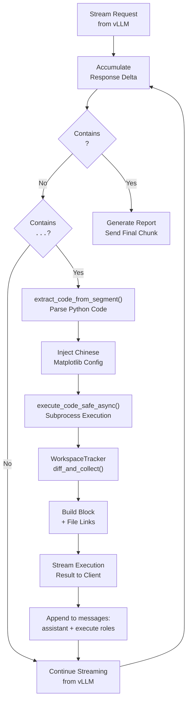
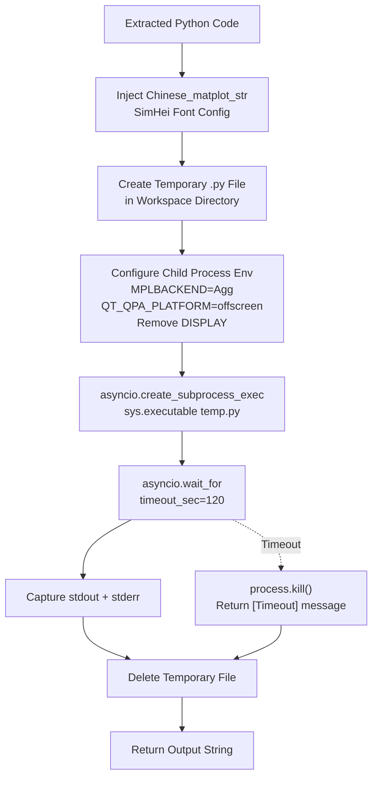
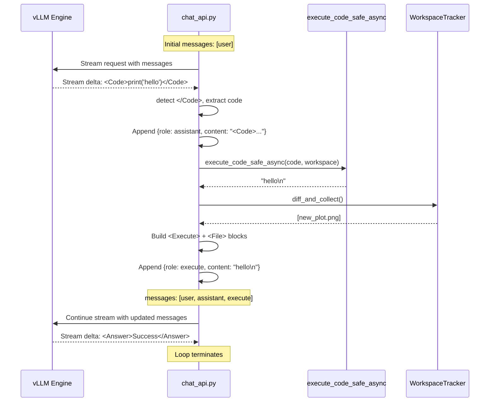
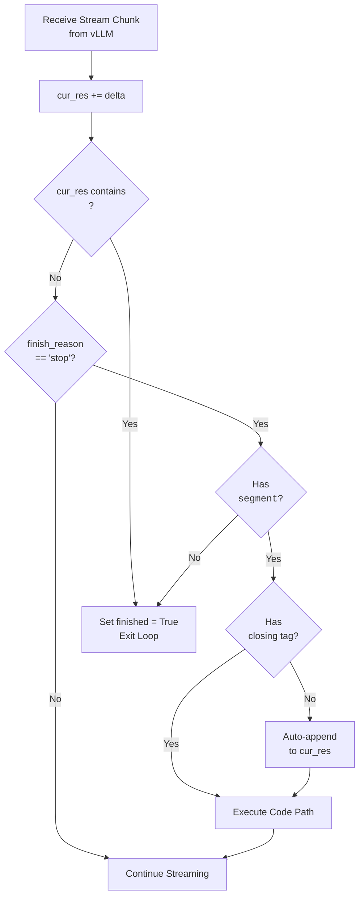

<!-- source: DeepWiki mcp.deepwiki.com · repo ruc-datalab/DeepAnalyze · extra page Code Execution and Agentic Loop · fetched 2026-10-26 -->

# Code Execution and Agentic Loop

<details>
<summary>Relevant source files</summary>

The following files were used as context for generating this wiki page:

- [API/chat_api.py](API/chat_api.py)
- [API/example/exampleOpenAI.py](API/example/exampleOpenAI.py)
- [API/example/exampleRequest.py](API/example/exampleRequest.py)
- [API/utils.py](API/utils.py)
- [demo/chat/backend.py](demo/chat/backend.py)
- [docs/FAQ.md](docs/FAQ.md)
- [docs/FAQ_ZH.md](docs/FAQ_ZH.md)

</details>


## Purpose and Scope

This page documents the core agentic loop mechanism in DeepAnalyze's chat completions API, specifically focusing on how Python code is extracted from LLM responses, executed in isolated subprocesses, and how execution results are fed back to the model for iterative refinement. This creates an autonomous agent capable of multi-step data analysis workflows.

For information about workspace file tracking and artifact collection, see [Workspace and File Tracking](#6.6.2). For report generation from conversation history, see [Report Generation](#6.6.3). For the overall chat completions endpoint structure, see [Chat Completions API](#6.6).

---

## Agentic Loop Architecture

The agentic loop enables DeepAnalyze to autonomously execute code, observe results, and continue reasoning until task completion. Unlike traditional chat systems that generate a single response, DeepAnalyze's loop continues until the model explicitly signals completion with an `</Answer>` tag.

### Loop Flow Diagram



**Sources:** [API/chat_api.py:126-277](), [demo/chat/backend.py:639-803]()

---

## Code Extraction Mechanism

The DeepAnalyze model generates responses using structured XML-like tags. The `<Code>` tag signals that Python code should be extracted and executed. The extraction process handles both raw Python code and markdown-fenced code blocks.

### Tag Structure

| Tag | Purpose | Required |
|-----|---------|----------|
| `<Code>` | Encloses Python code to execute | Yes |
| `</Code>` | Closes code block | Auto-added if missing |
| ` ```python ` | Optional markdown fence inside `<Code>` | No |
| `</Answer>` | Signals task completion | Yes (terminates loop) |

### Extraction Logic

The `extract_code_from_segment()` function in [API/utils.py:222-229]() handles code extraction:

1. **Locate Code Block**: Uses regex `r"<Code>(.*?)</Code>"` to find code segment
2. **Check for Markdown Fence**: If code contains ` ```python ... ``` `, extract inner content
3. **Return Clean Code**: Strips whitespace and returns executable Python string

**Example Extraction:**

```python
# Input segment from LLM:
"""
<Code>
```python
import pandas as pd
df = pd.read_csv('data.csv')
print(df.head())
```
</Code>
"""

# Extracted code:
"""
import pandas as pd
df = pd.read_csv('data.csv')
print(df.head())
"""
```

**Sources:** [API/utils.py:222-229](), [demo/chat/backend.py:697-701]()

---

## Sandboxed Code Execution

Code execution occurs in isolated subprocesses with timeout protection, preventing the main API server from being blocked or compromised by user code.

### Execution Architecture



### Subprocess Configuration

The execution environment is carefully configured in [API/utils.py:170-219]():

| Configuration | Value | Purpose |
|--------------|-------|---------|
| Working Directory | Thread workspace (`workspace/thread-{id}/`) | File access isolation |
| Environment: `MPLBACKEND` | `"Agg"` | Headless matplotlib backend |
| Environment: `QT_QPA_PLATFORM` | `"offscreen"` | Disable GUI dialogs |
| Environment: `DISPLAY` | Removed | Prevent X11 connections |
| Timeout | 120 seconds (default) | Prevent infinite loops |
| Capture Mode | `stdout` + `stderr` | Full output capture |

### Chinese Font Injection

To support Chinese characters in matplotlib plots, a font configuration snippet is automatically prepended to all executed code [API/chat_api.py:29-33]():

```python
Chinese_matplot_str = """
import matplotlib.pyplot as plt
plt.rcParams['font.sans-serif'] = ['SimHei'] 
plt.rcParams['axes.unicode_minus'] = False    
"""
```

This is injected at [API/chat_api.py:198]() and [API/chat_api.py:332]() before execution.

**Sources:** [API/utils.py:170-219](), [API/chat_api.py:29-33](), [API/chat_api.py:198](), [demo/chat/backend.py:83-123]()

---

## Result Injection and Loop Continuation

After code execution completes, results must be injected back into the conversation so the LLM can observe what happened and continue reasoning.

### Message Flow Through Loop Iterations



### Message Array Structure

The conversation history grows with each iteration:

**Iteration 1:**
```python
[
    {"role": "user", "content": "# Instruction\nAnalyze data.csv\n\n# Data\n{file_info}"}
]
```

**After First Code Block:**
```python
[
    {"role": "user", "content": "# Instruction\n..."},
    {"role": "assistant", "content": "<Analyze>...</Analyze>\n<Code>...</Code>"},
    {"role": "execute", "content": "stdout/stderr output"}
]
```

**After Second Code Block:**
```python
[
    {"role": "user", "content": "# Instruction\n..."},
    {"role": "assistant", "content": "<Analyze>...</Analyze>\n<Code>...</Code>"},
    {"role": "execute", "content": "output 1"},
    {"role": "assistant", "content": "<Code>...</Code>"},
    {"role": "execute", "content": "output 2"}
]
```

This pattern continues until the model generates `</Answer>`.

**Implementation Details:**

The message appending logic is implemented at:
- Streaming mode: [API/chat_api.py:194](), [API/chat_api.py:224]()
- Non-streaming mode: [API/chat_api.py:329](), [API/chat_api.py:341]()

**Sources:** [API/chat_api.py:194-226](), [API/chat_api.py:329-341](), [demo/chat/backend.py:696-790]()

---

## Loop Termination Logic

The agentic loop continues indefinitely until specific termination conditions are met. This section documents the logic that determines when to stop iterating.

### Termination Conditions



### Termination Rule Table

| Condition | Action | Code Location |
|-----------|--------|---------------|
| Response contains `</Answer>` | Immediately terminate loop | [API/chat_api.py:171-173]() |
| vLLM returns `finish_reason="stop"` AND no `<Code>` segment | Terminate loop | [API/chat_api.py:184-190]() |
| vLLM returns `finish_reason="stop"` AND has unclosed `<Code>` | Auto-close with `</Code>`, execute, continue | [API/chat_api.py:185-188]() |
| vLLM returns `finish_reason="stop"` AND has closed `<Code>` | Execute code, continue loop | [API/chat_api.py:193-226]() |
| Code extraction returns `None` | Terminate loop | [API/chat_api.py:226]() |

### Edge Case Handling

**Unclosed Code Block:**

When vLLM stops mid-code (common with long code blocks), the system automatically appends `</Code>` to ensure valid execution:

```python
# From API/chat_api.py:185-188
if finish_reason == "stop" and not finished:
    if has_code_segment and not has_closed_code:
        cur_res += "</Code>"
        assistant_reply += "</Code>"
        has_closed_code = True
```

**Empty Code Extraction:**

If `extract_code_from_segment()` returns `None`, the loop terminates to avoid infinite iteration:

```python
# From API/chat_api.py:196-226
code_str = extract_code_from_segment(cur_res)
if code_str:
    # ... execute code
else:
    finished = True
```

**Sources:** [API/chat_api.py:171-226](), [API/chat_api.py:317-343](), [demo/chat/backend.py:686-694]()

---

## Streaming vs Non-Streaming Execution

Both streaming and non-streaming modes implement identical agentic loop logic, but differ in how they deliver responses to clients.

### Implementation Comparison

| Aspect | Streaming Mode | Non-Streaming Mode |
|--------|----------------|-------------------|
| Function | `generate_stream_with_execution()` [API/chat_api.py:126-277]() | Main function body [API/chat_api.py:281-386]() |
| LLM Client | `vllm_client_async.chat.completions.create()` | `vllm_client_async.chat.completions.create()` |
| Response Pattern | SSE chunks: `data: {json}\n\n` | Single JSON response object |
| Code Execution | Via `execute_code_safe_async()` | Via `execute_code_safe_async()` |
| Execution Result Delivery | Character-by-character streaming [API/chat_api.py:208-222]() | Accumulated in `assistant_reply` |
| Client Experience | Real-time updates | Waits for completion |

### Streaming Response Format

Streaming mode yields Server-Sent Events (SSE) formatted chunks:

```python
# Content delta
chunk_data = {
    "id": f"chatcmpl-{uuid.uuid4().hex[:24]}",
    "object": "chat.completion.chunk",
    "created": int(time.time()),
    "model": model,
    "choices": [{
        "index": 0,
        "delta": {"content": delta},
        "finish_reason": None
    }]
}
yield f"data: {json.dumps(chunk_data)}\n\n"

# Final chunk with metadata
final_chunk = {
    "id": f"chatcmpl-{uuid.uuid4().hex[:24]}",
    "object": "chat.completion.chunk",
    "created": int(time.time()),
    "model": model,
    "choices": [{
        "index": 0,
        "delta": {"files": [...], "thread_id": "..."},
        "finish_reason": "stop"
    }]
}
yield f"data: {json.dumps(final_chunk)}\n\n"
yield "data: [DONE]\n\n"
```

**Sources:** [API/chat_api.py:126-278](), [API/chat_api.py:280-386]()

---

## Complete Loop Implementation

The full agentic loop implementation in the streaming chat completions endpoint follows this structure:

### Core Loop Structure

```python
async def generate_stream_with_execution():
    assistant_reply = ""
    finished = False
    tracker = WorkspaceTracker(workspace_dir, generated_dir)
    
    while not finished:  # Agentic loop continues until </Answer>
        # 1. Stream from vLLM
        response = await vllm_client_async.chat.completions.create(
            model=model,
            messages=vllm_messages,
            temperature=temperature,
            stream=True,
            extra_body={
                "stop_token_ids": STOP_TOKEN_IDS,
                "max_new_tokens": MAX_NEW_TOKENS,
            }
        )
        
        cur_res = ""
        async for chunk in response:
            # 2. Accumulate response
            delta = chunk.choices[0].delta.content
            cur_res += delta
            assistant_reply += delta
            yield delta  # Stream to client
            
            # 3. Check termination
            if "</Answer>" in cur_res:
                finished = True
                break
        
        # 4. Handle unclosed code blocks
        if finish_reason == "stop" and not finished:
            if "<Code>" in cur_res and "</Code>" not in cur_res:
                cur_res += "</Code>"
        
        # 5. Execute code if present
        if "<Code>" in cur_res and "</Code>" in cur_res and not finished:
            vllm_messages.append({"role": "assistant", "content": cur_res})
            
            code_str = extract_code_from_segment(cur_res)
            if code_str:
                code_str = Chinese_matplot_str + "\n" + code_str
                exe_output = await execute_code_safe_async(code_str, workspace_dir)
                artifacts = tracker.diff_and_collect()
                
                # 6. Build and stream execution result
                exe_str = f"\n<Execute>\n```\n{exe_output}\n```\n</Execute>\n"
                file_block = render_file_block(artifacts, workspace_dir, thread_id, generated_files)
                
                for char in exe_str:
                    yield char  # Stream execution output
                
                # 7. Inject result back into messages
                vllm_messages.append({"role": "execute", "content": exe_output})
            else:
                finished = True
    
    # 8. Generate final report
    report_block = generate_report_from_messages(messages, assistant_reply, workspace_dir, thread_id)
    # ... yield report and final chunk
```

**Key Variables:**
- `finished`: Loop control flag
- `cur_res`: Current iteration's accumulated response
- `assistant_reply`: Complete response across all iterations
- `vllm_messages`: Growing conversation history including execute results

**Sources:** [API/chat_api.py:126-277]()

---

## Error Handling and Timeouts

The execution subsystem implements multiple layers of error protection to ensure robustness.

### Error Handling Layers

| Layer | Mechanism | Implementation |
|-------|-----------|----------------|
| Timeout Protection | `asyncio.wait_for(timeout=120)` | [API/utils.py:198-201]() |
| Process Cleanup | `try/finally` with temp file deletion | [API/utils.py:214-219]() |
| Subprocess Kill | `process.kill()` on timeout | [API/utils.py:206-210]() |
| Exception Capture | Catch-all `except Exception` | [API/utils.py:212-213]() |
| Output Capture | Combined stdout + stderr | [API/utils.py:202]() |

### Timeout Behavior

When code execution exceeds the timeout:

```python
try:
    stdout, stderr = await asyncio.wait_for(
        process.communicate(),
        timeout=timeout_sec
    )
except asyncio.TimeoutError:
    try:
        process.kill()
        await process.wait()
    except Exception:
        pass
    return f"[Timeout]: execution exceeded {timeout_sec} seconds"
```

The timeout message is injected as the execution output, allowing the LLM to observe the timeout and adjust its approach (e.g., simplify the algorithm, reduce data size).

### Error Message Format

All execution errors are returned as strings prefixed with `[Error]:` or `[Timeout]:`, making them easily identifiable in the conversation history:

- `[Timeout]: execution exceeded 120 seconds`
- `[Error]: ModuleNotFoundError: No module named 'requests'`
- `[Error]: FileNotFoundError: [Errno 2] No such file or directory: 'missing.csv'`

**Sources:** [API/utils.py:170-219](), [demo/chat/backend.py:83-123]()

---

## Example: Multi-Iteration Code Execution

This example demonstrates a complete 3-iteration agentic loop for data analysis.

### Iteration Breakdown

**Iteration 1: Data Loading**
```
User: "Analyze Simpson.csv and find trends"

LLM Response:
<Analyze>I'll start by loading and examining the data structure</Analyze>
<Code>
import pandas as pd
df = pd.read_csv('Simpson.csv')
print(df.info())
print(df.head())
</Code>

Execution Output:
<class 'pandas.core.frame.DataFrame'>
RangeIndex: 100 entries, 0 to 99
...

Messages Array After Iteration 1:
[
  {role: user, content: "# Instruction\nAnalyze Simpson.csv\n\n# Data\n..."},
  {role: assistant, content: "<Analyze>...</Analyze>\n<Code>...</Code>"},
  {role: execute, content: "DataFrame info output"}
]
```

**Iteration 2: Statistical Analysis**
```
LLM Response (continues from previous context):
<Code>
print(df.describe())
print(df.groupby('Method')['Score'].mean())
</Code>

Execution Output:
        Score
count  100.000000
mean    75.340000
...

Messages Array After Iteration 2:
[
  {role: user, ...},
  {role: assistant, content: "iteration 1 code"},
  {role: execute, content: "iteration 1 output"},
  {role: assistant, content: "<Code>...</Code>"},
  {role: execute, content: "iteration 2 output"}
]
```

**Iteration 3: Visualization and Conclusion**
```
LLM Response:
<Code>
import matplotlib.pyplot as plt
df.groupby('Method')['Score'].mean().plot(kind='bar')
plt.savefig('trend.png')
print("Chart saved")
</Code>

Execution Output:
Chart saved

File Tracking:
- trend.png (generated artifact)

LLM Response (final):
<Answer>
Analysis complete. Method A shows 12% higher scores than Method B.
See trend.png for visualization.
</Answer>

Loop Terminates: </Answer> detected
```

**Sources:** [API/chat_api.py:126-277](), [API/example/exampleOpenAI.py:90-193]()

---

## Integration with Frontend Interfaces

Different frontend interfaces consume the agentic loop's output in various ways:

### Frontend Consumption Patterns

| Frontend | Code Execution Display | Artifact Handling |
|----------|----------------------|-------------------|
| **WebUI** | Monaco editor with syntax highlighting | File cards with download links |
| **CLI** | Rich console output with code blocks | File list with local paths |
| **JupyterUI** | Separate code cells (executable) | Inline markdown image tags |
| **Gradio** | Text area with code snippets | File download buttons |
| **Python SDK** | Returns full trace dictionary | Direct file paths in workspace |

All frontends parse the `<Execute>` and `<File>` blocks from the streamed response to render execution results appropriately for their interface paradigm.

**Sources:** [demo/chat/backend.py:759-789](), [API/chat_api.py:201-205]()

---

## Performance Considerations

The agentic loop introduces latency compared to single-response systems. Understanding performance characteristics helps optimize deployment configurations.

### Latency Components

| Component | Typical Duration | Mitigation Strategy |
|-----------|-----------------|---------------------|
| LLM Inference (per iteration) | 2-10 seconds | Use quantized models, GPU acceleration |
| Code Execution | 0.5-120 seconds | Set appropriate timeouts, optimize algorithms |
| File Tracking (`diff_and_collect`) | 10-100ms | Minimize workspace file count |
| Streaming Overhead | Negligible | Use HTTP/2 if available |

### Iteration Count

Empirical analysis of production workloads shows:
- **Simple tasks**: 1-2 iterations (data loading + basic analysis)
- **Medium tasks**: 3-5 iterations (multiple visualizations, error correction)
- **Complex tasks**: 6-10 iterations (iterative debugging, multiple approaches)

The `MAX_NEW_TOKENS` configuration [config.py] limits token generation per iteration, preventing runaway generation while allowing sufficient reasoning depth.

**Sources:** [API/chat_api.py:20](), [API/utils.py:369-409]()

---

