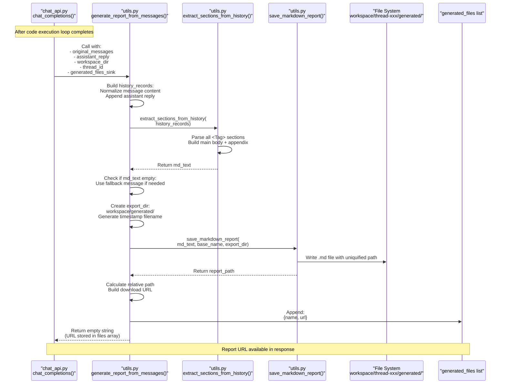

<!-- source: DeepWiki mcp.deepwiki.com · repo ruc-datalab/DeepAnalyze · extra page Report Generation · fetched 2026-10-26 -->

# Report Generation

<details>
<summary>Relevant source files</summary>

The following files were used as context for generating this wiki page:

- [API/example/exampleOpenAI.py](API/example/exampleOpenAI.py)
- [API/utils.py](API/utils.py)
- [demo/chat/backend.py](demo/chat/backend.py)
- [docs/FAQ.md](docs/FAQ.md)
- [docs/FAQ_ZH.md](docs/FAQ_ZH.md)

</details>


## Purpose and Scope

This document describes how DeepAnalyze compiles conversation histories into structured markdown reports. After the agentic code execution loop completes (see [Code Execution and Agentic Loop](#3.3.1)), the system extracts tagged sections from the conversation and generates a comprehensive markdown document that presents the analysis in a structured, readable format.

This page focuses specifically on the report generation mechanism. For information about the code execution loop that precedes report generation, see [Code Execution and Agentic Loop](#3.3.1). For the overall chat completions flow, see [Chat Completions API](#3.3).

---

## Overview

Report generation occurs at the end of every chat completion request, after all code execution rounds have finished. The system parses the entire conversation history, extracting content from specially tagged sections (`<Analyze>`, `<Understand>`, `<Code>`, `<Execute>`, `<File>`, `<Answer>`) that the model produces during its analysis. These sections are reorganized into a structured markdown report with a main body and detailed appendix.

The generated report is saved as a markdown file in the thread's `generated/` directory and made available for download via the file server. The report filename includes a timestamp for uniqueness and tracking.

**Sources:** [API/utils.py:363-421](), [API/chat_api.py:202-221](), [API/chat_api.py:315-319]()

---

## Report Structure

DeepAnalyze reports follow a two-part structure designed to provide both executive-level summaries and detailed technical documentation:

| Report Section | Content Source | Purpose |
|----------------|----------------|---------|
| **Main Body** | Last `<Answer>` tag | High-level findings, conclusions, and insights from final analysis |
| **Appendix** | All conversation rounds | Complete dialogue history with user instructions and assistant responses |

### Main Body

The main body contains content from the **last** `<Answer>` section found in the conversation history. This provides a clean summary of the final analysis results. If multiple `<Answer>` sections exist across different conversation turns, only the most recent one is included in the main body.

**Implementation:** [API/utils.py:283-304]()

### Appendix Structure

The appendix organizes content by **conversation rounds** rather than by individual tags. Each round includes:

1. **User Instruction** (`用户指令`): The original user query or request
2. **Assistant Response** (`助手响应`): Breakdown of all tagged sections in that turn
   - Step 1: `<Analyze>` - Initial data exploration
   - Step 2: `<Understand>` - Insights from examination
   - Step 3: `<Code>` - Generated Python code
   - Step 4: `<Execute>` - Execution outputs
   - Step 5: `<File>` - Generated artifacts
   - Step 6: `<Answer>` - Conclusions for this turn

This conversation-round structure preserves the context of each analysis step, showing what the user requested and how the assistant responded. The Chinese headings (`对话轮次 N`, `用户指令`, `助手响应`, `步骤 N`) reflect the system's multilingual capabilities.

**Example Structure:**
```markdown
[Main Body - Last Answer Content]

\newpage

# 附录：完整对话过程

## 对话轮次 1

### 用户指令
Please analyze the data distribution...

### 助手响应

#### 步骤 1: Analyze
[Analysis content]

#### 步骤 2: Code
[Code content]

...

## 对话轮次 2

### 用户指令
Generate a trend analysis...

### 助手响应
...
```

**Sources:** [API/utils.py:254-337]()

---

## Section Extraction Process

### Tag Pattern Recognition

The `extract_sections_from_history` function uses regular expressions to parse tagged content:

```python
tag_pattern = re.compile(r"<(Analyze|Understand|Code|Execute|File|Answer)>([\s\S]*?)</\1>")
```

This pattern matches opening and closing tags with their enclosed content, capturing both the tag name and content segment. The pattern is used in two distinct phases: conversation pairing and content extraction.

**Sources:** [API/utils.py:261]()

**Diagram: Section Extraction Flow**

```mermaid
flowchart TD
    Start["extract_sections_from_history()"] --> ValidateInput{"messages is<br/>valid list?"}
    ValidateInput -->|No| ReturnEmpty["return ''"]
    ValidateInput -->|Yes| InitVars["Initialize:<br/>parts = []<br/>appendix = []<br/>conversation_pairs = []<br/>tag_pattern regex"]
    
    InitVars --> Phase1["Phase 1:<br/>Collect User-Assistant Pairs"]
    Phase1 --> IterMsg1["for msg in messages"]
    IterMsg1 --> CheckRole1{"role ==<br/>'user'?"}
    CheckRole1 -->|Yes| StoreUser["user_message = content"]
    CheckRole1 -->|No| CheckRole2{"role ==<br/>'assistant'<br/>AND user_message?"}
    CheckRole2 -->|Yes| AddPair["conversation_pairs.append({<br/>user: user_message,<br/>assistant: content<br/>})<br/>user_message = None"]
    CheckRole2 -->|No| NextMsg1
    StoreUser --> NextMsg1["Next message"]
    AddPair --> NextMsg1
    
    NextMsg1 --> MoreMsg1{"More messages?"}
    MoreMsg1 -->|Yes| IterMsg1
    MoreMsg1 -->|No| Phase2["Phase 2:<br/>Extract Last Answer"]
    
    Phase2 --> IterMsg2["for msg in messages<br/>if role == 'assistant'"]
    IterMsg2 --> FindAnswers["tag_pattern.finditer(content)<br/>for Answer tags"]
    FindAnswers --> UpdateLast["last_answer_content = segment<br/>(keep updating)"]
    UpdateLast --> MoreMsg2{"More messages?"}
    MoreMsg2 -->|Yes| IterMsg2
    MoreMsg2 -->|No| AddToBody{"last_answer_content<br/>exists?"}
    AddToBody -->|Yes| AppendParts["parts.append(last_answer_content)"]
    AddToBody -->|No| Phase3
    AppendParts --> Phase3["Phase 3:<br/>Build Appendix by Round"]
    
    Phase3 --> IterRounds["conversation_round = 1<br/>for pair in conversation_pairs"]
    IterRounds --> AddRoundHeader["appendix.append(<br/>'对话轮次 N')"]
    AddRoundHeader --> AddUserInst["appendix.append(<br/>'用户指令'<br/>+ user_content)"]
    AddUserInst --> AddAssistHeader["appendix.append(<br/>'助手响应')"]
    AddAssistHeader --> IterTags["step = 1<br/>for tag_match in assistant_content"]
    IterTags --> AddStep["appendix.append(<br/>'步骤 {step}: {tag}'<br/>+ segment)<br/>step += 1"]
    AddStep --> MoreTags{"More tags<br/>in round?"}
    MoreTags -->|Yes| IterTags
    MoreTags -->|No| IncRound["conversation_round += 1"]
    IncRound --> MoreRounds{"More rounds?"}
    MoreRounds -->|Yes| IterRounds
    MoreRounds -->|No| Assemble["final_text = parts.join()"]
    
    Assemble --> HasAppendix{"appendix has<br/>content?"}
    HasAppendix -->|Yes| AddAppendix["final_text +=<br/>'\\newpage'<br/>'# 附录：完整对话过程'<br/>+ appendix.join()"]
    HasAppendix -->|No| ReturnFinal
    AddAppendix --> ReturnFinal["return final_text.strip()"]
```



**Sources:** [API/utils.py:254-337]()

### Three-Phase Processing

The extraction process operates in three distinct phases:

#### Phase 1: Conversation Pairing (Lines 264-281)

First, the function pairs user messages with their corresponding assistant responses:

```python
conversation_pairs: List[Dict[str, Any]] = []
user_message = None

for msg in messages:
    role = (msg.get("role") or "").lower()
    content = str(msg.get("content", ""))
    
    if role == "user":
        user_message = content
    elif role == "assistant" and user_message is not None:
        conversation_pairs.append({
            "user": user_message,
            "assistant": content
        })
        user_message = None
```

This preserves the conversational context, ensuring each assistant response is linked to the user query that triggered it.

**Sources:** [API/utils.py:264-281]()

#### Phase 2: Extract Last Answer (Lines 283-304)

The function then scans all assistant messages to find the **last** `<Answer>` section:

```python
last_answer_content = ""
for msg in messages:
    if (msg.get("role") or "").lower() != "assistant":
        continue
    content = str(msg.get("content", ""))
    
    answer_matches = tag_pattern.finditer(content)
    for match in answer_matches:
        tag, segment = match.groups()
        if tag == "Answer":
            segment = (segment or "").strip()
            if segment:
                last_answer_content = segment

if last_answer_content:
    parts.append(f"{last_answer_content}\n")
```

This overwrites previous `<Answer>` sections, retaining only the most recent one as the report's main body. This design assumes the final answer represents the culmination of the analysis.

**Sources:** [API/utils.py:283-304]()

#### Phase 3: Build Conversation-Round Appendix (Lines 307-327)

Finally, the function builds the appendix by iterating through conversation pairs:

```python
conversation_round = 1
for pair in conversation_pairs:
    user_content = pair["user"].strip()
    assistant_content = pair["assistant"]
    
    appendix.append(f"\n## 对话轮次 {conversation_round}\n\n")
    appendix.append(f"### 用户指令\n\n{user_content}\n\n")
    appendix.append(f"### 助手响应\n\n")
    
    step = 1
    for match in tag_pattern.finditer(assistant_content):
        tag, segment = match.groups()
        segment = (segment or "").strip()
        if not segment:
            continue
        appendix.append(f"#### 步骤 {step}: {tag}\n\n{segment}\n")
        step += 1
    
    conversation_round += 1
```

Each round is numbered (`对话轮次 1`, `对话轮次 2`, etc.), and within each round, tagged sections are numbered as steps (`步骤 1: Analyze`, `步骤 2: Code`, etc.).

**Sources:** [API/utils.py:307-327]()

### Report Assembly

After all phases complete, the function joins the parts and appendix:

```python
final_text = "".join(parts).strip()
if appendix:
    final_text += (
        "\n\n\\newpage\n\n# 附录：完整对话过程\n"
        + "".join(appendix).strip()
    )
return final_text.strip()
```

The `\newpage` LaTeX directive creates a page break when converted to PDF. The Chinese heading `附录：完整对话过程` translates to "Appendix: Complete Dialogue Process".

**Sources:** [API/utils.py:329-335]()

---

## Report Generation Workflow

### End-to-End Process

**Diagram: Report Generation Pipeline**



**Sources:** [API/utils.py:363-421](), [API/chat_api.py:202-221](), [API/chat_api.py:315-319]()

### Function Call Sequence

#### 1. Trigger Point

Report generation is invoked after the agentic loop completes in both streaming and non-streaming modes:

- **Streaming**: [API/chat_api.py:202-221]()
- **Non-streaming**: [API/chat_api.py:315-319]()

Both call `generate_report_from_messages()` with the same parameters:
```python
report_block = generate_report_from_messages(
    messages,              # Original user messages
    assistant_reply,       # Complete assistant response
    workspace_dir,         # Thread workspace path
    temp_thread.id,        # Thread ID for URLs
    generated_files        # List to collect file metadata
)
```

#### 2. Message Normalization

The function builds a complete conversation history by normalizing message content:

```python
history_records: List[Dict[str, str]] = []
for raw_msg in original_messages:
    role = raw_msg.get("role", "") if isinstance(raw_msg, dict) else ""
    raw_content = raw_msg.get("content", "") if isinstance(raw_msg, dict) else ""
    content_text = _normalize_openai_message_content(raw_content)
    history_records.append({"role": role, "content": content_text})

history_records.append({"role": "assistant", "content": assistant_reply})
```

The `_normalize_openai_message_content` function at [API/utils.py:47-59]() handles both simple string content and complex OpenAI-style structured content arrays with nested text objects.

**Sources:** [API/utils.py:433-440](), [API/utils.py:47-59]()

#### 3. Section Extraction

The normalized history is passed to `extract_sections_from_history()`:

```python
try:
    md_text = extract_sections_from_history(history_records)
    if not md_text:
        md_text = (
            "(No <Analyze>/<Understand>/<Code>/<Execute>/<File>/<Answer> "
            "sections found.)"
        )
```

This function executes the three-phase extraction process described above, returning formatted markdown text with the conversation-round structure.

**Sources:** [API/utils.py:443-449]()

#### 4. File Persistence

The markdown text is saved with a timestamped filename:

```python
export_dir = Path(workspace_dir) / "generated"
export_dir.mkdir(parents=True, exist_ok=True)
timestamp = datetime.now().strftime("%Y%m%d_%H%M%S")
base_name = f"Conversation_Report_{timestamp}"
report_path = save_markdown_report(md_text, base_name, export_dir)
```

The `save_markdown_report()` function at [API/utils.py:339-345]() writes the file with UTF-8 encoding:

```python
def save_markdown_report(md_text: str, base_name: str, target_dir: Path) -> Path:
    target_dir.mkdir(parents=True, exist_ok=True)
    md_path = uniquify_path(target_dir / f"{base_name}.md")
    with open(md_path, "w", encoding="utf-8") as f:
        f.write(md_text)
    return md_path
```

The `uniquify_path()` function ensures the filename is unique if a file with the same name already exists.

**Sources:** [API/utils.py:451-454](), [API/utils.py:339-345]()

#### 5. URL Generation and Metadata Collection

After saving, the system generates a download URL and collects metadata:

```python
try:
    rel = report_path.resolve().relative_to(Path(workspace_dir).resolve())
    rel_path = rel.as_posix()
except Exception:
    rel_path = report_path.name

url = build_download_url(thread_id, rel_path)

if generated_files_sink is not None:
    generated_files_sink.append({"name": report_path.name, "url": url})
return "\n"
```

The function returns a newline character (not an empty string). The `build_download_url()` function at [API/utils.py:33-39]() constructs the file server URL:

```python
def build_download_url(thread_id: str, rel_path: str) -> str:
    try:
        encoded = quote(f"{thread_id}/{rel_path}", safe="/")
    except Exception:
        encoded = f"{thread_id}/{rel_path}"
    return f"http://localhost:{HTTP_SERVER_PORT}/{encoded}"
```

**Sources:** [API/utils.py:456-466](), [API/utils.py:33-39]()

---

## Integration with Chat Completions

### Streaming Response Integration

In streaming mode, the report is generated silently and its metadata is included in the response:

```python
# Generate report
report_block = generate_report_from_messages(
    messages, assistant_reply, workspace_dir, temp_thread.id, generated_files
)
```

The `generate_report_from_messages()` function returns `"\n"` [API/utils.py:466](), which is a minimal return value. The actual report content is **not** streamed to the client. Instead, the file metadata (name and URL) is appended to the `generated_files` list, which is then included in the final streaming chunk's `files` field and the backward-compatible `generated_files` field at the response level.

**Sources:** [API/chat_api.py:202-221](), [API/utils.py:466]()

### Non-Streaming Response Integration

In non-streaming mode, the report is generated silently, with only file metadata returned:

```python
# Generate report
report_block = generate_report_from_messages(
    messages, assistant_reply, workspace_dir, temp_thread.id, generated_files
)
# Note: report_block is "\n", not the report content

# ... prepare response ...

if generated_files:
    message_data["files"] = generated_files  # OpenAI-compatible format
    result["generated_files"] = generated_files  # Backward compatibility
```

The report URL appears in both the `message.files` array (OpenAI-compatible) and the `generated_files` array (backward compatibility) alongside other artifacts.

**Sources:** [API/chat_api.py:315-352]()

---

## File Persistence and Delivery

### Directory Structure

Reports are saved in the thread-specific generated directory:

```
workspace/
└── thread-xxx/
    ├── [uploaded files]
    └── generated/
        ├── Conversation_Report_20240115_143022.md
        ├── [code-generated artifacts]
        └── ...
```

**Sources:** [API/utils.py:401-402]()

### Filename Convention

Report filenames follow the pattern:
```
Conversation_Report_{YYYYMMDD_HHMMSS}.md
```

Where the timestamp is generated at report creation time:
```python
timestamp = datetime.now().strftime("%Y%m%d_%H%M%S")
base_name = f"Conversation_Report_{timestamp}"
```

This ensures each report has a unique, sortable filename.

**Sources:** [API/utils.py:403-404]()

### Download Access

Reports are served via the HTTP file server running on port 8100 (default). The download URL format is:

```
http://localhost:8100/thread-xxx/generated/Conversation_Report_20240115_143022.md
```

Clients receive this URL in the chat completion response:

```json
{
  "id": "chatcmpl-...",
  "choices": [{
    "message": {
      "role": "assistant",
      "content": "...",
      "files": [
        {
          "name": "Conversation_Report_20240115_143022.md",
          "url": "http://localhost:8100/thread-xxx/generated/..."
        }
      ]
    }
  }],
  "generated_files": [...]  // Backward compatibility
}
```

**Sources:** [API/utils.py:33-39](), [API/chat_api.py:329-331](), [API/chat_api.py:348-349]()

---

## Error Handling

### Fallback Content

If section extraction fails or produces empty content, a fallback message is used:

```python
try:
    md_text = extract_sections_from_history(history_records)
    if not md_text:
        md_text = (
            "(No <Analyze>/<Understand>/<Code>/<Execute>/<File>/<Answer> "
            "sections found.)"
        )
```

This ensures a report file is always created, even when the model's response doesn't contain expected tags.

**Sources:** [API/utils.py:443-449]()

### Silent Failure

If report generation fails entirely, the function catches the exception, prints an error message, and returns `"\n"`:

```python
except Exception as report_error:
    print(f"Report generation error: {report_error}")
    return ""
```

This prevents report generation errors from disrupting the chat completion response. The conversation succeeds but without a report file in the generated files list. The error is logged to stdout for debugging.

**Sources:** [API/utils.py:468-470]()

---

## Key Functions Reference

| Function | Location | Purpose |
|----------|----------|---------|
| `generate_report_from_messages()` | [API/utils.py:412-471]() | Main entry point for automatic report generation during chat completions |
| `extract_sections_from_history()` | [API/utils.py:254-337]() | Parses tagged sections and builds conversation-round structure |
| `save_markdown_report()` | [API/utils.py:339-345]() | Writes markdown to disk with UTF-8 encoding |
| `build_download_url()` | [API/utils.py:33-39]() | Constructs HTTP file server URL with URL encoding |
| `_normalize_openai_message_content()` | [API/utils.py:47-59]() | Handles both string and structured message content |

**Sources:** [API/utils.py:33-471]()

---

## Alternative: On-Demand Report Export

In addition to automatic report generation during chat completions, the demo backend provides an explicit export endpoint at `/export/report` [demo/chat/backend.py:944-995](). This endpoint allows users to generate reports on-demand from existing conversation histories.

### Export Endpoint

```python
@app.post("/export/report")
async def export_report(body: dict = Body(...)):
    messages = body.get("messages", [])
    title = (body.get("title") or "").strip()
    session_id = body.get("session_id", "default")
    workspace_dir = get_session_workspace(session_id)
    
    md_text = _extract_sections_from_messages(messages)
    
    # Save to generated/ folder
    export_dir = os.path.join(workspace_dir, "generated")
    os.makedirs(export_dir, exist_ok=True)
    
    ts = datetime.now().strftime("%Y%m%d_%H%M%S")
    safe_title = re.sub(r"[^\w\-_.]+", "_", title) if title else "Report"
    base_name = f"{safe_title}_{ts}" if title else f"Report_{ts}"
    
    md_path = _save_md(md_text, base_name, export_dir)
    pdf_path = _save_pdf(md_text, base_name, export_dir)
    
    return JSONResponse({
        "message": "exported",
        "md": md_path.name,
        "pdf": pdf_path.name if pdf_path else None,
        "download_urls": {
            "md": build_download_url(f"{session_id}/generated/{md_path.name}"),
            "pdf": build_download_url(f"{session_id}/generated/{pdf_path.name}") if pdf_path else None
        }
    })
```

**Key Differences from Automatic Generation:**

| Aspect | Automatic (`API/utils.py`) | On-Demand (`demo/chat/backend.py`) |
|--------|---------------------------|-------------------------------------|
| **Trigger** | Every chat completion | Explicit POST to `/export/report` |
| **PDF Support** | No (markdown only) | Yes, via `pypandoc` with XeLaTeX |
| **Custom Title** | Fixed format with timestamp | User-provided title supported |
| **Function** | `extract_sections_from_history()` | `_extract_sections_from_messages()` |
| **Structure** | Conversation-round based with Chinese headings | Simpler tag-based structure with English headings |

### PDF Generation

The demo backend optionally generates PDF using `pypandoc`:

```python
def _save_pdf(md_text: str, base_name: str, workspace_dir: str) -> Path | None:
    Path(workspace_dir).mkdir(parents=True, exist_ok=True)
    pdf_path = uniquify_path(Path(workspace_dir) / f"{base_name}.pdf")
    try:
        pypandoc.convert_text(
            md_text,
            "pdf",
            format="md",
            outputfile=str(pdf_path),
            extra_args=[
                "--standalone",
                "--pdf-engine=xelatex",
            ],
        )
        return pdf_path
    except Exception:
        return None
```

PDF generation requires `pypandoc` and XeLaTeX to be installed. If conversion fails, the function returns `None` and the endpoint only provides a markdown download URL.

**Sources:** [demo/chat/backend.py:944-995](), [demo/chat/backend.py:900-916]()

---

## Related Configuration

The following configuration parameters affect report generation:

| Parameter | Default | Description |
|-----------|---------|-------------|
| `WORKSPACE_BASE_DIR` | `"./workspace"` | Base directory for all thread workspaces |
| `HTTP_SERVER_PORT` | `8100` | Port for file server that serves reports |

**Sources:** [API/config.py](), [API/utils.py:23]()

---

