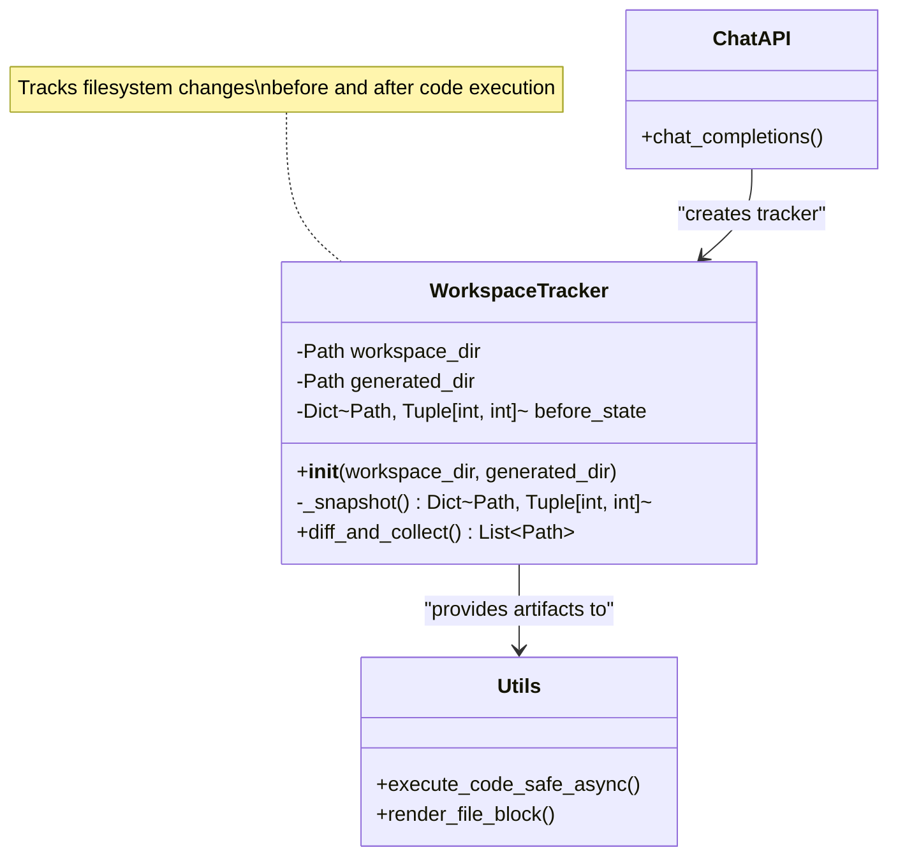
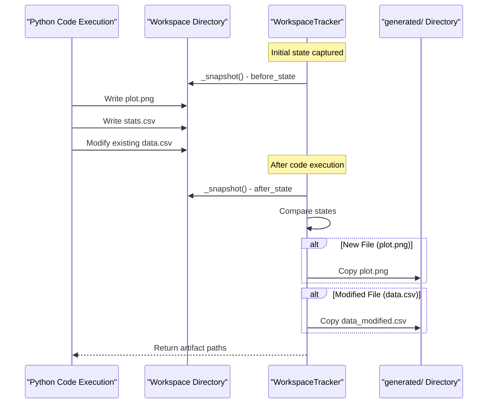
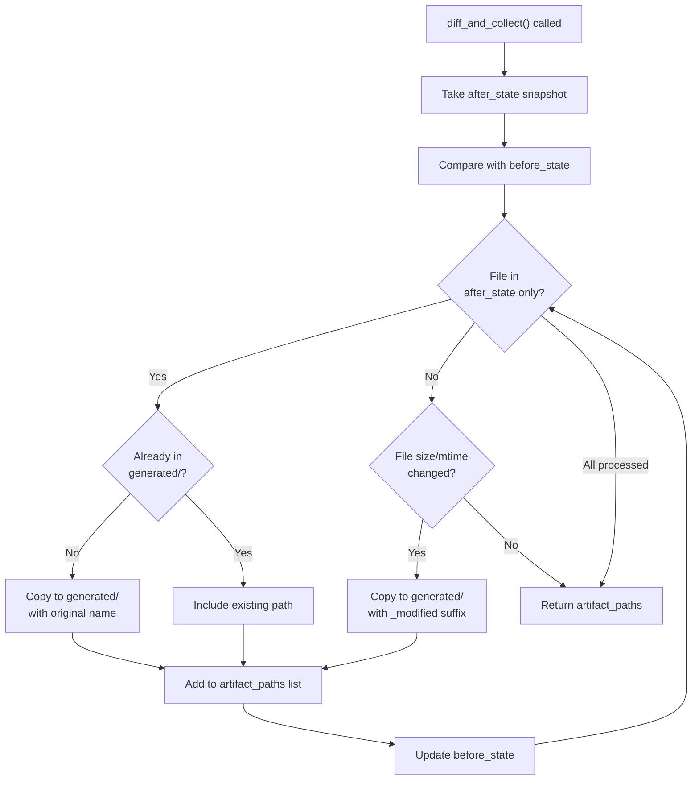
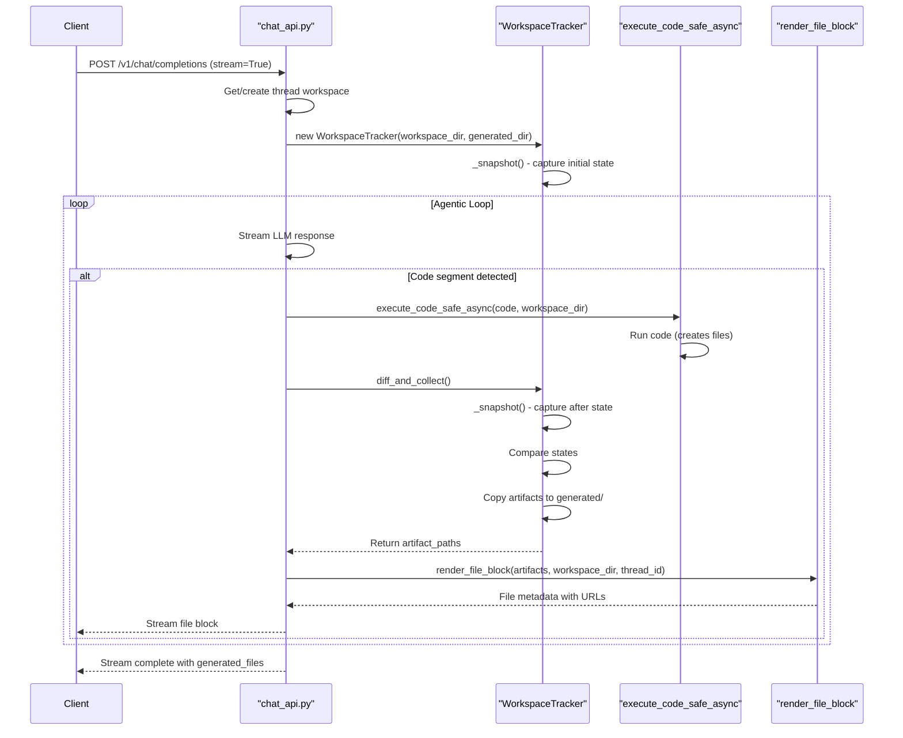
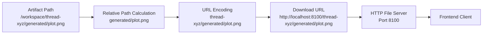
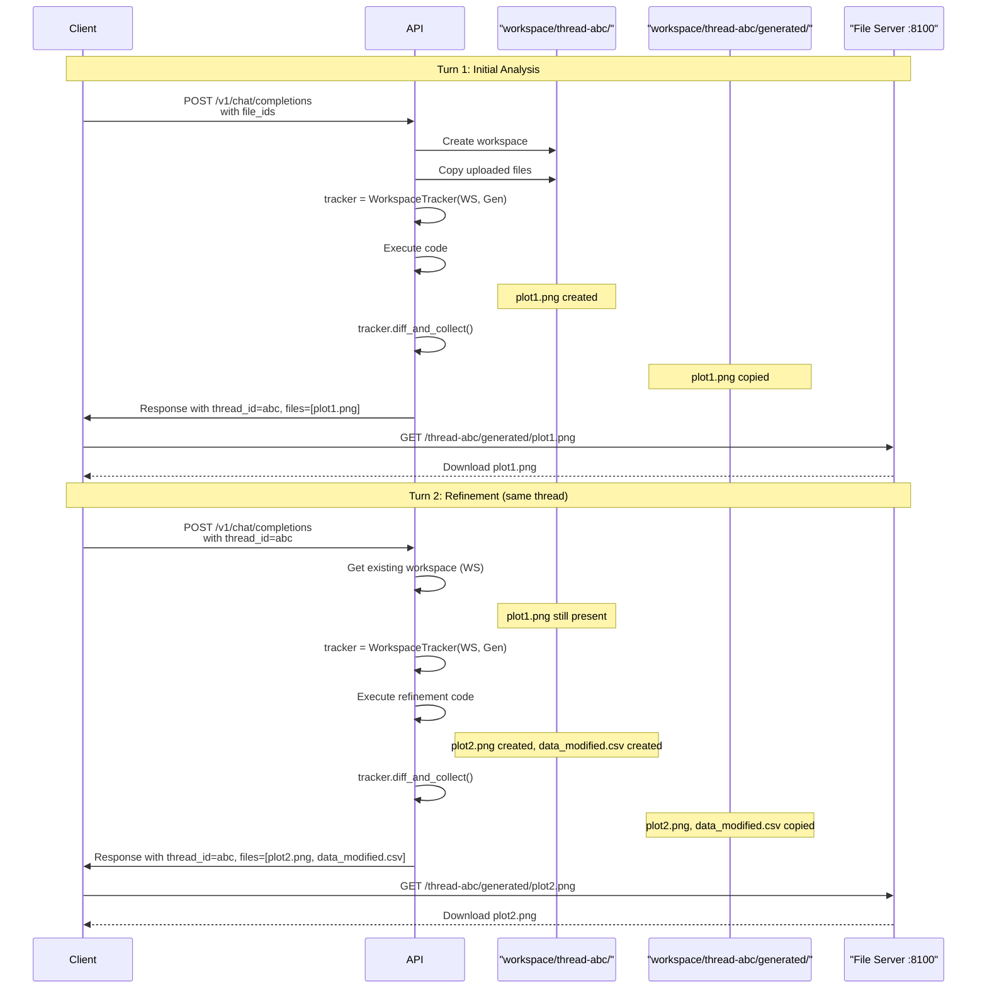

<!-- source: DeepWiki mcp.deepwiki.com · repo ruc-datalab/DeepAnalyze · extra page Workspace and File Tracking · fetched 2026-10-26 -->

# Workspace and File Tracking

<details>
<summary>Relevant source files</summary>

The following files were used as context for generating this wiki page:

- [API/chat_api.py](API/chat_api.py)
- [API/example/exampleOpenAI.py](API/example/exampleOpenAI.py)
- [API/example/exampleRequest.py](API/example/exampleRequest.py)
- [API/utils.py](API/utils.py)

</details>


## Purpose and Scope

This document describes the workspace management and file tracking system used by DeepAnalyze to capture artifacts generated during code execution. When the AI model generates and executes Python code, it may create files such as plots, CSV exports, or reports. The `WorkspaceTracker` class monitors the filesystem to automatically detect and collect these generated files, making them accessible to frontend clients via download URLs.

For information about the overall chat completions workflow, see [Chat Completions API](#6.6). For details on the code execution mechanism itself, see [Code Execution and Agentic Loop](#6.6.1). For report generation specifics, see [Report Generation](#6.6.3).

---

## Thread-Based Workspace Isolation

Each conversation thread operates within its own isolated workspace directory to prevent cross-contamination of files and enable stateful multi-turn workflows.

### Workspace Directory Structure

```
workspace/
├── FILE_STORAGE_DIR/          # Global file upload storage
│   ├── file-abc123.csv
│   └── file-def456.txt
└── thread-xyz789/             # Thread-specific workspace
    ├── data.csv               # Copied from FILE_STORAGE_DIR
    ├── analysis.csv           # User-uploaded or copied
    └── generated/             # Collected artifacts
        ├── plot.png
        ├── statistics.csv
        └── Conversation_Report_20240115_143022.md
```

### Workspace Creation and Management

The `get_thread_workspace()` function creates and returns the workspace directory path for a given thread:

[API/utils.py:26-30]()

```python
def get_thread_workspace(thread_id: str) -> str:
    """Get workspace directory for a thread"""
    workspace_dir = os.path.join(WORKSPACE_BASE_DIR, thread_id)
    os.makedirs(workspace_dir, exist_ok=True)
    return workspace_dir
```

When a chat completion request arrives with a `thread_id`, the API retrieves or creates the workspace and copies any attached files into it:

[API/chat_api.py:72-88]()

The workspace serves as the current working directory for code execution, ensuring all file operations are sandboxed and persistent across conversation turns.

**Sources:** [API/utils.py:26-30](), [API/chat_api.py:72-88](), [API/config.py]()

---

## The WorkspaceTracker Class

The `WorkspaceTracker` is the core mechanism for detecting and collecting generated files during code execution.

### Class Architecture



### Initialization and State Capture

The tracker is initialized with two directory paths and immediately captures a baseline snapshot:

[API/utils.py:350-357]()

```python
class WorkspaceTracker:
    """Track workspace file changes and collect artifacts into generated/ folder."""

    def __init__(self, workspace_dir: str, generated_dir: str):
        self.workspace_dir = Path(workspace_dir).resolve()
        self.generated_dir = Path(generated_dir).resolve()
        self.generated_dir.mkdir(parents=True, exist_ok=True)
        self.before_state = self._snapshot()
```

The `_snapshot()` method captures the current filesystem state as a dictionary mapping file paths to tuples of `(size, mtime_ns)`:

[API/utils.py:359-367]()

```python
def _snapshot(self) -> Dict[Path, Tuple[int, int]]:
    try:
        return {
            p.resolve(): (p.stat().st_size, p.stat().st_mtime_ns)
            for p in self.workspace_dir.rglob("*")
            if p.is_file()
        }
    except Exception:
        return {}
```

This snapshot includes file size and modification time in nanoseconds to detect both new files and modifications to existing files.

**Sources:** [API/utils.py:350-367]()

---

## File Detection Algorithm

After code execution completes, `diff_and_collect()` compares the current filesystem state against the baseline to identify changes.

### Detection Flow



### Implementation

The `diff_and_collect()` method performs state comparison and file collection:

[API/utils.py:369-409]()

The algorithm identifies three categories of files:

1. **Added files**: Present in `after_state` but not in `before_state`
2. **Modified files**: Present in both states but with different `(size, mtime_ns)` tuples
3. **Unchanged files**: Ignored

### File Processing Logic

| File Category | Detection Condition | Action | Destination Name |
|--------------|---------------------|--------|------------------|
| New file | `p not in before_state` | Copy to `generated/` | Original name |
| Modified file | `after_state[p] != before_state[p]` | Copy to `generated/` | `{stem}_modified{suffix}` |
| Already in `generated/` | `p` starts with `generated_dir` | Include as-is | Original path |
| Unchanged | `after_state[p] == before_state[p]` | Ignore | N/A |

**Sources:** [API/utils.py:369-409]()

---

## File Collection Process

### Collection Workflow



### Path Uniquification

To prevent filename conflicts, the system uses `uniquify_path()` which ensures each destination path is unique:

[API/utils.py:42-44]()

Currently implemented as a pass-through, but can be extended to add numeric suffixes when conflicts occur.

### Error Handling

The tracker includes exception handling for file operations to ensure partial failures don't break the entire collection process:

```python
for p in added:
    try:
        # ... copy logic ...
    except Exception as e:
        print(f"Error moving file {p}: {e}")
```

Failed file operations are logged but don't prevent collection of other artifacts.

**Sources:** [API/utils.py:369-409](), [API/utils.py:42-44]()

---

## Integration with Chat Completions API

The `WorkspaceTracker` is instantiated within the chat completions endpoint and used throughout the agentic execution loop.

### Lifecycle in Streaming Mode



### Instantiation in Chat API

The tracker is created once per chat completion request:

[API/chat_api.py:126-129]() (streaming mode)
```python
async def generate_stream_with_execution():
    assistant_reply = ""
    finished = False
    tracker = WorkspaceTracker(workspace_dir, generated_dir)
```

[API/chat_api.py:282-285]() (non-streaming mode)
```python
assistant_reply = ""
finished = False
generated_files = []
tracker = WorkspaceTracker(workspace_dir, generated_dir)
```

### Artifact Collection After Code Execution

After each code execution, the tracker is called to collect artifacts:

[API/chat_api.py:196-204]() (streaming)
```python
code_str = Chinese_matplot_str + "\n" + code_str
exe_output = await execute_code_safe_async(code_str, workspace_dir)
artifacts = tracker.diff_and_collect()  # ← Collect generated files
exe_str = f"\n<Execute>\n```\n{exe_output}\n```\n</Execute>\n"
file_block = render_file_block(
    artifacts, workspace_dir, current_thread_id, generated_files
)
assistant_reply += exe_str + file_block
```

The same pattern applies in non-streaming mode at [API/chat_api.py:330-340]().

**Sources:** [API/chat_api.py:126-129](), [API/chat_api.py:196-204](), [API/chat_api.py:282-285](), [API/chat_api.py:330-340]()

---

## File URL Generation and Access

Once artifacts are collected, they must be made accessible to frontend clients via HTTP URLs.

### URL Building Process



### build_download_url Function

The `build_download_url()` function constructs HTTP URLs for artifacts:

[API/utils.py:33-39]()

```python
def build_download_url(thread_id: str, rel_path: str) -> str:
    """Build download URL for a file"""
    try:
        encoded = quote(f"{thread_id}/{rel_path}", safe="/")
    except Exception:
        encoded = f"{thread_id}/{rel_path}"
    return f"http://localhost:{HTTP_SERVER_PORT}/{encoded}"
```

The function:
1. Combines `thread_id` and relative path
2. URL-encodes the path (preserving forward slashes)
3. Constructs full URL using `HTTP_SERVER_PORT` from config (default: 8100)

### render_file_block Function

The `render_file_block()` function processes artifact paths and builds metadata structures:

[API/utils.py:471-492]()

```python
def render_file_block(
    artifact_paths: List[Path],
    workspace_dir: str,
    thread_id: str,
    generated_files_sink: Optional[List[Dict[str, str]]] = None,
) -> str:
    """Build the <File> markdown block and optionally collect generated file metadata."""
    if not artifact_paths:
        return ""

    for p in artifact_paths:
        try:
            rel = Path(p).resolve().relative_to(Path(workspace_dir).resolve()).as_posix()
        except Exception:
            rel = Path(p).name
        url = build_download_url(thread_id, rel)
        name = Path(p).name
        if generated_files_sink is not None:
            if {"name": name, "url": url} not in generated_files_sink:
                generated_files_sink.append({"name": name, "url": url})
    return ""
```

Note: This function currently returns an empty string (no `<File>` tag in response body) but populates the `generated_files_sink` list, which is included in the response metadata.

### File Metadata Structure

Generated file metadata is returned in two formats for backward compatibility:

**OpenAI-compatible format** (in message object):
```json
{
  "choices": [{
    "message": {
      "files": [
        {"name": "plot.png", "url": "http://localhost:8100/thread-xyz/generated/plot.png"},
        {"name": "stats.csv", "url": "http://localhost:8100/thread-xyz/generated/stats.csv"}
      ]
    }
  }]
}
```

**Legacy format** (top-level field):
```json
{
  "generated_files": [
    {"name": "plot.png", "url": "http://localhost:8100/thread-xyz/generated/plot.png"},
    {"name": "stats.csv", "url": "http://localhost:8100/thread-xyz/generated/stats.csv"}
  ]
}
```

[API/chat_api.py:362-365]() shows both formats being populated.

**Sources:** [API/utils.py:33-39](), [API/utils.py:471-492](), [API/chat_api.py:362-365]()

---

## Usage Examples

### Multi-Turn Workflow with File Tracking

The following diagram illustrates how workspace tracking enables stateful multi-turn conversations:



### Example: Streaming with File Tracking

[API/example/exampleOpenAI.py:90-189]() demonstrates a complete multi-turn workflow using the OpenAI SDK:

```python
# First turn - creates thread and generates artifacts
stream = client.chat.completions.create(
    model=MODEL,
    messages=[{
        "role": "user",
        "content": "请查看这个数据文件的结构...",
        "file_ids": [file_obj.id]
    }],
    stream=True
)

# Collect thread_id and files from stream
for chunk in stream:
    if hasattr(chunk.choices[0].delta, 'thread_id'):
        received_thread_id = chunk.choices[0].delta.thread_id
    if hasattr(chunk, 'generated_files'):
        collected_files.extend(chunk.generated_files)

# Second turn - reuses workspace
messages.append({
    "role": "user",
    "content": "基于刚才的数据结构分析，请生成详细报告...",
    "thread_id": received_thread_id  # ← Workspace persistence
})
```

The second request has access to all files from the first turn because they share the same workspace directory.

**Sources:** [API/example/exampleOpenAI.py:90-189](), [API/example/exampleRequest.py:173-316]()

---

## Summary

The workspace and file tracking system provides:

1. **Thread Isolation**: Each conversation operates in its own workspace directory
2. **Automatic Detection**: `WorkspaceTracker` captures filesystem changes without manual annotation
3. **Artifact Collection**: Generated files are automatically moved to `generated/` folder
4. **Persistent State**: Multi-turn conversations maintain file context across requests
5. **Frontend Access**: Files are served via HTTP with structured metadata

The system is transparent to the AI model—it simply writes files to its current directory, and the tracking infrastructure automatically detects and exposes them to users.

**Sources:** [API/utils.py:26-44](), [API/utils.py:350-492](), [API/chat_api.py:72-88](), [API/chat_api.py:126-340]()

---

