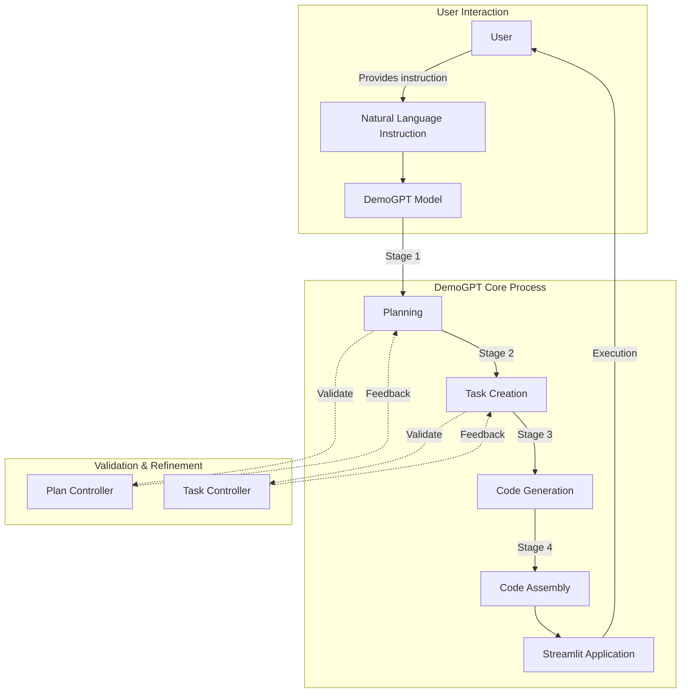
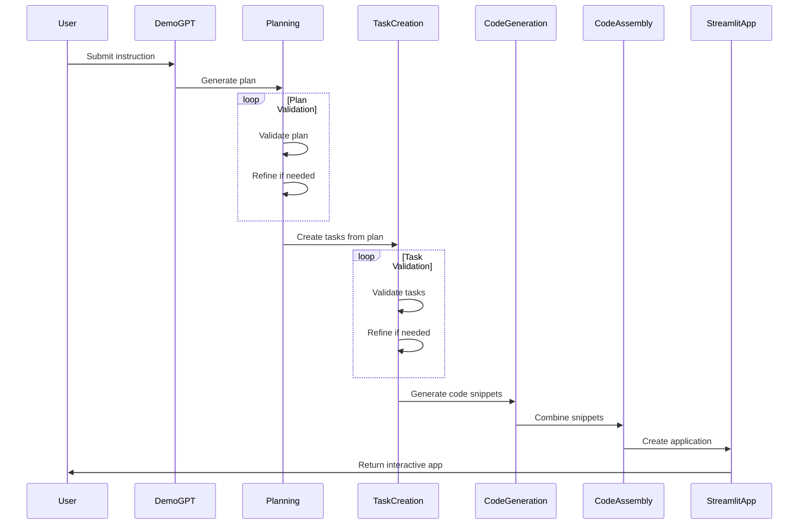
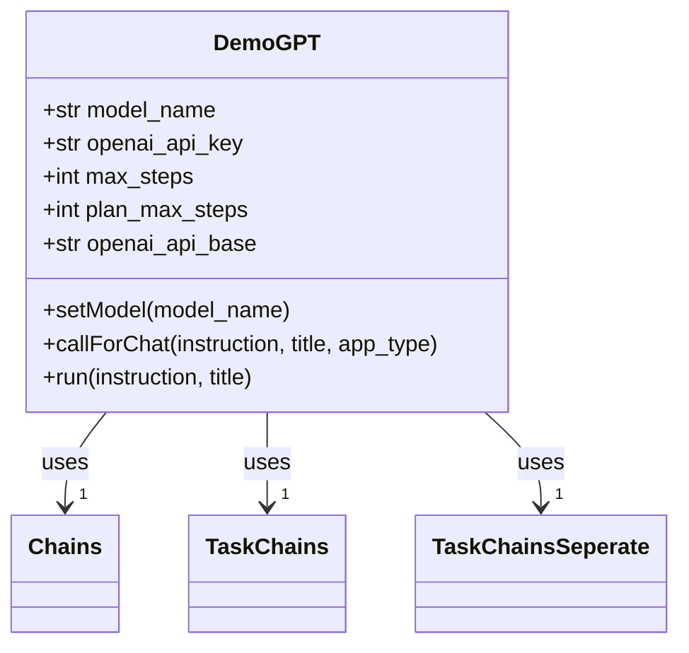
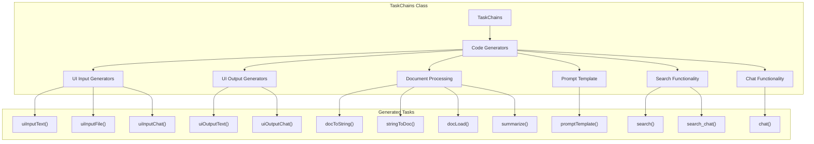
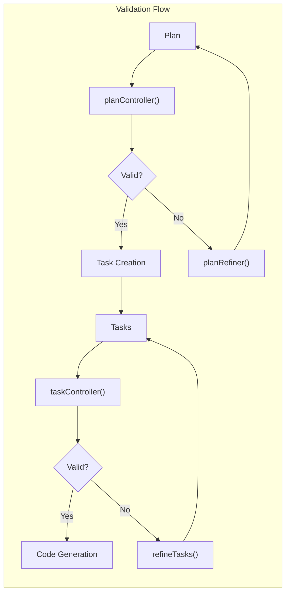

<!-- source: DeepWiki mcp.deepwiki.com · repo melih-unsal/DemoGPT · page 1 Overview · fetched 2026-10-26 -->

# Overview

Relevant source files

The following files were used as context for generating this wiki page:

- [README.md](README.md)
- [assets/demogpt_new_pipeline.jpeg](assets/demogpt_new_pipeline.jpeg)
- [assets/demogpt_new_pipeline1.jpeg](assets/demogpt_new_pipeline1.jpeg)
- [demogpt/app.py](demogpt/app.py)
- [demogpt/chains/chains.py](demogpt/chains/chains.py)
- [demogpt/chains/prompts/task_list/search.py](demogpt/chains/prompts/task_list/search.py)
- [demogpt/chains/prompts/task_list/search_chat.py](demogpt/chains/prompts/task_list/search_chat.py)
- [demogpt/chains/task_chains.py](demogpt/chains/task_chains.py)
- [demogpt/model.py](demogpt/model.py)
- [demogpt/utils.py](demogpt/utils.py)
- [docs/README_CN.md](docs/README_CN.md)
- [pyproject.toml](pyproject.toml)

DemoGPT is an open-source system that automatically generates LangChain-based Streamlit applications from natural language instructions. It serves as a comprehensive agent library, enabling users to create functional AI-powered applications by simply describing what they want to build, without writing any code themselves.

This document provides a technical overview of the DemoGPT system, explaining its core architecture, components, and the processing pipeline that transforms natural language instructions into executable Streamlit applications. For specific usage instructions and examples, see [Usage and Examples](#5).

## Core Purpose and Capabilities

DemoGPT was designed to democratize the creation of LLM-powered applications by abstracting away the complexities of coding. The system takes a user's natural language instruction and converts it into a fully functional Streamlit application that leverages LangChain for interacting with large language models.

Key capabilities include:

- Transformation of natural language instructions into executable code
- Generation of interactive Streamlit user interfaces
- Integration with various LLMs through LangChain
- Support for document processing, chat functionality, and web search
- Self-refinement of generated code

Sources: [README.md:88-115](), [pyproject.toml:8]()

## System Architecture

The DemoGPT system follows a plan-based pipeline architecture that systematically transforms user instructions into functional applications through a series of well-defined stages.

The system is composed of several key components:

1. **DemoGPT Model**: The central orchestrator that manages the entire process
2. **Chains**: Handle different aspects of the generation process, such as planning and task creation
3. **Task Chains**: Generate code snippets for specific task types
4. **Controllers**: Validate plans and tasks, providing feedback for refinement

Sources: [README.md:120-122](), [demogpt/model.py:18-90](), [demogpt/chains/chains.py:20-43]()

## Processing Pipeline

DemoGPT transforms user instructions into Streamlit applications through a four-stage pipeline:

### 1. Planning

The planning stage takes the user's natural language instruction and generates a structured plan. The system analyzes the instruction to understand the user's requirements and creates a sequential list of steps needed to build the application.

Sources: [demogpt/model.py:122-133](), [demogpt/chains/chains.py:122-130]()

### 2. Task Creation

Once a plan is created and validated, it is broken down into specific tasks. Each task represents a specific functionality or component of the application, such as input fields, processing logic, or output displays.

Sources: [demogpt/model.py:162-183](), [demogpt/chains/chains.py:158-171]()

### 3. Code Generation

In this stage, each task is translated into a code snippet. The system uses specialized task chains to generate code for different types of functionality, such as UI elements, document processing, and AI interactions.

Sources: [demogpt/model.py:255-257](), [demogpt/utils.py:248-314]()

### 4. Code Assembly

Finally, the individual code snippets are combined into a complete Streamlit application. The system handles imports, function definitions, and the main application flow, ensuring that all components work together correctly.

Sources: [demogpt/model.py:280-294](), [demogpt/model.py:550-562]()

## Core Components

### DemoGPT Model

The `DemoGPT` class in `model.py` serves as the main orchestrator of the application generation process. It initializes the necessary components, manages the pipeline flow, and handles errors and edge cases.

The model orchestrates the entire process, communicating with various chains to generate plans, tasks, and code.

Sources: [demogpt/model.py:18-562]()

### Chains System

The chains system in `chains/chains.py` handles different aspects of the application generation process. It provides methods for planning, task creation, code assembly, and refinement.

Key methods include:
- `planWithInputs`: Generates a plan from the user's instruction
- `tasks`: Creates tasks from the plan
- `combine`: Assembles code snippets into a complete application

Sources: [demogpt/chains/chains.py:122-130](), [demogpt/chains/chains.py:158-171](), [demogpt/chains/chains.py:199-207]()

### Task Chains

The task chains system in `chains/task_chains.py` is responsible for generating code snippets for specific task types. It provides specialized methods for different kinds of functionality, such as:

- UI elements (input fields, output displays)
- Document processing
- LLM interactions
- Search functionality

The task chains use LangChain and OpenAI models to generate appropriate code for each task type.

Sources: [demogpt/chains/task_chains.py:16-390](), [demogpt/utils.py:282-314]()

### Controllers

Controllers validate plans and tasks, ensuring they meet the requirements for the application. They provide feedback for refinement when necessary.

The validation process ensures that the generated plans and tasks are feasible and meet the requirements specified in the user's instruction.

Sources: [demogpt/model.py:146-160](), [demogpt/model.py:440-467](), [demogpt/chains/chains.py:174-177](), [demogpt/chains/chains.py:178-180]()

## Integration with External Systems

### LangChain Integration

DemoGPT heavily integrates with LangChain, using its components for:
- Creating chains with LLMs
- Building prompt templates
- Managing conversation memory
- Implementing document loaders and processors

The system leverages LangChain's capabilities to create powerful AI applications without requiring users to understand the underlying complexities.

Sources: [demogpt/chains/task_chains.py:3-10](), [demogpt/utils.py:404-425](), [demogpt/utils.py:567-588]()

### OpenAI API Integration

DemoGPT uses OpenAI's models for generating code and handling AI interactions. It allows users to specify their OpenAI API key and model preference, supporting various GPT models.

Sources: [demogpt/chains/chains.py:34-40](), [demogpt/chains/task_chains.py:26-32](), [demogpt/model.py:33-35]()

### Streamlit Integration

The final output of DemoGPT is a Streamlit application. The system generates Streamlit code that handles the UI, user interactions, and backend processing. It also provides a Streamlit interface for using DemoGPT itself.

Sources: [demogpt/app.py:1-216](), [demogpt/utils.py:682-716]()

## System Requirements

DemoGPT requires:
- Python 3.8.1 or higher
- OpenAI API key
- Required packages:
  - streamlit
  - langchain
  - openai
  - tiktoken
  - other dependencies listed in pyproject.toml

Sources: [pyproject.toml:17-35](), [README.md:123-148]()

## Conclusion

DemoGPT represents a sophisticated system for automatically generating LangChain-based Streamlit applications from natural language instructions. Its pipeline approach, with planning, task creation, code generation, and assembly stages, allows it to create complex applications with minimal user input. By leveraging LangChain, OpenAI, and Streamlit, DemoGPT simplifies the development of AI-powered applications, making them accessible to users without programming expertise.

---

